# 02 — Architecture and Technical Design

System, database, API, security and infrastructure design for the Fidero platform.

| Item | Value |
|---|---|
| Document | 02 of 6 in `docs/specs/` |
| Version | 0.1, working draft |
| Date | 31 October 2026 |
| Owner | Product and engineering lead (to be hired; founder acts until then) `[TO VERIFY]` |
| Status | Draft. For review. Not yet baselined |
| Source of truth | `docs/specs/01-requirements-and-product-specification.md` (document 01) |
| Supersedes | `docs/product/architecture.md` (kept as the original proposal; this document deepens it and keeps its principles) |
| Related | Document 05 (tests and traceability), document 06 (delivery, CI/CD and operations) |

Every figure in this document is a working assumption, not verified data. Unknown numbers and unmade choices are marked `[TO VERIFY]`. Vendors named here are candidates only.

## 0. How this document traces to document 01

- Every design element names the IDs it serves from document 01: business requirements (BR-), features (F-), functional requirements (FR-<MODULE>-nnn), non-functional requirements (NFR-), business rules (RUL-), interfaces (IF-) and constraints (C-).
- This document adds its own IDs: ADR- (architecture decisions), G- (architecture goals), TQ- (open technical questions), TR- (technical risks) and I-01 (issues found in document 01). It never creates new FR IDs.
- Section 13 maps every FR module to components, tables and endpoints. Section 12 maps every NFR to design measures. Document 05 carries the test traceability.
- Where document 01 is silent or inconsistent, the gap is listed in section 15 and not fixed here.

### Change log

| Version | Date | Change | Author |
|---|---|---|---|
| 0.1 | 31 October 2026 | First draft | Product and engineering lead (acting) |

### Release staging of the architecture

Nothing in this document is built in R0. R0 runs on spreadsheets, templates and a payment link.

| Release | Months | Architecture that ships |
|---|---|---|
| R0 | 0-3 | None. Landing page and payment link only |
| R1 | 3-9 | API, portal, back office, PostgreSQL/PostGIS, evidence store, Celery workers, modules ACC, ORD, PAY, CASE, RPT, GEO (overlays, images), ESC (manual bank entry), EVD, NTF, ADM, AUD, ANL, DPR, shared kernel |
| R2 | 9-18 | Android app, MOB, BLD, PRJ, LST, RAT, DSP, PTR, bank statement file and API adapters, satellite monitoring |
| R3 | 18-36 | REC, family and stool listings, materials ordering, CTY with a second country pack and, if required, a second regional deployment |

---

## 1. Architecture goals

| ID | Goal | Traces to |
|---|---|---|
| G-01 | Make it impossible for the platform to receive or hold client purchase, construction or project money. | C-01, RUL-01, FR-PAY-005, BO-07 |
| G-02 | Release nothing without recorded evidence and two distinct human approvers. | RUL-03, RUL-05, RUL-06, RUL-09, RUL-11 |
| G-03 | Make evidence and the audit trail tamper-evident from capture to report. | BR-06, FR-EVD-*, FR-MOB-004, FR-AUD-004 |
| G-04 | Work on slow connections and low-end Android phones. | C-08, NFR-PERF-01, NFR-PERF-02, NFR-PERF-05 |
| G-05 | Add a product line or country by configuration, not code. | BR-14, NFR-MNT-02, FR-ADM-001, FR-CTY-001 |
| G-06 | Be small enough for a team of two or three to build and run. | C-07 |
| G-07 | Keep a manual fallback for every external dependency. | AS-02 to AS-07, IF-01 to IF-09 |
| G-08 | Protect personal data under Act 843 and isolate safety data. | C-02, C-09, BR-15, NFR-PRIV-01, NFR-PRIV-02, RUL-17 |

## 2. Architecture decision records

Each record is short. A decision changes only through a new ADR that supersedes it.

### ADR-01 Modular monolith in Django

| Part | Content |
|---|---|
| Context | Small team (C-07). 22 SRS modules with heavy cross-module rules (a release depends on reports, disputes, fresh searches and inspections). Strong consistency is needed for money-related state. |
| Decision | One Python 3.12 / Django 5 + Django REST Framework codebase. One Django app per SRS module. One PostgreSQL database. Modules call each other only through a public `services.py` interface and domain events. Import rules are checked in CI with an import-linter contract. |
| Consequences | One deploy unit, one transaction boundary, simple local development. Risk of a "big ball of mud" is managed by the import contracts and table ownership (section 4). A module can be split out later if load demands it. |
| Alternatives rejected | Microservices (too much operations load, distributed transactions around releases). Serverless functions (hard to keep two-person approval and audit consistent). |
| Traces | C-07, NFR-MNT-01, NFR-MNT-02 |

### ADR-02 PostgreSQL 16 with PostGIS 3 as the single system of record

| Part | Content |
|---|---|
| Context | Overlay checks, overlap checks and spatial partner queries need real geometry (FR-GEO-*). Business rules must hold even if application code has a bug. |
| Decision | Amazon RDS for PostgreSQL 16, Multi-AZ, with PostGIS 3. Tables are prefixed by module code (`esc_`, `rpt_`, …). Key rules are enforced again in the database with check constraints, triggers and restricted roles (defence in depth). |
| Consequences | One store to back up and restore. Spatial queries in SQL. Triggers must be tested like code (document 05). |
| Alternatives rejected | Separate spatial service (extra moving part). Document database (weak constraints for money-related state). |
| Traces | BR-04, NFR-PERF-04, NFR-SCL-01, NFR-AVL-02 |

### ADR-03 No money-holding model in the platform

| Part | Content |
|---|---|
| Context | Fidero never holds client money (C-01, RUL-01). A design that has a "balance" or "wallet" invites misuse and regulatory risk. |
| Decision | There is no balance, wallet, ledger or pooled-account table. The ESC module is a mirror of what the bank reports. Amounts in ESC are recorded facts from the bank, never computed balances Fidero controls. PAY handles only Fidero's own fees, and its `purpose` column is limited by a check constraint to fee types. Payment instructions shown to clients come only from the escrow partner's record. The payment provider merchant account is configured for fee products only. |
| Consequences | No code path can take purchase money. Reconciliation of escrow is a matching exercise against bank data, not an accounting system. |
| Alternatives rejected | Fidero-held client account (prohibited by C-01). Payment-provider split payouts for purchase money (still moves client money through Fidero's merchant account). |
| Traces | C-01, RUL-01, FR-PAY-005, FR-ESC-003, BO-07 |

### ADR-04 Evidence in S3 with Object Lock in compliance mode

| Part | Content |
|---|---|
| Context | Evidence must never be overwritten or silently deleted (FR-EVD-002) and must have two copies in separate locations (NFR-AVL-03). |
| Decision | A dedicated S3 bucket with versioning and Object Lock in compliance mode. Each object gets a retain-until date from its data class (section 6.10). SHA-256 checksums are sent with each upload and checked by S3. Cross-region replication to a second region `[TO VERIFY]` with its own Object Lock. The database stores the hash and metadata; S3 stores the bytes. |
| Consequences | Nobody, including the AWS root user, can delete a locked object before its date. Retention can be extended but never shortened, so periods must be set to the agreed minimum (Q-08). |
| Alternatives rejected | Database blobs (cost and backup size). Governance mode (privileged users can bypass it). |
| Traces | BR-06, FR-EVD-001, FR-EVD-002, NFR-AVL-03 |

### ADR-05 Append-only, hash-chained audit log in PostgreSQL

| Part | Content |
|---|---|
| Context | No application user may edit or delete audit entries (FR-AUD-002). Tampering must be detectable (FR-AUD-004). |
| Decision | `aud_event` is written only through a `SECURITY DEFINER` function in the same transaction as the change. Each row stores the SHA-256 of the previous row's hash plus its own canonical content. The application database role has no UPDATE or DELETE right, and a trigger rejects both. The chain head is anchored hourly to an Object Lock bucket. Audit rows hold IDs and field names, not personal data values, so anonymisation never breaks the chain. |
| Consequences | Serialised writes to the chain (an advisory lock). Throughput is ample for the expected load `[TO VERIFY]` under load test. |
| Alternatives rejected | Separate ledger database (extra service and cost). Logs only in CloudWatch (not queryable by case, no chain). |
| Traces | BR-15, FR-AUD-001 to FR-AUD-004, NFR-AUD-01 |

### ADR-06 Native Android app, offline-first, with device-key signing

| Part | Content |
|---|---|
| Context | Contractors use low-end Android phones with patchy signal (C-08, AS-08). Evidence must be camera-only and signed on the device (RUL-08, FR-MOB-004). |
| Decision | Kotlin and Jetpack Compose. CameraX for capture. Room for the local queue. WorkManager for background upload. An ECDSA P-256 key generated in Android Keystore (hardware-backed where available) signs each item. No iPhone app before R2 data (Q-09). |
| Consequences | Full control of camera, keystore and background work. A second platform later means a second app. |
| Alternatives rejected | Progressive web app (no reliable background upload, no keystore, gallery cannot be fully blocked). Cross-platform frameworks (extra layer over camera and keystore, larger install size against NFR-PERF-05). |
| Traces | RUL-08, FR-MOB-001 to FR-MOB-011, NFR-PERF-05 |

### ADR-07 Two Next.js apps over one API

| Part | Content |
|---|---|
| Context | Listings must be indexable and fast on 3G (FR-LST-010). Staff need a dense, secure back office. |
| Decision | One TypeScript monorepo with two Next.js apps: `portal` (clients, sellers, developers, public listings, server-side rendered) and `backoffice` (staff, professionals, administrators). Both call the same `/v1` API. Shared UI library and generated API client from the OpenAPI document. |
| Consequences | Separate hostnames allow separate WAF rules, cookie scopes and content security policies. Two builds to maintain. |
| Alternatives rejected | Django templates (weaker phone-first interactivity). One app for all users (larger attack surface on the public site). |
| Traces | NFR-PERF-01, NFR-PERF-02, NFR-ACC-01, FR-LST-010 |

### ADR-08 Celery and Redis for background work, with a transactional outbox

| Part | Content |
|---|---|
| Context | Overlay checks, PDF rendering, notifications, scans and bank dispatch must not block requests. Events must not be lost if a worker crashes. |
| Decision | Celery workers and Celery beat with Redis 7 (ElastiCache) as broker and cache. Domain events are written to `core_outbox_event` in the same transaction as the change. A relay task publishes them. Consumers record processed event IDs and are idempotent. |
| Consequences | At-least-once delivery. Every task must be safe to run twice. |
| Alternatives rejected | Managed queue services (fine, but a second broker to learn). Synchronous calls (latency and failure coupling). |
| Traces | NFR-PERF-03, NFR-PERF-04, NFR-OBS-01 |

### ADR-09 AWS af-south-1 as working primary region

| Part | Content |
|---|---|
| Context | Data location under Act 843 is unresolved (C-09, Q-07, NFR-PRIV-01). AWS has no Ghana region. |
| Decision | Working assumption: primary region af-south-1 (Cape Town) `[TO VERIFY]` pending Q-07. Backups copied to a second region `[TO VERIFY]`. All infrastructure is in Terraform with region as a variable, so a move is a redeploy and data migration, not a redesign. Every data location is recorded in `dpr_data_location`. |
| Consequences | If the ruling requires hosting in Ghana, an in-country provider or colocation is needed (TR-01). |
| Alternatives rejected | Hosting in Europe (lower cost, but further from users and not yet accepted by the regulator `[TO VERIFY]`). Self-hosting in Accra now (operations load against C-07). |
| Traces | C-09, NFR-PRIV-01, FR-CTY-002 |

### ADR-10 Ports and adapters for integrations, manual path always present

| Part | Content |
|---|---|
| Context | Bank, payment, identity, map and messaging partners are not chosen (Q-01 to Q-03). Some may never offer APIs (AS-03, AS-07). |
| Decision | Each integration is a port (Python protocol) with one or more adapters: `manual`, `file` and `api`. The manual adapter always exists and needs an attached proof document. The active adapter is chosen per partner and country in ADM. |
| Consequences | Features ship before a partner API exists. Switching vendors touches one adapter. |
| Alternatives rejected | Direct vendor SDK calls inside modules (lock-in, untestable). |
| Traces | IF-01 to IF-09, AS-02 to AS-07, NFR-MNT-02 |

### ADR-11 Configuration as versioned, immutable data

| Part | Content |
|---|---|
| Context | Templates, condition sets, milestone schedules, prices, legal texts and country packs change over time, but a case must always show the version it used. |
| Decision | `adm_config_version` stores each configuration item as JSON with a schema, a content hash and a state (draft, published, retired). Published versions never change. Cases, reports, escrows and projects store the exact version ID used. The scope statement is a locked text version that needs two administrators and recorded lawyer and insurer approval (FR-ADM-004). |
| Consequences | No code change for a new line or country (NFR-MNT-02). JSON schemas must be versioned too. |
| Alternatives rejected | Hard-coded templates (P-14 frustration). Mutable configuration rows (old cases would change). |
| Traces | FR-ADM-001 to FR-ADM-005, FR-CASE-001, FR-RPT-001, FR-RPT-004, FR-CTY-001, RUL-04 |

### ADR-12 One approval component for every two-person rule

| Part | Content |
|---|---|
| Context | Two-person approval appears in report release (RUL-03), escrow release and cancellation (RUL-05, FR-ESC-013), refunds (FR-PAY-004), scope-text change (FR-ADM-004) and bulk export (FR-DPR-005). |
| Decision | A shared `core_approval_request` and `core_approval` pair. The database rejects a second approval from the same person and an approval from the person who prepared the request. Approvals need a fresh MFA step-up (within 5 minutes, assumption). Each subject type declares the roles each approval slot needs. |
| Consequences | One tested implementation. Approver names are recorded for the bank instruction (FR-ESC-008). |
| Alternatives rejected | Per-module approval code (inconsistent, harder to test against RUL-05). |
| Traces | RUL-03, RUL-05, RUL-11, FR-ESC-007, FR-RPT-006, FR-DPR-005, FR-ADM-004 |

### ADR-13 Authentication by channel

| Part | Content |
|---|---|
| Context | Four front ends with different risk (C1 in document 01). |
| Decision | Web apps: server-side sessions in HttpOnly, Secure, SameSite=Lax cookies scoped per app hostname, with CSRF tokens. Clients sign in with email or phone and a password or one-time code. Staff, professionals and approvers must use TOTP or WebAuthn. Mobile: short-lived JWT access tokens (10 minutes, assumption) and rotating refresh tokens with reuse detection. Partner API: OAuth 2.0 client credentials with per-partner scopes and rate limits. Passwords hashed with Argon2id. |
| Consequences | Three token types to test. Tokens never stored in browser local storage. |
| Alternatives rejected | JWT in browser storage (theft by script injection). External identity platform (cost and data location questions) `[TO VERIFY]` if needed later. |
| Traces | FR-ACC-001 to FR-ACC-003, FR-ACC-009, NFR-SEC-02, FR-PTR-004 |

### ADR-14 Multi-country by configuration, with regional cells when law demands

| Part | Content |
|---|---|
| Context | Nigeria pilot in R3 (BR-14). Each country may require its data at home (FR-CTY-002). |
| Decision | Every country-scoped row carries `country_code`. Country packs (templates, scope text, layers, currency, licence bodies, partners) are configuration. If a country's law requires local hosting, the same code is deployed as a separate regional cell with its own database; a thin directory service routes users by country. |
| Consequences | One codebase. Cross-country analytics use aggregated, anonymised extracts only. |
| Alternatives rejected | Separate code fork per country (breaks "one engine"). |
| Traces | BR-14, FR-CTY-001 to FR-CTY-003, NFR-MNT-02 |

### ADR-15 Deterministic PDFs with WeasyPrint and stored SHA-256

| Part | Content |
|---|---|
| Context | Clients and third parties must be able to check a report PDF against Fidero's record (FR-RPT-008). |
| Decision | Reports render from HTML templates with WeasyPrint in a worker, with fonts and images embedded and the render timestamp fixed to the release time. The SHA-256 of the exact bytes is stored in `rpt_report.pdf_sha256` and printed on a public check page, not inside the PDF itself. Released PDFs are stored in the Object Lock bucket. |
| Consequences | A re-render is never used for verification; only the stored bytes count. |
| Alternatives rejected | Headless browser rendering (heavier container). Hash printed inside the PDF (circular). |
| Traces | FR-RPT-007, FR-RPT-008, FR-RPT-010, BR-06 |

---

## 3. System context and containers

### 3.1 System context (C4 level 1)

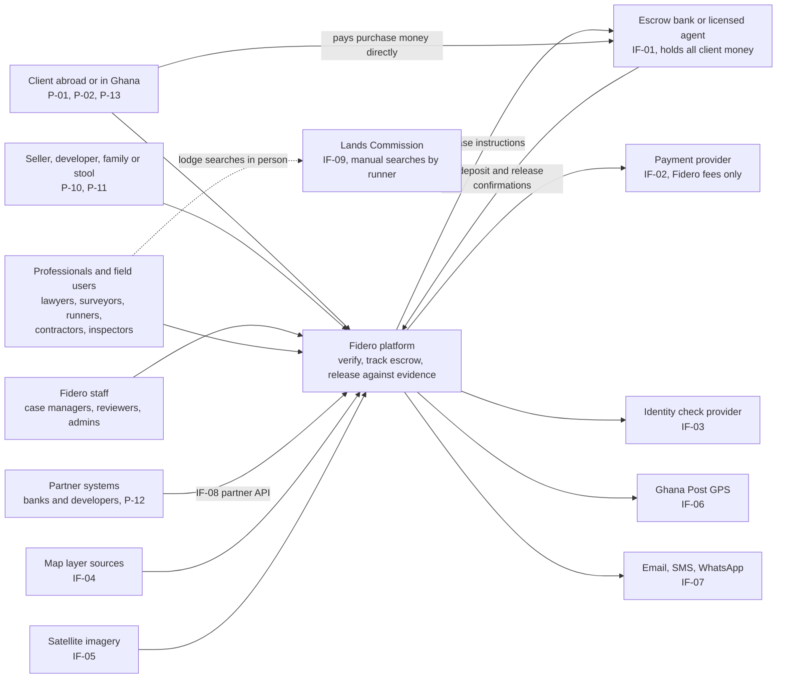

The client pays purchase, construction and project money straight to the bank. Fidero only sends instructions and records confirmations. The Lands Commission link is a person, not a system (AS-07).

### 3.2 Containers (C4 level 2)

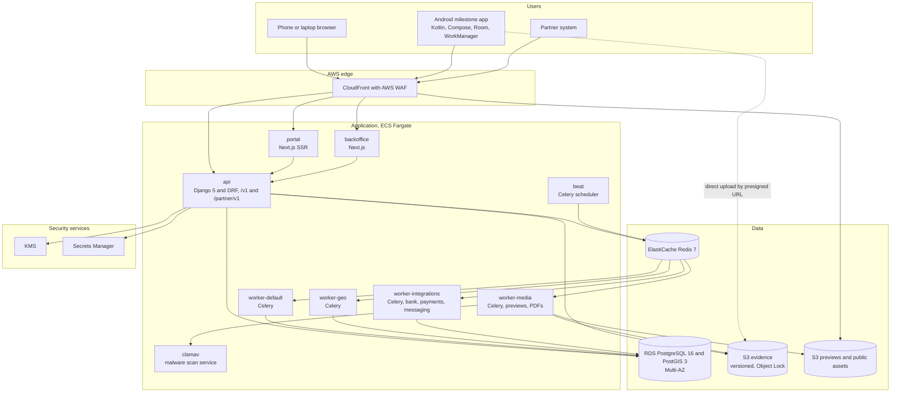

| Container | Technology | Purpose | Release |
|---|---|---|---|
| portal | Next.js, TypeScript, SSR | Client, seller and developer journeys; public listings | R1 (listings R2) |
| backoffice | Next.js, TypeScript | Staff, professionals and administrators; phone-first task pages | R1 |
| api | Django 5, DRF, Gunicorn with Uvicorn workers `[TO VERIFY]` | All business logic, `/v1` and `/partner/v1` | R1 (partner R2) |
| worker-default | Celery | Outbox relay, case creation, rules, track records | R1 |
| worker-geo | Celery with GDAL and PostGIS client | Overlay and overlap checks, imagery | R1 |
| worker-media | Celery with WeasyPrint, libvips, ffmpeg | Previews, video compression, PDF render | R1 |
| worker-integrations | Celery | Bank, payment, identity, messaging adapters | R1 |
| beat | Celery beat | Schedules in section 7.8 | R1 |
| clamav | ClamAV daemon | Scan every upload (FR-EVD-005) | R1 |
| Android app | Kotlin, Compose | Offline signed capture (FR-MOB-*) | R2 |
| PostgreSQL | RDS, Multi-AZ | System of record | R1 |
| Redis | ElastiCache | Broker, cache, rate-limit counters | R1 |
| S3 evidence | Versioning, Object Lock compliance, SSE-KMS | Evidence, released PDFs, audit anchors | R1 |
| S3 previews | SSE-KMS, served through CloudFront signed URLs | Resized images, listing media | R1 |

Uploads go straight from the client to S3 through presigned URLs. Files land in a quarantine prefix and move to the evidence prefix only after scan and hash checks.

---

## 4. Component view of the modular monolith

### 4.1 Rules for modules

1. One Django app per SRS module. Tables carry the module prefix.
2. A module writes only its own tables. It may read another module's tables only through that module's `selectors.py`.
3. A module calls another only through its `services.py`, or reacts to its events.
4. Cross-module foreign keys are allowed for integrity, with `ON DELETE RESTRICT`.
5. Every state change goes through the module's state machine, which writes the audit entry and the outbox event in the same transaction.
6. The shared kernel `core` holds identifiers, money and country types, the outbox, idempotency keys, approvals and allowed transitions. It depends on no module.

### 4.2 Module catalogue

| Module | Django app | Responsibilities | Owned tables (main) | Publishes | Consumes | FR IDs | Rel. |
|---|---|---|---|---|---|---|---|
| ACC | `accounts` | Sign-up, sign-in, MFA, lockout, roles and scoped grants, organisations, licences, identity checks, representatives | `acc_person`, `acc_credential`, `acc_mfa_device`, `acc_refresh_token`, `acc_role_grant`, `acc_organisation`, `acc_membership`, `acc_professional_licence`, `acc_identity_check`, `acc_representative_grant` | `person.registered`, `identity_check.completed`, `licence.expired`, `account.locked` | `config.published` | FR-ACC-001 to 011 | R1 |
| ORD | `orders` | Orders, tier quote, terms acceptance, lead source, referrals, extra inspection orders | `ord_order`, `ord_terms_acceptance`, `ord_referral_code`, `ord_referral_reward` | `order.created`, `order.paid` | `payment.confirmed`, `payment.offline_recorded` | FR-ORD-001 to 007 | R1 |
| PAY | `payments` | Fidero fee payments only, receipts, refunds, settlement reconciliation, seller invoices | `pay_fee_payment`, `pay_receipt`, `pay_refund`, `pay_settlement_line`, `pay_recon_issue`, `pay_invoice` | `payment.confirmed`, `payment.failed`, `refund.approved` | `order.created`, `listing.submitted`, `listing.sold` | FR-PAY-001 to 007 | R1 |
| CASE | `cases` | Case lifecycle from templates, tasks, assignments, due dates, status messages, document requests, risk screens, safety incidents, costs, messages, fresh-search cases | `case_case`, `case_task`, `case_status_message`, `case_document_request`, `case_risk_screen`, `case_cost_item`, `case_message`, `safety.incident` | `case.created`, `case.status_changed`, `task.assigned`, `task.completed`, `task.overdue`, `fresh_search.completed` | `order.paid`, `listing.verification_requested`, `reservation.created`, `report.released` | FR-CASE-001 to 015 | R1 |
| RPT | `reports` | Report versions, sections, verdict rule, locked scope text, signatures, review approvals, PDF and hash, conditions, corrections, anonymised copies | `rpt_report`, `rpt_section`, `rpt_condition`, `rpt_signature`, `rpt_hash_check` | `report.submitted`, `report.released`, `report.corrected` | `overlay.completed`, `case.status_changed` | FR-RPT-001 to 011 | R1 |
| GEO | `geo` | Assets and boundaries, overlay layers and results, overlaps, satellite images, monitoring, Ghana Post GPS | `geo_asset`, `geo_boundary_version`, `geo_overlay_layer`, `geo_overlay_layer_version`, `geo_overlay_feature`, `geo_overlay_result`, `geo_overlap_flag`, `geo_satellite_image`, `geo_monitoring_alert` | `asset.boundary_saved`, `overlay.completed`, `overlap.flagged`, `monitoring.alert_raised`, `monitoring.alert_resolved` | `listing.live`, `project.started` | FR-GEO-001 to 008 | R1 |
| ESC | `escrow` | Escrow mirror, parties, acceptances, bank payment instructions, conditions, bank events, release and cancel instructions, dispatch, statement import | `esc_escrow`, `esc_party`, `esc_acceptance`, `esc_condition`, `esc_bank_event`, `esc_release_instruction`, `esc_statement_file`, `esc_statement_line` | `escrow.agreed`, `escrow.funded`, `escrow.ready`, `release.approved`, `release.sent`, `release.confirmed`, `escrow.cancelled` | `report.released`, `dispute.opened`, `dispute.resolved`, `fresh_search.completed`, `milestone.client_approved`, `reservation.created` | FR-ESC-001 to 013 | R1 |
| EVD | `evidence` | Upload slots, hashing, scan, previews, signed links, links to subjects, provenance, integrity sampling | `evd_evidence`, `evd_link`, `evd_preview`, `evd_scan_result` | `evidence.stored`, `evidence.rejected` | none | FR-EVD-001 to 006 | R1 |
| MOB | `mobile` | Device registry and keys, sync, signed manifest checks, submissions, fraud flags | `mob_device`, `mob_signed_manifest`, `mob_submission`, `mob_submission_item`, `mob_fraud_flag` | `submission.received`, `evidence.flagged`, `flags.cleared` | `milestone.status_changed`, `task.assigned` | FR-MOB-001 to 011 | R2 |
| BLD | `construction` | Projects of all three types, bill of quantities, milestones, panel, conflict links, inspector assignment, inspections, defects, retention, re-pricing, variations, dashboard, off-plan checks, materials (R3) | `bld_project`, `bld_boq`, `bld_milestone`, `bld_panel_member`, `bld_conflict_link`, `bld_inspection`, `bld_inspection_item`, `bld_defect`, `bld_variation`, `bld_reprice`, `bld_materials_order` | `project.started`, `milestone.status_changed`, `milestone.client_approved`, `inspection.recorded`, `contractor.removed` | `submission.received`, `flags.cleared`, `release.confirmed`, `dispute.opened` | FR-BLD-001 to 013 | R2 |
| PRJ | `projectfunds` | Project funds on the shared project and milestone engine, suppliers, background checks, invoices, AML threshold, disclaimer | `prj_supplier`, `prj_background_check`, `prj_invoice`, `prj_aml_review` | `supplier.checked`, `invoice.accepted` | `milestone.status_changed`, `release.confirmed` | FR-PRJ-001 to 005 | R2 |
| LST | `listings` | Listings, publish rule, badge, search, enquiries, reservations, removal, family and stool listings (R3) | `lst_listing`, `lst_listing_media`, `lst_enquiry`, `lst_reservation`, `lst_removal` | `listing.submitted`, `listing.verification_requested`, `listing.live`, `listing.suspended`, `reservation.created`, `listing.sold` | `payment.confirmed`, `report.released`, `monitoring.alert_raised`, `release.confirmed`, `dispute.opened` | FR-LST-001 to 010 | R2 |
| RAT | `ratings` | Ratings, hidden comments, track records | `rat_rating`, `rat_track_record` | `track_record.updated` | `case.status_changed`, `milestone.status_changed`, `dispute.closed`, `release.confirmed` | FR-RAT-001 to 004 | R2 |
| DSP | `disputes` | Disputes, parties, statements, deadlines, decisions, mediation, freeze links | `dsp_dispute`, `dsp_party`, `dsp_statement`, `dsp_subject_link` | `dispute.opened`, `dispute.resolved`, `dispute.closed` | none | FR-DSP-001 to 005 | R2 |
| PTR | `partners` | Partner API clients, scopes, status queries, partner orders, metering, webhooks | `ptr_api_client`, `ptr_usage_event`, `ptr_webhook_subscription`, `ptr_webhook_delivery` | `partner.order_created` | `report.released`, `consent.changed` | FR-PTR-001 to 004 | R2 |
| NTF | `notifications` | Templates per language and channel, preferences, sends, content policy, delivery log | `ntf_template`, `ntf_preference`, `ntf_message`, `ntf_delivery_event` | none | most events | FR-NTF-001 to 005 | R1 |
| ADM | `administration` | Versioned configuration, prices, FX guides, partner registry, locked texts, settings | `adm_config_version`, `adm_price`, `adm_fx_rate`, `adm_partner`, `adm_locked_text_version`, `adm_setting` | `config.published` | none | FR-ADM-001 to 005 | R1 |
| AUD | `audit` | Append-only hash-chained audit log, anchors, search, chain checks | `aud_event`, `aud_anchor` | none | written in-transaction, not by events | FR-AUD-001 to 004 | R1 |
| ANL | `analytics` | Metric views, dashboard API, CSV exports with logging | `anl_*` materialised views, `anl_export_log` | none | reads selectors only | FR-ANL-001 to 003 | R1 |
| DPR | `dataprotection` | Privacy notice acceptance, consents including video and partner sharing, subject requests, retention, legal holds, bulk exports, data catalogue, data locations | `dpr_privacy_acceptance`, `dpr_consent`, `dpr_request`, `dpr_retention_rule`, `dpr_legal_hold`, `dpr_bulk_export`, `dpr_data_catalogue`, `dpr_data_location` | `consent.changed` | `person.registered` | FR-DPR-001 to 005 | R1 |
| REC | `records` | Traditional authority records, allottees, matching, revenue share, authority confirmation | `rec_authority`, `rec_allocation`, `rec_allottee`, `rec_match`, `rec_revenue_share` | `record.matched` | `asset.boundary_saved`, `case.status_changed` | FR-REC-001 to 004 | R3 |
| CTY | `countries` | Country registry, country packs, data location per country, routing directory | `cty_country`, `cty_country_pack`, `cty_directory` | `country.activated` | `config.published` | FR-CTY-001 to 003 | R3 (country column from R1) |
| core | `core` | Outbox, idempotency, approvals, allowed transitions, base types | `core_outbox_event`, `core_consumed_event`, `core_idempotency_key`, `core_approval_request`, `core_approval`, `core_allowed_transition` | all events via outbox | none | supports all | R1 |

### 4.3 Module dependencies

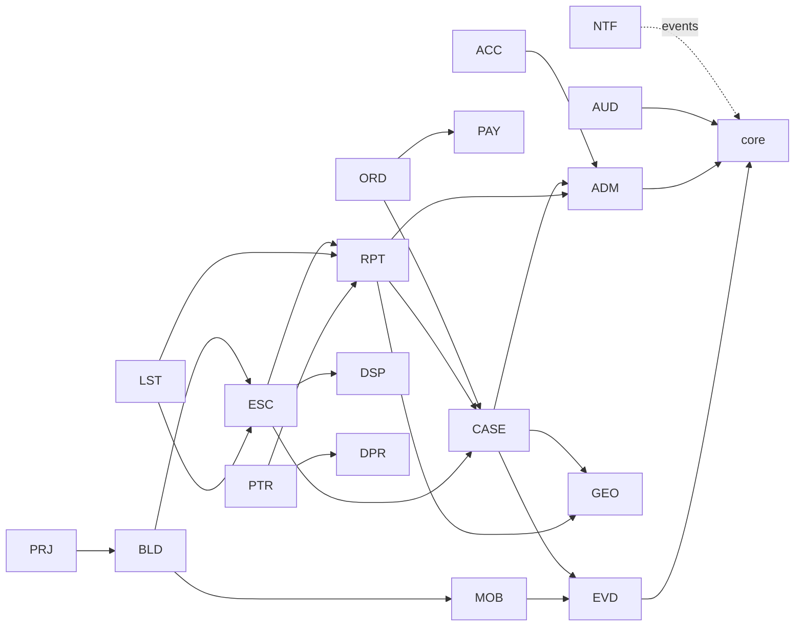

Arrows show "calls the services of". Events flow the other way through the outbox. Cycles are rejected by the import-linter contract in CI.

---

## 5. Key sequences

All write calls carry an `Idempotency-Key`. Every state change writes an audit entry and an outbox event in the same transaction. These are left out of the diagrams unless they matter.

### 5.1 Order and pay (J-01)

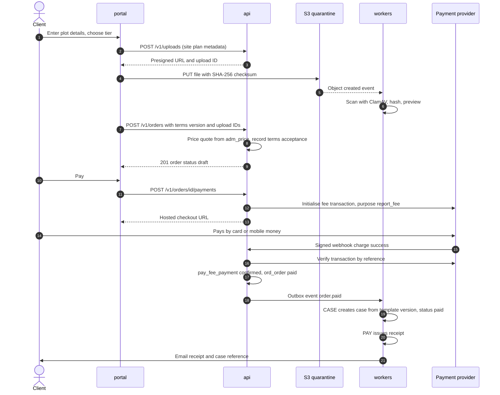

FR-ORD-001 to 005, FR-PAY-001, FR-PAY-003, FR-CASE-001, FR-EVD-005. No case exists until payment is confirmed (FR-ORD-004). An offline payment follows the same path from step 15, started by a case manager with proof attached.

### 5.2 Report review and release with hash (J-01 steps 5 to 7)

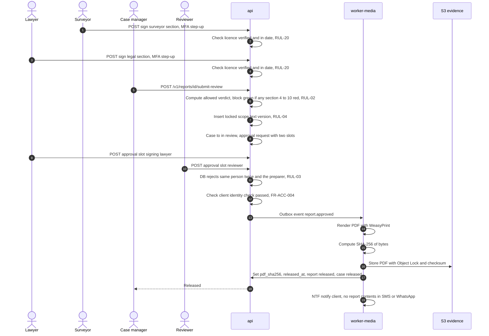

A reviewer can return the report instead, which moves the case back to in progress. A correction after release creates a new report version that supersedes the old one (FR-RPT-010).

### 5.3 Escrow release with two-person approval and bank instruction (J-02)

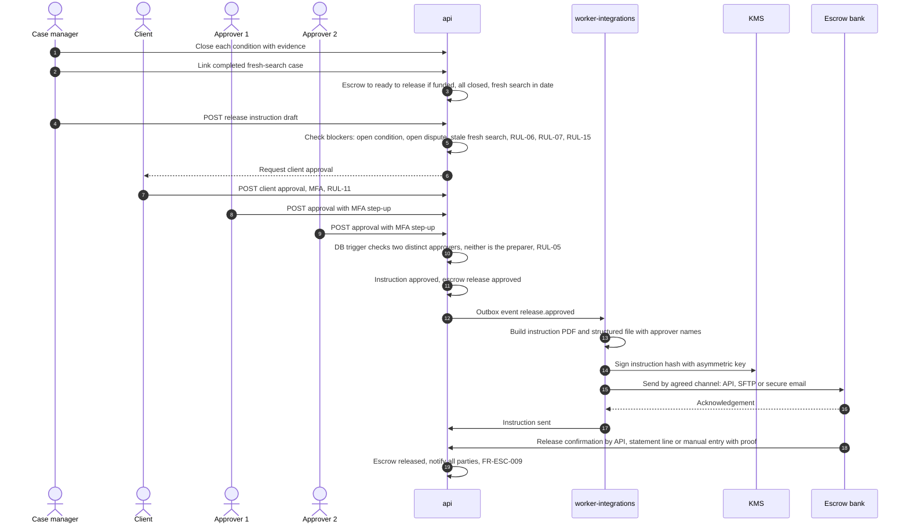

Every blocker is checked again inside the database trigger before the instruction can leave the approved state (section 6.5). If a dispute opens after approval but before dispatch, the dispatcher re-checks and stops (TQ-05).

### 5.4 Milestone capture to release (J-03)

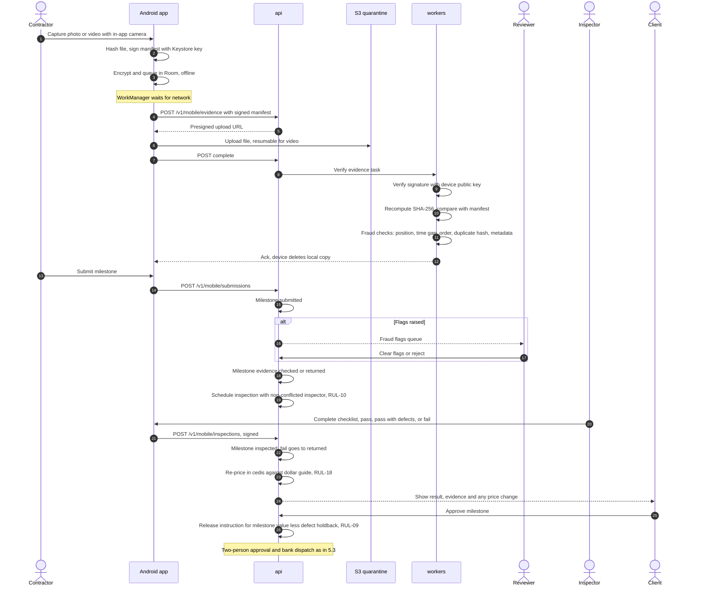

### 5.5 Listing publish and reservation with fresh search (J-04)

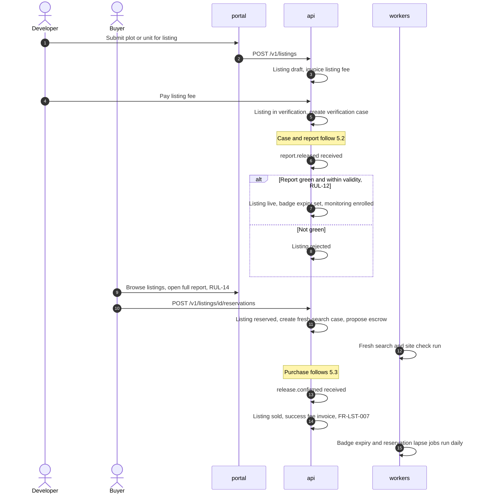

### 5.6 Partner plot status with consent check (J-06)

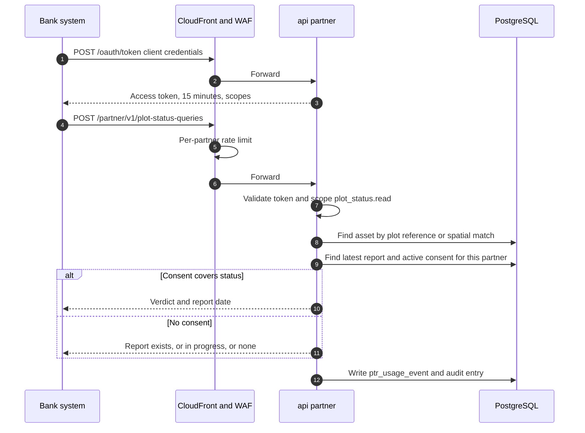

The full report is returned only with a specific consent for that partner and that report (FR-PTR-002, RUL-16).

---

## 6. Database design

### 6.1 Conventions

| Topic | Rule |
|---|---|
| Engine | PostgreSQL 16 with PostGIS 3 and `pgcrypto`, on RDS Multi-AZ |
| Keys | `uuid` primary keys generated in the application (time-ordered UUID version 7). Human references such as `FDR-GH-2027-00042` in a separate unique column |
| Time | `timestamptz` in UTC. Display converts to the user's zone and Ghana time (C3) |
| Money | `numeric(18,2)` plus `char(3)` ISO 4217 currency. Never floating point |
| Country | `char(2)` ISO 3166-1 `country_code` on every country-scoped row, foreign key to `cty_country` |
| State | `text` column `status` with a CHECK list matching document 01 C8, plus the generic transition trigger (6.3) |
| Concurrency | `row_version int` for optimistic locking; API uses ETag and If-Match |
| Personal data | Sensitive fields encrypted at field level (section 10.6). Lookups by keyed hash (`*_bidx`) |
| Retention | Every row with personal data carries `data_class` or inherits it from its parent (6.8) |
| Roles | `fidero_app` (DML on own tables, no DDL), `fidero_migrate` (DDL, used only by the deploy job), `fidero_audit_owner` (owns `aud_event`), `fidero_safety` (only role with access to schema `safety`), `fidero_readonly` (analytics replica) |

### 6.2 Logical entity relationships

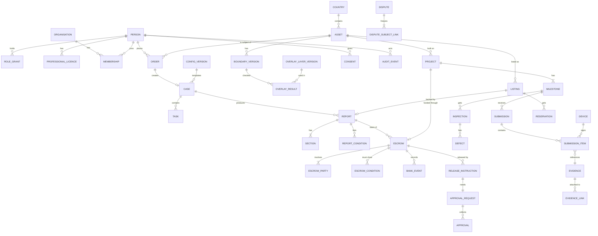

### 6.3 Shared kernel tables

```sql
CREATE TABLE core_allowed_transition (
  entity      text NOT NULL,            -- 'case', 'escrow', 'milestone', 'listing', 'dispute', ...
  from_status text NOT NULL,
  to_status   text NOT NULL,
  PRIMARY KEY (entity, from_status, to_status)
);
-- Seeded from document 01 C8 by migration. Generic trigger core.enforce_transition()
-- rejects any UPDATE of status that has no row here.

CREATE TABLE core_approval_request (
  id            uuid PRIMARY KEY,
  subject_type  text NOT NULL CHECK (subject_type IN
                  ('report_release','escrow_release','escrow_cancel','refund',
                   'locked_text_change','bulk_export')),
  subject_id    uuid NOT NULL,
  prepared_by   uuid NOT NULL REFERENCES acc_person(id),
  required      smallint NOT NULL DEFAULT 2 CHECK (required >= 2),
  status        text NOT NULL CHECK (status IN ('open','approved','rejected','withdrawn')),
  created_at    timestamptz NOT NULL DEFAULT now(),
  UNIQUE (subject_type, subject_id, created_at)
);

CREATE TABLE core_approval (
  id            uuid PRIMARY KEY,
  request_id    uuid NOT NULL REFERENCES core_approval_request(id),
  slot          text NOT NULL,           -- e.g. 'signing_lawyer', 'reviewer', 'release_1', 'release_2'
  approver_id   uuid NOT NULL REFERENCES acc_person(id),
  decision      text NOT NULL CHECK (decision IN ('approve','reject')),
  mfa_method    text NOT NULL CHECK (mfa_method IN ('totp','webauthn')),
  mfa_at        timestamptz NOT NULL,
  approved_at   timestamptz NOT NULL DEFAULT now(),
  CHECK (approved_at - mfa_at <= interval '5 minutes'),     -- step-up freshness (assumption)
  UNIQUE (request_id, approver_id),                          -- one person, one approval
  UNIQUE (request_id, slot)
);
-- Trigger core.approval_not_preparer(): rejects approver_id = request.prepared_by.
-- Trigger core.approval_close(): sets request to 'approved' when count(distinct approver_id)
-- with decision 'approve' reaches 'required'.

CREATE TABLE core_outbox_event (
  id            uuid PRIMARY KEY,
  topic         text NOT NULL,
  aggregate_id  uuid NOT NULL,
  payload       jsonb NOT NULL,
  created_at    timestamptz NOT NULL DEFAULT now(),
  published_at  timestamptz
);
CREATE INDEX ON core_outbox_event (created_at) WHERE published_at IS NULL;

CREATE TABLE core_idempotency_key (
  principal_id  uuid NOT NULL,
  key           text NOT NULL,
  request_hash  bytea NOT NULL,
  response_code smallint,
  response_body jsonb,
  created_at    timestamptz NOT NULL DEFAULT now(),
  PRIMARY KEY (principal_id, key)
);
```

### 6.4 Accounts, orders, fee payments and assets

```sql
CREATE TABLE acc_person (
  id               uuid PRIMARY KEY,
  country_code     char(2) NOT NULL REFERENCES cty_country(code),
  full_name_enc    bytea NOT NULL,                 -- field-level encrypted
  email_enc        bytea, email_bidx bytea UNIQUE,  -- blind index for sign-in lookup
  phone_enc        bytea, phone_bidx bytea UNIQUE,
  id_doc_number_enc bytea,                          -- Ghana Card or passport number
  id_check_status  text NOT NULL DEFAULT 'none'
                   CHECK (id_check_status IN ('none','pending','passed','failed','manual_passed')),
  password_hash    text,                            -- Argon2id
  failed_logins    smallint NOT NULL DEFAULT 0,
  locked_until     timestamptz,                     -- FR-ACC-009
  status           text NOT NULL CHECK (status IN ('active','suspended','anonymised')),
  data_class       text NOT NULL DEFAULT 'account',
  created_at       timestamptz NOT NULL DEFAULT now(),
  row_version      int NOT NULL DEFAULT 1,
  CHECK (email_bidx IS NOT NULL OR phone_bidx IS NOT NULL)
);

CREATE TABLE acc_role_grant (
  id          uuid PRIMARY KEY,
  person_id   uuid NOT NULL REFERENCES acc_person(id),
  role        text NOT NULL CHECK (role IN ('client','seller','developer','case_manager',
                'reviewer','lawyer','surveyor','runner','contractor','inspector',
                'administrator','quantity_surveyor','representative','authority_rep')),
  scope_type  text CHECK (scope_type IN ('country','case','project','listing','organisation','authority')),
  scope_id    uuid,
  release_rights boolean NOT NULL DEFAULT false,    -- FR-ESC-007 "staff with release rights"
  granted_by  uuid NOT NULL REFERENCES acc_person(id),
  valid_from  timestamptz NOT NULL DEFAULT now(),
  valid_to    timestamptz,
  CHECK (NOT release_rights OR role IN ('reviewer','case_manager'))
);

CREATE TABLE acc_professional_licence (
  id           uuid PRIMARY KEY,
  person_id    uuid NOT NULL REFERENCES acc_person(id),
  body         text NOT NULL,                   -- e.g. General Legal Council, licensing body for surveyors [TO VERIFY]
  number       text NOT NULL,
  expires_on   date NOT NULL,
  verified_by  uuid REFERENCES acc_person(id),
  verified_on  date,
  evidence_id  uuid REFERENCES evd_evidence(id),
  UNIQUE (body, number)
);

CREATE TABLE ord_order (
  id              uuid PRIMARY KEY,
  reference       text NOT NULL UNIQUE,
  country_code    char(2) NOT NULL REFERENCES cty_country(code),
  client_id       uuid NOT NULL REFERENCES acc_person(id),
  asset_id        uuid NOT NULL REFERENCES geo_asset(id),
  kind            text NOT NULL CHECK (kind IN ('verification','fresh_search','extra_inspection','listing_verification')),
  tier_config_id  uuid NOT NULL REFERENCES adm_config_version(id),
  price           numeric(18,2) NOT NULL CHECK (price >= 0),
  currency        char(3) NOT NULL,
  lead_source     text CHECK (lead_source IN ('association','webinar','referral','remittance_partner','other')),
  referral_code   text,
  terms_version_id uuid NOT NULL REFERENCES adm_locked_text_version(id),
  status          text NOT NULL CHECK (status IN ('draft','awaiting_payment','paid','cancelled','refunded')),
  created_at      timestamptz NOT NULL DEFAULT now()
);
CREATE INDEX ON ord_order (client_id, created_at DESC);

CREATE TABLE pay_fee_payment (
  id              uuid PRIMARY KEY,
  purpose         text NOT NULL CHECK (purpose IN ('report_fee','escrow_fee','inspection_fee',
                    'listing_fee','success_fee','construction_mgmt_fee','api_fee','conveyancing_fee')),
  payer_id        uuid NOT NULL REFERENCES acc_person(id),
  order_id        uuid REFERENCES ord_order(id),
  invoice_id      uuid REFERENCES pay_invoice(id),
  amount          numeric(18,2) NOT NULL CHECK (amount > 0),
  currency        char(3) NOT NULL,
  method          text NOT NULL CHECK (method IN ('card','mobile_money','bank_transfer_offline')),
  provider        text NOT NULL,
  provider_ref    text UNIQUE,
  card_last4      char(4),                          -- never the full number, FR-PAY-002
  status          text NOT NULL CHECK (status IN ('initiated','confirmed','failed','refunded','partially_refunded')),
  confirmed_at    timestamptz,
  CHECK (order_id IS NOT NULL OR invoice_id IS NOT NULL)
);
-- RUL-01: there is no purpose for purchase, construction or project money, and no table
-- anywhere that stores a client balance. A CI schema test fails if a column named
-- like '%balance%' or '%wallet%' appears.

CREATE TABLE geo_asset (
  id              uuid PRIMARY KEY,
  country_code    char(2) NOT NULL REFERENCES cty_country(code),
  type            text NOT NULL CHECK (type IN ('plot','building','offplan_unit')),
  locality        text NOT NULL,
  plot_number     text,
  site_plan_ref   text,
  ghana_post_gps  text,
  current_boundary_id uuid,                        -- FK to geo_boundary_version
  disputed_flag   boolean NOT NULL DEFAULT false,  -- drives RUL-17
  created_at      timestamptz NOT NULL DEFAULT now()
);
CREATE INDEX ON geo_asset (country_code, locality, plot_number);

CREATE TABLE geo_boundary_version (
  id           uuid PRIMARY KEY,
  asset_id     uuid NOT NULL REFERENCES geo_asset(id),
  geom         geometry(MultiPolygon, 4326) NOT NULL CHECK (ST_IsValid(geom)),
  source       text NOT NULL CHECK (source IN ('surveyor_coordinates','digitised_site_plan','records_programme')),
  captured_by  uuid NOT NULL REFERENCES acc_person(id),
  created_at   timestamptz NOT NULL DEFAULT now()
);
CREATE INDEX ON geo_boundary_version USING gist (geom);

CREATE TABLE geo_overlay_result (
  id                 uuid PRIMARY KEY,
  boundary_id        uuid NOT NULL REFERENCES geo_boundary_version(id),
  layer_version_id   uuid NOT NULL REFERENCES geo_overlay_layer_version(id),
  outcome            text NOT NULL CHECK (outcome IN ('inside','near','clear')),
  distance_m         numeric(10,2),
  buffer_m           numeric(10,2) NOT NULL,       -- from adm_setting at run time
  computed_at        timestamptz NOT NULL DEFAULT now(),
  UNIQUE (boundary_id, layer_version_id)
);
```

### 6.5 Cases, reports and escrow

```sql
CREATE TABLE case_case (
  id               uuid PRIMARY KEY,
  reference        text NOT NULL UNIQUE,
  country_code     char(2) NOT NULL REFERENCES cty_country(code),
  order_id         uuid NOT NULL UNIQUE REFERENCES ord_order(id),   -- FR-ORD-004
  asset_id         uuid NOT NULL REFERENCES geo_asset(id),
  client_id        uuid NOT NULL REFERENCES acc_person(id),
  product_line     text NOT NULL CHECK (product_line IN ('land','building','fresh_search')),
  template_version_id uuid NOT NULL REFERENCES adm_config_version(id),
  status           text NOT NULL CHECK (status IN ('draft','paid','in_progress','on_hold',
                     'in_review','released','cancelled')),
  hold_reason      text,
  risk_flag        boolean NOT NULL DEFAULT false,
  case_manager_id  uuid REFERENCES acc_person(id),
  data_class       text NOT NULL DEFAULT 'case_report',
  created_at       timestamptz NOT NULL DEFAULT now(),
  row_version      int NOT NULL DEFAULT 1,
  CHECK (status <> 'on_hold' OR hold_reason IS NOT NULL)
);
CREATE INDEX ON case_case (status, country_code);

CREATE TABLE case_task (
  id              uuid PRIMARY KEY,
  case_id         uuid NOT NULL REFERENCES case_case(id),
  step_key        text NOT NULL,                     -- from template, e.g. 'site_visit'
  owner_role      text NOT NULL,
  assignee_id     uuid REFERENCES acc_person(id),
  second_assignee_id uuid REFERENCES acc_person(id), -- RUL-17 two people on disputed plots
  due_at          timestamptz NOT NULL,
  due_change_reason text,
  required_evidence jsonb NOT NULL,                  -- list of evidence kinds from template
  status          text NOT NULL CHECK (status IN ('open','in_progress','done','cancelled')),
  completed_at    timestamptz,
  CHECK (second_assignee_id IS NULL OR second_assignee_id <> assignee_id)
);
CREATE INDEX ON case_task (assignee_id, status, due_at);
-- Trigger case.task_done_requires_evidence(): rejects status 'done' unless every kind in
-- required_evidence has a matching evd_link row (FR-CASE-004).
-- Trigger case.site_visit_risk(): for step_key 'site_visit' on an asset with disputed_flag,
-- rejects assignment without a passed case_risk_screen and a second assignee (RUL-17).

CREATE TABLE rpt_report (
  id               uuid PRIMARY KEY,
  case_id          uuid NOT NULL REFERENCES case_case(id),
  version          int NOT NULL,
  template_version_id uuid NOT NULL REFERENCES adm_config_version(id),
  scope_text_version_id uuid NOT NULL REFERENCES adm_locked_text_version(id), -- RUL-04
  overall_verdict  text CHECK (overall_verdict IN ('red','amber','green')),
  status           text NOT NULL CHECK (status IN ('draft','in_review','approved','released','superseded')),
  approval_request_id uuid REFERENCES core_approval_request(id),
  pdf_object_key   text,
  pdf_sha256       bytea CHECK (pdf_sha256 IS NULL OR length(pdf_sha256) = 32),
  released_at      timestamptz,
  supersedes_id    uuid REFERENCES rpt_report(id),
  correction_reason text,
  UNIQUE (case_id, version),
  CHECK (status <> 'released' OR (pdf_sha256 IS NOT NULL AND released_at IS NOT NULL)),
  CHECK (supersedes_id IS NULL OR correction_reason IS NOT NULL)
);
-- Trigger rpt.freeze_released(): rejects any UPDATE to a released row except status -> 'superseded'
-- (FR-RPT-010). Trigger rpt.verdict_rule(): rejects overall_verdict = 'green' if any rpt_section
-- with number between 4 and 10 has verdict 'red' (RUL-02; see I-01 on the 4-9 vs 4-10 conflict).

CREATE TABLE rpt_section (
  id           uuid PRIMARY KEY,
  report_id    uuid NOT NULL REFERENCES rpt_report(id),
  number       smallint NOT NULL CHECK (number BETWEEN 1 AND 14),
  owner_role   text NOT NULL,
  findings     jsonb NOT NULL DEFAULT '{}',
  verdict      text CHECK (verdict IN ('red','amber','green')),
  proposed_verdict text CHECK (proposed_verdict IN ('red','amber','green')),  -- from GEO for section 7
  UNIQUE (report_id, number)
);

CREATE TABLE rpt_signature (
  id           uuid PRIMARY KEY,
  section_id   uuid NOT NULL REFERENCES rpt_section(id),
  signer_id    uuid NOT NULL REFERENCES acc_person(id),
  licence_id   uuid NOT NULL REFERENCES acc_professional_licence(id),
  signed_at    timestamptz NOT NULL DEFAULT now(),
  content_sha256 bytea NOT NULL                     -- hash of section content at signing
);
-- Trigger rpt.licence_valid(): rejects if licence unverified or expires_on < signed_at (RUL-20).

CREATE TABLE esc_escrow (
  id               uuid PRIMARY KEY,
  reference        text NOT NULL UNIQUE,
  country_code     char(2) NOT NULL REFERENCES cty_country(code),
  kind             text NOT NULL CHECK (kind IN ('purchase','construction','offplan','project_fund')),
  asset_id         uuid NOT NULL REFERENCES geo_asset(id),
  report_id        uuid REFERENCES rpt_report(id),
  project_id       uuid REFERENCES bld_project(id),
  bank_partner_id  uuid NOT NULL REFERENCES adm_partner(id),     -- must be type escrow_bank
  bank_reference   text,
  agreed_amount    numeric(18,2) NOT NULL CHECK (agreed_amount > 0),  -- recorded fact, not a balance
  currency         char(3) NOT NULL,
  terms_version_id uuid NOT NULL REFERENCES adm_locked_text_version(id),
  status           text NOT NULL CHECK (status IN ('proposed','agreed','funded','ready_to_release',
                     'release_approved','released','frozen','cancelled')),
  fresh_search_case_id uuid REFERENCES case_case(id),
  created_at       timestamptz NOT NULL DEFAULT now(),
  CHECK (kind <> 'purchase' OR report_id IS NOT NULL),
  CHECK (kind = 'purchase' OR project_id IS NOT NULL)
);
-- Bank payment instructions shown to clients are read from adm_partner (bank) and
-- esc_escrow.bank_reference only. No column holds a Fidero account number (FR-ESC-003).

CREATE TABLE esc_condition (
  id            uuid PRIMARY KEY,
  escrow_id     uuid NOT NULL REFERENCES esc_escrow(id),
  source_condition_id uuid REFERENCES rpt_condition(id),  -- copied from section 11, FR-RPT-009
  text          text NOT NULL,
  status        text NOT NULL CHECK (status IN ('open','closed','waived_by_approval')),
  closed_by     uuid REFERENCES acc_person(id),
  closed_at     timestamptz,
  CHECK (status = 'open' OR (closed_by IS NOT NULL AND closed_at IS NOT NULL))
);
-- Trigger: closing requires at least one evd_link to this condition (FR-ESC-005).

CREATE TABLE esc_release_instruction (
  id               uuid PRIMARY KEY,
  escrow_id        uuid NOT NULL REFERENCES esc_escrow(id),
  kind             text NOT NULL CHECK (kind IN ('release','partial_release','cancel_refund')),
  milestone_id     uuid REFERENCES bld_milestone(id),
  payee_party_id   uuid NOT NULL REFERENCES esc_party(id),
  amount           numeric(18,2) NOT NULL CHECK (amount > 0),
  holdback_amount  numeric(18,2) NOT NULL DEFAULT 0 CHECK (holdback_amount >= 0),  -- RUL-09
  currency         char(3) NOT NULL,
  prepared_by      uuid NOT NULL REFERENCES acc_person(id),
  approval_request_id uuid NOT NULL REFERENCES core_approval_request(id),
  client_approved_at timestamptz,                                -- RUL-11
  status           text NOT NULL CHECK (status IN ('draft','pending_approval','approved',
                     'sent','confirmed','rejected_by_bank','withdrawn')),
  document_sha256  bytea,
  kms_signature    bytea,
  sent_at          timestamptz,
  bank_confirmation_event_id uuid REFERENCES esc_bank_event(id),
  CHECK (kind <> 'partial_release' OR milestone_id IS NOT NULL),
  CHECK (status NOT IN ('sent','confirmed') OR (document_sha256 IS NOT NULL AND kms_signature IS NOT NULL))
);
CREATE UNIQUE INDEX one_live_instruction_per_milestone
  ON esc_release_instruction (milestone_id)
  WHERE status IN ('pending_approval','approved','sent','confirmed') AND milestone_id IS NOT NULL;
-- Trigger esc.release_blockers() BEFORE UPDATE to 'approved' or 'sent' raises if:
--   any esc_condition for the escrow is 'open'                          (RUL-06)
--   any open dsp_dispute is linked to the escrow, project or milestone   (RUL-15)
--   kind <> 'cancel_refund' and the fresh-search case is missing, not released,
--     or older than adm_setting 'fresh_search_window_days'              (RUL-07; purchase only)
--   approval request is not 'approved'                                   (RUL-05)
--   milestone set and no inspection with outcome pass or pass_with_defects (RUL-09)
--   client_approved_at is null for kinds that need client approval      (RUL-11)
```

### 6.6 Evidence, mobile, construction, listings and disputes

```sql
CREATE TABLE evd_evidence (
  id              uuid PRIMARY KEY,
  object_key      text NOT NULL UNIQUE,
  object_version  text NOT NULL,                       -- S3 version ID
  sha256          bytea NOT NULL CHECK (length(sha256) = 32),
  media_type      text NOT NULL,
  size_bytes      bigint NOT NULL CHECK (size_bytes > 0),
  provenance      text NOT NULL CHECK (provenance IN ('app_captured','uploaded','system_generated')),
  device_id       uuid REFERENCES mob_device(id),
  signature_valid boolean,                             -- FR-EVD-006
  uploader_id     uuid NOT NULL REFERENCES acc_person(id),
  captured_at     timestamptz,                         -- device time
  received_at     timestamptz NOT NULL DEFAULT now(),  -- server time
  position        geography(Point, 4326),
  position_accuracy_m numeric(8,2),
  scan_status     text NOT NULL CHECK (scan_status IN ('pending','clean','rejected')),
  data_class      text NOT NULL,
  retain_until    date NOT NULL,                       -- mirrors S3 Object Lock date
  deleted_at      timestamptz,                         -- set only by retention job, logged
  CHECK (provenance <> 'app_captured' OR (device_id IS NOT NULL AND signature_valid IS NOT NULL))
);
CREATE INDEX ON evd_evidence (sha256);                 -- duplicate-hash fraud check
CREATE INDEX ON evd_evidence USING gist (position);

CREATE TABLE evd_link (
  evidence_id   uuid NOT NULL REFERENCES evd_evidence(id),
  subject_type  text NOT NULL CHECK (subject_type IN ('case','task','report_section','escrow_condition',
                  'milestone','inspection','defect','listing','dispute','consent','licence','invoice')),
  subject_id    uuid NOT NULL,
  evidence_kind text NOT NULL,                          -- matches template requirement keys
  linked_by     uuid NOT NULL REFERENCES acc_person(id),
  linked_at     timestamptz NOT NULL DEFAULT now(),
  PRIMARY KEY (evidence_id, subject_type, subject_id)
);
-- fidero_app has INSERT and SELECT only on evd_evidence and evd_link, plus UPDATE on
-- scan_status, signature_valid and deleted_at columns. No DELETE (FR-EVD-002).

CREATE TABLE mob_device (
  id               uuid PRIMARY KEY,
  person_id        uuid NOT NULL REFERENCES acc_person(id),
  public_key_spki  bytea NOT NULL,                      -- ECDSA P-256
  key_security     text NOT NULL CHECK (key_security IN ('strongbox','tee','software')),
  attestation_chain bytea[],
  app_signing_digest bytea,
  model            text, os_version text,
  status           text NOT NULL CHECK (status IN ('active','revoked')),
  registered_at    timestamptz NOT NULL DEFAULT now()
);

CREATE TABLE mob_fraud_flag (
  id           uuid PRIMARY KEY,
  evidence_id  uuid NOT NULL REFERENCES evd_evidence(id),
  kind         text NOT NULL CHECK (kind IN ('outside_buffer','time_gap','before_previous_pass',
                 'duplicate_hash','metadata_mismatch','bad_signature','software_key')),
  detail       jsonb NOT NULL,
  status       text NOT NULL CHECK (status IN ('open','cleared','upheld')),
  reviewed_by  uuid REFERENCES acc_person(id),
  reviewed_at  timestamptz
);

CREATE TABLE bld_project (
  id              uuid PRIMARY KEY,
  country_code    char(2) NOT NULL REFERENCES cty_country(code),
  type            text NOT NULL CHECK (type IN ('construction','offplan','funds')),
  asset_id        uuid REFERENCES geo_asset(id),
  client_id       uuid NOT NULL REFERENCES acc_person(id),
  contractor_id   uuid REFERENCES bld_panel_member(id),
  runner_person_id uuid REFERENCES acc_person(id),        -- person running a funded project
  schedule_version_id uuid NOT NULL REFERENCES adm_config_version(id),
  budget          numeric(18,2) NOT NULL, currency char(3) NOT NULL,
  status          text NOT NULL CHECK (status IN ('setup','active','paused','completed','cancelled')),
  CHECK (type = 'funds' OR asset_id IS NOT NULL)
);

CREATE TABLE bld_milestone (
  id              uuid PRIMARY KEY,
  project_id      uuid NOT NULL REFERENCES bld_project(id),
  seq             smallint NOT NULL,
  key             text NOT NULL,                       -- 'foundation', 'blocks', ... or a fund stage
  share_pct       numeric(5,2) NOT NULL CHECK (share_pct > 0 AND share_pct <= 100),
  amount          numeric(18,2) NOT NULL, currency char(3) NOT NULL,
  status          text NOT NULL CHECK (status IN ('not_started','submitted','evidence_checked',
                    'returned','inspected','client_approved','release_approved','paid')),
  inspector_id    uuid REFERENCES bld_panel_member(id),
  UNIQUE (project_id, seq)
);
-- Constraint trigger: sum(share_pct) per project = 100 at commit (deferred).

CREATE TABLE bld_conflict_link (
  inspector_id   uuid NOT NULL REFERENCES bld_panel_member(id),
  contractor_id  uuid NOT NULL REFERENCES bld_panel_member(id),
  reason         text NOT NULL,
  PRIMARY KEY (inspector_id, contractor_id)
);
-- Trigger bld.no_conflicted_inspector(): rejects bld_milestone.inspector_id when a
-- bld_conflict_link exists with the project's contractor, or both share an organisation (RUL-10).

CREATE TABLE bld_inspection (
  id            uuid PRIMARY KEY,
  milestone_id  uuid NOT NULL REFERENCES bld_milestone(id),
  inspector_id  uuid NOT NULL REFERENCES bld_panel_member(id),
  scheduled_for date NOT NULL,
  outcome       text CHECK (outcome IN ('pass','pass_with_defects','fail')),
  defect_value  numeric(18,2) NOT NULL DEFAULT 0 CHECK (defect_value >= 0),
  recorded_at   timestamptz,
  CHECK (outcome <> 'pass_with_defects' OR defect_value > 0)
);

CREATE TABLE lst_listing (
  id             uuid PRIMARY KEY,
  country_code   char(2) NOT NULL REFERENCES cty_country(code),
  asset_id       uuid NOT NULL REFERENCES geo_asset(id),
  seller_org_id  uuid REFERENCES acc_organisation(id),
  seller_id      uuid NOT NULL REFERENCES acc_person(id),
  report_id      uuid REFERENCES rpt_report(id),
  price          numeric(18,2) NOT NULL, currency char(3) NOT NULL,
  status         text NOT NULL CHECK (status IN ('draft','in_verification','rejected','live',
                   'suspended','expired','reserved','sold')),
  badge_expires_at timestamptz,
  search_doc     tsvector,
  CHECK (status NOT IN ('live','reserved') OR (report_id IS NOT NULL AND badge_expires_at IS NOT NULL))
);
CREATE INDEX ON lst_listing USING gin (search_doc);
CREATE INDEX ON lst_listing (country_code, status, price);
-- Trigger lst.publish_rule(): to 'live' only if the report is released, overall verdict green,
-- and released_at within adm_setting 'listing_report_max_age_days' (RUL-12).

CREATE TABLE dsp_dispute (
  id            uuid PRIMARY KEY,
  opened_by     uuid NOT NULL REFERENCES acc_person(id),
  reason        text NOT NULL,
  status        text NOT NULL CHECK (status IN ('open','awaiting_response','evidence','decision',
                  'closed','referred')),
  response_due  date, evidence_due date, decision_due date,   -- FR-DSP-003 working days
  decided_by    uuid REFERENCES acc_person(id),
  decision      text,
  CHECK (status <> 'closed' OR decision IS NOT NULL)
);

CREATE TABLE dsp_subject_link (
  dispute_id    uuid NOT NULL REFERENCES dsp_dispute(id),
  subject_type  text NOT NULL CHECK (subject_type IN ('escrow','milestone','listing','release_instruction')),
  subject_id    uuid NOT NULL,
  PRIMARY KEY (dispute_id, subject_type, subject_id)
);
CREATE INDEX ON dsp_subject_link (subject_type, subject_id);
```

### 6.7 Audit, consent and safety

```sql
CREATE TABLE aud_event (
  seq          bigint GENERATED ALWAYS AS IDENTITY PRIMARY KEY,
  id           uuid NOT NULL UNIQUE,
  occurred_at  timestamptz NOT NULL DEFAULT clock_timestamp(),
  actor_id     uuid,                         -- null for system jobs
  actor_kind   text NOT NULL CHECK (actor_kind IN ('person','partner','system')),
  action       text NOT NULL,                -- 'create','update','approve','release','export','sign_in',...
  object_type  text NOT NULL,
  object_id    uuid,
  country_code char(2),
  changes      jsonb NOT NULL,               -- field names; personal values replaced by keyed hashes
  origin_ip    inet, user_agent text, trace_id text,
  prev_hash    bytea NOT NULL,
  hash         bytea NOT NULL                -- sha256(prev_hash || canonical row content)
) PARTITION BY RANGE (occurred_at);
-- Owned by fidero_audit_owner. fidero_app has EXECUTE on aud.append(...) only.
-- aud.append() takes pg_advisory_xact_lock on the chain, reads the last hash, computes the new one.
-- Trigger aud.no_change() raises on UPDATE or DELETE. Partitions are monthly.
-- aud_anchor (seq, hash, anchored_at, s3_object_key) records hourly anchors to Object Lock.

CREATE TABLE dpr_consent (
  id             uuid PRIMARY KEY,
  person_id      uuid REFERENCES acc_person(id),
  subject_name_enc bytea,                    -- for people without accounts, e.g. family heads
  purpose        text NOT NULL CHECK (purpose IN ('privacy_notice','video_recording','partner_status',
                   'partner_full_report','case_study','marketing')),
  text_version_id uuid NOT NULL REFERENCES adm_locked_text_version(id),
  partner_client_id uuid REFERENCES ptr_api_client(id),
  report_id      uuid REFERENCES rpt_report(id),
  recording_evidence_id uuid REFERENCES evd_evidence(id),
  given_at       timestamptz NOT NULL,
  withdrawn_at   timestamptz,
  CHECK (purpose <> 'video_recording' OR recording_evidence_id IS NOT NULL),
  CHECK (purpose NOT IN ('partner_status','partner_full_report') OR partner_client_id IS NOT NULL),
  CHECK (purpose <> 'partner_full_report' OR report_id IS NOT NULL),
  CHECK (person_id IS NOT NULL OR subject_name_enc IS NOT NULL)
);
CREATE INDEX ON dpr_consent (partner_client_id, person_id) WHERE withdrawn_at IS NULL;

CREATE SCHEMA safety AUTHORIZATION fidero_safety;
CREATE TABLE safety.incident (
  id           uuid PRIMARY KEY,
  case_id      uuid NOT NULL,                -- no FK across schemas by design; checked in app
  reported_by  uuid NOT NULL,
  occurred_at  timestamptz NOT NULL,
  severity     text NOT NULL CHECK (severity IN ('low','medium','high','critical')),
  narrative_enc bytea NOT NULL,              -- encrypted with a dedicated KMS key
  persons_named_enc bytea,
  created_at   timestamptz NOT NULL DEFAULT now()
);
-- fidero_app cannot read schema safety. The safety service connects as fidero_safety through a
-- separate connection used only by views that check the 'safety.read' permission (section 10.9).
```

### 6.8 Other tables (summary)

| Table | Key columns and rules | FR |
|---|---|---|
| `acc_identity_check` | person, provider, provider ref, result, method (`provider`, `manual`), reviewed by | FR-ACC-004 |
| `acc_representative_grant` | client, representative person, case or project, read-only, expiry | FR-ACC-008 |
| `acc_mfa_device` | person, type (`totp`, `webauthn`), secret or credential (encrypted), last used | FR-ACC-003 |
| `ord_terms_acceptance` | order, text version, accepted at, IP | FR-ORD-003 |
| `pay_refund` | payment, amount, reason, approval request | FR-PAY-004 |
| `pay_settlement_line`, `pay_recon_issue` | provider settlement lines and mismatches | FR-PAY-006 |
| `case_status_message` | case, template key, rendered text, date, next expected date | FR-CASE-007 |
| `case_risk_screen` | case, screened by, outcome, people assigned, valid until | FR-CASE-009 |
| `case_cost_item` | case, item type, amount, currency | FR-CASE-011 |
| `rpt_condition` | report, text, who must act, evidence that closes it | FR-RPT-009 |
| `geo_overlay_layer_version` | layer, version, source, valid from, loaded by, feature count | FR-GEO-004 |
| `geo_overlay_feature` | layer version, `geometry(MultiPolygon, 4326)` with GiST index | FR-GEO-002 |
| `geo_monitoring_alert` | asset, image dates, change score, status | FR-GEO-007 |
| `esc_party` | escrow, role (buyer, seller, contractor, supplier, developer), person or organisation | FR-ESC-001 |
| `esc_acceptance` | escrow, party, terms version, accepted at | FR-ESC-002 |
| `esc_bank_event` | escrow, kind (`deposit`, `release_confirmed`, `refund_confirmed`), amount, source (`api`, `statement`, `manual`), proof evidence, entered by | FR-ESC-004, FR-ESC-009 |
| `esc_statement_file`, `esc_statement_line` | imported file hash, lines, match status | FR-ESC-011 |
| `mob_submission`, `mob_submission_item` | milestone or task, client UUID (unique), items, manifest | FR-MOB-006 |
| `bld_defect` | inspection, description, value, status, closing evidence | FR-BLD-006 |
| `bld_variation` | project, description, cost change, client and contractor agreement times | FR-BLD-008 |
| `bld_reprice` | milestone, USD guide, GHS amount, FX rate version, shown to client at | FR-BLD-007 |
| `prj_supplier`, `prj_invoice` | supplier with check status; invoice with stage, amount, payee bank details from supplier record | FR-PRJ-001 to 003 |
| `lst_reservation` | listing, buyer, fresh-search case, escrow, expires at | FR-LST-005 |
| `rat_rating` | subject, rater, score 1 to 5 (CHECK), comment, hidden reason | FR-RAT-002, FR-RAT-004 |
| `ptr_api_client` | partner, OAuth client ID, hashed secret, scopes, rate limit | FR-PTR-004 |
| `ptr_usage_event` | client, endpoint, result class, billed flag | FR-PTR-004 |
| `ntf_message` | recipient, channel, template version, status, provider ref | FR-NTF-005 |
| `adm_config_version` | kind, country, product line, version, JSON content, content hash, state, schema version | FR-ADM-001 |
| `adm_locked_text_version` | kind (`scope_statement`, `terms`, `privacy_notice`, `escrow_terms`), country, text, approvals, lawyer and insurer approval evidence | FR-ADM-004 |
| `adm_setting` | key, country, value, changed by; keys include `fresh_search_window_days`, `listing_report_max_age_days`, `badge_validity_days`, `plot_buffer_m`, `dispute_deadlines`, `ntf_amount_threshold` | FR-ADM-005 |
| `dpr_request` | requester, type (access, correction, deletion), due date, status, export evidence | FR-DPR-003 |
| `dpr_retention_rule`, `dpr_legal_hold` | data class, country, period, action; holds by subject | FR-DPR-004 |
| `dpr_bulk_export` | requester, scope, approval request, file hash | FR-DPR-005 |
| `rec_allocation` | authority, plot geometry, allottee, date, documents, confirmation status | FR-REC-001, FR-REC-004 |
| `cty_country` | code, name, currency, data region, status | FR-CTY-001 |

### 6.9 Multi-country and versioned templates

- Every country-scoped table has `country_code`. Row-level security policies on `country_code` are enabled for staff whose grants are country-scoped. Ghana is the only active country until R3.
- `adm_config_version` holds templates keyed by `(kind, country_code, product_line, version)`. Kinds: `case_template`, `report_template`, `condition_set`, `milestone_schedule`, `tier_catalogue`, `checklist`, `status_message_set`, `notification_set`.
- A published version is immutable (trigger rejects UPDATE of `content` when state is `published`). New work uses the latest published version; existing work keeps its version.
- A country pack (`cty_country_pack`) lists the config versions, locked texts, overlay layers, licence bodies and partners that make a country live. Activating a pack needs two administrators.
- If a country's law requires local data (FR-CTY-002), its data lives in a separate regional deployment (ADR-14). The `cty_directory` table maps users and references to their home cell.

### 6.10 Retention and anonymisation

| Step | Design |
|---|---|
| Classify | Each table and field is listed in `dpr_data_catalogue` with purpose and data class (NFR-PRIV-02). |
| Anchor | Retention runs from an anchor date per class: case release, escrow close, account closure, last lead contact. Periods are `[TO VERIFY]` (Q-08) except leads at 24 months (assumption from 01 C5.2). |
| Lock | Evidence objects get an S3 Object Lock date equal to the minimum agreed period. It can be extended for legal holds, never shortened. |
| Sweep | A nightly job lists expired records, skips any under `dpr_legal_hold`, then deletes or anonymises. |
| Anonymise | Personal fields are overwritten with nulls or tokens, and the field-level data key for that person is destroyed (crypto-shredding). Aggregates and audit rows stay valid because they hold IDs and keyed hashes only. |
| Delete evidence | After the lock date, the job deletes the S3 object version and sets `evd_evidence.deleted_at`. The audit log records the deletion (FR-EVD-002). |
| Backups | Backups expire on their own schedule (35 days for RDS, assumption). Restores re-run the sweep before go-live. |

---

## 7. API design

### 7.1 Conventions

| Topic | Rule |
|---|---|
| Style | REST over HTTPS, JSON (`application/json`), UTF-8. Resource names are plural nouns. Actions that change state and need approval are sub-resources (`/approvals`, `/close`) rather than PATCH of `status`. |
| Hosts | `api.<domain>` for portal, back office and mobile; `partner-api.<domain>` for partners. Domain `[TO VERIFY]`. |
| Versioning | Major version in the path: `/v1`, `/partner/v1`. Additive changes only within a version. A breaking change gets `/v2` and at least 6 months of overlap for partners (assumption). `Deprecation` and `Sunset` headers announce retirement. |
| Contract | OpenAPI 3.1 generated from DRF serialisers (drf-spectacular). Typed clients for both Next.js apps and Kotlin are generated from it. Contract tests in CI (document 06). |
| Auth | Web: session cookie plus `X-CSRFToken`. Mobile: `Authorization: Bearer <JWT>`. Partner: OAuth 2.0 client credentials bearer token. |
| Pagination | Cursor-based: `?limit=25&cursor=<opaque>`. Response has `items` and `next_cursor`. Maximum limit 100. |
| Filtering and sorting | Explicit query parameters per endpoint (`status`, `due_before`, `country`), `sort=due_at` or `sort=-created_at`. |
| Idempotency | `Idempotency-Key` header (UUID) required on every POST that creates a resource, starts a payment, approves, sends or submits. Stored per principal for 24 hours (assumption). Same key and same body returns the stored response; same key and a different body returns 422 `idempotency-key-reuse`. |
| Concurrency | Responses carry `ETag` from `row_version`. PATCH and state actions need `If-Match`; a mismatch returns 412. |
| Time and money | RFC 3339 timestamps in UTC. Money as `{"amount": "250.00", "currency": "USD"}` with the amount as a string. |
| Tracing | `traceparent` (W3C) accepted and returned. Every problem response includes `trace_id`. |
| Errors | RFC 9457 `application/problem+json`. |
| Rate limits | Per user and per IP at the WAF; per partner client in the API with Redis counters. `429` with `Retry-After`. |

### 7.2 Error model

```json
{
  "type": "https://api.<domain>/problems/release-blocked",
  "title": "Release instruction is blocked",
  "status": 409,
  "detail": "The escrow has 1 open condition and the fresh search is older than the allowed window.",
  "instance": "/v1/release-instructions/0192f3c1-7b1e-7c2a-9f00-5d7a2e4b1c11/approvals",
  "code": "release_blocked",
  "blocking_reasons": [
    {"rule": "RUL-06", "message": "Condition 'Family consent recorded' is open"},
    {"rule": "RUL-07", "message": "Fresh search dated 2 March is outside the window"}
  ],
  "trace_id": "4bf92f3577b34da6a3ce929d0e0e4736"
}
```

| Problem type | Status | When |
|---|---|---|
| `validation-error` | 400 | Field errors, listed in `errors[]` with JSON pointers |
| `unauthenticated` | 401 | Missing or expired credentials |
| `mfa-required` | 401 | Action needs a fresh MFA step-up |
| `forbidden` | 403 | Role or object permission missing |
| `not-found` | 404 | Also used when the caller may not know the object exists |
| `state-conflict` | 409 | Transition not allowed from the current state |
| `release-blocked` | 409 | RUL-05, 06, 07, 09, 11 or 15 not met, with `blocking_reasons` |
| `verdict-rule` | 409 | RUL-02 would be broken |
| `licence-invalid` | 409 | RUL-20 |
| `same-approver` | 409 | RUL-03 or RUL-05 second approval by the same person or the preparer |
| `precondition-failed` | 412 | `If-Match` mismatch |
| `idempotency-key-reuse` | 422 | Same key, different body |
| `evidence-rejected` | 422 | Malware, hash mismatch, bad signature, gallery source |
| `rate-limited` | 429 | Limit reached |

### 7.3 Webhooks

**Inbound** (`/v1/hooks/...`): payment provider, identity provider, WhatsApp and SMS delivery reports, bank (if API). Each adapter verifies the vendor signature, stores the raw body hash, deduplicates on the vendor event ID and then fetches the authoritative state from the vendor before acting (never trusts the body alone).

**Outbound** (partners, R2): events `verification.status_changed`, `order.completed`, `consent.withdrawn`. Body is a minimal envelope with IDs; the partner fetches details through the API so consent is checked at read time. Signed with HMAC-SHA256 over `timestamp.body` in a `Fidero-Signature` header with a per-subscription secret. Delivery is at least once with exponential back-off for 24 hours (assumption), then the subscription is marked failing and the partner is notified.

### 7.4 Endpoint catalogue

Roles: CL client, SE seller, DV developer, CM case manager, RV reviewer, LW lawyer, SV surveyor, RN runner, CT contractor, IN inspector, PT partner, AD administrator, QS quantity surveyor, AR authority representative, Pub public. "own" and "asg" mean own or assigned objects only.

| Method | Path | Purpose | Roles | FR IDs |
|---|---|---|---|---|
| POST | `/v1/auth/signup` | Sign up, send one-time codes, accept privacy notice | Pub | FR-ACC-001, FR-DPR-001 |
| POST | `/v1/auth/otp/verify` | Verify email or phone code | Pub | FR-ACC-001 |
| POST | `/v1/auth/login` | Password or one-time code sign-in, lockout | Pub | FR-ACC-002, FR-ACC-009 |
| POST | `/v1/auth/mfa/challenge`, `/v1/auth/mfa/verify` | TOTP or WebAuthn, also step-up | All with MFA | FR-ACC-003 |
| POST | `/v1/auth/mfa/devices` | Enrol TOTP or WebAuthn | All | FR-ACC-003 |
| POST | `/v1/auth/token`, `/v1/auth/token/refresh` | Mobile JWT and rotating refresh | CT, IN, RN, SV | FR-MOB-001 |
| POST | `/v1/auth/logout` | End session or revoke refresh token | All | NFR-SEC-02 |
| GET, PATCH | `/v1/me` | Profile, language, notification preferences | All | FR-ACC-010, FR-NTF-001 |
| POST | `/v1/me/identity-checks` | Start identity check | CL, SE, DV | FR-ACC-004 |
| POST, DELETE | `/v1/me/representatives` | Name or remove a representative | CL | FR-ACC-008 |
| POST | `/v1/organisations`, `/v1/organisations/{id}/members` | Organisation accounts | SE, DV | FR-ACC-011 |
| GET | `/v1/catalogue/tiers?country=` | Tiers and prices in the client's currency | Pub | FR-ORD-002 |
| GET | `/v1/legal-texts/{kind}/current` | Terms, scope statement, privacy notice | Pub | FR-ORD-003, FR-DPR-001 |
| POST | `/v1/uploads` | Presigned upload slot for a document | Authenticated | FR-EVD-001, FR-EVD-005 |
| POST | `/v1/orders` | Create an order with plot details and terms acceptance | CL, SE, DV | FR-ORD-001 to 003, 005, 006 |
| POST | `/v1/orders/{id}/payments` | Start fee payment | CL own | FR-PAY-001 |
| GET | `/v1/payments/{id}/receipt` | Receipt | CL own, CM | FR-PAY-003 |
| POST | `/v1/offline-payments` | Record offline fee payment with proof | CM | FR-ORD-004 |
| POST | `/v1/refunds`, `/v1/refunds/{id}/approvals` | Refund with reason and approver | CM, RV | FR-PAY-004 |
| GET | `/v1/reconciliation/issues` | Settlement mismatches | CM | FR-PAY-006 |
| GET | `/v1/cases`, `/v1/cases/{id}` | Case list and tracker | CL own, CM, RV, LW/SV/RN asg | FR-CASE-005, FR-CASE-007 |
| GET | `/v1/work-queue` | Tasks by due date, overdue first | CM, LW, SV, RN | FR-CASE-005, FR-CASE-006 |
| POST | `/v1/cases/{id}/accept` | Accept case, create tasks | CM | FR-CASE-001, FR-CASE-002 |
| PATCH | `/v1/tasks/{id}` | Assign, change due date with reason | CM | FR-CASE-003 |
| POST | `/v1/tasks/{id}/complete` | Complete task with evidence | CM, LW/SV/RN asg | FR-CASE-004, FR-CASE-006 |
| POST | `/v1/cases/{id}/document-requests` | Ask client for documents | CM | FR-CASE-008 |
| POST | `/v1/cases/{id}/messages` | Message thread | CL own, CM | FR-CASE-015 |
| POST | `/v1/cases/{id}/risk-screens` | Record risk screen | CM, RV | FR-CASE-009 |
| POST | `/v1/cases/{id}/safety-incidents` | Log safety incident (write only) | CM, LW, SV, RN, IN | FR-CASE-010 |
| POST | `/v1/cases/{id}/costs` | Record case cost item | CM | FR-CASE-011 |
| POST | `/v1/cases/{id}/hold`, `/resume`, `/cancel` | Pause, resume, cancel with reason | CM | FR-CASE-012 |
| POST | `/v1/assets/{id}/fresh-searches` | Start fresh-search case | CM, system | FR-CASE-014 |
| PUT | `/v1/reports/{id}/sections/{n}` | Enter findings and section verdict | Section owner asg | FR-RPT-002 |
| POST | `/v1/reports/{id}/sections/{n}/signatures` | Sign section | LW, SV asg | FR-RPT-005 |
| POST | `/v1/reports/{id}/submit-review` | Compute verdict, insert scope text, open approval | CM | FR-RPT-003, FR-RPT-004 |
| POST | `/v1/reports/{id}/approvals` | Approve or return report | LW (signer), RV | FR-RPT-006 |
| GET | `/v1/reports/{id}/pdf` | Short-lived signed link to the PDF | CL own, CM, RV, LW asg | FR-RPT-007, FR-EVD-003 |
| POST | `/v1/report-verifications` | Check a PDF hash against a reference | Pub | FR-RPT-008 |
| POST | `/v1/reports/{id}/corrections` | New version with reason | CM, RV | FR-RPT-010 |
| POST | `/v1/reports/{id}/anonymised-copies` | Case study copy with consent | RV | FR-RPT-011 |
| PUT | `/v1/assets/{id}/boundary` | Save polygon, trigger overlay and overlap checks | SV asg, CM | FR-GEO-001, 002, 005 |
| GET | `/v1/assets/{id}/overlay-results` | Results and proposed section 7 verdict | CM, RV, LW asg | FR-GEO-003 |
| GET | `/v1/assets/{id}/satellite-image` | Image with boundary | CM, CL own | FR-GEO-006 |
| GET | `/v1/geo/ghana-post/{code}` | Address to coordinates | CL, CM | FR-GEO-008 |
| POST | `/v1/escrows` | Propose escrow from a report or project | CL own, CM | FR-ESC-001 |
| GET | `/v1/escrows/{id}` | Escrow, conditions, bank payment instructions | Parties own, CM, RV | FR-ESC-003, FR-ESC-009 |
| POST | `/v1/escrows/{id}/acceptances` | Accept escrow terms | CL, SE, DV own | FR-ESC-002 |
| POST | `/v1/escrows/{id}/bank-events` | Manual deposit or confirmation with proof | CM | FR-ESC-004, FR-ESC-009 |
| POST | `/v1/escrows/{id}/conditions/{cid}/close` | Close condition with evidence | CM | FR-ESC-005 |
| POST | `/v1/escrows/{id}/release-instructions` | Prepare release, partial release or cancel | CM | FR-ESC-006, 010, 013 |
| POST | `/v1/release-instructions/{id}/client-approval` | Client approves | CL own | RUL-11 |
| POST | `/v1/release-instructions/{id}/approvals` | Staff approval with MFA | RV, CM with release rights | FR-ESC-007 |
| POST | `/v1/bank-statements` | Upload or ingest statement file | CM, system | FR-ESC-011 |
| GET | `/v1/bank-statements/{id}/unmatched` | Unmatched lines | CM | FR-ESC-011 |
| GET | `/v1/evidence/{id}/link` | 15-minute signed link | Per subject permission | FR-EVD-003 |
| POST | `/v1/projects` | Create construction, off-plan or funded project | CL | FR-BLD-001, FR-PRJ-001 |
| GET | `/v1/projects/{id}/dashboard` | Budget against actual, milestones, photos, payments | CL own, CM, RV | FR-BLD-009 |
| POST | `/v1/projects/{id}/boq` | Upload bill of quantities, set split | QS asg, CM | FR-BLD-002 |
| GET, POST | `/v1/panel-members` | Contractors, inspectors, suppliers | CM, RV, AD; CL read | FR-BLD-003, FR-RAT-003 |
| POST | `/v1/panel-members/{id}/removals` | Remove and freeze releases | RV | FR-BLD-010, FR-LST-008 |
| POST | `/v1/projects/{id}/inspector-assignments` | Assign non-conflicted inspector | CM | FR-BLD-004 |
| POST | `/v1/milestones/{id}/evidence-review` | Clear or uphold flags; accept or return | RV, CM | FR-BLD-005, FR-MOB-011 |
| POST | `/v1/milestones/{id}/inspections` | Schedule inspection | CM | FR-BLD-005 |
| POST | `/v1/milestones/{id}/client-approval` | Client approves, sees re-price | CL own | FR-BLD-007 |
| POST | `/v1/defects/{id}/close` | Close defect with evidence, release holdback | IN asg, CM | FR-BLD-006, FR-BLD-012 |
| POST | `/v1/projects/{id}/variations`, `/v1/variations/{id}/agreements` | Scope variation agreed by both | CL, CT own | FR-BLD-008 |
| POST | `/v1/projects/{id}/extra-inspections` | Order extra inspection | CL own | FR-ORD-007 |
| POST | `/v1/projects/{id}/materials-orders` | Materials order (R3) | CM | FR-BLD-013 |
| POST | `/v1/projects/{id}/background-checks` | Check runner and suppliers | CM | FR-PRJ-002, FR-PRJ-004 |
| POST | `/v1/projects/{id}/invoices` | Supplier invoice against stage | CM, CL own | FR-PRJ-003 |
| GET | `/v1/listings`, `/v1/listings/{id}` | Search, map, listing with badge and report link | Pub | FR-LST-003, FR-LST-004, FR-LST-010 |
| POST | `/v1/listings` | Submit listing | SE, DV, AR | FR-LST-001, FR-LST-009 |
| POST | `/v1/listings/{id}/enquiries`, `/reservations` | Enquire or reserve | CL | FR-LST-005 |
| POST | `/v1/listings/{id}/removals` | Remove for misconduct | RV | FR-LST-008 |
| POST | `/v1/ratings`, `/v1/ratings/{id}/hide` | Rate; hide abusive comment | CL; RV | FR-RAT-002, FR-RAT-004 |
| GET | `/v1/track-records/{subject_id}` | Track record | Pub | FR-RAT-001, FR-RAT-003 |
| POST | `/v1/disputes`, `/v1/disputes/{id}/statements` | Open dispute, submit statement | Parties, CM | FR-DSP-001, FR-DSP-002 |
| POST | `/v1/disputes/{id}/decisions`, `/referrals` | Decide or refer | RV (not a party) | FR-DSP-004, FR-DSP-005 |
| POST, DELETE | `/v1/consents` | Give or withdraw consent, including partner sharing | CL, SE | FR-PTR-002, FR-DPR-002 |
| POST | `/v1/admin/users/invitations` | Invite and assign roles | AD | FR-ACC-006 |
| POST | `/v1/admin/licences/{id}/verify` | Verify licence | AD, RV | FR-ACC-005 |
| GET, POST | `/v1/admin/config-versions`, `/{id}/publish` | Versioned templates and schedules | AD | FR-ADM-001 |
| GET, PUT | `/v1/admin/prices`, `/v1/admin/fx-rates` | Prices, tiers, FX guides | AD | FR-ADM-002 |
| GET, POST | `/v1/admin/partners` | Partner registry | AD | FR-ADM-003 |
| POST | `/v1/admin/locked-texts/{kind}/versions`, `/approvals` | Scope text change | AD (two) | FR-ADM-004 |
| GET, PUT | `/v1/admin/settings/{key}` | Configurable values | AD | FR-ADM-005 |
| POST | `/v1/admin/overlay-layers/{id}/versions` | Upload layer version | AD | FR-GEO-004 |
| GET, PUT | `/v1/admin/notification-templates` | Templates per language and channel | AD | FR-NTF-002 |
| GET, POST | `/v1/admin/countries`, `/country-packs` | Country configuration | AD | FR-CTY-001, FR-CTY-002 |
| GET | `/v1/audit-events` | Search audit log | RV, AD | FR-AUD-003 |
| GET | `/v1/analytics/metrics` | Dashboard metrics by country, line, tier | CM, RV, AD | FR-ANL-001, FR-ANL-003, FR-CTY-003 |
| POST | `/v1/analytics/exports` | CSV export, logged | RV, AD | FR-ANL-002 |
| GET, POST | `/v1/dpr/requests` | Access and correction requests | AD | FR-DPR-003 |
| POST | `/v1/dpr/bulk-exports`, `/{id}/approvals` | Two-person bulk export | AD | FR-DPR-005 |
| GET, POST | `/v1/dpr/legal-holds`, `/v1/dpr/retention-rules` | Retention configuration | AD | FR-DPR-004 |
| GET, POST | `/v1/records/authorities`, `/v1/records/allocations` | Records programme | CM, AR own | FR-REC-001, FR-REC-004 |
| GET | `/v1/records/matches?asset_id=` | Record matches, pre-fill chain | CM, LW asg | FR-REC-002 |
| GET | `/v1/records/revenue-shares` | Revenue owed per authority | AD, AR own | FR-REC-003 |
| POST | `/v1/mobile/devices` | Register device public key with attestation | CT, IN, RN, SV | FR-MOB-004 |
| GET | `/v1/mobile/sync?since=` | Assignments, checklists, required evidence, boundaries | CT, IN, RN, SV | FR-MOB-001, 003, 006, 007 |
| POST | `/v1/mobile/evidence`, `/{id}/complete` | Signed manifest, upload slot, finalise | CT, IN, RN, SV | FR-MOB-004, 008, 011 |
| POST | `/v1/mobile/submissions` | Submit milestone or task evidence set | CT, RN, SV | FR-MOB-006, FR-MOB-010 |
| POST | `/v1/mobile/inspections` | Inspection result with defects | IN asg | FR-MOB-007 |
| POST | `/partner/oauth/token` | Client credentials token | PT | FR-PTR-004 |
| POST | `/partner/v1/plot-status-queries` | Plot status by reference or coordinates | PT | FR-PTR-001, FR-PTR-002 |
| GET | `/partner/v1/reports/{id}` | Full report with specific consent | PT | FR-PTR-002 |
| POST | `/partner/v1/orders` | Order verification for consenting client | PT | FR-PTR-003 |
| GET | `/partner/v1/usage` | Metered usage | PT | FR-PTR-004 |
| POST, DELETE | `/partner/v1/webhooks` | Webhook subscriptions | PT | IF-08 |
| POST | `/v1/hooks/{adapter}` | Inbound vendor webhooks | Vendors | FR-PAY-001, FR-ACC-004, FR-NTF-005, FR-ESC-012 |

### 7.5 Example: create an order

```yaml
paths:
  /v1/orders:
    post:
      summary: Create a verification order (draft) with terms acceptance
      security: [{ sessionCookie: [] }]
      parameters:
        - { name: Idempotency-Key, in: header, required: true, schema: { type: string, format: uuid } }
      requestBody:
        required: true
        content:
          application/json:
            schema:
              type: object
              required: [country, kind, tier_id, asset, seller, terms_version_id, upload_ids]
              properties:
                country: { type: string, example: GH }
                kind: { type: string, enum: [verification] }
                tier_id: { type: string, format: uuid }
                asset:
                  type: object
                  required: [type, locality]
                  properties:
                    type: { type: string, enum: [plot, building] }
                    locality: { type: string, example: Kasoa }
                    plot_number: { type: string }
                    site_plan_ref: { type: string }
                    ghana_post_gps: { type: string, example: CX-123-4567 }
                seller: { type: object, properties: { name: { type: string }, phone: { type: string } } }
                terms_version_id: { type: string, format: uuid }
                upload_ids: { type: array, items: { type: string, format: uuid }, minItems: 1 }
                lead_source: { type: string, enum: [association, webinar, referral, remittance_partner, other] }
                referral_code: { type: string }
      responses:
        "201":
          description: Order created; price shown before payment
          content:
            application/json:
              example:
                id: 0192f3c1-0000-7000-8000-000000000001
                reference: FDR-GH-2027-00042
                status: awaiting_payment
                price: { amount: "450.00", currency: USD }
                next: { href: /v1/orders/0192f3c1-0000-7000-8000-000000000001/payments }
        "400": { $ref: "#/components/responses/Problem" }
        "422": { $ref: "#/components/responses/Problem" }
```

### 7.6 Example: approve a release instruction

```yaml
paths:
  /v1/release-instructions/{id}/approvals:
    post:
      summary: Record one staff approval. Second distinct approval moves the instruction to approved.
      security: [{ sessionCookie: [] }]
      x-required-permission: escrow.approve_release
      x-requires-mfa-step-up: true
      parameters:
        - { name: id, in: path, required: true, schema: { type: string, format: uuid } }
        - { name: Idempotency-Key, in: header, required: true, schema: { type: string, format: uuid } }
        - { name: If-Match, in: header, required: true, schema: { type: string } }
      requestBody:
        content:
          application/json:
            schema:
              type: object
              required: [decision, confirm_amount]
              properties:
                decision: { type: string, enum: [approve, reject] }
                confirm_amount: { $ref: "#/components/schemas/Money" }
                comment: { type: string, maxLength: 1000 }
      responses:
        "200":
          description: Approval recorded
          content:
            application/json:
              example:
                instruction_id: 0192f3c1-7b1e-7c2a-9f00-5d7a2e4b1c11
                status: approved
                approvals:
                  - { slot: release_1, approver: "A. Mensah", at: "2027-04-02T10:14:00Z" }
                  - { slot: release_2, approver: "K. Owusu", at: "2027-04-02T10:31:00Z" }
                dispatch: { status: queued }
        "401": { description: mfa-required }
        "403": { description: forbidden }
        "409": { description: release-blocked, same-approver or state-conflict }
        "412": { description: precondition-failed }
```

### 7.7 Example: mobile evidence and milestone submission

```yaml
paths:
  /v1/mobile/evidence:
    post:
      summary: Register a signed evidence item and get an upload URL
      security: [{ bearerJwt: [] }]
      requestBody:
        content:
          application/json:
            schema: { $ref: "#/components/schemas/SignedManifest" }   # see section 8.4
      responses:
        "201":
          content:
            application/json:
              example:
                evidence_id: 0192f400-0000-7000-8000-0000000000aa
                upload: { method: PUT, url: "https://<presigned>", expires_in: 900,
                          headers: { x-amz-checksum-sha256: "<base64 sha256>" } }
        "409": { description: duplicate client_item_id; returns the existing evidence_id }
        "422": { description: evidence-rejected, for example bad signature or revoked device }
  /v1/mobile/submissions:
    post:
      summary: Submit a milestone with its evidence items
      security: [{ bearerJwt: [] }]
      parameters:
        - { name: Idempotency-Key, in: header, required: true, schema: { type: string, format: uuid } }
      requestBody:
        content:
          application/json:
            example:
              client_submission_id: 3f6c1d7e-2a51-4f0c-9a4e-1b8f6f0e9d21
              milestone_id: 0192f3ff-0000-7000-8000-000000000010
              items:
                - { requirement_key: trench_depth_photo, evidence_id: 0192f400-0000-7000-8000-0000000000aa }
                - { requirement_key: trench_walk_video, evidence_id: 0192f400-0000-7000-8000-0000000000ab }
              note: Foundation complete
      responses:
        "202": { description: Accepted; milestone status submitted; checks run asynchronously }
        "409": { description: state-conflict, for example milestone already submitted or returned }
        "422": { description: missing required evidence, FR-MOB-006 }
```

### 7.8 Example: partner plot status

```yaml
paths:
  /partner/v1/plot-status-queries:
    post:
      summary: Status of the latest verification for a plot
      security: [{ partnerOAuth: [plot_status.read] }]
      requestBody:
        content:
          application/json:
            schema:
              oneOf:
                - { type: object, required: [plot_reference], properties: { plot_reference: { type: string } } }
                - type: object
                  required: [point]
                  properties:
                    point: { type: object, properties: { lat: { type: number }, lng: { type: number } } }
      responses:
        "200":
          content:
            application/json:
              examples:
                consented:
                  value: { status: verified, verdict: green, report_date: "2027-03-14",
                           report_reference: FDR-GH-2027-00042, full_report_available: false }
                not_consented:
                  value: { status: report_exists }
                none:
                  value: { status: no_report }
                in_progress:
                  value: { status: in_progress }
        "401": { description: unauthenticated }
        "403": { description: scope missing }
        "429": { description: rate-limited }
```

A point query matches by `ST_Intersects` with the current boundary. If more than one asset matches, the API returns `ambiguous` with no details (TQ-07).

### 7.9 Background jobs and schedules

| Task | Queue | Trigger or schedule (assumption) | Purpose | FR / NFR |
|---|---|---|---|---|
| `core.relay_outbox` | default | Every 2 s and on commit | Publish outbox events | ADR-08 |
| `cases.create_from_order` | default | `order.paid` | Create case and tasks | FR-CASE-001, 002 |
| `evidence.scan_and_hash` | media | S3 object created | ClamAV scan, SHA-256 check, move from quarantine | FR-EVD-001, 005 |
| `evidence.make_previews` | media | `evidence.stored` | Resize images, compress video | FR-EVD-004 |
| `evidence.integrity_sample` | media | Daily 01:00 GMT | Re-hash a random sample against stored hashes | BR-06 |
| `geo.run_overlays` | geo | `asset.boundary_saved` | Overlay checks within 30 s | FR-GEO-002, 003, NFR-PERF-04 |
| `geo.check_overlaps` | geo | `asset.boundary_saved` | Overlap with verified plots | FR-GEO-005 |
| `geo.fetch_image` | integrations | Report in progress | Satellite image with boundary | FR-GEO-006 |
| `geo.monitor_changes` | geo | Weekly | Change detection on listed and active plots | FR-GEO-007 |
| `reports.render_pdf` | media | Approval complete | WeasyPrint, hash, lock, release | FR-RPT-007 |
| `escrow.dispatch_instruction` | integrations | `release.approved` | Re-check blockers, sign, send | FR-ESC-008 |
| `escrow.import_statement` | integrations | Daily 06:00 GMT or on upload | Import and match statement | FR-ESC-011 |
| `escrow.poll_bank_status` | integrations | Every 15 min where API exists | Deposit and release status | FR-ESC-012 |
| `escrow.fresh_search_watch` | default | Daily | Warn when fresh search nears expiry | RUL-07 |
| `payments.reconcile` | integrations | Daily 02:00 GMT | Settlement against orders | FR-PAY-006 |
| `mobile.verify_evidence` | default | Evidence complete | Signature and fraud checks | FR-MOB-011 |
| `construction.reprice` | default | Before client approval | Cedi re-price against dollar guide | FR-BLD-007 |
| `administration.refresh_fx` | integrations | Daily | FX guide rates (source `[TO VERIFY]`) | FR-ADM-002 |
| `listings.expire_badges` | default | Hourly | Expire badges, suspend on alerts | FR-LST-006 |
| `listings.lapse_reservations` | default | Hourly | Release lapsed reservations | FR-LST-005 |
| `disputes.deadline_tick` | default | Hourly | Advance states on deadlines | FR-DSP-003 |
| `notifications.send` | notifications | Events | Render, apply content policy, send | FR-NTF-001, 004 |
| `notifications.due_reminders` | notifications | Daily 07:00 GMT | 2 working days before due; overdue alerts | FR-NTF-003 |
| `accounts.licence_expiry` | default | Daily | Flag expiring licences | FR-ACC-005 |
| `ratings.recompute` | default | Nightly | Track records | FR-RAT-001 |
| `partners.meter_rollup` | default | Hourly; monthly invoice | Usage for billing | FR-PTR-004, FR-PAY-007 |
| `partners.deliver_webhooks` | integrations | Events | Outbound webhooks with retries | IF-08 |
| `audit.anchor_head` | default | Hourly | Write chain head to Object Lock | FR-AUD-004 |
| `audit.verify_chain` | default | Daily | Recompute chain, alert on break | FR-AUD-004 |
| `analytics.refresh_views` | default | Every 15 min | Refresh materialised views | FR-ANL-001 |
| `dataprotection.retention_sweep` | default | Nightly | Delete or anonymise, respecting holds | FR-DPR-004 |
| `records.revenue_share` | default | Monthly | Revenue share per authority | FR-REC-003 |
| `core.purge_idempotency` | default | Daily | Remove expired keys | 7.1 |

---

## 8. Mobile app architecture

### 8.1 Structure

| Layer | Components |
|---|---|
| UI | Jetpack Compose screens: sign-in, assignments, milestone, evidence checklist, camera, inspection checklist, queue status |
| Capture | CameraX with the app's own preview and capture only. No `ACTION_GET_CONTENT`, no media read permissions, no share intent filters (FR-MOB-002, RUL-08) |
| Signing | `EvidenceSigner` using an Android Keystore ECDSA P-256 key, StrongBox if present, else TEE |
| Storage | Room database for queue and cached assignments, encrypted with SQLCipher `[TO VERIFY]`; files in app-private storage encrypted with AES-256-GCM using a Keystore-wrapped key (Tink streaming AEAD) (FR-MOB-009) |
| Sync | WorkManager unique work chains with network constraint and exponential back-off; survives app close and reboot (FR-MOB-005) |
| Network | OkHttp with certificate pinning to the CA set `[TO VERIFY]`, generated API client |
| Auth | JWT access token in memory; refresh token in encrypted storage |

Install size target under 30 MB and cold start under 3 seconds on a 2 GB device (NFR-PERF-05): no heavy SDKs, R8 shrinking, app bundle splits, baseline profiles.

### 8.2 Device keys and registration

1. On first sign-in the app generates a P-256 key pair in the Keystore, non-exportable, with attestation challenge from the server.
2. The app sends the public key and the attestation certificate chain to `POST /v1/mobile/devices`.
3. The server checks the chain to the Google attestation root, the challenge, the app package name and signing certificate digest, and records the key security level.
4. Devices with only software keys are allowed (C-08 low-end phones) but every item they sign gets a `software_key` flag for reviewer attention.
5. A device key is bound to one person. Revoking a device (lost phone, misconduct) stops new items; items already verified stay valid with their history.

### 8.3 Capture flow

1. User picks the milestone or task. The app shows the required evidence list from the synced schedule (FR-MOB-006).
2. CameraX captures to app-private storage. The app compresses photos (long edge 2048 px, JPEG quality 80, assumption) and caps video (60 s, 720p, assumption) (FR-MOB-008). The original stays until the server confirms.
3. The app reads GNSS position and accuracy. It warns if the point is more than the configured distance from the plot boundary (FR-MOB-003). The user can still capture; the server flags it.
4. The app computes SHA-256 of the final file bytes, builds the manifest, and signs it.
5. The item is written to Room with state `captured` and the file is encrypted at rest.

### 8.4 Signed evidence payload

The manifest is canonical JSON (RFC 8785, JSON Canonicalization Scheme). The signature is ECDSA P-256 with SHA-256 over the canonical bytes, DER-encoded and base64url.

```json
{
  "manifest": {
    "schema": "fidero.evidence.v1",
    "client_item_id": "8d3e5c1a-4b2f-4f7e-9c1d-2e6b7a9f0c13",
    "device_id": "0192f3aa-0000-7000-8000-0000000000d1",
    "subject": { "type": "milestone", "id": "0192f3ff-0000-7000-8000-000000000010",
                 "requirement_key": "trench_depth_photo" },
    "media": { "type": "image/jpeg", "size_bytes": 412337,
               "sha256": "q1y4i2b0p3k8c6w0s9h1n3f7t5e2a4m6r8v0x2z4b6d8" },
    "captured_at_device": "2027-05-10T09:41:22.120Z",
    "elapsed_realtime_ms": 88123456,
    "last_server_time_sync": { "server": "2027-05-10T08:02:10Z", "offset_ms": -350 },
    "location": { "lat": 5.53412, "lng": -0.42571, "accuracy_m": 6.5,
                  "provider": "gps", "fix_time": "2027-05-10T09:41:20Z", "mock": false },
    "camera": { "lens": "back", "model": "SM-A045F", "app_version": "1.4.0" },
    "previous_item_sha256": "Z2h0bWxwcmV2aXRlbWhhc2hleGFtcGxlMTIzNDU2Nzg"
  },
  "signature": "MEUCIQDv...base64url...",
  "signature_alg": "ES256"
}
```

`previous_item_sha256` chains items on the same device, so dropping or reordering items is detectable. Hashes in the example are placeholders.

### 8.5 Sync protocol

| Step | Call | Notes |
|---|---|---|
| 1. Pull | `GET /v1/mobile/sync?since=<token>` | Returns changed assignments, schedules, checklists, plot boundaries and buffers, revoked items. Delta token is opaque. |
| 2. Register item | `POST /v1/mobile/evidence` with the signed manifest | Server verifies signature now and returns a presigned URL. `client_item_id` makes the call idempotent. |
| 3. Upload | `PUT` to S3, multipart for video above 8 MB (assumption) | Resumable parts; S3 checks the SHA-256 checksum. |
| 4. Complete | `POST /v1/mobile/evidence/{id}/complete` | Server re-hashes, runs scan and fraud checks, returns `stored` or `rejected`. |
| 5. Delete local | On `stored` | Device deletes the original and the encrypted copy (FR-MOB-009). |
| 6. Submit | `POST /v1/mobile/submissions` | Only when all required items are `stored`. `client_submission_id` is the idempotency key. |

### 8.6 Conflict handling

- The server owns assignments and milestone state. The device never changes them; it only adds evidence and submissions.
- Evidence items are immutable once signed. There is nothing to merge.
- If the milestone state changed while the device was offline (returned, reassigned, frozen by dispute), the submission gets `409 state-conflict`. The app shows the reason. Stored evidence stays linked to the milestone and can be reused in the next submission if its requirement still applies.
- If an assignment is revoked, queued items still upload (they are evidence), but the server marks them `unassigned_capture` for review and they cannot be submitted.
- Clock: the server uses `received_at` as the authoritative time and compares it with the device time corrected by the last known offset.

### 8.7 Server verification and fraud checks (FR-MOB-011)

| Check | Rule (thresholds are assumptions, set in `adm_setting`) | Flag |
|---|---|---|
| Signature | Manifest signature valid for an active device key of the uploader | `bad_signature` (item rejected) |
| Hash | Recomputed SHA-256 equals manifest and S3 checksum | Item rejected |
| Position | Point outside the plot boundary plus buffer (default 50 m) or accuracy worse than 50 m | `outside_buffer` |
| Time gap | Corrected device time differs from server receipt in a way that cannot be explained by offline time; or capture is more than 7 days before upload | `time_gap` |
| Order | Capture time is before the previous milestone's pass time | `before_previous_pass` |
| Duplicate | Same SHA-256, or near-duplicate perceptual hash, seen on another project | `duplicate_hash` |
| Metadata | EXIF make and model differ from the registered device, or EXIF time differs from the manifest | `metadata_mismatch` |
| Mock location | Android reports a mock provider | `outside_buffer` with detail `mock` |
| Software key | Device key is not hardware-backed | `software_key` |

Flagged items go to the reviewer queue before an inspection is scheduled. Clearing or upholding a flag is audited. An upheld flag for work not done triggers FR-BLD-010.

---

## 9. Integration designs

Each integration has a port in the owning module and adapters chosen per partner in ADM (ADR-10). All outbound calls run in `worker-integrations` with timeouts, retries with jitter and a circuit breaker. All inbound calls are verified, deduplicated and logged.

| ID | Port (owner) | Primary adapter | Fallback adapters | Failure handling | Release |
|---|---|---|---|---|---|
| IF-01 Escrow bank | `BankGateway` (ESC) | `manual`: case manager enters deposit and release confirmations with the bank's document attached; instruction sent as KMS-signed PDF by secure email or bank portal | `file`: daily statement (CSV or MT940 `[TO VERIFY]`) by SFTP; `api`: bank status and instruction API `[TO VERIFY]` | Dispatch retried 3 times, then an alert and manual send. No release state is set without a bank confirmation. Statement lines that do not match go to an unmatched queue. | R1 manual; R2 file or API |
| IF-02 Payment provider | `FeeGateway` (PAY) | Paystack hosted checkout for cards and Ghana mobile money `[TO VERIFY]` | Bank transfer recorded offline with proof (FR-ORD-004) | Webhook missed: reconcile job verifies pending transactions every 15 min and daily settlement check. Provider outage: portal offers bank transfer. | R1 |
| IF-03 Identity checks | `IdentityVerifier` (ACC) | Smile ID for Ghana Card and passports `[TO VERIFY]` | Manual document check by staff with the document stored as evidence | Timeout: check stays pending; staff queue after 24 h. Images sent only over TLS; provider data location recorded. | R1 |
| IF-04 Map layers | `LayerSource` (GEO) | Admin upload of GeoJSON, Shapefile or GeoPackage, validated and versioned | Staff digitise from paper maps (AS-06) | Invalid geometry rejected with a report. Layer version recorded on every result. | R1 |
| IF-05 Satellite imagery | `ImagerySource` (GEO) | Sentinel-2 through a public catalogue `[TO VERIFY]` | Commercial high-resolution provider `[TO VERIFY]`; manual screenshot with source noted | Cloud cover too high: retry with the next scene; report notes the image date. | R1 images; R2 monitoring |
| IF-06 Ghana Post GPS | `AddressResolver` (GEO) | Official service where access is allowed `[TO VERIFY]` | Surveyor coordinates; manual entry | Unavailable: field optional, case continues. | R1 |
| IF-07 Messaging | `Channel` per channel (NTF) | Amazon SES email; Hubtel or Twilio SMS; WhatsApp Business Platform (Meta Cloud API) with approved templates `[TO VERIFY]` | Next channel in the user's preference order; in-portal notice always | Delivery status stored (FR-NTF-005). Content policy blocks report contents, large amounts and third-party personal data in SMS and WhatsApp (FR-NTF-004). | R1 |
| IF-08 Partner API | Partner API (PTR) | `/partner/v1` with OAuth 2.0 client credentials and webhooks | None needed; partners can also receive a signed PDF with consent | Rate limits and quotas per client; usage metered; failing webhooks paused. | R2 |
| IF-09 Lands Commission | `LandsSearch` (CASE) | `manual`: runner task with receipt and result uploaded as evidence | `api` adapter only if online access is offered `[TO VERIFY]` | Overdue search raises task alert and client status message. | All releases |

### 9.1 Release instruction format (IF-01)

- Content: escrow reference, bank reference, payee and their bank details from the bank's own records, amount and currency, holdback, conditions closed with evidence references, the two approvers' names and times, and the instruction ID.
- Form: a PDF for people and a structured file for systems (format agreed with the bank, `[TO VERIFY]`).
- Integrity: SHA-256 of the document, signed with a KMS asymmetric key (ECC NIST P-256) held only by the dispatch task's IAM role. The bank receives the public key in advance. Who signs on the bank side is open (Q-01, TQ-02).

---

## 10. Security architecture

### 10.1 Key assets

| Asset | Why it matters |
|---|---|
| Escrow release instruction | A false instruction moves a client's money to the wrong person |
| Evidence | Fake or altered evidence releases money for work not done |
| Reports | A forged or altered report misleads a buyer or a bank |
| Personal data | Identity documents, consent videos, contact details (Act 843) |
| Audit log | The record that proves who did what |
| Safety log | Names people who may be dangerous or at risk (RUL-17) |

### 10.2 Threat model (STRIDE)

| Asset | Threat | Example | Main controls | Traces |
|---|---|---|---|---|
| Release | Spoofing | Attacker takes over an approver's account | Mandatory MFA, WebAuthn preferred for approvers, step-up within 5 min, new-device alerts | FR-ACC-003, FR-ESC-007 |
| Release | Tampering | Payee details changed after approval | Payee details read from the bank's record; instruction hashed and KMS-signed; any change voids approvals | FR-ESC-008 |
| Release | Repudiation | Approver denies approving | Named approvals with MFA method and time in `core_approval`, hash-chained audit | RUL-05, FR-AUD-004 |
| Release | Information disclosure | Bank details leaked by SMS | Content policy on SMS and WhatsApp | FR-NTF-004 |
| Release | Denial of service | Bank channel down at release time | Manual adapter, retry, alert; escrow stays at release approved | IF-01 |
| Release | Elevation of privilege | Case manager approves own instruction; admin grants self release rights | DB rejects preparer as approver; grants of release rights need two administrators and are audited | RUL-05, C2 |
| Evidence | Spoofing | Photos from another site or phone gallery | Camera-only capture, device key, position and metadata checks | RUL-08, FR-MOB-011 |
| Evidence | Tampering | File swapped after upload | SHA-256 at device and server, S3 checksum, Object Lock, integrity sampling | BR-06, FR-EVD-002 |
| Evidence | Repudiation | Contractor denies submitting | Signature by a key bound to the contractor's device | FR-MOB-004 |
| Evidence | Information disclosure | Public bucket or guessable links | Private buckets, 15-min signed links, CloudFront signed URLs for previews | FR-EVD-003 |
| Evidence | Denial of service | Huge or malicious uploads | Size limits in presigned policy, malware scan, quarantine prefix | FR-EVD-005 |
| Reports | Spoofing | Fake PDF presented as Fidero's | Public hash check page; reference lookup | FR-RPT-008 |
| Reports | Tampering | Released report edited | Released rows frozen by trigger; corrections create a new version | FR-RPT-010 |
| Reports | Elevation of privilege | Unlicensed person signs a section | Licence check trigger, MFA on signing | RUL-20 |
| PII | Information disclosure | Professional browses unassigned cases | Object-level permissions by assignment; queries scoped; tests per role | FR-ACC-007 |
| PII | Information disclosure | Database snapshot stolen | KMS encryption at rest plus field-level encryption for sensitive fields | NFR-SEC-01 |
| PII | Tampering | Data changed through mass-assignment | Explicit serializer fields; write permissions per field | NFR-SEC-05 |
| PII | Information disclosure | Bulk export by one insider | Two-person approval; export logged and watermarked | FR-DPR-005 |
| Audit log | Tampering | DBA edits audit rows | Owner role separation, no UPDATE or DELETE, hash chain, hourly anchors to Object Lock | FR-AUD-002, FR-AUD-004 |
| Audit log | Repudiation | Actions without an audit row | Audit written in the same transaction as the change; CI test checks every state service writes one | FR-AUD-001 |
| Safety log | Information disclosure | Incident reveals a threatened witness | Separate schema, role and KMS key; no analytics, search or export access | RUL-17, FR-CASE-010 |
| Partner API | Spoofing and disclosure | Partner queries without client consent; enumeration of plots | OAuth scopes, consent check at read time, rate limits, `ambiguous` answer on multiple matches | RUL-16, FR-PTR-002 |

### 10.3 Authentication

| Actor | Method | MFA | Session |
|---|---|---|---|
| Client, seller, developer | Email or phone with password, or one-time code | Optional; mandatory when approving a release or milestone (FR-ACC-003) | Cookie session, 60 min idle and 7 days absolute (assumption) |
| Staff, reviewers, administrators | Email and password | Mandatory TOTP or WebAuthn | 30 min idle (NFR-SEC-02), 12 h absolute (assumption) |
| Lawyers, surveyors, QS | Email and password | Mandatory | As staff |
| Contractors, inspectors, runners (mobile) | Phone and one-time code, then device registration | Device key plus PIN or biometric unlock of the app (assumption) | JWT 10 min, refresh 30 days rotating with reuse detection (assumption) |
| Partner systems | OAuth 2.0 client credentials | Not applicable; IP allow list optional | Token 15 min (assumption) |

Common rules: Argon2id password hashing (NFR-SEC-02); breached-password check against a k-anonymity list `[TO VERIFY]`; lockout after 5 failures for 15 minutes with notice (FR-ACC-009); one-time codes 6 digits, 10-minute life, 5 tries (assumption); session rotation on sign-in and privilege change.

### 10.4 Authorisation

Two layers:

1. **Role permissions** (RBAC) from `acc_role_grant`, checked by DRF permission classes named `HasPermission("escrow.approve_release")`.
2. **Object permissions** by scope: country, case, project, listing, organisation or authority. Queries go through module selectors that filter by the caller's grants. PostgreSQL row-level security on `country_code` is a second layer for staff.

| Permission | CL | SE | DV | CM | RV | LW | SV | RN | CT | IN | PT | AD |
|---|---|---|---|---|---|---|---|---|---|---|---|---|
| Order and pay a report | Y | Y | Y | - | - | - | - | - | - | - | API | - |
| View case and tracker | own | - | own | Y | Y | asg | asg | asg | - | - | - | - |
| Complete task | - | - | - | Y | Y | asg | asg | asg | - | - | - | - |
| Edit report section | - | - | - | Y | Y | asg | asg | - | - | - | - | - |
| Sign report section | - | - | - | - | - | asg+lic | asg+lic | - | - | - | - | - |
| Approve report release | - | - | - | - | Y | signer | - | - | - | - | - | - |
| Accept escrow terms | own | own | own | - | - | - | - | - | - | - | - | - |
| Close escrow condition, enter bank event | - | - | - | Y | Y | - | - | - | - | - | - | - |
| Prepare release instruction | - | - | - | Y | Y | - | - | - | - | - | - | - |
| Approve release instruction | client step | - | - | RR | RR | - | - | - | - | - | - | - |
| Submit milestone evidence | - | - | - | - | - | - | - | - | asg | - | - | - |
| Record inspection | - | - | - | - | - | - | - | - | - | asg, no conflict | - | - |
| Review fraud flags | - | - | - | - | Y | - | - | - | - | - | - | - |
| Submit listing | - | Y | Y | - | - | - | - | - | - | - | - | - |
| Remove listing or panel member | - | - | - | - | Y | - | - | - | - | - | - | - |
| Open dispute | own | own | own | Y | - | - | - | - | asg | - | - | - |
| Decide dispute | - | - | - | - | Y, not party | - | - | - | - | - | - | - |
| Query plot status | - | - | - | - | - | - | - | - | - | - | consented | - |
| Manage users, templates, prices, partners | - | - | - | - | - | - | - | - | - | - | - | Y |
| Change scope statement | - | - | - | - | - | - | - | - | - | - | - | two AD |
| Search audit log | - | - | - | - | Y | - | - | - | - | - | - | Y |
| View dashboards | - | - | - | Y | Y | - | - | - | - | - | - | Y |
| Export metrics CSV | - | - | - | - | Y | - | - | - | - | - | - | Y |
| Handle data subject requests, bulk export | - | - | - | - | - | - | - | - | - | - | - | Y (two for bulk) |
| Log safety incident | - | - | - | Y | Y | Y | Y | Y | Y | Y | - | - |
| Read safety log | - | - | - | named | named | - | - | - | - | - | - | - |
| Release money | never | never | never | never | never | never | never | never | never | never | never | never |

Key: Y allowed; own = own objects; asg = assigned objects; lic = valid licence; RR = holds release rights (`release_rights` on the grant); named = individually granted `safety.read`. Administrators get no case access by default (least privilege); break-glass access needs a second administrator and is audited. The bank pays; no role moves money (RUL-11).

### 10.5 Secrets

- AWS Secrets Manager for database credentials (rotated every 30 days, assumption), vendor API keys and webhook secrets (NFR-SEC-04).
- ECS tasks read secrets at start through task roles; nothing in images, environment files or the repository. Secret scanning in CI (document 06).
- KMS asymmetric key for instruction signing; private key never leaves KMS.
- Break-glass AWS access through IAM Identity Center with MFA and session recording in CloudTrail.

### 10.6 Encryption

| Layer | Control |
|---|---|
| In transit | TLS 1.2 or later at CloudFront and load balancers, TLS 1.3 preferred; HSTS; TLS to RDS and Redis (NFR-SEC-01) |
| At rest | KMS customer-managed keys for RDS, snapshots, S3 buckets, ElastiCache, EBS and logs |
| Field level | Envelope encryption (AES-256-GCM) with per-person data keys wrapped by a KMS key for: full name, email, phone, identity document numbers, date of birth, bank details of individuals, consent subject names, safety narratives. Keyed HMAC blind indexes for lookups. Destroying a person's data key anonymises them (6.10) |
| Device | Encrypted Room database and files with Keystore-wrapped keys (FR-MOB-009) |
| Key separation | Separate KMS keys for: database, evidence, previews, field PII, safety data, audit anchors, instruction signing, backups |

### 10.7 Evidence integrity chain

1. Device hashes and signs (8.4).
2. S3 checks the SHA-256 checksum on upload.
3. Server re-hashes and verifies the signature.
4. Object Lock prevents change or early deletion; versioning keeps any later write separate.
5. `evd_evidence` stores hash, version ID and provenance; the insert is audited.
6. The report appendix lists each evidence item with its hash, so the report PDF hash covers the evidence list.
7. Daily integrity sampling re-hashes stored objects; a mismatch is a security incident.

### 10.8 OWASP ASVS level 2 mapping (NFR-SEC-05)

Mapped to ASVS 4.0.3 chapters. Re-mapping to ASVS 5.0 is `[TO VERIFY]` before the R1 security review.

| Chapter | Main design measures |
|---|---|
| V1 Architecture | This document, threat model 10.2, module boundaries, ADRs |
| V2 Authentication | Argon2id, MFA for staff, lockout, one-time code limits (10.3) |
| V3 Session management | HttpOnly Secure cookies, idle and absolute timeouts, rotation, refresh token reuse detection |
| V4 Access control | RBAC plus object permissions, deny by default, RLS, two-person rules |
| V5 Validation and encoding | DRF serializers with explicit fields, Django ORM only, React output encoding, strict CSP |
| V6 Stored cryptography | KMS, field-level encryption, no custom crypto |
| V7 Errors and logging | Problem details without stack traces, security events (10.10), no PII in logs |
| V8 Data protection | Minimisation catalogue, retention, cache-control no-store on sensitive responses |
| V9 Communication | TLS everywhere, HSTS, certificate pinning in app |
| V10 Malicious code | Pinned dependencies, SCA and SAST in CI, signed images (document 06) |
| V11 Business logic | Database-enforced rules (6.4 to 6.7), idempotency, rate limits |
| V12 Files and resources | Presigned uploads with size and type limits, malware scan, quarantine, no server-side fetch of user URLs |
| V13 API | OpenAPI contract, auth on every route, scopes, rate limits, problem details |
| V14 Configuration | Terraform, hardened containers as non-root with read-only filesystem, security headers |

### 10.9 Data protection under Act 843 (DPR)

| Measure | Design |
|---|---|
| Registration with the Data Protection Commission | Organisational task `[TO VERIFY]`; data locations exported from `dpr_data_location` |
| Notice and consent | Versioned privacy notice accepted at sign-up (FR-DPR-001); recorded consent for every person on video (FR-DPR-002) |
| Minimisation | Every field listed with purpose in `dpr_data_catalogue`; CI fails if a model field is missing from it (NFR-PRIV-02) |
| Access and correction | Request workflow with export pack and logged corrections (FR-DPR-003) |
| Retention | Rules per class, legal holds, nightly sweep (FR-DPR-004, 6.10) |
| Bulk export | Two-person approval, logged, encrypted file with 24 h link (FR-DPR-005) |
| Processors | Each vendor recorded with data categories and location; data processing agreements `[TO VERIFY]` |
| Breach response | Security events feed an incident runbook in document 06; notification time `[TO VERIFY]` |
| Safety-log isolation | Schema `safety`, role `fidero_safety`, own KMS key, no read replica copy, no analytics, no search index, access only with `safety.read` granted to named people, every read audited |

### 10.10 Security event logging

Logged to the audit log and to CloudWatch, with alerts to the on-call channel:

| Event | Alert |
|---|---|
| Sign-in success and failure, lockout, MFA enrolment or removal | Lockout bursts; MFA removed for an approver |
| Grant or removal of roles, especially release rights and `safety.read` | Always |
| Approval of any two-person action | Approvals outside working hours (assumption) |
| Evidence rejected (bad signature, hash mismatch, malware) | Always |
| Audit chain verification failure | Always, page immediately |
| Partner rate-limit breaches and consent failures | Repeated failures |
| Break-glass access, AWS root use, KMS key policy change, Object Lock configuration change | Always |
| WAF blocks above baseline | Spike |

---

## 11. Infrastructure

### 11.1 Accounts and environments

| AWS account | Contents |
|---|---|
| management | AWS Organizations, IAM Identity Center, billing |
| nonprod | dev and staging environments |
| prod | production |
| backup-and-logs | Cross-account backup vault with Vault Lock, CloudTrail organisation trail, log archive |

| Environment | Purpose | Data | Scale (assumption) |
|---|---|---|---|
| dev | Integration of merged work, preview deploys | Synthetic only | Single-AZ, smallest sizes, scaled to zero out of hours |
| staging | Release candidates, penetration tests, usability tests | Synthetic or anonymised only; never production PII | Same topology as production at smaller sizes |
| production | Live service | Real data | Multi-AZ |

### 11.2 Network

```mermaid
flowchart TB
    users["Users, app and partners"]
    subgraph aws["AWS region af-south-1, working assumption"]
        cf["CloudFront and WAF"]
        subgraph vpc["VPC"]
            subgraph pub["Public subnets, 2 AZs"]
                alb["Application Load Balancer"]
                nat["NAT gateway"]
            end
            subgraph appnet["Private app subnets, 2 AZs"]
                ecs["ECS Fargate services<br/>portal, backoffice, api, workers, beat, clamav"]
            end
            subgraph datanet["Private data subnets, 2 AZs"]
                rds[("RDS PostgreSQL Multi-AZ")]
                cache[("ElastiCache Redis")]
            end
            vpce["VPC endpoints<br/>S3, KMS, Secrets Manager, ECR, CloudWatch"]
        end
        s3["S3 evidence and previews"]
    end
    subgraph dr["Second region, TO VERIFY"]
        s3r["S3 replica with Object Lock"]
        bk["Backup vault copies"]
    end
    vendors["Vendors: payments, identity, messaging, bank"]

    users --> cf
    cf --> alb
    cf --> s3
    alb --> ecs
    ecs --> rds
    ecs --> cache
    ecs --> vpce
    vpce --> s3
    ecs --> nat
    nat --> vendors
    s3 -.->|"replication"| s3r
    rds -.->|"backup copy"| bk
```

- The load balancer accepts traffic only from CloudFront (managed prefix list and a secret origin header).
- No public IPs on tasks or databases. Outbound internet only through NAT to an allow list of vendor domains `[TO VERIFY]` (egress filtering by a network firewall is a later option for cost reasons).
- Security groups allow only the needed ports between tiers.

### 11.3 Compute and storage

| Service | Platform | Size per task (assumption) | Count in production (assumption) | Scaling |
|---|---|---|---|---|
| api | Fargate | 1 vCPU, 2 GB | 2 to 6 | CPU and request count |
| portal | Fargate | 0.5 vCPU, 1 GB | 2 to 4 | Requests; CloudFront caches listing pages |
| backoffice | Fargate | 0.5 vCPU, 1 GB | 2 | Fixed |
| worker-default | Fargate | 0.5 vCPU, 1 GB | 1 to 4 | Queue depth |
| worker-geo | Fargate | 1 vCPU, 2 GB | 1 to 2 | Queue depth |
| worker-media | Fargate | 1 vCPU, 3 GB | 1 to 4 | Queue depth |
| worker-integrations | Fargate | 0.5 vCPU, 1 GB | 1 to 2 | Queue depth |
| beat | Fargate | 0.25 vCPU, 0.5 GB | 1 exactly | None |
| clamav | Fargate | 1 vCPU, 3 GB | 1 to 2 | Queue depth |
| PostgreSQL | RDS Multi-AZ | db.m7g.large or smaller Graviton class `[TO VERIFY]` | 1 primary + standby; read replica from R2 for analytics | Vertical; storage autoscaling |
| Redis | ElastiCache | cache.t4g.small `[TO VERIFY]` | Primary + replica | Vertical |

| Bucket | Settings |
|---|---|
| `evidence` | Versioning, Object Lock compliance, SSE-KMS, block public access, replication to second region, lifecycle to Infrequent Access after 90 days (assumption) |
| `quarantine` | Uploads land here; objects deleted after 24 h if not promoted |
| `previews` | SSE-KMS, served by CloudFront signed URLs; listing images public through CloudFront only |
| `audit-anchors` | Object Lock compliance, in backup-and-logs account |
| `exports` | SSE-KMS, 24 h lifecycle |

### 11.4 Backups and disaster recovery (NFR-AVL-02, NFR-AVL-03)

| Item | Mechanism | RPO | RTO |
|---|---|---|---|
| Database, AZ failure | RDS Multi-AZ automatic failover | ~0 | Minutes |
| Database, data error or corruption | RDS point-in-time restore (35-day window, assumption) | Minutes | Under 2 h (assumption) |
| Database, region loss | RDS cross-region automated backup replication with point-in-time restore in the second region `[TO VERIFY]` availability from af-south-1; fallback is hourly AWS Backup snapshot copies | Under 1 h | Under 4 h: Terraform applies the stack in the second region, restore, switch DNS |
| Evidence | S3 versioning and Object Lock in region; cross-region replication with Replication Time Control | Minutes | Read from replica immediately |
| Redis | Rebuildable; holds no system-of-record data | Not applicable | Minutes |
| Configuration | Terraform state in S3 with versioning and state locking; container images in ECR with cross-region replication | Not applicable | Part of the 4 h |
| Ransomware or account compromise | Backup copies in the separate backup account vault with Vault Lock; Object Lock on evidence | 1 h | 4 h |

DR is rehearsed in staging before R1 go-live and every six months after (assumption). The rehearsal result is recorded in document 06. The second region must meet the same data location ruling as the first (Q-07, TR-01).

### 11.5 Infrastructure as code and delivery

- Terraform for all AWS resources, in `infra/` with modules (`network`, `data`, `ecs-service`, `edge`, `observability`, `backup`) and one root per environment. Remote state in S3 with locking. Plans run on every pull request; applies to production need approval.
- GitHub Actions with OIDC federation to AWS roles (no long-lived keys). Pipeline outline: lint and type checks, unit and rule tests (NFR-MNT-01), import-linter contracts, migrations check, OpenAPI contract diff, SAST, dependency and container scans, build and sign images, deploy to dev, deploy to staging with smoke tests, manual approval, blue-green deploy to production on ECS, post-deploy checks.
- Database migrations are backward compatible (expand, migrate, contract) so a deploy can roll back.
- Android builds signed in CI with the upload key in a protected environment; release through a managed Play track.
- Full detail of the pipeline, branching, release and runbooks is in document 06.

### 11.6 Observability (NFR-OBS-01)

| Signal | Tool | Content |
|---|---|---|
| Traces | OpenTelemetry SDK in Django, Celery and Next.js; AWS Distro for OpenTelemetry collector sidecar exporting to AWS X-Ray `[TO VERIFY]` | Trace ID on every request and job, returned in responses and problem details |
| Metrics | CloudWatch (container, RDS, Redis, S3), custom metrics from the app | Latency, error rate, queue depth per queue, upload backlog, job failures, overlay check duration |
| Logs | CloudWatch Logs, JSON structured, PII-scrubbed, 90-day retention for app logs (assumption) | Request logs with trace ID, job logs |
| Errors | Sentry for backend, web and Android, with PII scrubbing and data location `[TO VERIFY]` | Exceptions with release tags |
| Dashboards | Grafana (managed service `[TO VERIFY]`) over CloudWatch and X-Ray | Service health, business flow health, mobile sync health |
| Uptime | Synthetic checks on portal, API health and partner API | Availability against NFR-AVL-01 |

| Alert (thresholds are assumptions) | Condition |
|---|---|
| API error rate | 5xx above 2% for 5 minutes |
| API latency | p95 reads above 500 ms or writes above 1 s for 10 minutes (NFR-PERF-03) |
| Queue backlog | Any queue older than 5 minutes; `integrations` older than 15 minutes |
| Mobile upload backlog | Evidence registered but not completed for over 24 hours, by device |
| Job failures | Any failure of `dispatch_instruction`, `render_pdf`, `verify_chain`, `retention_sweep` |
| Overlay checks | Over 30 s (NFR-PERF-04) |
| Backups | Missing backup or failed cross-region copy |

### 11.7 Cost estimate

Monthly, in US dollars. Every figure is an assumption to be checked with the AWS pricing calculator for af-south-1 and vendor quotes `[TO VERIFY]`. Prices in af-south-1 are higher than in older regions.

| Item | dev | staging | production |
|---|---|---|---|
| ECS Fargate (all services) | 60 (assumption) | 150 (assumption) | 450 (assumption) |
| RDS PostgreSQL (Multi-AZ in production) | 60 (assumption) | 120 (assumption) | 450 (assumption) |
| ElastiCache Redis | 25 (assumption) | 40 (assumption) | 90 (assumption) |
| NAT gateways and data transfer | 45 (assumption) | 50 (assumption) | 150 (assumption) |
| Load balancer | 25 (assumption) | 25 (assumption) | 35 (assumption) |
| S3 storage, replication and requests | 5 (assumption) | 10 (assumption) | 60 to start, growing with evidence `[TO VERIFY]` |
| CloudFront and WAF | 10 (assumption) | 15 (assumption) | 60 (assumption) |
| KMS, Secrets Manager | 10 (assumption) | 15 (assumption) | 30 (assumption) |
| CloudWatch, X-Ray, backups | 20 (assumption) | 40 (assumption) | 150 (assumption) |
| Sentry, Grafana | shared | shared | 100 combined (assumption) |
| SES email | 0 to 5 (assumption) | 0 to 5 (assumption) | 10 (assumption) |
| SMS and WhatsApp | test only | test only | Usage-based `[TO VERIFY]` |
| Identity checks | test only | test only | Per check `[TO VERIFY]` |
| Payment provider fees | Not applicable | Not applicable | Per transaction `[TO VERIFY]` |
| **Total (excluding usage-based vendors)** | **about 270 (assumption)** | **about 470 (assumption)** | **about 1,600 (assumption)** |

Savings levers: dev scaled to zero out of hours; Graviton instances; Savings Plans once usage is stable; one NAT gateway in non-production.

---

## 12. Non-functional design

| NFR | Design measures | Verified by (doc 05 or 06) |
|---|---|---|
| NFR-PERF-01 | SSR for portal, CloudFront caching of public pages, small JS bundles, images resized by `make_previews`, lazy loading | 3G-throttled page tests |
| NFR-PERF-02 | Bundle budget of 500 KB enforced in CI, system fonts or one subset web font, no heavy client libraries on first load | CI budget check |
| NFR-PERF-03 | Indexed queries per selector, cursor pagination, Redis caching of catalogue and config, heavy work in Celery, connection pooling (RDS Proxy `[TO VERIFY]`) | Load test at 10 times R1 load |
| NFR-PERF-04 | Dedicated `geo` queue, GiST indexes on layers, simplified layer geometries per zoom, results stored per layer version | Timed test with production-size layers |
| NFR-PERF-05 | Native app, R8, no heavy SDKs, baseline profiles | Device lab on a 2 GB phone |
| NFR-AVL-01 | Multi-AZ RDS and Redis, at least 2 tasks per web service in 2 AZs, blue-green deploys, health checks | Uptime monitor |
| NFR-AVL-02 | PITR, cross-region backup replication, Terraform rebuild, DR rehearsal (11.4) | DR rehearsal |
| NFR-AVL-03 | S3 cross-region replication with Object Lock; backup vault copies | Replication metrics |
| NFR-SEC-01 | TLS 1.2+, KMS at rest, field-level encryption (10.6) | Configuration scan |
| NFR-SEC-02 | Argon2id, 30-minute idle timeout for staff (10.3) | Automated tests |
| NFR-SEC-03 | Independent penetration test on staging before each release | Test report |
| NFR-SEC-04 | Secrets Manager, OIDC to AWS, secret scanning (10.5) | CI scan |
| NFR-SEC-05 | ASVS L2 mapping (10.8) | Security review checklist |
| NFR-PRIV-01 | Region decision ADR-09, `dpr_data_location` for every service and vendor | Data location register |
| NFR-PRIV-02 | `dpr_data_catalogue` with CI check (10.9) | CI check |
| NFR-USE-01 | Short order flow, saved drafts, phone-first forms, prices shown early | Usability tests |
| NFR-USE-02 | Status messages from reviewed templates in `case_status_message` sets; readability check in CI for templates | Readability check |
| NFR-ACC-01 | Accessible component library, automated axe checks, manual screen-reader tests | Accessibility tests |
| NFR-OBS-01 | OpenTelemetry trace IDs, alerts in 11.6 | Alert tests |
| NFR-MNT-01 | Rules enforced in services and DB, each with tests; coverage gate at 80% | CI coverage gate |
| NFR-MNT-02 | Versioned configuration (ADR-11), country packs (ADR-14), adapters (ADR-10) | Add a test product line by configuration only |
| NFR-SCL-01 | Indexes and partitioning plan (audit by month; evidence by size of index), read replica for analytics, horizontal workers | Load test with 2,000 cases, 500 projects, 20,000 listings |
| NFR-LOC-01 | Next.js i18n message files; Django gettext; Android string resources; notification templates per language | Lint for hard-coded strings |
| NFR-AUD-01 | Audit retention at least the longest class covered; partitions kept; readable through search API | Retention test |

---

## 13. Requirement coverage

| FR module | Django app and front ends | Main tables | Main endpoints | Sections |
|---|---|---|---|---|
| ACC (FR-ACC-001 to 011) | `accounts`; portal, backoffice, app | `acc_person`, `acc_role_grant`, `acc_professional_licence`, `acc_identity_check`, `acc_representative_grant`, `acc_organisation` | `/v1/auth/*`, `/v1/me*`, `/v1/organisations`, `/v1/admin/users/invitations`, `/v1/admin/licences` | 6.4, 10.3, 10.4 |
| ORD (FR-ORD-001 to 007) | `orders`; portal | `ord_order`, `ord_terms_acceptance`, referral tables | `/v1/orders`, `/v1/catalogue/tiers`, `/v1/offline-payments`, `/v1/projects/{id}/extra-inspections` | 5.1, 7.5 |
| PAY (FR-PAY-001 to 007) | `payments`; portal, backoffice | `pay_fee_payment`, `pay_refund`, `pay_settlement_line`, `pay_invoice` | `/v1/orders/{id}/payments`, `/v1/refunds`, `/v1/reconciliation/issues`, `/v1/hooks/*` | ADR-03, 6.4, IF-02 |
| CASE (FR-CASE-001 to 015) | `cases`; backoffice, portal | `case_case`, `case_task`, `case_status_message`, `case_risk_screen`, `safety.incident` | `/v1/cases*`, `/v1/tasks/*`, `/v1/work-queue`, `/v1/assets/{id}/fresh-searches` | 6.5, 6.7 |
| RPT (FR-RPT-001 to 011) | `reports`; backoffice, portal | `rpt_report`, `rpt_section`, `rpt_signature`, `rpt_condition` | `/v1/reports/*`, `/v1/report-verifications` | 5.2, 6.5, ADR-15 |
| GEO (FR-GEO-001 to 008) | `geo`; backoffice | `geo_asset`, `geo_boundary_version`, `geo_overlay_*`, `geo_monitoring_alert` | `/v1/assets/{id}/*`, `/v1/admin/overlay-layers`, `/v1/geo/ghana-post` | 6.4, IF-04 to IF-06 |
| ESC (FR-ESC-001 to 013) | `escrow`; portal, backoffice | `esc_escrow`, `esc_condition`, `esc_bank_event`, `esc_release_instruction`, `core_approval*` | `/v1/escrows*`, `/v1/release-instructions/*`, `/v1/bank-statements` | 5.3, 6.5, 7.6, IF-01 |
| EVD (FR-EVD-001 to 006) | `evidence`; all | `evd_evidence`, `evd_link` | `/v1/uploads`, `/v1/evidence/{id}/link` | ADR-04, 6.6, 10.7 |
| MOB (FR-MOB-001 to 011) | `mobile`; Android app | `mob_device`, `mob_submission*`, `mob_fraud_flag` | `/v1/mobile/*` | 5.4, 7.7, 8 |
| BLD (FR-BLD-001 to 013) | `construction`; portal, backoffice, app | `bld_project`, `bld_milestone`, `bld_inspection`, `bld_defect`, `bld_conflict_link`, `bld_variation`, `bld_reprice` | `/v1/projects/*`, `/v1/milestones/*`, `/v1/panel-members`, `/v1/defects/*` | 5.4, 6.6 |
| PRJ (FR-PRJ-001 to 005) | `projectfunds`; portal, backoffice | `prj_supplier`, `prj_invoice`, `prj_background_check`, `prj_aml_review`, shared `bld_project` and `bld_milestone` | `/v1/projects`, `/v1/projects/{id}/background-checks`, `/v1/projects/{id}/invoices` | 4.2, 6.8 |
| LST (FR-LST-001 to 010) | `listings`; portal (SSR) | `lst_listing`, `lst_reservation`, `lst_enquiry` | `/v1/listings*` | 5.5, 6.6 |
| RAT (FR-RAT-001 to 004) | `ratings`; portal | `rat_rating`, `rat_track_record` | `/v1/ratings`, `/v1/track-records/*` | 6.8 |
| DSP (FR-DSP-001 to 005) | `disputes`; portal, backoffice | `dsp_dispute`, `dsp_subject_link`, `dsp_statement` | `/v1/disputes*` | 6.5 trigger, 6.6 |
| PTR (FR-PTR-001 to 004) | `partners`; partner API | `ptr_api_client`, `ptr_usage_event`, `dpr_consent` | `/partner/*` | 5.6, 7.8 |
| NTF (FR-NTF-001 to 005) | `notifications` | `ntf_template`, `ntf_message`, `ntf_preference` | `/v1/me`, `/v1/admin/notification-templates` | IF-07 |
| ADM (FR-ADM-001 to 005) | `administration`; backoffice | `adm_config_version`, `adm_locked_text_version`, `adm_setting`, `adm_price`, `adm_partner` | `/v1/admin/*` | ADR-11, 6.9 |
| AUD (FR-AUD-001 to 004) | `audit`; backoffice | `aud_event`, `aud_anchor` | `/v1/audit-events` | ADR-05, 6.7 |
| ANL (FR-ANL-001 to 003) | `analytics`; backoffice | `anl_*` views, `anl_export_log` | `/v1/analytics/*` | 11.6 |
| DPR (FR-DPR-001 to 005) | `dataprotection`; backoffice | `dpr_*` | `/v1/dpr/*`, `/v1/consents` | 6.10, 10.9 |
| REC (FR-REC-001 to 004) | `records`; backoffice, portal | `rec_*` | `/v1/records/*` | 4.2 |
| CTY (FR-CTY-001 to 003) | `countries`; backoffice | `cty_country`, `cty_country_pack`, `cty_directory` | `/v1/admin/countries`, `/v1/admin/country-packs` | ADR-14, 6.9 |

Business rules: RUL-01 (ADR-03, 6.4), RUL-02 (6.5), RUL-03 (ADR-12, 5.2), RUL-04 (6.5, ADR-11), RUL-05 (6.3, 6.5), RUL-06 and RUL-07 (6.5), RUL-08 (8.1), RUL-09 (6.5, 6.6), RUL-10 (6.6), RUL-11 (6.5, 10.4), RUL-12 and RUL-13 (6.6, 7.9), RUL-14 (5.5), RUL-15 (6.5), RUL-16 (5.6, 6.7), RUL-17 (6.5, 6.7, 10.9), RUL-18 (5.4, 7.9), RUL-19 (6.8), RUL-20 (6.5), RUL-21 (6.8 `prj_invoice` payee from supplier record only).

---

## 14. Risks and open technical questions

### 14.1 Technical risks

| ID | Risk | Effect | Mitigation | Link |
|---|---|---|---|---|
| TR-01 | Q-07 ruling requires hosting in Ghana | AWS region unusable for personal data | Region-agnostic Terraform; keep options for in-country cloud or colocation `[TO VERIFY]`; split personal data store if needed | Q-07, C-09 |
| TR-02 | Bank offers neither API nor statement file | Manual entry load grows with volume | Manual adapter with proof; volume trigger to renegotiate | Q-01, AS-03 |
| TR-03 | Object Lock periods set before Q-08 is answered | Data kept longer than lawful, or deleted too early | Set the compliance-mode retain-until date to the shortest period the lawyer confirms as safe, since it can be extended later but never shortened; extend by legal hold when needed; get an interim minimum from the lawyer before R1 go-live `[TO VERIFY]` | Q-08 |
| TR-04 | Low-end phones lack hardware key storage | Weaker evidence assurance | Allow with `software_key` flag and reviewer check; inspector visit still required | AS-08, C-08 |
| TR-05 | Small team cannot run the stack | Outages and slow fixes | Managed services only; runbooks and alerts in document 06 | C-07 |
| TR-06 | Overlay layer data unavailable or poor | Section 7 relies on manual work | Manual digitising path; layer version on every result | AS-06 |
| TR-07 | Vendor data locations conflict with Act 843 | Need to change vendors | Record each in `dpr_data_location`; adapters make switching cheap | Q-02, Q-03, Q-07 |
| TR-08 | Audit chain serialisation becomes a bottleneck | Slower writes | Load test; partition chains per country if needed | NFR-SCL-01 |

### 14.2 Open technical questions

| ID | Question | Owner | Needed by | Link |
|---|---|---|---|---|
| TQ-01 | Final primary and backup regions | Product and engineering lead with lawyer | R1 start | Q-07 |
| TQ-02 | Release instruction format, channel and signature the bank accepts | Founder with bank | R1 escrow go-live | Q-01 |
| TQ-03 | Statement file format (CSV, MT940 or other) and delivery (SFTP or portal) | Founder with bank | R2 | Q-01, AS-03 |
| TQ-04 | Is RDS cross-region automated backup replication available from af-south-1 to the chosen second region? | Engineering | R1 | NFR-AVL-02 |
| TQ-05 | If a dispute opens after release approval but before the bank pays, can the bank recall the instruction? | Founder with bank | R1 | RUL-15 |
| TQ-06 | Retention periods per data class for Object Lock | Lawyer, insurer | R1 | Q-08 |
| TQ-07 | How to answer a partner point query that matches several plots | Product | R2 | FR-PTR-001 |
| TQ-08 | Approval window length for milestones and whether lapse counts as approval | Founder, lawyer | R2 | 01 C8 Milestone |
| TQ-09 | Thresholds for fraud flags (buffer, time gap, near-duplicate) | Operations | R2 | FR-MOB-011 |
| TQ-10 | Minimum Android version and share of devices without hardware keys | Operations | R2 | C3, Q-09 |
| TQ-11 | Is Ghana Post GPS lookup available to third parties, and on what terms? | Product | R1 | IF-06 |
| TQ-12 | Amount threshold for FR-NTF-004 | Product | R1 | FR-NTF-004 |

---

## 15. Issues found in document 01

These are gaps or conflicts found while designing. Document 01 is not changed here. The design choice used in the meantime is stated.

| ID | Issue | Where in 01 | Interim design choice |
|---|---|---|---|
| I-01 | RUL-02 and FR-RPT-003 block green if any section 4 to 10 is red, but `docs/operations/verification-report-template.md` says sections 4 to 9. | B7, C4.5 | Trigger uses 4 to 10 (document 01 is the source of truth); template wording needs alignment. |
| I-02 | FR-BLD-005 lists an "inspection scheduled" step that the Milestone state model in C8 does not have. FR-BLD-005 also ends at "released"; C8 ends at "Paid". | C4.10, C8 | Status follows C8. Scheduling is recorded in `bld_inspection.scheduled_for`. |
| I-03 | The Escrow state model has no state for partial releases (FR-ESC-010), and no path from Frozen to Cancelled or from Release approved to Frozen. | C8, C4.7 | Escrow stays `funded` while tranches are released through instructions; final release sets `released`. Dispute after approval handled by dispatch re-check (TQ-05). |
| I-04 | The Case state model starts at Draft, but FR-ORD-004 creates a case only after payment. | C8, C4.2 | Draft lives on the order. Cases start at `paid`; `draft` is kept in the CHECK list for compatibility but never used. |
| I-05 | No state models for Report, Release instruction or Project, which have rules attached. | C8 | Design states in 6.5 and 6.6 (report: draft, in review, approved, released, superseded; instruction: draft, pending approval, approved, sent, confirmed, rejected by bank, withdrawn). |
| I-06 | C2 roles omit people that FRs name: quantity surveyor (FR-BLD-002), client representative (FR-ACC-008), authority representative (FR-REC-004), the person running a funded project and suppliers (FR-PRJ-001). | C2 | Added as role values in `acc_role_grant` with narrow scopes. Needs product confirmation. |
| I-07 | "Staff with release rights" (FR-ESC-007) is not defined in C2. Case managers "cannot release alone" but may or may not be one of two approvers. | C2, C4.7 | `release_rights` flag on reviewer or case manager grants, granted by two administrators. The preparer cannot approve. |
| I-08 | RUL-11 says a client approves releases, but J-02 and the Escrow state model have no client approval step for land purchases. | B6, B7, C8 | Client approval recorded on every release instruction except cancellation refunds. |
| I-09 | The Milestone model lets client approval happen when "the approval window lapses", which may conflict with RUL-11 ("A client approves"). | C8, B7 | Not automated until TQ-08 is answered. |
| I-10 | The Listing model has no transition from Reserved to Suspended (for example a monitoring alert or dispute during a reservation). | C8 | Treated as an open question; dispute freezes the escrow; listing stays reserved. |
| I-11 | FR-ANL-002 lets reviewers export CSV, while FR-DPR-005 requires two-person approval for bulk exports of personal data. The boundary is not defined. | C4.19, C4.20 | Metric exports contain no personal data; any export with personal data goes through DPR. |
| I-12 | NFR-AVL-03 asks for evidence copies in two separate locations, while C-09 and Q-07 may limit where data can be. A second location inside an accepted jurisdiction may not exist on AWS. | C7, A7 | Second region `[TO VERIFY]` under the same ruling (TR-01). |
| I-13 | FR-ACC-003 requires MFA for "any user who approves a release", which includes clients under RUL-11. This affects NFR-USE-01 for diaspora clients. | C4.1 | Clients enrol MFA at their first approval, not at sign-up. |
| I-14 | FR-NTF-004 refers to "money amounts above a threshold" without a value or a configurable setting in FR-ADM-005. | C4.16, C4.17 | `adm_setting.ntf_amount_threshold`, value `[TO VERIFY]` (TQ-12). |
| I-15 | IF-08 says the partner API is "defined in document 02", but FR-PTR-001 does not say how a partner identifies a plot (Fidero reference, site plan reference or coordinates) or what happens on several matches. | C6, C4.15 | Accept a Fidero reference or a point; return `ambiguous` on several matches (TQ-07). |
| I-16 | FR-MOB-010 (Should) lets runners and surveyors use the app for case tasks, but RUL-08 applies the camera-only rule to milestones only. Whether R1 browser uploads remain valid for case tasks after R2 is not stated. | C4.9, B7 | Both accepted; `provenance` records which. |
