# 02 — Architecture and Technical Design

System, database, API, security and infrastructure design for the Fidero platform.

| Item | Value |
|---|---|
| Document | 02 of 6 in `docs/specs/` |
| Version | 0.2, working draft |
| Date | 1 November 2026 |
| Owner | Product and engineering lead (to be hired; founder acts until then) `[TO VERIFY]` |
| Status | Draft. For review. Not yet baselined |
| Source of truth | `docs/specs/01-requirements-and-product-specification.md` (document 01, version 0.3) |
| Decision record | `docs/decisions/2026-11-01-diaspora-platform.md`: Fidero is the diaspora's trusted agent at home. Same engine, more lines, country as configuration from R1 |
| Supersedes | `docs/product/architecture.md` (kept as the original proposal; this document deepens it and keeps its principles) |
| Related | Document 05 (tests and traceability), document 06 (delivery, CI/CD and operations) |

Every figure in this document is a working assumption, not verified data. Unknown numbers and unmade choices are marked `[TO VERIFY]`. Vendors named here are candidates only.

## 0. How this document traces to document 01

- Every design element names the IDs it serves from document 01: business requirements (BR-), features (F-), functional requirements (FR-<MODULE>-nnn), non-functional requirements (NFR-), business rules (RUL-), interfaces (IF-) and constraints (C-).
- This document adds its own IDs: ADR- (architecture decisions), G- (architecture goals), TQ- (open technical questions), TR- (technical risks) and I- (issues found in document 01, section 15). It never creates new FR IDs.
- Section 13 maps every FR module to components, tables and endpoints. Section 12 maps every NFR to design measures. Document 05 carries the test traceability.
- Where document 01 is silent or inconsistent, the gap is listed in section 15 and not fixed here.

### Change log

| Version | Date | Change | Author |
|---|---|---|---|
| 0.1 | 31 October 2026 | First draft | Product and engineering lead (acting) |
| 0.2 | 1 November 2026 | Aligned with document 01 version 0.3 and the decision record. New actors (family members, institutions, carers and errand agents, tenants, insurer partners) in the context and container views; the Android app becomes the field app. Six new modules FEE, CARE, PMG, TSK, INS and EVT with tables, events, endpoints and sequences for J-09 to J-12. CTY moves to R1: `country_id` on every tenant-scoped table, versioned `cty_country_config` with copying (FR-CTY-004), and a cell strategy for per-country data location. Verified payee registry and database checks for RUL-22 to RUL-25; held funds as a mirror of the bank for FR-ESC-014 and FR-ESC-015. ADR-16 to ADR-21. Threat model, RBAC, NFR, coverage, risks and questions extended. Issues fixed in 01 version 0.2 and 0.3 removed from section 15; new issues I-17 to I-28 added. Release rights limited to reviewers, as 01 C2 now states. | Product and engineering lead (acting) |

### Release staging of the architecture

Nothing in this document is built in R0. R0 runs on spreadsheets, templates and a payment link.

| Release | Months | Architecture that ships |
|---|---|---|
| R0 | 0-3 | None. Landing page and payment link only |
| R1 | 3-9 | API, portal, back office, PostgreSQL/PostGIS, evidence store, Celery workers, modules ACC, ORD, PAY, CASE, RPT, GEO (overlays, images), ESC (manual bank entry, held funds, payee registry), EVD, NTF, ADM, AUD, ANL, DPR, FEE (payments to institutions, manual upload of invoices and receipts), CTY (country as configuration, `country_id` everywhere, one cell), shared kernel. Country 2 runs its manual phase from month 6 with no software |
| R2 | 9-18 | Android field app, MOB (with check-in and check-out), BLD, PRJ, LST, RAT, DSP, PTR, CARE, PMG, TSK, INS, bank statement file and API adapters, institution portal or file adapters, insurer adapters, satellite monitoring, CTY configuration copying (FR-CTY-004) and, if country 2 passes its gate and its law demands it, a second cell (FR-CTY-002) |
| R3 | 18-36 | EVT, REC, family and stool listings, materials ordering, country 3 configuration and cell if required |

---

## 1. Architecture goals

| ID | Goal | Traces to |
|---|---|---|
| G-01 | Make it impossible for the platform to receive or hold client purchase, construction or project money. | C-01, RUL-01, FR-PAY-005, BO-07 |
| G-02 | Release nothing without recorded evidence and two distinct human approvers. | RUL-03, RUL-05, RUL-06, RUL-09, RUL-11 |
| G-03 | Make evidence and the audit trail tamper-evident from capture to report. | BR-06, FR-EVD-*, FR-MOB-004, FR-AUD-004 |
| G-04 | Work on slow connections and low-end Android phones. | C-08, NFR-PERF-01, NFR-PERF-02, NFR-PERF-05 |
| G-05 | Add a product line or country by configuration, not code. Country is configuration from R1. | BR-14, NFR-MNT-02, FR-ADM-001, FR-CTY-001, FR-CTY-004, C-13 |
| G-06 | Be small enough for a team of two or three to build and run. | C-07 |
| G-07 | Keep a manual fallback for every external dependency. | AS-02 to AS-07, AS-10, AS-11, IF-01 to IF-11 |
| G-08 | Protect personal data under Act 843 and isolate safety data. | C-02, C-09, BR-15, NFR-PRIV-01, NFR-PRIV-02, RUL-17 |
| G-09 | Make it impossible to instruct a release to anyone but a verified institution, supplier, vendor or professional whose bank account is in that name. Never to a relative, never to Fidero. | BO-10, RUL-22, RUL-23, RUL-24, RUL-25, FR-ESC-015 |
| G-10 | Run every product line, from land to school fees to care visits, on the one engine: a case template, a condition set, a schedule and the same approvals, evidence store and bank mirror. | BR-17 to BR-22, F-29 to F-35, NFR-MNT-02, decision record |

## 2. Architecture decision records

Each record is short. A decision changes only through a new ADR that supersedes it.

### ADR-01 Modular monolith in Django

| Part | Content |
|---|---|
| Context | Small team (C-07). 28 SRS modules in document 01 version 0.3, with heavy cross-module rules (a release depends on reports, disputes, fresh searches and inspections). Strong consistency is needed for money-related state. |
| Decision | One Python 3.12 / Django 5 + Django REST Framework codebase. One Django app per SRS module. One PostgreSQL database. Modules call each other only through a public `services.py` interface and domain events. Import rules are checked in CI with an import-linter contract. |
| Consequences | One deploy unit, one transaction boundary, simple local development. Risk of a "big ball of mud" is managed by the import contracts and table ownership (section 4). A module can be split out later if load demands it. |
| Alternatives rejected | Microservices (too much operations load, distributed transactions around releases). Serverless functions (hard to keep two-person approval and audit consistent). |
| Traces | C-07, NFR-MNT-01, NFR-MNT-02 |

### ADR-02 PostgreSQL 16 with PostGIS 3 as the single system of record

| Part | Content |
|---|---|
| Context | Overlay checks, overlap checks and spatial partner queries need real geometry (FR-GEO-*). Business rules must hold even if application code has a bug. |
| Decision | Amazon RDS for PostgreSQL 16, Multi-AZ, with PostGIS 3. Tables are prefixed by module code (`esc_`, `rpt_`, …). Key rules are enforced again in the database with check constraints, triggers and restricted roles (defence in depth). |
| Consequences | One store to back up and restore. Spatial queries in SQL. Triggers must be tested like code (document 05). |
| Alternatives rejected | Separate spatial service (extra moving part). Document database (weak constraints for money-related state). |
| Traces | BR-04, NFR-PERF-04, NFR-SCL-01, NFR-AVL-02 |

### ADR-03 No money-holding model in the platform

| Part | Content |
|---|---|
| Context | Fidero never holds client money (C-01, RUL-01). A design that has a "balance" or "wallet" invites misuse and regulatory risk. |
| Decision | There is no balance, wallet, ledger or pooled-account table. The ESC module is a mirror of what the bank reports. Amounts in ESC are recorded facts from the bank, never computed balances Fidero controls. PAY handles only Fidero's own fees, and its `purpose` column is limited by a check constraint to fee types. Payment instructions shown to clients come only from the escrow partner's record. The payment provider merchant account is configured for fee products only. |
| Consequences | No code path can take purchase money. Reconciliation of escrow is a matching exercise against bank data, not an accounting system. |
| Alternatives rejected | Fidero-held client account (prohibited by C-01). Payment-provider split payouts for purchase money (still moves client money through Fidero's merchant account). |
| Traces | C-01, RUL-01, FR-PAY-005, FR-ESC-003, BO-07 |

### ADR-04 Evidence in S3 with Object Lock in compliance mode

| Part | Content |
|---|---|
| Context | Evidence must never be overwritten or silently deleted (FR-EVD-002) and must have two copies in separate locations (NFR-AVL-03). |
| Decision | A dedicated S3 bucket with versioning and Object Lock in compliance mode. Each object gets a retain-until date from its data class (section 6.10). SHA-256 checksums are sent with each upload and checked by S3. Cross-region replication to a second region `[TO VERIFY]` with its own Object Lock. The database stores the hash and metadata; S3 stores the bytes. |
| Consequences | Nobody, including the AWS root user, can delete a locked object before its date. Retention can be extended but never shortened, so periods must be set to the agreed minimum (Q-08). |
| Alternatives rejected | Database blobs (cost and backup size). Governance mode (privileged users can bypass it). |
| Traces | BR-06, FR-EVD-001, FR-EVD-002, NFR-AVL-03 |

### ADR-05 Append-only, hash-chained audit log in PostgreSQL

| Part | Content |
|---|---|
| Context | No application user may edit or delete audit entries (FR-AUD-002). Tampering must be detectable (FR-AUD-004). |
| Decision | `aud_event` is written only through a `SECURITY DEFINER` function in the same transaction as the change. Each row stores the SHA-256 of the previous row's hash plus its own canonical content. The application database role has no UPDATE or DELETE right, and a trigger rejects both. The chain head is anchored hourly to an Object Lock bucket. Audit rows hold IDs and field names, not personal data values, so anonymisation never breaks the chain. |
| Consequences | Serialised writes to the chain (an advisory lock). Throughput is ample for the expected load `[TO VERIFY]` under load test. |
| Alternatives rejected | Separate ledger database (extra service and cost). Logs only in CloudWatch (not queryable by case, no chain). |
| Traces | BR-15, FR-AUD-001 to FR-AUD-004, NFR-AUD-01 |

### ADR-06 Native Android app, offline-first, with device-key signing

| Part | Content |
|---|---|
| Context | Contractors use low-end Android phones with patchy signal (C-08, AS-08). Evidence must be camera-only and signed on the device (RUL-08, FR-MOB-004). |
| Decision | Kotlin and Jetpack Compose. CameraX for capture. Room for the local queue. WorkManager for background upload. An ECDSA P-256 key generated in Android Keystore (hardware-backed where available) signs each item. No iPhone app before R2 data (Q-09). |
| Consequences | Full control of camera, keystore and background work. A second platform later means a second app. |
| Alternatives rejected | Progressive web app (no reliable background upload, no keystore, gallery cannot be fully blocked). Cross-platform frameworks (extra layer over camera and keystore, larger install size against NFR-PERF-05). |
| Traces | RUL-08, FR-MOB-001 to FR-MOB-011, NFR-PERF-05 |

### ADR-07 Two Next.js apps over one API

| Part | Content |
|---|---|
| Context | Listings must be indexable and fast on 3G (FR-LST-010). Staff need a dense, secure back office. |
| Decision | One TypeScript monorepo with two Next.js apps: `portal` (clients, sellers, developers, public listings, server-side rendered) and `backoffice` (staff, professionals, administrators). Both call the same `/v1` API. Shared UI library and generated API client from the OpenAPI document. |
| Consequences | Separate hostnames allow separate WAF rules, cookie scopes and content security policies. Two builds to maintain. |
| Alternatives rejected | Django templates (weaker phone-first interactivity). One app for all users (larger attack surface on the public site). |
| Traces | NFR-PERF-01, NFR-PERF-02, NFR-A11Y-01, FR-LST-010 |

### ADR-08 Celery and Redis for background work, with a transactional outbox

| Part | Content |
|---|---|
| Context | Overlay checks, PDF rendering, notifications, scans and bank dispatch must not block requests. Events must not be lost if a worker crashes. |
| Decision | Celery workers and Celery beat with Redis 7 (ElastiCache) as broker and cache. Domain events are written to `core_outbox_event` in the same transaction as the change. A relay task publishes them. Consumers record processed event IDs and are idempotent. |
| Consequences | At-least-once delivery. Every task must be safe to run twice. |
| Alternatives rejected | Managed queue services (fine, but a second broker to learn). Synchronous calls (latency and failure coupling). |
| Traces | NFR-PERF-03, NFR-PERF-04, NFR-OBS-01 |

### ADR-09 AWS af-south-1 as working primary region

| Part | Content |
|---|---|
| Context | Data location under Act 843 is unresolved (C-09, Q-07, NFR-PRIV-01). AWS has no Ghana region. |
| Decision | Working assumption: primary region af-south-1 (Cape Town) `[TO VERIFY]` pending Q-07. Backups copied to a second region `[TO VERIFY]`. All infrastructure is in Terraform with region as a variable, so a move is a redeploy and data migration, not a redesign. Every data location is recorded in `dpr_data_location`. |
| Consequences | If the ruling requires hosting in Ghana, an in-country provider or colocation is needed (TR-01). |
| Alternatives rejected | Hosting in Europe (lower cost, but further from users and not yet accepted by the regulator `[TO VERIFY]`). Self-hosting in Accra now (operations load against C-07). |
| Traces | C-09, NFR-PRIV-01, FR-CTY-002 |

### ADR-10 Ports and adapters for integrations, manual path always present

| Part | Content |
|---|---|
| Context | Bank, payment, identity, map and messaging partners are not chosen (Q-01 to Q-03). Some may never offer APIs (AS-03, AS-07). |
| Decision | Each integration is a port (Python protocol) with one or more adapters: `manual`, `file` and `api`. The manual adapter always exists and needs an attached proof document. The active adapter is chosen per partner and country in ADM. |
| Consequences | Features ship before a partner API exists. Switching vendors touches one adapter. |
| Alternatives rejected | Direct vendor SDK calls inside modules (lock-in, untestable). |
| Traces | IF-01 to IF-09, AS-02 to AS-07, NFR-MNT-02 |

### ADR-11 Configuration as versioned, immutable data

| Part | Content |
|---|---|
| Context | Templates, condition sets, milestone schedules, prices, legal texts and country packs change over time, but a case must always show the version it used. |
| Decision | `adm_config_version` stores each configuration item as JSON with a schema, a content hash and a state (draft, published, retired). Published versions never change. Cases, reports, escrows and projects store the exact version ID used. The scope statement is a locked text version that needs two administrators and recorded lawyer and insurer approval (FR-ADM-004). |
| Consequences | No code change for a new line or country (NFR-MNT-02). JSON schemas must be versioned too. |
| Alternatives rejected | Hard-coded templates (P-14 frustration). Mutable configuration rows (old cases would change). |
| Traces | FR-ADM-001 to FR-ADM-005, FR-CASE-001, FR-RPT-001, FR-RPT-004, FR-CTY-001, RUL-04 |

### ADR-12 One approval component for every two-person rule

| Part | Content |
|---|---|
| Context | Two-person approval appears in report release (RUL-03), escrow release and cancellation (RUL-05, FR-ESC-013), refunds (FR-PAY-004), scope-text change (FR-ADM-004) and bulk export (FR-DPR-005). |
| Decision | A shared `core_approval_request` and `core_approval` pair. The database rejects a second approval from the same person and an approval from the person who prepared the request. Approvals need a fresh MFA step-up (within 5 minutes, assumption). Each subject type declares the roles each approval slot needs. |
| Consequences | One tested implementation. Approver names are recorded for the bank instruction (FR-ESC-008). |
| Alternatives rejected | Per-module approval code (inconsistent, harder to test against RUL-05). |
| Traces | RUL-03, RUL-05, RUL-11, FR-ESC-007, FR-RPT-006, FR-DPR-005, FR-ADM-004 |

### ADR-13 Authentication by channel

| Part | Content |
|---|---|
| Context | Four front ends with different risk (C1 in document 01). |
| Decision | Web apps: server-side sessions in HttpOnly, Secure, SameSite=Lax cookies scoped per app hostname, with CSRF tokens. Clients sign in with email or phone and a password or one-time code. Staff, professionals and approvers must use TOTP or WebAuthn. Mobile: short-lived JWT access tokens (10 minutes, assumption) and rotating refresh tokens with reuse detection. Partner API: OAuth 2.0 client credentials with per-partner scopes and rate limits. Passwords hashed with Argon2id. |
| Consequences | Three token types to test. Tokens never stored in browser local storage. |
| Alternatives rejected | JWT in browser storage (theft by script injection). External identity platform (cost and data location questions) `[TO VERIFY]` if needed later. |
| Traces | FR-ACC-001 to FR-ACC-003, FR-ACC-009, NFR-SEC-02, FR-PTR-004 |

### ADR-14 Multi-country by configuration, with regional cells when law demands

Status: superseded by ADR-16 in version 0.2. Kept for history; the `country_code` column it names became `country_id`.

| Part | Content |
|---|---|
| Context | Nigeria pilot in R3 (BR-14). Each country may require its data at home (FR-CTY-002). |
| Decision | Every country-scoped row carries `country_code`. Country packs (templates, scope text, layers, currency, licence bodies, partners) are configuration. If a country's law requires local hosting, the same code is deployed as a separate regional cell with its own database; a thin directory service routes users by country. |
| Consequences | One codebase. Cross-country analytics use aggregated, anonymised extracts only. |
| Alternatives rejected | Separate code fork per country (breaks "one engine"). |
| Traces | BR-14, FR-CTY-001 to FR-CTY-003, NFR-MNT-02 |

### ADR-15 Deterministic PDFs with WeasyPrint and stored SHA-256

| Part | Content |
|---|---|
| Context | Clients and third parties must be able to check a report PDF against Fidero's record (FR-RPT-008). |
| Decision | Reports render from HTML templates with WeasyPrint in a worker, with fonts and images embedded and the render timestamp fixed to the release time. The SHA-256 of the exact bytes is stored in `rpt_report.pdf_sha256` and printed on a public check page, not inside the PDF itself. Released PDFs are stored in the Object Lock bucket. |
| Consequences | A re-render is never used for verification; only the stored bytes count. |
| Alternatives rejected | Headless browser rendering (heavier container). Hash printed inside the PDF (circular). |
| Traces | FR-RPT-007, FR-RPT-008, FR-RPT-010, BR-06 |

### ADR-16 Country as configuration from R1, with cells only where law demands

| Part | Content |
|---|---|
| Context | Document 01 version 0.3 moves country configuration to R1 (FR-CTY-001, BR-14, NFR-MNT-02) and opens a second country's manual phase at month 6, with its software from month 12 if its gate passes (AS-13, C-13). A new country must open by copying and editing configuration (FR-CTY-004). Some countries may require data to stay in the country or region (FR-CTY-002, C-09). ADR-14 assumed a Nigeria pilot in R3. |
| Decision | Supersedes ADR-14. Every tenant-scoped table carries `country_id` from the first migration, with row-level security for country-scoped staff. A country is a row in `cty_country` plus a versioned, immutable `cty_country_config` (templates, scope statement, overlay layers, currency, partners, licence bodies, legal texts, holiday calendar, errand catalogue, data location). A new country starts as a copy of another country's published configuration, then edits and publishes with two administrators. Deployment is in cells: one cell is one full stack (database, buckets, workers) in one region and one AWS account. Ghana is the first cell. A new country joins an existing cell unless its data location rule needs a new one; then the same Terraform root is applied in the compliant region or account and a small directory routes sign-ins and references to the right cell (section 6.9). |
| Consequences | No code changes for a country other than new integrations. A country in a shared cell costs configuration only; a country in its own cell roughly doubles infrastructure cost (assumption, 11.7) and operations load (TR-11). Cross-cell views use anonymised aggregates only. A client with activity in two cells has one account per cell, linked by sign-in `[TO VERIFY]` (TQ-13). |
| Alternatives rejected | Separate code fork per country (breaks G-10). One global database with per-country schemas (does not satisfy an in-country hosting rule). Full cell per country from day one (cost and operations load against C-07). |
| Traces | BR-14, FR-CTY-001 to FR-CTY-004, NFR-MNT-02, C-09, C-13, AS-13, Q-15 |

### ADR-17 Verified payee registry; every release names a verified payee

| Part | Content |
|---|---|
| Context | RUL-22 applies to every line: money is released only to a verified institution, supplier, vendor or professional with a bank account in that name, never as cash to a relative or to the client's representative. FR-ESC-015 blocks any release where the account name does not match. Payee records today are scattered: `esc_party`, `prj_supplier`, `bld_panel_member`, the new institutions, carers, agencies, insurers and vendors. |
| Decision | One table `esc_payee` holds every party that can receive money, with its kind, the verified legal name from a registration or identity document, the bank account name and number from the bank's own record, a computed `name_match`, a `verification_status`, and the two staff who verified it (FR-ADM-003 second-person check). Every `esc_release_instruction` has a `payee_id`. A database trigger rejects approval or dispatch unless the payee is `verified`, `name_match` is `matched`, the payee's kind is allowed for the instruction's subject, and the payee is not the client, a family member of the client or the client's representative. Any change to the payee's bank details resets verification and withdraws open approvals. Name matching is a normalised exact match (upper case, punctuation removed, common suffixes such as LTD and LIMITED removed); a reviewer cannot override a mismatch, only replace the evidence. |
| Consequences | One tested implementation of RUL-22 for every line, with RUL-21 and RUL-25 as special cases. Verification needs a source for the bank account name: the bank's confirmation letter in R1, an account name enquiry where the bank offers one `[TO VERIFY]` (TQ-14). Land sellers and developers are payees too and must be verified through the report's identity and authority checks (I-18). |
| Alternatives rejected | Payee details on each line's own table (five implementations of one rule). A reviewer override for near matches (defeats the rule; a legitimate name difference is fixed by new evidence). |
| Traces | RUL-21, RUL-22, RUL-25, FR-ESC-015, FR-FEE-001, FR-FEE-003, FR-TSK-003, FR-PMG-005, FR-INS-002, FR-EVT-001, FR-ADM-003, BO-10 |

### ADR-18 Held funds as a mirror of the bank, never a ledger

| Part | Content |
|---|---|
| Context | FR-ESC-014 asks for a held amount from which several small releases are made over time, with a running statement to the client, for institution payments, care visits and errands. FR-FEE-007 asks for a statement per family member. ADR-03 forbids any balance, wallet or ledger that Fidero controls. |
| Decision | Extends ADR-03. A held-funds escrow (`esc_escrow.kind = 'held_funds'`) is still a mirror. It stores no amount that Fidero computes and keeps. The figure shown as "held at the bank" is a view, `esc_held_statement`, derived at read time from bank-confirmed deposits minus bank-confirmed releases, with approved instructions not yet confirmed shown separately as "instructed, awaiting the bank". A trigger refuses an instruction whose amount exceeds that derived figure, so Fidero never instructs more than the bank has reported holding. The running statement is the ordered list of bank events and instructions for the escrow, filterable by family member, institution or errand. Reconciliation against the bank's statement is daily (FR-ESC-011) and any difference is a reviewer item. Whether the bank holds each client's funds in a named sub-account or in one trust account with client references is the bank's design `[TO VERIFY]` (TQ-15). |
| Consequences | The CI schema test that fails on any column named like `%balance%` or `%wallet%` stays. Document 01's words "held balance" and "balance held" (FR-ESC-014, FR-FEE-007) are read as "amount the bank reports holding" (I-17). |
| Alternatives rejected | A stored running balance updated by application code (a Fidero ledger of client money, against C-01). Per-payment escrows for every school term (too many bank accounts and deposits for small sums). |
| Traces | C-01, RUL-01, FR-ESC-014, FR-ESC-010, FR-FEE-007, FR-CARE-004, FR-TSK-002 |

### ADR-19 One field app for every field role, with check-in and check-out

| Part | Content |
|---|---|
| Context | Document 01 version 0.3 renames the milestone app the field app and adds carers and errand agents to its users (C1, P-17, FR-MOB-010, FR-MOB-012). Care visits need a geotagged check-in and check-out at a registered address (RUL-23, FR-CARE-003). Inspections of managed properties need the same (FR-PMG-006). |
| Decision | Extends ADR-06. The same Kotlin app serves contractors, inspectors, runners, surveyors, carers and errand agents. The user's assignments decide which screens appear. A check-in or check-out is a signed manifest item of kind `checkin` or `checkout` with position and time, stored in `mob_checkin` and verified like evidence (distance from the registered address against `adm_setting` `checkin_radius_m`, default 100 m, assumption). Plan items, readings and concerns are form items in the same signed, offline queue. The app never shows a family member's confirmation code (ADR-20). Between check-in and check-out the app does not track location; it records position only at capture events (NFR-PRIV-02). |
| Consequences | One app to build and release. Screens grow with roles; the install size target in NFR-PERF-05 still applies. Carers on low-end phones get the same `software_key` flag as contractors (TR-04). |
| Alternatives rejected | A separate care app (second codebase, against C-07). Browser check-in (no camera-only guarantee, weaker position evidence, no offline queue). |
| Traces | FR-MOB-001, FR-MOB-010, FR-MOB-012, FR-CARE-003, FR-CARE-006, FR-TSK-003, RUL-23, NFR-PERF-05 |

### ADR-20 Family confirmation out of band

| Part | Content |
|---|---|
| Context | A carer is paid only for visits confirmed by the family (RUL-23, FR-CARE-004). If the confirmation passed through the carer's phone, the carer could confirm their own visit. Many family members at home have a basic phone and no app. |
| Decision | At check-out the server sends a one-time code and a one-tap link to the registered channel (SMS, WhatsApp or app) of a family member the client named as a confirmer. The code never appears in the carer's app. The family member taps the link, replies with the code or confirms by phone to Fidero staff, who record the call. Codes are 6 digits, live 24 hours, allow 5 tries and are stored hashed (assumptions). A visit left unconfirmed for 24 hours alerts the client and Fidero (FR-CARE-005). A family member with no phone of their own is handled by a staff call plus a monthly sample check `[TO VERIFY]` (TQ-16). The same mechanism confirms deliveries for events (FR-EVT-002). |
| Consequences | One more SMS or WhatsApp message per visit (cost in 11.7). Confirmation by call relies on a staff member, so those visits are sampled for a second check. |
| Alternatives rejected | A code shown in the carer's app for the family to read back (the carer sees it). A signature on the carer's phone (not independent). Silent approval after a timeout (RUL-11: silence is never approval). |
| Traces | RUL-23, RUL-11, FR-CARE-004, FR-CARE-005, FR-EVT-002, FR-NTF-004 |

### ADR-21 Thin line modules over the shared engine

| Part | Content |
|---|---|
| Context | Six new lines (FEE, CARE, PMG, TSK, INS, EVT) each need verification of people or an asset, money held at the bank, release against evidence, two-person approval, notifications and audit. The decision record says a new line is a new case template, condition set and schedule, not new software. |
| Decision | Each line module owns only its own entities (invoices, visits, tenancies, errands, policies, vendors) and the rules specific to them. Verification of an institution, a property or a vendor runs as a `case_case` from a case template for that line. Money runs through ESC (`held_funds`, `repair` or `event` escrows and the shared `esc_release_instruction` with its payee check). Evidence runs through EVD and MOB. Approvals run through `core_approval_request`. A line module never writes to ESC tables; it calls `escrow.services` and reacts to `release.confirmed`. |
| Consequences | A seventh line (relocation, vehicles, investing partners in R3) is a module of three or four tables. Rules in ESC are tested once. Line modules stay small enough for the team in C-07. |
| Alternatives rejected | A separate payment path per line (five copies of RUL-05, RUL-11 and RUL-22). A generic "job" table for all lines (loses the specific constraints such as RUL-23 and RUL-24). |
| Traces | G-10, NFR-MNT-02, BR-17 to BR-22, FR-ESC-010, FR-ESC-014, principle 5 in 01 B2 |

---

## 3. System context and containers

### 3.1 System context (C4 level 1)

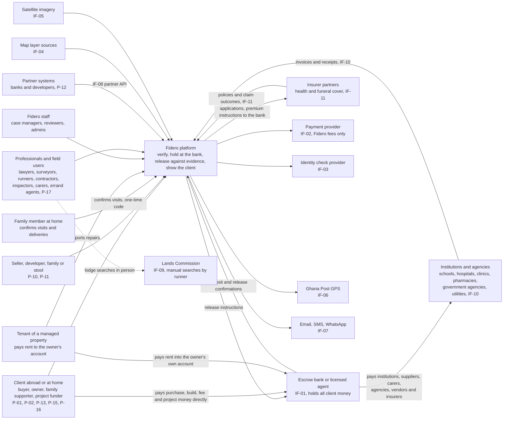

The client pays purchase, construction, project, fee and errand money straight to the bank. A tenant pays rent straight into the owner's own account at the bank (RUL-24). The bank pays every payee: seller, contractor, institution, carer, agency, vendor or insurer. Fidero only verifies, sends instructions and records confirmations. The Lands Commission link is a person, not a system (AS-07). Institutions are mostly people with invoices and receipts in R1; a portal or file link follows in R2 (IF-10).

### 3.2 Containers (C4 level 2)

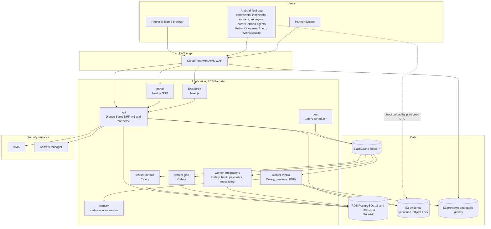

| Container | Technology | Purpose | Release |
|---|---|---|---|
| portal | Next.js, TypeScript, SSR | Client, seller, developer, family member, institution contact, tenant and insurer partner journeys; the home dashboard (FR-ACC-012); public listings | R1 (listings R2) |
| backoffice | Next.js, TypeScript | Staff, professionals and administrators; phone-first task pages | R1 |
| api | Django 5, DRF, Gunicorn with Uvicorn workers `[TO VERIFY]` | All business logic, `/v1` and `/partner/v1` | R1 (partner R2) |
| worker-default | Celery | Outbox relay, case creation, rules, track records | R1 |
| worker-geo | Celery with GDAL and PostGIS client | Overlay and overlap checks, imagery | R1 |
| worker-media | Celery with WeasyPrint, libvips, ffmpeg | Previews, video compression, PDF render | R1 |
| worker-integrations | Celery | Bank, payment, identity, messaging, institution and insurer adapters | R1 |
| beat | Celery beat | Schedules in section 7.12 | R1 |
| clamav | ClamAV daemon | Scan every upload (FR-EVD-005) | R1 |
| Android field app | Kotlin, Compose | Offline signed capture, check-in and check-out, plan items, concerns (FR-MOB-001 to FR-MOB-012) | R2 |
| PostgreSQL | RDS, Multi-AZ | System of record | R1 |
| Redis | ElastiCache | Broker, cache, rate-limit counters | R1 |
| S3 evidence | Versioning, Object Lock compliance, SSE-KMS | Evidence, released PDFs, audit anchors | R1 |
| S3 previews | SSE-KMS, served through CloudFront signed URLs | Resized images, listing media | R1 |

Uploads go straight from the client to S3 through presigned URLs. Files land in a quarantine prefix and move to the evidence prefix only after scan and hash checks.

---

## 4. Component view of the modular monolith

### 4.1 Rules for modules

1. One Django app per SRS module. Tables carry the module prefix.
2. A module writes only its own tables. It may read another module's tables only through that module's `selectors.py`.
3. A module calls another only through its `services.py`, or reacts to its events.
4. Cross-module foreign keys are allowed for integrity, with `ON DELETE RESTRICT`.
5. Every state change goes through the module's state machine, which writes the audit entry and the outbox event in the same transaction.
6. The shared kernel `core` holds identifiers, money and country types, the outbox, idempotency keys, approvals and allowed transitions. It depends on no module.

### 4.2 Module catalogue

| Module | Django app | Responsibilities | Owned tables (main) | Publishes | Consumes | FR IDs | Rel. |
|---|---|---|---|---|---|---|---|
| ACC | `accounts` | Sign-up, sign-in, MFA, lockout, roles and scoped grants, organisations (sellers, developers, institutions, insurers from R2), licences, identity checks, representatives, family members, client-owned bank accounts, vetting records for carers and agents, the home dashboard | `acc_person`, `acc_credential`, `acc_mfa_device`, `acc_refresh_token`, `acc_role_grant`, `acc_organisation`, `acc_membership`, `acc_professional_licence`, `acc_identity_check`, `acc_representative_grant`, `acc_family_member`, `acc_bank_account`, `acc_vetting` | `person.registered`, `identity_check.completed`, `licence.expired`, `account.locked`, `family_member.added`, `vetting.completed` | `config.published` | FR-ACC-001 to 012 | R1 |
| ORD | `orders` | Orders, tier quote, terms acceptance, lead source, referrals, extra inspection orders | `ord_order`, `ord_terms_acceptance`, `ord_referral_code`, `ord_referral_reward` | `order.created`, `order.paid` | `payment.confirmed`, `payment.offline_recorded` | FR-ORD-001 to 007 | R1 |
| PAY | `payments` | Fidero fee payments only, receipts, refunds, settlement reconciliation, seller invoices | `pay_fee_payment`, `pay_receipt`, `pay_refund`, `pay_settlement_line`, `pay_recon_issue`, `pay_invoice` | `payment.confirmed`, `payment.failed`, `refund.approved` | `order.created`, `listing.submitted`, `listing.sold` | FR-PAY-001 to 007 | R1 |
| CASE | `cases` | Case lifecycle from templates for every line that verifies something (land, building, fresh search, institution verification, property onboarding, vendor verification), tasks, assignments, due dates, status messages, document requests, risk screens, safety incidents, costs, messages | `case_case`, `case_task`, `case_status_message`, `case_document_request`, `case_risk_screen`, `case_cost_item`, `case_message`, `safety.incident` | `case.created`, `case.status_changed`, `task.assigned`, `task.completed`, `task.overdue`, `fresh_search.completed` | `order.paid`, `listing.verification_requested`, `reservation.created`, `report.released` | FR-CASE-001 to 015 | R1 |
| RPT | `reports` | Report versions, sections, verdict rule, locked scope text, signatures, review approvals, PDF and hash, conditions, corrections, anonymised copies | `rpt_report`, `rpt_section`, `rpt_condition`, `rpt_signature`, `rpt_hash_check` | `report.submitted`, `report.released`, `report.corrected` | `overlay.completed`, `case.status_changed` | FR-RPT-001 to 011 | R1 |
| GEO | `geo` | Assets and boundaries, overlay layers and results, overlaps, satellite images, monitoring, Ghana Post GPS | `geo_asset`, `geo_boundary_version`, `geo_overlay_layer`, `geo_overlay_layer_version`, `geo_overlay_feature`, `geo_overlay_result`, `geo_overlap_flag`, `geo_satellite_image`, `geo_monitoring_alert` | `asset.boundary_saved`, `overlay.completed`, `overlap.flagged`, `monitoring.alert_raised`, `monitoring.alert_resolved` | `listing.live`, `project.started` | FR-GEO-001 to 008 | R1 |
| ESC | `escrow` | Escrow mirror for purchase, construction, off-plan, project fund, held funds, repair and event escrows; parties, acceptances, bank payment instructions, conditions, bank events, release and cancel instructions with their payee, dispatch, statement import, the verified payee registry (ADR-17), the derived held statement (ADR-18) | `esc_escrow`, `esc_party`, `esc_acceptance`, `esc_condition`, `esc_bank_event`, `esc_release_instruction`, `esc_statement_file`, `esc_statement_line`, `esc_payee`, view `esc_held_statement` | `escrow.agreed`, `escrow.funded`, `escrow.ready`, `release.approved`, `release.sent`, `release.confirmed`, `escrow.cancelled`, `payee.verified`, `payee.suspended`, `held_funds.deposit_confirmed` | `report.released`, `dispute.opened`, `dispute.resolved`, `fresh_search.completed`, `milestone.client_approved`, `reservation.created`, `invoice.client_approved`, `visit.confirmed`, `errand_step.receipted`, `repair.inspected`, `vendor_payment.evidenced` | FR-ESC-001 to 015 | R1 |
| EVD | `evidence` | Upload slots, hashing, scan, previews, signed links, links to subjects, provenance, integrity sampling | `evd_evidence`, `evd_link`, `evd_preview`, `evd_scan_result` | `evidence.stored`, `evidence.rejected` | none | FR-EVD-001 to 006 | R1 |
| MOB | `mobile` | Device registry and keys, sync, signed manifest checks, submissions, check-in and check-out at registered addresses, fraud flags, for every field role | `mob_device`, `mob_signed_manifest`, `mob_submission`, `mob_submission_item`, `mob_checkin`, `mob_fraud_flag` | `submission.received`, `evidence.flagged`, `flags.cleared`, `checkin.recorded`, `checkout.recorded` | `milestone.status_changed`, `task.assigned`, `visit.scheduled`, `errand.assigned`, `inspection.scheduled` | FR-MOB-001 to 012 | R2 |
| BLD | `construction` | Projects of all three types, bill of quantities, milestones, panel, conflict links, inspector assignment, inspections, defects, retention, re-pricing, variations, dashboard, off-plan checks, materials (R3) | `bld_project`, `bld_boq`, `bld_milestone`, `bld_panel_member`, `bld_conflict_link`, `bld_inspection`, `bld_inspection_item`, `bld_defect`, `bld_variation`, `bld_reprice`, `bld_materials_order` | `project.started`, `milestone.status_changed`, `milestone.client_approved`, `inspection.recorded`, `contractor.removed` | `submission.received`, `flags.cleared`, `release.confirmed`, `dispute.opened` | FR-BLD-001 to 013 | R2 |
| PRJ | `projectfunds` | Project funds on the shared project and milestone engine, suppliers, background checks, invoices, AML threshold, disclaimer | `prj_supplier`, `prj_background_check`, `prj_invoice`, `prj_aml_review` | `supplier.checked`, `invoice.accepted` | `milestone.status_changed`, `release.confirmed` | FR-PRJ-001 to 005 | R2 |
| LST | `listings` | Listings, publish rule, badge, search, enquiries, reservations, removal, family and stool listings (R3) | `lst_listing`, `lst_listing_media`, `lst_enquiry`, `lst_reservation`, `lst_removal` | `listing.submitted`, `listing.verification_requested`, `listing.live`, `listing.suspended`, `reservation.created`, `listing.sold` | `payment.confirmed`, `report.released`, `monitoring.alert_raised`, `release.confirmed`, `dispute.opened` | FR-LST-001 to 010 | R2 |
| RAT | `ratings` | Ratings, hidden comments, track records | `rat_rating`, `rat_track_record` | `track_record.updated` | `case.status_changed`, `milestone.status_changed`, `dispute.closed`, `release.confirmed` | FR-RAT-001 to 004 | R2 |
| DSP | `disputes` | Disputes, parties, statements, deadlines, decisions, mediation, freeze links | `dsp_dispute`, `dsp_party`, `dsp_statement`, `dsp_subject_link` | `dispute.opened`, `dispute.resolved`, `dispute.closed` | none | FR-DSP-001 to 005 | R2 |
| PTR | `partners` | Partner API clients, scopes, status queries, partner orders, metering, webhooks | `ptr_api_client`, `ptr_usage_event`, `ptr_webhook_subscription`, `ptr_webhook_delivery` | `partner.order_created` | `report.released`, `consent.changed` | FR-PTR-001 to 004 | R2 |
| NTF | `notifications` | Templates per language and channel, preferences, sends, content policy, delivery log | `ntf_template`, `ntf_preference`, `ntf_message`, `ntf_delivery_event` | none | most events | FR-NTF-001 to 005 | R1 |
| ADM | `administration` | Versioned configuration, prices, FX guides, partner registry, locked texts, settings | `adm_config_version`, `adm_price`, `adm_fx_rate`, `adm_partner`, `adm_locked_text_version`, `adm_setting` | `config.published` | none | FR-ADM-001 to 005 | R1 |
| AUD | `audit` | Append-only hash-chained audit log, anchors, search, chain checks | `aud_event`, `aud_anchor` | none | written in-transaction, not by events | FR-AUD-001 to 004 | R1 |
| ANL | `analytics` | Metric views, dashboard API, CSV exports with logging | `anl_*` materialised views, `anl_export_log` | none | reads selectors only | FR-ANL-001 to 003 | R1 |
| DPR | `dataprotection` | Privacy notice acceptance, consents including video and partner sharing, subject requests, retention, legal holds, bulk exports, data catalogue, data locations | `dpr_privacy_acceptance`, `dpr_consent`, `dpr_request`, `dpr_retention_rule`, `dpr_legal_hold`, `dpr_bulk_export`, `dpr_data_catalogue`, `dpr_data_location` | `consent.changed` | `person.registered` | FR-DPR-001 to 005 | R1 |
| FEE | `fees` | Institutions and their verification case, named contacts, invoices and fee notes, checks against institution and family member, client approval, payment through held funds to the institution's payee record, receipts and confirmations returned, recurring schedules, runner cash vouchers as the fallback, statement per family member | `fee_institution`, `fee_institution_contact`, `fee_invoice`, `fee_payment`, `fee_schedule`, `fee_cash_voucher` | `institution.verified`, `invoice.submitted`, `invoice.client_approved`, `fee_payment.receipted`, `fee_schedule.due` | `case.status_changed`, `release.confirmed`, `held_funds.deposit_confirmed`, `payee.verified`, `payee.suspended` | FR-FEE-001 to 007 | R1 |
| CARE | `care` | Care plans and plan items, carer panel over `acc_vetting`, visit schedule, check-in and check-out results, plan item results and readings, family confirmation codes, missed and unconfirmed alerts, concerns, pay-per-confirmed-visit instructions | `care_plan`, `care_plan_item`, `care_carer`, `care_visit`, `care_visit_item`, `care_confirmation`, `care_concern` | `visit.scheduled`, `visit.checked_out`, `visit.confirmed`, `visit.unconfirmed`, `visit.missed`, `concern.raised` | `checkin.recorded`, `checkout.recorded`, `evidence.stored`, `release.confirmed`, `vetting.completed` | FR-CARE-001 to 006 | R2 |
| PMG | `propertymgmt` | Managed properties and their onboarding case, tenancies, rent periods matched to the owner's account statement under the owner's mandate, late rent alerts, repairs with quotes from the panel, repair escrows, inspections, owner timeline | `pmg_managed_property`, `pmg_tenancy`, `pmg_rent_period`, `pmg_statement_mandate`, `pmg_repair`, `pmg_repair_quote`, `pmg_inspection` | `property.onboarded`, `rent.received`, `rent.late`, `repair.reported`, `repair.quote_approved`, `repair.inspected` | `case.status_changed`, `statement.line_imported`, `checkin.recorded`, `inspection.recorded`, `release.confirmed`, `payee.verified` | FR-PMG-001 to 006 | R2 |
| TSK | `errands` | Errand catalogue per country (as configuration), errands, checklist documents, steps with receipts, agent panel over `acc_vetting`, agencies as payees, official fee instructions, completion check, handover | `tsk_errand`, `tsk_errand_document`, `tsk_errand_step`, `tsk_agent`, `tsk_handover` | `errand.ordered`, `errand.assigned`, `errand_step.receipted`, `errand.completed`, `errand.handed_over` | `config.published`, `held_funds.deposit_confirmed`, `evidence.stored`, `release.confirmed`, `vetting.completed` | FR-TSK-001 to 005 | R2 |
| INS | `insurance` | Insurer partners' products, applications passed to the insurer, policies and documents, premium schedule with instructions to the insurer's payee record, renewal reminders, claims tracked without a Fidero decision | `ins_product`, `ins_application`, `ins_policy`, `ins_premium`, `ins_claim` | `application.submitted`, `policy.issued`, `premium.due`, `claim.updated` | `release.confirmed`, `payee.verified`, `config.published` | FR-INS-001 to 004 | R2 |
| EVT | `events` | Events with budget and date, vendors and their verification case, deposits against signed quotes, vendor payments against invoices and delivery evidence with family confirmation, budget against actual | `evt_event`, `evt_vendor`, `evt_vendor_payment` | `event.created`, `vendor.verified`, `vendor_payment.evidenced` | `case.status_changed`, `release.confirmed`, `payee.verified`, `visit.confirmed` | FR-EVT-001 to 003 | R3 |
| REC | `records` | Traditional authority records, allottees, matching, revenue share, authority confirmation | `rec_authority`, `rec_allocation`, `rec_allottee`, `rec_match`, `rec_revenue_share` | `record.matched` | `asset.boundary_saved`, `case.status_changed` | FR-REC-001 to 004 | R3 |
| CTY | `countries` | Country registry, cells and data location, versioned country configuration with copying, activation with two administrators, routing directory, metrics by country | `cty_country`, `cty_cell`, `cty_country_config`, `cty_directory` | `country.activated`, `country_config.published` | `config.published` | FR-CTY-001 to 004 | R1 (copying and second cell R2) |
| core | `core` | Outbox, idempotency, approvals, allowed transitions, base types | `core_outbox_event`, `core_consumed_event`, `core_idempotency_key`, `core_approval_request`, `core_approval`, `core_allowed_transition` | all events via outbox | none | supports all | R1 |

### 4.3 Module dependencies

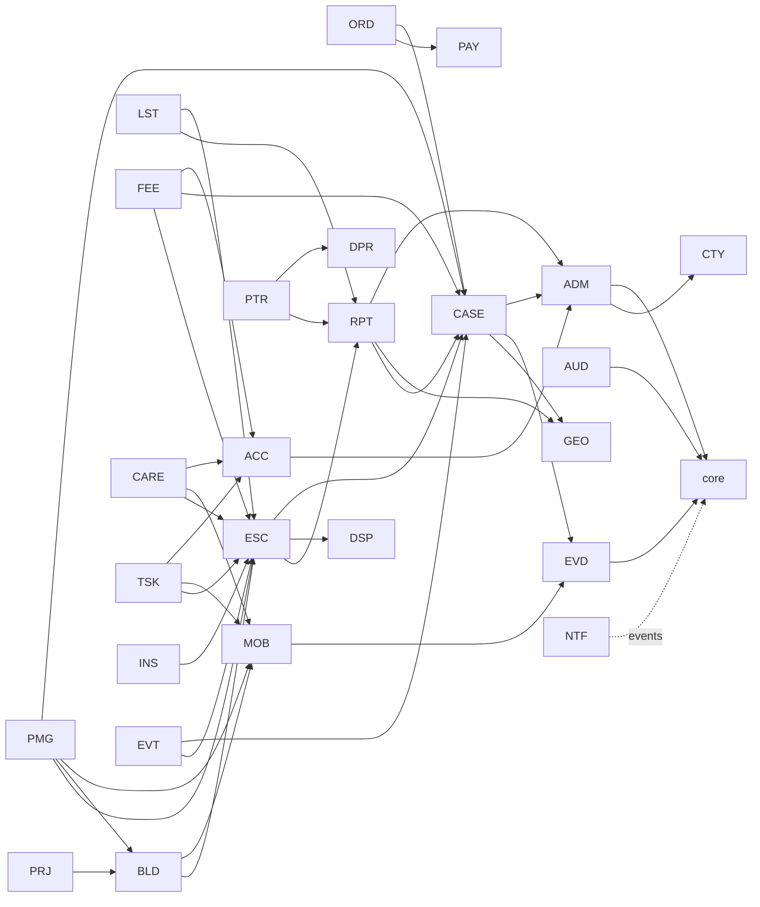

Arrows show "calls the services of". Events flow the other way through the outbox. Cycles are rejected by the import-linter contract in CI. The six line modules (ADR-21) call ESC for money, CASE for verification cases, MOB for field evidence and ACC for family members and vetting. None of them writes an ESC table.

---

## 5. Key sequences

All write calls carry an `Idempotency-Key`. Every state change writes an audit entry and an outbox event in the same transaction. These are left out of the diagrams unless they matter.

### 5.1 Order and pay (J-01)

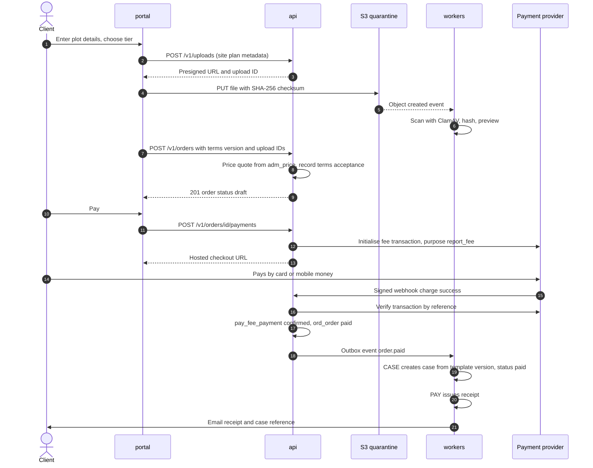

FR-ORD-001 to 005, FR-PAY-001, FR-PAY-003, FR-CASE-001, FR-EVD-005. No case exists until payment is confirmed (FR-ORD-004). An offline payment follows the same path from step 15, started by a case manager with proof attached.

### 5.2 Report review and release with hash (J-01 steps 5 to 7)

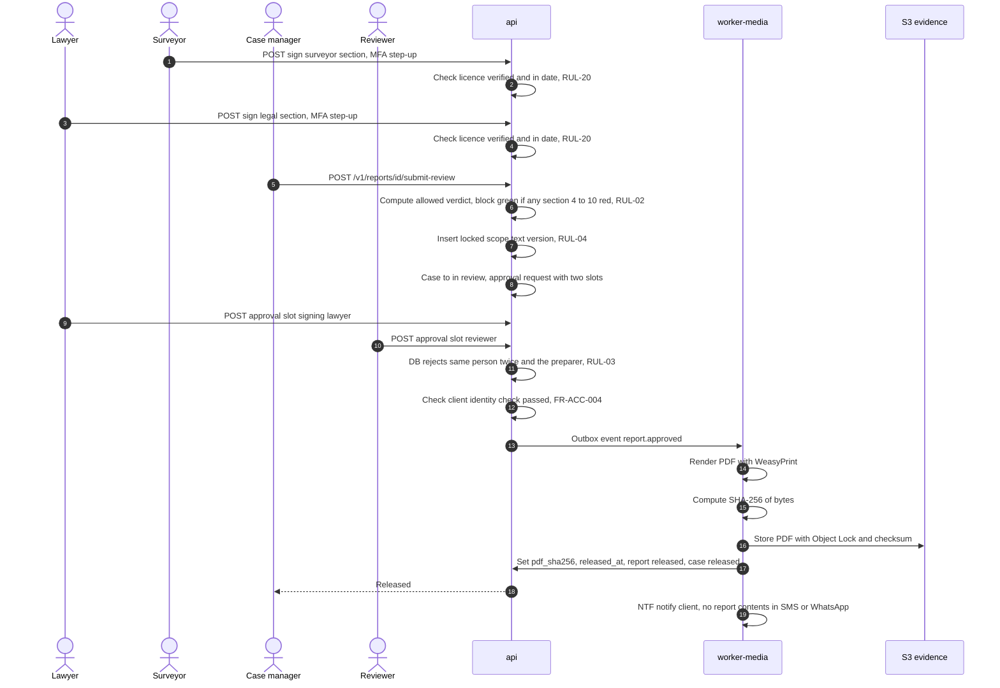

A reviewer can return the report instead, which moves the case back to in progress. A correction after release creates a new report version that supersedes the old one (FR-RPT-010).

### 5.3 Escrow release with two-person approval and bank instruction (J-02)

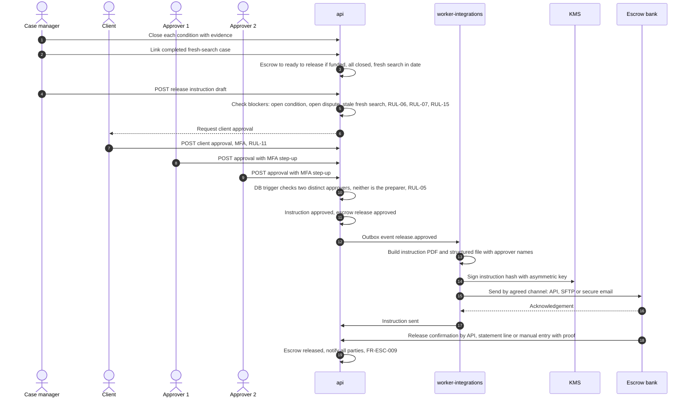

Every blocker is checked again inside the database trigger before the instruction can leave the approved state (section 6.5). If a dispute opens after approval but before dispatch, the dispatcher re-checks and stops (TQ-05).

### 5.4 Milestone capture to release (J-03)

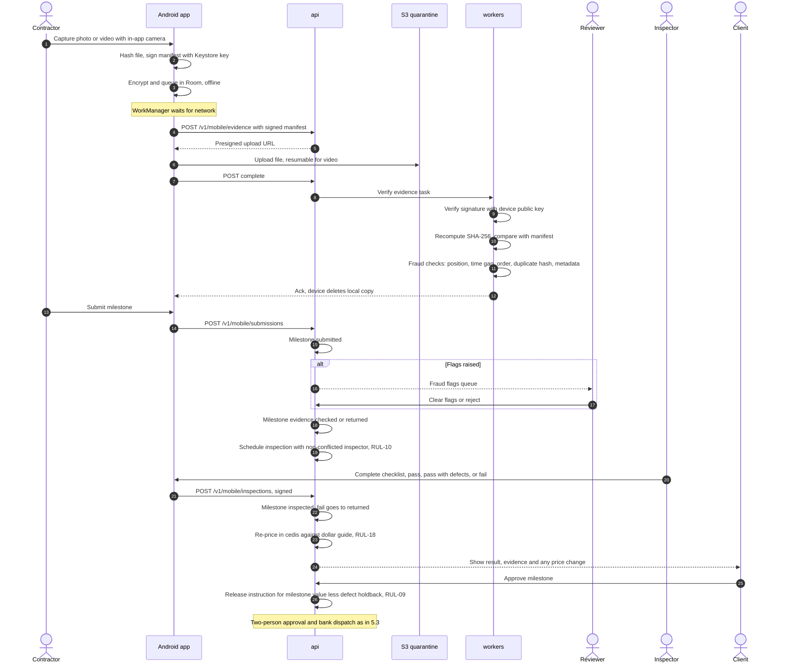

### 5.5 Listing publish and reservation with fresh search (J-04)

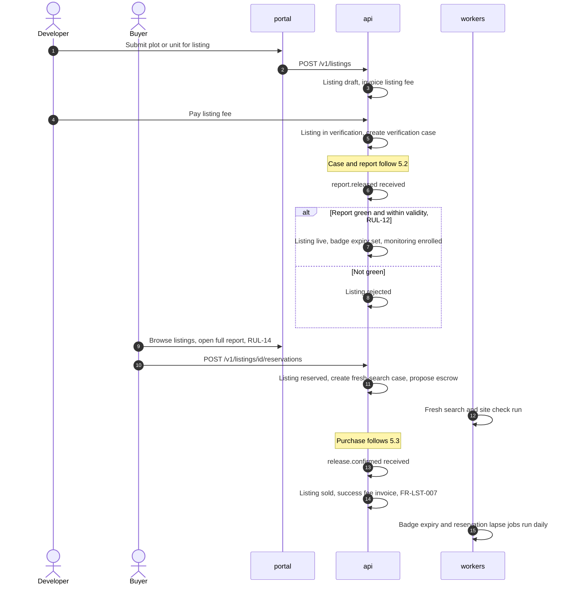

### 5.6 Partner plot status with consent check (J-06)

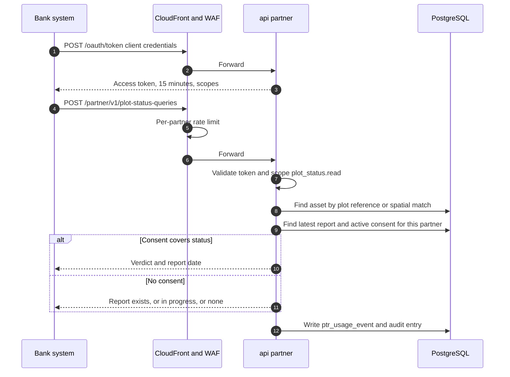

The full report is returned only with a specific consent for that partner and that report (FR-PTR-002, RUL-16).

### 5.7 Pay a school or hospital directly (J-09)

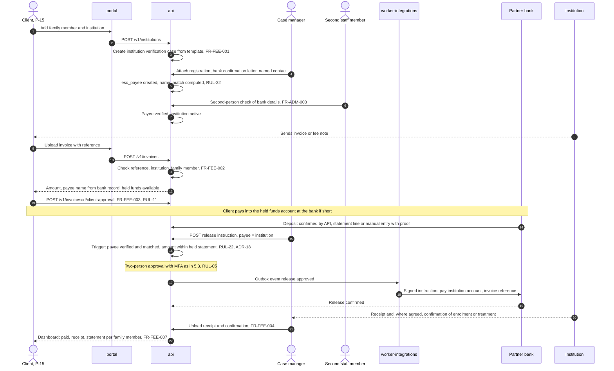

For school fees, `fee_schedule` creates the next invoice each term and asks for the client's approval before payment (FR-FEE-005). Where the institution cannot take a direct payment, the fallback is a runner cash voucher (FR-FEE-006, section 6.12 and I-19). The payee of record stays the institution; the runner is never the payee.

### 5.8 Care visit with check-in, check-out and family confirmation (J-10)

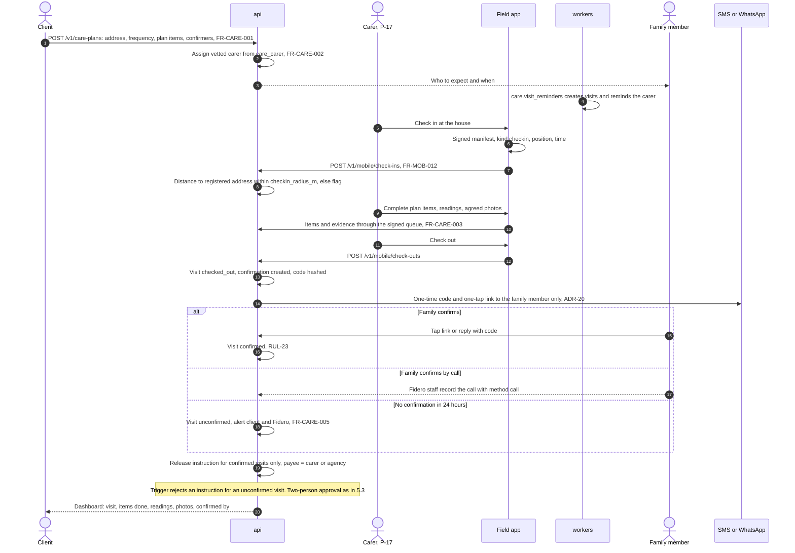

A concern raised by the carer (FR-CARE-006) is a separate, encrypted record sent the same day to the client and a reviewer. A missed visit (no check-in by the end of the scheduled window) alerts the client and Fidero.

### 5.9 Property management: rent to the owner's account, repairs against quotes (J-11)

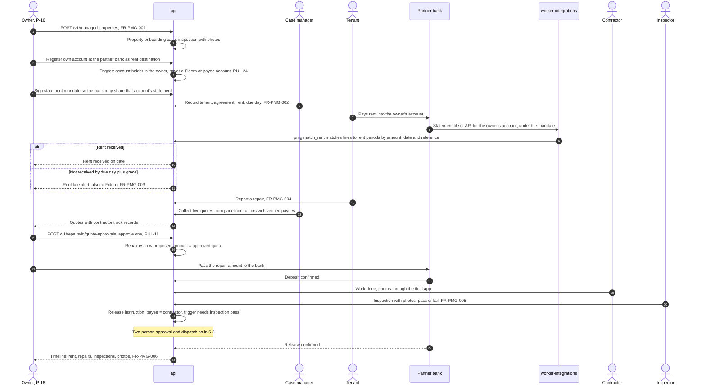

Fidero never receives rent and never appears as a rent destination (RUL-24). Rent matching reads the owner's account statement only under the owner's recorded mandate to the bank (I-21, TQ-17).

### 5.10 Paperwork and errands (J-12)

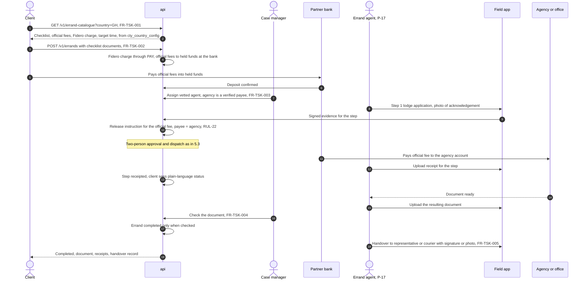

Fidero's own charge is a fee payment (PAY). Official fees are client money, held at the bank and paid to the agency only. The agent is never the payee of an official fee.

---

## 6. Database design

### 6.1 Conventions

| Topic | Rule |
|---|---|
| Engine | PostgreSQL 16 with PostGIS 3 and `pgcrypto`, on RDS Multi-AZ |
| Keys | `uuid` primary keys generated in the application (time-ordered UUID version 7). Human references such as `FDR-GH-2027-00042` in a separate unique column |
| Time | `timestamptz` in UTC. Display converts to the user's zone and Ghana time (C3) |
| Money | `numeric(18,2)` plus `char(3)` ISO 4217 currency. Never floating point |
| Country | `country_id uuid NOT NULL REFERENCES cty_country(id)` on every tenant-scoped row from the first migration (FR-CTY-001). The ISO 3166-1 code lives once, in `cty_country.code`, and appears in human references such as `FDR-GH-2027-00042` and in API filters. Row-level security on `country_id` for country-scoped staff. A CI schema test fails if a table that holds client, case, money, evidence or configuration data lacks `country_id` and is not on the allow list of global tables (`core_*`, `aud_*`, `cty_cell`, `cty_directory`) |
| State | `text` column `status` with a CHECK list matching document 01 C8, plus the generic transition trigger (6.3) |
| Concurrency | `row_version int` for optimistic locking; API uses ETag and If-Match |
| Personal data | Sensitive fields encrypted at field level (section 10.6). Lookups by keyed hash (`*_bidx`) |
| Retention | Every row with personal data carries `data_class` or inherits it from its parent (6.8) |
| Roles | `fidero_app` (DML on own tables, no DDL), `fidero_migrate` (DDL, used only by the deploy job), `fidero_audit_owner` (owns `aud_event`), `fidero_safety` (only role with access to schema `safety`), `fidero_readonly` (analytics replica) |

### 6.2 Logical entity relationships

```mermaid
erDiagram
    PERSON ||--o{ ROLE_GRANT : holds
    PERSON ||--o{ PROFESSIONAL_LICENCE : has
    ORGANISATION ||--o{ MEMBERSHIP : has
    PERSON ||--o{ MEMBERSHIP : joins
    PERSON ||--o{ ORDER : places
    ASSET ||--o{ ORDER : "is subject of"
    ORDER ||--o| CASE : creates
    CASE ||--o{ TASK : contains
    CASE ||--o{ REPORT : produces
    REPORT ||--|{ SECTION : has
    REPORT ||--o{ REPORT_CONDITION : lists
    ASSET ||--o{ BOUNDARY_VERSION : has
    BOUNDARY_VERSION ||--o{ OVERLAY_RESULT : checked
    OVERLAY_LAYER_VERSION ||--o{ OVERLAY_RESULT : "used in"
    REPORT ||--o{ ESCROW : "basis of"
    ESCROW ||--|{ ESCROW_PARTY : involves
    ESCROW ||--o{ ESCROW_CONDITION : "must close"
    ESCROW ||--o{ BANK_EVENT : records
    ESCROW ||--o{ RELEASE_INSTRUCTION : "released by"
    RELEASE_INSTRUCTION ||--|| APPROVAL_REQUEST : needs
    APPROVAL_REQUEST ||--o{ APPROVAL : collects
    ASSET ||--o{ PROJECT : "built on"
    PROJECT ||--|{ MILESTONE : has
    PROJECT ||--o| ESCROW : "funded through"
    MILESTONE ||--o{ SUBMISSION : receives
    MILESTONE ||--o{ INSPECTION : gets
    INSPECTION ||--o{ DEFECT : lists
    SUBMISSION ||--o{ SUBMISSION_ITEM : contains
    SUBMISSION_ITEM }o--|| EVIDENCE : references
    DEVICE ||--o{ SUBMISSION_ITEM : signs
    EVIDENCE ||--o{ EVIDENCE_LINK : "attached to"
    ASSET ||--o{ LISTING : "listed as"
    LISTING ||--o| REPORT : "backed by"
    LISTING ||--o{ RESERVATION : gets
    DISPUTE ||--|{ DISPUTE_SUBJECT_LINK : freezes
    PERSON ||--o{ CONSENT : gives
    PERSON ||--o{ AUDIT_EVENT : acts
    COUNTRY ||--o{ ASSET : contains
    CONFIG_VERSION ||--o{ CASE : "templates"
    COUNTRY ||--|{ COUNTRY_CONFIG : "configured by"
    CELL ||--o{ COUNTRY : hosts
    PERSON ||--o{ FAMILY_MEMBER : supports
    PERSON ||--o{ BANK_ACCOUNT : owns
    PAYEE ||--o{ RELEASE_INSTRUCTION : "paid by"
    ESCROW ||--o{ RELEASE_INSTRUCTION : "instructs from"
    INSTITUTION ||--|| PAYEE : "is paid as"
    INSTITUTION ||--o{ INVOICE : issues
    FAMILY_MEMBER ||--o{ INVOICE : "is for"
    INVOICE ||--o| FEE_PAYMENT : "paid by"
    FEE_PAYMENT }o--|| RELEASE_INSTRUCTION : through
    FAMILY_MEMBER ||--o{ CARE_PLAN : "cared for by"
    CARE_PLAN ||--|{ CARE_PLAN_ITEM : lists
    CARE_PLAN ||--o{ CARE_VISIT : schedules
    CARER ||--o{ CARE_VISIT : performs
    CARE_VISIT ||--o{ CARE_VISIT_ITEM : records
    CARE_VISIT ||--o| CARE_CONFIRMATION : "confirmed by"
    CARE_VISIT ||--o{ CARE_CONCERN : raises
    PERSON ||--o{ MANAGED_PROPERTY : owns
    ASSET ||--o| MANAGED_PROPERTY : "managed as"
    MANAGED_PROPERTY ||--|| BANK_ACCOUNT : "rent paid into"
    MANAGED_PROPERTY ||--o{ TENANCY : lets
    TENANCY ||--o{ RENT_PERIOD : expects
    RENT_PERIOD }o--o| STATEMENT_LINE : "matched to"
    MANAGED_PROPERTY ||--o{ REPAIR : needs
    REPAIR ||--|{ REPAIR_QUOTE : collects
    REPAIR ||--o| ESCROW : "funded by"
    MANAGED_PROPERTY ||--o{ PROPERTY_INSPECTION : gets
    PERSON ||--o{ ERRAND : orders
    ERRAND ||--|{ ERRAND_DOCUMENT : requires
    ERRAND ||--|{ ERRAND_STEP : "done in"
    AGENT ||--o{ ERRAND : performs
    ERRAND ||--o| HANDOVER : "ends with"
    PERSON ||--o{ POLICY : holds
    FAMILY_MEMBER ||--o{ POLICY : insures
    POLICY ||--|{ PREMIUM : schedules
    POLICY ||--o{ CLAIM : "claimed on"
    PERSON ||--o{ EVENT : funds
    EVENT ||--|{ EVENT_VENDOR : uses
    EVENT_VENDOR ||--o{ VENDOR_PAYMENT : receives
```

Every entity except the shared kernel, the audit log and the cell directory carries `country_id` (not drawn).

### 6.3 Shared kernel tables

```sql
CREATE TABLE core_allowed_transition (
  entity      text NOT NULL,            -- 'case', 'escrow', 'milestone', 'listing', 'dispute', ...
  from_status text NOT NULL,
  to_status   text NOT NULL,
  PRIMARY KEY (entity, from_status, to_status)
);
-- Seeded from document 01 C8 by migration. Generic trigger core.enforce_transition()
-- rejects any UPDATE of status that has no row here.

CREATE TABLE core_approval_request (
  id            uuid PRIMARY KEY,
  subject_type  text NOT NULL CHECK (subject_type IN
                  ('report_release','escrow_release','escrow_cancel','refund',
                   'locked_text_change','bulk_export',
                   'payee_verification',        -- bank details of any payee, FR-ADM-003
                   'bank_account_verification', -- a client's own account as rent destination, RUL-24
                   'release_setting_change',    -- FR-ADM-005 values that affect a release
                   'release_rights_grant',      -- C2: release rights granted by two administrators
                   'country_config_publish',    -- FR-CTY-004, 6.9
                   'cash_voucher')),            -- FR-FEE-006 runner cash voucher
  subject_id    uuid NOT NULL,
  prepared_by   uuid NOT NULL REFERENCES acc_person(id),
  required      smallint NOT NULL DEFAULT 2 CHECK (required >= 2),
  status        text NOT NULL CHECK (status IN ('open','approved','rejected','withdrawn')),
  created_at    timestamptz NOT NULL DEFAULT now(),
  UNIQUE (subject_type, subject_id, created_at)
);

CREATE TABLE core_approval (
  id            uuid PRIMARY KEY,
  request_id    uuid NOT NULL REFERENCES core_approval_request(id),
  slot          text NOT NULL,           -- e.g. 'signing_lawyer', 'reviewer', 'release_1', 'release_2'
  approver_id   uuid NOT NULL REFERENCES acc_person(id),
  decision      text NOT NULL CHECK (decision IN ('approve','reject')),
  mfa_method    text NOT NULL CHECK (mfa_method IN ('totp','webauthn')),
  mfa_at        timestamptz NOT NULL,
  approved_at   timestamptz NOT NULL DEFAULT now(),
  CHECK (approved_at - mfa_at <= interval '5 minutes'),     -- step-up freshness (assumption)
  UNIQUE (request_id, approver_id),                          -- one person, one approval
  UNIQUE (request_id, slot)
);
-- Trigger core.approval_not_preparer(): rejects approver_id = request.prepared_by.
-- Trigger core.approval_close(): sets request to 'approved' when count(distinct approver_id)
-- with decision 'approve' reaches 'required'.

CREATE TABLE core_outbox_event (
  id            uuid PRIMARY KEY,
  topic         text NOT NULL,
  aggregate_id  uuid NOT NULL,
  payload       jsonb NOT NULL,
  created_at    timestamptz NOT NULL DEFAULT now(),
  published_at  timestamptz
);
CREATE INDEX ON core_outbox_event (created_at) WHERE published_at IS NULL;

CREATE TABLE core_idempotency_key (
  principal_id  uuid NOT NULL,
  key           text NOT NULL,
  request_hash  bytea NOT NULL,
  response_code smallint,
  response_body jsonb,
  created_at    timestamptz NOT NULL DEFAULT now(),
  PRIMARY KEY (principal_id, key)
);
```

### 6.4 Accounts, orders, fee payments and assets

```sql
CREATE TABLE acc_person (
  id               uuid PRIMARY KEY,
  country_id     uuid NOT NULL REFERENCES cty_country(id),
  full_name_enc    bytea NOT NULL,                 -- field-level encrypted
  email_enc        bytea, email_bidx bytea UNIQUE,  -- blind index for sign-in lookup
  phone_enc        bytea, phone_bidx bytea UNIQUE,
  id_doc_number_enc bytea,                          -- Ghana Card or passport number
  id_check_status  text NOT NULL DEFAULT 'none'
                   CHECK (id_check_status IN ('none','pending','passed','failed','manual_passed')),
  password_hash    text,                            -- Argon2id
  failed_logins    smallint NOT NULL DEFAULT 0,
  locked_until     timestamptz,                     -- FR-ACC-009
  status           text NOT NULL CHECK (status IN ('active','suspended','anonymised')),
  data_class       text NOT NULL DEFAULT 'account',
  created_at       timestamptz NOT NULL DEFAULT now(),
  row_version      int NOT NULL DEFAULT 1,
  CHECK (email_bidx IS NOT NULL OR phone_bidx IS NOT NULL)
);

CREATE TABLE acc_role_grant (
  id          uuid PRIMARY KEY,
  person_id   uuid NOT NULL REFERENCES acc_person(id),
  role        text NOT NULL CHECK (role IN ('client','seller','developer','case_manager',
                'reviewer','lawyer','surveyor','runner','contractor','inspector',
                'administrator','quantity_surveyor','representative','authority_rep',
                'project_runner','supplier',                         -- 01 C2 version 0.2
                'family_member','institution_contact','carer','errand_agent',
                'tenant','insurer_partner')),                        -- 01 C2 version 0.3
  scope_type  text CHECK (scope_type IN ('country','case','project','listing','organisation','authority',
                'family_member','institution','care_plan','managed_property','tenancy','errand','policy','event')),
  scope_id    uuid,
  release_rights boolean NOT NULL DEFAULT false,    -- FR-ESC-007; a permission, not a role (01 C2)
  granted_by  uuid NOT NULL REFERENCES acc_person(id),
  approval_request_id uuid REFERENCES core_approval_request(id),  -- required when release_rights
  valid_from  timestamptz NOT NULL DEFAULT now(),
  valid_to    timestamptz,
  CHECK (NOT release_rights OR role = 'reviewer'),  -- 01 C2: case managers cannot approve a release
  CHECK (NOT release_rights OR approval_request_id IS NOT NULL),
  CHECK (role NOT IN ('family_member','institution_contact','carer','errand_agent','tenant','insurer_partner')
         OR scope_id IS NOT NULL)                   -- these roles are always scoped
);
-- Trigger acc.no_money_roles(): rejects release_rights on any grant whose person also holds
-- 'client', 'family_member', 'representative', 'carer', 'errand_agent', 'contractor' or 'supplier'
-- in the same country (separation of duties, RUL-11, RUL-22).

CREATE TABLE acc_professional_licence (
  id           uuid PRIMARY KEY,
  person_id    uuid NOT NULL REFERENCES acc_person(id),
  body         text NOT NULL,                   -- e.g. General Legal Council, licensing body for surveyors [TO VERIFY]
  number       text NOT NULL,
  expires_on   date NOT NULL,
  verified_by  uuid REFERENCES acc_person(id),
  verified_on  date,
  evidence_id  uuid REFERENCES evd_evidence(id),
  UNIQUE (body, number)
);

CREATE TABLE acc_family_member (                     -- FR-ACC-012, FR-FEE-002, FR-CARE-001
  id              uuid PRIMARY KEY,
  country_id      uuid NOT NULL REFERENCES cty_country(id),   -- the country where the person lives
  client_id       uuid NOT NULL REFERENCES acc_person(id),
  person_id       uuid REFERENCES acc_person(id),              -- set when they have their own sign-in
  full_name_enc   bytea NOT NULL,
  relationship    text NOT NULL,                                -- 'mother', 'nephew', ... free text
  phone_enc       bytea, phone_bidx bytea,                     -- confirmation channel, ADR-20
  address_enc     bytea,
  address_point   geography(Point, 4326),                      -- registered address for check-in, RUL-23
  may_confirm_visits boolean NOT NULL DEFAULT false,
  consent_id      uuid REFERENCES dpr_consent(id),             -- the family member's own notice
  status          text NOT NULL CHECK (status IN ('active','removed','anonymised')),
  data_class      text NOT NULL DEFAULT 'family',
  created_at      timestamptz NOT NULL DEFAULT now(),
  CHECK (NOT may_confirm_visits OR phone_bidx IS NOT NULL OR person_id IS NOT NULL)
);
CREATE INDEX ON acc_family_member (client_id) WHERE status = 'active';
-- A family member is never a payee. Trigger esc.payee_not_relative() in 6.11 checks this table.

CREATE TABLE acc_bank_account (                      -- a client's OWN account, e.g. rent destination, RUL-24
  id                uuid PRIMARY KEY,
  country_id        uuid NOT NULL REFERENCES cty_country(id),
  holder_person_id  uuid NOT NULL REFERENCES acc_person(id),
  bank_partner_id   uuid NOT NULL REFERENCES adm_partner(id),  -- must be type escrow_bank, RUL-24
  account_number_enc bytea NOT NULL,
  account_name_enc  bytea NOT NULL,
  account_name_bidx bytea NOT NULL,                             -- normalised name, blind index
  name_match        text NOT NULL DEFAULT 'pending' CHECK (name_match IN ('pending','matched','mismatch')),
  verification_status text NOT NULL DEFAULT 'unverified'
                    CHECK (verification_status IN ('unverified','pending','verified','suspended')),
  evidence_id       uuid REFERENCES evd_evidence(id),          -- bank confirmation letter or name enquiry result
  approval_request_id uuid REFERENCES core_approval_request(id), -- bank_account_verification, two staff
  created_at        timestamptz NOT NULL DEFAULT now(),
  CHECK (verification_status <> 'verified' OR (name_match = 'matched' AND approval_request_id IS NOT NULL))
);
-- Trigger acc.bank_account_holder_name(): name_match = 'matched' only when account_name_bidx equals
-- the holder's normalised full name blind index. There is no holder kind 'fidero' and no column anywhere
-- for a Fidero account number (RUL-01, RUL-24). Trigger acc.bank_account_change_resets(): any change to
-- account_number_enc or account_name_enc sets verification_status back to 'pending'.

CREATE TABLE acc_vetting (                           -- FR-CARE-002, FR-TSK-003, shared by carers and agents
  id               uuid PRIMARY KEY,
  country_id       uuid NOT NULL REFERENCES cty_country(id),
  person_id        uuid NOT NULL REFERENCES acc_person(id),
  kind             text NOT NULL CHECK (kind IN ('carer','errand_agent','runner','inspector','contractor')),
  identity_check_id uuid NOT NULL REFERENCES acc_identity_check(id),
  references_evidence_id uuid REFERENCES evd_evidence(id),
  background_check_evidence_id uuid REFERENCES evd_evidence(id),  -- police report or equivalent [TO VERIFY]
  training_evidence_id uuid REFERENCES evd_evidence(id),
  checklist_version_id uuid NOT NULL REFERENCES adm_config_version(id), -- what vetting means per country, Q-19
  status           text NOT NULL CHECK (status IN ('pending','vetted','expired','revoked')),
  vetted_by        uuid REFERENCES acc_person(id),
  vetted_at        timestamptz,
  valid_until      date,
  revoke_reason    text,
  CHECK (status <> 'vetted' OR (vetted_by IS NOT NULL AND valid_until IS NOT NULL
         AND references_evidence_id IS NOT NULL AND background_check_evidence_id IS NOT NULL))
);
CREATE UNIQUE INDEX one_live_vetting ON acc_vetting (person_id, kind) WHERE status IN ('pending','vetted');

CREATE TABLE ord_order (
  id              uuid PRIMARY KEY,
  reference       text NOT NULL UNIQUE,
  country_id    uuid NOT NULL REFERENCES cty_country(id),
  client_id       uuid NOT NULL REFERENCES acc_person(id),
  asset_id        uuid NOT NULL REFERENCES geo_asset(id),
  kind            text NOT NULL CHECK (kind IN ('verification','fresh_search','extra_inspection','listing_verification')),
  tier_config_id  uuid NOT NULL REFERENCES adm_config_version(id),
  price           numeric(18,2) NOT NULL CHECK (price >= 0),
  currency        char(3) NOT NULL,
  lead_source     text CHECK (lead_source IN ('association','webinar','referral','remittance_partner','other')),
  referral_code   text,
  terms_version_id uuid NOT NULL REFERENCES adm_locked_text_version(id),
  status          text NOT NULL CHECK (status IN ('draft','awaiting_payment','paid','cancelled','refunded')),
  created_at      timestamptz NOT NULL DEFAULT now()
);
CREATE INDEX ON ord_order (client_id, created_at DESC);

CREATE TABLE pay_fee_payment (
  id              uuid PRIMARY KEY,
  purpose         text NOT NULL CHECK (purpose IN ('report_fee','escrow_fee','inspection_fee',
                    'listing_fee','success_fee','construction_mgmt_fee','api_fee','conveyancing_fee',
                    'institution_service_fee','care_service_fee','property_mgmt_fee','errand_fee',
                    'event_service_fee')),               -- new line fees provisional until pricing, Q-20, TQ-22
  payer_id        uuid NOT NULL REFERENCES acc_person(id),
  order_id        uuid REFERENCES ord_order(id),
  invoice_id      uuid REFERENCES pay_invoice(id),
  amount          numeric(18,2) NOT NULL CHECK (amount > 0),
  currency        char(3) NOT NULL,
  method          text NOT NULL CHECK (method IN ('card','mobile_money','bank_transfer_offline')),
  provider        text NOT NULL,
  provider_ref    text UNIQUE,
  card_last4      char(4),                          -- never the full number, FR-PAY-002
  status          text NOT NULL CHECK (status IN ('initiated','confirmed','failed','refunded','partially_refunded')),
  confirmed_at    timestamptz,
  CHECK (order_id IS NOT NULL OR invoice_id IS NOT NULL)
);
-- RUL-01: there is no purpose for purchase, construction or project money, and no table
-- anywhere that stores a client balance. A CI schema test fails if a column named
-- like '%balance%' or '%wallet%' appears.

CREATE TABLE geo_asset (
  id              uuid PRIMARY KEY,
  country_id    uuid NOT NULL REFERENCES cty_country(id),
  type            text NOT NULL CHECK (type IN ('plot','building','offplan_unit')),
  locality        text NOT NULL,
  plot_number     text,
  site_plan_ref   text,
  ghana_post_gps  text,
  current_boundary_id uuid,                        -- FK to geo_boundary_version
  disputed_flag   boolean NOT NULL DEFAULT false,  -- drives RUL-17
  created_at      timestamptz NOT NULL DEFAULT now()
);
CREATE INDEX ON geo_asset (country_id, locality, plot_number);

CREATE TABLE geo_boundary_version (
  id           uuid PRIMARY KEY,
  asset_id     uuid NOT NULL REFERENCES geo_asset(id),
  geom         geometry(MultiPolygon, 4326) NOT NULL CHECK (ST_IsValid(geom)),
  source       text NOT NULL CHECK (source IN ('surveyor_coordinates','digitised_site_plan','records_programme')),
  captured_by  uuid NOT NULL REFERENCES acc_person(id),
  created_at   timestamptz NOT NULL DEFAULT now()
);
CREATE INDEX ON geo_boundary_version USING gist (geom);

CREATE TABLE geo_overlay_result (
  id                 uuid PRIMARY KEY,
  boundary_id        uuid NOT NULL REFERENCES geo_boundary_version(id),
  layer_version_id   uuid NOT NULL REFERENCES geo_overlay_layer_version(id),
  outcome            text NOT NULL CHECK (outcome IN ('inside','near','clear')),
  distance_m         numeric(10,2),
  buffer_m           numeric(10,2) NOT NULL,       -- from adm_setting at run time
  computed_at        timestamptz NOT NULL DEFAULT now(),
  UNIQUE (boundary_id, layer_version_id)
);
```

### 6.5 Cases, reports and escrow

```sql
CREATE TABLE case_case (
  id               uuid PRIMARY KEY,
  reference        text NOT NULL UNIQUE,
  country_id     uuid NOT NULL REFERENCES cty_country(id),
  order_id         uuid UNIQUE REFERENCES ord_order(id),            -- FR-ORD-004; null only for line cases below
  asset_id         uuid REFERENCES geo_asset(id),                  -- null for institution and vendor cases
  client_id        uuid NOT NULL REFERENCES acc_person(id),
  product_line     text NOT NULL CHECK (product_line IN ('land','building','fresh_search',
                     'institution_verification',   -- FEE, FR-FEE-001
                     'property_onboarding',        -- PMG, FR-PMG-001
                     'vendor_verification')),      -- EVT, FR-EVT-001; ADR-21
  template_version_id uuid NOT NULL REFERENCES adm_config_version(id),
  status           text NOT NULL CHECK (status IN ('paid','in_progress','on_hold',
                     'in_review','released','cancelled')),   -- 01 C8: a case starts at Paid
  hold_reason      text,
  risk_flag        boolean NOT NULL DEFAULT false,
  case_manager_id  uuid REFERENCES acc_person(id),
  data_class       text NOT NULL DEFAULT 'case_report',
  created_at       timestamptz NOT NULL DEFAULT now(),
  row_version      int NOT NULL DEFAULT 1,
  CHECK (status <> 'on_hold' OR hold_reason IS NOT NULL),
  CHECK (product_line IN ('institution_verification','vendor_verification') OR asset_id IS NOT NULL),
  CHECK (product_line IN ('institution_verification','property_onboarding','vendor_verification')
         OR order_id IS NOT NULL)
);
CREATE INDEX ON case_case (status, country_id);

CREATE TABLE case_task (
  id              uuid PRIMARY KEY,
  case_id         uuid NOT NULL REFERENCES case_case(id),
  step_key        text NOT NULL,                     -- from template, e.g. 'site_visit'
  owner_role      text NOT NULL,
  assignee_id     uuid REFERENCES acc_person(id),
  second_assignee_id uuid REFERENCES acc_person(id), -- RUL-17 two people on disputed plots
  due_at          timestamptz NOT NULL,
  due_change_reason text,
  required_evidence jsonb NOT NULL,                  -- list of evidence kinds from template
  status          text NOT NULL CHECK (status IN ('open','in_progress','done','cancelled')),
  completed_at    timestamptz,
  CHECK (second_assignee_id IS NULL OR second_assignee_id <> assignee_id)
);
CREATE INDEX ON case_task (assignee_id, status, due_at);
-- Trigger case.task_done_requires_evidence(): rejects status 'done' unless every kind in
-- required_evidence has a matching evd_link row (FR-CASE-004).
-- Trigger case.site_visit_risk(): for step_key 'site_visit' on an asset with disputed_flag,
-- rejects assignment without a passed case_risk_screen and a second assignee (RUL-17).

CREATE TABLE rpt_report (
  id               uuid PRIMARY KEY,
  case_id          uuid NOT NULL REFERENCES case_case(id),
  version          int NOT NULL,
  template_version_id uuid NOT NULL REFERENCES adm_config_version(id),
  scope_text_version_id uuid NOT NULL REFERENCES adm_locked_text_version(id), -- RUL-04
  overall_verdict  text CHECK (overall_verdict IN ('red','amber','green')),
  status           text NOT NULL CHECK (status IN ('draft','in_review','approved','released','superseded')),
  approval_request_id uuid REFERENCES core_approval_request(id),
  pdf_object_key   text,
  pdf_sha256       bytea CHECK (pdf_sha256 IS NULL OR length(pdf_sha256) = 32),
  released_at      timestamptz,
  supersedes_id    uuid REFERENCES rpt_report(id),
  correction_reason text,
  UNIQUE (case_id, version),
  CHECK (status <> 'released' OR (pdf_sha256 IS NOT NULL AND released_at IS NOT NULL)),
  CHECK (supersedes_id IS NULL OR correction_reason IS NOT NULL)
);
-- Trigger rpt.freeze_released(): rejects any UPDATE to a released row except status -> 'superseded'
-- (FR-RPT-010). Trigger rpt.verdict_rule(): rejects overall_verdict = 'green' if any rpt_section
-- with number between 4 and 10 has verdict 'red' (RUL-02; the report template also says 4 to 10).

CREATE TABLE rpt_section (
  id           uuid PRIMARY KEY,
  report_id    uuid NOT NULL REFERENCES rpt_report(id),
  number       smallint NOT NULL CHECK (number BETWEEN 1 AND 14),
  owner_role   text NOT NULL,
  findings     jsonb NOT NULL DEFAULT '{}',
  verdict      text CHECK (verdict IN ('red','amber','green')),
  proposed_verdict text CHECK (proposed_verdict IN ('red','amber','green')),  -- from GEO for section 7
  UNIQUE (report_id, number)
);

CREATE TABLE rpt_signature (
  id           uuid PRIMARY KEY,
  section_id   uuid NOT NULL REFERENCES rpt_section(id),
  signer_id    uuid NOT NULL REFERENCES acc_person(id),
  licence_id   uuid NOT NULL REFERENCES acc_professional_licence(id),
  signed_at    timestamptz NOT NULL DEFAULT now(),
  content_sha256 bytea NOT NULL                     -- hash of section content at signing
);
-- Trigger rpt.licence_valid(): rejects if licence unverified or expires_on < signed_at (RUL-20).

CREATE TABLE esc_escrow (
  id               uuid PRIMARY KEY,
  reference        text NOT NULL UNIQUE,
  country_id     uuid NOT NULL REFERENCES cty_country(id),
  kind             text NOT NULL CHECK (kind IN ('purchase','construction','offplan','project_fund',
                     'held_funds',        -- FR-ESC-014: institution payments, care visits, errands; ADR-18
                     'repair',            -- FR-PMG-005
                     'event')),           -- FR-EVT-002
  client_id        uuid NOT NULL REFERENCES acc_person(id),
  asset_id         uuid REFERENCES geo_asset(id),                -- null for held_funds and event
  report_id        uuid REFERENCES rpt_report(id),
  project_id       uuid REFERENCES bld_project(id),
  bank_partner_id  uuid NOT NULL REFERENCES adm_partner(id),     -- must be type escrow_bank
  bank_reference   text,
  agreed_amount    numeric(18,2) NOT NULL CHECK (agreed_amount > 0),  -- recorded fact, not a balance
  currency         char(3) NOT NULL,
  terms_version_id uuid NOT NULL REFERENCES adm_locked_text_version(id),
  status           text NOT NULL CHECK (status IN ('proposed','agreed','funded','ready_to_release',
                     'client_approved','release_approved','partly_released','released','frozen','cancelled')),
                     -- matches 01 C8 version 0.2. A held_funds escrow lives in funded or partly_released
  fresh_search_case_id uuid REFERENCES case_case(id),
  created_at       timestamptz NOT NULL DEFAULT now(),
  CHECK (kind <> 'purchase' OR report_id IS NOT NULL),
  CHECK (kind NOT IN ('construction','offplan','project_fund') OR project_id IS NOT NULL),
  CHECK (kind IN ('held_funds','event') OR asset_id IS NOT NULL),
  CHECK (kind <> 'held_funds' OR agreed_amount >= 0)              -- a held_funds escrow has no fixed price
);
CREATE INDEX ON esc_escrow (client_id, kind, status);
-- Bank payment instructions shown to clients are read from adm_partner (bank) and
-- esc_escrow.bank_reference only. No column holds a Fidero account number (FR-ESC-003).

CREATE TABLE esc_condition (
  id            uuid PRIMARY KEY,
  escrow_id     uuid NOT NULL REFERENCES esc_escrow(id),
  source_condition_id uuid REFERENCES rpt_condition(id),  -- copied from section 11, FR-RPT-009
  text          text NOT NULL,
  status        text NOT NULL CHECK (status IN ('open','closed','waived_by_approval')),
  closed_by     uuid REFERENCES acc_person(id),
  closed_at     timestamptz,
  CHECK (status = 'open' OR (closed_by IS NOT NULL AND closed_at IS NOT NULL))
);
-- Trigger: closing requires at least one evd_link to this condition (FR-ESC-005).

CREATE TABLE esc_release_instruction (
  id               uuid PRIMARY KEY,
  escrow_id        uuid NOT NULL REFERENCES esc_escrow(id),
  kind             text NOT NULL CHECK (kind IN ('release','partial_release','cancel_refund')),
  milestone_id     uuid REFERENCES bld_milestone(id),
  subject_type     text CHECK (subject_type IN ('milestone','fee_invoice','care_visit','errand_step',
                     'repair','event_vendor_payment','premium','cash_voucher')),   -- FR-ESC-010
  subject_id       uuid,
  payee_party_id   uuid REFERENCES esc_party(id),
  payee_id         uuid REFERENCES esc_payee(id),                 -- ADR-17; null only for cancel_refund
  payment_method   text NOT NULL DEFAULT 'bank_transfer'
                   CHECK (payment_method IN ('bank_transfer','runner_cash_voucher')),  -- FR-FEE-006
  amount           numeric(18,2) NOT NULL CHECK (amount > 0),
  holdback_amount  numeric(18,2) NOT NULL DEFAULT 0 CHECK (holdback_amount >= 0),  -- RUL-09
  currency         char(3) NOT NULL,
  prepared_by      uuid NOT NULL REFERENCES acc_person(id),
  approval_request_id uuid NOT NULL REFERENCES core_approval_request(id),
  client_approved_at timestamptz,                                -- RUL-11
  status           text NOT NULL CHECK (status IN ('draft','pending_approval','approved',
                     'sent','confirmed','rejected_by_bank','withdrawn')),
  document_sha256  bytea,
  kms_signature    bytea,
  sent_at          timestamptz,
  bank_confirmation_event_id uuid REFERENCES esc_bank_event(id),
  CHECK (kind <> 'partial_release' OR milestone_id IS NOT NULL OR subject_id IS NOT NULL),
  CHECK ((subject_type IS NULL) = (subject_id IS NULL)),
  CHECK (kind = 'cancel_refund' OR payee_id IS NOT NULL),        -- RUL-22: every release names a payee
  CHECK (payment_method <> 'runner_cash_voucher' OR subject_type = 'cash_voucher'),
  CHECK (status NOT IN ('sent','confirmed') OR (document_sha256 IS NOT NULL AND kms_signature IS NOT NULL))
);
CREATE UNIQUE INDEX one_live_instruction_per_milestone
  ON esc_release_instruction (milestone_id)
  WHERE status IN ('pending_approval','approved','sent','confirmed') AND milestone_id IS NOT NULL;
CREATE UNIQUE INDEX one_live_instruction_per_subject
  ON esc_release_instruction (subject_type, subject_id)
  WHERE status IN ('pending_approval','approved','sent','confirmed') AND subject_id IS NOT NULL;
-- Trigger esc.release_blockers() BEFORE UPDATE to 'approved' or 'sent' raises if:
--   any esc_condition for the escrow is 'open'                          (RUL-06)
--   any open dsp_dispute is linked to the escrow, project or milestone   (RUL-15)
--   kind <> 'cancel_refund' and the fresh-search case is missing, not released,
--     or older than adm_setting 'fresh_search_window_days'              (RUL-07; purchase only)
--   approval request is not 'approved'                                   (RUL-05)
--   milestone set and no inspection with outcome pass or pass_with_defects (RUL-09)
--   client_approved_at is null for kinds that need client approval      (RUL-11)
--   payee is not 'verified' with name_match 'matched', or its kind is not
--     allowed for subject_type, or it is the client, a family member of
--     the client or the client's representative (6.11)                   (RUL-22, FR-ESC-015)
--   subject_type 'care_visit' and the visit is not 'confirmed'            (RUL-23)
--   subject_type 'errand_step' and the step has no receipt or the agency
--     is not the payee                                                    (RUL-23, FR-TSK-003)
--   subject_type 'repair' and the repair has no inspection with pass      (FR-PMG-005)
--   subject_type 'premium' and the payee kind is not 'insurer'            (RUL-25)
--   subject_type 'fee_invoice' and the invoice has no client approval, or
--     the payee is not the invoice's institution                          (FR-FEE-003, RUL-11)
--   escrow kind 'held_funds' and amount exceeds the derived available
--     figure in esc_held_statement (ADR-18)                               (FR-ESC-014)
```

### 6.6 Evidence, mobile, construction, listings and disputes

```sql
CREATE TABLE evd_evidence (
  id              uuid PRIMARY KEY,
  object_key      text NOT NULL UNIQUE,
  object_version  text NOT NULL,                       -- S3 version ID
  sha256          bytea NOT NULL CHECK (length(sha256) = 32),
  media_type      text NOT NULL,
  size_bytes      bigint NOT NULL CHECK (size_bytes > 0),
  provenance      text NOT NULL CHECK (provenance IN ('app_captured','uploaded','system_generated')),
  device_id       uuid REFERENCES mob_device(id),
  signature_valid boolean,                             -- FR-EVD-006
  uploader_id     uuid NOT NULL REFERENCES acc_person(id),
  captured_at     timestamptz,                         -- device time
  received_at     timestamptz NOT NULL DEFAULT now(),  -- server time
  position        geography(Point, 4326),
  position_accuracy_m numeric(8,2),
  scan_status     text NOT NULL CHECK (scan_status IN ('pending','clean','rejected')),
  data_class      text NOT NULL,
  retain_until    date NOT NULL,                       -- mirrors S3 Object Lock date
  deleted_at      timestamptz,                         -- set only by retention job, logged
  CHECK (provenance <> 'app_captured' OR (device_id IS NOT NULL AND signature_valid IS NOT NULL))
);
CREATE INDEX ON evd_evidence (sha256);                 -- duplicate-hash fraud check
CREATE INDEX ON evd_evidence USING gist (position);

CREATE TABLE evd_link (
  evidence_id   uuid NOT NULL REFERENCES evd_evidence(id),
  subject_type  text NOT NULL CHECK (subject_type IN ('case','task','report_section','escrow_condition',
                  'milestone','inspection','defect','listing','dispute','consent','licence','invoice',
                  'payee','bank_account','vetting','institution','fee_invoice','fee_payment','cash_voucher',
                  'care_visit','care_visit_item','care_concern','checkin',
                  'managed_property','tenancy','rent_period','repair','repair_quote','property_inspection',
                  'errand','errand_document','errand_step','handover',
                  'policy','premium','claim','event_vendor','event_vendor_payment')),
  subject_id    uuid NOT NULL,
  evidence_kind text NOT NULL,                          -- matches template requirement keys
  linked_by     uuid NOT NULL REFERENCES acc_person(id),
  linked_at     timestamptz NOT NULL DEFAULT now(),
  PRIMARY KEY (evidence_id, subject_type, subject_id)
);
-- fidero_app has INSERT and SELECT only on evd_evidence and evd_link, plus UPDATE on
-- scan_status, signature_valid and deleted_at columns. No DELETE (FR-EVD-002).

CREATE TABLE mob_device (
  id               uuid PRIMARY KEY,
  person_id        uuid NOT NULL REFERENCES acc_person(id),
  public_key_spki  bytea NOT NULL,                      -- ECDSA P-256
  key_security     text NOT NULL CHECK (key_security IN ('strongbox','tee','software')),
  attestation_chain bytea[],
  app_signing_digest bytea,
  model            text, os_version text,
  status           text NOT NULL CHECK (status IN ('active','revoked')),
  registered_at    timestamptz NOT NULL DEFAULT now()
);

CREATE TABLE mob_checkin (                           -- FR-MOB-012, RUL-23; ADR-19
  id               uuid PRIMARY KEY,
  country_id       uuid NOT NULL REFERENCES cty_country(id),
  device_id        uuid NOT NULL REFERENCES mob_device(id),
  person_id        uuid NOT NULL REFERENCES acc_person(id),
  subject_type     text NOT NULL CHECK (subject_type IN ('care_visit','property_inspection','milestone_inspection','errand_step')),
  subject_id       uuid NOT NULL,
  kind             text NOT NULL CHECK (kind IN ('checkin','checkout')),
  manifest_id      uuid NOT NULL REFERENCES mob_signed_manifest(id),   -- signed like evidence, 8.4
  position         geography(Point, 4326) NOT NULL,
  accuracy_m       numeric(8,2) NOT NULL,
  registered_point geography(Point, 4326) NOT NULL,                     -- copied at verification time
  distance_m       numeric(10,2) NOT NULL,
  within_radius    boolean NOT NULL,                                    -- distance_m <= adm_setting checkin_radius_m
  device_time      timestamptz NOT NULL,
  received_at      timestamptz NOT NULL DEFAULT now(),
  signature_valid  boolean NOT NULL,
  UNIQUE (subject_type, subject_id, kind)
);
-- A checkout row needs an earlier checkin row for the same subject (trigger mob.checkout_after_checkin()).
-- Outside the radius is allowed but flagged `outside_address_radius` in mob_fraud_flag for a reviewer.

CREATE TABLE mob_fraud_flag (
  id           uuid PRIMARY KEY,
  evidence_id  uuid NOT NULL REFERENCES evd_evidence(id),
  kind         text NOT NULL CHECK (kind IN ('outside_buffer','time_gap','before_previous_pass',
                 'duplicate_hash','metadata_mismatch','bad_signature','software_key',
                 'outside_address_radius','checkout_too_soon')),      -- care visits and inspections
  detail       jsonb NOT NULL,
  status       text NOT NULL CHECK (status IN ('open','cleared','upheld')),
  reviewed_by  uuid REFERENCES acc_person(id),
  reviewed_at  timestamptz
);

CREATE TABLE bld_project (
  id              uuid PRIMARY KEY,
  country_id    uuid NOT NULL REFERENCES cty_country(id),
  type            text NOT NULL CHECK (type IN ('construction','offplan','funds')),
  asset_id        uuid REFERENCES geo_asset(id),
  client_id       uuid NOT NULL REFERENCES acc_person(id),
  contractor_id   uuid REFERENCES bld_panel_member(id),
  runner_person_id uuid REFERENCES acc_person(id),        -- person running a funded project
  schedule_version_id uuid NOT NULL REFERENCES adm_config_version(id),
  budget          numeric(18,2) NOT NULL, currency char(3) NOT NULL,
  status          text NOT NULL CHECK (status IN ('setup','active','paused','completed','cancelled')),
  CHECK (type = 'funds' OR asset_id IS NOT NULL)
);

CREATE TABLE bld_milestone (
  id              uuid PRIMARY KEY,
  project_id      uuid NOT NULL REFERENCES bld_project(id),
  seq             smallint NOT NULL,
  key             text NOT NULL,                       -- 'foundation', 'blocks', ... or a fund stage
  share_pct       numeric(5,2) NOT NULL CHECK (share_pct > 0 AND share_pct <= 100),
  amount          numeric(18,2) NOT NULL, currency char(3) NOT NULL,
  status          text NOT NULL CHECK (status IN ('not_started','submitted','evidence_checked',
                    'returned','inspection_scheduled','inspected','client_approved','release_approved',
                    'paid','frozen')),                   -- matches 01 C8 Milestone, version 0.2
  inspector_id    uuid REFERENCES bld_panel_member(id),
  UNIQUE (project_id, seq)
);
-- Constraint trigger: sum(share_pct) per project = 100 at commit (deferred).

CREATE TABLE bld_conflict_link (
  inspector_id   uuid NOT NULL REFERENCES bld_panel_member(id),
  contractor_id  uuid NOT NULL REFERENCES bld_panel_member(id),
  reason         text NOT NULL,
  PRIMARY KEY (inspector_id, contractor_id)
);
-- Trigger bld.no_conflicted_inspector(): rejects bld_milestone.inspector_id when a
-- bld_conflict_link exists with the project's contractor, or both share an organisation (RUL-10).

CREATE TABLE bld_inspection (
  id            uuid PRIMARY KEY,
  milestone_id  uuid NOT NULL REFERENCES bld_milestone(id),
  inspector_id  uuid NOT NULL REFERENCES bld_panel_member(id),
  scheduled_for date NOT NULL,
  outcome       text CHECK (outcome IN ('pass','pass_with_defects','fail')),
  defect_value  numeric(18,2) NOT NULL DEFAULT 0 CHECK (defect_value >= 0),
  recorded_at   timestamptz,
  CHECK (outcome <> 'pass_with_defects' OR defect_value > 0)
);

CREATE TABLE lst_listing (
  id             uuid PRIMARY KEY,
  country_id   uuid NOT NULL REFERENCES cty_country(id),
  asset_id       uuid NOT NULL REFERENCES geo_asset(id),
  seller_org_id  uuid REFERENCES acc_organisation(id),
  seller_id      uuid NOT NULL REFERENCES acc_person(id),
  report_id      uuid REFERENCES rpt_report(id),
  price          numeric(18,2) NOT NULL, currency char(3) NOT NULL,
  status         text NOT NULL CHECK (status IN ('draft','in_verification','rejected','live',
                   'suspended','expired','reserved','sold')),
  badge_expires_at timestamptz,
  search_doc     tsvector,
  CHECK (status NOT IN ('live','reserved') OR (report_id IS NOT NULL AND badge_expires_at IS NOT NULL))
);
CREATE INDEX ON lst_listing USING gin (search_doc);
CREATE INDEX ON lst_listing (country_id, status, price);
-- Trigger lst.publish_rule(): to 'live' only if the report is released, overall verdict green,
-- and released_at within adm_setting 'listing_report_max_age_days' (RUL-12).

CREATE TABLE dsp_dispute (
  id            uuid PRIMARY KEY,
  opened_by     uuid NOT NULL REFERENCES acc_person(id),
  reason        text NOT NULL,
  status        text NOT NULL CHECK (status IN ('open','awaiting_response','evidence','decision',
                  'closed','referred')),
  response_due  date, evidence_due date, decision_due date,   -- FR-DSP-003 working days
  decided_by    uuid REFERENCES acc_person(id),
  decision      text,
  CHECK (status <> 'closed' OR decision IS NOT NULL)
);

CREATE TABLE dsp_subject_link (
  dispute_id    uuid NOT NULL REFERENCES dsp_dispute(id),
  subject_type  text NOT NULL CHECK (subject_type IN ('escrow','milestone','listing','release_instruction')),
  subject_id    uuid NOT NULL,
  PRIMARY KEY (dispute_id, subject_type, subject_id)
);
CREATE INDEX ON dsp_subject_link (subject_type, subject_id);
```

### 6.7 Audit, consent and safety

```sql
CREATE TABLE aud_event (
  seq          bigint GENERATED ALWAYS AS IDENTITY PRIMARY KEY,
  id           uuid NOT NULL UNIQUE,
  occurred_at  timestamptz NOT NULL DEFAULT clock_timestamp(),
  actor_id     uuid,                         -- null for system jobs
  actor_kind   text NOT NULL CHECK (actor_kind IN ('person','partner','system')),
  action       text NOT NULL,                -- 'create','update','approve','release','export','sign_in',...
  object_type  text NOT NULL,
  object_id    uuid,
  country_id   uuid,
  changes      jsonb NOT NULL,               -- field names; personal values replaced by keyed hashes
  origin_ip    inet, user_agent text, trace_id text,
  prev_hash    bytea NOT NULL,
  hash         bytea NOT NULL                -- sha256(prev_hash || canonical row content)
) PARTITION BY RANGE (occurred_at);
-- Owned by fidero_audit_owner. fidero_app has EXECUTE on aud.append(...) only.
-- aud.append() takes pg_advisory_xact_lock on the chain, reads the last hash, computes the new one.
-- Trigger aud.no_change() raises on UPDATE or DELETE. Partitions are monthly.
-- aud_anchor (seq, hash, anchored_at, s3_object_key) records hourly anchors to Object Lock.

CREATE TABLE dpr_consent (
  id             uuid PRIMARY KEY,
  person_id      uuid REFERENCES acc_person(id),
  subject_name_enc bytea,                    -- for people without accounts, e.g. family heads
  purpose        text NOT NULL CHECK (purpose IN ('privacy_notice','video_recording','partner_status',
                   'partner_full_report','case_study','marketing')),
  text_version_id uuid NOT NULL REFERENCES adm_locked_text_version(id),
  partner_client_id uuid REFERENCES ptr_api_client(id),
  report_id      uuid REFERENCES rpt_report(id),
  recording_evidence_id uuid REFERENCES evd_evidence(id),
  given_at       timestamptz NOT NULL,
  withdrawn_at   timestamptz,
  CHECK (purpose <> 'video_recording' OR recording_evidence_id IS NOT NULL),
  CHECK (purpose NOT IN ('partner_status','partner_full_report') OR partner_client_id IS NOT NULL),
  CHECK (purpose <> 'partner_full_report' OR report_id IS NOT NULL),
  CHECK (person_id IS NOT NULL OR subject_name_enc IS NOT NULL)
);
CREATE INDEX ON dpr_consent (partner_client_id, person_id) WHERE withdrawn_at IS NULL;

CREATE SCHEMA safety AUTHORIZATION fidero_safety;
CREATE TABLE safety.incident (
  id           uuid PRIMARY KEY,
  case_id      uuid NOT NULL,                -- no FK across schemas by design; checked in app
  reported_by  uuid NOT NULL,
  occurred_at  timestamptz NOT NULL,
  severity     text NOT NULL CHECK (severity IN ('low','medium','high','critical')),
  narrative_enc bytea NOT NULL,              -- encrypted with a dedicated KMS key
  persons_named_enc bytea,
  created_at   timestamptz NOT NULL DEFAULT now()
);
-- fidero_app cannot read schema safety. The safety service connects as fidero_safety through a
-- separate connection used only by views that check the 'safety.read' permission (section 10.9).
```

### 6.8 Other tables (summary)

| Table | Key columns and rules | FR |
|---|---|---|
| `acc_identity_check` | person, provider, provider ref, result, method (`provider`, `manual`), reviewed by | FR-ACC-004 |
| `acc_representative_grant` | client, representative person, case or project, read-only, expiry | FR-ACC-008 |
| `acc_mfa_device` | person, type (`totp`, `webauthn`), secret or credential (encrypted), last used | FR-ACC-003 |
| `ord_terms_acceptance` | order, text version, accepted at, IP | FR-ORD-003 |
| `pay_refund` | payment, amount, reason, approval request | FR-PAY-004 |
| `pay_settlement_line`, `pay_recon_issue` | provider settlement lines and mismatches | FR-PAY-006 |
| `case_status_message` | case, template key, rendered text, date, next expected date | FR-CASE-007 |
| `case_risk_screen` | case, screened by, outcome, people assigned, valid until | FR-CASE-009 |
| `case_cost_item` | case, item type, amount, currency | FR-CASE-011 |
| `rpt_condition` | report, text, who must act, evidence that closes it | FR-RPT-009 |
| `geo_overlay_layer_version` | layer, version, source, valid from, loaded by, feature count | FR-GEO-004 |
| `geo_overlay_feature` | layer version, `geometry(MultiPolygon, 4326)` with GiST index | FR-GEO-002 |
| `geo_monitoring_alert` | asset, image dates, change score, status | FR-GEO-007 |
| `esc_party` | escrow, role (buyer, seller, contractor, supplier, developer), person or organisation | FR-ESC-001 |
| `esc_acceptance` | escrow, party, terms version, accepted at | FR-ESC-002 |
| `esc_bank_event` | escrow, kind (`deposit`, `release_confirmed`, `refund_confirmed`), amount, source (`api`, `statement`, `manual`), proof evidence, entered by, `checked_by` (a second staff member, required when source is `manual`, CHECK `checked_by <> entered_by`), payee or depositor reference, family member or subject reference for statements | FR-ESC-004, FR-ESC-009, FR-ESC-014 |
| `esc_statement_file`, `esc_statement_line` | imported file hash, account kind (`escrow`, `held_funds`, `owner_rent` under a `pmg_statement_mandate`), lines, match status, matched subject (escrow, rent period) | FR-ESC-011, FR-PMG-003 |
| `mob_submission`, `mob_submission_item` | milestone or task, client UUID (unique), items, manifest | FR-MOB-006 |
| `bld_defect` | inspection, description, value, status, closing evidence | FR-BLD-006 |
| `bld_variation` | project, description, cost change, client and contractor agreement times | FR-BLD-008 |
| `bld_reprice` | milestone, USD guide, GHS amount, FX rate version, shown to client at | FR-BLD-007 |
| `prj_supplier`, `prj_invoice` | supplier with check status and its `payee_id` in `esc_payee`; invoice with stage, amount; the instruction's payee must be the invoice's supplier | FR-PRJ-001 to 003, RUL-21 |
| `lst_reservation` | listing, buyer, fresh-search case, escrow, expires at | FR-LST-005 |
| `rat_rating` | subject, rater, score 1 to 5 (CHECK), comment, hidden reason | FR-RAT-002, FR-RAT-004 |
| `ptr_api_client` | partner, OAuth client ID, hashed secret, scopes, rate limit | FR-PTR-004 |
| `ptr_usage_event` | client, endpoint, result class, billed flag | FR-PTR-004 |
| `ntf_message` | recipient, channel, template version, status, provider ref | FR-NTF-005 |
| `adm_config_version` | kind, `country_id`, product line, version, JSON content, content hash, state, schema version. Kinds now include `errand_catalogue`, `care_plan_template`, `vetting_checklist`, `institution_types`, `holiday_calendar` | FR-ADM-001, FR-TSK-001, FR-CTY-001 |
| `adm_locked_text_version` | kind (`scope_statement`, `terms`, `privacy_notice`, `escrow_terms`), country, text, approvals, lawyer and insurer approval evidence | FR-ADM-004 |
| `adm_setting` | key, `country_id`, value, changed by, `approval_request_id` (required for keys flagged `affects_release`, FR-ADM-005 version 0.2); keys include `fresh_search_window_days`, `listing_report_max_age_days`, `badge_validity_days`, `plot_buffer_m`, `device_time_gap_s`, `dispute_deadlines`, `client_approval_reminder_days`, `ntf_amount_threshold`, `prj_enhanced_check_amount`, `checkin_radius_m`, `visit_confirm_hours`, `rent_grace_days`, `cash_voucher_max_amount`, `cash_voucher_reconcile_days`, `receipt_target_days` | FR-ADM-005 |
| `dpr_request` | requester, type (access, correction, deletion), due date, status, export evidence | FR-DPR-003 |
| `dpr_retention_rule`, `dpr_legal_hold` | data class, country, period, action; holds by subject | FR-DPR-004 |
| `dpr_bulk_export` | requester, scope, approval request, file hash | FR-DPR-005 |
| `rec_allocation` | authority, plot geometry, allottee, date, documents, confirmation status | FR-REC-001, FR-REC-004 |
| `adm_partner` | kind (`escrow_bank`, `payment_provider`, `identity`, `messaging`, `insurer`, `institution_portal`, `developer`, `bank_api`), `country_id`, adapter per port, bank details with `approval_request_id` for any change (FR-ADM-003 second administrator) | FR-ADM-003, IF-01 to IF-11 |
| `acc_identity_check`, `acc_vetting` | see 6.4; vetting checklist version per country | FR-ACC-004, FR-CARE-002 |
| `fee_institution_contact` | institution, person with role `institution_contact`, may confirm invoices, may send receipts | FR-FEE-001, FR-ACC-011 |
| `fee_schedule` | institution, family member, client, period (`term`, `month`, `quarter`), expected amount, next due, reminder lead days, status; creates `fee_invoice` rows in `draft` for the client's approval | FR-FEE-005 |
| `care_plan_item` | plan, key, kind (`medicine`, `meal`, `reading`, `companionship`, `transport`, `other`), instructions, photo or reading required | FR-CARE-001 |
| `care_visit_item` | visit, plan item, done, reading (JSON), evidence | FR-CARE-003 |
| `pmg_statement_mandate` | owner, bank account, mandate evidence (the owner's signed instruction to the bank), bank acknowledgement, valid from and to, status | FR-PMG-003, I-21 |
| `pmg_inspection` | property, inspector (panel member), kind (`onboarding`, `periodic`, `repair`), scheduled for, check-in, outcome, notes, photos through `evd_link` | FR-PMG-001, FR-PMG-005, FR-PMG-006 |
| `tsk_errand_document` | errand, checklist key from the catalogue, evidence, status (`missing`, `uploaded`, `accepted`, `rejected` with reason) | FR-TSK-002 |
| `tsk_agent` | person, agency organisation, `acc_vetting`, status; the agency's `payee_id` is on the organisation | FR-TSK-003 |
| `tsk_handover` | errand, handed to (representative person, or courier name and tracking reference), method, signature or photo evidence, at | FR-TSK-005 |
| `ins_product` | insurer partner, kind (`health`, `funeral`), name, terms evidence, country, status, text showing the insurer's name and that the policy is the insurer's | FR-INS-001 |
| `ins_claim` | policy, started by client, submitted to insurer at, insurer reference, insurer status (`received`, `assessing`, `paid`, `declined`), outcome evidence; no Fidero decision column | FR-INS-004, RUL-25 |
| `evt_vendor` | event, organisation or person, registration evidence, `payee_id`, verification case, status | FR-EVT-001 |
| `cty_country` | id, code, name, currency, `cell_id`, status, current published config version, activated by (two administrators) | FR-CTY-001, FR-CTY-002 |
| `cty_cell` | id, name, AWS region, AWS account, API and portal hosts, data location notes, status | FR-CTY-002, ADR-16 |
| `cty_directory` | sign-in blind index or reference prefix, cell; kept in every cell, replicated | ADR-16 |

### 6.9 Multi-country and versioned configuration (FR-CTY-001 to FR-CTY-004, ADR-16)

Country is configuration from R1. Nothing about Ghana is hard-coded (01 B2 principle 9).

**Country column.** Every tenant-scoped table has `country_id`, set from the owning person, asset or configuration at insert and never changed. Row-level security policies on `country_id` apply to staff whose grants are country-scoped (FR-ACC-007). Global tables are listed in 6.1.

**Versioned country configuration.**

```sql
CREATE TABLE cty_country (
  id              uuid PRIMARY KEY,
  code            char(2) NOT NULL UNIQUE,            -- ISO 3166-1, used in references and API filters
  name            text NOT NULL,
  currency        char(3) NOT NULL,                   -- ISO 4217
  cell_id         uuid NOT NULL REFERENCES cty_cell(id),
  status          text NOT NULL CHECK (status IN ('draft','manual_phase','validating','active','suspended')),
  current_config_id uuid REFERENCES cty_country_config(id),
  activation_request_id uuid REFERENCES core_approval_request(id),  -- two administrators
  CHECK (status <> 'active' OR (current_config_id IS NOT NULL AND activation_request_id IS NOT NULL))
);

CREATE TABLE cty_country_config (                    -- FR-CTY-001, FR-CTY-004; immutable once published
  id              uuid PRIMARY KEY,
  country_id      uuid NOT NULL REFERENCES cty_country(id),
  version         int NOT NULL,
  schema_version  text NOT NULL,
  content         jsonb NOT NULL,       -- the pack: template version IDs, scope statement version, overlay layer
                                        -- versions, currency and FX guide source, partner IDs per port, licence
                                        -- bodies, legal text versions, holiday calendar, errand catalogue version,
                                        -- institution types, vetting checklist, data location statement
  content_sha256  bytea NOT NULL CHECK (length(content_sha256) = 32),
  state           text NOT NULL CHECK (state IN ('draft','published','retired')),
  copied_from_id  uuid REFERENCES cty_country_config(id),   -- FR-CTY-004: which country's version it started from
  created_by      uuid NOT NULL REFERENCES acc_person(id),
  approval_request_id uuid REFERENCES core_approval_request(id),  -- country_config_publish, two administrators
  published_at    timestamptz,
  UNIQUE (country_id, version),
  CHECK (state <> 'published' OR (approval_request_id IS NOT NULL AND published_at IS NOT NULL))
);
-- Trigger cty.config_immutable(): rejects UPDATE of content when state = 'published'.
-- Trigger cty.config_refs_exist(): every ID in content must point to a published adm_config_version,
-- adm_locked_text_version, geo_overlay_layer_version or adm_partner row in the same country, or to a
-- global row explicitly marked shareable. Cases, escrows, errands and policies store the exact
-- cty_country_config.id they started under, as they already do for adm_config_version (ADR-11).
```

**Opening a country by copying (FR-CTY-004).** `POST /v1/admin/countries/{id}/config-versions` with `copy_from` creates a `draft` from another country's published version. The copy job rewrites every referenced configuration item into a draft `adm_config_version` or `adm_locked_text_version` for the new country, so the new country never points at Ghana's rows. The administrator edits the drafts (currency, scope statement, partners, licence bodies, holiday calendar, errand catalogue, legal texts, overlay layers), then publishes with a second administrator. Integrations are the only code: a new bank, identity provider or messaging provider is a new adapter behind an existing port (ADR-10). The copy is logged as a configuration change.

**Data location strategy (FR-CTY-002, C-09).** A cell is one complete deployment: VPC, RDS, Redis, S3 buckets, workers, API and web apps, in one AWS region and one AWS account, applied from the same Terraform root with the cell's variables (11.1). Rules:

| Question | Answer | Design |
|---|---|---|
| Does the country's law accept hosting in the Ghana cell's region (af-south-1, `[TO VERIFY]`)? | Yes | The country joins the Ghana cell. Isolation is `country_id`, row-level security, separate KMS keys per country for field-level encryption, and separate S3 prefixes. Cost is configuration only. |
| | No, data must stay in the country or a named region | A new cell in the compliant region or, if no AWS region qualifies, with another provider `[TO VERIFY]` (TR-01, TR-11). Same code, same Terraform modules, own database, own buckets, own Object Lock, own backups. |
| How does a user reach the right cell? | | `cty_directory` maps a sign-in blind index (email or phone) and every reference prefix (`FDR-NG-`) to a cell. It holds no other personal data and is replicated to every cell. The edge (CloudFront) routes `api.<domain>` by path prefix or hostname per cell `[TO VERIFY]`. |
| What if a client has activity in two cells? | | One account per cell, linked by the same sign-in through the directory; the home dashboard (FR-ACC-012) shows one cell at a time with a switch. Nothing personal crosses cells `[TO VERIFY]` (TQ-13). |
| Metrics by country (FR-CTY-003) | | Each cell publishes aggregated, anonymised metric tables (counts, sums, medians) to a central analytics bucket in the Ghana cell. No row-level data crosses a cell boundary. |
| Staff in several countries | | A staff member has a grant per country. Cross-cell work means signing in to each cell; the back office shows the cell name in the header. |
| Shared configuration | | Published configuration can be copied between cells by export and import of the content JSON with its hash; nothing else is shared. |
| Which second country, when | | Assumed Nigeria at month 6 manual, month 12 software, then Kenya `[TO VERIFY]` (Q-15). Nigeria's data location rule `[TO VERIFY]` decides whether it needs its own cell (TQ-13). |

The one-cell design in R1 keeps C-07. The decision to open a second cell is taken at country 2's day-90 gate with the lawyer's data location opinion in hand.

**Versioned templates.** `adm_config_version` holds templates keyed by `(kind, country_id, product_line, version)`. Kinds: `case_template`, `report_template`, `condition_set`, `milestone_schedule`, `tier_catalogue`, `checklist`, `status_message_set`, `notification_set`, `errand_catalogue`, `care_plan_template`, `vetting_checklist`, `institution_types`, `holiday_calendar`. A published version is immutable (trigger rejects UPDATE of `content` when state is `published`). New work uses the latest published version; existing work keeps its version.

### 6.10 Retention and anonymisation

| Step | Design |
|---|---|
| Classify | Each table and field is listed in `dpr_data_catalogue` with purpose and data class (NFR-PRIV-02). New classes for the lines in 01 version 0.3: `family` (family members, care plans, visits), `health` (care readings, concerns, insurance applications and claims; special category, dedicated KMS key, no analytics, no search index), `tenancy` (tenants, agreements, rent), `errand` (identity and official documents uploaded for errands, deleted at completion plus `[TO VERIFY]` days), `payee` (bank account details of institutions and suppliers). Retention periods `[TO VERIFY]` (Q-08). |
| Anchor | Retention runs from an anchor date per class: case release, escrow close, account closure, last lead contact. Periods are `[TO VERIFY]` (Q-08) except leads at 24 months (assumption from 01 C5.2). |
| Lock | Evidence objects get an S3 Object Lock date equal to the minimum agreed period. It can be extended for legal holds, never shortened. |
| Sweep | A nightly job lists expired records, skips any under `dpr_legal_hold`, then deletes or anonymises. |
| Anonymise | Personal fields are overwritten with nulls or tokens, and the field-level data key for that person is destroyed (crypto-shredding). Aggregates and audit rows stay valid because they hold IDs and keyed hashes only. |
| Delete evidence | After the lock date, the job deletes the S3 object version and sets `evd_evidence.deleted_at`. The audit log records the deletion (FR-EVD-002). |
| Backups | Backups expire on their own schedule (35 days for RDS, assumption). Restores re-run the sweep before go-live. |

### 6.11 Payees and held funds (RUL-22, RUL-25, FR-ESC-014, FR-ESC-015; ADR-17, ADR-18)

```sql
CREATE TABLE esc_payee (
  id                 uuid PRIMARY KEY,
  country_id         uuid NOT NULL REFERENCES cty_country(id),
  kind               text NOT NULL CHECK (kind IN ('institution','supplier','vendor','professional','contractor',
                       'agency','insurer','carer','seller','developer')),   -- see I-18 on seller and developer
  subject_type       text NOT NULL CHECK (subject_type IN ('institution','supplier','panel_member','organisation','person','partner')),
  subject_id         uuid NOT NULL,                                  -- the verified institution, supplier, ...
  legal_name_enc     bytea NOT NULL,                                 -- from registration or identity document
  legal_name_bidx    bytea NOT NULL,                                 -- normalised: upper case, punctuation and
                                                                     -- suffixes LTD, LIMITED, PLC, CO removed
  legal_name_evidence_id uuid NOT NULL REFERENCES evd_evidence(id), -- registration certificate or ID document
  bank_partner_id    uuid REFERENCES adm_partner(id),                -- the payee's bank, any bank
  bank_name          text NOT NULL,
  account_number_enc bytea NOT NULL,
  account_name_enc   bytea NOT NULL,                                 -- as the BANK states it
  account_name_bidx  bytea NOT NULL,
  account_name_source text NOT NULL CHECK (account_name_source IN ('bank_confirmation_letter','name_enquiry_api','bank_statement')),
  account_name_evidence_id uuid NOT NULL REFERENCES evd_evidence(id),
  name_match         text NOT NULL GENERATED ALWAYS AS
                       (CASE WHEN legal_name_bidx = account_name_bidx THEN 'matched' ELSE 'mismatch' END) STORED,
  verification_status text NOT NULL DEFAULT 'pending'
                       CHECK (verification_status IN ('pending','verified','suspended','revoked')),
  verified_by        uuid REFERENCES acc_person(id),
  second_check_by    uuid REFERENCES acc_person(id),                 -- FR-ADM-003: a second administrator or reviewer
  approval_request_id uuid REFERENCES core_approval_request(id),    -- payee_verification
  verified_at        timestamptz,
  valid_until        date,                                           -- re-verify yearly (assumption)
  suspend_reason     text,
  row_version        int NOT NULL DEFAULT 1,
  UNIQUE (subject_type, subject_id),
  CHECK (verification_status <> 'verified' OR (name_match = 'matched' AND verified_by IS NOT NULL
         AND second_check_by IS NOT NULL AND second_check_by <> verified_by AND approval_request_id IS NOT NULL))
);
CREATE INDEX ON esc_payee (country_id, kind, verification_status);
-- Trigger esc.payee_change_resets(): any UPDATE of account_number_enc, account_name_enc, bank_name or
-- legal_name_enc sets verification_status = 'pending', clears verified_by, second_check_by and
-- approval_request_id, and withdraws every open core_approval_request for instructions with this payee.
-- Trigger esc.payee_not_relative(): rejects a payee whose subject person is a client with an open escrow
-- paid to that payee, appears in acc_family_member for that client, or holds a 'representative' grant
-- for that client (RUL-22 "never to a relative or to the client's representative").
-- Trigger esc.payee_kind_for_subject() on esc_release_instruction:
--   fee_invoice -> institution; errand_step -> agency; care_visit -> carer or agency; repair -> contractor;
--   event_vendor_payment -> vendor; premium -> insurer (RUL-25); milestone -> contractor, developer or
--   supplier; purchase release -> seller or developer; cash_voucher -> institution (the runner is a courier).
-- No reviewer override exists for name_match. A legitimate difference is fixed by new evidence.
-- fidero_app has no DELETE on esc_payee (history of payees stays for the audit trail).
```

**Held funds and the running statement (FR-ESC-014).** No table stores a running figure. The view below is the only source of "held at the bank" and is computed from bank-confirmed events.

```sql
CREATE VIEW esc_held_statement AS
SELECT e.id AS escrow_id, e.client_id, e.country_id, e.currency,
       COALESCE(SUM(b.amount) FILTER (WHERE b.kind = 'deposit'), 0)
     - COALESCE(SUM(b.amount) FILTER (WHERE b.kind = 'release_confirmed'), 0)
     - COALESCE(SUM(b.amount) FILTER (WHERE b.kind = 'refund_confirmed'), 0)     AS held_at_bank,
       COALESCE((SELECT SUM(i.amount) FROM esc_release_instruction i
                 WHERE i.escrow_id = e.id AND i.status IN ('pending_approval','approved','sent')), 0)
                                                                                 AS instructed_awaiting_bank,
       MAX(b.occurred_at)                                                        AS last_bank_event_at
FROM esc_escrow e
LEFT JOIN esc_bank_event b ON b.escrow_id = e.id
WHERE e.kind = 'held_funds'
GROUP BY e.id;
-- "Available to instruct" = held_at_bank - instructed_awaiting_bank, computed in the trigger
-- esc.release_blockers() for held_funds escrows (ADR-18). The statement shown to the client is the
-- union of esc_bank_event and esc_release_instruction rows for the escrow, ordered by time, each
-- carrying its subject (invoice, visit, errand step) and family member so FR-FEE-007 filters by
-- family member. The column is named held_at_bank on purpose; the CI test on '%balance%' stands.
```

The deposit reference the client uses when paying into held funds is `FDR-<country>-<client reference>`, issued by the bank or agreed with it `[TO VERIFY]` (TQ-15). Deposits with an unmatched reference land in the unmatched queue (FR-ESC-011).

### 6.12 Family lines: institutions, care visits, insurer partner lines (FEE, CARE, INS)

```sql
CREATE TABLE fee_institution (                        -- FR-FEE-001
  id               uuid PRIMARY KEY,
  country_id       uuid NOT NULL REFERENCES cty_country(id),
  type             text NOT NULL,                       -- from institution_types config: school, hospital, clinic,
                                                        -- pharmacy, government_agency, utility, ...
  legal_name_enc   bytea NOT NULL, legal_name_bidx bytea NOT NULL,
  registration_number text,
  registration_evidence_id uuid REFERENCES evd_evidence(id),
  verification_case_id uuid REFERENCES case_case(id),  -- product_line institution_verification
  payee_id         uuid UNIQUE REFERENCES esc_payee(id),
  invoice_channel  text NOT NULL DEFAULT 'manual_upload'
                   CHECK (invoice_channel IN ('manual_upload','institution_portal','file')),   -- IF-10
  returns_confirmation boolean NOT NULL DEFAULT false, -- enrolment or treatment confirmation agreed, FR-FEE-004
  status           text NOT NULL CHECK (status IN ('pending','verified','suspended')),
  added_by_client_id uuid REFERENCES acc_person(id),
  CHECK (status <> 'verified' OR payee_id IS NOT NULL)
);
CREATE UNIQUE INDEX ON fee_institution (country_id, legal_name_bidx);
-- Trigger fee.institution_verified_means_payee_verified(): status 'verified' requires the payee to be 'verified'.
-- Trigger fee.institution_follows_payee(): payee.suspended or revoked sets the institution to 'suspended'.

CREATE TABLE fee_invoice (                            -- FR-FEE-002, FR-FEE-003
  id               uuid PRIMARY KEY,
  country_id       uuid NOT NULL REFERENCES cty_country(id),
  client_id        uuid NOT NULL REFERENCES acc_person(id),
  family_member_id uuid NOT NULL REFERENCES acc_family_member(id),
  institution_id   uuid NOT NULL REFERENCES fee_institution(id),
  schedule_id      uuid REFERENCES fee_schedule(id),   -- set when created by a recurring schedule, FR-FEE-005
  institution_reference text NOT NULL,                 -- invoice, student or patient reference
  amount           numeric(18,2) NOT NULL CHECK (amount > 0), currency char(3) NOT NULL,
  due_on           date,
  submitted_by     text NOT NULL CHECK (submitted_by IN ('client','institution_contact','schedule','case_manager')),
  evidence_id      uuid REFERENCES evd_evidence(id),  -- the invoice or fee note
  check_status     text NOT NULL DEFAULT 'pending' CHECK (check_status IN ('pending','checked','rejected')),
  checked_by       uuid REFERENCES acc_person(id),
  check_note       text,
  client_approved_at timestamptz,                      -- RUL-11; required before any instruction
  status           text NOT NULL CHECK (status IN ('draft','submitted','checked','client_approved',
                     'instructed','paid','receipted','rejected','cancelled')),
  created_at       timestamptz NOT NULL DEFAULT now(),
  CHECK (status NOT IN ('client_approved','instructed','paid','receipted') OR client_approved_at IS NOT NULL),
  CHECK (status NOT IN ('checked','client_approved','instructed','paid','receipted') OR check_status = 'checked'),
  CHECK (submitted_by = 'schedule' OR evidence_id IS NOT NULL)
);
CREATE INDEX ON fee_invoice (client_id, family_member_id, created_at DESC);   -- FR-FEE-007 statement
CREATE UNIQUE INDEX ON fee_invoice (institution_id, institution_reference)
  WHERE status NOT IN ('rejected','cancelled');                                -- no double payment of one invoice
-- Trigger fee.family_member_belongs_to_client(): family_member_id.client_id = client_id.

CREATE TABLE fee_payment (                            -- FR-FEE-003, FR-FEE-004
  id               uuid PRIMARY KEY,
  invoice_id       uuid NOT NULL UNIQUE REFERENCES fee_invoice(id),
  escrow_id        uuid NOT NULL REFERENCES esc_escrow(id),             -- kind held_funds, same client
  release_instruction_id uuid NOT NULL REFERENCES esc_release_instruction(id),
  receipt_evidence_id uuid REFERENCES evd_evidence(id),
  confirmation_evidence_id uuid REFERENCES evd_evidence(id),            -- enrolment, treatment, service
  receipt_received_at timestamptz,
  receipt_due_at   timestamptz NOT NULL,                                -- paid_at + receipt_target_days
  status           text NOT NULL CHECK (status IN ('instructed','paid','receipted','receipt_overdue'))
);
-- Trigger fee.payment_payee_is_institution(): the instruction's payee_id = institution.payee_id and
-- subject_type = 'fee_invoice' and subject_id = invoice_id (RUL-22, FR-FEE-003).

CREATE TABLE fee_cash_voucher (                       -- FR-FEE-006 fallback when direct payment is impossible
  id               uuid PRIMARY KEY,
  country_id       uuid NOT NULL REFERENCES cty_country(id),
  invoice_id       uuid NOT NULL UNIQUE REFERENCES fee_invoice(id),
  runner_id        uuid NOT NULL REFERENCES acc_person(id),
  amount           numeric(18,2) NOT NULL CHECK (amount > 0), currency char(3) NOT NULL,
  approval_request_id uuid NOT NULL REFERENCES core_approval_request(id),  -- cash_voucher, two staff
  voucher_evidence_id uuid NOT NULL REFERENCES evd_evidence(id),          -- the signed bank voucher
  release_instruction_id uuid NOT NULL REFERENCES esc_release_instruction(id),  -- payee = institution,
                                                                                 -- payment_method runner_cash_voucher
  drawn_at         timestamptz,
  receipt_evidence_id uuid REFERENCES evd_evidence(id),                   -- institution's receipt
  reconciled_by    uuid REFERENCES acc_person(id),
  reconciled_at    timestamptz,
  status           text NOT NULL CHECK (status IN ('approved','drawn','paid','reconciled','overdue','escalated')),
  CHECK (status <> 'reconciled' OR (receipt_evidence_id IS NOT NULL AND reconciled_by IS NOT NULL
         AND reconciled_by <> runner_id))
);
-- Trigger fee.voucher_limits(): amount <= adm_setting cash_voucher_max_amount [TO VERIFY]; the runner
-- holds no 'client', 'family_member' or 'representative' grant for this client; one open voucher per
-- runner at a time. The job fee.cash_voucher_overdue sets 'overdue' after cash_voucher_reconcile_days
-- (2 working days per FR-FEE-006) and 'escalated' to a reviewer the day after. See I-19.

CREATE TABLE care_plan (                              -- FR-CARE-001
  id               uuid PRIMARY KEY,
  country_id       uuid NOT NULL REFERENCES cty_country(id),
  client_id        uuid NOT NULL REFERENCES acc_person(id),
  family_member_id uuid NOT NULL REFERENCES acc_family_member(id),
  template_version_id uuid REFERENCES adm_config_version(id),  -- care_plan_template, Q-19
  address_point    geography(Point, 4326) NOT NULL,            -- copied from the family member, may differ
  schedule         jsonb NOT NULL,                              -- e.g. {"weekly": ["tue","fri"], "window": "09:00-12:00"}
  visit_fee        numeric(18,2) NOT NULL CHECK (visit_fee > 0), currency char(3) NOT NULL,
  confirmers       uuid[] NOT NULL,                             -- acc_family_member ids with may_confirm_visits
  carer_id         uuid REFERENCES care_carer(id),
  escrow_id        uuid REFERENCES esc_escrow(id),             -- held_funds
  client_standing_approval_at timestamptz,                     -- approves payment of visit_fee per confirmed visit, I-25
  status           text NOT NULL CHECK (status IN ('draft','active','paused','ended')),
  CHECK (cardinality(confirmers) >= 1),
  CHECK (status <> 'active' OR (carer_id IS NOT NULL AND escrow_id IS NOT NULL AND client_standing_approval_at IS NOT NULL))
);
-- Trigger care.confirmers_may_confirm(): every id in confirmers is an active acc_family_member of this
-- client with may_confirm_visits = true.

CREATE TABLE care_carer (                             -- FR-CARE-002
  id               uuid PRIMARY KEY,
  country_id       uuid NOT NULL REFERENCES cty_country(id),
  person_id        uuid NOT NULL UNIQUE REFERENCES acc_person(id),
  vetting_id       uuid NOT NULL REFERENCES acc_vetting(id),   -- kind carer, status vetted
  agency_org_id    uuid REFERENCES acc_organisation(id),        -- when employed by an agency
  payee_id         uuid NOT NULL REFERENCES esc_payee(id),      -- the carer (kind carer) or the agency (kind agency), TQ-18
  track_record_id  uuid REFERENCES rat_track_record(id),
  status           text NOT NULL CHECK (status IN ('active','suspended','removed'))
);
-- Trigger care.carer_vetted(): status 'active' requires vetting status 'vetted' and valid_until >= today.
-- Trigger care.plan_assigns_active_carer(): care_plan.carer_id must be 'active'.

CREATE TABLE care_visit (                             -- FR-CARE-003 to FR-CARE-005, RUL-23
  id               uuid PRIMARY KEY,
  country_id       uuid NOT NULL REFERENCES cty_country(id),
  plan_id          uuid NOT NULL REFERENCES care_plan(id),
  carer_id         uuid NOT NULL REFERENCES care_carer(id),
  window_start     timestamptz NOT NULL, window_end timestamptz NOT NULL,
  checkin_id       uuid REFERENCES mob_checkin(id),
  checkout_id      uuid REFERENCES mob_checkin(id),
  fee              numeric(18,2) NOT NULL, currency char(3) NOT NULL,   -- copied from the plan at creation
  status           text NOT NULL CHECK (status IN ('scheduled','checked_in','checked_out','confirmed',
                     'unconfirmed','missed','disputed','instructed','paid','cancelled')),
  confirmed_at     timestamptz,
  alert_sent_at    timestamptz,                                          -- FR-CARE-005
  CHECK (window_end > window_start),
  CHECK (status NOT IN ('checked_out','confirmed','unconfirmed','instructed','paid')
         OR (checkin_id IS NOT NULL AND checkout_id IS NOT NULL)),
  CHECK (status NOT IN ('confirmed','instructed','paid') OR confirmed_at IS NOT NULL)
);
CREATE INDEX ON care_visit (plan_id, window_start);
CREATE INDEX ON care_visit (status, window_end) WHERE status IN ('scheduled','checked_in','checked_out');
-- Trigger care.visit_confirmed_needs_confirmation(): status 'confirmed' requires a care_confirmation row
-- with confirmed_at set, and checkin and checkout rows with within_radius true or a cleared flag (RUL-23).
-- Trigger esc.release_blockers() refuses an instruction for a visit that is not 'confirmed' (6.5).

CREATE TABLE care_confirmation (                      -- FR-CARE-004; ADR-20
  id               uuid PRIMARY KEY,
  visit_id         uuid NOT NULL UNIQUE REFERENCES care_visit(id),
  code_hash        bytea NOT NULL,                             -- sha256 of code and per-visit salt; never the code
  code_expires_at  timestamptz NOT NULL,                       -- checkout + visit_confirm_hours (24, assumption)
  attempts         smallint NOT NULL DEFAULT 0 CHECK (attempts <= 5),
  sent_to_family_member_id uuid NOT NULL REFERENCES acc_family_member(id),
  sent_channel     text NOT NULL CHECK (sent_channel IN ('sms','whatsapp','app')),
  sent_message_id  uuid REFERENCES ntf_message(id),
  confirmed_by_family_member_id uuid REFERENCES acc_family_member(id),
  method           text CHECK (method IN ('code','link','app','call')),
  recorded_by_staff_id uuid REFERENCES acc_person(id),        -- required for method 'call'
  call_note        text,
  confirmed_at     timestamptz,
  CHECK (method <> 'call' OR recorded_by_staff_id IS NOT NULL),
  CHECK (confirmed_at IS NULL OR (method IS NOT NULL AND confirmed_by_family_member_id IS NOT NULL))
);
-- Trigger care.confirmer_allowed(): confirmed_by_family_member_id is in the plan's confirmers and is not
-- the carer's own person. Trigger care.staff_not_carer(): recorded_by_staff_id holds a staff role and is
-- not the carer. The code is generated server-side, sent only through NTF to the family member's channel,
-- and is never returned by any API the carer can call (ADR-20).

CREATE TABLE care_concern (                           -- FR-CARE-006; data class health
  id               uuid PRIMARY KEY,
  country_id       uuid NOT NULL REFERENCES cty_country(id),
  visit_id         uuid REFERENCES care_visit(id),
  plan_id          uuid NOT NULL REFERENCES care_plan(id),
  raised_by        uuid NOT NULL REFERENCES acc_person(id),
  kind             text NOT NULL CHECK (kind IN ('health','safety','welfare')),
  severity         text NOT NULL CHECK (severity IN ('low','medium','high','urgent')),
  narrative_enc    bytea NOT NULL,                              -- health KMS key
  raised_at        timestamptz NOT NULL DEFAULT now(),
  routed_to_reviewer_id uuid REFERENCES acc_person(id),
  client_notified_at timestamptz,
  reviewer_notified_at timestamptz,
  status           text NOT NULL CHECK (status IN ('open','acknowledged','actioned','closed')),
  data_class       text NOT NULL DEFAULT 'health'
);
-- The job care.route_concerns delivers to the client and a reviewer the same day (FR-CARE-006); an
-- 'urgent' concern pages the on-call reviewer. Not included in analytics or search.

CREATE TABLE ins_application (                        -- FR-INS-002
  id               uuid PRIMARY KEY,
  country_id       uuid NOT NULL REFERENCES cty_country(id),
  client_id        uuid NOT NULL REFERENCES acc_person(id),
  insured_family_member_id uuid NOT NULL REFERENCES acc_family_member(id),
  product_id       uuid NOT NULL REFERENCES ins_product(id),
  insurer_partner_id uuid NOT NULL REFERENCES adm_partner(id),  -- kind insurer
  application_enc  bytea NOT NULL,                              -- health KMS key; passed through, minimal retention
  submitted_to_insurer_at timestamptz,
  insurer_reference text,
  status           text NOT NULL CHECK (status IN ('draft','submitted','accepted','declined','withdrawn'))
);

CREATE TABLE ins_policy (                             -- FR-INS-003
  id               uuid PRIMARY KEY,
  country_id       uuid NOT NULL REFERENCES cty_country(id),
  application_id   uuid NOT NULL UNIQUE REFERENCES ins_application(id),
  policy_number    text NOT NULL,
  document_evidence_id uuid NOT NULL REFERENCES evd_evidence(id),
  insurer_payee_id uuid NOT NULL REFERENCES esc_payee(id),     -- kind insurer, verified, RUL-25
  starts_on        date NOT NULL, renews_on date NOT NULL,
  claim_contact    text NOT NULL,                               -- the insurer's, shown to the client
  status           text NOT NULL CHECK (status IN ('active','lapsed','cancelled','renewed'))
);
-- Trigger ins.insurer_payee_kind(): insurer_payee_id.kind = 'insurer' (RUL-25).

CREATE TABLE ins_premium (                            -- FR-INS-002
  id               uuid PRIMARY KEY,
  policy_id        uuid NOT NULL REFERENCES ins_policy(id),
  due_on           date NOT NULL,
  amount           numeric(18,2) NOT NULL CHECK (amount > 0), currency char(3) NOT NULL,
  route            text NOT NULL CHECK (route IN ('client_direct_to_insurer','held_funds_to_insurer')),  -- I-22
  release_instruction_id uuid REFERENCES esc_release_instruction(id),   -- route held_funds_to_insurer only
  insurer_receipt_evidence_id uuid REFERENCES evd_evidence(id),
  status           text NOT NULL CHECK (status IN ('due','instructed','paid','overdue','waived')),
  UNIQUE (policy_id, due_on),
  CHECK (route <> 'held_funds_to_insurer' OR status = 'due' OR release_instruction_id IS NOT NULL)
);
-- pay_fee_payment.purpose has no 'premium' value: a premium can never be a Fidero fee (RUL-25, ADR-03).
```

### 6.13 Property management, errands and events (PMG, TSK, EVT)

```sql
CREATE TABLE pmg_managed_property (                   -- FR-PMG-001, FR-PMG-002, RUL-24
  id               uuid PRIMARY KEY,
  country_id       uuid NOT NULL REFERENCES cty_country(id),
  owner_id         uuid NOT NULL REFERENCES acc_person(id),
  asset_id         uuid NOT NULL UNIQUE REFERENCES geo_asset(id),       -- type building
  onboarding_case_id uuid REFERENCES case_case(id),                     -- product_line property_onboarding
  rent_account_id  uuid REFERENCES acc_bank_account(id),               -- the OWNER'S own account
  statement_mandate_id uuid REFERENCES pmg_statement_mandate(id),
  inspection_interval_months smallint NOT NULL DEFAULT 6,              -- assumption
  status           text NOT NULL CHECK (status IN ('onboarding','managed','paused','ended')),
  CHECK (status <> 'managed' OR (rent_account_id IS NOT NULL AND onboarding_case_id IS NOT NULL))
);
-- Trigger pmg.rent_account_is_owners(): rent_account_id.holder_person_id = owner_id and the account is
-- 'verified' (RUL-24). acc_bank_account cannot hold a payee's or a Fidero account, so no other
-- destination is possible. A CI schema test also asserts that no column in the schema references
-- adm_partner bank details as a rent destination.

CREATE TABLE pmg_tenancy (                            -- FR-PMG-002
  id               uuid PRIMARY KEY,
  property_id      uuid NOT NULL REFERENCES pmg_managed_property(id),
  tenant_person_id uuid NOT NULL REFERENCES acc_person(id),            -- role tenant, scoped to this tenancy
  agreement_evidence_id uuid NOT NULL REFERENCES evd_evidence(id),
  rent_amount      numeric(18,2) NOT NULL CHECK (rent_amount > 0), currency char(3) NOT NULL,
  period           text NOT NULL CHECK (period IN ('monthly','quarterly','half_yearly','yearly')),
  due_day          smallint NOT NULL CHECK (due_day BETWEEN 1 AND 28),
  starts_on        date NOT NULL, ends_on date,
  tenant_reference text NOT NULL,                                       -- what the tenant writes on the transfer
  status           text NOT NULL CHECK (status IN ('active','ended','terminated'))
);
CREATE UNIQUE INDEX one_active_tenancy ON pmg_tenancy (property_id) WHERE status = 'active';

CREATE TABLE pmg_rent_period (                        -- FR-PMG-003
  id               uuid PRIMARY KEY,
  tenancy_id       uuid NOT NULL REFERENCES pmg_tenancy(id),
  period_start     date NOT NULL, due_on date NOT NULL,
  expected_amount  numeric(18,2) NOT NULL, currency char(3) NOT NULL,
  statement_line_id uuid REFERENCES esc_statement_line(id),            -- from the owner's account statement
  received_amount  numeric(18,2),
  received_on      date,
  status           text NOT NULL CHECK (status IN ('due','received','partial','late','written_off')),
  late_alert_sent_at timestamptz,
  UNIQUE (tenancy_id, period_start),
  CHECK (status NOT IN ('received','partial') OR statement_line_id IS NOT NULL)
);
-- The job pmg.match_rent matches statement lines of the owner's account (under the mandate) to periods
-- by tenant_reference, then by amount and date within rent_grace_days. Unmatched lines go to the owner
-- and a case manager. The received figure is a bank fact, never a Fidero computation (ADR-03).

CREATE TABLE pmg_repair (                             -- FR-PMG-004, FR-PMG-005
  id               uuid PRIMARY KEY,
  country_id       uuid NOT NULL REFERENCES cty_country(id),
  property_id      uuid NOT NULL REFERENCES pmg_managed_property(id),
  reported_by      uuid NOT NULL REFERENCES acc_person(id),             -- tenant or inspector
  description      text NOT NULL,
  report_evidence_id uuid REFERENCES evd_evidence(id),
  approved_quote_id uuid REFERENCES pmg_repair_quote(id),
  owner_approved_at timestamptz,                                        -- RUL-11
  escrow_id        uuid REFERENCES esc_escrow(id),                      -- kind repair
  inspection_id    uuid REFERENCES pmg_inspection(id),                 -- kind repair, outcome pass
  status           text NOT NULL CHECK (status IN ('reported','quoting','quotes_ready','approved','funded',
                     'in_progress','inspected','instructed','paid','rejected','cancelled')),
  CHECK (status NOT IN ('approved','funded','in_progress','inspected','instructed','paid')
         OR (approved_quote_id IS NOT NULL AND owner_approved_at IS NOT NULL)),
  CHECK (status NOT IN ('instructed','paid') OR inspection_id IS NOT NULL)
);
-- Trigger pmg.two_quotes_before_approval(): status 'quotes_ready' or later needs at least 2 quotes from
-- different contractors unless adm_setting repair_single_quote_max_amount [TO VERIFY] allows one.
-- Trigger pmg.repair_escrow_amount(): esc_escrow.agreed_amount = approved quote amount.
-- esc.release_blockers() refuses an instruction for a repair without an inspection pass (FR-PMG-005).

CREATE TABLE pmg_repair_quote (
  id               uuid PRIMARY KEY,
  repair_id        uuid NOT NULL REFERENCES pmg_repair(id),
  contractor_id    uuid NOT NULL REFERENCES bld_panel_member(id),       -- vetted panel, FR-BLD-003
  payee_id         uuid NOT NULL REFERENCES esc_payee(id),              -- kind contractor
  amount           numeric(18,2) NOT NULL CHECK (amount > 0), currency char(3) NOT NULL,
  quote_evidence_id uuid NOT NULL REFERENCES evd_evidence(id),
  valid_until      date,
  status           text NOT NULL CHECK (status IN ('received','approved','declined','withdrawn')),
  UNIQUE (repair_id, contractor_id)
);

CREATE TABLE tsk_errand (                             -- FR-TSK-001 to FR-TSK-004
  id               uuid PRIMARY KEY,
  reference        text NOT NULL UNIQUE,
  country_id       uuid NOT NULL REFERENCES cty_country(id),
  client_id        uuid NOT NULL REFERENCES acc_person(id),
  for_family_member_id uuid REFERENCES acc_family_member(id),           -- when the document is for a relative
  catalogue_version_id uuid NOT NULL REFERENCES adm_config_version(id),  -- kind errand_catalogue
  catalogue_key    text NOT NULL,                                       -- e.g. 'ghana_card_renewal'
  official_fees    numeric(18,2) NOT NULL CHECK (official_fees >= 0), currency char(3) NOT NULL,
  fidero_fee_payment_id uuid REFERENCES pay_fee_payment(id),           -- Fidero's charge, PAY, purpose errand_fee
  escrow_id        uuid REFERENCES esc_escrow(id),                      -- held_funds for official fees
  agent_id         uuid REFERENCES tsk_agent(id),
  agency_payee_id  uuid REFERENCES esc_payee(id),                       -- kind agency, RUL-22
  target_days      smallint NOT NULL,
  result_evidence_id uuid REFERENCES evd_evidence(id),                  -- the resulting document or confirmation
  result_checked_by uuid REFERENCES acc_person(id),
  status           text NOT NULL CHECK (status IN ('ordered','documents_pending','funded','assigned',
                     'in_progress','result_uploaded','completed','handed_over','cancelled')),
  CHECK (status NOT IN ('completed','handed_over') OR (result_evidence_id IS NOT NULL AND result_checked_by IS NOT NULL)),
  CHECK (status NOT IN ('assigned','in_progress','result_uploaded','completed','handed_over')
         OR (agent_id IS NOT NULL AND agency_payee_id IS NOT NULL))
);
-- Trigger tsk.checker_not_agent(): result_checked_by is staff and not the agent (FR-TSK-004, RUL-23).

CREATE TABLE tsk_errand_step (                        -- FR-TSK-003
  id               uuid PRIMARY KEY,
  errand_id        uuid NOT NULL REFERENCES tsk_errand(id),
  seq              smallint NOT NULL,
  key              text NOT NULL,                                       -- from the catalogue item
  description      text NOT NULL,                                       -- plain language for the client
  official_fee     numeric(18,2) NOT NULL DEFAULT 0 CHECK (official_fee >= 0),
  release_instruction_id uuid REFERENCES esc_release_instruction(id),   -- payee = agency
  acknowledgement_evidence_id uuid REFERENCES evd_evidence(id),
  receipt_evidence_id uuid REFERENCES evd_evidence(id),
  checkin_id       uuid REFERENCES mob_checkin(id),                     -- optional, when the step is at an office
  status           text NOT NULL CHECK (status IN ('pending','in_progress','fee_instructed','fee_paid','receipted','done','blocked')),
  done_at          timestamptz,
  UNIQUE (errand_id, seq),
  CHECK (official_fee = 0 OR status NOT IN ('receipted','done') OR receipt_evidence_id IS NOT NULL)
);
-- esc.release_blockers(): an instruction for an errand_step needs payee = errand.agency_payee_id (RUL-22).
-- A step with a fee cannot be 'done' without its receipt (RUL-23, FR-TSK-003).

CREATE TABLE evt_event (                              -- FR-EVT-001, FR-EVT-003
  id               uuid PRIMARY KEY,
  country_id       uuid NOT NULL REFERENCES cty_country(id),
  client_id        uuid NOT NULL REFERENCES acc_person(id),
  name             text NOT NULL, event_date date NOT NULL,
  budget           numeric(18,2) NOT NULL CHECK (budget > 0), currency char(3) NOT NULL,
  escrow_id        uuid REFERENCES esc_escrow(id),                      -- kind event
  confirmer_family_member_id uuid REFERENCES acc_family_member(id),     -- confirms deliveries, ADR-20
  status           text NOT NULL CHECK (status IN ('planning','funded','in_progress','closed','cancelled'))
);

CREATE TABLE evt_vendor_payment (                     -- FR-EVT-002
  id               uuid PRIMARY KEY,
  vendor_id        uuid NOT NULL REFERENCES evt_vendor(id),
  kind             text NOT NULL CHECK (kind IN ('deposit','balance','full')),
  amount           numeric(18,2) NOT NULL CHECK (amount > 0), currency char(3) NOT NULL,
  quote_evidence_id uuid REFERENCES evd_evidence(id),                  -- signed quote, required for deposit
  invoice_evidence_id uuid REFERENCES evd_evidence(id),
  delivery_evidence_ids uuid[] NOT NULL DEFAULT '{}',                   -- photos, delivery notes
  family_confirmation_id uuid REFERENCES care_confirmation(id),         -- reused mechanism, ADR-20
  client_approved_at timestamptz,
  release_instruction_id uuid REFERENCES esc_release_instruction(id),  -- payee = vendor
  status           text NOT NULL CHECK (status IN ('proposed','evidenced','client_approved','instructed','paid','rejected')),
  CHECK (kind <> 'deposit' OR quote_evidence_id IS NOT NULL),
  CHECK (kind = 'deposit' OR status NOT IN ('evidenced','client_approved','instructed','paid')
         OR (invoice_evidence_id IS NOT NULL AND cardinality(delivery_evidence_ids) >= 1))
);
-- Trigger evt.budget_not_exceeded(): sum of proposed and paid vendor payments <= event budget unless the
-- client raises the budget (recorded). esc.release_blockers(): payee = vendor.payee_id, verified (RUL-22).
```

State models for these entities are proposed here because 01 C8 has none for them (I-23).

---

## 7. API design

### 7.1 Conventions

| Topic | Rule |
|---|---|
| Style | REST over HTTPS, JSON (`application/json`), UTF-8. Resource names are plural nouns. Actions that change state and need approval are sub-resources (`/approvals`, `/close`) rather than PATCH of `status`. |
| Hosts | `api.<domain>` for portal, back office and mobile; `partner-api.<domain>` for partners. Domain `[TO VERIFY]`. |
| Versioning | Major version in the path: `/v1`, `/partner/v1`. Additive changes only within a version. A breaking change gets `/v2` and at least 6 months of overlap for partners (assumption). `Deprecation` and `Sunset` headers announce retirement. |
| Contract | OpenAPI 3.1 generated from DRF serialisers (drf-spectacular). Typed clients for both Next.js apps and Kotlin are generated from it. Contract tests in CI (document 06). |
| Auth | Web: session cookie plus `X-CSRFToken`. Mobile: `Authorization: Bearer <JWT>`. Partner: OAuth 2.0 client credentials bearer token. |
| Pagination | Cursor-based: `?limit=25&cursor=<opaque>`. Response has `items` and `next_cursor`. Maximum limit 100. |
| Filtering and sorting | Explicit query parameters per endpoint (`status`, `due_before`, `country`), `sort=due_at` or `sort=-created_at`. |
| Idempotency | `Idempotency-Key` header (UUID) required on every POST that creates a resource, starts a payment, approves, sends or submits. Stored per principal for 24 hours (assumption). Same key and same body returns the stored response; same key and a different body returns 422 `idempotency-key-reuse`. |
| Concurrency | Responses carry `ETag` from `row_version`. PATCH and state actions need `If-Match`; a mismatch returns 412. |
| Time and money | RFC 3339 timestamps in UTC. Money as `{"amount": "250.00", "currency": "USD"}` with the amount as a string. |
| Tracing | `traceparent` (W3C) accepted and returned. Every problem response includes `trace_id`. |
| Errors | RFC 9457 `application/problem+json`. |
| Rate limits | Per user and per IP at the WAF; per partner client in the API with Redis counters. `429` with `Retry-After`. |

### 7.2 Error model

```json
{
  "type": "https://api.<domain>/problems/release-blocked",
  "title": "Release instruction is blocked",
  "status": 409,
  "detail": "The escrow has 1 open condition and the fresh search is older than the allowed window.",
  "instance": "/v1/release-instructions/0192f3c1-7b1e-7c2a-9f00-5d7a2e4b1c11/approvals",
  "code": "release_blocked",
  "blocking_reasons": [
    {"rule": "RUL-06", "message": "Condition 'Family consent recorded' is open"},
    {"rule": "RUL-07", "message": "Fresh search dated 2 March is outside the window"}
  ],
  "trace_id": "4bf92f3577b34da6a3ce929d0e0e4736"
}
```

| Problem type | Status | When |
|---|---|---|
| `validation-error` | 400 | Field errors, listed in `errors[]` with JSON pointers |
| `unauthenticated` | 401 | Missing or expired credentials |
| `mfa-required` | 401 | Action needs a fresh MFA step-up |
| `forbidden` | 403 | Role or object permission missing |
| `not-found` | 404 | Also used when the caller may not know the object exists |
| `state-conflict` | 409 | Transition not allowed from the current state |
| `release-blocked` | 409 | RUL-05, 06, 07, 09, 11 or 15 not met, with `blocking_reasons` |
| `verdict-rule` | 409 | RUL-02 would be broken |
| `licence-invalid` | 409 | RUL-20 |
| `same-approver` | 409 | RUL-03 or RUL-05 second approval by the same person or the preparer |
| `payee-not-verified` | 409 | RUL-22, FR-ESC-015: payee unverified, name mismatch, wrong kind for the subject, or a relative or representative of the client |
| `visit-not-confirmed` | 409 | RUL-23: instruction for a care visit without family confirmation, or an errand step without its receipt |
| `rent-destination-invalid` | 422 | RUL-24: rent account is not the owner's own verified account |
| `insurer-only` | 422 | RUL-25: premium or claim money routed anywhere but the insurer |
| `held-funds-insufficient` | 409 | FR-ESC-014: instruction exceeds what the bank reports holding (ADR-18) |
| `confirmation-code-invalid` | 422 | Wrong, expired or exhausted family confirmation code (ADR-20) |
| `precondition-failed` | 412 | `If-Match` mismatch |
| `idempotency-key-reuse` | 422 | Same key, different body |
| `evidence-rejected` | 422 | Malware, hash mismatch, bad signature, gallery source |
| `rate-limited` | 429 | Limit reached |

### 7.3 Webhooks

**Inbound** (`/v1/hooks/...`): payment provider, identity provider, WhatsApp and SMS delivery reports and replies (family confirmation codes, ADR-20), bank (if API), institution portals (R2, IF-10) and insurer partners (R2, IF-11) where they offer one. Each adapter verifies the vendor signature, stores the raw body hash, deduplicates on the vendor event ID and then fetches the authoritative state from the vendor before acting (never trusts the body alone).

**Outbound** (partners, R2): events `verification.status_changed`, `order.completed`, `consent.withdrawn`. Body is a minimal envelope with IDs; the partner fetches details through the API so consent is checked at read time. Signed with HMAC-SHA256 over `timestamp.body` in a `Fidero-Signature` header with a per-subscription secret. Delivery is at least once with exponential back-off for 24 hours (assumption), then the subscription is marked failing and the partner is notified.

### 7.4 Endpoint catalogue

Roles: CL client, SE seller, DV developer, CM case manager, RV reviewer, LW lawyer, SV surveyor, RN runner, CT contractor, IN inspector, PT partner, AD administrator, QS quantity surveyor, AR authority representative, FM family member, IC institution contact, CE carer or errand agent, TN tenant, IS insurer partner, Pub public. "own" and "asg" mean own or assigned objects only. RR means the reviewer holds release rights.

| Method | Path | Purpose | Roles | FR IDs |
|---|---|---|---|---|
| POST | `/v1/auth/signup` | Sign up, send one-time codes, accept privacy notice | Pub | FR-ACC-001, FR-DPR-001 |
| POST | `/v1/auth/otp/verify` | Verify email or phone code | Pub | FR-ACC-001 |
| POST | `/v1/auth/login` | Password or one-time code sign-in, lockout | Pub | FR-ACC-002, FR-ACC-009 |
| POST | `/v1/auth/mfa/challenge`, `/v1/auth/mfa/verify` | TOTP or WebAuthn, also step-up | All with MFA | FR-ACC-003 |
| POST | `/v1/auth/mfa/devices` | Enrol TOTP or WebAuthn | All | FR-ACC-003 |
| POST | `/v1/auth/token`, `/v1/auth/token/refresh` | Mobile JWT and rotating refresh | CT, IN, RN, SV, CE | FR-MOB-001 |
| POST | `/v1/auth/logout` | End session or revoke refresh token | All | NFR-SEC-02 |
| GET, PATCH | `/v1/me` | Profile, language, notification preferences | All | FR-ACC-010, FR-NTF-001 |
| POST | `/v1/me/identity-checks` | Start identity check | CL, SE, DV | FR-ACC-004 |
| POST, DELETE | `/v1/me/representatives` | Name or remove a representative | CL | FR-ACC-008 |
| POST | `/v1/organisations`, `/v1/organisations/{id}/members` | Organisation accounts (institutions and insurers from R2) | SE, DV, IC, IS | FR-ACC-011 |
| GET | `/v1/home` | Everything the client has running at home: cases, escrows, held funds, family members, institutions, properties, visits, errands, policies, events | CL | FR-ACC-012 |
| GET, POST, PATCH | `/v1/family-members`, `/v1/family-members/{id}` | Add, edit or remove a family member and who may confirm visits | CL | FR-ACC-012, FR-CARE-001 |
| GET, POST | `/v1/bank-accounts`, `/v1/bank-accounts/{id}/verifications` | Register the client's own account (rent destination); staff verify in two steps | CL; CM, RV | RUL-24, FR-PMG-002 |
| GET | `/v1/catalogue/tiers?country=` | Tiers and prices in the client's currency | Pub | FR-ORD-002 |
| GET | `/v1/legal-texts/{kind}/current` | Terms, scope statement, privacy notice | Pub | FR-ORD-003, FR-DPR-001 |
| POST | `/v1/uploads` | Presigned upload slot for a document | Authenticated | FR-EVD-001, FR-EVD-005 |
| POST | `/v1/orders` | Create an order with plot details and terms acceptance | CL, SE, DV | FR-ORD-001 to 003, 005, 006 |
| POST | `/v1/orders/{id}/payments` | Start fee payment | CL own | FR-PAY-001 |
| GET | `/v1/payments/{id}/receipt` | Receipt | CL own, CM | FR-PAY-003 |
| POST | `/v1/offline-payments` | Record offline fee payment with proof | CM | FR-ORD-004 |
| POST | `/v1/refunds`, `/v1/refunds/{id}/approvals` | Refund with reason and approver | CM, RV | FR-PAY-004 |
| GET | `/v1/reconciliation/issues` | Settlement mismatches | CM | FR-PAY-006 |
| GET | `/v1/cases`, `/v1/cases/{id}` | Case list and tracker | CL own, CM, RV, LW/SV/RN asg | FR-CASE-005, FR-CASE-007 |
| GET | `/v1/work-queue` | Tasks by due date, overdue first | CM, LW, SV, RN | FR-CASE-005, FR-CASE-006 |
| POST | `/v1/cases/{id}/accept` | Accept case, create tasks | CM | FR-CASE-001, FR-CASE-002 |
| PATCH | `/v1/tasks/{id}` | Assign, change due date with reason | CM | FR-CASE-003 |
| POST | `/v1/tasks/{id}/complete` | Complete task with evidence | CM, LW/SV/RN asg | FR-CASE-004, FR-CASE-006 |
| POST | `/v1/cases/{id}/document-requests` | Ask client for documents | CM | FR-CASE-008 |
| POST | `/v1/cases/{id}/messages` | Message thread | CL own, CM | FR-CASE-015 |
| POST | `/v1/cases/{id}/risk-screens` | Record risk screen | CM, RV | FR-CASE-009 |
| POST | `/v1/cases/{id}/safety-incidents` | Log safety incident (write only) | CM, LW, SV, RN, IN | FR-CASE-010 |
| POST | `/v1/cases/{id}/costs` | Record case cost item | CM | FR-CASE-011 |
| POST | `/v1/cases/{id}/hold`, `/resume`, `/cancel` | Pause, resume, cancel with reason | CM | FR-CASE-012 |
| POST | `/v1/assets/{id}/fresh-searches` | Start fresh-search case | CM, system | FR-CASE-014 |
| PUT | `/v1/reports/{id}/sections/{n}` | Enter findings and section verdict | Section owner asg | FR-RPT-002 |
| POST | `/v1/reports/{id}/sections/{n}/signatures` | Sign section | LW, SV asg | FR-RPT-005 |
| POST | `/v1/reports/{id}/submit-review` | Compute verdict, insert scope text, open approval | CM | FR-RPT-003, FR-RPT-004 |
| POST | `/v1/reports/{id}/approvals` | Approve or return report | LW (signer), RV | FR-RPT-006 |
| GET | `/v1/reports/{id}/pdf` | Short-lived signed link to the PDF | CL own, CM, RV, LW asg | FR-RPT-007, FR-EVD-003 |
| POST | `/v1/report-verifications` | Check a PDF hash against a reference | Pub | FR-RPT-008 |
| POST | `/v1/reports/{id}/corrections` | New version with reason | CM, RV | FR-RPT-010 |
| POST | `/v1/reports/{id}/anonymised-copies` | Case study copy with consent | RV | FR-RPT-011 |
| PUT | `/v1/assets/{id}/boundary` | Save polygon, trigger overlay and overlap checks | SV asg, CM | FR-GEO-001, 002, 005 |
| GET | `/v1/assets/{id}/overlay-results` | Results and proposed section 7 verdict | CM, RV, LW asg | FR-GEO-003 |
| GET | `/v1/assets/{id}/satellite-image` | Image with boundary | CM, CL own | FR-GEO-006 |
| GET | `/v1/geo/ghana-post/{code}` | Address to coordinates | CL, CM | FR-GEO-008 |
| POST | `/v1/escrows` | Propose escrow from a report or project | CL own, CM | FR-ESC-001 |
| GET | `/v1/escrows/{id}` | Escrow, conditions, bank payment instructions | Parties own, CM, RV | FR-ESC-003, FR-ESC-009 |
| POST | `/v1/escrows/{id}/acceptances` | Accept escrow terms | CL, SE, DV own | FR-ESC-002 |
| POST | `/v1/escrows/{id}/bank-events` | Manual deposit or confirmation with proof | CM | FR-ESC-004, FR-ESC-009 |
| POST | `/v1/escrows/{id}/conditions/{cid}/close` | Close condition with evidence | CM | FR-ESC-005 |
| POST | `/v1/escrows/{id}/release-instructions` | Prepare release, partial release or cancel | CM | FR-ESC-006, 010, 013 |
| POST | `/v1/release-instructions/{id}/client-approval` | Client approves | CL own | RUL-11 |
| POST | `/v1/release-instructions/{id}/approvals` | Staff approval with MFA; payee, subject and held-funds checks run again | RV (RR) | FR-ESC-007, FR-ESC-015 |
| GET | `/v1/escrows/{id}/statement?family_member=` | Running statement of a held-funds escrow: bank events and instructions, held at the bank, awaiting the bank | CL own, CM, RV | FR-ESC-014, FR-FEE-007 |
| GET, POST | `/v1/payees`, `/v1/payees/{id}` | Payee registry: legal name evidence, bank account name evidence, status | CM, RV, AD | RUL-22, FR-ESC-015 |
| POST | `/v1/payees/{id}/verifications` | First and second-person verification of a payee's bank details | CM, RV, AD (two people) | FR-ESC-015, FR-ADM-003 |
| POST | `/v1/payees/{id}/suspensions` | Suspend a payee with reason; withdraws open approvals | RV | RUL-22 |
| POST | `/v1/bank-statements` | Upload or ingest statement file | CM, system | FR-ESC-011 |
| GET | `/v1/bank-statements/{id}/unmatched` | Unmatched lines | CM | FR-ESC-011 |
| GET | `/v1/evidence/{id}/link` | 15-minute signed link | Per subject permission | FR-EVD-003 |
| POST | `/v1/projects` | Create construction, off-plan or funded project | CL | FR-BLD-001, FR-PRJ-001 |
| GET | `/v1/projects/{id}/dashboard` | Budget against actual, milestones, photos, payments | CL own, CM, RV | FR-BLD-009 |
| POST | `/v1/projects/{id}/boq` | Upload bill of quantities, set split | QS asg, CM | FR-BLD-002 |
| GET, POST | `/v1/panel-members` | Contractors, inspectors, suppliers | CM, RV, AD; CL read | FR-BLD-003, FR-RAT-003 |
| POST | `/v1/panel-members/{id}/removals` | Remove and freeze releases | RV | FR-BLD-010, FR-LST-008 |
| POST | `/v1/projects/{id}/inspector-assignments` | Assign non-conflicted inspector | CM | FR-BLD-004 |
| POST | `/v1/milestones/{id}/evidence-review` | Clear or uphold flags; accept or return | RV, CM | FR-BLD-005, FR-MOB-011 |
| POST | `/v1/milestones/{id}/inspections` | Schedule inspection | CM | FR-BLD-005 |
| POST | `/v1/milestones/{id}/client-approval` | Client approves, sees re-price | CL own | FR-BLD-007 |
| POST | `/v1/defects/{id}/close` | Close defect with evidence, release holdback | IN asg, CM | FR-BLD-006, FR-BLD-012 |
| POST | `/v1/projects/{id}/variations`, `/v1/variations/{id}/agreements` | Scope variation agreed by both | CL, CT own | FR-BLD-008 |
| POST | `/v1/projects/{id}/extra-inspections` | Order extra inspection | CL own | FR-ORD-007 |
| POST | `/v1/projects/{id}/materials-orders` | Materials order (R3) | CM | FR-BLD-013 |
| POST | `/v1/projects/{id}/background-checks` | Check runner and suppliers | CM | FR-PRJ-002, FR-PRJ-004 |
| POST | `/v1/projects/{id}/invoices` | Supplier invoice against stage | CM, CL own | FR-PRJ-003 |
| GET | `/v1/listings`, `/v1/listings/{id}` | Search, map, listing with badge and report link | Pub | FR-LST-003, FR-LST-004, FR-LST-010 |
| POST | `/v1/listings` | Submit listing | SE, DV, AR | FR-LST-001, FR-LST-009 |
| POST | `/v1/listings/{id}/enquiries`, `/reservations` | Enquire or reserve | CL | FR-LST-005 |
| POST | `/v1/listings/{id}/removals` | Remove for misconduct | RV | FR-LST-008 |
| POST | `/v1/ratings`, `/v1/ratings/{id}/hide` | Rate; hide abusive comment | CL; RV | FR-RAT-002, FR-RAT-004 |
| GET | `/v1/track-records/{subject_id}` | Track record | Pub | FR-RAT-001, FR-RAT-003 |
| POST | `/v1/disputes`, `/v1/disputes/{id}/statements` | Open dispute, submit statement | Parties, CM | FR-DSP-001, FR-DSP-002 |
| POST | `/v1/disputes/{id}/decisions`, `/referrals` | Decide or refer | RV (not a party) | FR-DSP-004, FR-DSP-005 |
| POST, DELETE | `/v1/consents` | Give or withdraw consent, including partner sharing | CL, SE | FR-PTR-002, FR-DPR-002 |
| POST | `/v1/admin/users/invitations` | Invite and assign roles | AD | FR-ACC-006 |
| POST | `/v1/admin/licences/{id}/verify` | Verify licence | AD, RV | FR-ACC-005 |
| GET, POST | `/v1/admin/config-versions`, `/{id}/publish` | Versioned templates and schedules | AD | FR-ADM-001 |
| GET, PUT | `/v1/admin/prices`, `/v1/admin/fx-rates` | Prices, tiers, FX guides | AD | FR-ADM-002 |
| GET, POST | `/v1/admin/partners` | Partner registry | AD | FR-ADM-003 |
| POST | `/v1/admin/locked-texts/{kind}/versions`, `/approvals` | Scope text change | AD (two) | FR-ADM-004 |
| GET, PUT | `/v1/admin/settings/{key}` | Configurable values | AD | FR-ADM-005 |
| POST | `/v1/admin/overlay-layers/{id}/versions` | Upload layer version | AD | FR-GEO-004 |
| GET, PUT | `/v1/admin/notification-templates` | Templates per language and channel | AD | FR-NTF-002 |
| GET, POST | `/v1/admin/countries` | Country registry: code, currency, cell, status | AD | FR-CTY-001, FR-CTY-002 |
| GET, POST | `/v1/admin/countries/{id}/config-versions` | Draft a country configuration; `copy_from` copies another country's published version | AD | FR-CTY-001, FR-CTY-004 |
| POST | `/v1/admin/countries/{id}/config-versions/{v}/approvals` | Publish with two administrators; activate the country | AD (two) | FR-CTY-004 |
| GET | `/v1/admin/cells` | Cells, regions and data locations | AD | FR-CTY-002 |
| GET | `/v1/audit-events` | Search audit log | RV, AD | FR-AUD-003 |
| GET | `/v1/analytics/metrics` | Dashboard metrics by country, line, tier, including the family, property, errand and insurer metrics in 01 A9 | CM, RV, AD | FR-ANL-001, FR-ANL-003, FR-CTY-003 |
| POST | `/v1/analytics/exports` | CSV export, logged | RV, AD | FR-ANL-002 |
| GET, POST | `/v1/dpr/requests` | Access and correction requests | AD | FR-DPR-003 |
| POST | `/v1/dpr/bulk-exports`, `/{id}/approvals` | Two-person bulk export | AD | FR-DPR-005 |
| GET, POST | `/v1/dpr/legal-holds`, `/v1/dpr/retention-rules` | Retention configuration | AD | FR-DPR-004 |
| GET, POST | `/v1/records/authorities`, `/v1/records/allocations` | Records programme | CM, AR own | FR-REC-001, FR-REC-004 |
| GET | `/v1/records/matches?asset_id=` | Record matches, pre-fill chain | CM, LW asg | FR-REC-002 |
| GET | `/v1/records/revenue-shares` | Revenue owed per authority | AD, AR own | FR-REC-003 |
| POST | `/v1/mobile/devices` | Register device public key with attestation | CT, IN, RN, SV, CE | FR-MOB-004 |
| GET | `/v1/mobile/sync?since=` | Assignments, checklists, required evidence, boundaries, visits and plan items, errand steps, registered addresses and radius | CT, IN, RN, SV, CE | FR-MOB-001, 003, 006, 007, 010, 012 |
| POST | `/v1/mobile/evidence`, `/{id}/complete` | Signed manifest, upload slot, finalise | CT, IN, RN, SV, CE | FR-MOB-004, 008, 010, 011 |
| POST | `/v1/mobile/submissions` | Submit milestone, task, visit or errand step evidence set | CT, RN, SV, CE | FR-MOB-006, FR-MOB-010 |
| POST | `/v1/mobile/check-ins`, `/v1/mobile/check-outs` | Signed check-in or check-out at a registered address for a visit, inspection or errand step | CE, IN | FR-MOB-012, FR-CARE-003 |
| PUT | `/v1/mobile/visits/{id}/items/{key}` | Mark a plan item done, with reading or evidence | CE asg | FR-CARE-003 |
| POST | `/v1/mobile/visits/{id}/concerns` | Raise a health, safety or welfare concern | CE asg | FR-CARE-006 |
| POST | `/v1/mobile/errands/{id}/steps/{seq}/receipts` | Upload acknowledgement or receipt for a step | CE asg | FR-TSK-003 |
| POST | `/v1/mobile/inspections` | Inspection result with defects | IN asg | FR-MOB-007 |
| GET, POST | `/v1/institutions`, `/v1/institutions/{id}` | Register an institution; opens its verification case | CL, CM | FR-FEE-001 |
| POST | `/v1/institutions/{id}/contacts` | Name the institution contact (role `institution_contact`) | CM | FR-FEE-001, FR-ACC-011 |
| POST | `/v1/invoices` | Submit an invoice or fee note with reference and document | CL, IC, CM | FR-FEE-002 |
| POST | `/v1/invoices/{id}/checks` | Record the check against institution and family member | CM | FR-FEE-002 |
| POST | `/v1/invoices/{id}/client-approval` | Client approves; shows payee name as the bank states it and held funds | CL own | FR-FEE-003, RUL-11 |
| POST | `/v1/invoices/{id}/instructions` | Prepare the release instruction to the institution from held funds | CM | FR-FEE-003, RUL-22 |
| POST | `/v1/fee-payments/{id}/receipts` | Attach the institution's receipt and confirmation | CM, IC | FR-FEE-004 |
| GET, POST, PATCH | `/v1/fee-schedules` | Recurring fee schedules with reminders | CL own, CM | FR-FEE-005 |
| POST | `/v1/invoices/{id}/cash-vouchers`, `/v1/cash-vouchers/{id}/reconciliations` | Runner cash voucher fallback, two-person approved, reconciled within 2 working days | CM, RV; RN uploads receipt | FR-FEE-006 |
| GET | `/v1/family-members/{id}/statement` | Invoices, payments, receipts and held at the bank for one family member | CL own | FR-FEE-007 |
| GET, POST, PATCH | `/v1/care-plans`, `/v1/care-plans/{id}` | Care plan with items, schedule, confirmers; standing approval of the visit fee | CL own, CM | FR-CARE-001 |
| GET, POST | `/v1/carers`, `/v1/carers/{id}/vetting` | Carer panel and vetting records | CM, RV; CL read for assigned carer | FR-CARE-002 |
| POST | `/v1/care-plans/{id}/assignments` | Assign a vetted carer; family told who to expect | CM | FR-CARE-002 |
| GET | `/v1/care-visits`, `/v1/care-visits/{id}` | Visits with check-in, items, photos, confirmation status | CL own, FM own, CM, CE asg | FR-CARE-003, FR-CARE-005 |
| POST | `/v1/care-visits/{id}/confirmations` | Family member confirms with code or link; staff record a call | FM (confirmer), CM for call | FR-CARE-004, RUL-23 |
| POST | `/v1/care-visits/{id}/instructions` | Instruction to pay the carer for a confirmed visit, batched weekly (assumption) | CM | FR-CARE-004 |
| GET | `/v1/concerns`, `/v1/concerns/{id}` | Concerns routed to the client and a reviewer | CL own, RV | FR-CARE-006 |
| GET, POST | `/v1/managed-properties`, `/v1/managed-properties/{id}` | Register a property; opens onboarding case with inspection | CL (owner), CM | FR-PMG-001 |
| PUT | `/v1/managed-properties/{id}/rent-account` | Set the owner's own verified account as rent destination | CL own | FR-PMG-002, RUL-24 |
| POST | `/v1/managed-properties/{id}/statement-mandates` | Record the owner's mandate to the bank to share the account statement | CL own, CM | FR-PMG-003 |
| POST | `/v1/managed-properties/{id}/tenancies` | Record tenant, agreement, rent, due day | CM | FR-PMG-002 |
| GET | `/v1/tenancies/{id}` | Agreement and rent record | TN own, CL own, CM | FR-PMG-002, FR-PMG-003 |
| GET | `/v1/managed-properties/{id}/rent-periods` | Rent due and received from statement matching | CL own, CM | FR-PMG-003 |
| POST | `/v1/repairs` | Report a repair | TN own, IN asg, CL own | FR-PMG-004 |
| POST | `/v1/repairs/{id}/quotes` | Add a quote from a panel contractor with verified payee | CM | FR-PMG-004 |
| POST | `/v1/repairs/{id}/quote-approvals` | Owner approves one quote; repair escrow proposed | CL own | FR-PMG-004, RUL-11 |
| POST | `/v1/repairs/{id}/inspections` | Schedule and record the repair inspection | CM, IN asg | FR-PMG-005 |
| POST | `/v1/repairs/{id}/instructions` | Instruction to pay the contractor after inspection pass | CM | FR-PMG-005, RUL-22 |
| GET, POST | `/v1/managed-properties/{id}/inspections`, `/timeline` | Periodic inspections; rent, repairs, inspections and photos in one timeline | CL own, CM | FR-PMG-006 |
| GET | `/v1/errand-catalogue?country=` | Catalogue with checklist, official fees, Fidero charge, target time | Pub | FR-TSK-001 |
| POST | `/v1/errands` | Order an errand, upload checklist documents, pay Fidero's charge; official fees to held funds | CL | FR-TSK-002 |
| POST | `/v1/errands/{id}/assignments` | Assign a vetted agent and the agency payee | CM | FR-TSK-003 |
| GET | `/v1/errands/{id}` | Steps in plain language, receipts, result | CL own, CM, CE asg | FR-TSK-003 |
| POST | `/v1/errands/{id}/steps/{seq}/instructions` | Instruction to pay the official fee to the agency | CM | FR-TSK-003, RUL-22 |
| POST | `/v1/errands/{id}/result-checks` | Staff check the resulting document; completes the errand | CM, RV | FR-TSK-004 |
| POST | `/v1/errands/{id}/handovers` | Handover to representative or courier with signature or photo | CE asg, CM | FR-TSK-005 |
| GET | `/v1/insurance/products?country=` | Insurer partners' products, with the insurer's name and terms | CL | FR-INS-001 |
| POST | `/v1/insurance/applications` | Apply; passed to the insurer; premium route shown as the insurer's account | CL | FR-INS-002 |
| POST | `/v1/insurance/applications/{id}/outcomes` | Insurer returns acceptance and policy document | IS, CM | FR-INS-002, FR-INS-003 |
| GET | `/v1/insurance/policies`, `/v1/insurance/policies/{id}` | Policy document, renewal date, insurer claim contact | CL own | FR-INS-003 |
| POST | `/v1/insurance/premiums/{id}/instructions` | Instruction from held funds to the insurer's payee, where that route is used | CM | FR-INS-002, RUL-25 |
| POST | `/v1/insurance/policies/{id}/claims`, `/v1/insurance/claims/{id}/updates` | Client starts a claim; insurer updates status | CL own; IS | FR-INS-004 |
| GET, POST | `/v1/events`, `/v1/events/{id}` | Event with budget, date and vendors; budget against actual | CL own, CM | FR-EVT-001, FR-EVT-003 |
| POST | `/v1/events/{id}/vendors` | Add a vendor; opens vendor verification case and payee record | CL own, CM | FR-EVT-001 |
| POST | `/v1/events/{id}/vendor-payments`, `/v1/vendor-payments/{id}/client-approval` | Deposit against signed quote; payment against invoice and delivery evidence | CM; CL own | FR-EVT-002 |
| POST | `/v1/vendor-payments/{id}/instructions` | Instruction to pay the vendor | CM | FR-EVT-002, RUL-22 |
| GET | `/v1/events/{id}/receipts` | Receipt for every payment | CL own | FR-EVT-003 |
| POST | `/partner/oauth/token` | Client credentials token | PT | FR-PTR-004 |
| POST | `/partner/v1/plot-status-queries` | Plot status by reference or coordinates | PT | FR-PTR-001, FR-PTR-002 |
| GET | `/partner/v1/reports/{id}` | Full report with specific consent | PT | FR-PTR-002 |
| POST | `/partner/v1/orders` | Order verification for consenting client | PT | FR-PTR-003 |
| GET | `/partner/v1/usage` | Metered usage | PT | FR-PTR-004 |
| POST, DELETE | `/partner/v1/webhooks` | Webhook subscriptions | PT | IF-08 |
| POST | `/v1/hooks/{adapter}` | Inbound vendor webhooks, including institution and insurer adapters (R2) and messaging replies | Vendors | FR-PAY-001, FR-ACC-004, FR-NTF-005, FR-ESC-012, FR-FEE-002, FR-INS-002 |

### 7.5 Example: create an order

```yaml
paths:
  /v1/orders:
    post:
      summary: Create a verification order (draft) with terms acceptance
      security: [{ sessionCookie: [] }]
      parameters:
        - { name: Idempotency-Key, in: header, required: true, schema: { type: string, format: uuid } }
      requestBody:
        required: true
        content:
          application/json:
            schema:
              type: object
              required: [country, kind, tier_id, asset, seller, terms_version_id, upload_ids]
              properties:
                country: { type: string, example: GH }
                kind: { type: string, enum: [verification] }
                tier_id: { type: string, format: uuid }
                asset:
                  type: object
                  required: [type, locality]
                  properties:
                    type: { type: string, enum: [plot, building] }
                    locality: { type: string, example: Kasoa }
                    plot_number: { type: string }
                    site_plan_ref: { type: string }
                    ghana_post_gps: { type: string, example: CX-123-4567 }
                seller: { type: object, properties: { name: { type: string }, phone: { type: string } } }
                terms_version_id: { type: string, format: uuid }
                upload_ids: { type: array, items: { type: string, format: uuid }, minItems: 1 }
                lead_source: { type: string, enum: [association, webinar, referral, remittance_partner, other] }
                referral_code: { type: string }
      responses:
        "201":
          description: Order created; price shown before payment
          content:
            application/json:
              example:
                id: 0192f3c1-0000-7000-8000-000000000001
                reference: FDR-GH-2027-00042
                status: awaiting_payment
                price: { amount: "450.00", currency: USD }
                next: { href: /v1/orders/0192f3c1-0000-7000-8000-000000000001/payments }
        "400": { $ref: "#/components/responses/Problem" }
        "422": { $ref: "#/components/responses/Problem" }
```

### 7.6 Example: approve a release instruction

```yaml
paths:
  /v1/release-instructions/{id}/approvals:
    post:
      summary: Record one staff approval. Second distinct approval moves the instruction to approved.
      security: [{ sessionCookie: [] }]
      x-required-permission: escrow.approve_release
      x-requires-mfa-step-up: true
      parameters:
        - { name: id, in: path, required: true, schema: { type: string, format: uuid } }
        - { name: Idempotency-Key, in: header, required: true, schema: { type: string, format: uuid } }
        - { name: If-Match, in: header, required: true, schema: { type: string } }
      requestBody:
        content:
          application/json:
            schema:
              type: object
              required: [decision, confirm_amount]
              properties:
                decision: { type: string, enum: [approve, reject] }
                confirm_amount: { $ref: "#/components/schemas/Money" }
                comment: { type: string, maxLength: 1000 }
      responses:
        "200":
          description: Approval recorded
          content:
            application/json:
              example:
                instruction_id: 0192f3c1-7b1e-7c2a-9f00-5d7a2e4b1c11
                status: approved
                approvals:
                  - { slot: release_1, approver: "A. Mensah", at: "2027-04-02T10:14:00Z" }
                  - { slot: release_2, approver: "K. Owusu", at: "2027-04-02T10:31:00Z" }
                dispatch: { status: queued }
        "401": { description: mfa-required }
        "403": { description: forbidden }
        "409": { description: release-blocked, same-approver or state-conflict }
        "412": { description: precondition-failed }
```

### 7.7 Example: mobile evidence and milestone submission

```yaml
paths:
  /v1/mobile/evidence:
    post:
      summary: Register a signed evidence item and get an upload URL
      security: [{ bearerJwt: [] }]
      requestBody:
        content:
          application/json:
            schema: { $ref: "#/components/schemas/SignedManifest" }   # see section 8.4
      responses:
        "201":
          content:
            application/json:
              example:
                evidence_id: 0192f400-0000-7000-8000-0000000000aa
                upload: { method: PUT, url: "https://<presigned>", expires_in: 900,
                          headers: { x-amz-checksum-sha256: "<base64 sha256>" } }
        "409": { description: duplicate client_item_id; returns the existing evidence_id }
        "422": { description: evidence-rejected, for example bad signature or revoked device }
  /v1/mobile/submissions:
    post:
      summary: Submit a milestone with its evidence items
      security: [{ bearerJwt: [] }]
      parameters:
        - { name: Idempotency-Key, in: header, required: true, schema: { type: string, format: uuid } }
      requestBody:
        content:
          application/json:
            example:
              client_submission_id: 3f6c1d7e-2a51-4f0c-9a4e-1b8f6f0e9d21
              milestone_id: 0192f3ff-0000-7000-8000-000000000010
              items:
                - { requirement_key: trench_depth_photo, evidence_id: 0192f400-0000-7000-8000-0000000000aa }
                - { requirement_key: trench_walk_video, evidence_id: 0192f400-0000-7000-8000-0000000000ab }
              note: Foundation complete
      responses:
        "202": { description: Accepted; milestone status submitted; checks run asynchronously }
        "409": { description: state-conflict, for example milestone already submitted or returned }
        "422": { description: missing required evidence, FR-MOB-006 }
```

### 7.8 Example: partner plot status

```yaml
paths:
  /partner/v1/plot-status-queries:
    post:
      summary: Status of the latest verification for a plot
      security: [{ partnerOAuth: [plot_status.read] }]
      requestBody:
        content:
          application/json:
            schema:
              oneOf:
                - { type: object, required: [plot_reference], properties: { plot_reference: { type: string } } }
                - type: object
                  required: [point]
                  properties:
                    point: { type: object, properties: { lat: { type: number }, lng: { type: number } } }
      responses:
        "200":
          content:
            application/json:
              examples:
                consented:
                  value: { status: verified, verdict: green, report_date: "2027-03-14",
                           report_reference: FDR-GH-2027-00042, full_report_available: false }
                not_consented:
                  value: { status: report_exists }
                none:
                  value: { status: no_report }
                in_progress:
                  value: { status: in_progress }
        "401": { description: unauthenticated }
        "403": { description: scope missing }
        "429": { description: rate-limited }
```

A point query matches by `ST_Intersects` with the current boundary. If more than one asset matches, the API returns `ambiguous` with no details (TQ-07).

### 7.9 Example: approve and pay an institution invoice (J-09)

```yaml
paths:
  /v1/invoices/{id}/client-approval:
    post:
      summary: Client approves an invoice for payment to the institution from held funds (FR-FEE-003, RUL-11)
      security: [{ sessionCookie: [] }]
      x-requires-mfa-step-up: true          # the client approves a release of client money, FR-ACC-003 (I-13)
      parameters:
        - { name: id, in: path, required: true, schema: { type: string, format: uuid } }
        - { name: Idempotency-Key, in: header, required: true, schema: { type: string, format: uuid } }
        - { name: If-Match, in: header, required: true, schema: { type: string } }
      requestBody:
        required: true
        content:
          application/json:
            schema:
              type: object
              required: [confirm_amount, confirm_payee_account_name]
              properties:
                confirm_amount: { $ref: "#/components/schemas/Money" }
                confirm_payee_account_name:
                  type: string
                  description: The account name exactly as the bank states it, shown to the client before approval
                note: { type: string, maxLength: 500 }
      responses:
        "200":
          description: Approved. A case manager now prepares the instruction; two staff approve; the bank pays.
          content:
            application/json:
              example:
                invoice_id: 0192f500-0000-7000-8000-000000000301
                status: client_approved
                institution: { name: "Komfo Anokye Teaching Hospital", payee_status: verified, name_match: matched }
                family_member: { id: 0192f500-0000-7000-8000-000000000020, relationship: mother }
                amount: { amount: "1850.00", currency: GHS }
                held_funds:
                  escrow_reference: FDR-GH-HF-2027-00017
                  held_at_bank: { amount: "4200.00", currency: GHS }
                  instructed_awaiting_bank: { amount: "0.00", currency: GHS }
                  available_to_instruct: { amount: "4200.00", currency: GHS }
                next: "Fidero prepares the payment. Two staff approve. The bank pays the hospital. You will see the receipt here."
        "401": { description: mfa-required }
        "409": { description: payee-not-verified, held-funds-insufficient or state-conflict }
        "412": { description: precondition-failed }
```

If the held funds are short, the response is `409 held-funds-insufficient` with the bank's payment instructions for a top-up and no Fidero account details (FR-ESC-003).

### 7.10 Example: family member confirms a care visit (J-10)

```yaml
paths:
  /v1/care-visits/{id}/confirmations:
    post:
      summary: Confirm a visit with the one-time code sent to the family member (FR-CARE-004, RUL-23, ADR-20)
      description: >
        Called from the one-tap link, from the family member's app, or by a Fidero staff member recording a
        phone call. The carer's app has no access to this endpoint and never sees the code.
      security: [{ sessionCookie: [] }, { confirmationLink: [] }]
      parameters:
        - { name: id, in: path, required: true, schema: { type: string, format: uuid } }
        - { name: Idempotency-Key, in: header, required: true, schema: { type: string, format: uuid } }
      requestBody:
        required: true
        content:
          application/json:
            schema:
              oneOf:
                - type: object
                  required: [method, code]
                  properties:
                    method: { type: string, enum: [code, link, app] }
                    code: { type: string, pattern: "^[0-9]{6}$" }
                - type: object
                  required: [method, family_member_id, call_note]
                  properties:
                    method: { type: string, enum: [call] }
                    family_member_id: { type: string, format: uuid }
                    call_note: { type: string, maxLength: 1000 }
      responses:
        "200":
          content:
            application/json:
              example:
                visit_id: 0192f600-0000-7000-8000-000000000410
                status: confirmed
                confirmed_by: { relationship: daughter, method: link, at: "2027-06-03T11:42:10Z" }
                check_in: { at: "2027-06-03T09:02:31Z", within_radius: true }
                check_out: { at: "2027-06-03T11:05:12Z", within_radius: true }
                items_done: 3
                payment: "The carer is paid for this visit in the next weekly batch after two Fidero staff approve."
        "403": { description: forbidden, the caller is not a named confirmer or staff }
        "409": { description: state-conflict, visit not checked out or already confirmed }
        "422": { description: confirmation-code-invalid, wrong, expired or 5 tries used }
```

### 7.11 Example: owner approves a repair quote (J-11)

```yaml
paths:
  /v1/repairs/{id}/quote-approvals:
    post:
      summary: Owner approves one of the quotes; a repair escrow is proposed for that amount (FR-PMG-004, RUL-11)
      security: [{ sessionCookie: [] }]
      x-requires-mfa-step-up: true
      parameters:
        - { name: id, in: path, required: true, schema: { type: string, format: uuid } }
        - { name: Idempotency-Key, in: header, required: true, schema: { type: string, format: uuid } }
        - { name: If-Match, in: header, required: true, schema: { type: string } }
      requestBody:
        required: true
        content:
          application/json:
            schema:
              type: object
              required: [quote_id, confirm_amount]
              properties:
                quote_id: { type: string, format: uuid }
                confirm_amount: { $ref: "#/components/schemas/Money" }
      responses:
        "201":
          description: Quote approved; repair escrow proposed with the bank's payment instructions
          content:
            application/json:
              example:
                repair_id: 0192f700-0000-7000-8000-000000000520
                status: approved
                approved_quote:
                  contractor: { name: "Tema Roofworks Ltd", track_record: { completed: 14, disputes: 0 }, payee_status: verified }
                  amount: { amount: "6400.00", currency: GHS }
                quotes_considered: 2
                escrow:
                  reference: FDR-GH-RP-2027-00031
                  status: proposed
                  pay_to: { bank: "Partner bank", account_name: "Partner Bank Escrow Trust", reference: "FDR-GH-RP-2027-00031" }
                next: "Pay the amount to the bank. Work starts when the bank confirms. The contractor is paid after our inspector passes the work."
        "409": { description: state-conflict, fewer than two quotes or quote expired }
        "422": { description: validation-error, confirm_amount differs from the quote }
```

The `pay_to` block is read from the bank partner's record only (FR-ESC-003). Payment to the contractor needs the inspection pass and the two-person approval in 5.3.

### 7.12 Background jobs and schedules

| Task | Queue | Trigger or schedule (assumption) | Purpose | FR / NFR |
|---|---|---|---|---|
| `core.relay_outbox` | default | Every 2 s and on commit | Publish outbox events | ADR-08 |
| `cases.create_from_order` | default | `order.paid` | Create case and tasks | FR-CASE-001, 002 |
| `evidence.scan_and_hash` | media | S3 object created | ClamAV scan, SHA-256 check, move from quarantine | FR-EVD-001, 005 |
| `evidence.make_previews` | media | `evidence.stored` | Resize images, compress video | FR-EVD-004 |
| `evidence.integrity_sample` | media | Daily 01:00 GMT | Re-hash a random sample against stored hashes | BR-06 |
| `geo.run_overlays` | geo | `asset.boundary_saved` | Overlay checks within 30 s | FR-GEO-002, 003, NFR-PERF-04 |
| `geo.check_overlaps` | geo | `asset.boundary_saved` | Overlap with verified plots | FR-GEO-005 |
| `geo.fetch_image` | integrations | Report in progress | Satellite image with boundary | FR-GEO-006 |
| `geo.monitor_changes` | geo | Weekly | Change detection on listed and active plots | FR-GEO-007 |
| `reports.render_pdf` | media | Approval complete | WeasyPrint, hash, lock, release | FR-RPT-007 |
| `escrow.dispatch_instruction` | integrations | `release.approved` | Re-check blockers, sign, send | FR-ESC-008 |
| `escrow.import_statement` | integrations | Daily 06:00 GMT or on upload | Import and match statement | FR-ESC-011 |
| `escrow.poll_bank_status` | integrations | Every 15 min where API exists | Deposit and release status | FR-ESC-012 |
| `escrow.fresh_search_watch` | default | Daily | Warn when fresh search nears expiry | RUL-07 |
| `payments.reconcile` | integrations | Daily 02:00 GMT | Settlement against orders | FR-PAY-006 |
| `mobile.verify_evidence` | default | Evidence complete | Signature and fraud checks | FR-MOB-011 |
| `construction.reprice` | default | Before client approval | Cedi re-price against dollar guide | FR-BLD-007 |
| `administration.refresh_fx` | integrations | Daily | FX guide rates (source `[TO VERIFY]`) | FR-ADM-002 |
| `listings.expire_badges` | default | Hourly | Expire badges, suspend on alerts | FR-LST-006 |
| `listings.lapse_reservations` | default | Hourly | Release lapsed reservations | FR-LST-005 |
| `disputes.deadline_tick` | default | Hourly | Advance states on deadlines | FR-DSP-003 |
| `notifications.send` | notifications | Events | Render, apply content policy, send | FR-NTF-001, 004 |
| `notifications.due_reminders` | notifications | Daily 07:00 GMT | 2 working days before due; overdue alerts | FR-NTF-003 |
| `accounts.licence_expiry` | default | Daily | Flag expiring licences | FR-ACC-005 |
| `ratings.recompute` | default | Nightly | Track records | FR-RAT-001 |
| `partners.meter_rollup` | default | Hourly; monthly invoice | Usage for billing | FR-PTR-004, FR-PAY-007 |
| `partners.deliver_webhooks` | integrations | Events | Outbound webhooks with retries | IF-08 |
| `audit.anchor_head` | default | Hourly | Write chain head to Object Lock | FR-AUD-004 |
| `audit.verify_chain` | default | Daily | Recompute chain, alert on break | FR-AUD-004 |
| `analytics.refresh_views` | default | Every 15 min | Refresh materialised views | FR-ANL-001 |
| `dataprotection.retention_sweep` | default | Nightly | Delete or anonymise, respecting holds | FR-DPR-004 |
| `records.revenue_share` | default | Monthly | Revenue share per authority | FR-REC-003 |
| `fees.schedule_due` | default | Daily 06:30 GMT | Create draft invoices from recurring schedules, remind the client before the due date, ask for approval | FR-FEE-005 |
| `fees.receipt_overdue` | default | Daily | Flag paid invoices with no receipt after `receipt_target_days`; chase the institution contact | FR-FEE-004 |
| `fees.cash_voucher_overdue` | default | Daily | Mark vouchers not reconciled within 2 working days; escalate to a reviewer | FR-FEE-006 |
| `fees.institution_reverify` | default | Monthly | Re-verify institutions and payees past `valid_until` | FR-FEE-001, RUL-22 |
| `care.visit_reminders` | notifications | Daily 06:00 GMT and 2 h before a window | Create visits from plan schedules; remind the carer; tell the family who to expect | FR-CARE-002, FR-CARE-003 |
| `care.missed_and_unconfirmed` | default | Every 15 min | No check-in by window end: missed. No confirmation 24 h after check-out: unconfirmed. Alert client and Fidero | FR-CARE-005 |
| `care.route_concerns` | notifications | Event `concern.raised` | Deliver to client and reviewer same day; page on urgent | FR-CARE-006 |
| `care.weekly_payment_batch` | default | Weekly (assumption) | Prepare instructions for confirmed, uninstructed visits per carer or agency | FR-CARE-004 |
| `propertymgmt.match_rent` | integrations | On statement import; daily 07:00 GMT | Match owner-account statement lines to rent periods; alert late rent after `rent_grace_days` | FR-PMG-003 |
| `propertymgmt.schedule_inspections` | default | Monthly | Create periodic inspections per property interval | FR-PMG-006 |
| `errands.target_watch` | default | Daily | Warn when an errand nears or passes its target time | FR-TSK-001 |
| `insurance.renewal_reminders` | notifications | Daily | Remind before renewal; mark lapsed policies | FR-INS-003 |
| `insurance.premium_due` | default | Daily | Create due premiums; prepare instructions where the held-funds route is used | FR-INS-002 |
| `escrow.payee_expiry` | default | Daily | Payees past `valid_until` to pending; withdraw open approvals | RUL-22 |
| `escrow.held_funds_reconcile` | integrations | Daily after statement import | Compare `esc_held_statement` with the bank's held-funds account statement; differences to a reviewer | FR-ESC-014, FR-ESC-011 |
| `countries.copy_config` | default | On demand | Copy a published country configuration into drafts for a new country | FR-CTY-004 |
| `analytics.publish_country_aggregates` | default | Nightly | Anonymised aggregates per cell to the central metrics bucket | FR-CTY-003 |
| `core.purge_idempotency` | default | Daily | Remove expired keys | 7.1 |

---

## 8. Mobile app architecture

### 8.1 Structure

| Layer | Components |
|---|---|
| UI | Jetpack Compose screens: sign-in, assignments, milestone, evidence checklist, camera, inspection checklist, queue status; for carers and errand agents: today's visits and steps, check-in and check-out, plan items and readings, concern form, step receipts, handover. The role's grants decide which screens appear (ADR-19) |
| Capture | CameraX with the app's own preview and capture only. No `ACTION_GET_CONTENT`, no media read permissions, no share intent filters (FR-MOB-002, RUL-08) |
| Signing | `EvidenceSigner` using an Android Keystore ECDSA P-256 key, StrongBox if present, else TEE |
| Storage | Room database for queue and cached assignments, encrypted with SQLCipher `[TO VERIFY]`; files in app-private storage encrypted with AES-256-GCM using a Keystore-wrapped key (Tink streaming AEAD) (FR-MOB-009) |
| Sync | WorkManager unique work chains with network constraint and exponential back-off; survives app close and reboot (FR-MOB-005) |
| Network | OkHttp with certificate pinning to the CA set `[TO VERIFY]`, generated API client |
| Auth | JWT access token in memory; refresh token in encrypted storage |

Install size target under 30 MB and cold start under 3 seconds on a 2 GB device (NFR-PERF-05): no heavy SDKs, R8 shrinking, app bundle splits, baseline profiles.

### 8.2 Device keys and registration

1. On first sign-in the app generates a P-256 key pair in the Keystore, non-exportable, with attestation challenge from the server.
2. The app sends the public key and the attestation certificate chain to `POST /v1/mobile/devices`.
3. The server checks the chain to the Google attestation root, the challenge, the app package name and signing certificate digest, and records the key security level.
4. Devices with only software keys are allowed (C-08 low-end phones) but every item they sign gets a `software_key` flag for reviewer attention.
5. A device key is bound to one person. Revoking a device (lost phone, misconduct) stops new items; items already verified stay valid with their history.

### 8.3 Capture flow

1. User picks the milestone or task. The app shows the required evidence list from the synced schedule (FR-MOB-006).
2. CameraX captures to app-private storage. The app compresses photos (long edge 2048 px, JPEG quality 80, assumption) and caps video (60 s, 720p, assumption) (FR-MOB-008). The original stays until the server confirms.
3. The app reads GNSS position and accuracy. It warns if the point is more than the configured distance from the plot boundary (FR-MOB-003). The user can still capture; the server flags it.
4. The app computes SHA-256 of the final file bytes, builds the manifest, and signs it.
5. The item is written to Room with state `captured` and the file is encrypted at rest.

### 8.4 Signed evidence payload

The manifest is canonical JSON (RFC 8785, JSON Canonicalization Scheme). The signature is ECDSA P-256 with SHA-256 over the canonical bytes, DER-encoded and base64url.

```json
{
  "manifest": {
    "schema": "fidero.evidence.v1",
    "client_item_id": "8d3e5c1a-4b2f-4f7e-9c1d-2e6b7a9f0c13",
    "device_id": "0192f3aa-0000-7000-8000-0000000000d1",
    "subject": { "type": "milestone", "id": "0192f3ff-0000-7000-8000-000000000010",
                 "requirement_key": "trench_depth_photo" },
    "media": { "type": "image/jpeg", "size_bytes": 412337,
               "sha256": "q1y4i2b0p3k8c6w0s9h1n3f7t5e2a4m6r8v0x2z4b6d8" },
    "captured_at_device": "2027-05-10T09:41:22.120Z",
    "elapsed_realtime_ms": 88123456,
    "last_server_time_sync": { "server": "2027-05-10T08:02:10Z", "offset_ms": -350 },
    "location": { "lat": 5.53412, "lng": -0.42571, "accuracy_m": 6.5,
                  "provider": "gps", "fix_time": "2027-05-10T09:41:20Z", "mock": false },
    "camera": { "lens": "back", "model": "SM-A045F", "app_version": "1.4.0" },
    "previous_item_sha256": "Z2h0bWxwcmV2aXRlbWhhc2hleGFtcGxlMTIzNDU2Nzg"
  },
  "signature": "MEUCIQDv...base64url...",
  "signature_alg": "ES256"
}
```

`previous_item_sha256` chains items on the same device, so dropping or reordering items is detectable. Hashes in the example are placeholders.

### 8.5 Sync protocol

| Step | Call | Notes |
|---|---|---|
| 1. Pull | `GET /v1/mobile/sync?since=<token>` | Returns changed assignments, schedules, checklists, plot boundaries and buffers, revoked items. Delta token is opaque. |
| 2. Register item | `POST /v1/mobile/evidence` with the signed manifest | Server verifies signature now and returns a presigned URL. `client_item_id` makes the call idempotent. |
| 3. Upload | `PUT` to S3, multipart for video above 8 MB (assumption) | Resumable parts; S3 checks the SHA-256 checksum. |
| 4. Complete | `POST /v1/mobile/evidence/{id}/complete` | Server re-hashes, runs scan and fraud checks, returns `stored` or `rejected`. |
| 5. Delete local | On `stored` | Device deletes the original and the encrypted copy (FR-MOB-009). |
| 6. Submit | `POST /v1/mobile/submissions` | Only when all required items are `stored`. `client_submission_id` is the idempotency key. |

### 8.6 Conflict handling

- The server owns assignments and milestone state. The device never changes them; it only adds evidence and submissions.
- Evidence items are immutable once signed. There is nothing to merge.
- If the milestone state changed while the device was offline (returned, reassigned, frozen by dispute), the submission gets `409 state-conflict`. The app shows the reason. Stored evidence stays linked to the milestone and can be reused in the next submission if its requirement still applies.
- If an assignment is revoked, queued items still upload (they are evidence), but the server marks them `unassigned_capture` for review and they cannot be submitted.
- Clock: the server uses `received_at` as the authoritative time and compares it with the device time corrected by the last known offset.

### 8.7 Server verification and fraud checks (FR-MOB-011)

| Check | Rule (thresholds are assumptions, set in `adm_setting`) | Flag |
|---|---|---|
| Signature | Manifest signature valid for an active device key of the uploader | `bad_signature` (item rejected) |
| Hash | Recomputed SHA-256 equals manifest and S3 checksum | Item rejected |
| Position | Point outside the plot boundary plus buffer (default 50 m) or accuracy worse than 50 m | `outside_buffer` |
| Time gap | Corrected device time differs from server receipt in a way that cannot be explained by offline time; or capture is more than 7 days before upload | `time_gap` |
| Order | Capture time is before the previous milestone's pass time | `before_previous_pass` |
| Duplicate | Same SHA-256, or near-duplicate perceptual hash, seen on another project | `duplicate_hash` |
| Metadata | EXIF make and model differ from the registered device, or EXIF time differs from the manifest | `metadata_mismatch` |
| Mock location | Android reports a mock provider | `outside_buffer` with detail `mock` |
| Software key | Device key is not hardware-backed | `software_key` |

Flagged items go to the reviewer queue before an inspection is scheduled. Clearing or upholding a flag is audited. An upheld flag for work not done triggers FR-BLD-010.

### 8.8 Carers and errand agents (FR-MOB-010, FR-MOB-012, FR-CARE-003, FR-CARE-006, FR-TSK-003)

| Step | Design |
|---|---|
| Sync | `GET /v1/mobile/sync` returns the carer's visits for the next 7 days (assumption) with the registered address point, radius, plan items and what each item needs (photo, reading, tick), and the agent's errand steps with their checklist. No other client data is sent to the device. |
| Check-in | The carer taps "I am here". The app reads position and accuracy, builds a signed manifest of kind `checkin` (8.4, with `subject.type` `care_visit`), queues it offline and uploads it. The server computes the distance to the registered address and sets `within_radius`. Outside the radius is allowed but flagged (`outside_address_radius`), so a visit at a hospital instead of the house is reviewed, not blocked. |
| Plan items | Each item is a form row: tick, reading (for example blood pressure as two integers), or a photo through the in-app camera only (RUL-08 applied by choice, see I-16). Items are signed and chained like evidence. |
| Check-out | Same as check-in with kind `checkout`. The server rejects a check-out without a check-in and flags `checkout_too_soon` when the visit lasted less than the plan's minimum (assumption, `adm_setting`). Check-out triggers the family confirmation message (ADR-20). The app shows "Waiting for the family to confirm" and never the code. |
| Concerns | A concern form (kind, severity, free text) is encrypted on the device like evidence and sent on the next sync; `urgent` sends immediately when online and shows the Fidero emergency number when offline. The carer sees only that it was received. |
| Errand steps | Each step shows its description, the acknowledgement or receipt it needs, and whether its official fee has been paid by the bank to the agency. The agent uploads documents through the in-app camera or a document scan; the server marks provenance. The result document and the handover record (signature on screen or photo) are evidence items. |
| Minimisation | Between check-in and check-out the app does not track location (NFR-PRIV-02). The carer sees the family member's first name, the address and the plan items, nothing else. Data on the device is deleted after the server confirms receipt (FR-MOB-009). |
| Safety | The carer can tap a safety button that logs a `safety.incident` row (FR-CASE-010 path) and calls the Fidero duty phone. Carers are assigned to no address flagged as unsafe without a risk screen (principle 7 in 01 B2). The carer's own phone number is never shown to the family; contact runs through Fidero (RUL-17 by analogy). |

---

## 9. Integration designs

Each integration has a port in the owning module and adapters chosen per partner in ADM (ADR-10). All outbound calls run in `worker-integrations` with timeouts, retries with jitter and a circuit breaker. All inbound calls are verified, deduplicated and logged.

| ID | Port (owner) | Primary adapter | Fallback adapters | Failure handling | Release |
|---|---|---|---|---|---|
| IF-01 Escrow bank | `BankGateway` (ESC) | `manual`: case manager enters deposit and release confirmations with the bank's document attached; instruction sent as KMS-signed PDF by secure email or bank portal | `file`: daily statement (CSV or MT940 `[TO VERIFY]`) by SFTP; `api`: bank status and instruction API `[TO VERIFY]` | Dispatch retried 3 times, then an alert and manual send. No release state is set without a bank confirmation. Statement lines that do not match go to an unmatched queue. | R1 manual; R2 file or API |
| IF-02 Payment provider | `FeeGateway` (PAY) | Paystack hosted checkout for cards and Ghana mobile money `[TO VERIFY]` | Bank transfer recorded offline with proof (FR-ORD-004) | Webhook missed: reconcile job verifies pending transactions every 15 min and daily settlement check. Provider outage: portal offers bank transfer. | R1 |
| IF-03 Identity checks | `IdentityVerifier` (ACC) | Smile ID for Ghana Card and passports `[TO VERIFY]` | Manual document check by staff with the document stored as evidence | Timeout: check stays pending; staff queue after 24 h. Images sent only over TLS; provider data location recorded. | R1 |
| IF-04 Map layers | `LayerSource` (GEO) | Admin upload of GeoJSON, Shapefile or GeoPackage, validated and versioned | Staff digitise from paper maps (AS-06) | Invalid geometry rejected with a report. Layer version recorded on every result. | R1 |
| IF-05 Satellite imagery | `ImagerySource` (GEO) | Sentinel-2 through a public catalogue `[TO VERIFY]` | Commercial high-resolution provider `[TO VERIFY]`; manual screenshot with source noted | Cloud cover too high: retry with the next scene; report notes the image date. | R1 images; R2 monitoring |
| IF-06 Ghana Post GPS | `AddressResolver` (GEO) | Official service where access is allowed `[TO VERIFY]` | Surveyor coordinates; manual entry | Unavailable: field optional, case continues. | R1 |
| IF-07 Messaging | `Channel` per channel (NTF) | Amazon SES email; Hubtel or Twilio SMS; WhatsApp Business Platform (Meta Cloud API) with approved templates `[TO VERIFY]` | Next channel in the user's preference order; in-portal notice always | Delivery status stored (FR-NTF-005). Content policy blocks report contents, large amounts and third-party personal data in SMS and WhatsApp (FR-NTF-004). | R1 |
| IF-08 Partner API | Partner API (PTR) | `/partner/v1` with OAuth 2.0 client credentials and webhooks | None needed; partners can also receive a signed PDF with consent | Rate limits and quotas per client; usage metered; failing webhooks paused. | R2 |
| IF-09 Lands Commission | `LandsSearch` (CASE) | `manual`: runner task with receipt and result uploaded as evidence | `api` adapter only if online access is offered `[TO VERIFY]` | Overdue search raises task alert and client status message. | All releases |
| IF-10 Institutions | `InstitutionChannel` (FEE) | `manual`: the client or the institution contact uploads the invoice; the case manager or contact uploads the receipt; the bank's payment carries the invoice reference | `portal`: the institution contact signs in to the portal to submit invoices and receipts (R2); `file`: a periodic fee list and receipt file by SFTP or email for large schools and hospitals (format per institution `[TO VERIFY]`, Q-16); `api` only where an institution offers one `[TO VERIFY]` | Invoice reference not recognised by the institution: payment is not instructed until the contact confirms. Receipt not returned within `receipt_target_days`: chase job, then a runner collects it. Institution cannot take a transfer: runner cash voucher (FR-FEE-006, I-19). | R1 manual; R2 portal or file |
| IF-11 Insurer partners | `InsurerGateway` (INS) | `manual`: application PDF sent to the insurer's named contact by secure email; policy document and claim outcome uploaded by staff or the insurer partner user in the portal | `file`: application and policy batch files per insurer `[TO VERIFY]` (Q-17); `api` where offered | Insurer silent: application stays `submitted` with reminders; the client is told. Premium route decided per insurer: client pays the insurer directly, or the bank pays the insurer from held funds; never Fidero (RUL-25). Claims: Fidero records the insurer's status only. | R2 |

### 9.1 Release instruction format (IF-01)

- Content: escrow reference, bank reference, payee and their bank details from the bank's own records, amount and currency, holdback, conditions closed with evidence references, the two approvers' names and times, and the instruction ID.
- Form: a PDF for people and a structured file for systems (format agreed with the bank, `[TO VERIFY]`).
- Integrity: SHA-256 of the document, signed with a KMS asymmetric key (ECC NIST P-256) held only by the dispatch task's IAM role. The bank receives the public key in advance. Who signs on the bank side is open (Q-01, TQ-02).
- Payee: the instruction names the payee's account exactly as `esc_payee` holds it from the bank's own record, with the payee kind and the subject reference (invoice, visit batch, errand step, repair, vendor payment). A runner cash voucher is a distinct instruction type the bank must accept `[TO VERIFY]` (I-19).

### 9.2 Bank account name verification (RUL-22, RUL-24, FR-ESC-015)

| Source | When | How it feeds `esc_payee` and `acc_bank_account` |
|---|---|---|
| Bank confirmation letter | R1, every payee and owner account | The institution, supplier or owner provides a letter or stamped statement header from their bank. Staff enter the account name exactly as printed; the letter is evidence. A second staff member checks it (FR-ADM-003). |
| Account name enquiry | R2 where the partner bank offers it `[TO VERIFY]` (TQ-14) | The `BankGateway` port gains `lookup_account_name(bank, number)`; the returned name is stored with source `name_enquiry_api` and its raw response hash. Replaces the letter for accounts at banks the service covers. |
| Statement line | Rent destination only | The first rent line received into the owner's account under the mandate confirms the account is live; it does not replace name verification. |

Normalisation for `name_match`: upper case, remove punctuation and double spaces, remove the suffixes LTD, LIMITED, PLC, CO, COMPANY, ENTERPRISE(S) and honorifics for individuals `[TO VERIFY]` with the bank's own conventions. The rule is a pure function with tests in document 05.

### 9.3 Statement access for the owner's rent account (FR-PMG-003, RUL-24, I-21)

The rent account belongs to the owner, not to Fidero. Fidero can read its statement only under a mandate the owner gives the bank (`pmg_statement_mandate`). Adapters: `file` (the bank sends the owner's account statement for that account by SFTP, same format as IF-01), `api` where the bank offers third-party read access `[TO VERIFY]`, and `manual` (the owner uploads the statement or forwards the bank's credit alert; a case manager matches it with the owner's confirmation). Lines are stored in `esc_statement_line` with account kind `owner_rent` and are visible to the owner and case managers only. Whether the bank will share a customer's statement with Fidero under a mandate is open (TQ-17).

---

## 10. Security architecture

### 10.1 Key assets

| Asset | Why it matters |
|---|---|
| Escrow release instruction | A false instruction moves a client's money to the wrong person |
| Evidence | Fake or altered evidence releases money for work not done |
| Reports | A forged or altered report misleads a buyer or a bank |
| Personal data | Identity documents, consent videos, contact details (Act 843) |
| Audit log | The record that proves who did what |
| Safety log | Names people who may be dangerous or at risk (RUL-17) |
| Payee registry | A wrong or altered payee record sends a client's money to the wrong account (RUL-22) |
| Family and health data | Addresses of elderly parents, visit times, readings, concerns and insurance applications; special category under Act 843 |
| Confirmation codes | A code in the wrong hands pays a carer for a visit that did not happen (RUL-23) |

### 10.2 Threat model (STRIDE)

| Asset | Threat | Example | Main controls | Traces |
|---|---|---|---|---|
| Release | Spoofing | Attacker takes over an approver's account | Mandatory MFA, WebAuthn preferred for approvers, step-up within 5 min, new-device alerts | FR-ACC-003, FR-ESC-007 |
| Release | Tampering | Payee details changed after approval | Payee details read from the bank's record; instruction hashed and KMS-signed; any change voids approvals | FR-ESC-008 |
| Release | Repudiation | Approver denies approving | Named approvals with MFA method and time in `core_approval`, hash-chained audit | RUL-05, FR-AUD-004 |
| Release | Information disclosure | Bank details leaked by SMS | Content policy on SMS and WhatsApp | FR-NTF-004 |
| Release | Denial of service | Bank channel down at release time | Manual adapter, retry, alert; escrow stays at release approved | IF-01 |
| Release | Elevation of privilege | Case manager approves own instruction; admin grants self release rights | DB rejects preparer as approver; grants of release rights need two administrators and are audited | RUL-05, C2 |
| Evidence | Spoofing | Photos from another site or phone gallery | Camera-only capture, device key, position and metadata checks | RUL-08, FR-MOB-011 |
| Evidence | Tampering | File swapped after upload | SHA-256 at device and server, S3 checksum, Object Lock, integrity sampling | BR-06, FR-EVD-002 |
| Evidence | Repudiation | Contractor denies submitting | Signature by a key bound to the contractor's device | FR-MOB-004 |
| Evidence | Information disclosure | Public bucket or guessable links | Private buckets, 15-min signed links, CloudFront signed URLs for previews | FR-EVD-003 |
| Evidence | Denial of service | Huge or malicious uploads | Size limits in presigned policy, malware scan, quarantine prefix | FR-EVD-005 |
| Reports | Spoofing | Fake PDF presented as Fidero's | Public hash check page; reference lookup | FR-RPT-008 |
| Reports | Tampering | Released report edited | Released rows frozen by trigger; corrections create a new version | FR-RPT-010 |
| Reports | Elevation of privilege | Unlicensed person signs a section | Licence check trigger, MFA on signing | RUL-20 |
| PII | Information disclosure | Professional browses unassigned cases | Object-level permissions by assignment; queries scoped; tests per role | FR-ACC-007 |
| PII | Information disclosure | Database snapshot stolen | KMS encryption at rest plus field-level encryption for sensitive fields | NFR-SEC-01 |
| PII | Tampering | Data changed through mass-assignment | Explicit serializer fields; write permissions per field | NFR-SEC-05 |
| PII | Information disclosure | Bulk export by one insider | Two-person approval; export logged and watermarked | FR-DPR-005 |
| Audit log | Tampering | DBA edits audit rows | Owner role separation, no UPDATE or DELETE, hash chain, hourly anchors to Object Lock | FR-AUD-002, FR-AUD-004 |
| Audit log | Repudiation | Actions without an audit row | Audit written in the same transaction as the change; CI test checks every state service writes one | FR-AUD-001 |
| Safety log | Information disclosure | Incident reveals a threatened witness | Separate schema, role and KMS key; no analytics, search or export access | RUL-17, FR-CASE-010 |
| Partner API | Spoofing and disclosure | Partner queries without client consent; enumeration of plots | OAuth scopes, consent check at read time, rate limits, `ambiguous` answer on multiple matches | RUL-16, FR-PTR-002 |
| Payee | Tampering | Institution or supplier bank details changed to an attacker's account | Two-person verification of every payee; name match against the bank's own record; any change resets verification and withdraws open approvals; change alerts; instructions carry the payee exactly as verified | RUL-22, FR-ESC-015, FR-ADM-003 |
| Payee | Spoofing | A relative or the client's representative registered as a "supplier" | `esc.payee_not_relative()` checks family members and representative grants; identity and registration evidence; reviewer check on individuals | RUL-22, RUL-21 |
| Payee | Spoofing | Fake invoice from a look-alike institution | Invoice checked against a verified institution and its reference format; institution contact confirms where the channel exists; duplicate reference blocked | FR-FEE-002 |
| Confirmation | Spoofing | Carer obtains the family member's code and confirms their own visit | Code sent only to the family member's registered channel, never shown in the carer app; code hashed; 5 tries; confirmer must be a named family member who is not the carer; visits confirmed by staff call are sampled | RUL-23, ADR-20 |
| Confirmation | Repudiation | Family denies confirming | Confirmation records channel, message ID, method, time and the family member; one-tap links are single use | FR-CARE-004 |
| Rent | Tampering | Rent destination changed to a third party's account | `acc_bank_account` holder must be the owner; two-person verification; change resets verification and alerts the owner on every channel | RUL-24, FR-PMG-002 |
| Cash voucher | Elevation and theft | Runner draws cash and does not pay the institution | Two-person approval; cap per voucher; one open voucher per runner; receipt within 2 working days or escalation; runner cannot be the client's relative | FR-FEE-006, I-19 |
| Family and health data | Information disclosure | Carer or staff browses addresses and readings of people they do not serve | Grants scoped to care plan; carer app receives only assigned visits; concerns and readings under the health KMS key; no analytics or search over them; every read of a concern audited | FR-ACC-007, NFR-PRIV-02 |
| Family and health data | Information disclosure | Insurance application data kept or exposed | Pass-through with field-level encryption; retained only until the insurer confirms receipt plus `[TO VERIFY]` days; never in SMS or WhatsApp | FR-INS-002, FR-NTF-004 |
| Carer safety | Physical harm | Carer sent to an unsafe address or threatened by a household | Risk screen on first visit to a new address; safety button in the app; incident log isolated; carer's number hidden from the family | RUL-17, FR-CASE-010 |
| Tenant | Information disclosure | Tenant sees the owner's details or other properties | Tenant grant scoped to one tenancy; selectors filter by scope | FR-ACC-007 |
| Multi-country | Information disclosure | Data of one country read from another cell or by the wrong country's staff | `country_id` row-level security; separate cells where law demands; directory holds no personal data beyond a blind index | FR-CTY-002, C-09 |

### 10.3 Authentication

| Actor | Method | MFA | Session |
|---|---|---|---|
| Client, seller, developer | Email or phone with password, or one-time code | Optional; mandatory when approving a release or milestone (FR-ACC-003) | Cookie session, 60 min idle and 7 days absolute (assumption) |
| Staff, reviewers, administrators | Email and password | Mandatory TOTP or WebAuthn | 30 min idle (NFR-SEC-02), 12 h absolute (assumption) |
| Lawyers, surveyors, QS | Email and password | Mandatory | As staff |
| Contractors, inspectors, runners (mobile) | Phone and one-time code, then device registration | Device key plus PIN or biometric unlock of the app (assumption) | JWT 10 min, refresh 30 days rotating with reuse detection (assumption) |
| Partner systems | OAuth 2.0 client credentials | Not applicable; IP allow list optional | Token 15 min (assumption) |
| Family member | Phone one-time code; one-tap confirmation links signed per visit, single use, 24 h life | Not required; confirming a visit is not a release approval (I-25) | Short session, 30 min (assumption) |
| Institution contact | Email and password | Mandatory TOTP from R2 organisation accounts; one-time code in R1 (assumption) | 60 min idle |
| Carer, errand agent (mobile) | As contractors: phone and one-time code, then device registration | Device key plus PIN or biometric unlock | As contractors |
| Tenant | Phone one-time code | Optional | 60 min idle |
| Insurer partner | Email and password, organisation account | Mandatory TOTP or WebAuthn | As staff |

Common rules: Argon2id password hashing (NFR-SEC-02); breached-password check against a k-anonymity list `[TO VERIFY]`; lockout after 5 failures for 15 minutes with notice (FR-ACC-009); one-time codes 6 digits, 10-minute life, 5 tries (assumption); session rotation on sign-in and privilege change.

### 10.4 Authorisation

Two layers:

1. **Role permissions** (RBAC) from `acc_role_grant`, checked by DRF permission classes named `HasPermission("escrow.approve_release")`.
2. **Object permissions** by scope: country, case, project, listing, organisation or authority. Queries go through module selectors that filter by the caller's grants. PostgreSQL row-level security on `country_id` is a second layer for staff.

| Permission | CL | SE | DV | CM | RV | LW | SV | RN | CT | IN | PT | AD |
|---|---|---|---|---|---|---|---|---|---|---|---|---|
| Order and pay a report | Y | Y | Y | - | - | - | - | - | - | - | API | - |
| View case and tracker | own | - | own | Y | Y | asg | asg | asg | - | - | - | - |
| Complete task | - | - | - | Y | Y | asg | asg | asg | - | - | - | - |
| Edit report section | - | - | - | Y | Y | asg | asg | - | - | - | - | - |
| Sign report section | - | - | - | - | - | asg+lic | asg+lic | - | - | - | - | - |
| Approve report release | - | - | - | - | Y | signer | - | - | - | - | - | - |
| Accept escrow terms | own | own | own | - | - | - | - | - | - | - | - | - |
| Close escrow condition, enter bank event | - | - | - | Y | Y | - | - | - | - | - | - | - |
| Prepare release instruction | - | - | - | Y | Y | - | - | - | - | - | - | - |
| Approve release instruction | client step | - | - | - | RR | - | - | - | - | - | - | - |
| Submit milestone evidence | - | - | - | - | - | - | - | - | asg | - | - | - |
| Record inspection | - | - | - | - | - | - | - | - | - | asg, no conflict | - | - |
| Review fraud flags | - | - | - | - | Y | - | - | - | - | - | - | - |
| Submit listing | - | Y | Y | - | - | - | - | - | - | - | - | - |
| Remove listing or panel member | - | - | - | - | Y | - | - | - | - | - | - | - |
| Open dispute | own | own | own | Y | - | - | - | - | asg | - | - | - |
| Decide dispute | - | - | - | - | Y, not party | - | - | - | - | - | - | - |
| Query plot status | - | - | - | - | - | - | - | - | - | - | consented | - |
| Manage users, templates, prices, partners | - | - | - | - | - | - | - | - | - | - | - | Y |
| Change scope statement | - | - | - | - | - | - | - | - | - | - | - | two AD |
| Search audit log | - | - | - | - | Y | - | - | - | - | - | - | Y |
| View dashboards | - | - | - | Y | Y | - | - | - | - | - | - | Y |
| Export metrics CSV | - | - | - | - | Y | - | - | - | - | - | - | Y |
| Handle data subject requests, bulk export | - | - | - | - | - | - | - | - | - | - | - | Y (two for bulk) |
| Log safety incident | - | - | - | Y | Y | Y | Y | Y | Y | Y | - | - |
| Read safety log | - | - | - | named | named | - | - | - | - | - | - | - |
| Release money | never | never | never | never | never | never | never | never | never | never | never | never |

Key: Y allowed; own = own objects; asg = assigned objects; lic = valid licence; RR = holds release rights (`release_rights` on the grant, reviewers only per 01 C2); named = individually granted `safety.read`. Administrators get no case access by default (least privilege); break-glass access needs a second administrator and is audited. The bank pays; no role moves money (RUL-11).

Roles added in 01 version 0.3 (FM family member, IC institution contact, CE carer or errand agent, TN tenant, IS insurer partner), with the staff roles that act on the same objects:

| Permission | CL | FM | IC | CE | TN | IS | CM | RV | AD |
|---|---|---|---|---|---|---|---|---|---|
| Add or remove family members, institutions, properties; see the home dashboard | own | - | - | - | - | - | - | - | - |
| Submit an invoice | own | - | own inst. | - | - | - | Y | - | - |
| Check an invoice against institution and family member | - | - | - | - | - | - | Y | Y | - |
| Approve an invoice for payment | own | - | - | - | - | - | - | - | - |
| Attach a receipt or confirmation | - | - | own inst. | - | - | - | Y | - | - |
| Verify a payee (two people) | - | - | - | - | - | - | Y | Y | Y |
| Suspend a payee | - | - | - | - | - | - | - | Y | - |
| Approve a cash voucher (two people) | - | - | - | - | - | - | Y | RR | - |
| Create or change a care plan | own | - | - | - | - | - | Y | - | - |
| Vet a carer or agent; assign | - | - | - | - | - | - | Y | Y | - |
| Check in, check out, complete plan items, upload step receipts | - | - | - | asg | - | - | - | - | - |
| Confirm a visit | - | named confirmer | - | never | - | - | record call | - | - |
| See a visit's items, photos and readings | own | own relative | - | asg, until synced | - | - | Y | Y | - |
| Raise a concern | - | - | - | asg | - | - | - | - | - |
| Read a concern | own | - | - | - | - | - | - | Y | - |
| Set the rent destination account | own | - | - | - | - | - | - | - | - |
| Record a tenancy | - | - | - | - | - | - | Y | - | - |
| See the agreement and rent record | own | - | - | - | own | - | Y | - | - |
| Report a repair | own | - | - | IN asg | own | - | Y | - | - |
| Approve a repair quote | own | - | - | - | - | - | - | - | - |
| Order an errand; see steps and result | own | - | - | asg | - | - | Y | - | - |
| Check the errand result | - | - | - | never | - | - | Y | Y | - |
| Apply for cover; start a claim | own | - | - | - | - | - | - | - | - |
| Return a policy or claim outcome | - | - | - | - | - | own applicants | Y | - | - |
| Prepare a release instruction for any line | - | - | - | - | - | - | Y | Y | - |
| Approve a release instruction | client step | - | - | - | - | - | - | RR | - |
| Open a country configuration draft; publish (two) | - | - | - | - | - | - | - | - | Y |
| Receive money | never | never | institution's account | own confirmed work, via the bank | never | insurer's account | never | never | never |

### 10.5 Secrets

- AWS Secrets Manager for database credentials (rotated every 30 days, assumption), vendor API keys and webhook secrets (NFR-SEC-04).
- ECS tasks read secrets at start through task roles; nothing in images, environment files or the repository. Secret scanning in CI (document 06).
- KMS asymmetric key for instruction signing; private key never leaves KMS.
- Break-glass AWS access through IAM Identity Center with MFA and session recording in CloudTrail.

### 10.6 Encryption

| Layer | Control |
|---|---|
| In transit | TLS 1.2 or later at CloudFront and load balancers, TLS 1.3 preferred; HSTS; TLS to RDS and Redis (NFR-SEC-01) |
| At rest | KMS customer-managed keys for RDS, snapshots, S3 buckets, ElastiCache, EBS and logs |
| Field level | Envelope encryption (AES-256-GCM) with per-person data keys wrapped by a KMS key for: full name, email, phone, identity document numbers, date of birth, bank details of individuals and payees, consent subject names, safety narratives, family members' names and addresses, care readings and concerns, insurance applications, tenant details. Keyed HMAC blind indexes for lookups and name matching. Destroying a person's data key anonymises them (6.10) |
| Device | Encrypted Room database and files with Keystore-wrapped keys (FR-MOB-009) |
| Key separation | Separate KMS keys for: database, evidence, previews, field PII (one per country), health data (care readings, concerns, insurance applications), payee bank details, safety data, audit anchors, instruction signing, backups |

### 10.7 Evidence integrity chain

1. Device hashes and signs (8.4).
2. S3 checks the SHA-256 checksum on upload.
3. Server re-hashes and verifies the signature.
4. Object Lock prevents change or early deletion; versioning keeps any later write separate.
5. `evd_evidence` stores hash, version ID and provenance; the insert is audited.
6. The report appendix lists each evidence item with its hash, so the report PDF hash covers the evidence list.
7. Daily integrity sampling re-hashes stored objects; a mismatch is a security incident.

### 10.8 OWASP ASVS level 2 mapping (NFR-SEC-05)

Mapped to ASVS 4.0.3 chapters. Re-mapping to ASVS 5.0 is `[TO VERIFY]` before the R1 security review.

| Chapter | Main design measures |
|---|---|
| V1 Architecture | This document, threat model 10.2, module boundaries, ADRs |
| V2 Authentication | Argon2id, MFA for staff, lockout, one-time code limits (10.3) |
| V3 Session management | HttpOnly Secure cookies, idle and absolute timeouts, rotation, refresh token reuse detection |
| V4 Access control | RBAC plus object permissions, deny by default, RLS, two-person rules |
| V5 Validation and encoding | DRF serializers with explicit fields, Django ORM only, React output encoding, strict CSP |
| V6 Stored cryptography | KMS, field-level encryption, no custom crypto |
| V7 Errors and logging | Problem details without stack traces, security events (10.10), no PII in logs |
| V8 Data protection | Minimisation catalogue, retention, cache-control no-store on sensitive responses |
| V9 Communication | TLS everywhere, HSTS, certificate pinning in app |
| V10 Malicious code | Pinned dependencies, SCA and SAST in CI, signed images (document 06) |
| V11 Business logic | Database-enforced rules (6.4 to 6.7), idempotency, rate limits |
| V12 Files and resources | Presigned uploads with size and type limits, malware scan, quarantine, no server-side fetch of user URLs |
| V13 API | OpenAPI contract, auth on every route, scopes, rate limits, problem details |
| V14 Configuration | Terraform, hardened containers as non-root with read-only filesystem, security headers |

### 10.9 Data protection under Act 843 (DPR)

| Measure | Design |
|---|---|
| Registration with the Data Protection Commission | Organisational task `[TO VERIFY]`; data locations exported from `dpr_data_location` |
| Notice and consent | Versioned privacy notice accepted at sign-up (FR-DPR-001); recorded consent for every person on video (FR-DPR-002) |
| Minimisation | Every field listed with purpose in `dpr_data_catalogue`; CI fails if a model field is missing from it (NFR-PRIV-02) |
| Access and correction | Request workflow with export pack and logged corrections (FR-DPR-003) |
| Retention | Rules per class, legal holds, nightly sweep (FR-DPR-004, 6.10) |
| Bulk export | Two-person approval, logged, encrypted file with 24 h link (FR-DPR-005) |
| Processors | Each vendor recorded with data categories and location; data processing agreements `[TO VERIFY]` |
| Breach response | Security events feed an incident runbook in document 06; notification time `[TO VERIFY]` |
| Safety-log isolation | Schema `safety`, role `fidero_safety`, own KMS key, no read replica copy, no analytics, no search index, access only with `safety.read` granted to named people, every read audited |
| Special category data | Care readings, concerns and insurance applications are health data `[TO VERIFY]` under Act 843 section 37 or its equivalent in each country. Own KMS key, no analytics or search, access by scope only, every read of a concern audited, insurance data passed through and not kept beyond `[TO VERIFY]` days (TR-12) |
| Family members without accounts | Treated as data subjects with their own notice (`acc_family_member.consent_id`) delivered by the client and confirmed on the first confirmation message; access and correction requests through the client or directly (FR-DPR-003) |
| Per-country data location | `cty_cell` records where each country's data lives; `dpr_data_location` lists every service and vendor per cell (NFR-PRIV-01, FR-CTY-002) |

### 10.10 Security event logging

Logged to the audit log and to CloudWatch, with alerts to the on-call channel:

| Event | Alert |
|---|---|
| Sign-in success and failure, lockout, MFA enrolment or removal | Lockout bursts; MFA removed for an approver |
| Grant or removal of roles, especially release rights and `safety.read` | Always |
| Payee created, verified, changed or suspended; rent destination changed | Always, to the reviewer channel; the client or owner is told on every channel |
| Family confirmation code failures | 3 failures on one visit, or 10 across visits in an hour (assumption) |
| Cash voucher approved, drawn, overdue | Always |
| Country configuration published or country activated; new cell deployed | Always |
| Approval of any two-person action | Approvals outside working hours (assumption) |
| Evidence rejected (bad signature, hash mismatch, malware) | Always |
| Audit chain verification failure | Always, page immediately |
| Partner rate-limit breaches and consent failures | Repeated failures |
| Break-glass access, AWS root use, KMS key policy change, Object Lock configuration change | Always |
| WAF blocks above baseline | Spike |

---

## 11. Infrastructure

### 11.1 Accounts and environments

| AWS account | Contents |
|---|---|
| `fidero-management` | AWS Organizations, IAM Identity Center, consolidated billing. No workloads |
| `fidero-security` | CloudTrail organisation trail, AWS Config, security findings, log archive with Object Lock, `audit-anchors` bucket |
| `fidero-shared` | ECR registry, Terraform state, CI role trust |
| `fidero-dev`, `fidero-staging`, `fidero-prod` | Workloads, one account per environment |
| `fidero-backup` | AWS Backup vault copies for production with Vault Lock, second region `[TO VERIFY]` |

This matches the account layout in document 06, which owns the detail. A second cell (ADR-16, 6.9) adds `fidero-prod-<country>` and `fidero-backup-<country>` accounts in the compliant region, applied from the same Terraform roots with the cell's variables; dev and staging stay shared unless the country's rule covers test data too `[TO VERIFY]`.

| Environment | Purpose | Data | Scale (assumption) |
|---|---|---|---|
| dev | Integration of merged work on `main` | Synthetic only | Single-AZ, smallest sizes, scaled down out of hours |
| staging | Release candidates, penetration tests, usability tests, restore drills | Synthetic or anonymised only; never production personal data | Same topology as production at smaller sizes |
| production | Live service | Real data | Multi-AZ |

### 11.2 Network

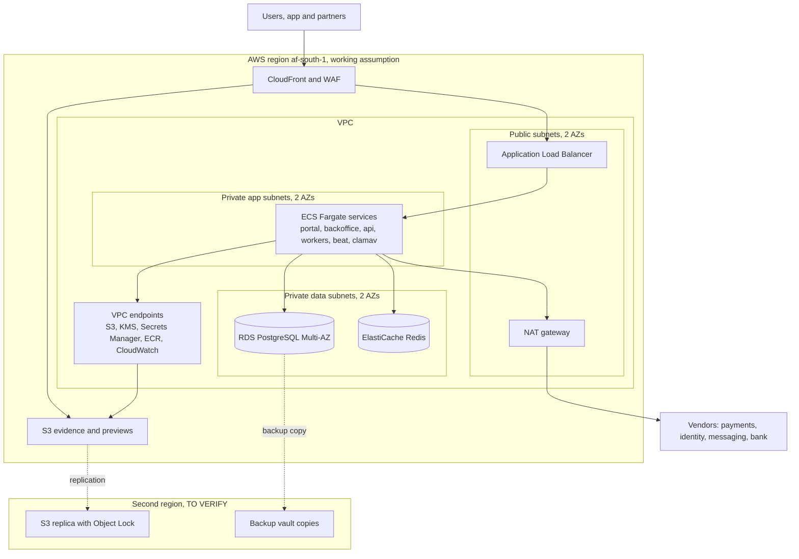

- The load balancer accepts traffic only from CloudFront (managed prefix list and a secret origin header).
- No public IPs on tasks or databases. Outbound internet only through NAT to an allow list of vendor domains `[TO VERIFY]` (egress filtering by a network firewall is a later option for cost reasons).
- Security groups allow only the needed ports between tiers.

### 11.3 Compute and storage

| Service | Platform | Size per task (assumption) | Count in production (assumption) | Scaling |
|---|---|---|---|---|
| api | Fargate | 1 vCPU, 2 GB | 2 to 6 | CPU and request count |
| portal | Fargate | 0.5 vCPU, 1 GB | 2 to 4 | Requests; CloudFront caches listing pages |
| backoffice | Fargate | 0.5 vCPU, 1 GB | 2 | Fixed |
| worker-default | Fargate | 0.5 vCPU, 1 GB | 1 to 4 | Queue depth |
| worker-geo | Fargate | 1 vCPU, 2 GB | 1 to 2 | Queue depth |
| worker-media | Fargate | 1 vCPU, 3 GB | 1 to 4 | Queue depth |
| worker-integrations | Fargate | 0.5 vCPU, 1 GB | 1 to 2 | Queue depth |
| beat | Fargate | 0.25 vCPU, 0.5 GB | 1 exactly | None |
| clamav | Fargate | 1 vCPU, 3 GB | 1 to 2 | Queue depth |
| PostgreSQL | RDS Multi-AZ | db.m7g.large or smaller Graviton class `[TO VERIFY]` | 1 primary + standby; read replica from R2 for analytics | Vertical; storage autoscaling |
| Redis | ElastiCache | cache.t4g.small `[TO VERIFY]` | Primary + replica | Vertical |

| Bucket | Settings |
|---|---|
| `evidence` | Versioning, Object Lock compliance, SSE-KMS, block public access, replication to second region, lifecycle to Infrequent Access after 90 days (assumption) |
| `quarantine` | Uploads land here; objects deleted after 24 h if not promoted |
| `previews` | SSE-KMS, served by CloudFront signed URLs; listing images public through CloudFront only |
| `audit-anchors` | Object Lock compliance, in the `fidero-security` account |
| `exports` | SSE-KMS, 24 h lifecycle |

### 11.4 Backups and disaster recovery (NFR-AVL-02, NFR-AVL-03)

| Item | Mechanism | RPO | RTO |
|---|---|---|---|
| Database, AZ failure | RDS Multi-AZ automatic failover | ~0 | Minutes |
| Database, data error or corruption | RDS point-in-time restore (35-day window, assumption) | Minutes | Under 2 h (assumption) |
| Database, region loss | RDS cross-region automated backup replication with point-in-time restore in the second region `[TO VERIFY]` availability from af-south-1; fallback is hourly AWS Backup snapshot copies | Under 1 h | Under 4 h: Terraform applies the stack in the second region, restore, switch DNS |
| Evidence | S3 versioning and Object Lock in region; cross-region replication with Replication Time Control | Minutes | Read from replica immediately |
| Redis | Rebuildable; holds no system-of-record data | Not applicable | Minutes |
| Configuration | Terraform state in S3 with versioning and state locking; container images in ECR with cross-region replication | Not applicable | Part of the 4 h |
| Ransomware or account compromise | Backup copies in the separate backup account vault with Vault Lock; Object Lock on evidence | 1 h | 4 h |

DR is rehearsed in staging before R1 go-live and every six months after (assumption). The rehearsal result is recorded in document 06. The second region must meet the same data location ruling as the first (Q-07, TR-01).

### 11.5 Infrastructure as code and delivery

- Terraform for all AWS resources, in `infra/` with modules (`network`, `data`, `ecs-service`, `edge`, `observability`, `backup`) and one root per environment. Remote state in S3 with locking. Plans run on every pull request; applies to production need approval.
- GitHub Actions with OIDC federation to AWS roles (no long-lived keys). Pipeline outline: lint and type checks, unit and rule tests (NFR-MNT-01), import-linter contracts, migrations check, OpenAPI contract diff, SAST, dependency and container scans, build and sign images, deploy to dev, deploy to staging with smoke tests, manual approval, blue-green deploy to production on ECS, post-deploy checks.
- Database migrations are backward compatible (expand, migrate, contract) so a deploy can roll back.
- Android builds signed in CI with the upload key in a protected environment; release through a managed Play track.
- Full detail of the pipeline, branching, release and runbooks is in document 06.

### 11.6 Observability (NFR-OBS-01)

| Signal | Tool | Content |
|---|---|---|
| Traces | OpenTelemetry SDK in Django, Celery and Next.js; AWS Distro for OpenTelemetry collector sidecar exporting to AWS X-Ray `[TO VERIFY]` | Trace ID on every request and job, returned in responses and problem details |
| Metrics | CloudWatch (container, RDS, Redis, S3), custom metrics from the app | Latency, error rate, queue depth per queue, upload backlog, job failures, overlay check duration |
| Logs | CloudWatch Logs, JSON structured, PII-scrubbed, 90-day retention for app logs (assumption) | Request logs with trace ID, job logs |
| Errors | Sentry for backend, web and Android, with PII scrubbing and data location `[TO VERIFY]` | Exceptions with release tags |
| Dashboards | Grafana (managed service `[TO VERIFY]`) over CloudWatch and X-Ray | Service health, business flow health, mobile sync health |
| Uptime | Synthetic checks on portal, API health and partner API | Availability against NFR-AVL-01 |

| Alert (thresholds are assumptions) | Condition |
|---|---|
| API error rate | 5xx above 2% for 5 minutes |
| API latency | p95 reads above 500 ms or writes above 1 s for 10 minutes (NFR-PERF-03) |
| Queue backlog | Any queue older than 5 minutes; `integrations` older than 15 minutes |
| Mobile upload backlog | Evidence registered but not completed for over 24 hours, by device |
| Job failures | Any failure of `dispatch_instruction`, `render_pdf`, `verify_chain`, `retention_sweep` |
| Overlay checks | Over 30 s (NFR-PERF-04) |
| Backups | Missing backup or failed cross-region copy |

### 11.7 Cost estimate

Monthly, in US dollars. Every figure is an assumption to be checked with the AWS pricing calculator for af-south-1 and vendor quotes `[TO VERIFY]`. Prices in af-south-1 are higher than in older regions.

| Item | dev | staging | production |
|---|---|---|---|
| ECS Fargate (all services) | 60 (assumption) | 150 (assumption) | 450 (assumption) |
| RDS PostgreSQL (Multi-AZ in production) | 60 (assumption) | 120 (assumption) | 450 (assumption) |
| ElastiCache Redis | 25 (assumption) | 40 (assumption) | 90 (assumption) |
| NAT gateways and data transfer | 45 (assumption) | 50 (assumption) | 150 (assumption) |
| Load balancer | 25 (assumption) | 25 (assumption) | 35 (assumption) |
| S3 storage, replication and requests | 5 (assumption) | 10 (assumption) | 60 to start, growing with evidence `[TO VERIFY]` |
| CloudFront and WAF | 10 (assumption) | 15 (assumption) | 60 (assumption) |
| KMS, Secrets Manager | 10 (assumption) | 15 (assumption) | 30 (assumption) |
| CloudWatch, X-Ray, backups | 20 (assumption) | 40 (assumption) | 150 (assumption) |
| Sentry, Grafana | shared | shared | 100 combined (assumption) |
| SES email | 0 to 5 (assumption) | 0 to 5 (assumption) | 10 (assumption) |
| SMS and WhatsApp | test only | test only | Usage-based `[TO VERIFY]` |
| Identity checks | test only | test only | Per check `[TO VERIFY]` |
| Payment provider fees | Not applicable | Not applicable | Per transaction `[TO VERIFY]` |
| **Total (excluding usage-based vendors)** | **about 270 (assumption)** | **about 470 (assumption)** | **about 1,600 (assumption)** |

Savings levers: dev scaled to zero out of hours; Graviton instances; Savings Plans once usage is stable; one NAT gateway in non-production.

A second cell for country 2 adds roughly one more production column, about 1,600 a month (assumption, TR-11), plus its own penetration test and DR rehearsal. A country that joins the Ghana cell adds only usage. Family confirmation messages add one SMS or WhatsApp message per visit (usage-based `[TO VERIFY]`).

---

## 12. Non-functional design

| NFR | Design measures | Verified by (doc 05 or 06) |
|---|---|---|
| NFR-PERF-01 | SSR for portal, CloudFront caching of public pages, small JS bundles, images resized by `make_previews`, lazy loading | 3G-throttled page tests |
| NFR-PERF-02 | Bundle budget of 500 KB enforced in CI, system fonts or one subset web font, no heavy client libraries on first load | CI budget check |
| NFR-PERF-03 | Indexed queries per selector, cursor pagination, Redis caching of catalogue and config, heavy work in Celery, connection pooling (RDS Proxy `[TO VERIFY]`) | Load test at 10 times R1 load |
| NFR-PERF-04 | Dedicated `geo` queue, GiST indexes on layers, simplified layer geometries per zoom, results stored per layer version | Timed test with production-size layers |
| NFR-PERF-05 | Native field app for every field role, R8, no heavy SDKs, baseline profiles; role screens loaded lazily | Device lab on a 2 GB phone |
| NFR-AVL-01 | Multi-AZ RDS and Redis, at least 2 tasks per web service in 2 AZs, blue-green deploys, health checks | Uptime monitor |
| NFR-AVL-02 | PITR, cross-region backup replication, Terraform rebuild, DR rehearsal (11.4) | DR rehearsal |
| NFR-AVL-03 | S3 cross-region replication with Object Lock; backup vault copies | Replication metrics |
| NFR-SEC-01 | TLS 1.2+, KMS at rest, field-level encryption (10.6) | Configuration scan |
| NFR-SEC-02 | Argon2id, 30-minute idle timeout for staff (10.3) | Automated tests |
| NFR-SEC-03 | Independent penetration test on staging before each release | Test report |
| NFR-SEC-04 | Secrets Manager, OIDC to AWS, secret scanning (10.5) | CI scan |
| NFR-SEC-05 | ASVS L2 mapping (10.8) | Security review checklist |
| NFR-PRIV-01 | Region decision ADR-09, cells per country where law demands (ADR-16, 6.9), `dpr_data_location` for every service and vendor per cell | Data location register |
| NFR-PRIV-02 | `dpr_data_catalogue` with CI check (10.9) | CI check |
| NFR-USE-01 | Short order flow, saved drafts, phone-first forms, prices shown early | Usability tests |
| NFR-USE-02 | Status messages from reviewed templates in `case_status_message` sets; readability check in CI for templates | Readability check |
| NFR-A11Y-01 | Accessible component library, automated axe checks, manual screen-reader tests; field app follows Android accessibility guidance from R2, including the carer screens | Accessibility tests |
| NFR-OBS-01 | OpenTelemetry trace IDs, alerts in 11.6 | Alert tests |
| NFR-MNT-01 | Rules enforced in services and DB, each with tests; coverage gate at 80% | CI coverage gate |
| NFR-MNT-02 | Versioned configuration (ADR-11), country as configuration from R1 with copying (ADR-16, 6.9), thin line modules (ADR-21), adapters (ADR-10) | R1: open a test country in staging by copying Ghana's configuration with no code change. R2: add a test product line by configuration only |
| NFR-SCL-01 | Indexes and partitioning plan (audit by month; evidence by size of index), read replica for analytics, horizontal workers; recurring lines add many small rows (invoices, visits, rent periods), indexed by client and date | Load test with 2,000 cases, 500 projects, 20,000 listings, plus 5,000 invoices and 4,000 visits a month (assumption) |
| NFR-LOC-01 | Next.js i18n message files; Django gettext; Android string resources; notification templates per language | Lint for hard-coded strings |
| NFR-AUD-01 | Audit retention at least the longest class covered; partitions kept; readable through search API | Retention test |

---

## 13. Requirement coverage

Every FR ID in document 01 version 0.3 appears below, one row per module, so a text comparison of the two documents finds no gap.

| FR module | FR IDs | Django app and front ends | Main tables | Main endpoints | Sections |
|---|---|---|---|---|---|
| ACC | FR-ACC-001, FR-ACC-002, FR-ACC-003, FR-ACC-004, FR-ACC-005, FR-ACC-006, FR-ACC-007, FR-ACC-008, FR-ACC-009, FR-ACC-010, FR-ACC-011, FR-ACC-012 | `accounts`; portal, backoffice, app | `acc_person`, `acc_role_grant`, `acc_professional_licence`, `acc_identity_check`, `acc_representative_grant`, `acc_organisation`, `acc_family_member`, `acc_bank_account`, `acc_vetting` | `/v1/auth/*`, `/v1/me*`, `/v1/home`, `/v1/family-members`, `/v1/bank-accounts`, `/v1/organisations`, `/v1/admin/users/invitations`, `/v1/admin/licences` | 6.4, 10.3, 10.4 |
| ORD | FR-ORD-001, FR-ORD-002, FR-ORD-003, FR-ORD-004, FR-ORD-005, FR-ORD-006, FR-ORD-007 | `orders`; portal | `ord_order`, `ord_terms_acceptance`, referral tables | `/v1/orders`, `/v1/catalogue/tiers`, `/v1/offline-payments`, `/v1/projects/{id}/extra-inspections` | 5.1, 7.5 |
| PAY | FR-PAY-001, FR-PAY-002, FR-PAY-003, FR-PAY-004, FR-PAY-005, FR-PAY-006, FR-PAY-007 | `payments`; portal, backoffice | `pay_fee_payment`, `pay_refund`, `pay_settlement_line`, `pay_invoice` | `/v1/orders/{id}/payments`, `/v1/refunds`, `/v1/reconciliation/issues`, `/v1/hooks/*` | ADR-03, 6.4, IF-02 |
| CASE | FR-CASE-001, FR-CASE-002, FR-CASE-003, FR-CASE-004, FR-CASE-005, FR-CASE-006, FR-CASE-007, FR-CASE-008, FR-CASE-009, FR-CASE-010, FR-CASE-011, FR-CASE-012, FR-CASE-013, FR-CASE-014, FR-CASE-015 | `cases`; backoffice, portal | `case_case`, `case_task`, `case_status_message`, `case_risk_screen`, `safety.incident` | `/v1/cases*`, `/v1/tasks/*`, `/v1/work-queue`, `/v1/assets/{id}/fresh-searches` | 6.5, 6.7 |
| RPT | FR-RPT-001, FR-RPT-002, FR-RPT-003, FR-RPT-004, FR-RPT-005, FR-RPT-006, FR-RPT-007, FR-RPT-008, FR-RPT-009, FR-RPT-010, FR-RPT-011 | `reports`; backoffice, portal | `rpt_report`, `rpt_section`, `rpt_signature`, `rpt_condition` | `/v1/reports/*`, `/v1/report-verifications` | 5.2, 6.5, ADR-15 |
| GEO | FR-GEO-001, FR-GEO-002, FR-GEO-003, FR-GEO-004, FR-GEO-005, FR-GEO-006, FR-GEO-007, FR-GEO-008 | `geo`; backoffice | `geo_asset`, `geo_boundary_version`, `geo_overlay_*`, `geo_monitoring_alert` | `/v1/assets/{id}/*`, `/v1/admin/overlay-layers`, `/v1/geo/ghana-post` | 6.4, IF-04 to IF-06 |
| ESC | FR-ESC-001, FR-ESC-002, FR-ESC-003, FR-ESC-004, FR-ESC-005, FR-ESC-006, FR-ESC-007, FR-ESC-008, FR-ESC-009, FR-ESC-010, FR-ESC-011, FR-ESC-012, FR-ESC-013, FR-ESC-014, FR-ESC-015 | `escrow`; portal, backoffice | `esc_escrow`, `esc_condition`, `esc_bank_event`, `esc_release_instruction`, `esc_payee`, view `esc_held_statement`, `core_approval*` | `/v1/escrows*`, `/v1/escrows/{id}/statement`, `/v1/release-instructions/*`, `/v1/payees*`, `/v1/bank-statements` | 5.3, 6.5, 6.11, 7.6, 9.2, IF-01, ADR-17, ADR-18 |
| EVD | FR-EVD-001, FR-EVD-002, FR-EVD-003, FR-EVD-004, FR-EVD-005, FR-EVD-006 | `evidence`; all | `evd_evidence`, `evd_link` | `/v1/uploads`, `/v1/evidence/{id}/link` | ADR-04, 6.6, 10.7 |
| MOB | FR-MOB-001, FR-MOB-002, FR-MOB-003, FR-MOB-004, FR-MOB-005, FR-MOB-006, FR-MOB-007, FR-MOB-008, FR-MOB-009, FR-MOB-010, FR-MOB-011, FR-MOB-012 | `mobile`; Android field app | `mob_device`, `mob_submission*`, `mob_checkin`, `mob_fraud_flag` | `/v1/mobile/*`, `/v1/mobile/check-ins`, `/v1/mobile/check-outs` | 5.4, 5.8, 7.7, 8, 8.8, ADR-19 |
| BLD | FR-BLD-001, FR-BLD-002, FR-BLD-003, FR-BLD-004, FR-BLD-005, FR-BLD-006, FR-BLD-007, FR-BLD-008, FR-BLD-009, FR-BLD-010, FR-BLD-011, FR-BLD-012, FR-BLD-013 | `construction`; portal, backoffice, app | `bld_project`, `bld_milestone`, `bld_inspection`, `bld_defect`, `bld_conflict_link`, `bld_variation`, `bld_reprice` | `/v1/projects/*`, `/v1/milestones/*`, `/v1/panel-members`, `/v1/defects/*` | 5.4, 6.6 |
| PRJ | FR-PRJ-001, FR-PRJ-002, FR-PRJ-003, FR-PRJ-004, FR-PRJ-005 | `projectfunds`; portal, backoffice | `prj_supplier`, `prj_invoice`, `prj_background_check`, `prj_aml_review`, shared `bld_project` and `bld_milestone` | `/v1/projects`, `/v1/projects/{id}/background-checks`, `/v1/projects/{id}/invoices` | 4.2, 6.8 |
| LST | FR-LST-001, FR-LST-002, FR-LST-003, FR-LST-004, FR-LST-005, FR-LST-006, FR-LST-007, FR-LST-008, FR-LST-009, FR-LST-010 | `listings`; portal (SSR) | `lst_listing`, `lst_reservation`, `lst_enquiry` | `/v1/listings*` | 5.5, 6.6 |
| RAT | FR-RAT-001, FR-RAT-002, FR-RAT-003, FR-RAT-004 | `ratings`; portal | `rat_rating`, `rat_track_record` | `/v1/ratings`, `/v1/track-records/*` | 6.8 |
| DSP | FR-DSP-001, FR-DSP-002, FR-DSP-003, FR-DSP-004, FR-DSP-005 | `disputes`; portal, backoffice | `dsp_dispute`, `dsp_subject_link`, `dsp_statement` | `/v1/disputes*` | 6.5 trigger, 6.6 |
| PTR | FR-PTR-001, FR-PTR-002, FR-PTR-003, FR-PTR-004 | `partners`; partner API | `ptr_api_client`, `ptr_usage_event`, `dpr_consent` | `/partner/*` | 5.6, 7.8 |
| NTF | FR-NTF-001, FR-NTF-002, FR-NTF-003, FR-NTF-004, FR-NTF-005 | `notifications` | `ntf_template`, `ntf_message`, `ntf_preference` | `/v1/me`, `/v1/admin/notification-templates` | IF-07 |
| ADM | FR-ADM-001, FR-ADM-002, FR-ADM-003, FR-ADM-004, FR-ADM-005 | `administration`; backoffice | `adm_config_version`, `adm_locked_text_version`, `adm_setting`, `adm_price`, `adm_partner` | `/v1/admin/*` | ADR-11, 6.9 |
| AUD | FR-AUD-001, FR-AUD-002, FR-AUD-003, FR-AUD-004 | `audit`; backoffice | `aud_event`, `aud_anchor` | `/v1/audit-events` | ADR-05, 6.7 |
| ANL | FR-ANL-001, FR-ANL-002, FR-ANL-003 | `analytics`; backoffice | `anl_*` views, `anl_export_log` | `/v1/analytics/*` | 11.6 |
| DPR | FR-DPR-001, FR-DPR-002, FR-DPR-003, FR-DPR-004, FR-DPR-005 | `dataprotection`; backoffice | `dpr_*` | `/v1/dpr/*`, `/v1/consents` | 6.10, 10.9 |
| REC | FR-REC-001, FR-REC-002, FR-REC-003, FR-REC-004 | `records`; backoffice, portal | `rec_*` | `/v1/records/*` | 4.2 |
| CTY | FR-CTY-001, FR-CTY-002, FR-CTY-003, FR-CTY-004 | `countries`; backoffice | `cty_country`, `cty_cell`, `cty_country_config`, `cty_directory`, `country_id` on every tenant-scoped table | `/v1/admin/countries`, `/v1/admin/countries/{id}/config-versions`, `/v1/admin/cells`, `/v1/analytics/metrics` | ADR-16, 6.1, 6.9, 11.1 |
| FEE | FR-FEE-001, FR-FEE-002, FR-FEE-003, FR-FEE-004, FR-FEE-005, FR-FEE-006, FR-FEE-007 | `fees`; portal, backoffice | `fee_institution`, `fee_institution_contact`, `fee_invoice`, `fee_payment`, `fee_schedule`, `fee_cash_voucher`, shared `esc_payee`, `esc_escrow` (held_funds), `case_case` (institution_verification) | `/v1/institutions*`, `/v1/invoices*`, `/v1/fee-payments/{id}/receipts`, `/v1/fee-schedules`, `/v1/cash-vouchers*`, `/v1/family-members/{id}/statement` | 5.7, 6.11, 6.12, 7.9, 7.12, IF-10 |
| CARE | FR-CARE-001, FR-CARE-002, FR-CARE-003, FR-CARE-004, FR-CARE-005, FR-CARE-006 | `care`; portal, backoffice, field app | `care_plan`, `care_plan_item`, `care_carer`, `care_visit`, `care_visit_item`, `care_confirmation`, `care_concern`, shared `acc_vetting`, `mob_checkin` | `/v1/care-plans*`, `/v1/carers*`, `/v1/care-visits*`, `/v1/concerns`, `/v1/mobile/check-ins`, `/v1/mobile/visits/*` | 5.8, 6.12, 7.10, 7.12, 8.8, ADR-19, ADR-20 |
| PMG | FR-PMG-001, FR-PMG-002, FR-PMG-003, FR-PMG-004, FR-PMG-005, FR-PMG-006 | `propertymgmt`; portal, backoffice, field app | `pmg_managed_property`, `pmg_tenancy`, `pmg_rent_period`, `pmg_statement_mandate`, `pmg_repair`, `pmg_repair_quote`, `pmg_inspection`, shared `acc_bank_account`, `esc_statement_line`, `esc_escrow` (repair) | `/v1/managed-properties*`, `/v1/tenancies/{id}`, `/v1/repairs*` | 5.9, 6.13, 7.11, 7.12, 9.3 |
| TSK | FR-TSK-001, FR-TSK-002, FR-TSK-003, FR-TSK-004, FR-TSK-005 | `errands`; portal, backoffice, field app | `tsk_errand`, `tsk_errand_document`, `tsk_errand_step`, `tsk_agent`, `tsk_handover`, `adm_config_version` (errand_catalogue), shared `acc_vetting`, `esc_escrow` (held_funds) | `/v1/errand-catalogue`, `/v1/errands*`, `/v1/mobile/errands/*` | 5.10, 6.13, 7.12, 8.8 |
| INS | FR-INS-001, FR-INS-002, FR-INS-003, FR-INS-004 | `insurance`; portal, backoffice | `ins_product`, `ins_application`, `ins_policy`, `ins_premium`, `ins_claim`, shared `esc_payee` (insurer) | `/v1/insurance/*` | 6.12, 7.12, IF-11 |
| EVT | FR-EVT-001, FR-EVT-002, FR-EVT-003 | `events`; portal, backoffice | `evt_event`, `evt_vendor`, `evt_vendor_payment`, shared `esc_payee`, `esc_escrow` (event), `case_case` (vendor_verification), `care_confirmation` | `/v1/events*`, `/v1/vendor-payments/*` | 6.13, ADR-20 |

Business rules: RUL-01 (ADR-03, 6.4), RUL-02 (6.5), RUL-03 (ADR-12, 5.2), RUL-04 (6.5, ADR-11), RUL-05 (6.3, 6.5), RUL-06 and RUL-07 (6.5), RUL-08 (8.1), RUL-09 (6.5, 6.6), RUL-10 (6.6), RUL-11 (6.5, 10.4), RUL-12 and RUL-13 (6.6, 7.12), RUL-14 (5.5), RUL-15 (6.5), RUL-16 (5.6, 6.7), RUL-17 (6.5, 6.7, 10.9), RUL-18 (5.4, 7.12), RUL-19 (6.8), RUL-20 (6.5), RUL-21 (6.8, 6.11 payee kind supplier only), RUL-22 (ADR-17, 6.5 trigger, 6.11 `esc_payee`, 9.2), RUL-23 (6.5 trigger, 6.12 `care_visit` and `care_confirmation`, 6.13 `tsk_errand_step`, ADR-20), RUL-24 (6.4 `acc_bank_account`, 6.13 `pmg_managed_property` trigger, 9.3), RUL-25 (6.12 `ins_policy`, `ins_premium`, `ins_claim`; no `premium` purpose in `pay_fee_payment`).

Interfaces: IF-01 to IF-09 (section 9), IF-10 and IF-11 (section 9, 9.2, 9.3). Journeys: J-01 (5.1, 5.2), J-02 (5.3), J-03 (5.4), J-04 (5.5), J-06 (5.6), J-09 (5.7), J-10 (5.8), J-11 (5.9), J-12 (5.10).

---

## 14. Risks and open technical questions

### 14.1 Technical risks

| ID | Risk | Effect | Mitigation | Link |
|---|---|---|---|---|
| TR-01 | Q-07 ruling requires hosting in Ghana | AWS region unusable for personal data | Region-agnostic Terraform; keep options for in-country cloud or colocation `[TO VERIFY]`; split personal data store if needed | Q-07, C-09 |
| TR-02 | Bank offers neither API nor statement file | Manual entry load grows with volume | Manual adapter with proof; volume trigger to renegotiate | Q-01, AS-03 |
| TR-03 | Object Lock periods set before Q-08 is answered | Data kept longer than lawful, or deleted too early | Set the compliance-mode retain-until date to the shortest period the lawyer confirms as safe, since it can be extended later but never shortened; extend by legal hold when needed; get an interim minimum from the lawyer before R1 go-live `[TO VERIFY]` | Q-08 |
| TR-04 | Low-end phones lack hardware key storage | Weaker evidence assurance | Allow with `software_key` flag and reviewer check; inspector visit still required | AS-08, C-08 |
| TR-05 | Small team cannot run the stack | Outages and slow fixes | Managed services only; runbooks and alerts in document 06 | C-07 |
| TR-06 | Overlay layer data unavailable or poor | Section 7 relies on manual work | Manual digitising path; layer version on every result | AS-06 |
| TR-07 | Vendor data locations conflict with Act 843 | Need to change vendors | Record each in `dpr_data_location`; adapters make switching cheap | Q-02, Q-03, Q-07 |
| TR-08 | Audit chain serialisation becomes a bottleneck | Slower writes | Load test; partition chains per country if needed | NFR-SCL-01 |
| TR-09 | Institutions will not accept bank transfers with an invoice reference (AS-10) | Cash vouchers become the norm; cash in runners' hands | Voucher cap, two-person approval, 2-day reconciliation; renegotiate with the largest institutions first; measure the voucher share monthly and stop the line for an institution above a threshold `[TO VERIFY]` | AS-10, FR-FEE-006, Q-16, I-19 |
| TR-10 | The bank will not share an owner's account statement under a mandate | Rent tracking falls back to owner uploads | Manual adapter; owner-forwarded credit alerts; consider the rent account at the partner bank only | FR-PMG-003, TQ-17 |
| TR-11 | A second cell for country 2 doubles infrastructure and operations for a team of two or three | Outages, cost, slower releases | Join the Ghana cell unless the law forbids it; automate cell creation fully in Terraform; one shared on-call rota | ADR-16, C-07, Q-15 |
| TR-12 | Care readings, concerns and insurance applications are special category data with stricter rules | Fines or forced redesign | Own KMS key, minimal retention, no analytics, lawyer's opinion before CARE and INS open | C-02, FR-CARE-006, FR-INS-002 |
| TR-13 | Carers face unsafe households or false accusations | Harm to carers; disputes over pay | Risk screen for new addresses, safety button, check-in evidence, concerns path, hidden contact details | RUL-17, FR-CARE-003, P-17 |
| TR-14 | Bank account name verification stays manual (letters) at volume | Slow onboarding of institutions and suppliers; forged letters | Name enquiry API when available (TQ-14); letters checked by two people; re-verification yearly | RUL-22, FR-ESC-015 |
| TR-15 | A client with activity in two cells gets a split experience | Confusion, support load | Linked accounts through the directory; one cell at a time in the home dashboard; defer until a second cell exists | ADR-16, TQ-13 |

### 14.2 Open technical questions

| ID | Question | Owner | Needed by | Link |
|---|---|---|---|---|
| TQ-01 | Final primary and backup regions | Product and engineering lead with lawyer | R1 start | Q-07 |
| TQ-02 | Release instruction format, channel and signature the bank accepts | Founder with bank | R1 escrow go-live | Q-01 |
| TQ-03 | Statement file format (CSV, MT940 or other) and delivery (SFTP or portal) | Founder with bank | R2 | Q-01, AS-03 |
| TQ-04 | Is RDS cross-region automated backup replication available from af-south-1 to the chosen second region? | Engineering | R1 | NFR-AVL-02 |
| TQ-05 | If a dispute opens after release approval but before the bank pays, can the bank recall the instruction? | Founder with bank | R1 | RUL-15 |
| TQ-06 | Retention periods per data class for Object Lock | Lawyer, insurer | R1 | Q-08 |
| TQ-07 | How to answer a partner point query that matches several plots | Product | R2 | FR-PTR-001 |
| TQ-08 | Approval window length for milestones and whether lapse counts as approval. Resolved in 01 version 0.2: silence is never approval; reminders follow the configured period; the open part is tracked as Q-13 | Founder, lawyer | R2 | 01 C8 Milestone, Q-13 |
| TQ-09 | Thresholds for fraud flags (buffer, time gap, near-duplicate) | Operations | R2 | FR-MOB-011 |
| TQ-10 | Minimum Android version and share of devices without hardware keys | Operations | R2 | C3, Q-09 |
| TQ-11 | Is Ghana Post GPS lookup available to third parties, and on what terms? | Product | R1 | IF-06 |
| TQ-12 | Amount threshold for FR-NTF-004 (now configurable in FR-ADM-005; the value is open) | Product | R1 | FR-NTF-004 |
| TQ-13 | Does country 2's law require in-country or in-region hosting, and so a second cell? How are a client's accounts in two cells linked? | Lawyer, product and engineering lead | Country 2 day-90 gate (about month 9) | Q-15, FR-CTY-002, ADR-16 |
| TQ-14 | Does the partner bank offer an account name enquiry for accounts at any bank, and on what terms? | Founder with bank | R1 escrow go-live | RUL-22, FR-ESC-015, 9.2 |
| TQ-15 | How does the bank hold held funds: a named sub-account per client, or one trust account with client references? What deposit reference format? | Founder with bank | R1 | FR-ESC-014, ADR-18 |
| TQ-16 | How is a visit confirmed when the family member has no phone of their own? Is a staff call plus sampling acceptable to the lawyer and insurer? | Operations, lawyer | R2 | FR-CARE-004, ADR-20 |
| TQ-17 | Will the bank share a customer's account statement with Fidero under the owner's mandate, by file or API? | Founder with bank | R2 | FR-PMG-003, RUL-24, 9.3 |
| TQ-18 | Are carers and errand agents paid as individuals or through an agency, and which is the payee of record? | Operations, lawyer | R2 | RUL-22, RUL-23, FR-CARE-004, Q-19 |
| TQ-19 | Premium route per insurer: client pays the insurer directly, or the bank pays from held funds? What intermediary licence does each route need? | Founder, lawyer | R2 | FR-INS-002, RUL-25, C-11, Q-17 |
| TQ-20 | Which institutions can send invoices and receipts by portal or file, and in what format? | Operations | R2 | IF-10, Q-16 |
| TQ-21 | Source and update cadence of official fees in the errand catalogue per country | Operations | R2 | FR-TSK-001 |
| TQ-22 | Pricing per line confirms the provisional Fidero fee purposes in `pay_fee_payment` (institution service, care service, property management, errand and event service fees) | Founder | R1, R2 | Q-20, FR-PAY-005 |

---

## 15. Issues found in document 01

These are gaps or conflicts found while designing. Document 01 is not changed here. The design choice used in the meantime is stated.

Resolved by document 01 version 0.2 and 0.3 and removed from this list: I-01 (the report template now says sections 4 to 10), I-03 (partial release, freeze and cancel paths in the Escrow model), I-04 (cases start at Paid), I-06 (missing roles added to C2), I-07 (release rights defined as a permission held by reviewers; case managers cannot approve), I-08 (client approval step in the Escrow model), I-09 (silence is never approval; Q-13), I-10 (Reserved to Suspended), I-12 (NFR-AVL-03 bounded by NFR-PRIV-01; Q-11), I-14 (SMS and WhatsApp threshold configurable in FR-ADM-005). Numbers are not reused.

| ID | Issue | Where in 01 | Interim design choice |
|---|---|---|---|
| I-02 | FR-BLD-005 ends the milestone route at "released"; the C8 Milestone model ends at "Paid". (The missing "inspection scheduled" state was added to C8 in version 0.2.) | C4.10, C8 | Status follows C8: `paid`. |
| I-05 | No state models for Report, Release instruction or Project, which have rules attached. | C8 | Design states in 6.5 and 6.6 (report: draft, in review, approved, released, superseded; instruction: draft, pending approval, approved, sent, confirmed, rejected by bank, withdrawn). |
| I-11 | FR-ANL-002 lets reviewers export CSV, while FR-DPR-005 requires two-person approval for bulk exports of personal data. The boundary is still not defined. | C4.19, C4.20 | Metric exports contain no personal data; any export with personal data goes through DPR. |
| I-13 | FR-ACC-003 requires MFA for "any user who approves a release", which includes clients under RUL-11. This affects NFR-USE-01 for diaspora clients, and now applies to every invoice approval and repair quote approval. | C4.1 | Clients enrol MFA at their first approval, not at sign-up. Family confirmation of a visit is not a release approval (I-25). |
| I-15 | FR-PTR-001 now says a partner submits a plot reference or coordinates (fixed in 0.2), but what happens when a point matches several plots is still not stated. | C4.15 | Return `ambiguous` with no details (TQ-07). |
| I-16 | FR-MOB-010 (Should) lets runners, surveyors, carers and errand agents use the app for case tasks, visits and errands, but RUL-08 applies the camera-only rule to milestones only. Whether browser uploads remain valid evidence for tasks, visits and errand steps is not stated. | C4.9, B7 | Both accepted; `provenance` records which. The field app applies camera-only by design for visit photos. |
| I-17 | FR-ESC-014 and FR-FEE-007 say "held balance" and "balance held". ADR-03 and C-01 forbid any balance Fidero keeps, and this document's CI test fails on a column named like `%balance%`. | C4.7, C4.21 | Read as "the amount the bank reports holding". `esc_held_statement.held_at_bank` is derived from bank events (ADR-18). Suggest 01 says "amount held at the bank". |
| I-18 | RUL-22 lists institution, supplier, vendor or professional as the only payees, but the payee on the launch product (a land purchase) is the seller, and on off-plan and listings the developer. | B7 | `esc_payee.kind` includes `seller` and `developer`, verified through the report's identity and authority checks and a bank account in that name. Suggest 01 adds them to RUL-22. |
| I-19 | FR-FEE-006 lets a runner draw cash against a voucher and pay an institution in person. RUL-22 says Fidero never releases cash to a relative or representative, and RUL-01 says Fidero never holds client money. Cash in a Fidero runner's hands for up to 2 working days sits between the two. | C4.21, B7 | The payee of record is the institution; the instruction is a distinct `runner_cash_voucher` type the bank must accept; two-person approval, a cap `[TO VERIFY]`, one open voucher per runner, receipt within 2 working days, escalation after. Needs the bank's and lawyer's confirmation (TR-09). |
| I-20 | Must requirements depend on Should requirements: FR-CARE-002 to 006 are Must but FR-CARE-001 (create a care plan) is Should; FR-PMG-002, 003 and 005 are Must but FR-PMG-001 is Should; FR-TSK-002 to 004 are Must but FR-TSK-001 is Should. | C4.22 to C4.24 | Treated as Must for the line once the line opens. Suggest 01 aligns the priorities. |
| I-21 | FR-PMG-003 reads rent from "the bank's statement or confirmation" of the owner's own account. No requirement, consent or interface covers the owner's mandate to the bank to share that statement with Fidero. | C4.23, C6 | `pmg_statement_mandate` recorded before matching starts; adapters in 9.3; open with the bank (TQ-17). |
| I-22 | FR-INS-002 says premiums go "to the insurer's account, never to Fidero" but not whether the client pays the insurer directly or the bank pays from held funds; neither route appears in the Escrow state model, and C-11 says the intermediary licence is `[TO VERIFY]`. | C4.25, C8, A7 | Both routes designed (`ins_premium.route`); the insurer is a verified payee for the held-funds route (TQ-19). |
| I-23 | C8 has no state models for institution payment, care visit, repair, errand or policy, although RUL-22 to RUL-25 attach rules to them. | C8 | States proposed in 6.12 and 6.13 (for example visit: scheduled, checked in, checked out, confirmed, unconfirmed, missed, disputed, instructed, paid). Suggest 01 adopts them. |
| I-24 | The Tenant role in C2 can "see their agreement and rent record" and "report a repair", but no FR in C4.1 gives a tenant an account or a sign-in. | C2, C4.1, C4.23 | Tenant signs in with a phone one-time code, with a grant scoped to one tenancy. |
| I-25 | RUL-11 says the client approves every release. FR-CARE-004 pays the carer on the family's confirmation, and FR-TSK-003 pays official fees per step; neither states a client approval per payment. | B7, C4.22, C4.24 | The client's approval of the care plan (visit fee per confirmed visit) and of the errand order (official fees per step) is recorded as a standing approval within the agreed amounts; two staff still approve each instruction. Needs the lawyer's view. |
| I-26 | FR-ESC-015 blocks a release when the account name does not match, but 01 does not say where the bank account name comes from or who checks it. | C4.7 | Bank confirmation letter checked by two people in R1; account name enquiry where the bank offers it (9.2, TQ-14). |
| I-27 | FR-FEE-001 (R1) needs an institution with a named contact who confirms invoices (C2 role "Institution contact"), but organisation accounts for institutions (FR-ACC-011) are R2. | C2, C4.1, C4.21 | In R1 the contact is a person account with role `institution_contact` scoped to the institution; organisation accounts follow in R2. |
| I-28 | Requirement IDs added in version 0.3 sit out of numeric order in their tables (FR-ACC-012 before FR-ACC-009, FR-ESC-014 and 015 before 011, FR-MOB-012 before 011, FR-CTY-004 before 002). Cosmetic, but it makes range notation such as "001 to 012" misleading. | C4 | This document lists every FR ID in full in section 13. |
