# 03 — UI/UX Design Specification

Information architecture, user flows, wireframes, interaction and content rules, design system and accessibility for the four Tenmina front ends: the `portal` web app, the `backoffice` web app, and from R2 two apps published on the Apple App Store and Google Play: **Tenmina**, the client app for clients, family members and tenants, and **Tenmina Field**, the field app (iOS and Android) for contractors, inspectors, runners, surveyors, carers and errand agents. Both apps come from one React Native codebase (02 ADR-22).

| Item | Value |
|---|---|
| Document | 03 of 6 in `docs/specs/` |
| Version | 0.10 |
| Date | 12 November 2026 |
| Status | Draft. For review. Not yet baselined |
| Owner | Product designer, for the founder as product owner |
| Source of truth | `01-requirements-and-product-specification.md` v0.13 (personas, features, journeys, rules, FR and NFR IDs, state models) |
| Other sources | `README.md`, `docs/decisions/2026-11-01-diaspora-platform.md`, `docs/operations/verification-report-template.md`, `docs/operations/milestone-schedule.md`, `docs/product/architecture.md` |
| Companion | `03-prototype/index.html`, a clickable prototype with sample data |

Every figure in this document is a working assumption, not verified data. Unknown numbers are marked `[TO VERIFY]`. Names, places, prices, dates and references in wireframes and the prototype are samples.

### Change history

| Version | Date | Change |
|---|---|---|
| 0.1 | 31 October 2026 | First draft against 01 v0.1. |
| 0.2 | 1 November 2026 | Redesign for 01 v0.3 and the decision record `docs/decisions/2026-11-01-diaspora-platform.md`: Tenmina is the diaspora's trusted agent at home. Adds the principles "Pay the institution, not the relative" and "Country is configuration"; the unified home dashboard (F-35) as the portal home with sections for Property, Family, and Projects and errands; a country selector at onboarding; screens SCR-PTL-36 to SCR-PTL-54, SCR-BO-27 to SCR-BO-32 and SCR-MOB-14 to SCR-MOB-18; flows for J-09 to J-12 with error states; wireframes W-25 to W-36; content rules for who gets paid (RUL-22), rent (RUL-24) and insurer products (RUL-25); components CMP-25 to CMP-32; prototype flows G and H. Client approval added to the escrow flow and tracker (01 v0.2 Escrow state model). Section 11.2 refreshed against 01 v0.3: I-01, I-02, I-03, I-04, I-06, I-07, I-08, I-09, I-10, I-12, I-13 and I-14 closed; I-17 to I-24 added. Design assumptions DA-07 to DA-10 added; DA-06 retired. |
| 0.3 | 1 November 2026 | Aligned to 01 v0.4: runner cash route removed (DA-10, SCR-BO-30, J-09 flow, W-26, W-28, CMP-25, CMP-30 and content rules now show "not eligible for direct payment"; runners only collect invoices and deliver receipts); standing approvals for care visits and errand steps (W-29, W-34, J-10, J-12); 72-hour reviewer decision, second-person check of call confirmations and code lockout (J-10, W-31, SCR-BO-28); owner's written mandate for rent statement lines (J-11, SCR-PTL-46); premium route stated; "amount held at the bank" wording; issues I-02, I-15, I-18, I-20, I-21 and I-23 closed, I-11 partly closed. Prototype updated to match. |
| 0.4 | 7 November 2026 | Aligned to 01 v0.6: both app stores, React Native, client app. The field app becomes Tenmina Field (iOS and Android); the client app Tenmina is added (F-36, FR-APP-001 to FR-APP-006). Adds the client app map with the portal's tabs (2.3a), platform conventions for iOS and Android (2.4a), screens SCR-APP-01 to SCR-APP-06 (push permission explained first, biometric set-up and unlock, account deletion that says what is kept and why, update required, paying Tenmina's fee in the app), wireframes W-37 to W-39, a React Native column in the component library, iOS targets and Dynamic Type in the accessibility rules, DA-11 and DA-12, DQ-18 to DQ-20, and issues I-25 to I-27. Prototype flow F relabelled "Tenmina Field (iOS and Android)". |
| 0.10 | 12 November 2026 | Aligned to 01 v0.13: release timing and escrow account structure (RUL-07 window, RUL-33, RUL-34, NFR-PERF-06, FR-ESC-018 to FR-ESC-020, Q-29, Q-30). No new screen IDs. Bank payment instructions (SCR-PTL-18, W-10) show the escrow's own virtual account number or reference at the partner bank, never Tenmina's account and never another escrow's. The escrow tracker (SCR-PTL-17, W-09) tells the client when the seller will be paid and that there is no waiting period ("Paid within 2 working days of your approval", a working assumption, DA-15), and shows a held-back share as its own release. The back office shows the release clock and the overdue state on the escrow list (SCR-BO-10), the release approval (SCR-BO-12, W-15) and My work (SCR-BO-02); W-15 adds a gate for the escrow's confirmed balance; the escrow detail (SCR-BO-11) shows the virtual account and its bank-confirmed balance; reconciliation (SCR-BO-13) lists deposits the bank credited to another escrow's reference; W-16 adds the release timing targets. J-02 flow: same-day instruction, the balance gate, a payment-overdue alert and the held-back share. Design rule 11, a 5.4 note, status messages, money display rules, two fixed lines (5.6a), section 5.6d, a 6.1d note on the clock, usability task T10, and issues I-38 and I-39 against 01 v0.13. The fresh-search window on W-15 and W-16 now counts from the dates of the registry's result and the site check (01 v0.13 review fixes), and a held-back share's own condition does not block the main release (RUL-06). The prototype is unchanged. |
| 0.9 | 12 November 2026 | Aligned to 01 v0.12: fund and evidence protection (RUL-28 to RUL-32, FR-ESC-016, FR-ESC-017, FR-PAY-008, FR-CASE-016, FR-ACC-013, FR-RPT-012). Adds the payee change approval for the client (SCR-PTL-55 in the portal, SCR-MOB-23 in the client app, DA-14) and the back office screens for payee change approvals (SCR-BO-42), official search records (SCR-BO-43), party identity checks (SCR-BO-44) and the re-check queue (SCR-BO-45); wireframes W-42 (approve a payee change) and W-43 (payee change approvals); a payee change sub-flow and refund-to-source note in J-02 and two more report release gates in J-01; design rules 9 and 10; status messages, fixed lines (5.6a) and section 5.6c for the payee lock, refunds to source, official records, identity and re-checks, including the line "We never change who gets paid because of a message, email or call."; refund wording on W-07, W-09, W-12 and W-15 (source account; fee to the original payment method); a no-upload rule and a search line for runners on SCR-BO-04 and SCR-MOB-12 (6.1c); payee lock gates on W-15; CMP-30 states; Bloc rules for the new screens (orange only for the client's step and the person's own slot; blocked banners black). Samples now ask for the seller's ID number, not a copy. Usability task T9, DQ-24, issues I-31 to I-37; I-28 to I-30 closed by 01 v0.9. The prototype is unchanged. |
| 0.8 | 12 November 2026 | Founder decision: the back office uses Bloc too, so all four front ends share one look (DQ-21 closed). Adds section 6.1d (laptop layout, side bar, dense tables, orange only for what is late or waiting on this person, approvals that move money on black with press and hold) and four back office mockups (my work, case detail, two-person release approval, payment run approval). Sections 6.1 and 6.2 are kept only as the record of the earlier direction. |
| 0.7 | 12 November 2026 | Founder decision: the portal and Tenmina Field use Bloc too (DQ-21 answered for both; still open for the back office). Section 6.1a now covers all three front ends, with web tokens for the portal (6.1b) and field rules for Tenmina Field (6.1c). Six Tenmina Field screens added to the mockups (inspector's jobs and checklist, a sealed capture, a contractor's offline milestone, a carer's check-in, My pay). Platform conventions (2.4a) and typography updated. The prototype is restyled to Bloc. |
| 0.6 | 12 November 2026 | Founder decision: the client app Tenmina uses the **Bloc** visual direction (section 6.1a), chosen from four directions on the design canvas. Black or white grounds, lime for proof and the main action, orange only for what needs the client, yellow only for the Amber verdict; Bricolage Grotesque and IBM Plex Mono bundled in the app (DQ-01 answered for the apps). Adds the account cards shown side by side, press and hold to approve (5.4), the Bloc tab bar in place of the platform tab bar (2.4a), motion rules, contrast ratios, and DQ-21 to DQ-23. The portal, back office and Tenmina Field keep sections 6.1 and 6.2 until DQ-21 is decided. The prototype is unchanged. |
| 0.5 | 11 November 2026 | Aligned to 01 v0.8: professional payments (F-37, FR-PRO-001 to FR-PRO-010, RUL-26, RUL-27). Adds "My pay" for contracted professionals in the back office from R1 (SCR-BO-33 to SCR-BO-36: jobs and earnings, payable detail, expense claim with receipt photo, statements) and in Tenmina Field from R2 (SCR-MOB-19 to SCR-MOB-22); staff screens for agreements and rate cards, payables and expense claims, payment run preparation, payment run approval and reconciliation (SCR-BO-37 to SCR-BO-41); wireframes W-40 (Tenmina Field earnings) and W-41 (payment run approval); content rules in 5.6b, including that pay screens never show the verdict next to an amount; the two-person pattern extended to payment runs, rate card versions and expense exceptions; DA-13 (professionals use the back office web app for My pay in R1, not the client portal). Errand payment wording follows FR-TSK-002 and FR-TSK-003: Tenmina's charge is paid through the payment provider, official fees into the partner bank, and Tenmina pays the agent itself (J-12 flow, W-34, SCR-BO-32, the errands fixed line in 5.6a). Issues I-28 to I-30. The prototype is unchanged. |

## 0. How this document traces to 01

- Every screen has a stable ID: `SCR-PTL-nn` (portal), `SCR-BO-nn` (back office), `SCR-MOB-nn` (Tenmina Field, the field app on iOS and Android; one exception, SCR-MOB-23, DA-14), `SCR-APP-nn` (screens that exist only in the apps, mostly in the client app Tenmina). A portal screen that the client app shows natively keeps its `SCR-PTL` ID (DA-11). IDs are never reused.
- Every reusable component has an ID: `CMP-nn`.
- Every screen lists the 01 IDs it satisfies: functional requirements (`FR-`), features (`F-`), journeys (`J-`) and rules (`RUL-`). This document creates no new requirement IDs.
- Section 10 holds the full screen-to-requirement table. Document 05 can test each screen against it.
- Where 01 is unclear or inconsistent, this document makes a design assumption, marks it `DA-nn`, and lists the gap in section 11.2. It does not edit 01.

### Design assumptions used in this document

| ID | Assumption | Why |
|---|---|---|
| DA-01 | Clients confirm approvals (escrow terms, milestone approval, cedi re-pricing) with a one-time code. This is the client's step, not a release. | FR-ACC-003 asks for MFA for "any user who approves a release". RUL-11 says the client approves. See issue I-05. |
| DA-02 | Prices show in the client's chosen display currency, but the charge is made in USD for cards and GHS for mobile money. | Confirmed by FR-ORD-002 in 01 v0.3 (issue I-09 closed). Kept as the display rule. |
| DA-03 | Money uses ISO codes (`USD 450.00`, `GHS 5,400.00`), not symbols. | `$` is ambiguous for clients in the US and Canada. Screen readers read codes reliably. |
| DA-04 | The hash check computes the PDF hash in the browser. The PDF never leaves the user's device. | Privacy. FR-RPT-008 says "anyone" can check. |
| DA-05 | The back office is used on laptops by office staff, and on phones by runners, surveyors and lawyers for their own tasks. | FR-CASE-006. |
| DA-06 | Retired. 01 v0.3 NFR-A11Y-01 now holds the field app to WCAG 2.2 AA from R2. | Issue I-06 closed. The ID is not reused. |
| DA-07 | A family member who confirms a care visit does not need an account. At check-out they get a one-time link and a 6-digit code by SMS or WhatsApp, sent only to them and never shown in the carer's app (02 ADR-20). The link opens a page with one button; they can also reply with the code. A call to Tenmina is the fallback. | FR-CARE-004 allows "a one-tap code, a call or the app". Many elderly relatives will not install an app. See issue I-19. |
| DA-08 | The amount held at the bank for institution payments, care visits and errands (FR-ESC-014) is shown as "held at Partner Bank for you", with a running statement. It is never called a wallet or a Tenmina balance. | RUL-01 and B2.2. The money is at the bank. |
| DA-09 | The country chosen at onboarding is the country where the things are (the plot, the hospital, the parent), not where the client lives. A client can add a second country later and the dashboard groups by country. | FR-CTY-001: every case, payment and user belongs to one country. Clients abroad live elsewhere by definition. |
| DA-10 | An institution that cannot receive a bank transfer is marked not eligible for direct payment (FR-FEE-006). The client's screen says so plainly: "[Institution] cannot receive a bank transfer, so Tenmina cannot pay it for you. We never pay in cash." No other way to pay through Tenmina is offered. A runner may collect an invoice or deliver a receipt in person; that row says "Receipt delivered by a Tenmina runner". | 01 v0.4 removed the cash route. The client must know before approving anything. Issue I-20 closed. |
| DA-11 | The client app shows the portal's signed-in client screens natively and keeps their `SCR-PTL` IDs, content and rules. Only screens with no portal equivalent get `SCR-APP` IDs. Public pages (home and prices, listings, insurer product pages) and the family confirmation link (SCR-PTL-45) stay on the web; the app opens them in the system browser or an in-app browser tab. | FR-APP-001 asks for "the client features of the portal ... on the same API and rules". One design per screen keeps the two consistent and halves review. |
| DA-12 | Until Q-23 is answered, the client app pays Tenmina's fees on the web: "Pay on the Tenmina website" opens the portal's payment page (SCR-PTL-10) in the system browser and returns to the app when done. If the stores accept the payment provider in the app, SCR-APP-06 shows the provider's checkout instead. The app never shows a store in-app purchase. | FR-APP-005, AS-14, Q-23. Fees pay for real-world services. Purchase, construction and project money is never paid in either app (RUL-01). |
| DA-13 | In R1 contracted professionals see their pay in the back office web app, on their phones, under "My pay" (SCR-BO-33 to SCR-BO-36). They already sign in there and do their tasks there (SCR-BO-01, SCR-BO-04). The client portal does not serve professionals. From R2, Tenmina Field shows the same screens natively (SCR-MOB-19 to SCR-MOB-22) for field roles. | 01 C1 puts professionals in the back office and the field app. FR-PRO does not name a front end. |
| DA-14 | The client app's payee change approval has its own ID, SCR-MOB-23, as well as the portal's SCR-PTL-55. This is an exception to DA-11 and to the prefix rule in section 0 (`SCR-MOB` is otherwise Tenmina Field). The ID was reserved so that documents 04 to 06 can trace the app's press-and-hold version separately. Content and rules are those of SCR-PTL-55. | Other documents reference SCR-MOB-23. A later version may move it to an `SCR-APP` ID; the ID is never reused. |
| DA-15 | Before and after approving a purchase release, the client sees "Paid within 2 working days of your approval. No waiting period." as a working assumption. It holds only if the two Tenmina approvals follow the client's on the same working day, so the back office shows the client's approval time on the release and puts it first in My work. Once the instruction is sent the tracker shows the expected date ("Expected paid by 9 May"), never a date the bank has not confirmed as a promise. | NFR-PERF-06 sets same-day sending after the last approval and payment within `[2 working days, TO VERIFY]`, but no target for the staff approvals after the client's (issue I-39). The client's question is when the seller is paid. |

---

## 1. Design principles

The principles come from 01 section B2. Each one changes what a user sees.

| Principle (01 B2) | What it means in the UI | Where it shows |
|---|---|---|
| **Evidence before money** (B2.1) | No money action without the evidence shown beside it. A release button is never live while a gate is open. Every gate says what is missing in words. | Escrow tracker (SCR-PTL-17), release approval (SCR-BO-12), milestone approval (SCR-PTL-23), condition checklist (CMP-08) |
| **Tenmina never holds the money** (B2.2) | Purchase, build and project money screens show only the partner bank's name and account. Tenmina's own payment page is only for Tenmina fees and says so. A fixed line on every money screen: "Your money is held by [bank], not by Tenmina." | Bank instructions (SCR-PTL-18), payment (SCR-PTL-10), money display (CMP-17) |
| **Plain status, always** (B2.3) | Every case, escrow, milestone, listing and dispute has one status sentence at the top: what happened, when, what comes next and by when. Reading age 12. | Status timeline (CMP-06), all trackers |
| **Built for a slow phone** (B2.4) | Phone layout first. System fonts. Small pages. Static map first, live map on tap. Thumbnails before full images. Forms save as you go. The app works offline. | Performance budgets (section 7.2), offline banner (CMP-13) |
| **One engine** (B2.5) | Land, building, construction, off-plan, project funds, institution payments, care visits, property management, errands and events share the same components: tracker, conditions, evidence, approvals, statement. A new line is new content, not a new screen design. | Shared components in section 6.4; home dashboard (SCR-PTL-36) |
| **People stay in the loop** (B2.6) | Licensed people sign their sections with name and licence number shown. Two named Tenmina approvers on every release, visible to the client. | Report viewer (SCR-PTL-14), approval card (CMP-10) |
| **Safety first** (B2.7) | A risk screen blocks assignment to a disputed plot until two people are named. Field staff can log an incident from any task in two taps. The app never shows the client's personal data to field staff. | Risk screen (SCR-BO-05), task detail (SCR-BO-04), app task (SCR-MOB-12) |
| **Pay the institution, not the relative** (B2.8) | Every payment screen names the payee and its verified account: "Paid to Komfo Anokye Teaching Hospital, account ending 4471." There is no screen on which a relative can be chosen as a payee. Carers and errand agents are paid as vetted professionals, only for confirmed visits or completed steps, never as a free choice of payee. Verified institutions carry a visible verified status with the date. A payment to an unverified payee is blocked in words. | Institution card (CMP-26), payee line (CMP-30), pay an invoice (SCR-PTL-40), institution verification (SCR-BO-27) |
| **Country is configuration** (B2.9) | The client picks a country at onboarding. Currency, holiday calendar, institution types, errand catalogue, partner bank and legal texts follow from it. No screen hard-codes "Ghana", "GHS" or "Lands Commission"; they come from the country record. The dashboard shows the country on every item. | Country selector (CMP-29, SCR-PTL-37), country configuration (SCR-BO-29), home dashboard (SCR-PTL-36) |

### Design rules that follow

1. One primary action per screen.
2. Status first, detail second. The answer to "what is happening?" is above the fold on a 360 px wide phone.
3. Never colour alone. Verdicts and states use icon, word and colour together.
4. Never a dead end. Every error, empty and blocked state says what to do next.
5. No hidden money. Every amount shows its currency code and who holds it.
6. Irreversible actions need a clear summary and a deliberate confirm (section 5.3). Reversible actions use undo.
7. Name who gets paid. Every released or planned payment shows the payee's name and the last four digits of its verified account (RUL-22). Rent says it goes to the owner's own account (RUL-24). Insurance says whose policy it is (RUL-25).
8. Country on every object. Each case, payment, property and visit shows its country and currency, taken from configuration.
9. Who gets paid is locked. Once terms are agreed, the payee and account change only through the payee change approval (SCR-PTL-55, SCR-BO-42), never because of a message, email or call (RUL-28). Refunds go back to the account the money came from (RUL-29).
10. Proof shows its source. A search result or identity check shows where it came from: the registry's official channel or the national identity system, with its reference and time. A copy handed over by anyone is never shown as proof (RUL-30, RUL-31).
11. Each escrow has its own account. Payment instructions show the escrow's own virtual account number or reference at the partner bank, never Tenmina's account and never another escrow's. A release draws only on that escrow's bank-confirmed balance. After the last approval the instruction goes that working day, with no waiting period, and the client sees when the seller will be paid (RUL-33, RUL-34).

---

## 2. Information architecture

### 2.1 Portal sitemap (Next.js, phone first)

```text
portal
├── Public
│   ├── Home ................................ SCR-PTL-01
│   ├── How it works / prices ............... SCR-PTL-01 (sections)
│   ├── Check a report (hash check) ......... SCR-PTL-15
│   ├── Listings search and map (R2) ........ SCR-PTL-26
│   │   └── Listing detail (R2) ............. SCR-PTL-27
│   ├── Insurer product pages (R2) .......... SCR-PTL-51
│   ├── Sign up ............................. SCR-PTL-02
│   │   └── Choose a country ................ SCR-PTL-37
│   ├── Sign in ............................. SCR-PTL-03
│   └── Confirm a visit (one-time link) ..... SCR-PTL-45
└── Signed in
    ├── Home dashboard (F-35) ............... SCR-PTL-36
    │   (sections: Property · Family · Projects and errands;
    │    SCR-PTL-05 "Home: my things" is superseded by this screen)
    ├── Identity check ...................... SCR-PTL-04
    ├── PROPERTY
    │   ├── Order a report (4 steps) ........ SCR-PTL-06 to 09
    │   ├── Pay Tenmina's fee ................ SCR-PTL-10
    │   ├── Payment result and receipt ...... SCR-PTL-11
    │   ├── Case tracker .................... SCR-PTL-12
    │   │   ├── Document request ............ SCR-PTL-13
    │   │   ├── Messages .................... SCR-PTL-19
    │   │   ├── Report viewer ............... SCR-PTL-14
    │   │   └── Rate this case (R2) ......... SCR-PTL-33
    │   ├── Escrow offer and terms .......... SCR-PTL-16
    │   ├── Escrow tracker .................. SCR-PTL-17
    │   │   └── Approve a payee change ...... SCR-PTL-55
    │   ├── Bank payment instructions ....... SCR-PTL-18
    │   ├── Start a build (R2) .............. SCR-PTL-25
    │   ├── Build dashboard (R2) ............ SCR-PTL-22
    │   │   ├── Milestone detail and approval SCR-PTL-23
    │   │   └── Variation approval .......... SCR-PTL-24
    │   ├── Listings: reserve (R2) .......... SCR-PTL-28
    │   ├── Selling (R2): list, my listings . SCR-PTL-31, 32
    │   └── Property management (R2)
    │       ├── Register a property, inspection  SCR-PTL-46
    │       ├── Property dashboard: tenancy, rent, repairs  SCR-PTL-47
    │       ├── Repair quotes and approval .. SCR-PTL-48
    │       └── Tenant view (tenant role) ... SCR-PTL-54
    ├── FAMILY
    │   ├── Add a family member ............. SCR-PTL-38
    │   ├── Add an institution, verification status  SCR-PTL-39
    │   ├── Pay an invoice .................. SCR-PTL-40
    │   ├── Recurring fee schedule .......... SCR-PTL-41
    │   ├── Family-member statement ......... SCR-PTL-42
    │   ├── Care plan setup (R2) ............ SCR-PTL-43
    │   ├── Care visits and alerts (R2) ..... SCR-PTL-44
    │   ├── Insurer product page (R2) ....... SCR-PTL-51
    │   └── Policy wallet (R2) .............. SCR-PTL-52
    ├── PROJECTS AND ERRANDS
    │   ├── Project fund dashboard (R2) ..... SCR-PTL-30
    │   ├── Errand catalogue (R2) ........... SCR-PTL-49
    │   ├── Errand checklist and progress (R2)  SCR-PTL-50
    │   └── Event budget (R3) ............... SCR-PTL-53
    ├── Disputes (R2) ....................... SCR-PTL-29
    ├── Records confirmation (R3) ........... SCR-PTL-35
    └── Account
        ├── Profile, notifications, representative, countries .. SCR-PTL-20
        ├── Sharing and consent ............. SCR-PTL-21
        └── My data ......................... SCR-PTL-34
```

A payee change on a held amount in Family or Projects and errands opens the same SCR-PTL-55, from the item's "Needs you" card on the dashboard.

The three capitalised groups are the product families in the decision record. The dashboard shows one section per family; a section appears only when the client has something in it. Family lines are offered to every client from R1 (the decision record, "Customer to lead with").

### 2.2 Back office sitemap (web, laptop first, phone for field roles)

```text
backoffice
├── Sign in with second factor .............. SCR-BO-01
├── My work (queue) ......................... SCR-BO-02
├── Cases
│   ├── Case detail with tasks .............. SCR-BO-03
│   ├── Task detail (phone friendly) ........ SCR-BO-04
│   ├── Risk screen and assignment .......... SCR-BO-05
│   ├── Map and overlay results ............. SCR-BO-07
│   ├── Official search record .............. SCR-BO-43
│   ├── Party identity checks ............... SCR-BO-44
│   ├── Report builder ...................... SCR-BO-08
│   └── Report review and release ........... SCR-BO-09
├── Safety: incident log (restricted) ....... SCR-BO-06
├── Escrow
│   ├── Escrow list and release clock ....... SCR-BO-10
│   ├── Escrow detail and conditions ........ SCR-BO-11
│   ├── Release approval .................... SCR-BO-12
│   ├── Payee change approvals .............. SCR-BO-42
│   └── Bank and fee reconciliation ......... SCR-BO-13
├── Re-check queue (random re-checks) ....... SCR-BO-45
├── Builds (R2)
│   ├── Milestone review and fraud flags .... SCR-BO-14
│   └── Panel: contractors and inspectors ... SCR-BO-15
├── Listings moderation (R2) ................ SCR-BO-16
├── Disputes (R2) ........................... SCR-BO-17
├── Family lines
│   ├── Institution verification ............ SCR-BO-27
│   ├── Invoice check and payment queue ..... SCR-BO-30
│   └── Carer and agent panel, visit monitoring (R2)  SCR-BO-28
├── Property management desk (R2) ........... SCR-BO-31
├── Errands desk (R2) ....................... SCR-BO-32
├── My pay (contracted professionals)
│   ├── My jobs and earnings ................ SCR-BO-33
│   ├── Payable detail ...................... SCR-BO-34
│   ├── Claim an expense .................... SCR-BO-35
│   └── Statements .......................... SCR-BO-36
├── Professional payments
│   ├── Agreements and rate cards ........... SCR-BO-37
│   ├── Payables and expense claims ......... SCR-BO-38
│   ├── Payment run preparation ............. SCR-BO-39
│   ├── Payment run approval ................ SCR-BO-40
│   └── Payment run reconciliation .......... SCR-BO-41
├── Records programme (R3) .................. SCR-BO-26
├── Dashboard and exports ................... SCR-BO-23
├── Audit log ............................... SCR-BO-22
└── Admin
    ├── Country configuration ............... SCR-BO-29
    ├── Templates and configuration ......... SCR-BO-18
    ├── Prices, tiers, currencies ........... SCR-BO-19
    ├── Users, roles, licences .............. SCR-BO-20
    ├── Partners and API keys ............... SCR-BO-21
    ├── Notification templates and log ...... SCR-BO-25
    └── Data requests and retention ......... SCR-BO-24
```

The back office carries a country switcher in the top bar for staff who work in more than one country. Everything below it is filtered by the chosen country (FR-ACC-007, FR-CTY-003).

### 2.3 Field app map, Tenmina Field (iOS and Android, R2, offline first)

```text
Tenmina Field (iOS and Android)
├── Sign in and register this phone ......... SCR-MOB-01
├── My jobs ................................. SCR-MOB-02
│   ├── Project and milestone overview ...... SCR-MOB-03
│   │   ├── Evidence checklist .............. SCR-MOB-04
│   │   │   ├── Camera ...................... SCR-MOB-05
│   │   │   └── Check this capture .......... SCR-MOB-06
│   │   └── Submit milestone ................ SCR-MOB-07
│   ├── Inspection checklist (inspector) .... SCR-MOB-09
│   │   ├── Add a defect .................... SCR-MOB-10
│   │   └── Result and submit ............... SCR-MOB-11
│   ├── Case task (runner, surveyor) ........ SCR-MOB-12
│   ├── Care visit (carer)
│   │   ├── Check in at the address ......... SCR-MOB-14
│   │   ├── Plan items and photos ........... SCR-MOB-15
│   │   └── Check out, raise a concern ...... SCR-MOB-16
│   ├── Errand steps and receipts (agent) ... SCR-MOB-17
│   └── Property inspection (inspector) ..... SCR-MOB-18
├── My pay (contracted professionals; carers are paid from the client's held funds)
│   ├── Earnings: jobs and pay .............. SCR-MOB-19
│   ├── Payable detail ...................... SCR-MOB-20
│   ├── Claim an expense .................... SCR-MOB-21
│   └── Statements .......................... SCR-MOB-22
├── Upload queue ............................ SCR-MOB-08
├── Account, storage, help .................. SCR-MOB-13
│   └── Delete my account ................... SCR-APP-04 (shared with Tenmina)
└── Update required (at start, when too old)  SCR-APP-05 (shared with Tenmina)
```

### 2.3a Client app map, Tenmina (iOS and Android, R2)

The tabs match the signed-in portal (2.4), so a client who uses both finds things in the same place. Screens keep their portal IDs (DA-11).

```text
Tenmina (iOS and Android)
├── First run
│   ├── Sign up, choose a country ........... SCR-PTL-02, SCR-PTL-37
│   ├── Sign in ............................. SCR-PTL-03
│   ├── Identity check ...................... SCR-PTL-04
│   ├── Turn on notifications? .............. SCR-APP-01
│   └── Unlock with Face ID or fingerprint? . SCR-APP-02
├── Unlock (on return) ...................... SCR-APP-03
├── Update required (when too old) .......... SCR-APP-05
├── Tab: Home
│   └── Home dashboard (F-35) ............... SCR-PTL-36
├── Tab: Property
│   ├── Order a report (4 steps) ............ SCR-PTL-06 to 09
│   ├── Pay Tenmina's fee .................... SCR-APP-06 (opens SCR-PTL-10 on the web, DA-12)
│   ├── Case tracker, messages, documents ... SCR-PTL-12, 13, 19
│   ├── Report viewer, check a report ....... SCR-PTL-14, SCR-PTL-15
│   ├── Escrow terms, tracker, bank details . SCR-PTL-16, 17, 18
│   ├── Approve a payee change .............. SCR-MOB-23 (as SCR-PTL-55, DA-14)
│   ├── Build dashboard, milestone, variation SCR-PTL-22, 23, 24
│   ├── Property dashboard, repairs ......... SCR-PTL-46, 47, 48
│   ├── Tenant view (tenant role) ........... SCR-PTL-54
│   └── Listings ............................ opens the web (SCR-PTL-26, 27)
├── Tab: Family
│   ├── Family members, institutions ........ SCR-PTL-38, 39
│   ├── Pay an invoice, fee schedule ........ SCR-PTL-40, 41
│   ├── Family-member statement ............. SCR-PTL-42
│   ├── Care plan, visits and alerts ........ SCR-PTL-43, 44
│   └── Policy wallet ....................... SCR-PTL-52
├── Tab: Projects
│   ├── Project fund dashboard .............. SCR-PTL-30
│   ├── Errand catalogue and progress ....... SCR-PTL-49, 50
│   └── Disputes ............................ SCR-PTL-29
└── Tab: Account
    ├── Profile, notifications, representative SCR-PTL-20
    ├── Sharing and consent ................. SCR-PTL-21
    ├── My data ............................. SCR-PTL-34
    └── Delete my account ................... SCR-APP-04
```

Push notifications and links in messages open the matching screen through deep links (02 section 8.9). Opening a link never approves anything: the screen asks for the usual confirmation and second factor (section 5.3).

### 2.4 Navigation model

| Front end | Phone | Laptop | Notes |
|---|---|---|---|
| Portal, public | Top bar: logo, "Listings", "Check a report", "Sign in". Menu button for the rest. | Same items in a horizontal top bar. | Public pages are server rendered and indexable (FR-LST-010). |
| Portal, signed in | Bottom tab bar with up to 5 tabs: **Home** (the dashboard, SCR-PTL-36), **Property**, **Family**, **Projects** (projects and errands), **Account**. | Left side bar with the same items. | A family tab appears only when the client has something in it, or on first use as a prompt. A first-time user sees Home, Property, Family, Account. The old tabs Orders, Escrow and Build become sections inside Property. |
| Back office | Field roles (lawyer, surveyor, runner) get a single "My tasks" list and a top bar. No side bar. | Left side bar grouped by work area. Items filtered by role (FR-ACC-007) and by the chosen country. Global search for case, escrow, listing, institution and person references. | Staff session times out after 30 minutes idle with a warning at 25 (NFR-SEC-02). |
| Tenmina client app (iOS and Android) | Bottom tab bar with the same 5 tabs as the signed-in portal: **Home**, **Property**, **Family**, **Projects**, **Account**. Same rule for hiding an empty Family tab. | n/a | Tablet layouts are not designed in R2; the phone layout scales. Platform conventions in 2.4a. |
| Tenmina Field (iOS and Android) | Bottom bar: **Jobs**, **Queue** (with a count badge), **Account**. Linear task flows with a back arrow. A carer sees only today's visits; an errand agent sees only assigned errands. | n/a | Upload state is visible on every screen through the offline banner (CMP-13). |

Wayfinding rules:

- Every signed-in page has a heading that names the object and its reference, such as "Plot 14, Kasoa Millennium City · TMN-2027-0142" or "Comfort Mensah · Komfo Anokye Teaching Hospital · FEE-2027-0412".
- Every object shows its country and currency in the reference line, from configuration. A client with one country sees it once, in the dashboard header.
- Breadcrumbs on laptop only. On phone, a back link names the parent: "← Case TMN-2027-0142".
- Help is in the same place on every page: a "Get help" link in the page footer and in the account menu (WCAG 2.2 SC 3.2.6).

### 2.4a Platform conventions for iOS and Android (both apps)

Both apps share screens, content and components (02 ADR-22). Each platform keeps its own conventions where users expect them. Content, order of information and rules never change between platforms.

| Topic | iOS | Android |
|---|---|---|
| Navigation | Tab bar at the bottom; screens push from the right with a back chevron that names the parent; large title on top-level tabs only | Bottom navigation bar; top app bar with an up arrow that names the parent; no large titles |
| Back | Back chevron and edge swipe. A screen with unsent input (a half-filled order step, a capture not yet saved) asks before leaving: "Leave this step? Your answers are kept as a draft." | System back gesture or button and the up arrow. Same rule for unsent input. Back on the first tab's root leaves the app; it never signs out |
| Confirmations | Native alert for a short irreversible confirm; a sheet for a confirm with ticks and a code (section 5.3) | Native dialog for a short confirm; a full-screen or bottom sheet for a confirm with ticks and a code |
| Choices and sharing | Action sheet for 2 to 5 choices; share sheet only to export a report PDF or a receipt from the client app | Bottom sheet for choices; share sheet only to export a report PDF or a receipt from the client app. Tenmina Field accepts nothing shared in from other apps (RUL-08) |
| Safe areas | Content stays inside the safe area: notch, Dynamic Island and the home indicator. Sticky buttons sit above the home indicator | Edge-to-edge with insets for the status bar, display cut-outs and gesture navigation. Sticky buttons sit above the gesture bar |
| Text size | Dynamic Type up to the largest accessibility size. Layouts reflow; amounts, payee names and references wrap and are never cut | Font scale up to 200%. Same reflow rule |
| Fonts | Both apps bundle Bricolage Grotesque and IBM Plex Mono (6.1a) | Same |
| Tab bar | The Bloc tab bar in both apps (6.1a): a black bar above the home indicator, the current tab a lime block with its name. Replaces the system tab bar so both platforms look the same. Tenmina Field tabs: Jobs, Queue (with a count), Pay, Account | Same bar, above the gesture bar |
| Pickers and keyboards | Native date picker; numeric keypad for codes and amounts; one-time code autofill from messages | Native date picker; numeric keyboard; SMS one-time code autofill |
| Permissions | Explain first, then the system prompt (SCR-APP-01, camera and location in Tenmina Field). If refused, say what will not work and link to Settings | Same. Android 13 and later ask for notifications; older versions do not, and the explainer is skipped |
| Biometrics wording | "Face ID" or "Touch ID", whichever the phone has | "Fingerprint or face unlock" |
| Haptics and sound | Optional confirmation haptic; never the only signal | Same |
| Icons | Same outline set (6.3); platform share and back icons | Same outline set; platform share and back icons |

### 2.5 Screen inventory

Release follows 01. "Roles" uses 01 C2 role names.

#### Portal

| Screen | Name | Purpose | Roles | Rel. | Satisfies |
|---|---|---|---|---|---|
| SCR-PTL-01 | Home and prices | Explain Tenmina, show tiers and sample report, start an order | Public | R1 | F-02, FR-ORD-002, FR-ORD-005 |
| SCR-PTL-02 | Sign up | Create account with email and phone, both confirmed by code; privacy notice | Public | R1 | F-01, FR-ACC-001, FR-DPR-001, J-01 |
| SCR-PTL-03 | Sign in | Password or one-time code; lockout message | All portal users | R1 | FR-ACC-002, FR-ACC-009 |
| SCR-PTL-04 | Identity check | Ghana Card or passport check through the provider, or manual upload | Client | R1 | FR-ACC-004, J-01, J-02 |
| SCR-PTL-05 | Home: my things | Superseded by SCR-PTL-36, the home dashboard, in v0.2. ID retired, not reused | - | - | - |
| SCR-PTL-06 | Order step 1: what to check | Land or building; tier; price in display currency | Client | R1 | F-02, F-09, FR-ORD-001, FR-ORD-002, J-01, J-08 |
| SCR-PTL-07 | Order step 2: the plot | Locality, plot number, site plan reference, Ghana Post GPS | Client | R1 | FR-ORD-001, FR-GEO-008, J-01 |
| SCR-PTL-08 | Order step 3: documents and seller | Upload site plan and documents; seller name, contact and national ID number if known (Tenmina checks it with the national identity system; no photo of the card is asked for, RUL-31) | Client | R1 | FR-ORD-001, FR-EVD-001, FR-EVD-005, FR-ACC-013, J-01 |
| SCR-PTL-09 | Order step 4: check and agree | Summary, scope statement, terms, lead source, referral code | Client | R1 | FR-ORD-003, FR-ORD-005, FR-ORD-006, RUL-04 |
| SCR-PTL-10 | Pay Tenmina's fee | Card or mobile money for the fee only | Client | R1 | FR-PAY-001, FR-PAY-002, FR-PAY-005, RUL-01 |
| SCR-PTL-11 | Payment result | Receipt, case reference, what happens next; failure recovery | Client | R1 | FR-PAY-003, FR-ORD-004, J-01 |
| SCR-PTL-12 | Case tracker | Status sentence, plain-language timeline, requests, messages | Client, representative | R1 | F-06, FR-CASE-007, FR-CASE-008, FR-NTF-001, FR-ACC-008, J-01, J-08 |
| SCR-PTL-13 | Document request | Upload what Tenmina asked for | Client | R1 | FR-CASE-008, FR-EVD-001 |
| SCR-PTL-14 | Report viewer | Verdict, reasons, conditions, section verdicts, signatures, PDF, hash, versions | Client | R1 | F-04, FR-RPT-005, FR-RPT-007, FR-RPT-008, FR-RPT-010, J-01 |
| SCR-PTL-15 | Check a report | Anyone checks a PDF against the stored hash | Public | R1 | FR-RPT-008 |
| SCR-PTL-16 | Escrow offer and terms | Offer escrow on green or amber; show conditions from section 11; any held-back share and its later condition, only if the terms set one; when the seller is paid after the last approval (no waiting period); accept terms | Client, seller | R1 | F-08, FR-ESC-001, FR-ESC-002, FR-ESC-020, FR-RPT-009, RUL-33, J-02 |
| SCR-PTL-17 | Escrow tracker | Deposit, conditions, fresh search, approvals, bank confirmation; when the seller will be paid after the client's approval, with no waiting period (DA-15); a held-back share as its own release; the locked payee and any payee change in its cooling-off period; on cancellation, the refund to the source account | Client, seller | R1 | F-08, FR-ESC-004 to FR-ESC-009, FR-ESC-016, FR-ESC-017, FR-ESC-018, FR-ESC-020, RUL-06, RUL-07, RUL-28, RUL-29, RUL-33, J-02 |
| SCR-PTL-18 | Bank payment instructions | The partner bank's details for the purchase price, with this escrow's own virtual account number or reference; never Tenmina's account | Client | R1 | FR-ESC-003, FR-ESC-019, RUL-01, RUL-34 |
| SCR-PTL-19 | Messages | Case thread with Tenmina | Client | R1 | FR-CASE-015 |
| SCR-PTL-20 | Profile and notifications | Channels, preferences, representative | All portal users | R1 | FR-ACC-008, FR-ACC-010, FR-NTF-001 |
| SCR-PTL-21 | Sharing and consent | Grant and withdraw sharing with partners; case study consent | Client | R1 (case study), R2 (partners) | FR-PTR-002, FR-RPT-011, RUL-16, J-06 |
| SCR-PTL-22 | Build dashboard | Budget against actual, milestones, photo timeline, inspector results, payments | Client, representative | R2 | F-16, FR-BLD-009, J-03 |
| SCR-PTL-23 | Milestone detail and approval | Evidence, inspector result, defects held back, cedi re-pricing, approve | Client | R2 | FR-BLD-005, FR-BLD-006, FR-BLD-007, RUL-09, RUL-11, RUL-18 |
| SCR-PTL-24 | Variation approval | Approve or reject a scope change before work | Client, contractor | R2 | FR-BLD-008, RUL-19 |
| SCR-PTL-25 | Start a build | Pick verified plot, see bill of quantities, pick contractor with track record | Client | R2 | FR-BLD-001, FR-BLD-002, FR-BLD-003, FR-RAT-003 |
| SCR-PTL-26 | Listings search and map | Search, filter, list and map views | Public | R2 | F-19, FR-LST-004, FR-LST-010, J-04 |
| SCR-PTL-27 | Listing detail | Badge, check date, expiry, full report link, track record, reserve | Public; reserve needs sign in | R2 | FR-LST-003, FR-LST-005, FR-RAT-003, RUL-12, RUL-13, RUL-14, J-04 |
| SCR-PTL-28 | Reserve a listing | Start fresh search and escrow | Client | R2 | FR-LST-005, FR-CASE-014, J-04 |
| SCR-PTL-29 | Dispute | Open a dispute; see frozen releases, deadlines, statements, decision | Client, seller, developer, contractor | R2 | F-21, FR-DSP-001 to FR-DSP-004, RUL-15, J-07 |
| SCR-PTL-30 | Project fund dashboard | Budget by stage, checked suppliers, invoices, payments | Client | R2 | F-18, FR-PRJ-001 to FR-PRJ-005, RUL-21, J-05 |
| SCR-PTL-31 | List a property | Submit asset and pay listing fee | Seller, developer | R2 | FR-LST-001, FR-ACC-011, FR-PAY-007 |
| SCR-PTL-32 | My listings | Status, badge expiry, re-verify, sold | Seller, developer | R2 | FR-LST-006, FR-LST-007 |
| SCR-PTL-33 | Rate this case | 1 to 5 rating and comment | Client | R2 | FR-RAT-002 |
| SCR-PTL-34 | My data | See what Tenmina holds; ask for a copy or a correction | All portal users | R1 | FR-DPR-003 |
| SCR-PTL-35 | Records confirmation | Authority representative views and confirms records | Authority representative | R3 | FR-REC-004, F-25 |
| SCR-PTL-36 | Home dashboard | Everything the client has running at home in one view: sections for Property, Family, and Projects and errands; one status sentence per item; country shown | Client | R1 | F-35, FR-ACC-012, FR-CASE-007, FR-CTY-001 |
| SCR-PTL-37 | Choose a country | At onboarding: pick the country where the things are; sets currency, calendar and partners | Public (during sign-up), client | R1 | F-28, FR-CTY-001, FR-ACC-001 |
| SCR-PTL-38 | Add a family member | Name, relationship, address, phone; who may confirm visits | Client | R1 | FR-ACC-012, FR-CARE-001 (R2 fields) |
| SCR-PTL-39 | Add an institution | Pick or propose a school, hospital, clinic, pharmacy, agency or utility; see verification status and the verified account | Client | R1 | F-29, FR-FEE-001, RUL-22, J-09 |
| SCR-PTL-40 | Pay an invoice | Upload an invoice or open one the institution sent; see the checks; approve; pay into the partner bank; payee named | Client | R1 | F-29, FR-FEE-002, FR-FEE-003, FR-ESC-014, FR-ESC-015, RUL-11, RUL-22, J-09 |
| SCR-PTL-41 | Recurring fee schedule | Per term or per month; reminder; approve before each payment; enrolment confirmation | Client | R1 | FR-FEE-005, FR-FEE-004, J-09 |
| SCR-PTL-42 | Family-member statement | Invoices, payments, receipts, amount held at the bank, running statement; who was paid | Client, representative | R1 | FR-FEE-007, FR-FEE-004, FR-ESC-014, RUL-22, J-09 |
| SCR-PTL-43 | Care plan setup | Address, visits per week, tasks, agreed photos, who confirms; optional standing approval up to a monthly amount | Client | R2 | F-30, FR-CARE-001, RUL-11, J-10 |
| SCR-PTL-44 | Care visits and alerts | Visit cards with check-in and out times, photos, confirmation state; missed, late and unconfirmed alerts; carer concerns | Client, representative | R2 | FR-CARE-003, FR-CARE-005, FR-CARE-006, RUL-23, J-10 |
| SCR-PTL-45 | Confirm a visit | One-time link for the family member: one button, or the code sent to their own phone (locks after 5 wrong attempts; the carer never sees it); or "this visit did not happen" | Family member (no account, DA-07) | R2 | FR-CARE-004, RUL-23, J-10 |
| SCR-PTL-46 | Register a property | Address, type, documents; book the condition inspection; see its photos; sign the written mandate letting the bank share the rent account's statement lines | Client (owner) | R2 | F-31, FR-PMG-001, FR-PMG-003, J-11 |
| SCR-PTL-47 | Property dashboard | Tenancy and rent record, rent due and received into the owner's own account, repairs, inspections, photo timeline | Client (owner), representative | R2 | FR-PMG-002, FR-PMG-003, FR-PMG-006, RUL-24, J-11 |
| SCR-PTL-48 | Repair quotes and approval | Two or more quotes from vetted contractors; approve one; money held; inspection; payment to contractor | Client (owner) | R2 | FR-PMG-004, FR-PMG-005, RUL-11, RUL-22, J-11 |
| SCR-PTL-49 | Errand catalogue | Errands for the country, each with checklist, official fees, Tenmina's charge and target time | Client | R2 | F-32, FR-TSK-001, FR-CTY-001, J-12 |
| SCR-PTL-50 | Errand checklist and progress | Upload checklist documents; pay fees into the partner bank; approve each step fee or give a standing approval up to a monthly amount; steps with receipts; completion by the resulting document; handover | Client, representative | R2 | FR-TSK-002 to FR-TSK-005, RUL-11, RUL-22, RUL-23, J-12 |
| SCR-PTL-51 | Insurer product page | Health or funeral cover from a named licensed insurer; terms; "A policy from [insurer]. Tenmina does not hold the risk."; apply | Public, client | R2 | F-33, FR-INS-001, FR-INS-002, RUL-25 |
| SCR-PTL-52 | Policy wallet | Policy documents, renewal dates, insurer's claim contact; start a claim and track the insurer's response | Client | R2 | FR-INS-003, FR-INS-004, RUL-25 |
| SCR-PTL-53 | Event budget | Event, date, budget, verified vendors, payments against invoices and delivery evidence, receipts | Client | R3 | F-34, FR-EVT-001 to FR-EVT-003, RUL-22 |
| SCR-PTL-54 | Tenant view | The tenant's agreement and rent record; report a repair | Tenant | R2 | FR-PMG-002, FR-PMG-004 |
| SCR-PTL-55 | Approve a payee change | Who asked for the change and when; the old and new payee and account (masked to the last four digits); the checks done on the new payee (identity against the national identity system, account name from the bank) with dates; the cooling-off end time; approve or reject. Approval is press and hold with the code, like other money approvals (5.4). Rejecting keeps the old payee. Opens from "Needs you" on the dashboard, the escrow tracker or a held-amount statement | Client | R1 | FR-ESC-016, FR-ACC-013, RUL-11, RUL-28, J-02, J-09 |

#### Back office

| Screen | Name | Purpose | Roles | Rel. | Satisfies |
|---|---|---|---|---|---|
| SCR-BO-01 | Sign in | Password plus second factor; idle timeout | All staff and professionals | R1 | FR-ACC-003, FR-ACC-009, NFR-SEC-02 |
| SCR-BO-02 | My work | Queue of cases and tasks by due date; overdue first; a release past its release clock target, or approved by the client and waiting for staff, at the top | Case manager, reviewer, professionals | R1 | FR-CASE-005, FR-NTF-003, FR-ESC-018, J-01 |
| SCR-BO-03 | Case detail | Steps as tasks, owners, due dates, evidence, client status, costs (professional pay and expenses fill in from accepted work), pause or cancel | Case manager, reviewer | R1 | F-03, FR-CASE-001 to FR-CASE-004, FR-CASE-007, FR-CASE-008, FR-CASE-011, FR-CASE-012, FR-CASE-013, FR-PRO-010 |
| SCR-BO-04 | Task detail | Do one task on a phone: evidence, notes, done; log incident. A runner's search task has no upload for a search result: "Search results come from Tenmina's office through the [registry]'s own channel, not from you." (FR-CASE-016) | Lawyer, surveyor, runner | R1 | FR-CASE-004, FR-CASE-006, FR-CASE-010, FR-CASE-016, FR-EVD-001, RUL-30 |
| SCR-BO-05 | Risk screen and assignment | Risk questions; two-person rule on disputed plots | Case manager | R1 | FR-CASE-009, RUL-17 |
| SCR-BO-06 | Incident log | Restricted safety log | Reviewer, administrator | R1 | FR-CASE-010 |
| SCR-BO-07 | Map and overlays | Plot polygon, layer results, overlaps with verified plots, satellite image | Case manager, surveyor | R1 | F-05, FR-GEO-001 to FR-GEO-006 |
| SCR-BO-08 | Report builder | Sections 1 to 14, section verdicts, evidence, signatures, locked scope, conditions | Case manager, lawyer, surveyor | R1 | F-04, FR-RPT-001 to FR-RPT-005, FR-RPT-009, RUL-02, RUL-04, RUL-20 |
| SCR-BO-09 | Report review and release | Two-person review, return with comments, release, new version. Release blocked while a party identity check is missing or failed (SCR-BO-44) or a search has no official channel record (SCR-BO-43) | Lawyer, reviewer | R1 | FR-RPT-006, FR-RPT-007, FR-RPT-010, FR-ACC-013, FR-CASE-016, RUL-03, RUL-30, RUL-31 |
| SCR-BO-10 | Escrow list | All escrows by state; blocked first; for each release from its last condition closed to the bank's payment, the release clock in working days and an overdue flag (not sent on the day of the last approval, or not paid within the target) | Case manager, reviewer | R1 | F-08, FR-ESC-001, FR-ESC-006, FR-ESC-018, NFR-PERF-06 |
| SCR-BO-11 | Escrow detail | Parties, terms, the escrow's virtual account number or reference and its bank-confirmed balance, deposit and its source account, any held-back share, the locked payee and any payee change, conditions, fresh search, freeze (dispute or failed re-check) | Case manager, reviewer | R1 | FR-ESC-001, FR-ESC-002, FR-ESC-004, FR-ESC-005, FR-ESC-006, FR-ESC-016, FR-ESC-017, FR-ESC-019, FR-ESC-020, FR-RPT-012, RUL-06, RUL-07, RUL-15, RUL-28, RUL-29, RUL-34 |
| SCR-BO-12 | Release approval | Two-person approval with gates and second factor; send; bank confirmation. Gates include the payee lock (no payee change in its cooling-off period), the amount within the escrow's confirmed balance and, for a refund, the source account. Shows the release clock; the instruction goes the working day of the last approval | Reviewer with release rights | R1 | FR-ESC-006 to FR-ESC-009, FR-ESC-013, FR-ESC-016, FR-ESC-017, FR-ESC-018, FR-ESC-019, RUL-05, RUL-06, RUL-07, RUL-28, RUL-29, RUL-33, RUL-34 |
| SCR-BO-13 | Reconciliation | Fee settlements against orders; bank statement lines against escrows by virtual account number or reference; each escrow's balance against the bank's; deposits the bank credited to another escrow's reference, listed for the bank to correct | Case manager | R1 (fees and balances), R2 (bank file) | FR-PAY-004, FR-PAY-006, FR-ESC-011, FR-ESC-019, RUL-34, F-23 |
| SCR-BO-14 | Milestone review | Submissions, server flags, evidence check, inspector result, approve | Case manager, reviewer | R2 | FR-BLD-005, FR-BLD-010, FR-MOB-011, FR-EVD-006, J-03 |
| SCR-BO-15 | Panel | Contractors and inspectors, documents, conflicts, track record | Case manager, administrator | R2 | FR-BLD-003, FR-BLD-004, FR-RAT-001, RUL-10 |
| SCR-BO-16 | Listings moderation | Publish, suspend, remove; monitoring alerts | Reviewer | R2 | FR-LST-002, FR-LST-006, FR-LST-008, FR-GEO-007, FR-RAT-004 |
| SCR-BO-17 | Dispute management | Deadlines, statements, decision, mediation | Reviewer | R2 | FR-DSP-002 to FR-DSP-005 |
| SCR-BO-18 | Templates and configuration | Versioned templates, condition sets, schedules, locked scope, configurable values, including the release timing targets | Administrator | R1 | F-11, FR-ADM-001, FR-ADM-004, FR-ADM-005, FR-CTY-001, NFR-PERF-06 |
| SCR-BO-19 | Prices and currencies | Tiers, prices, exchange-rate guides | Administrator | R1 | FR-ADM-002 |
| SCR-BO-20 | Users, roles, licences | Invite, assign roles, verify licences | Administrator | R1 | FR-ACC-005, FR-ACC-006, FR-ACC-007 |
| SCR-BO-21 | Partners and API | Banks, professionals, suppliers, API partners, keys, metering | Administrator | R1, R2 | FR-ADM-003, FR-PTR-004 |
| SCR-BO-22 | Audit log | Search the append-only log; chain check | Reviewer, administrator | R1 | F-12, FR-AUD-001 to FR-AUD-004 |
| SCR-BO-23 | Dashboard and exports | A9 metrics; CSV export | Case manager, reviewer, administrator | R1 | F-13, FR-ANL-001 to FR-ANL-003 |
| SCR-BO-24 | Data requests and retention | Access and correction requests; retention; bulk export with two approvals | Administrator | R1 | F-14, FR-DPR-003 to FR-DPR-005 |
| SCR-BO-25 | Notifications | Templates per language and channel; send log | Administrator | R1 | FR-NTF-002, FR-NTF-004, FR-NTF-005 |
| SCR-BO-26 | Records programme | Capture allocation records; revenue share | Case manager, administrator | R3 | F-25, FR-REC-001 to FR-REC-003 |
| SCR-BO-27 | Institution verification | Registration, bank account in the institution's name, named contact; verify, reject, re-verify; second person checks the account | Case manager, reviewer | R1 | FR-FEE-001, FR-ESC-015, FR-ADM-003, RUL-22, J-09 |
| SCR-BO-28 | Carer and agent panel | Vetted carers and errand agents: identity, references, background check, training, track record; live visit monitoring; missed and unconfirmed visits; call confirmations waiting for a second staff check; visits unconfirmed after 72 hours for a reviewer's decision; concerns | Case manager, reviewer, administrator | R2 | FR-CARE-002, FR-CARE-004, FR-CARE-005, FR-CARE-006, FR-TSK-003, RUL-23 |
| SCR-BO-29 | Country configuration | One record per country: currency, holiday calendar, templates, scope statement, overlay layers, partners, licence bodies, legal texts, errand catalogue, data location; copy a country to open a new one | Administrator | R1 (edit), R2 (copy) | F-28, FR-CTY-001, FR-CTY-002, FR-CTY-004, FR-ADM-005 |
| SCR-BO-30 | Invoice check and payment queue | Invoices waiting for checks; institution and family member match; amount; approve for release; mark an institution not eligible for direct payment; runner tasks to collect an invoice or deliver a receipt (no money) | Case manager, reviewer | R1 | FR-FEE-002, FR-FEE-003, FR-FEE-006, FR-ESC-014, FR-ESC-015, RUL-22, J-09 |
| SCR-BO-31 | Property management desk | Managed properties; rent due and late; repair requests and quotes; inspection schedule | Case manager | R2 | FR-PMG-003, FR-PMG-004, FR-PMG-006, RUL-24, J-11 |
| SCR-BO-32 | Errands desk | Errands by step; agency fees paid; receipts; completion check of the resulting document, which creates the agent's payable (paid by Tenmina, SCR-BO-38); handover record | Case manager | R2 | FR-TSK-003, FR-TSK-004, FR-TSK-005, FR-PRO-002, J-12 |
| SCR-BO-33 | My jobs and earnings | For a contracted professional: accepted and pending work, the rate for each item, amount and status (accepted, in a payment run, paid, held, failed), totals for the month and the year. Never the verdict or outcome next to an amount (5.6b) | Lawyer, surveyor, runner (R1); inspector, quantity surveyor, errand agent (R2) | R1 | F-37, FR-PRO-002, FR-PRO-003, FR-PRO-008, RUL-26 |
| SCR-BO-34 | Payable detail | One payable: the work, accepted date, rate card version, gross, tax withheld, net, due date, payment run, paid date and bank reference, remittance advice; if held, the reason in plain words | Same | R1 | FR-PRO-002, FR-PRO-007, FR-PRO-008 |
| SCR-BO-35 | Claim an expense | Kind, amount, date, case; receipt photo from the phone camera or a file; the limit for the role and kind; what happens over the limit or without a receipt; claim status | Same | R1 | FR-PRO-004 |
| SCR-BO-36 | My statements | Remittance advice for each payment, yearly statement for each tax year, the agreement and current rate card, the account Tenmina pays (last four digits) | Same | R1 | FR-PRO-001, FR-PRO-006, FR-PRO-007 |
| SCR-BO-37 | Agreements and rate cards | Agreements with the signed document and the verified payee; rate card versions by country, role, unit and scope with start dates; draft a version; a second administrator approves | Administrator; case manager for agreements | R1 | FR-PRO-001, FR-PRO-003, FR-PRO-006, RUL-26 |
| SCR-BO-38 | Payables and expense claims | Payables queue, overdue first; close a runner's month; hold or release a payable for a fraud or misconduct review; expense claims to approve, with a second approval for exceptions | Case manager, reviewer | R1 | FR-PRO-002, FR-PRO-004, FR-PRO-008, RUL-26 |
| SCR-BO-39 | Payment run preparation | Pick a cut-off; one line per professional with payables, expenses, tax and net; items left out and why (payee not verified, held, exception not yet approved); totals; send for approval | Case manager, reviewer (preparer) | R1 | FR-PRO-005, FR-PRO-006, RUL-27 |
| SCR-BO-40 | Payment run approval | A different person with payment rights checks totals, lines and payees and approves with the second factor; then downloads the bulk file, with its hash shown for the upload to the bank's portal | Reviewer or administrator with payment rights | R1 | FR-PRO-005, FR-PRO-006, FR-PRO-007, RUL-26, RUL-27 |
| SCR-BO-41 | Payment run reconciliation | Import the bank's or provider's confirmation; lines confirmed, failed or unconfirmed; resolve each (next run, cancel, or a bank letter checked by a second person); remittance advices sent | Case manager, reviewer | R1 | FR-PRO-009, FR-PRO-007 |
| SCR-BO-42 | Payee change approvals | Payee changes on escrows and held amounts, oldest first: who asked, by which channel, old and new payee and account; the fresh identity check and account-name check of the new payee as evidence; the client's approval (always first); two staff approval slots with second factor; the cooling-off countdown to its end time; a "Release blocked" banner on every affected escrow until it ends. A change that arrived only by message, email or call cannot be entered here; staff start the payee verification flow and the client is told on a second channel | Case manager (starts); reviewers with release rights (approve) | R1 | FR-ESC-016, FR-ACC-013, FR-ESC-015, RUL-05, RUL-22, RUL-28 |
| SCR-BO-43 | Official search record | One record per official search: the registry and channel (in Ghana, the Lands Commission online portal or its client service unit), the Tenmina account used, the staff member who submitted it, date, the registry's reference, and the result as received from that channel. Where the registry has no remote channel, the staff member who confirmed the result with the registry. No upload option for runners, sellers, agents or clients; a result someone hands over can be noted, but it never closes the search task | Case manager, reviewer (submit and record); lawyer (read) | R1 | FR-CASE-016, FR-CASE-014, IF-09, RUL-30 |
| SCR-BO-44 | Party identity checks | One line per seller, grantor, consenting party and individual payee: status from the national identity system through IF-03 (Not started, Checking, Passed, Failed, Service unavailable), the check reference and time, who ran it. Never a photo or scan of the card, and no biometric data. Blocked states say what waits: "Report cannot be released: the grantor's identity check failed." "Payee cannot be verified until this check passes." | Case manager, reviewer | R1 | FR-ACC-013, IF-03, RUL-31 |
| SCR-BO-45 | Re-check queue | This month's random sample of released reports and closed release conditions (share from RUL-32 `[5%, TO VERIFY]`); assign each to a licensed professional with no link to the case (the system lists only eligible people); due date; result (Confirmed, Failed); a failed re-check opens an incident, starts the client notice of any correction, and freezes releases on affected open escrows | Reviewer, administrator | R1 | FR-RPT-012, FR-RPT-010, RUL-32 |

#### Field app, Tenmina Field (iOS and Android)

| Screen | Name | Purpose | Roles | Rel. | Satisfies |
|---|---|---|---|---|---|
| SCR-MOB-01 | Sign in | Sign in; register the phone's signing key (Android Keystore or the iOS Secure Enclave, checked by Play Integrity or App Attest). A phone or build that fails the check is told plainly: "This copy of Tenmina Field cannot be used. Install it from Google Play or the App Store." | Contractor, inspector, runner, surveyor, carer, errand agent | R2 | FR-MOB-001, FR-MOB-004 |
| SCR-MOB-02 | My jobs | Assigned projects, inspections and tasks | Same | R2 | FR-MOB-001 |
| SCR-MOB-03 | Milestone overview | Milestone, status, what is needed | Contractor | R2 | FR-BLD-005, J-03 |
| SCR-MOB-04 | Evidence checklist | Required items from the schedule; progress | Contractor | R2 | FR-MOB-006 |
| SCR-MOB-05 | Camera | In-app capture only; position check | All app roles | R2 | FR-MOB-002, FR-MOB-003, FR-MOB-004, RUL-08 |
| SCR-MOB-06 | Check this capture | Preview, metadata, retake | All app roles | R2 | FR-MOB-003, FR-MOB-004, FR-MOB-008 |
| SCR-MOB-07 | Submit milestone | Confirm and queue | Contractor | R2 | FR-MOB-005, FR-MOB-006, J-03 |
| SCR-MOB-08 | Upload queue | What is waiting, sending, sent | All app roles | R2 | FR-MOB-005, FR-MOB-008, FR-MOB-009 |
| SCR-MOB-09 | Inspection checklist | Milestone checklist items | Inspector | R2 | FR-MOB-007, RUL-09, RUL-10 |
| SCR-MOB-10 | Add a defect | Photos, description, value | Inspector | R2 | FR-MOB-007, FR-BLD-006 |
| SCR-MOB-11 | Inspection result | Pass, pass with defects, fail; submit | Inspector | R2 | FR-MOB-007, RUL-09 |
| SCR-MOB-12 | Case task | Runner or surveyor task with in-app capture. A search task has no capture for the search result: "Search results come from Tenmina's office through the [registry]'s own channel, not from you. Do not collect or photograph one for us." | Runner, surveyor | R2 | FR-MOB-010, FR-CASE-010, FR-CASE-016, RUL-30 |
| SCR-MOB-13 | Account and storage | Storage used, encrypted items, help; link to delete the account (SCR-APP-04) | All app roles | R2 | FR-MOB-008, FR-MOB-009, FR-APP-004 |
| SCR-MOB-14 | Care visit: check in | Today's visit; check in at the registered address with GPS; distance warning | Carer | R2 | FR-MOB-012, FR-CARE-003, RUL-23, J-10 |
| SCR-MOB-15 | Care visit: plan items | Tick each plan item; agreed photos and readings captured in app | Carer | R2 | FR-CARE-003, FR-MOB-002, FR-MOB-010, J-10 |
| SCR-MOB-16 | Care visit: check out | Check out (Tenmina then sends the family their own confirmation link and code; the carer never sees the code); raise a concern | Carer | R2 | FR-MOB-012, FR-CARE-004, FR-CARE-006, J-10 |
| SCR-MOB-17 | Errand steps | Assigned errand; steps; receipt or acknowledgement captured at each step; handover photo or signature | Errand agent | R2 | FR-TSK-003, FR-TSK-005, FR-MOB-010, J-12 |
| SCR-MOB-18 | Property inspection | Condition inspection or repair inspection with check-in, checklist and photos | Inspector | R2 | FR-PMG-001, FR-PMG-005, FR-MOB-012, J-11 |
| SCR-MOB-19 | Earnings | My jobs and pay, as SCR-BO-33, with this month's totals and the next payment run date; readable offline from the last sync, marked with its time | Runner, surveyor, inspector, quantity surveyor, errand agent; lawyers if they use the app | R2 | F-37, FR-PRO-002, FR-PRO-003, FR-PRO-008, RUL-26 |
| SCR-MOB-20 | Payable detail | As SCR-BO-34 | Same | R2 | FR-PRO-002, FR-PRO-007 |
| SCR-MOB-21 | Claim an expense | Receipt photo with the in-app camera only; kind, amount, case or errand; limit shown; queued offline like evidence | Same | R2 | FR-PRO-004, FR-MOB-002 |
| SCR-MOB-22 | Statements | Remittance advices and the yearly statement, as SCR-BO-36 | Same | R2 | FR-PRO-007 |

#### Client app, Tenmina (iOS and Android)

The client app shows the portal's signed-in client screens natively under their `SCR-PTL` IDs (DA-11, 2.3a), meeting FR-APP-001. These screens exist only in the apps, with one exception: SCR-MOB-23 is the app's own ID for SCR-PTL-55 (DA-14).

| Screen | Name | Purpose | Roles | Rel. | Satisfies |
|---|---|---|---|---|---|
| SCR-APP-01 | Turn on notifications? | Explains before the system dialog what Tenmina will notify about (requests, approvals, status changes, never amounts or report findings on the lock screen) and that channels can be changed in Account. Buttons "Turn on" (then the system dialog) and "Not now". If refused, the app never asks again by itself; Account shows how to turn them on in Settings | Client, family member, tenant | R2 | FR-APP-002, FR-NTF-001, FR-NTF-004 |
| SCR-APP-02 | Unlock with Face ID or fingerprint? | Offered once after the first sign-in on this phone. Says that unlocking opens the app only, and that approving a payment still needs the user's code | Client, family member, tenant | R2 | FR-APP-003, FR-ACC-003 |
| SCR-APP-03 | Unlock | Biometric prompt on return. Fallback: "Sign in another way" (SCR-PTL-03). After a new face or fingerprint is added to the phone, the user signs in again | Client, family member, tenant | R2 | FR-APP-003 |
| SCR-APP-04 | Delete my account | Lists what will be deleted, what Tenmina must keep, why and for how long (for example "Reports and escrow records: kept as the law requires", with the period from the retention rules, `[TO VERIFY]` per Q-08), and anything still open that delays deletion ("Your escrow TMN-ESC-0091 is still open. We will close your account when it ends."). Confirm with ticks and the user's code where they have one; receipt with a reference. Same screen in both apps | All app users | R2 | FR-APP-004, FR-DPR-004, C-14 |
| SCR-APP-05 | Update required | Shown at start when the app is older than the minimum version. One sentence why, a button to the store page, nothing else usable. In Tenmina Field it adds: "Your 7 saved items are safe on this phone and will upload after you update." Same screen in both apps | All app users | R2 | FR-APP-006, FR-MOB-005 |
| SCR-APP-06 | Pay Tenmina's fee in the app | Tenmina's fee only. Web mode (DA-12): the fee, what it pays for, and "Pay on the Tenmina website", which opens SCR-PTL-10 in the system browser and returns to the payment result. Provider mode, if Q-23 allows: the payment provider's checkout for card or mobile money. Never purchase, construction or project money | Client | R2 | FR-APP-005, FR-PAY-001, FR-PAY-005, RUL-01 |
| SCR-MOB-23 | Approve a payee change (client app) | SCR-PTL-55 shown natively, with its own ID (DA-14): who asked, old and new payee and account (masked), the checks done, the cooling-off end time; approve with the code and press and hold, or reject. On black, with the client's step in orange (6.1a). A push notification opens it but never approves it (2.3a) | Client | R2 | FR-APP-001, FR-ESC-016, RUL-11, RUL-28 |

---

## 3. User flows

Each flow follows a journey in 01 B6. Error and edge states are drawn as side branches. Rounded nodes are screens; diamonds are decisions; red-path nodes start with "Blocked" or "Failed". State names match 01 C8.

### 3.1 J-01 Order a land verification report (R1)

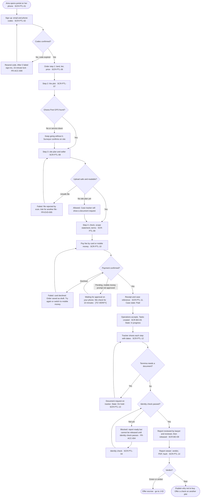

Edge states: a reviewer returns the report (state goes back to In progress; the client sees "Our reviewer asked for one more check. New expected date: 9 April."); a case is cancelled with a refund decision (FR-CASE-012), and the fee goes back through the payment provider to the card or mobile money account the client paid with (FR-PAY-008).

Two more gates sit before A11, both shown to staff on SCR-BO-09 and to the client as a late step, never as blame: every seller, grantor and consenting party has passed the national identity check (FR-ACC-013, SCR-BO-44), and every search has an official channel record (FR-CASE-016, SCR-BO-43). A search result that a runner, the seller or an agent hands over does not count until Tenmina has the same result from the registry's own channel (RUL-30).

### 3.2 J-02 Buy through escrow (R1)

```mermaid
flowchart TD
    B0(["Green or amber report · SCR-PTL-14"]) --> B1["Escrow offer: conditions copied from section 11 · SCR-PTL-16"]
    B1 --> B2{"All parties accept terms?"}
    B2 -->|"Seller does not accept in 10 days · [TO VERIFY]"| B2x["Escrow stays Proposed. Case manager chases. Client can withdraw"]
    B2 -->|"Yes"| B3["Seller's identity and account name checked; seller's account fixed as the payee · RUL-28, RUL-31. State: Agreed. Bank opens escrow"]
    B3 --> B4["Bank payment instructions · SCR-PTL-18. This escrow's own virtual account number or reference at the bank. Never Tenmina's account · RUL-34"]
    B4 --> B5{"Bank confirms deposit?"}
    B5 -->|"Amount short or reference missing"| B5x["Failed: deposit not matched. Case manager checks with bank. Client told what to fix"]
    B5x --> B5
    B5 -->|"Credited to another escrow's reference"| B5w["Not counted in this escrow's balance. Listed in reconciliation for the bank to correct · SCR-BO-13, FR-ESC-019"]
    B5w --> B5
    B5 -->|"Yes"| B6["State: Funded. Tracker shows deposit date and amount · SCR-PTL-17"]
    B6 --> B7["Close each condition with evidence · SCR-BO-11"]
    B7 --> B7m{"Evidence complete?"}
    B7m -->|"Document missing"| B7r["Condition stays open. Named owner and date shown to client"]
    B7r --> B7
    B7m -->|"Yes"| B8["Fresh search and site check · FR-CASE-014"]
    B8 --> B8f{"Fresh search clear and in date?"}
    B8f -->|"New caveat found"| B8x["Blocked: release stopped. Report re-issued as new version. Client advised"]
    B8f -->|"Out of date"| B8o["Blocked: fresh search older than the window · RUL-07. Re-run"]
    B8o --> B8
    B8f -->|"Yes"| B9["State: Ready to release"]
    B9 --> B9c["Client approves the release with a one-time code · SCR-PTL-17 · RUL-11, DA-01. Told when the seller will be paid · DA-15"]
    B9c --> B9d{"Client approved?"}
    B9d -->|"No response"| B9r["Reminders on the configured period. Silence is never approval. Escrow stays Ready to release"]
    B9r --> B9c
    B9d -->|"Yes"| B9e["State: Client approved"]
    B9e --> B10["Approval 1 of 2 · SCR-BO-12"]
    B10 --> B11["Approval 2 of 2 by a different person, with second factor"]
    B11 --> B11b{"Amount within this escrow's confirmed balance?"}
    B11b -->|"No"| B11x["Blocked: more than this escrow's own balance at the bank. No override · RUL-34, FR-ESC-019"]
    B11b -->|"Yes"| B12["State: Release approved. Instruction sent to bank that working day. No waiting period · RUL-33, FR-ESC-018"]
    B12 --> B13{"Bank confirms payment?"}
    B13 -->|"Bank rejects instruction"| B13x["Failed: case manager contacts bank. Client sees 'Bank has queried the instruction'"]
    B13 -->|"Not confirmed within 2 working days · [TO VERIFY]"| B13o["Overdue: case manager alerted · FR-ESC-018, NFR-PERF-06. Client sees 'The bank has not yet confirmed payment'"]
    B13o --> B13
    B13 -->|"Yes"| B14(["State: Released. All parties see bank confirmation"])
    B13 -->|"Yes, and the terms set a held-back share"| B15["State: Partly released. Held-back share stays at the bank for its own condition · FR-ESC-020"]
    B15 -->|"Its condition closed; client and two staff approve"| B12
    B6 -.->|"Dispute opened"| BF["State: Frozen. Release button removed · RUL-15. Go to J-07"]
    B9 -.->|"Dispute opened"| BF
    B12 -.->|"Dispute opened before the bank pays"| BF
    BF -.->|"Dispute resolved"| B6
```

The client approval step follows the Escrow state model in 01 v0.2 and later (Ready to release → Client approved). It is the client's step, not a release: two Tenmina staff still approve and the bank pays.

**Release timing (RUL-33, FR-ESC-018, NFR-PERF-06).** There is no waiting period after the last approval. The release clock starts when the last condition of the release closes and shows on SCR-BO-10, SCR-BO-12 and My work. The instruction goes to the bank on the working day of the last approval, and the bank pays within `[2 working days, TO VERIFY]`; the target from last condition closed to seller paid is `[5 working days, TO VERIFY]` at the median. A release not sent that day, or not confirmed paid in time, shows as overdue in the back office and raises an alert. The client never sees the clock; they see when the seller will be paid (DA-15).

**Held-back share (RUL-33, FR-ESC-020, Q-30).** Only where the escrow terms set one, for example part of a land price kept until the buyer's registration is lodged, if the lawyer confirms this is allowed (Q-30). The client sees it as its own release with its own condition and the same approvals, never as money Tenmina keeps back. Its open condition does not block the main release (RUL-06).

**Payee change (RUL-28, FR-ESC-016).** A change of payee or account does not change the escrow's state. It blocks any release to the new account until the change is approved and the cooling-off period has ended.

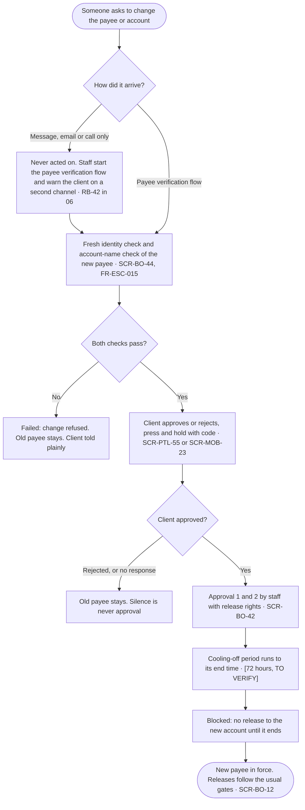

**Cancellation and refund (RUL-29, FR-ESC-017).** A cancelled escrow is refunded only to the account the deposit came from, as recorded from the bank's confirmation. If that account can no longer receive money, the refund to another account in the client's own name needs a fresh identity check of the client, the client's approval, two staff approvals and the cooling-off period. Both paths use the release approval screen with "Refund" wording (W-15).

### 3.3 J-03 Build with milestone payments (R2)

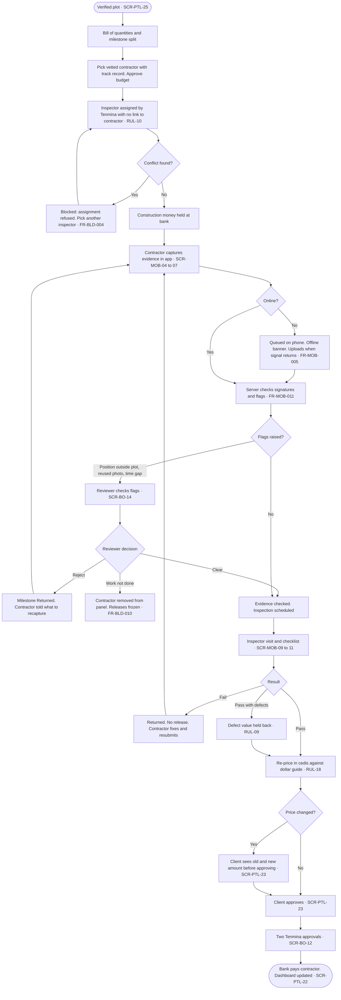

### 3.4 J-04 Buy a verified listing (R2)

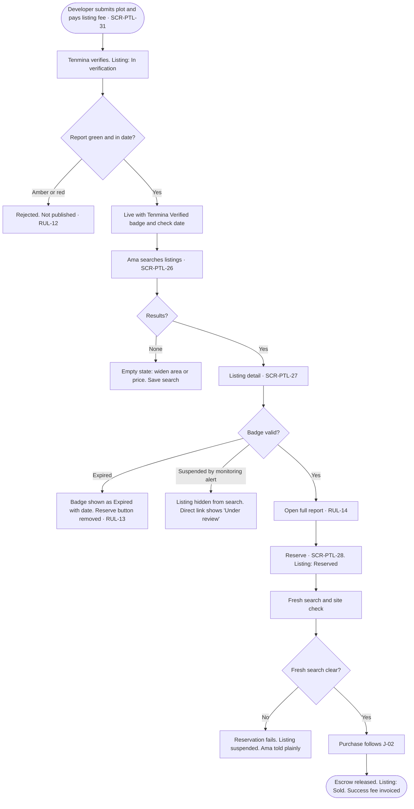

### 3.5 J-05 Fund a project at home (R2)

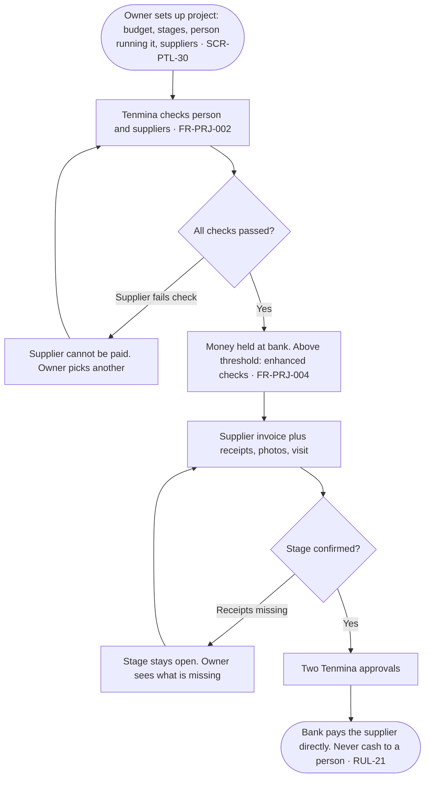

### 3.6 J-06 Bank collateral check (R2)

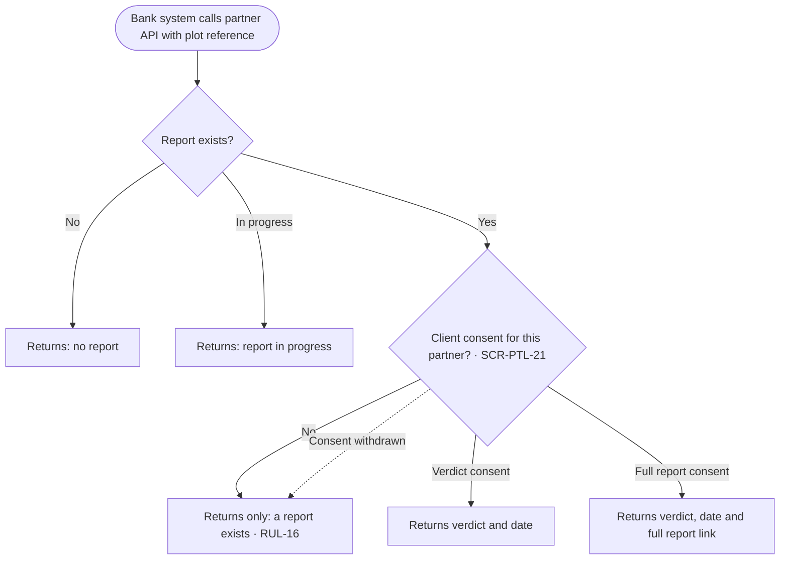

The client-facing part of J-06 is the consent screen SCR-PTL-21. Consent is per partner and per level. Withdrawal works the same way as granting.

### 3.7 J-07 Raise and resolve a dispute (R2)

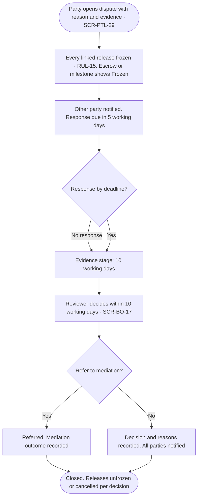

Deadlines are the assumptions in FR-DSP-003. Each step shows its due date in Ghana time and in the user's time zone.

### 3.8 J-08 Verify an existing building (R1)

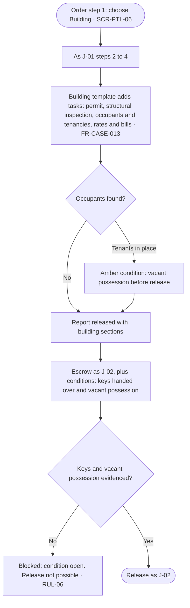

### 3.9 J-09 Pay a school or hospital directly (R1)

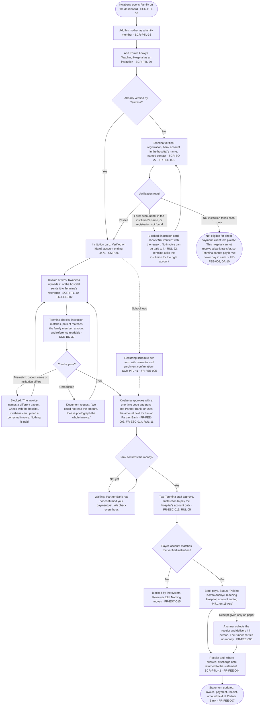

Edge states: an institution's verification lapses (bank account changed): the card turns to "Re-verifying" and payments pause until a second staff member confirms the new account (FR-ADM-003). A recurring payment is never taken without Kwabena's approval for that term (FR-FEE-005, RUL-11). An institution that can only take cash is never paid through Tenmina, and nothing about it suggests a cash option (FR-FEE-006).

### 3.10 J-10 Arrange care visits (R2)

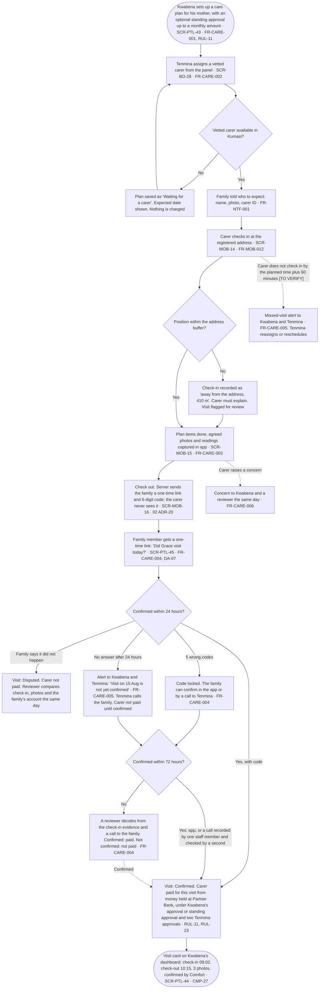

Edge state: the family member cannot use a phone. DA-07's fallback is a call from Tenmina to a second named family member; the confirmation records "confirmed by call with [name]", and a second staff member checks the record before the visit counts (FR-CARE-004).

### 3.11 J-11 Manage a property (R2)

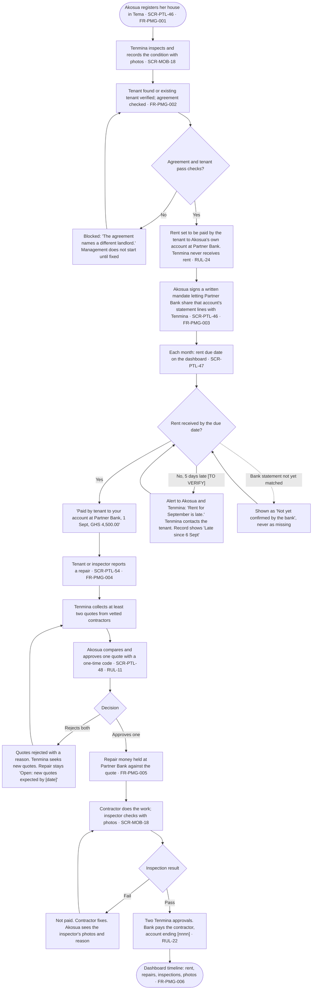

### 3.12 J-12 Get paperwork done (R2)

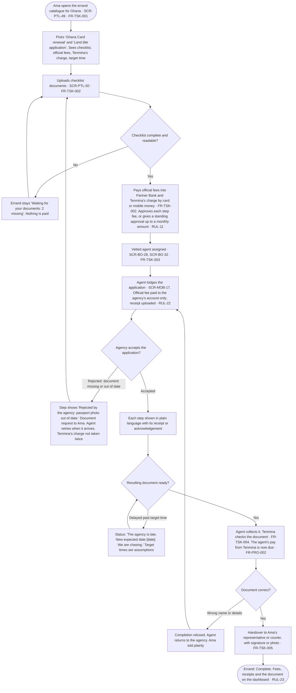

Who pays whom. Official fees go from Partner Bank to the agency only (RUL-22). Tenmina's charge is paid to Tenmina through the payment provider when the errand is ordered, never into Partner Bank (FR-TSK-002). The agent is paid by Tenmina from its own account, under FR-PRO, once Tenmina has checked the resulting document (FR-TSK-003, FR-PRO-002, RUL-23). The client's money never pays the agent (RUL-27).

---

## 4. Wireframes

Low fidelity. Phone wireframes are 40 characters wide, standing for a 360 px screen. Laptop wireframes are wider. `[ Button ]` is a button, `( )` a radio, `[x]` a checkbox, `___` an input, `<v>` a select, `(*)` an icon. All data is sample data.

Annotation keys: **Content**, **Actions**, **States**, **Rules**, **Satisfies**.

### W-01 Sign up · SCR-PTL-02

```text
+----------------------------------------+
| TENMINA                     Sign in     |
+----------------------------------------+
| Create your account                    |
| Step 1 of 2                            |
|                                        |
| Full name                              |
| [ Ama Serwaa Mensah____________ ]      |
| Email                                  |
| [ ama.mensah@example.com_______ ]      |
| Mobile number                          |
| [ +44 v ][ 7700 900123__________ ]     |
| Password (12 characters or more)       |
| [ ************_________ ] [Show]       |
|                                        |
| [x] I have read the privacy notice     |
|     (plain-language, 1 page) >         |
|                                        |
| [        Send my codes         ]       |
|                                        |
| We send one code by email and one by   |
| text message. Codes last 10 minutes.   |
+----------------------------------------+
| Step 2: [ _ _ _ _ _ _ ] email code     |
|         [ _ _ _ _ _ _ ] phone code     |
|         Resend codes (in 0:45)         |
+----------------------------------------+
```

- **Content.** One "full name" field, not first and last, because Ghanaian names do not always split that way. Country code picker defaults from the browser locale.
- **Actions.** Send codes; enter codes; resend after a 45-second wait (sample).
- **States.** Code wrong: "That code does not match. Check the latest message." Code expired: "That code has expired. We sent a new one." Email already used: offer sign in.
- **Rules.** Paste allowed in code and password fields; password managers work (WCAG 3.3.8). Privacy notice acceptance recorded with version.
- **Satisfies.** FR-ACC-001, FR-DPR-001, J-01.

### W-02 Identity check · SCR-PTL-04

```text
+----------------------------------------+
| <- Home                                |
| Confirm who you are                    |
|                                        |
| We must check your identity before we  |
| release a report or open an escrow.    |
| It takes about 3 minutes.              |
|                                        |
| Choose a document                      |
| ( ) Ghana Card                         |
| (*) Passport                           |
| ( ) I cannot do this online            |
|                                        |
| You will:                              |
|  1. Photograph the photo page          |
|  2. Take a short selfie video          |
|                                        |
| [      Start identity check      ]     |
|                                        |
| Who sees this: Tenmina staff and our    |
| identity check provider. Why? >        |
+----------------------------------------+
| STATUS CARD (after submit)             |
| (i) Checking your passport. Most       |
|     checks finish within 1 hour.       |
+----------------------------------------+
```

- **Content.** Why, how long, what happens, who sees the data.
- **Actions.** Start the provider check; or choose manual check, which opens an upload form for staff review.
- **States.** Pending, passed, failed with reason and retry, manual review. If the provider is down: "Our identity check service is not working right now. You can carry on ordering. We will remind you."
- **Rules.** The check is not needed to order or pay. It is needed before report release and escrow (A10 in J-01).
- **Satisfies.** FR-ACC-004, J-01, J-02.

### W-03 Order step 1, what to check · SCR-PTL-06

```text
+----------------------------------------+
| <- Cancel        Order a check         |
| [1 What]-[2 Plot]-[3 Docs]-[4 Agree]   |
|  ======                                |
| What do you want checked?              |
| +------------------------------------+ |
| |(*) Land (a plot)                   | |
| +------------------------------------+ |
| |( ) A building on its land          | |
| |    Adds permit, structure, tenants | |
| +------------------------------------+ |
|                                        |
| How fast?                              |
| +------------------------------------+ |
| |(*) Standard                        | |
| |    USD 450.00   about 3-4 weeks    | |
| |( ) Rush                            | |
| |    USD 600.00   about 2 weeks      | |
| +------------------------------------+ |
| Show prices in  <USD v>                |
| Prices are samples. Final price shown  |
| before you pay.                        |
|                                        |
| [            Continue            ]     |
+----------------------------------------+
```

- **Content.** Product line and tier as large radio cards (44 px or more). Tiers come from admin configuration (FR-ORD-002). "Extra plot, same seller" appears only after the first plot is added.
- **Actions.** Continue. The draft saves after each step.
- **States.** Prices fail to load: show "Prices are not loading. Try again." with a retry button; never show a stale price as final.
- **Rules.** Display currency per DA-02. Local standard tier shown when the user's country is Ghana.
- **Satisfies.** FR-ORD-001, FR-ORD-002, F-09, J-01, J-08.

### W-04 Order step 2, the plot · SCR-PTL-07

```text
+----------------------------------------+
| <- Back          Order a check         |
| [1 What]-[2 Plot]-[3 Docs]-[4 Agree]   |
|           ======                       |
| Where is the plot?                     |
| Region                                 |
| [ Central                      v ]     |
| Town or area                           |
| [ Kasoa, Millennium City______ ]       |
| Plot number (if known)                 |
| [ 14_________ ]                        |
| Site plan reference (if known)         |
| [ CR/KS/2026/0391_____ ]               |
| Ghana Post GPS address (if known)      |
| [ CX-071-4420___ ]  Look up            |
| +------------------------------------+ |
| | Map preview (static image)         | |
| | Pin near Kasoa. Tap to adjust >    | |
| +------------------------------------+ |
| Don't know some of these? That's fine. |
| Our surveyor confirms on site.         |
| [            Continue            ]     |
+----------------------------------------+
```

- **Content.** Only locality is required. Ghana Post GPS format hint `AA-NNN-NNNN`.
- **Actions.** Look up GPS address; adjust pin on a live map loaded only on tap (keeps page weight down).
- **States.** Look up fails: "We could not find that address. Check it, or carry on without it." Never blocks.
- **Rules.** No redundant entry: fields filled earlier (for example from a listing) are pre-filled (WCAG 3.3.7).
- **Satisfies.** FR-ORD-001, FR-GEO-008, J-01.

### W-05 Order step 4, check and agree · SCR-PTL-09

```text
+----------------------------------------+
| <- Back          Order a check         |
| [1 What]-[2 Plot]-[3 Docs]-[4 Agree]   |
|                             =======    |
| Check your order                       |
| Land check, Standard ......... Change  |
| Plot 14, Kasoa Millennium City  Change |
| Site plan uploaded (1 file) .. Change  |
| Seller: Kofi Asante, +233 24.. Change  |
|                                        |
| What the report covers                 |
| +------------------------------------+ |
| | (lock) Scope and limitation        | |
| | statement, version 1.0             | |
| | "This report sets out the results  | |
| |  of the checks listed in section   | |
| |  3 ..."   Read it all >            | |
| +------------------------------------+ |
| [ ] I have read what the report covers |
|     and does not cover                 |
| [ ] I agree to the terms (v1.0) >      |
| How did you hear about us? <Select v>  |
| Referral code (optional) [_______]     |
|                                        |
| Total to pay        USD 450.00         |
| [      Continue to payment       ]     |
+----------------------------------------+
```

- **Content.** Summary with change links back to each step. Locked scope text shown in full on expand, with version number.
- **Actions.** Accept scope and terms (two separate checkboxes), choose lead source, enter referral code, continue.
- **States.** Referral code invalid: inline message, order still allowed. Unchecked boxes: error summary at top with links to each box.
- **Rules.** Acceptance recorded with time and version (FR-ORD-003). Scope text cannot be edited (RUL-04).
- **Satisfies.** FR-ORD-003, FR-ORD-005, FR-ORD-006, RUL-04.

### W-06 Pay Tenmina's fee · SCR-PTL-10

```text
+----------------------------------------+
| <- Back             Pay                |
| You are paying Tenmina's fee for        |
| a land check.                          |
|                                        |
| Fee                    USD 450.00      |
| (about GBP 355, guide only)            |
|                                        |
| How do you want to pay?                |
| (*) Card                               |
| ( ) Mobile money (GHS 6,975.00)        |
|                                        |
| +------------------------------------+ |
| | Payment provider's secure card     | |
| | form loads here                    | |
| +------------------------------------+ |
|                                        |
| [       Pay USD 450.00           ]     |
|                                        |
| (i) This page is only for Tenmina's     |
| fee. We never take money for the land. |
| Land money goes to a licensed bank.    |
+----------------------------------------+
```

- **Content.** Amount, method, guide conversion, the "fee only" notice.
- **Actions.** Pay. Button repeats the amount.
- **States.** Processing (button disabled, "Paying... do not close this page"); declined (reason from provider in plain words, try again or switch method); mobile money pending ("Approve the payment on your phone. We will wait for up to 10 minutes."); timeout (order saved as draft, nothing charged twice).
- **Rules.** No card data stored (FR-PAY-002). Fee and escrow money never share a screen or flow (FR-PAY-005, RUL-01).
- **Satisfies.** FR-PAY-001, FR-PAY-002, FR-PAY-005, J-01.

### W-07 Case tracker · SCR-PTL-12

```text
+----------------------------------------+
| <- Home                                |
| Plot 14, Kasoa Millennium City         |
| Land check  TMN-2027-0142              |
| +------------------------------------+ |
| | NOW: Searches lodged at the Lands  | |
| | Commission on 12 March. Results    | |
| | expected by 2 April.               | |
| +------------------------------------+ |
| ! We need one thing from you           |
|   Seller's Ghana Card no. [Add] 20 Mar |
|                                        |
| Timeline                               |
| (v) Order paid ............. 3 Mar     |
| (v) Case accepted .......... 4 Mar     |
| (v) Searches lodged ........ 12 Mar    |
| (o) Site visit ...... planned 18 Mar   |
| ( ) Map checks ...... expected 20 Mar  |
| ( ) Consent meeting . expected 27 Mar  |
| ( ) Search results .. expected 2 Apr   |
| ( ) Legal review .... expected 7 Apr   |
| ( ) Report ready .... expected 10 Apr  |
|                                        |
| [ Message Tenmina ]  Receipt >          |
+----------------------------------------+
```

- **Content.** One "Now" sentence (CMP-06 pattern), open requests first, then the timeline. Done steps show actual dates; future steps show expected dates.
- **Actions.** Upload requested document; message Tenmina; view receipt; share read-only access with a representative.
- **States.** On hold: "Paused. We are waiting for the seller's Ghana Card number. We will restart as soon as it arrives." Late: "Search results are late. We expected them by 2 April. We are chasing and will update you by 9 April." Cancelled with refund status: "Your fee of USD 450.00 is being refunded to the card ending 1234 that you paid with." (FR-PAY-008).
- **Rules.** Messages come from templates (FR-CASE-007). No third-party personal data shown beyond what the client supplied. Tenmina asks for the seller's ID number, not a copy of the card: a photo or copy is never proof (RUL-31). Tenmina checks the number with the national identity system itself.
- **Satisfies.** FR-CASE-007, FR-CASE-008, FR-CASE-015, FR-ACC-008, FR-NTF-001, FR-PAY-008, F-06, J-01.

### W-08 Report viewer · SCR-PTL-14

```text
+----------------------------------------+
| <- Case TMN-2027-0142                  |
| Your report                            |
| +------------------------------------+ |
| | [(!) AMBER]  Fix before you pay    | |
| | Issues found that can be resolved  | |
| | before purchase.                   | |
| +------------------------------------+ |
| Why                                    |
| - Two corner pillars missing           |
| - Family consent promised, not yet     |
|   recorded                             |
| Before you pay                         |
| [ ] Pillars re-set by surveyor         |
| [ ] Consent meeting recorded on video  |
|                                        |
| Section verdicts  (table, 4 to 10)     |
| 4 Plot identity ......... (!) Amber    |
| 5 Lands Commission ...... (v) Green    |
| 8 Seller authority ...... (!) Amber    |
| ...                                    |
| Signed by: Lawyer A. Darko, GBA-1234   |
|  Surveyor E. Tetteh, LS-0567           |
| [   Download PDF (1.2 MB)   ]          |
| Report v1 · 10 Apr 2027 · SHA-256:     |
| 9f2c 41ab ... e07d  [Copy] [Check >]   |
| [ Buy through escrow ]                 |
+----------------------------------------+
```

- **Content.** Verdict badge (CMP-07) with the template's meaning, 3 to 5 reasons, conditions, section table, signatures with licence numbers, PDF, version, hash.
- **Actions.** Download PDF; copy hash; check a file against the hash (in-browser, DA-04); offer escrow on green or amber.
- **States.** New version: banner "This report was corrected on 14 April. Reason: plot number typo. Version 2 replaces version 1." Older versions stay listed. Red: escrow button replaced by "Why we advise you not to buy" and "Check another plot".
- **Rules.** Released reports never change (FR-RPT-010). Hash shown in groups of 4 for reading aloud.
- **Satisfies.** FR-RPT-005, FR-RPT-007, FR-RPT-008, FR-RPT-010, RUL-02, J-01.

### W-09 Escrow tracker · SCR-PTL-17

```text
+----------------------------------------+
| <- Home                                |
| Escrow for Plot 14, Kasoa              |
| ESC-2027-0031 · Held by Partner Bank   |
| +------------------------------------+ |
| | NOW: All 4 conditions closed.      | |
| | Fresh search done 2 May. Release   | |
| | is waiting for a second Tenmina     | |
| | approval.                          | |
| +------------------------------------+ |
| Money at the bank                      |
| USD 18,000.00  deposit confirmed 22 Apr|
| Your money is held by Partner Bank,    |
| not by Tenmina.                         |
|                                        |
| Conditions (4 of 4 closed)             |
| [v] Pillars re-set ...... closed 25 Apr|
| [v] Consent recorded .... closed 28 Apr|
| [v] Indenture signed .... closed 30 Apr|
| [v] Seller's tax clearance closed 6 May|
| Fresh search (within window) [v] 2 May |
|                                        |
| Your approval                          |
| (v) You approved the release 6 May     |
|     14:00 GMT (code verified)          |
| Release approvals   [ 1 of 2 ]         |
| (v) K. Boateng, reviewer, 6 May 15:20  |
| ( ) Second approver                    |
| Then: bank pays seller, confirms.      |
| Paid within 2 working days of your     |
| approval. No waiting period.           |
+----------------------------------------+
```

- **Content.** Status sentence, bank and amount, conditions with closing dates, fresh search, the client's own approval, Tenmina's two approvals, next step, and when the seller will be paid: the fixed line "Paid within 2 working days of your approval. No waiting period." (5.6a, DA-15) before and after the client approves. A held-back share, where the terms set one, is its own release card under the first, with its condition and amount: "Release 2 of 2. Held back until your registration is lodged. USD 1,800.00 (sample; share `[TO VERIFY]`, Q-30)." An open condition shows its owner and due date instead of a closing date: "Seller's tax clearance. Owner: seller's lawyer. Due 6 May."
- **Actions.** Approve the release once every condition is closed (one-time code, DA-01, RUL-11); view evidence for a closed condition; open a dispute (R2); view bank instructions.
- **States.** Proposed (waiting for parties), Agreed (waiting for deposit), Funded (conditions closing; approvals show "Start when every condition is closed"), Ready to release ("Your approval is needed. Tenmina staff approve after you."), Client approved, Release approved, Released, Frozen ("A dispute was opened on 4 May. No money can move until it is resolved."), Cancelled ("Refund of USD 18,000.00 to the account it came from, ending 2290."). Release approved: "Tenmina told Partner Bank to pay the seller on 7 May. Expected paid by 9 May." Payment late: "Partner Bank has not yet confirmed payment to the seller. We expected it by 9 May. We are chasing the bank and will update you by 10 May." Partly released, with a held-back share: "Partner Bank paid the seller on 7 May. USD 1,800.00 stays at the bank until your registration is lodged." No response from the client: reminders; silence is never approval. Payee change in progress: a black panel above the conditions, "Payee change: Kofi Asante's new account ending 7710. Waiting for your decision." with an orange "Needs you" block opening SCR-PTL-55; after approval, "No money can go to the new account until 9 May, 14:00 GMT." Frozen after a failed re-check: "A routine re-check found a problem with this case on 4 May. No money can move until we have checked it. We will update you by 8 May."
- **Rules.** No approval or release while any condition of that release is open (RUL-06); a held-back share's own condition does not hold up the main release; fresh search and site check must be in date at approval and at sending (RUL-07); client approves first and cannot release alone (RUL-11); approver names shown (RUL-05). The payee is locked from Agreed; the fixed line "We never change who gets paid because of a message, email or call." sits under the payee (RUL-28). Refunds name the source account only (RUL-29). No waiting period after the last approval, and no part of a release held back unless the terms set it (RUL-33).
- **Satisfies.** FR-ESC-004 to FR-ESC-009, FR-ESC-016, FR-ESC-017, FR-ESC-018, FR-ESC-020, FR-RPT-012, RUL-05, RUL-06, RUL-07, RUL-11, RUL-15, RUL-28, RUL-29, RUL-33, J-02.

### W-10 Bank payment instructions · SCR-PTL-18

```text
+----------------------------------------+
| <- Escrow ESC-2027-0031                |
| Pay the purchase price to the bank     |
| +------------------------------------+ |
| | (shield) These are the bank's      | |
| | details, not Tenmina's. Tenmina      | |
| | never asks you to pay land money   | |
| | to Tenmina.                         | |
| +------------------------------------+ |
| Bank ............ Partner Bank [SAMPLE]|
| Account name .... Partner Bank Escrow  |
| Account number .. 9000 0000 0031 [Copy]|
|   (this escrow's own account number)   |
| SWIFT ........... XXXXGHAC     [Copy]  |
| Reference ....... ESC-2027-0031 [Copy] |
| Amount .......... USD 18,000.00        |
|                                        |
| Always use the reference. Without it   |
| the bank cannot match your payment.    |
| If anyone sends you different details, |
| do not pay. Call us first.             |
|                                        |
| This account number is for this escrow |
| only. Partner Bank holds the money as  |
| escrow agent, not Tenmina.             |
+----------------------------------------+
```

- **Content.** Bank details from the escrow record only: the bank, the name of its escrow account for the programme, this escrow's own virtual account number or unique reference (RUL-34), SWIFT, the amount. Where a pilot uses one bank account per escrow, that account's number shows in the same place with the same words. Warning about changed details. The escrow account fixed line (5.6a).
- **Actions.** Copy each field; download as PDF; "Report suspicious details".
- **States.** Escrow not yet Agreed: details hidden with "The bank will open the escrow once everyone has accepted the terms." Agreed, but the bank has not yet issued the escrow's own number or reference: details hidden with "Partner Bank is opening this escrow's own account number. We will tell you when you can pay."
- **Rules.** Never Tenmina's account (FR-ESC-003, RUL-01). Never another escrow's number or reference; no two open escrows or held amounts share one (FR-ESC-019, RUL-34). Details change only through a two-person admin change, logged.
- **Satisfies.** FR-ESC-003, FR-ESC-019, RUL-01, RUL-34, J-02.

### W-11 Back office: my work queue · SCR-BO-02

```text
+------------------------------------------------------------------------------------+
| TENMINA back office   My work | Cases | Escrow | Reports | Admin     Esi M. (v)     |
+------------------------------------------------------------------------------------+
| My work (32 open)  Filter: [All types v] [All owners v] [Overdue first v]  Search  |
| OVERDUE (3)                                                                        |
| (!) TMN-2027-0129  Search results  Runner: Yaw O.   Due 28 Mar  2 days late [Chase]|
| (!) TMN-2027-0133 Consent meeting  Lawyer: A. Darko Due 29 Mar  1 day late  [Chase]|
| DUE THIS WEEK (7)                                                                  |
|     TMN-2027-0142  Site visit      Surveyor: E.T.   Due 18 Mar  (risk: clear)      |
|     TMN-2027-0150  Intake           Me              Due 31 Mar  New, unassigned    |
| WAITING ON OTHERS (22) ................................................ show >     |
+------------------------------------------------------------------------------------+
```

- **Content.** Tasks grouped by overdue, due this week, waiting. Each row: case, step, owner, due date, lateness in words and icon.
- **Actions.** Filter, search, open case, chase owner (sends templated reminder, logged), bulk reassign.
- **States.** Empty: "Nothing due. New cases appear here when paid." Loading: skeleton rows. Error: retry with last good list shown and its time.
- **Rules.** Sort by due date with overdue first (FR-CASE-005). Role filter (FR-ACC-007).
- **Satisfies.** FR-CASE-005, FR-NTF-003, J-01.

### W-12 Back office: case detail with tasks · SCR-BO-03

```text
+------------------------------------------------------------------------------------+
| <- My work   TMN-2027-0142  Plot 14, Kasoa   Land v1.3   In progress   Risk: clear |
+--------------------------------------------+---------------------------------------+
| Tasks                                      | Client sees now                       |
| Step            Owner      Due     Status  | "Searches lodged at the Lands         |
| Intake          Esi M.     4 Mar   Done    |  Commission on 12 March. Results      |
| Searches lodged Esi M.     6 Mar   Done    |  expected by 2 April."  [Change msg v]|
| Site visit      E.Tetteh+1 18 Mar  Open    |---------------------------------------|
| Overlay checks  System     20 Mar  Ready   | Requests to client                    |
| Consent meeting A. Darko   27 Mar  Open    | Seller's ID number due 20 Mar Open    |
| Search results  Esi M.     2 Apr   Waiting | [ + Request a document ]              |
| Legal review    A. Darko   7 Apr   -       |---------------------------------------|
| Second review   (reviewer) 9 Apr   -       | Costs   Lawyer GHS 1,500  Runner 300  |
| Release         Esi M.     10 Apr  -       | [ Pause ] [ Cancel case ]             |
+--------------------------------------------+---------------------------------------+
| Task: Site visit   Required evidence: coordinates [ ], photos [ ], video [ ]       |
| [ Mark done ] (disabled: 3 evidence items missing)  Change due date (reason needed)|
+------------------------------------------------------------------------------------+
```

- **Content.** Template version, state, risk flag, tasks, the current client message, requests, costs.
- **Actions.** Assign, change due date with reason, request document, pick next client message from templates, pause, cancel with refund decision.
- **States.** Mark done disabled with a reason until evidence is attached (FR-CASE-004). On hold banner with reason. "Search results" can be marked done only from an official search record (SCR-BO-43); its owner is the staff member who submitted the search from Tenmina's registry account, never a runner (FR-CASE-016).
- **Rules.** Building cases show four extra steps (FR-CASE-013). Cancel with refund decision: the fee goes back through the payment provider to the original payment method (FR-PAY-008).
- **Satisfies.** FR-CASE-001 to FR-CASE-004, FR-CASE-007, FR-CASE-008, FR-CASE-011, FR-CASE-012, FR-CASE-013, FR-CASE-016, FR-PAY-008.

### W-13 Risk screen and assignment · SCR-BO-05

```text
+--------------------------------------------------+
| Site visit: risk screen   TMN-2027-0129          |
| 1. Any report of threats on this plot?  (Yes) No |
| 2. Occupied by someone claiming it?      Yes (No)|
| 3. Known dispute area (overlay)?        (Yes) No |
| Result: (!) DISPUTED. Two people needed.         |
| Visitors  [ E. Tetteh, surveyor      v ]         |
|           [ Yaw Owusu, runner         v ]        |
| [x] Lawyer told the family head of the visit     |
| [ Assign visit ]                                 |
+--------------------------------------------------+
```

- **Content.** Short risk questions, computed result in words and icon, named visitors.
- **Actions.** Answer, assign, cancel visit.
- **States.** Fewer than two people on a disputed plot: Assign disabled, message "Disputed plot: add a second person (RUL-17)."
- **Rules.** RUL-17; the incident link sits on every field task.
- **Satisfies.** FR-CASE-009, FR-CASE-010.

### W-14 Report builder · SCR-BO-08

```text
+------------------------------------------------------------------------------------+
| Report builder  TMN-2027-0142  Template land v1.3   Draft   Autosaved 10:41 GMT    |
+----------------------+-------------------------------------------------------------+
| Sections             | 8. Seller authority and consent        Owner: A. Darko      |
| 1 Cover        auto  | Findings  [ Family head confirmed seller's allocation ...  ]|
| 2 Summary      -     | Evidence  [doc] Allocation note  [vid] Consent 27 Mar (v)   |
| 3 Scope        auto  | Section verdict  ( ) Green  (*) Amber  ( ) Red              |
| 4 Plot identity Amber|   Amber means: consent promised but not yet recorded.       |
| 5 Searches   Green |---------------------------------------------------------------|
| 6 Surveyor     Green | 11. Verdict and conditions                                  |
| 7 Overlays     Green |   Allowed overall: Green blocked (no red, 2 amber) -> Amber |
| 8 Seller       Amber |   Conditions (copied to escrow):                            |
| 9 Chain        Green |   1 Pillars re-set   owner: surveyor  evidence: photos      |
| 10 Occupation  Green |   [ + Add condition ]                                       |
| 11 Verdict   Amber |---------------------------------------------------------------|
| 12 Scope (lock) v1.0 | 12. Scope and limitation  (lock) Locked text v1.0. Cannot   |
| 13 Signatures  0 of 3|     be edited here. Changes go through admin (FR-ADM-004).  |
| 14 Appendices auto  | 13. Sign  [ Sign legal section ] needs licence GBA-1234 valid|
+----------------------+-------------------------------------------------------------+
| [ Preview PDF ]   [ Send for review ] (disabled: summary empty, 3 signatures due)  |
+------------------------------------------------------------------------------------+
```

- **Content.** Section list with verdict per section in icon and word, the active section, computed allowed verdict, conditions as structured items, locked scope block.
- **Actions.** Enter findings, attach evidence from the case store, choose section verdict, add conditions, sign own section, preview, send for review.
- **States.** Green chosen while any section 4 to 10 is red: option disabled with "Overall cannot be green: section 7 is red (RUL-02)." Licence expired: sign button disabled with "Your licence expired on 31 Jan. Upload the renewed licence." Conflict: someone else editing the section, shown with name, read-only.
- **Rules.** RUL-02, RUL-04, RUL-20.
- **Satisfies.** FR-RPT-001 to FR-RPT-005, FR-RPT-009, FR-GEO-003.

### W-15 Two-person release approval · SCR-BO-12

```text
+------------------------------------------------------------------------------------+
| Release approval  ESC-2027-0031  Plot 14, Kasoa              Ready to release      |
| Release clock: day 1 since the last condition closed 6 May. Target: sent today     |
+------------------------------------------------------------------------------------+
| Pay USD 18,000.00 from escrow at Partner Bank to Kofi Asante (seller), acct ..4471 |
+------------------------------------------------------------------------------------+
| Gates (all must pass)                                                              |
| (v) All 4 conditions closed with evidence ......................... view evidence  |
| (v) Search result 2 May, site check 3 May: inside 14 days [TO VERIFY] ...... view  |
| (v) No open dispute                                                                |
| (v) Deposit confirmed by bank 22 Apr, USD 18,000.00                                |
| (v) Within this escrow's confirmed balance: USD 18,000.00 at ref ESC-2027-0031     |
| (v) Payee matches escrow terms v1.0; no payee change in cooling-off ...... view    |
| (v) Seller's identity checked with the national identity system, 14 Apr            |
+------------------------------------------------------------------------------------+
| Approval 1 of 2                         | Approval 2 of 2                          |
| (v) Kofi Boateng, reviewer              | You: Abena Owusu, reviewer               |
|     6 May 2027 15:20 GMT, code verified | [x] I checked the evidence for each      |
|                                         |     condition myself                     |
|                                         | Code from your authenticator [______]    |
|                                         | [ Approve and send instruction ]         |
+------------------------------------------------------------------------------------+
| After approval: instruction signed by both approvers and sent to the bank today.   |
| No waiting period (RUL-33). Bank pays within 2 working days [TO VERIFY].           |
| Status changes to Release approved, then Released when the bank confirms.          |
+------------------------------------------------------------------------------------+
```

- **Content.** One sentence saying who gets how much from where. The release clock (5.6d). Gates, including the escrow's confirmed balance at its own virtual account number or reference. Two approval slots with names and times. The client's approval time, so staff approve the same working day (DA-15).
- **Actions.** Approve with second factor; return with comment; view each piece of evidence.
- **States.** Any gate failing: approve area replaced by "Release blocked: 1 condition open (seller's tax clearance)." Payee change in cooling-off: "Release blocked: the payee's account changed on 6 May. No release to the new account until 9 May, 14:00 GMT (RUL-28)." Frozen after a failed re-check: "Release blocked: re-check RCK-2027-05-03 failed. See the incident." Same person as approver 1: "You gave approval 1. A different person must give approval 2 (RUL-05)." Over balance: "Release blocked: USD 18,000.00 is more than this escrow's confirmed balance of USD 17,500.00 at Partner Bank (RUL-34)." No override; the balance changes only with the bank's confirmation. Overdue: the clock turns orange, "Overdue: not sent on the day of the last approval" or "Overdue: Partner Bank has not confirmed payment. Expected by 9 May." Held-back share: the sentence reads "Pay USD 16,200.00 … Held back until registration is lodged: USD 1,800.00 (sample)"; the share's own release later uses this screen with its condition as a gate (FR-ESC-020). Frozen by dispute: whole screen read-only with the dispute link. Bank rejects: banner with bank's reason.
- **Rules.** RUL-05, RUL-06, RUL-07, RUL-15, RUL-28, RUL-33, RUL-34. No "send later" or "hold for N days" control. A refund also draws only on the escrow's confirmed balance. Refund and cancellation use the same screen with "Refund" wording (FR-ESC-013). The refund sentence names the source account from the bank's deposit confirmation, "Refund USD 18,000.00 from escrow at Partner Bank to Ama Mensah, account ending 2290, where the deposit came from", and has a gate "Refund goes to the source account" (FR-ESC-017). Any other account shows "Refund blocked: this is not the account the money came from" unless the RUL-29 exception path is complete (client identity check, client approval, two staff approvals, cooling-off), shown as its own gate.
- **Satisfies.** FR-ESC-006 to FR-ESC-009, FR-ESC-013, FR-ESC-016, FR-ESC-017, FR-ESC-018, FR-ESC-019, FR-ESC-020.

### W-16 Admin: templates and configuration · SCR-BO-18

```text
+------------------------------------------------------------------------------------+
| Admin > Configuration          Country: Ghana v                                    |
| Templates      Version  Status     | Values (Ghana)                 Current        |
| Land case      1.3      Live      | Fresh-search window      14 days [TO VERIFY]   |
| Building case  1.1      Live      | Listing badge validity   90 days [TO VERIFY]   |
| Land report    1.3      Live      | Plot buffer distance     50 m [TO VERIFY]      |
| Milestones std 1.0      Live       | Dispute response        5 working days        |
|                                    | Bank pays within  2 working days [TO VERIFY]  |
|                                    | Seller paid, median 5 working days [TO VERIFY]|
| Land case     1.4      Draft >    | [ Edit values ] (change logged, takes effect   |
|                                    |  for new cases only)                          |
| Locked scope statement v1.0 (lock)                                                 |
| Change needs: 2 administrators + lawyer approval file + insurer approval file      |
| [ Propose new version ]   Pending: none                                            |
+------------------------------------------------------------------------------------+
```

- **Content.** Versioned templates and values per country. The fresh-search window counts from the date on the registry's result and the date of the site check, and is checked at the last approval and again when the instruction is sent (RUL-07). The release timing targets come from NFR-PERF-06; the release instruction is always sent on the working day of the last approval, so there is no value for a waiting period.
- **Actions.** Draft, compare, publish a version; edit values; propose scope change.
- **States.** Publishing a template shows a diff and "Running cases keep version 1.3." Scope proposal waits for a second admin.
- **Rules.** RUL-04, FR-ADM-004. Values marked `[TO VERIFY]` show a warning chip until confirmed by the owner in 01 B9.
- **Satisfies.** FR-ADM-001, FR-ADM-004, FR-ADM-005, FR-CTY-001.

### W-17 Tenmina Field: contractor milestone submission with offline queue · SCR-MOB-07

```text
+--------------------------------+
| (!) Offline. 7 items saved on  |
|     this phone. They upload    |
|     when you have signal.      |
+--------------------------------+
| <- Foundation   House, Kasoa   |
| Milestone 1 of 6               |
| Evidence (6 of 6 done)         |
| [v] Cleared site, setting out  |
| [v] Trenches with tape (2)     |
| [v] Reinforcement, 2 angles    |
| [v] Video: trench line         |
| [v] Cured foundation           |
| [v] Delivery notes (3)         |
|                                |
| All taken with this app.       |
| Position checked: on plot.     |
|                                |
| [ Submit milestone          ]  |
|                                |
| Submitted offline: it will be  |
| sent automatically. Keep the   |
| app installed.                 |
+--------------------------------+
| Jobs     Queue (7)    Account  |
+--------------------------------+
```

- **Content.** Offline banner with item count, checklist from the milestone schedule, capture summary.
- **Actions.** Open an item to capture or retake; submit (queues when offline).
- **States.** Item missing: Submit disabled with "2 items still needed." Capture off plot: item marked "(!) Taken 340 m from the plot" and the contractor must explain or retake. Sending: progress per item. Sent: "Received by Tenmina 14:22 GMT." Upload failed: retried automatically with backoff; never lost.
- **Rules.** Camera only, no gallery, on iOS and Android (RUL-08). Queue survives the app being closed, ended by the phone's system, or a restart (FR-MOB-005). On iPhone, if the user swipes the app away, uploads pause until it is opened again; the queue screen says "Open Tenmina Field to finish sending". Originals kept until server confirms (FR-MOB-008).
- **Satisfies.** FR-MOB-002 to FR-MOB-006, FR-MOB-008, FR-MOB-009, J-03.

### W-18 Tenmina Field: inspector checklist · SCR-MOB-09 and SCR-MOB-11

```text
+--------------------------------+
| <- Inspection: Blocks          |
| House, Kasoa. You have no link |
| to this contractor.            |
| 3 of 8 checked                 |
| Walls match drawing   Yes  No  |
|   (*)                [ Photo ] |
| Walls plumb, level    Yes  No  |
|   (*)                [ Photo ] |
| Block quality         Yes (No) |
|   Note: crumbling, east wall   |
|   [ Add as defect ]            |
| Mortar joints filled  ...      |
| ...                            |
| Result                         |
| ( ) Pass                       |
| (*) Pass with defects          |
|     1 defect, GHS 2,400 held   |
| ( ) Fail                       |
| [ Submit result ]              |
+--------------------------------+
```

- **Content.** Checklist from the milestone schedule, one item per row, yes/no as large toggles.
- **Actions.** Answer, photo, add defect with value (SCR-MOB-10), choose result, submit.
- **States.** Unanswered items block submit. Fail needs a reason. Offline: same queue as W-17.
- **Rules.** RUL-09 (defect value held), RUL-10 (conflict message at top).
- **Satisfies.** FR-MOB-007, FR-BLD-006, J-03.

### W-19 Build dashboard · SCR-PTL-22

```text
+----------------------------------------+
| House on Plot 14, Kasoa   BLD-2027-0007|
| NOW: Blocks passed inspection 14 Aug   |
| with 1 defect. Waiting for your        |
| approval by 21 Aug.  [ Review ]        |
| Budget                                 |
| Planned  USD 42,000 ######----  spent  |
| Released USD 12,600 (30%)              |
| Held at bank USD 29,400                |
| Milestones                             |
| (v) Mobilisation  paid 2 Jun           |
| (v) Foundation    paid 9 Jul           |
| (!) Blocks        pass w/ defects      |
| ( ) Lintel ... ( ) Roof ... ( ) Finish |
| Photo timeline                         |
| [img][img][img][img]  14 Aug >         |
| [img][img][img]       2 Jul  >         |
| Inspector: P. Quaye, 14 Aug, report >  |
+----------------------------------------+
```

- **Content.** Status sentence with the client's next action, budget against actual, milestone list, photo timeline grouped by milestone, inspector results.
- **Actions.** Review milestone, order an extra inspection (FR-ORD-007), approve a variation, open a dispute.
- **States.** No photos yet: "The contractor has not sent photos yet. Foundation photos are due by 30 June." Release frozen: banner with dispute link.
- **Rules.** Thumbnails are 320 px previews; full image on tap (FR-EVD-004).
- **Satisfies.** FR-BLD-009, FR-ORD-007, J-03.

### W-20 Milestone approval with cedi re-pricing · SCR-PTL-23

```text
+----------------------------------------+
| <- Build   Milestone 2: Blocks         |
| (!) PASS WITH DEFECTS  14 Aug          |
| 1 defect: crumbling blocks, east wall  |
| Price check (in cedis)                 |
| Agreed       GHS 98,000.00             |
| Re-priced    GHS 101,500.00 (+3.6%)    |
| Why: cement price guide rose. Source > |
| Defect held  GHS 2,400.00              |
| To pay now   GHS 99,100.00             |
| = USD 6,394 at guide rate (guide only) |
| [x] I have seen the new price          |
| Code sent to your phone [______]       |
| [ Approve this milestone ]             |
| [ Question it ]  [ Open a dispute ]    |
| After you approve, two Tenmina staff    |
| approve and the bank pays.             |
+----------------------------------------+
```

- **Content.** Inspector result, re-pricing with old and new amounts, reason, defect hold-back, amount to pay now.
- **Actions.** Approve (with one-time code, DA-01), question, dispute.
- **States.** Approval window: "If you do nothing by 21 Aug, we remind you. Nothing is paid until you approve." (01 v0.2 Milestone model: silence is never approval; issue I-14 closed.) Fail result: no approve button; "No payment. The contractor must fix and resubmit."
- **Rules.** RUL-18 change shown before approval; RUL-11 client approval does not release on its own.
- **Satisfies.** FR-BLD-005 to FR-BLD-007, RUL-09, RUL-11, RUL-18.

### W-21 Listings search and map · SCR-PTL-26

```text
+----------------------------------------+
| Verified listings                      |
| [ Tema, East Legon, Kasoa... ] Search  |
| Filters (3)  Sort: newest check v      |
| [ List ]  [ Map ]                      |
| +------------------------------------+ |
| | [plot img] Plot, 100 x 70 ft       | |
| | Community 25, Tema                 | |
| | USD 24,000                         | |
| | (v) Tenmina Verified, checked 3 Jun | |
| +------------------------------------+ |
| | [plot img] 3-bed, off-plan unit    | |
| | Oyarifa Gardens [SAMPLE ESTATE]    | |
| | USD 61,500                         | |
| | (v) Tenmina Verified, checked 20 May| |
| +------------------------------------+ |
| Showing 2 of 2. Prices set by sellers. |
+----------------------------------------+
```

- **Content.** Card per listing with price, size, locality, badge with check date. Map view shows numbered pins plus the same list below; no information only on the map.
- **Actions.** Search, filter (region, locality, price, size, type, verification date), toggle list or map, open detail.
- **States.** Empty with suggestions; map fails to load: list stays usable.
- **Rules.** Only Live listings appear (FR-LST-002). Map pan and zoom have button alternatives (WCAG 2.5.7).
- **Satisfies.** FR-LST-004, FR-LST-010, J-04.

### W-22 Listing detail · SCR-PTL-27

```text
+----------------------------------------+
| <- Listings                            |
| [ photo placeholder ]                  |
| Plot, 100 x 70 ft, Community 25, Tema  |
| USD 24,000                             |
| +------------------------------------+ |
| | (v) TENMINA VERIFIED                | |
| | Checks done 3 June 2027            | |
| | Badge valid until 1 Sept 2027      | |
| | [ Read the full report ]           | |
| +------------------------------------+ |
| Seller: Sample Estates Ltd             |
| Track record: 12 sales, 0 disputes >   |
| Before you pay, Tenmina runs a fresh    |
| search and site check. Your money is   |
| held by a licensed bank.               |
| [ Reserve this plot ]  [ Ask Tenmina ]  |
+----------------------------------------+
```

- **Content.** Badge (CMP-23) with check date and expiry, full report link, seller track record, what happens on reserve.
- **Actions.** Read report (always available, RUL-14), reserve (sign in needed), enquire through Tenmina.
- **States.** Expired: badge shows "(x) Badge expired 1 Sept 2027. Checks are out of date." and reserve is removed. Suspended: "Under review. This listing cannot be reserved now." Reserved by someone else: "Reserved. Check back after 30 Sept."
- **Rules.** RUL-12, RUL-13, RUL-14.
- **Satisfies.** FR-LST-003, FR-LST-005, FR-LST-006, FR-RAT-003, J-04.

### W-23 Dispute · SCR-PTL-29

```text
+----------------------------------------+
| <- Escrow ESC-2027-0031                |
| Dispute DSP-2027-0004                  |
| NOW: Waiting for the seller's response |
| by 11 May (5 working days).            |
| (lock) Release frozen. No money can    |
| move until this is decided.            |
| Steps                                  |
| (v) Opened by you ........ 4 May       |
| (o) Seller response ...... by 11 May   |
| ( ) Evidence ............. by 25 May   |
| ( ) Decision ............. by 8 Jun    |
| Your statement   Read >                |
| Evidence (3 files)  [ + Add ]          |
| [ Withdraw dispute ]                   |
+----------------------------------------+
```

- **Content.** Status sentence, frozen notice, step deadlines, statements, evidence, decision with reasons when made.
- **Actions.** Open (reason picker plus free text plus evidence), add evidence before the deadline, withdraw.
- **States.** Referred to mediation; decided (outcome, reasons, decider name, what happens to the money).
- **Rules.** RUL-15; FR-DSP-003 deadlines in working days.
- **Satisfies.** FR-DSP-001 to FR-DSP-005, J-07.

### W-24 Partner sharing and consent · SCR-PTL-21

```text
+----------------------------------------+
| <- Account   Sharing                   |
| Who can see your reports               |
| Sample Bank Ghana [SAMPLE]             |
| asked about Plot 14, Kasoa on 2 Sept   |
| What may they see?                     |
| ( ) Nothing beyond "a report exists"   |
| (*) Verdict and date only              |
| ( ) Full report                        |
| [ Save my choice ]                     |
| You can change this at any time. We    |
| keep a record of each choice.          |
| Case studies                           |
| [ ] Tenmina may use an anonymised       |
|     version of my report               |
+----------------------------------------+
```

- **Content.** Partner name, what they asked, three plain levels.
- **Actions.** Choose, save, withdraw (same control).
- **States.** Saved with time; withdrawn takes effect for the next API call.
- **Rules.** RUL-16; default is the most private level.
- **Satisfies.** FR-PTR-002, FR-RPT-011, J-06.

### W-25 Home dashboard · SCR-PTL-36

```text
+----------------------------------------+
| TENMINA            Ghana · GHS   Ama (v)|
+----------------------------------------+
| At home                                |
| 2 things need you. 5 running.          |
|                                        |
| PROPERTY (3)                     See > |
| +------------------------------------+ |
| | Plot 14, Kasoa · Land check        | |
| | Searches lodged 12 Mar. Results    | |
| | expected by 2 Apr.                 | |
| +------------------------------------+ |
| | Escrow ESC-2027-0031 · Partner Bank| |
| | ! Your approval is needed.         | |
| +------------------------------------+ |
| | House, Tema · Rent due 1 Sept      | |
| | Paid by tenant to your account at  | |
| | Partner Bank, 1 Aug, GHS 4,500.00  | |
| +------------------------------------+ |
| FAMILY (3)                       See > |
| +------------------------------------+ |
| | Mother · Komfo Anokye Teaching     | |
| | Hospital                           | |
| | ! Invoice GHS 3,850.00 waiting for | |
| |   your approval.                   | |
| +------------------------------------+ |
| | Kofi and Yaw · Sample School, fees | |
| | Term 1 paid to Sample School,      | |
| | account ending 2210. Term 2 due    | |
| | 5 Jan.                             | |
| +------------------------------------+ |
| | Mother · care visits (2 a week)    | |
| | Visit confirmed Tue 09:02-10:15.   | |
| | Next: Fri 15 Aug.                  | |
| +------------------------------------+ |
| PROJECTS AND ERRANDS (1)         See > |
| +------------------------------------+ |
| | Ghana Card renewal · Errand        | |
| | Lodged at the agency 11 Aug.       | |
| | Card expected by 9 Sept.           | |
| +------------------------------------+ |
| Held at Partner Bank for you           |
| GHS 5,000.00  Statement >              |
| [ + Add something at home ]            |
+----------------------------------------+
| Home   Property   Family  Projects Acct|
+----------------------------------------+
```

- **Content.** Country and currency in the header (from configuration, DA-09). One line that counts what needs the client. One section per product family, in the order Property, Family, Projects and errands. Each item is a card with the object's name and one status sentence (CMP-06 pattern). Items that need the client come first in their section and carry "!" with the word. The amount held at the bank (FR-ESC-014) shows as money at the bank with a statement link, never as a wallet (DA-08).
- **Actions.** Open any item; "See" per section; add something at home (opens a chooser: a check on land or a building, a family member, an institution, a property, an errand, a project).
- **States.** Empty section: hidden. First use: one card, "Nothing running yet. Start with a check on a plot, or add a family member to pay a school or hospital directly." Two countries: a country chip on each card and a grouping control. Error: last good data with its time.
- **Rules.** Every money line names who was paid and where it is held (RUL-22, RUL-24, rule 7). No amounts in push, SMS or WhatsApp above the threshold (FR-NTF-004). Status sentences from templates (FR-CASE-007).
- **Satisfies.** F-35, FR-ACC-012, FR-CASE-007, FR-ESC-014, FR-CTY-001, RUL-22, RUL-24.

### W-26 Add an institution · SCR-PTL-39

```text
+----------------------------------------+
| <- Family                              |
| Add a school, hospital or agency       |
| Search Tenmina's verified list          |
| [ Komfo Anokye_________________ ] Find |
| +------------------------------------+ |
| | (v) VERIFIED by Tenmina 12 Jan 2027 | |
| | Komfo Anokye Teaching Hospital     | |
| | Kumasi · Hospital                  | |
| | Registration checked               | |
| | Bank account in the hospital's     | |
| | name, ending 4471                  | |
| | Contact: Accounts office           | |
| | [ Use this institution ]           | |
| +------------------------------------+ |
| Not listed?                            |
| [ Propose an institution ]             |
| We verify it before any payment:       |
| registration, an account in its own    |
| name, and a named contact. About 5     |
| working days (sample).                 |
+----------------------------------------+
| PROPOSED (status card)                 |
| (o) Sample Clinic, Tema                |
|     Checking. Started 3 Aug. Expected  |
|     by 10 Aug. No payment until done.  |
+----------------------------------------+
| NOT VERIFIED (status card)             |
| (x) Sample Pharmacy, Kumasi            |
|     The bank account given is in a     |
|     person's name, not the pharmacy's. |
|     We cannot pay it. We have asked    |
|     the pharmacy for its own account.  |
+----------------------------------------+
| NOT ELIGIBLE (status card)             |
| (x) Sample Clinic, Tamale              |
|     This clinic cannot receive a bank  |
|     transfer, so Tenmina cannot pay it  |
|     for you. We never pay in cash.     |
+----------------------------------------+
```

- **Content.** Institution card (CMP-26) with verified status and date, type, what was checked, the account's last four digits, named contact role (not a person's name, NFR-PRIV-02).
- **Actions.** Search the verified list; use an institution; propose a new one (name, type, town, contact, any invoice).
- **States.** Verified, Checking (with expected date), Not verified (with the reason in words and what Tenmina is doing), Not eligible for direct payment (cannot receive a bank transfer; DA-10), Re-verifying (account changed; payments paused).
- **Rules.** No payment to an institution that is not Verified (RUL-22, FR-ESC-015). No cash route for an institution that is not eligible (FR-FEE-006). Account changes need a second staff member (FR-ADM-003).
- **Satisfies.** FR-FEE-001, FR-FEE-006, RUL-22, J-09.

### W-27 Pay an invoice · SCR-PTL-40

```text
+----------------------------------------+
| <- Mother's statement                  |
| Pay an invoice                         |
| Komfo Anokye Teaching Hospital         |
| (v) Verified · account ending 4471     |
| For: Comfort Mensah (your mother)      |
|                                        |
| Invoice                                |
| (*) Sent by the hospital to Tenmina     |
|     KATH-2027-08812 · 14 Aug           |
| ( ) Upload an invoice [ Choose file ]  |
| +------------------------------------+ |
| | Patient ......... Comfort Mensah   | |
| | Ward, 3 nights; medicines; tests   | |
| | Amount .......... GHS 3,850.00     | |
| | Due ............. 20 Aug           | |
| +------------------------------------+ |
| Our checks                             |
| (v) Hospital matches the verified      |
|     institution                        |
| (v) Patient matches your family member |
| (v) Amount and reference readable      |
|                                        |
| How to pay                             |
| (*) From the money held for you at     |
|     Partner Bank (GHS 5,000.00)        |
| ( ) Pay GHS 3,850.00 into Partner Bank |
|     now (card or mobile money)         |
| Tenmina's charge   GHS 40.00 (sample)   |
|                                        |
| Who gets paid                          |
| GHS 3,850.00 to Komfo Anokye Teaching  |
| Hospital, account ending 4471. Nobody  |
| else can be paid from this invoice.    |
|                                        |
| [x] I have checked this invoice        |
| Code sent to your phone [______]       |
| [ Approve: pay GHS 3,850.00 to Komfo   |
|   Anokye Teaching Hospital ]           |
| After you approve, two Tenmina staff    |
| approve and Partner Bank pays. The     |
| receipt comes back to your statement.  |
+----------------------------------------+
```

- **Content.** Institution and family member on top with verified status. Invoice source (institution-sent or uploaded). Invoice details. The three checks in words. Payment source: the amount held at the bank or a new payment into the bank. The payee line (CMP-30) before the button. Tenmina's charge shown separately.
- **Actions.** Choose invoice source; upload; approve with one-time code (DA-01); question the invoice.
- **States.** Check fails: that line turns to "(x) The patient on this invoice is Kwame Mensah, not Comfort Mensah. Check with the hospital." and the approve button is replaced by "Upload a corrected invoice" and "Ask Tenmina". Unreadable: document request. Amount held at the bank too low: "GHS 1,150.00 more is needed. Pay the difference into Partner Bank." Approved: receipt state "You approved GHS 3,850.00 on 15 Aug 09:40 GMT. Next: Tenmina approvals, then Partner Bank pays the hospital."
- **Rules.** Payee is fixed to the verified institution's account (RUL-22, FR-ESC-015). Client approval alone releases nothing (RUL-11). Money is at the bank (RUL-01).
- **Satisfies.** FR-FEE-002, FR-FEE-003, FR-ESC-014, FR-ESC-015, RUL-11, RUL-22, J-09.

### W-28 Family-member statement · SCR-PTL-42

```text
+----------------------------------------+
| <- Family                              |
| Comfort Mensah (your mother)           |
| Kumasi · Ghana · GHS                   |
| +------------------------------------+ |
| | NOW: Partner Bank paid Komfo       | |
| | Anokye Teaching Hospital on 15 Aug | |
| | at 10:12 GMT. Receipt attached.    | |
| +------------------------------------+ |
| Held at Partner Bank for you           |
| GHS 1,150.00     [ Add money ]         |
|                                        |
| Statement                              |
| 15 Aug  Paid to Komfo Anokye Teaching  |
|         Hospital, acct ending 4471     |
|         Invoice KATH-2027-08812        |
|         -GHS 3,850.00   Receipt (pdf) >|
|         Discharge note (hospital) >    |
| 15 Aug  Tenmina's charge                |
|         -GHS 40.00      Receipt >      |
| 2 Aug   You paid into Partner Bank     |
|         +GHS 5,000.00   Bank ref >     |
| 14 Jul  Paid to Sample Pharmacy, acct  |
|         ending 0932                    |
|         Receipt delivered by a Tenmina  |
|         runner                         |
|         -GHS 210.00     Receipt >      |
| Held at bank 1 Jul .... GHS 1,360.00   |
|                                        |
| Care visits (R2)   Insurance (R2) >    |
| [ Download statement (PDF) ]           |
+----------------------------------------+
```

- **Content.** Status sentence. Amount held at the bank. Statement rows (CMP-25): date, payee with account ending, invoice reference, amount with sign, links to receipt and any confirmation the institution agreed to share. A receipt a runner delivered in person says so on its row (FR-FEE-006, DA-10). No row ever shows a cash payment.
- **Actions.** Add money (bank instructions, SCR-PTL-18 pattern); open receipts; download PDF; filter by institution.
- **States.** Payment pending: row shows "Approved by you 15 Aug. Waiting for Tenmina approvals." in place of the receipt link. Receipt not yet returned: "Receipt expected from the hospital by 18 Aug." Empty: "No payments yet. Add an institution to start."
- **Rules.** Every row names the payee (RUL-22). The amount is described as held by the bank (RUL-01, DA-08). Health details appear only where the institution agreed and the client asked (FR-FEE-004, NFR-PRIV-02).
- **Satisfies.** FR-FEE-004, FR-FEE-006, FR-FEE-007, FR-ESC-014, RUL-22, J-09.

### W-29 Care plan setup · SCR-PTL-43

```text
+----------------------------------------+
| <- Family                              |
| Care visits for Comfort Mensah         |
| Address                                |
| [ House 12, Ahodwo, Kumasi______ ]     |
| Ghana Post GPS (if known) [AK-___-___] |
| How often?                             |
| ( ) Weekly  (*) Twice a week ( ) Daily |
| Days  [x] Tue [x] Fri   Time <morning> |
| What should the carer do?              |
| [x] Pick up and check medicines        |
| [x] Blood pressure reading             |
| [ ] Prepare a meal                     |
| [x] Companionship, 30 minutes          |
| [ ] Transport to an appointment        |
| Photos agreed with the family          |
| [x] Medicines laid out                 |
| [x] Blood pressure monitor reading     |
| [ ] Photo of your mother (ask her)     |
| Who may confirm a visit?               |
| [x] Comfort Mensah (by call or code)   |
| [x] Akua Mensah, sister, +233 24...    |
| Price per visit  GHS 120.00 (sample)   |
| Tenmina's charge  included              |
| Standing approval (optional)           |
| [x] Pay confirmed visits up to         |
|     GHS 1,200.00 a month (sample)      |
| Above that we ask you each time.       |
| Paid to the carer only after the       |
| family confirms the visit.             |
| [ Set up care visits ]                 |
+----------------------------------------+
```

- **Content.** Address, frequency, plan items, agreed photos (consent is explicit), confirmers, price, an optional standing approval up to a monthly amount, the payment rule in words.
- **Actions.** Save; edit later; pause visits (holiday).
- **States.** No carer yet: "We are finding a vetted carer in Kumasi. Expected by 20 Aug. Nothing is charged until the first confirmed visit." Carer assigned: card with name, photo and Tenmina ID, sent to the family too.
- **Rules.** RUL-23: payment only on confirmed visits. RUL-11: a standing approval covers visit payments up to the stated monthly amount; each payment still needs its evidence and two Tenmina approvals; above the amount the client approves each one; the client can withdraw it at any time. Photos of a person need their consent (FR-DPR-002 practice).
- **Satisfies.** FR-CARE-001, FR-CARE-002, RUL-11, RUL-23, J-10.

### W-30 Carer visit on Tenmina Field · SCR-MOB-14 to 16

```text
+--------------------------------+   +--------------------------------+
| Today · Tue 12 Aug             |   | <- Visit · Comfort Mensah      |
| Comfort Mensah, Ahodwo         |   | Checked in 09:02 · at address  |
| Planned 09:00 to 10:00         |   | Plan (2 of 4 done)             |
| You are 40 m from the address. |   | [v] Medicines checked          |
|                                |   |     (camera) photo 09:10       |
| [ Check in ]                   |   | [v] Blood pressure 128/82      |
|                                |   |     (camera) monitor 09:21     |
| If you cannot reach the house, |   | [ ] Companionship 30 min       |
| tap "Raise a concern".         |   | [ ] Ask about appointment      |
| [ Raise a concern ]            |   | [ Raise a concern ]            |
+--------------------------------+   | [ Check out ] (2 items left)   |
                                     +--------------------------------+
+--------------------------------+
| Check out · 10:15              |
| Visit lasted 1 h 13 min.       |
| We have sent the family a link |
| and a code on their own phone. |
| They confirm by tapping it,    |
| replying, or by phone.         |
| Paid after the family confirms.|
| [ Finish ]                     |
| (!) Offline: saved on phone.   |
+--------------------------------+
```

- **Content.** One visit at a time. Distance to the address before check-in. Plan items with in-app photos where agreed. No code on the carer's phone: Tenmina sends it straight to the family (02 ADR-20). The payment rule in one line.
- **Actions.** Check in; tick items; capture (camera only); raise a concern (health, safety, welfare); check out; finish.
- **States.** Too far from the address: check-in allowed but marked "410 m from the address. Say why." with a required note; the visit is flagged for review. Items left at check-out: allowed with a reason ("Mother was asleep"); shown to the client. Offline: queue as W-17.
- **Rules.** Check-in and out with GPS (FR-MOB-012). Camera only (RUL-08 covers care visits from R2; FR-MOB-001 adds carers). The carer never sees the client's payment details.
- **Satisfies.** FR-MOB-010, FR-MOB-012, FR-CARE-003, FR-CARE-006, RUL-23, J-10.

### W-31 Family confirmation · SCR-PTL-45

```text
+----------------------------------------+
| TENMINA                                 |
| Did Grace visit Comfort today?         |
| Tuesday 12 August, about 09:00-10:15   |
|                                        |
| Code we sent to your phone             |
| [ _ _ _ _ ]                            |
|                                        |
| [       Yes, the visit happened   ]    |
|                                        |
| [ No, nobody came ]                    |
|                                        |
| This link works for 24 hours. Kwabena  |
| in New Jersey sees your answer. You    |
| can also call Tenmina: 030 000 0000     |
| (sample).                              |
+----------------------------------------+
| AFTER "YES"                            |
| (v) Thank you. Visit confirmed 10:20.  |
+----------------------------------------+
| AFTER "NO"                             |
| We are sorry. Tenmina will call you     |
| today. The carer is not paid for this  |
| visit.                                 |
+----------------------------------------+
```

- **Content.** One question, the carer's first name, the time, a 6-digit code field (CMP-28), two buttons, a plain line on who sees the answer.
- **Actions.** Confirm with code; say the visit did not happen; call Tenmina.
- **States.** Wrong code: "That code does not match. Check the message we sent you, or tap 'No, nobody came'." Fifth wrong code: "This code is now locked. Tenmina will call you to confirm." (FR-CARE-004). Link expired: "This link has expired. Tenmina will call you." Already answered: shows the answer and time.
- **Rules.** No account needed (DA-07). Codes lock after 5 wrong attempts. A confirmation by call is recorded by one staff member and checked by a second. A visit still unconfirmed after 72 hours goes to a reviewer (FR-CARE-004). Large text (20 px body), 56 px buttons, works on a basic phone browser. No amounts shown.
- **Satisfies.** FR-CARE-004, RUL-23, J-10.

### W-32 Property dashboard with rent and repairs · SCR-PTL-47

```text
+----------------------------------------+
| <- Property                            |
| House, Community 4, Tema  PMG-2027-003 |
| Ghana · GHS                            |
| +------------------------------------+ |
| | NOW: Rent for August was paid by   | |
| | the tenant to your account at      | |
| | Partner Bank on 1 Aug. Repair      | |
| | quotes are waiting for you.        | |
| +------------------------------------+ |
| ! Approve a repair quote   [ Review ]  |
|                                        |
| Tenancy                                |
| Tenant ....... Verified, since 1 Mar   |
| Agreement .... Checked, 12 months >    |
| Rent ......... GHS 4,500.00 a month    |
| Paid to ...... your account at Partner |
|                Bank, ending 8820       |
| Tenmina never receives your rent.       |
|                                        |
| Rent record                            |
| Aug  (v) Paid 1 Aug  GHS 4,500.00      |
| Jul  (v) Paid 3 Jul  GHS 4,500.00      |
| Jun  (!) Late, paid 9 Jun (8 days)     |
| May  (v) Paid 1 May                    |
|                                        |
| Repairs                                |
| (!) Leaking roof, bedroom 2            |
|     2 quotes ready. Approve one >      |
| (v) Water pump · paid to Sample        |
|     Plumbing Ltd, acct ending 1177,    |
|     14 Jun, after inspection           |
| Inspections   Next: 15 Sept            |
| Photo timeline  [img][img][img] >      |
+----------------------------------------+
```

- **Content.** Status sentence. Tenancy summary with where rent goes (RUL-24). Rent record by month with the state in words. Repairs with payee named. Inspections and photo timeline.
- **Actions.** Review quotes; see the agreement; report a repair; order an extra inspection; see photos.
- **States.** Rent late: "(!) Late since 6 Sept. Tenmina contacted the tenant on 7 Sept." Not yet confirmed by the bank: "(o) Not yet confirmed by the bank" (never shown as missing). Vacant: "No tenant. Tenmina is finding one."
- **Rules.** Rent to the owner's own account, never Tenmina (RUL-24). Repair contractors paid only after inspection (FR-PMG-005, RUL-22).
- **Satisfies.** FR-PMG-002, FR-PMG-003, FR-PMG-005, FR-PMG-006, RUL-22, RUL-24, J-11.

### W-33 Repair quote approval · SCR-PTL-48

```text
+----------------------------------------+
| <- House, Tema                         |
| Leaking roof, bedroom 2                |
| Reported by the tenant 2 Aug · photos >|
| Inspector's note: flashing failed,     |
| about 4 m2 of sheets to replace.       |
|                                        |
| Quotes from vetted contractors         |
| +------------------------------------+ |
| |(*) Sample Roofing Ltd              | |
| |    GHS 6,200.00 · 3 days           | |
| |    Track record: 9 repairs, 0      | |
| |    disputes · Quote (pdf) >        | |
| +------------------------------------+ |
| |( ) Sample Builders Ltd             | |
| |    GHS 7,450.00 · 5 days           | |
| |    Track record: 14 repairs, 1     | |
| |    dispute (resolved) · Quote >    | |
| +------------------------------------+ |
| ( ) Neither. Ask for new quotes        |
|     Why? [_______________________]     |
|                                        |
| If you approve                         |
| GHS 6,200.00 is held at Partner Bank   |
| until an inspector passes the work.    |
| Then Partner Bank pays Sample Roofing  |
| Ltd, account ending 3301.              |
| Tenmina's charge  GHS 150.00 (sample)   |
| Code sent to your phone [______]       |
| [ Approve Sample Roofing, GHS 6,200 ]  |
+----------------------------------------+
```

- **Content.** The problem with evidence, at least two quotes as radio cards with price, time and track record, a rejection option with reason, the payee line and the hold rule.
- **Actions.** Approve one quote with a code (DA-01); reject both with a reason; ask a question.
- **States.** Only one quote in: approve button disabled with "We need at least two quotes (FR-PMG-004). Second quote expected by 9 Aug." Rejected: "New quotes expected by [date]." Approved: "Held at Partner Bank. Work starts about 12 Aug. Inspection after."
- **Rules.** Two quotes minimum (FR-PMG-004). Money held until inspection (FR-PMG-005). Payee named (RUL-22). Client approval is not a release (RUL-11).
- **Satisfies.** FR-PMG-004, FR-PMG-005, FR-RAT-003, RUL-11, RUL-22, J-11.

### W-34 Errand progress · SCR-PTL-50

```text
+----------------------------------------+
| <- Projects and errands                |
| Ghana Card renewal      TSK-2027-0088  |
| Ghana · GHS · agent: Tenmina-vetted     |
| +------------------------------------+ |
| | NOW: Lodged at the NIA office on   | |
| | 11 Aug. Receipt attached. Card     | |
| | expected by 9 Sept (target,        | |
| | assumption).                       | |
| +------------------------------------+ |
| Checklist (4 of 4 received)            |
| [v] Old Ghana Card photo  [v] Proof of |
|     address  [v] Passport photo        |
| [v] Signed form                        |
| Fees                                   |
| Official fee  GHS 125.00 (sample)      |
|   Paid to National Identification      |
|   Authority, acct ending 0450, 11 Aug  |
|   Receipt >                            |
|   Paid under your standing approval    |
|   (up to GHS 300.00 a month, sample)   |
| Tenmina's charge  GHS 180.00 (sample)   |
|   Paid to Tenmina by card, 8 Aug.       |
|   Receipt >                            |
| Steps                                  |
| (v) Documents checked ....... 8 Aug    |
| (v) Official fee paid into bank 9 Aug  |
| (v) Lodged, receipt uploaded . 11 Aug  |
| ( ) Card ready ....... expected 9 Sept |
| ( ) Tenmina checks the card             |
| ( ) Handed to Kofi A. (your rep)       |
| Messages >   Receipts (2) >            |
+----------------------------------------+
```

- **Content.** Status sentence, checklist, fees with payees, steps with evidence. The agency is named as payee; the agent is never paid from the client's money, because Tenmina pays the agent itself.
- **Actions.** Upload a missing document; see receipts; message Tenmina; change the representative.
- **States.** Rejected by the agency: "(x) Rejected by the NIA on 12 Aug: passport photo out of date. We need a new photo from you by 19 Aug." Late: "The agency is late. New expected date 23 Sept. We are chasing." Complete: "Handed to Kofi A. on 10 Sept, signed for. Photo of the card >". Document wrong at check: "The card shows the wrong date of birth. Our agent has returned it to the agency."
- **Rules.** Official fees to the agency's account only (RUL-22, FR-TSK-003). Each fee needs the client's approval for that step or a standing approval up to a monthly amount, plus its receipt and two Tenmina approvals (RUL-11). Completion only on the checked document (FR-TSK-004). Tenmina's charge is paid through the payment provider, not into the partner bank (FR-TSK-002). The agent is paid by Tenmina once the document is checked, never from the client's money (FR-TSK-003, RUL-23, RUL-27).
- **Satisfies.** FR-TSK-002 to FR-TSK-005, RUL-11, RUL-22, RUL-23, J-12.

### W-35 Insurer product page · SCR-PTL-51

```text
+----------------------------------------+
| <- Family                              |
| Health cover for a parent in Ghana     |
| +------------------------------------+ |
| |  SAMPLE INSURER GHANA LTD          | |
| |  Licensed insurer, NIC licence     | |
| |  no. [TO VERIFY]                   | |
| |  A policy from Sample Insurer.     | |
| |  Tenmina does not hold the risk.    | |
| +------------------------------------+ |
| Family Health Plan (sample)            |
| Covers: in-patient care, consultations,|
| medicines up to GHS 20,000 a year      |
| (sample). Waiting period 30 days.      |
| Does not cover: ... Read the policy    |
| wording (Sample Insurer) >             |
| Premium   GHS 95.00 a month (sample)   |
|   Paid to Sample Insurer Ghana Ltd,    |
|   account ending 6610. Never to Tenmina.|
| Claims     Decided and paid by Sample  |
|   Insurer. Tenmina helps you start one  |
|   and tracks the insurer's answer.     |
| Tenmina's role  We check the insurer is |
|   licensed, pass on your application   |
|   and keep your policy documents.      |
|   Tenmina is not the insurer.           |
| [ Apply with Sample Insurer ]          |
| Insurance is regulated by the National |
| Insurance Commission [TO VERIFY].      |
+----------------------------------------+
```

- **Content.** The insurer's name and licence first and largest (CMP-31). The fixed line "A policy from [insurer]. Tenmina does not hold the risk." What is covered, what is not, the premium with its payee, how claims work, Tenmina's role in three sentences.
- **Actions.** Read the insurer's policy wording; apply (application is passed to the insurer); compare plans from other insurers if more than one partner.
- **States.** No partner insurer in this country: page not shown; dashboard shows no insurance section. Application sent: "Sent to Sample Insurer on 3 Sept. The insurer decides within 5 working days (sample)." Declined by the insurer: shown with the insurer's reason and contact.
- **Rules.** The insurer's name appears before Tenmina's on the page (RUL-25). Premiums go to the insurer's account, never to Tenmina: the client pays the insurer directly, or Partner Bank pays the insurer from money held for that purpose (FR-INS-002). No Tenmina brand colour on the product name; the product is the insurer's.
- **Satisfies.** FR-INS-001, FR-INS-002, RUL-25.

### W-36 Admin: country configuration · SCR-BO-29

```text
+------------------------------------------------------------------------------------+
| Admin > Countries        [ Ghana · Live v ]   [ + Open a new country ]             |
+------------------------------------------------------------------------------------+
| Ghana (GH)    Configuration v1.4, live since 3 Mar 2027    [ Compare with v1.3 ]   |
| Section                 Status      Last change                Owner               |
| Currency and rates      GHS; USD guide; GBP, EUR, CAD guides   Admin, 1 Mar        |
| Holiday calendar        14 days 2027 [TO VERIFY]  Admin, 1 Feb                     |
| Working-day rules       Mon-Fri, excludes calendar             Admin               |
| Partner bank            Partner Bank (SAMPLE); account changes need 2 admins       |
| Insurer partners        Sample Insurer Ghana Ltd (health, funeral) · licence file  |
| Licence bodies          Ghana Bar Association; Licensed Surveyors Association      |
| Case templates          Land v1.3, Building v1.1 (see Templates)                   |
| Report scope statement  v1.0 (locked; lawyer and insurer approval on file)         |
| Overlay layers          Acquisitions v3, Road reserves v2, Wetlands v1, Flood v1   |
| Institution types       School, Hospital, Clinic, Pharmacy, Agency, Utility        |
| Errand catalogue        12 items (Ghana Card, passport, title, probate ...) v1.0   |
| Legal texts             Privacy notice v2, Terms v1.0, Escrow terms v1.0           |
| Data location           Region: [TO VERIFY] · backups: [TO VERIFY] (Q-11)          |
| Languages               English (Ghana). Twi, Ga, Ewe: not enabled                 |
+------------------------------------------------------------------------------------+
| Nigeria (NG)  Draft, copied from Ghana v1.4 on 1 Nov 2026  [ Edit ] [ Checklist ] |
| 9 of 14 sections still carry Ghana values. Cannot go live until all are reviewed   |
| and the data location is set (FR-CTY-002). Manual phase gate: not yet passed.      |
+------------------------------------------------------------------------------------+
```

- **Content.** One record per country with every configurable section from FR-CTY-001, each with status, version and owner. A draft country shows how many sections still hold copied values.
- **Actions.** Edit a section (versioned, logged); compare versions; open a new country by copying (FR-CTY-004, R2); run the go-live checklist.
- **States.** Live, Draft, Manual phase (no software yet; configuration being prepared), Suspended. A value that affects a release needs a second administrator (FR-ADM-005). `[TO VERIFY]` values show a warning chip.
- **Rules.** Nothing about Ghana is hard-coded (B2.9). Bank and insurer account changes need two administrators (FR-ADM-003). A country cannot go live until its data location is set and its manual phase gate is recorded as passed (C-13).
- **Satisfies.** FR-CTY-001, FR-CTY-002, FR-CTY-004, FR-ADM-003, FR-ADM-005.

### W-37 Client app: turn on notifications? · SCR-APP-01

```text
+--------------------------------+
|                                |
|  Know when something needs you |
|                                |
|  We will tell you when:        |
|  - a report or step is ready   |
|  - a payment needs your OK     |
|  - a visit or errand is done   |
|                                |
|  Your lock screen shows only   |
|  "You have an update". Amounts |
|  and names stay inside the app.|
|                                |
|  You can change this any time  |
|  in Account.                   |
|                                |
| [ Turn on notifications     ]  |
|   Not now                      |
+--------------------------------+
```

- **Content.** What will be notified, and what never appears on the lock screen (FR-NTF-004). Shown once, after the first sign-in, before the system dialog.
- **Actions.** "Turn on notifications" opens the system dialog. "Not now" closes the screen; the app does not ask again on its own.
- **States.** Refused at the system dialog: Account shows "Notifications are off. Turn them on in your phone's Settings." with a link. Android 12 and older: no system dialog, so the screen is skipped.
- **Rules.** Never ask before the user has signed in and seen the dashboard. Email, SMS and WhatsApp preferences are unchanged (FR-NTF-001).
- **Satisfies.** FR-APP-002, FR-NTF-001, FR-NTF-004.

### W-38 Both apps: delete my account · SCR-APP-04

```text
+--------------------------------+
| <- Account                     |
| Delete my account              |
|                                |
| We will delete:                |
| - your sign-in and this phone  |
| - your profile and contacts    |
| - your notification settings   |
|                                |
| We must keep, and why:         |
| - Reports and escrow records:  |
|   the law requires it [period] |
| - The audit log of approvals   |
|                                |
| Still open:                    |
| (!) Escrow TMN-ESC-0091, held  |
|     at Partner Bank. Your      |
|     account closes when it     |
|     ends. We will call you.    |
|                                |
| [ ] I understand what is kept  |
| Code from your app [______]    |
| [ Delete my account         ]  |
+--------------------------------+
```

- **Content.** Three plain lists: deleted, kept with reason and period, still open. Periods come from the retention rules (01 C5.2, `[TO VERIFY]` per Q-08).
- **Actions.** Tick, enter the code where the user has a second factor, delete. "Cancel" goes back.
- **States.** Nothing open: deletion starts at once; receipt "Request DEL-2027-0031 received. You are signed out." Something open: request recorded; the account closes to new orders; deletion completes when the open items end. Legal hold: "Some records are kept for a legal matter. We cannot say more here." In Tenmina Field: "Photos you took for jobs stay with each job's record."
- **Rules.** Reachable in two taps from Account in both apps (store rules, C-14). No phone call required to delete. Silence is never approval: an open escrow is not cancelled by deleting an account.
- **Satisfies.** FR-APP-004, FR-DPR-004, C-14.

### W-39 Both apps: update required · SCR-APP-05

```text
+--------------------------------+
|                                |
|  Please update Tenmina Field    |
|                                |
|  This version can no longer    |
|  connect safely. Updating      |
|  takes about a minute on       |
|  Wi-Fi.                        |
|                                |
|  Your 7 saved items are safe   |
|  on this phone. They upload    |
|  after you update.             |
|                                |
| [ Update on Google Play     ]  |
+--------------------------------+
```

- **Content.** One reason, one action. The store button names the phone's store ("Update on the App Store" on iPhone).
- **Actions.** Open the store page. Nothing else in the app works until the update.
- **States.** Queued items: count shown. No connection: "Connect to the internet to update."
- **Rules.** The queue is never deleted by the update (FR-APP-006, FR-MOB-005).
- **Satisfies.** FR-APP-006, FR-MOB-005.

### W-40 Tenmina Field: earnings · SCR-MOB-19

```text
+----------------------------------------+
| <- My jobs                     Online  |
| My pay                                 |
| May 2027 so far (sample amounts)       |
|   Accepted, not yet paid  GHS 1,350.00 |
|   Paid this month         GHS 2,100.00 |
| +------------------------------------+ |
| | Next payment run: Thu 27 May       | |
| | Paid by Tenmina, from its own       | |
| | account, to your account ..4471    | |
| +------------------------------------+ |
| Jobs                                   |
| Site visit, TMR-GH-2027-00042          |
|   Accepted 14 May        GHS 450.00    |
|   In payment run PAYRUN-GH-2027-014    |
| Surveyor's section, TMR-GH-2027-00042  |
|   Accepted 17 May        GHS 600.00    |
|   Due by 31 May                        |
| Site visit, TMR-GH-2027-00051          |
|   Accepted 20 May        GHS 300.00    |
|   Held: we are checking the evidence   |
|   on this job. Not about the result.   |
| [ Claim an expense ]                   |
| Statements >     Rate card >           |
+----------------------------------------+
```

- **Content.** Month totals, the next payment run date, the account Tenmina pays and "from its own account". Jobs by work type and reference, with amount and status. No verdict, result or risk colour anywhere (5.6b). The same content is SCR-BO-33 in the back office web app in R1 (DA-13).
- **Actions.** Open a job (SCR-MOB-20); claim an expense with a receipt photo (SCR-MOB-21); statements (SCR-MOB-22); see the rate card that applies.
- **States.** Offline: "Shown from your last sync at 07:40." Held: the reason in plain words, never the result. Failed: "Your bank returned the payment on 27 May. We will pay it in the next run. Check your account details >". Empty: "No accepted jobs yet this month."
- **Rules.** RUL-26: the amount is the same whatever the verdict. RUL-27: always "from Tenmina's own account", never client money. A professional sees only their own pay.
- **Satisfies.** FR-PRO-002, FR-PRO-003, FR-PRO-008, RUL-26, RUL-27.

### W-41 Back office: payment run approval · SCR-BO-40

```text
+------------------------------------------------------------------------------------+
| Payment run PAYRUN-GH-2027-014   Ghana   Cut-off 27 May 2027 12:00 GMT  To approve |
+------------------------------------------------------------------------------------+
| Pay GHS 18,240.00 to 14 professionals from Tenmina's operating account at Sample    |
| Bank, ending 0912. Not client money. Amounts are samples; tax [TO VERIFY] (Q-25)   |
+------------------------------------------------------------------------------------+
| Checks (all must pass)                                                             |
| (v) Every payee verified in the name on the agreement; account name matched        |
| (v) Every payable is for accepted work; held items left out                        |
| (v) 3 expense claims over the limit have a second approval                         |
| (v) Tax withheld per Ghana configuration v7                                        |
| (v) Debit account is an operating account, not an escrow or held-funds account     |
+------------------------------------------------------------------------------------+
| Professional       Role       Items  Gross      Tax      Expenses  Net             |
| A. Owusu-Ansah     Lawyer     6      3,600.00   [rate]   120.00    [net]           |
| K. Asare           Surveyor   5      2,750.00   [rate]   80.00     [net]           |
| Y. Darko           Runner     1      1,800.00   [rate]   45.00     [net]           |
| ... 11 more                                               [ See all lines ]        |
| Left out: 2 payables held (fraud review), 1 payee not verified    [ See why ]      |
+------------------------------------------------------------------------------------+
| Prepared by                            | Approval                                  |
| (v) Efua Owusu, case manager           | You: Kofi Boateng, reviewer,              |
|     27 May 2027 13:20 GMT              |     payment rights                        |
|                                        | [x] I checked the totals and payees       |
|                                        | Code from your authenticator [______]     |
|                                        | [ Approve run ]   [ Return with comment ] |
+------------------------------------------------------------------------------------+
| After approval: bulk file built in Sample Bank's format. Its SHA-256 is shown here |
| for the upload to the bank's portal. Status: File issued, then Confirmed or Failed. |
+------------------------------------------------------------------------------------+
```

- **Content.** One sentence: how much, to how many professionals, from which account, and "Not client money." The checks. One line per professional with gross, tax, expenses and net. Items left out, with reasons. Two slots: Prepared by and Approval. No verdict column (5.6b).
- **Actions.** Approve with the second factor; return to the preparer with a comment; open any line; after approval, download the file (logged) and see its hash.
- **States.** Viewer is the preparer: the approval area reads "You prepared this run. A different person with payment rights must approve it (FR-PRO-005)." Viewer has no payment rights: "You cannot approve payment runs." A payee changed after preparation: "Run returned to draft: K. Asare's bank details changed on 27 May. The account must be checked again." Confirmation imported: line outcomes (Confirmed, Failed with the bank's reason, Unconfirmed) and a link to SCR-BO-41.
- **Rules.** RUL-27: the debit account is Tenmina's operating account only, and every payee is a verified contracted professional (FR-PRO-006). RUL-26: no verdict or outcome is shown or used. The preparer can never approve.
- **Satisfies.** FR-PRO-005, FR-PRO-006, FR-PRO-007, RUL-26, RUL-27.

### W-42 Approve a payee change · SCR-PTL-55 and SCR-MOB-23

```text
+----------------------------------------+
| <- Escrow ESC-2027-0031                |
| Approve a payee change                 |
| +------------------------------------+ |
| | We never change who gets paid      | |
| | because of a message, email or     | |
| | call.                              | |
| +------------------------------------+ |
| Asked by  Kofi Asante (seller)         |
|           through his lawyer, 6 May    |
| Reason    "Old account closed"         |
|                                        |
| From  Kofi Asante, Sample Bank ..4471  |
| To    Kofi Asante, Other Bank  ..7710  |
|                                        |
| Checks on the new account              |
| [v] Identity: national identity        |
|     system, 6 May 11:02, ref NIA-..93  |
| [v] Account name from the bank:        |
|     "KOFI ASANTE", matched 6 May       |
|                                        |
| If you approve: two Tenmina staff      |
| approve after you. Then no money can   |
| go to the new account until            |
| 9 May, 14:00 GMT (cooling-off).        |
|                                        |
| Code [_][_][_][_][_][_]                |
| [ Hold to approve the change ]         |
| [ Reject: keep the old account ]       |
+----------------------------------------+
```

- **Content.** Who asked, through whom and when; the reason as given; old and new payee and account, masked to the last four digits; the checks done on the new payee with source, time and reference; what happens after approval and the cooling-off end time in Ghana time and the client's own time. The fixed payee lock line (5.6a) on top. No full account number on screen or in any message.
- **Actions.** Approve with the code and press and hold (5.4); reject; "This was not expected" (reject and call Tenmina, which opens an incident under 06 RB-42); view the escrow.
- **States.** Checks not yet done: approve area replaced by "We are still checking the new account. You can approve once both checks pass." A check failed: "The new account's name does not match Kofi Asante. We have refused this change. The old account stays." Approved, waiting for staff: the chain (you, first staff check, second staff check, cooling-off ends). Rejected: "You rejected this change on 6 May. Money can only go to the account ending 4471." No response: reminders on the configured period; the old payee stays; silence is never approval. Held amounts (institution, care, errand) use the same screen with the institution's name.
- **Rules.** RUL-28: client first, then two staff with release rights, fresh identity and account-name checks, cooling-off before any release to the new account. RUL-11: the client approves; Tenmina staff still approve after. The client app (SCR-MOB-23, DA-14) is the same screen on black with the orange hold fill (6.1a).
- **Satisfies.** FR-ESC-016, FR-ACC-013, RUL-11, RUL-28, J-02, J-09.

### W-43 Back office: payee change approvals · SCR-BO-42

```text
+------------------------------------------------------------------------------------+
| Payee change PCH-2027-0007   ESC-2027-0031  Plot 14, Kasoa        Cooling-off      |
+------------------------------------------------------------------------------------+
| RELEASE BLOCKED to the new account until 9 May 2027 14:00 GMT  (2 d 21 h left)     |
+------------------------------------------------------------------------------------+
| Change Kofi Asante (seller): Sample Bank ..4471  ->  Other Bank ..7710             |
| Asked 6 May 09:40 by the seller's lawyer, through the payee verification flow      |
+------------------------------------------------------------------------------------+
| Evidence (all must pass)                                                           |
| (v) Identity of the new payee: national identity system, ref NIA-..93, 6 May 11:02 |
| (v) Account name from the bank's name check: KOFI ASANTE, 6 May 11:20 ..... view   |
| (v) Client told on a second channel (email and SMS), 6 May 11:25                   |
| (v) Client approved, code verified, 6 May 13:05 GMT                                |
+------------------------------------------------------------------------------------+
| Approval 1 of 2                         | Approval 2 of 2                          |
| (v) Abena Owusu, reviewer               | (v) Kofi Boateng, reviewer               |
|     6 May 2027 13:40 GMT, code verified |     6 May 2027 14:00 GMT, code verified  |
+------------------------------------------------------------------------------------+
| Then: cooling-off ends 9 May 14:00 GMT. Releases to ..7710 follow the usual gates. |
+------------------------------------------------------------------------------------+
```

- **Content.** One sentence of who changes from which account to which. The evidence list: fresh identity check (SCR-BO-44), account-name check (FR-ESC-015), the second-channel notice to the client, the client's approval. Two approval slots. The cooling-off countdown with its end time, and the "Release blocked" banner, repeated on every affected escrow (SCR-BO-11, SCR-BO-12).
- **Actions.** Start a change (case manager) from the payee verification flow only; approve with the second factor; reject with a reason; open the incident if the request looks like fraud.
- **States.** Waiting for checks; waiting for the client ("Waiting for the client. Staff approvals open after the client approves."); same person as approver 1: "A different person must give approval 2 (RUL-05)."; check failed: change closed as refused; client rejected: change closed, old payee kept; cooling-off running; in force. A request that arrived only by message, email or call has no form here: the screen says "Do not act on it. Start the payee verification flow and warn the client on a second channel (06 RB-42)."
- **Rules.** RUL-28 and FR-ESC-016. No override of the cooling-off. The person who started the change cannot approve it. Bloc (6.1d): the banner is a black block with a lock icon and white text; orange marks only the approval slot that is this person's; lime ticks the evidence.
- **Satisfies.** FR-ESC-016, FR-ESC-015, FR-ACC-013, RUL-05, RUL-28.

---

## 5. Interaction and content design

### 5.1 Status messages

Every case, escrow, milestone, listing and dispute shows one status sentence at the top (FR-CASE-007, B2.3). Status messages are written from templates held in translation files (NFR-LOC-01, FR-NTF-002).

**Pattern.** `[What happened] [where] on [date]. [What happens next] by [date].`

| Situation | Template output (sample) |
|---|---|
| Step done, next known | "Searches lodged at the Lands Commission on 12 March. Results expected by 2 April." |
| Waiting on the client | "We need the seller's Ghana Card number from you. Please add it by 20 March so we stay on time." |
| Waiting on a third party | "The surveyor visits the plot on 18 March. You do not need to do anything." |
| Late | "Search results are late. We expected them by 2 April. We are chasing the Lands Commission and will update you by 9 April." |
| Paused | "Your case is paused. We are waiting for the family head to fix a date for the consent meeting." |
| Blocked money | "The release is waiting for one condition: the seller's tax clearance. The seller's lawyer expects it by 6 May." |
| Frozen | "A dispute was opened on 4 May. No money can move until it is decided. Decision due by 8 June." |
| Done | "Partner Bank paid the seller on 7 May at 11:05 GMT. Your purchase is complete." |
| Release sent (RUL-33) | "Tenmina told Partner Bank to pay the seller on 7 May. Expected paid by 9 May." |
| Release payment late (NFR-PERF-06) | "Partner Bank has not yet confirmed payment to the seller. We expected it by 9 May. We are chasing the bank and will update you by 10 May." |
| Held-back share (FR-ESC-020) | "Partner Bank paid the seller on 7 May. USD 1,800.00 stays at the bank until your registration is lodged, expected by 30 June." |
| Deposit not matched (RUL-34) | "Partner Bank has not matched your payment of 22 April to this escrow. We have asked the bank to check the reference and will update you by 24 April." |
| Institution paid (J-09) | "Partner Bank paid Komfo Anokye Teaching Hospital, account ending 4471, on 15 August at 10:12 GMT. Receipt attached." |
| Invoice mismatch | "The invoice names a different patient. Nothing has been paid. Check with the hospital and upload a corrected invoice." |
| Recurring fee due | "Term 2 fees for Kofi and Yaw are due to Sample School by 5 January. Approve the payment by 29 December." |
| Visit confirmed (J-10) | "Grace visited your mother on Tuesday from 09:02 to 10:15. Comfort confirmed the visit at 10:20." |
| Visit unconfirmed | "Tuesday's visit is not yet confirmed. We have asked the family. The carer is not paid until it is." |
| Visit under review | "Tuesday's visit is still not confirmed after 72 hours. A Tenmina reviewer is checking the visit record and calling the family. The carer is paid only if the reviewer confirms it." |
| Institution not eligible | "Sample Pharmacy cannot receive a bank transfer, so Tenmina cannot pay it for you. We never pay in cash." |
| Visit missed | "The carer did not check in for Friday's visit. We called the family at 10:30 and are arranging another visit." |
| Rent paid (J-11) | "August rent was paid by the tenant to your account at Partner Bank on 1 August." |
| Rent late | "September rent is late. It was due on 1 September. Tenmina contacted the tenant on 7 September." |
| Quote rejected | "You rejected both quotes on 8 August. New quotes expected by 15 August." |
| Errand rejected (J-12) | "The agency rejected the application on 12 August: the passport photo is out of date. We need a new photo from you by 19 August." |
| Errand complete | "Your Ghana Card was handed to Kofi A. on 10 September and signed for. The errand is complete." |
| Payee change waiting (RUL-28) | "The seller asked to change the account he is paid into on 6 May. Nothing changes unless you approve. Please decide by 13 May." |
| Payee change cooling-off | "You approved the new account on 6 May. No money can go to it until 9 May at 14:00 GMT." |
| Payee change asked by message (RUL-28) | "Someone asked us by email to change where your money goes. We have not acted on it. If you did not expect this, call us." |
| Refund (RUL-29) | "Partner Bank refunded USD 18,000.00 to the account it came from, ending 2290, on 7 May." |
| Fee refund (FR-PAY-008) | "Your fee of USD 450.00 was refunded on 7 May to the card ending 1234 that you paid with." |
| Waiting for the official search (RUL-30) | "We asked the Lands Commission for the search on 12 March through our own account. Results expected by 2 April." |
| Identity check waiting (RUL-31) | "We are checking the seller's identity with the National Identification Authority. Expected by 14 March." |
| Correction after a re-check (RUL-32) | "A routine re-check of your report found a mistake in section 6. We issued version 1.1 on 4 June. Please read what changed." |

Rules:

- One sentence for what happened, one for what next. Never more than 30 words in total.
- Always a date. Use "expected" for estimates and "by" for deadlines.
- Name the institution, not the person, for third parties (data minimisation, NFR-PRIV-02).
- Never blame the client. Never guess at reasons Tenmina does not know.
- SMS and WhatsApp versions carry no report contents, no amounts above the threshold and no third-party personal data (FR-NTF-004). They say "There is an update on your case TMN-2027-0142. Open the Tenmina app or website to see it."

### 5.2 Empty, loading, error and offline states

| State | Pattern | Sample copy |
|---|---|---|
| Empty, first use | Plain explanation and one action (CMP-16) | "You have no checks yet. Order one to find out if a plot is safe to buy." [Order a check] |
| Empty, filtered | Say why and offer to clear filters | "No listings match. Try a wider price range." [Clear filters] |
| Loading, under 1 s | Nothing shown | |
| Loading, 1 s or more | Skeleton in the shape of the content (CMP-21). Keep any data already on screen. | |
| Loading, 10 s or more | Add a sentence | "This is taking longer than usual. Your connection may be slow." |
| Error, recoverable | Inline message near the cause, with a fix | "That file is too large (14 MB). The limit is 10 MB [TO VERIFY]. Try a photo instead of a scan." |
| Error, page | Keep the shell and last good data with its time | "We could not load the latest status. Showing what we had at 09:14 GMT." [Try again] |
| Error, server | Reference for support, no technical detail | "Something went wrong on our side. Reference T-7F3A. Try again in a minute." |
| Offline, web | Banner (CMP-13). Forms keep input. Submit queues only where safe; payments never queue. | "You are offline. You can keep reading. We will send your upload when you reconnect." |
| Offline, app | Banner with queue count, always visible | "Offline. 7 items saved on this phone." |
| Blocked | Say what blocks it, who must act, and by when | "Release blocked: 1 condition open." |

### 5.3 Confirmation of irreversible actions

Irreversible actions: pay a fee, accept escrow terms, approve an escrow release as the client, approve or reject a payee change, approve a refund to another account in the client's name (RUL-29 exception), sign a report section, release a report, approve a release or refund, submit a milestone, submit an inspection result, approve an invoice payment, approve a repair quote, confirm or deny a care visit, apply for an insurer's policy, open a dispute, publish a template or a country configuration, approve a bulk export, delete an account from an app.

Pattern:

1. A summary panel that says, in one sentence, what will happen and to whom. Example: "Pay USD 18,000.00 from escrow at Partner Bank to Kofi Asante."
2. One or more statements the user must tick, written as facts they confirm: "I checked the evidence for each condition myself."
3. Second factor where money or signatures are involved (FR-ACC-003, FR-ESC-007, DA-01).
4. A button that names the action and amount: "Approve and send instruction", never "OK" or "Yes".
5. A receipt state that shows what happened, the time, and what comes next.

No "Are you sure?" dialogs for routine actions. Reversible actions (dismiss, archive, change a filter) act at once and offer "Undo" in a toast for 8 seconds.

### 5.4 The two-person approval pattern

Used for professional payment runs (FR-PRO-005), rate card versions (FR-PRO-001) and expense exceptions (FR-PRO-004) too, with one change: slot 1 is "Prepared by" and is filled by the preparer, and slot 2 is the one approval, by a different person (W-41). Also used for: escrow releases and refunds (RUL-05, FR-ESC-007, FR-ESC-013), payee changes (FR-ESC-016) and refunds to another account in the client's name (RUL-29), where the client approves first and the cooling-off runs after slot 2 (W-43), report release (RUL-03), locked scope changes (FR-ADM-004), bulk personal data export (FR-DPR-005), and bank detail changes (design rule).

- The approval card (CMP-10) has two slots, "Approval 1 of 2" and "Approval 2 of 2".
- Each filled slot shows name, role, date and time in Ghana time, and "code verified".
- The gates list sits above the slots. If any gate fails, no slot is active and the reason is shown.
- The person in slot 1 sees slot 2 as "Waiting for a different person". The button is not rendered for them, so it cannot be clicked by mistake.
- People who closed a condition or authored the work can approve only where 01 allows it. A reviewer cannot be second approver of their own work (01 C2).
- Clients see the same two slots, read only, on their tracker. This shows "people stay in the loop" (B2.6).
- In the client app the client's own approval is **press and hold** (6.1a): enter the 6-digit code, then hold the button for 1.2 seconds while it fills with orange. Letting go early cancels. With VoiceOver or TalkBack on, a double tap approves instead, because holding is hard there. Under the button: "Nothing moves until you approve." After it, the client sees the chain: you, first staff check, second staff check, the bank pays.
- When the last slot is filled, the instruction goes to the bank that working day. There is no "send later" or waiting period, and the card says so: "Sent to Partner Bank today. No waiting period." (RUL-33).
- Approvals expire if a gate changes after slot 1 is filled, such as a new dispute or a fresh search going out of date. The card says "Approval 1 was reset because the fresh search expired on 16 May."

### 5.5 Communicating verdicts

Verdicts are never colour alone (WCAG 1.4.1). Each uses a distinct **shape**, a **word** and a **colour**, plus a one-line meaning from the report template.

| Verdict | Icon shape | Word | Meaning line (from template) |
|---|---|---|---|
| Green | Circle with a tick | GREEN | "No material issue found within scope. You may proceed, subject to the conditions listed." |
| Amber | Triangle with "!" | AMBER | "Issues found that can be fixed before purchase. Do not pay the seller until they are fixed." |
| Red | Octagon with a cross | RED | "A serious issue. Tenmina advises you not to buy." |

- The verdict word is always written, including in tables and on small screens.
- Icon shapes differ, so the verdict reads in greyscale and for colour-blind users.
- Screen readers hear "Verdict: amber. Issues found that can be fixed before purchase."
- Never use red, amber or green for anything else in the UI: not for brand, not for buttons, not for charts. Errors use the red family but always with the word "Error" or a specific message and an error icon.
- An amber report with an escrow says plainly: "Paying into escrow is safe. The bank holds the money. The seller is paid only when every condition is closed."

### 5.6 Money display

- Always show the currency code before the amount: `USD 18,000.00`, `GHS 101,500.00` (DA-03). Two decimals for money. Thousands separated with commas.
- Say who holds it: "held by Partner Bank", "paid to the contractor by Partner Bank". Never "your Tenmina balance".
- Guide conversions are marked "(guide only)" in smaller text and are never used in a button label.
- Cedi re-pricing (RUL-18, FR-BLD-007) shows the agreed amount, the new amount, the change as amount and percentage, the reason, the source of the guide and its date, then the amount to pay now. The client ticks "I have seen the new price" before approving.
- Amounts are not animated and do not count up.
- SMS and WhatsApp never include amounts above the threshold (FR-NTF-004).
- **Say who gets paid (RUL-22).** Every paid or planned payment on any line carries the payee line (CMP-30): `Paid to <payee>, account ending <nnnn>`, where the payee is the verified institution, supplier, vendor, professional, or the seller or developer named in a purchase escrow. Planned: `Will be paid to Komfo Anokye Teaching Hospital, account ending 4471`. Paid: `Paid to Komfo Anokye Teaching Hospital, account ending 4471, 15 Aug`. The payee is the verified organisation's registered name, never a person's name, never a relative, never "the carer" or "the agent". The exceptions are a licensed professional paid in their own name (lawyer, surveyor, inspector), shown with their licence number, and a seller paid in their own name in a purchase escrow.
- **Not eligible for direct payment (FR-FEE-006, DA-10).** `Sample Pharmacy cannot receive a bank transfer, so Tenmina cannot pay it for you. We never pay in cash.` Never offer another way to pay that institution through Tenmina. A receipt a runner delivered says `Receipt delivered by a Tenmina runner`.
- **Rent (RUL-24).** `Paid by tenant to your account at Partner Bank, ending 8820`. The word "Tenmina" never appears next to a rent amount except in the fixed line "Tenmina never receives your rent."
- **Amount held at the bank (FR-ESC-014, DA-08).** `Held at Partner Bank for you: GHS 1,150.00`. Never "balance", "wallet", "credit" or "your Tenmina account".
- **Insurance (RUL-25, FR-INS-002).** Premiums: `Paid to Sample Insurer Ghana Ltd, account ending 6610. Never to Tenmina.` The route is stated: `You pay Sample Insurer directly` or `Partner Bank pays Sample Insurer from money held for this policy`. Claims: `Decided and paid by Sample Insurer.`
- **Tenmina's own charge.** Always a separate line labelled "Tenmina's charge", with its own receipt, so a client can see what Tenmina earned on any item (FR-PAY-003).
- **Refunds (RUL-29, FR-ESC-017, FR-PAY-008).** A refund of held money names the source account: `Refund to Ama Mensah, account ending 2290, where the money came from`. A refund of Tenmina's fee names the original payment method: `Refunded to the card ending 1234 that you paid with` or `to the mobile money number ending 5521 that you paid with`. No refund screen offers a field to type another account. The exception path is its own approval (5.4), never an edit of the refund.
- **Escrow account (RUL-34, FR-ESC-019).** Payment instructions show the escrow's own account number or reference: `Pay to Partner Bank Escrow, account 9000 0000 0031, for ESC-2027-0031 only`. Staff screens show each escrow's balance as `Confirmed by Partner Bank: USD 18,000.00, 6 May 17:00`. Never a balance built from anything the bank has not confirmed, and never the total of the shared escrow account.
- **When the seller is paid (RUL-33, NFR-PERF-06).** Before the instruction: `Paid within 2 working days of your approval. No waiting period.` After it: `Expected paid by 9 May`. After the bank confirms: the payee line with the date (`Paid to Kofi Asante, account ending 4471, 7 May`).
- **Held-back share (FR-ESC-020).** Its own line under the release: `Held back at Partner Bank until your registration is lodged: USD 1,800.00`. Never "kept by Tenmina" or "retained".
- **Locked payee (RUL-28).** Under every planned payee line on an escrow or held amount: `We never change who gets paid because of a message, email or call.` During a cooling-off period the payee line shows both accounts: `Will be paid to Kofi Asante, account ending 7710, from 9 May 14:00 GMT. Until then: account ending 4471.`

### 5.6a Fixed lines for partner products and other lines

These sentences are locked text, held in translation files and changed only with the lawyer's agreement. They appear exactly as written on the screens listed.

| Line | Fixed text | Where |
|---|---|---|
| Insurer products (RUL-25) | "A policy from [insurer]. Tenmina does not hold the risk." | Insurer product page (SCR-PTL-51), policy wallet (SCR-PTL-52), dashboard insurance cards, every email about a policy |
| Insurer claims (RUL-25) | "[Insurer] decides and pays claims. Tenmina helps you start a claim and tracks the insurer's answer." | SCR-PTL-52 |
| Rent (RUL-24) | "Rent is paid by your tenant to your own account at [bank]. Tenmina never receives your rent." | SCR-PTL-46, SCR-PTL-47, tenant view (SCR-PTL-54) |
| Institution payments (RUL-22) | "Tenmina pays the school, hospital or agency directly. Money never goes to a relative or a go-between." | SCR-PTL-39, SCR-PTL-40, Family section empty state |
| Care visits (RUL-23) | "The carer is paid only for visits the family confirms." | SCR-PTL-43, SCR-PTL-44, SCR-MOB-16 |
| Errands (RUL-23, RUL-27) | "Official fees go to the agency. Tenmina's charge is paid to Tenmina when you order. Tenmina pays its agent itself, never from your money." | SCR-PTL-49, SCR-PTL-50 |
| Project funds and events (RUL-21, RUL-22) | "Suppliers and vendors are paid directly against invoices. Tenmina confirms the money was spent as agreed. It does not judge whether the plan will succeed." | SCR-PTL-30, SCR-PTL-53 |
| Country (B2.9) | "Showing your things in [country]. Prices in [currency]." | Dashboard header when the client has more than one country |
| Payee lock (RUL-28) | "We never change who gets paid because of a message, email or call." | SCR-PTL-17, SCR-PTL-18, SCR-PTL-40, SCR-PTL-55, SCR-MOB-23, every email and message about an escrow or a held amount |
| Refund to source (RUL-29) | "Refunds go back only to the account the money came from." | SCR-PTL-16, SCR-PTL-17, SCR-PTL-42, escrow terms, every refund notice |
| Official records (RUL-30) | "Tenmina gets search results from [registry] itself. A copy someone hands over is never enough." | SCR-PTL-12 (search steps), SCR-PTL-14 (searches section) |
| Field search tasks (RUL-30) | "Search results come from Tenmina's office through [registry]'s own channel, not from you. Do not collect or photograph one for us." | SCR-BO-04 and SCR-MOB-12 on any search task |
| Identity (RUL-31) | "We check identity with [national identity system]. A photo or copy of an ID card is never proof." | SCR-PTL-08, SCR-PTL-12 (identity steps), SCR-PTL-55 |
| Re-checks (RUL-32) | "Each month an independent professional re-checks a random sample of our work, without notice." | SCR-PTL-01 (how it works), SCR-PTL-14 (report footer) |
| Escrow account (RUL-34) | "This account number is for this escrow only. [Bank] holds the money as escrow agent, not Tenmina." | SCR-PTL-18, escrow terms (SCR-PTL-16), every deposit reminder |
| Release timing (RUL-33) | "Paid within 2 working days of your approval. No waiting period." | SCR-PTL-16, SCR-PTL-17 before and after the client's approval, the client's approval in the app |

The errands line changed in v0.5 to follow FR-TSK-002 and FR-TSK-003 in 01 v0.8. The six lines for RUL-28 to RUL-32 were added in v0.9, and the two for RUL-33 and RUL-34 in v0.10. Each needs the lawyer's agreement before it ships. The number of working days in the release timing line is read from the configured target (NFR-PERF-06, FR-ADM-005), now `[2 working days, TO VERIFY]`, and stays a working assumption until the bank agrees it in writing (DA-15). `[registry]` and `[national identity system]` come from the country configuration: in Ghana, "the Lands Commission" and "the National Identification Authority".

### 5.6b Professional pay screens (F-37, RUL-26, RUL-27)

These rules apply to My pay (SCR-BO-33 to SCR-BO-36, SCR-MOB-19 to SCR-MOB-22) and to the staff screens SCR-BO-37 to SCR-BO-41.

- **No verdict next to pay (RUL-26).** A job is named by its work type and reference: "Surveyor's section, TMR-GH-2027-00042", "Inspection, milestone 3, BLD-2027-0012". Never its verdict, inspection result, risk colour or a report finding, and never a verdict icon (5.5). A red report and a green report look the same on an earnings screen. Staff pay screens have no verdict column either.
- **Say whose money (RUL-27).** "Paid by Tenmina from its own account to your account ending 4471." Never "paid by the client", "from escrow" or "from money held at Partner Bank".
- **Status words.** Accepted, In a payment run, Paid, Held, Failed. Failed always says what happens next: "Your bank returned this payment. We will pay it in the next run." Due dates say "Due by 30 May" with the rule in small text: "10 working days after acceptance (assumption)".
- **Held.** The reason in plain words, never a result: "Held while we check the evidence on this job. This is not about the report's result." or "Held until your bank account is checked again."
- **Tax.** Gross, tax withheld and net on every payable, remittance advice and statement, with the rule named from the country configuration: "Withholding tax [rate] `[TO VERIFY]`" (Q-25).
- **Expenses.** The limit shows before the claim is sent: "Up to GHS 300.00 without a second approval (sample)." Without a receipt: "No receipt: a second Tenmina staff member must approve this claim."
- **Nothing about other people's pay.** A professional sees only their own pay (01 C2). Staff screens list pay only for the country they work in.

### 5.6c Fund and evidence protection screens (RUL-28 to RUL-32)

These rules apply to SCR-PTL-55, SCR-MOB-23 and SCR-BO-42 to SCR-BO-45, and to every screen that shows a payee, a refund, a search result or an identity check.

- **Payee lock (RUL-28).** The payee and account are shown as locked from the moment terms are agreed, with a small lock icon and the fixed line (5.6a). No screen has an "edit payee" or "edit bank details" control on an agreed escrow or held amount. A change starts only in the payee verification flow (SCR-BO-42) and reaches the client as SCR-PTL-55. The case thread in the back office (SCR-BO-03) shows staff a banner on any message that mentions a new account: "Payee details are never taken from a message. Start a payee change instead."
- **Second channel.** When a payee change starts, the client is told on a channel other than the one the request came on: email and SMS for a request from the seller's side; a call for anything that looks like fraud. The notice never contains a link that approves anything.
- **Cooling-off.** Shown as an end time ("until 9 May, 14:00 GMT") and, in the back office, a countdown. Never as a progress bar the client might read as "nearly done, so approve". No one can shorten it.
- **Refunds (RUL-29).** See 5.6. The source account is read from the bank's deposit confirmation and shown, masked, on the escrow detail (SCR-BO-11) from the day the deposit is confirmed, so staff never look it up at refund time.
- **Official records (RUL-30).** A search result is shown with its channel, the Tenmina account, the registry reference and the date received. A result someone handed over may be noted on SCR-BO-43 as "Handed over by [role], not evidence", in muted text, never with a lime tick. Runners see the field search line (5.6a) on every search task, and their task has no capture or upload slot for the result.
- **Identity (RUL-31).** Each party's line on SCR-BO-44 shows the source ("National identity system, ref …, 6 May 11:02"), never an image of the card. If the service is down the state is "Service unavailable: waiting. Do not use a copy." There is no manual-upload option for these parties. The client's own identity check (SCR-PTL-04, FR-ACC-004) is a separate flow and keeps its own fallback.
- **Re-checks (RUL-32).** Clients never see that their case was sampled unless the re-check finds something. Then they get the correction notice (5.1) and, if releases were frozen, the frozen state on the tracker (W-09). Professionals on the re-check panel see only cases they have no link to; the queue does not show who did the original work until the re-check is submitted.
- **Bloc colours.** Orange only for the client's own step: the "Needs you" card and the hold fill on SCR-PTL-55 and SCR-MOB-23, and in the back office only the approval slot that is this person's (6.1d). Lime for passed checks and for the main action. A "Release blocked" or "Frozen" banner is a black block with white text and a lock icon, not orange, because it does not need the client. Yellow stays for the Amber verdict only. Red is used only for its two meanings in 6.1a: the Red verdict and a payee whose name the bank did not match; a failed identity or re-check shows a cross icon and the word "Failed" on black or white.

### 5.6d Release timing and escrow account screens (RUL-33, RUL-34)

These rules apply to SCR-PTL-16 to SCR-PTL-18, SCR-BO-02 and SCR-BO-10 to SCR-BO-13.

- **Release clock (FR-ESC-018).** Back office only. It starts when the last condition of a release closes and counts working days on the country's holiday calendar. SCR-BO-10 shows it as a mono chip ("Day 2", "Sent 7 May", "Paid 8 May"); SCR-BO-12 shows it under the title; My work lists overdue releases first. Overdue means the instruction was not sent on the working day of the last approval, or the bank has not confirmed payment within the target. Clients never see the clock; they see when the seller will be paid (DA-15).
- **No waiting period (RUL-33).** No screen has a "send later", "schedule" or "hold for N days" control. Only a freeze stops an approved release (a failed re-check from R1, a dispute from R2), and it shows as the black blocked banner with its reason. The clock keeps running and records the freeze.
- **The escrow's own account (RUL-34, FR-ESC-019).** SCR-PTL-18 shows the escrow's virtual account number or unique reference with the fixed line (5.6a). SCR-BO-11 shows the same number with the bank-confirmed balance and the time of the bank's last confirmation. A pilot that uses one bank account per escrow looks the same.
- **Balance gate.** SCR-BO-12 lists "Within this escrow's confirmed balance" with the other gates. A failing gate names the shortfall. Nobody can override it; only a bank confirmation changes the balance.
- **A deposit credited to the wrong escrow.** SCR-BO-13 lists it: "Credited by Partner Bank to ESC-2027-0044's reference. Not matched to that escrow's terms." It cannot be released from either escrow, the escrow it was meant for stays waiting for its deposit, and staff ask the bank to correct it. Only the bank's correcting entry changes either balance; Tenmina never moves money between escrows (issue I-38). The client sees the "Deposit not matched" status message (5.1).
- **Held-back share (FR-ESC-020).** Shown only where the terms set one: on SCR-PTL-16 before the client accepts, then on SCR-PTL-17 as its own release card with its condition, owner and due date, and the same approval chain. Its open condition never shows as blocking the main release (RUL-06).
- **Bloc colours.** Lime for the bank-confirmed balance tick, the passed gates and the main action. Orange in the back office only for an overdue clock or a release waiting on this person (6.1d); for the client, only their own approval. The "Paid within 2 working days" line is plain text, not orange, because it does not need the client. A held-back share card is white or black with a lock icon. Yellow stays for the Amber verdict only.

### 5.7 Voice and tone

Tenmina sounds like a calm, careful professional who is on the client's side.

| Do | Don't |
|---|---|
| "We found two missing pillars." | "Unfortunately, it appears that some discrepancies may have been identified." |
| "Do not pay the seller yet." | "We would recommend that you consider delaying payment." |
| "The bank holds your money." | "Your funds are safely secured in our escrow." (Tenmina holds nothing) |
| "Fresh search" with a one-line explanation on first use | Legal shorthand without explanation |
| "Seller", "family head", "Lands Commission" | Internal names: "Task 5", "Overlay layer v3" |

Reading age 12 (NFR-USE-02): sentences under 20 words, everyday words, active voice. Check every template with a readability tool before release and test with real users. Legal text (scope statement, terms) is exempt from rewriting, but each is preceded by a plain summary marked "Summary, not the legal text".

---

## 6. Design system

### 6.1 Brand direction

Name: **Tenmina**. Values: trust and evidence.

The verdict colours are red, amber and green. So are the colours of the Ghana flag and of kente cloth. The brand therefore avoids them entirely, which also avoids the obvious cliché. The palette draws on two materials tied to the work:

- **Indigo**, from the dyed cloth found across West Africa. Deep, calm and serious. Used for the brand and primary actions.
- **Laterite**, the red-brown earth of Ghana's plots and roads. Used sparingly for the brand mark and illustrations only, never on controls or status, so it is never confused with a red verdict.
- **Sand** neutrals. Warm off-white backgrounds instead of cold grey, easier on low-quality screens in bright light.

The wordmark is "Tenmina" set in the system sans at semi-bold. A simple mark: a square plot outline with a tick through one corner, standing for "checked land". No shields with locks, no handshakes, no padlocks on houses.

### 6.1a Bloc: all four front ends (from v0.6)

The founder chose Bloc for the client app Tenmina on 12 November 2026, from four directions on the design canvas (Pulse, Lime, Clarity, Bloc), the same day for the portal and Tenmina Field (v0.7) and for the back office (v0.8). Sections 6.1 and 6.2 below 6.1d are the earlier direction, kept as a record; where they differ, 6.1a to 6.1d win. The mockups are at `docs/specs/03-mockups/bloc/`. Code: `packages/tokens` (version 3), shared by both apps, and `apps/client`. The prototype (`03-prototype/index.html`) shows the portal in Bloc.

**Grounds.** Every screen is black (`ink #0B0B0B`) or white (`paper #FFFFFF`). Tabs that list things (Home, Property, Family, Projects) are white. Screens where money moves or evidence is read (approvals, the report, Account) are black. In system dark mode every screen is black.

**Colour, by meaning.**

| Colour | Hex | Means | Never |
|---|---|---|---|
| Lime | `#A3EE5B` | Proof, verified, the main action, the current tab | A verdict on its own (the Green chip adds a tick and the word) |
| Orange | `#FF6A3D` | Something only the client can do: "Needs you", their step in the approval chain, the current case step, the hold fill | Decoration. Used sparingly so it keeps its meaning |
| Yellow | `#FDE24F` | The Amber verdict, nothing else | Tiles, cards or highlights |
| Red | `#FF5A4E` | The Red verdict and a payee whose name the bank did not match | Decoration |
| Surface | `#F3F1EC` on white, `#1A1A1A` on black | Panels | |

The earlier rule that the brand avoids red, amber and green (6.1) still holds in spirit: yellow and red appear only as verdicts, always with an icon and a word, and lime is a brand colour that is never the only sign of a Green verdict.

**Contrast (WCAG 2.x formula).** Black text on lime 14.0:1, on orange 6.9:1, on yellow 15.2:1, on red 6.4:1. Lime and orange on black 14.0:1 and 6.9:1. Muted text `#A9A69E` on black 8.1:1, on `#1A1A1A` 7.2:1. Muted `#6A675F` on white 5.6:1, on `#F3F1EC` 5.0:1. Orange on white is only 2.8:1, so orange is never text or an icon on a white ground: there it is a block with black text. Lime on white is 1.4:1, so a lime block always carries a black icon or label.

**Type.** Bricolage Grotesque (400, 600, 700, 800) for words and numbers; IBM Plex Mono (500, 600) for references, dates, codes and small uppercase labels. Both are bundled in the app, so there is no download cost per screen; the portal keeps system fonts (NFR-PERF-02). Both cover ɛ and ɔ `[TO VERIFY]` on real devices before release.

**Shapes.** Corners 14 to 24 points, not pills, except chips. Money held at the bank is shown as **account cards side by side**, one per account, the next one peeking in from the right: the account, its bank reference, the amount, the client's name and the bank. Each card carries a slowly turning seal, "Held at the bank · Released on proof". There is no card network logo, chip or contactless sign, so it never looks like a payment card. A **ticket** (a tear line with notches) is used only where money is about to move: the amount above the line, exactly who is paid below it.

**Components in the app.** Account cards; ticket; panel; "Needs you" card (orange, with a black arrow block); step trail for a case (black ticks, orange "Now"); dot stepper for errands; segment bar; verdict chip (icon, word, colour); six-box code field; press-and-hold button; the Bloc tab bar.

**Motion.** Content rises into place in a short stagger (about 0.5 s). The first account card tilts up into place and the second slides in. The seal turns once every 24 seconds. The current step and "Needs you" items pulse softly in orange. The hold button fills. Nothing needs motion to be understood, and every animation stops when the phone asks for reduced motion.

**Payee change and refunds (v0.9).** The client's payee change approval (SCR-PTL-55, SCR-MOB-23) is on black, like every approval: the old and new accounts as two account-style rows, the checks ticked in lime, the cooling-off end time in mono, and the press-and-hold button that fills orange because the step is the client's. A frozen or blocked escrow shows a black "Release blocked" strip with a lock icon, never orange. The payee lock line sits under the ticket's "who is paid" half.

**The welcome screen.** The mockup uses a photograph of a client. The app shows a lime block with the seal until Tenmina holds a licence for a photograph for the app and the store pages (DQ-22).

### 6.1b Bloc in the portal (web)

The portal uses the same colours, type and components as the client app, as CSS custom properties. The token names in 6.2 stay; their values change, so components keep working.

| Token | Paper (white) ground | Ink (black) ground |
|---|---|---|
| `--color-bg` | `#FFFFFF` | `#0B0B0B` |
| `--color-surface` / `--color-surface-2` | `#F3F1EC` / `#E9E6DF` | `#1A1A1A` / `#242424` |
| `--color-text` / `--color-text-muted` | `#0B0B0B` / `#6A675F` | `#F7F6F2` / `#A9A69E` |
| `--color-primary` / `--color-on-primary` | `#A3EE5B` / `#0B0B0B` (lime block, black label) | same |
| `--color-action` (new) | `#FF6A3D` block with `#0B0B0B` text: needs the client | same; may also be text on ink |
| `--color-focus` | 3 px `#0B0B0B` ring | 3 px `#A3EE5B` ring |
| `--verdict-green-solid` / `-amber-solid` / `-red-solid` | `#A3EE5B` / `#FDE24F` / `#FF5A4E`, all with `#0B0B0B` text and their icon | same |

- **Grounds.** Lists and dashboards on white; approvals, the report viewer and account settings on black, as in the app. Dark mode makes every page black.
- **Fonts.** Bricolage Grotesque (400, 700, 800) and IBM Plex Mono (500, 600) are self-hosted as subset WOFF2 files with `font-display: swap` and system fallbacks, Latin plus ɛ and ɔ only. The full TTF files for these five weights total about 546 KB, more than NFR-PERF-02's whole 500 KB first load, so subsetting and WOFF2 compression are required and the result must be measured before R1 `[TO VERIFY]`. If it does not fit with room to spare, the portal keeps only Bricolage Grotesque 800 for headings and amounts and IBM Plex Mono 500 for references, and uses system fonts for body text.
- **Laptop layout.** The same blocks in a two-column grid from `lg` (900 px): account cards and "Needs you" on the left, cases and family on the right. The top bar is black with the current section as a lime block.
- **Unchanged.** Information architecture, flows, wireframes, content rules and accessibility rules in sections 2 to 5 and 7.

### 6.1c Bloc in Tenmina Field

The same rules, tuned for people working outside on a cheap phone in strong sun.

- **Grounds.** Black or white only, never a mid grey, so the screen reads in sunlight. Lists (My jobs, inspection checklists, My pay) on white; capture review, care visits and milestone submission on black.
- **Orange** marks the next job and the offline banner, because the phone needs the person to do something: find signal, or keep the app installed. **Lime** marks sealed evidence and the one main action per screen.
- **Large controls.** Yes and No are separate 52 × 40 point blocks, not a switch. One main button per screen, at the bottom, 60 points tall.
- **Sealed capture.** After each photo the "Check this photo" screen shows the seal ("Sealed when taken · Camera only"), where it was taken against the plan, the time, and the fingerprint. Retake or use; there is no gallery (RUL-08).
- **My pay** uses only black, white and lime blocks. No yellow, red or orange anywhere on pay screens, so nothing hints at a verdict or result (5.6b, RUL-26).
- **Conflict line.** Inspector screens show "You have no link to this contractor" in a black strip at the top (RUL-10).
- **Search line.** A runner's or surveyor's search task shows "Search results come from Tenmina's office, not from you" in the same black strip (RUL-30, 5.6a). The task has no capture slot for the result.

### 6.1d Bloc in the back office

The back office is for staff who work long days on dense lists, mostly on a laptop. Field roles who use it on a phone (DA-13) get the portal's phone layout.

- **Layout.** A black side bar, 236 px, with the mark, "Back office", the sections (My work, Cases, Escrow, Reports, Payment runs, Admin) with counts in mono, and the person and role at the bottom. The current section is a lime block. The working area is white.
- **Tables.** Mono uppercase column labels; references and dates in mono; rows as soft blocks (`#F3F1EC`) rather than ruled lines where a row opens something. One action button per row, black.
- **Orange** only marks what is late or waiting on this person: overdue tasks, the open task on a case, a request due from the client, the approval slot that is theirs. A whole screen is never orange.
- **Approvals that move money** (W-15 releases and refunds, W-41 payment runs) use the client app's pattern: the sentence of who gets how much from where on a white or black block, the gates ticked in lime, approval 1 shown as done, the person's own slot outlined in orange, six code boxes, then press and hold. The release screen sits on black, like the client's own approval.
- **Payment runs** use only black, white and lime: no yellow, red or orange next to a person or amount (5.6b, RUL-26). "Not client money" is said in lime on the black total.
- **Verdict chips** appear only on case and report screens, with icon and word, as everywhere else.
- **Release clock** (FR-ESC-018) is a mono chip on the escrow list, the release approval and My work, black on `#F3F1EC`; it turns orange only when the release is overdue (5.6d).
- **Payee changes, official records, identity checks and re-checks** (SCR-BO-42 to SCR-BO-45) follow 5.6c. The payee change approval uses the release pattern above, with the client's approval shown first as done. "Release blocked" and "Frozen" banners are black with white text and a lock icon. Orange marks only the slot or task that is this person's, such as a re-check assigned to them that is due.

### 6.2 Design tokens

Tokens are named by role, not by colour, so themes and countries can change values without code changes. Web: CSS custom properties. Both apps: one React Native theme object built from the same tokens, shared by iOS and Android, with platform-adapted styling (2.4a). Contrast ratios below were calculated with the WCAG 2.x formula.

#### Colour, light theme

| Token | Hex | Use | Contrast |
|---|---|---|---|
| `--color-bg` | `#FAF7F2` | Page background (sand) | |
| `--color-surface` | `#FFFFFF` | Cards, inputs | |
| `--color-surface-2` | `#F2EDE4` | Sunken areas, table stripes | |
| `--color-text` | `#1C1B19` | Body text | 16.1:1 on bg; 17.2:1 on surface |
| `--color-text-muted` | `#5A544D` | Secondary text | 7.0:1 on bg; 6.4:1 on surface-2 |
| `--color-border` | `#DDD5C8` | Dividers only (decorative) | n/a |
| `--color-border-strong` | `#7C7368` | Input and control borders | 4.7:1 on surface (UI 3:1 met) |
| `--color-primary` | `#2B3F8C` | Primary buttons, links (indigo) | 9.0:1 on bg |
| `--color-primary-hover` | `#22337A` | Hover and pressed | white text 11.5:1 |
| `--color-on-primary` | `#FFFFFF` | Text on primary | 9.6:1 |
| `--color-primary-subtle` | `#E8ECF8` | Selected rows, chips | primary text 8.1:1 |
| `--color-accent` | `#A0461E` | Brand mark, illustration (laterite) | 6.2:1 on surface |
| `--color-focus` | `#1A56DB` | Focus ring, 3 px | 5.8:1 on bg |
| `--color-info` / `--color-info-bg` | `#1D5FA8` / `#E6F0FA` | Information notes | 5.6:1 |
| `--verdict-green-fg` / `-bg` | `#0A6B4F` / `#E2F3EC` | Green verdict text and fill | 5.7:1 |
| `--verdict-green-solid` | `#0B7A5C` | Large badge fill, white text | 5.3:1 |
| `--verdict-amber-fg` / `-bg` | `#7A4300` / `#FDF0D5` | Amber verdict text and fill | 7.1:1 |
| `--verdict-amber-solid` | `#F0B429` | Large badge fill, dark text | 9.2:1 with `#1C1B19` |
| `--verdict-red-fg` / `-bg` | `#A3191B` / `#FCE8E6` | Red verdict and error text | 6.6:1 |
| `--verdict-red-solid` | `#B42318` | Large badge fill, white text | 6.6:1 |

The amber solid fill has only 1.9:1 against white. It is therefore always drawn with a 2 px `--verdict-amber-fg` border and the triangle icon, which carry the 3:1 non-text contrast (WCAG 1.4.11).

#### Colour, dark theme

| Token | Hex | Contrast |
|---|---|---|
| `--color-bg` | `#121417` | |
| `--color-surface` | `#1B1E23` | |
| `--color-surface-2` | `#252A31` | |
| `--color-text` | `#ECEAE6` | 15.4:1 on bg |
| `--color-text-muted` | `#B5AFA7` | 8.5:1 on bg; 6.6:1 on surface-2 |
| `--color-border` | `#353B45` | decorative |
| `--color-border-strong` | `#808896` | 4.7:1 on surface |
| `--color-primary` | `#A9B8F5` | 9.5:1 on bg; text on it `#0F1733` 9.1:1 |
| `--color-primary-subtle` | `#1F2747` | primary text 7.6:1 |
| `--color-accent` | `#E08A62` | 6.4:1 on surface |
| `--color-focus` | `#7FA8FF` | 7.9:1 on bg |
| `--color-info` / `-bg` | `#8EC1F5` / `#13263A` | 8.1:1 |
| `--verdict-green-fg` / `-bg` / `-solid` | `#6FD9B0` / `#0F2E25` / `#3CBF8E` | 8.5:1; dark text on solid 8.3:1 |
| `--verdict-amber-fg` / `-bg` / `-solid` | `#F7C66B` / `#33260C` / `#F0B429` | 9.3:1; dark text on solid 10.3:1 |
| `--verdict-red-fg` / `-bg` / `-solid` | `#FF9F96` / `#3A1514` / `#F2685C` | 8.2:1; dark text on solid 6.3:1 |

Dark theme follows `prefers-color-scheme` and can be set by the user. In dark theme, solid verdict badges use dark text.

#### Colour-blind check

The three solid verdict fills were simulated for full deuteranopia, protanopia and tritanopia (Machado 2009 model). Colour difference (CIE ΔE 1976) between each pair stayed above 24 in every case: green to red was 41.8 (deuteranopia), 24.8 (protanopia) and 107.5 (tritanopia). Amber is far lighter than both (lightness about 75 against about 45). Protanopia is the weakest case, which is why shape and word carry the meaning and colour only supports it. Re-test with real users who have colour vision deficiency `[TO VERIFY]` during the usability study.

#### Typography

Superseded by 6.1a to 6.1d: all four front ends use Bricolage Grotesque and IBM Plex Mono. What follows is the earlier rule, kept as a record. System fonts only. No web font download, which saves 40 to 100 KB per page on 3G (NFR-PERF-02). The apps use the system font on each platform: Roboto on Android and San Francisco on iOS. Both cover the Akan letters ɛ and ɔ; the Hausa hooked letters are to be checked on iOS before Hausa is added `[TO VERIFY]`. App text sizes follow the same scale in points and respond to Dynamic Type and Android font scaling.

| Token | Size / line height | Weight | Use |
|---|---|---|---|
| `--font-sans` | `system-ui, -apple-system, "Segoe UI", Roboto, "Noto Sans", Arial, sans-serif` | | All text |
| `--font-mono` | `ui-monospace, "SF Mono", Menlo, Consolas, "Roboto Mono", monospace` | | References, hashes |
| `--text-xs` | 13 / 18 px | 400 | Metadata only, never body |
| `--text-sm` | 14 / 20 px | 400, 600 | Labels, table cells |
| `--text-md` | 16 / 24 px | 400 | Body (minimum for body text) |
| `--text-lg` | 18 / 26 px | 600 | Status sentence |
| `--text-xl` | 20 / 28 px | 600 | Card titles |
| `--text-2xl` | 24 / 32 px | 700 | Page titles on phone |
| `--text-3xl` | 30 / 38 px | 700 | Page titles on laptop |
| `--text-4xl` | 36 / 44 px | 700 | Report verdict word |

Sizes are set in `rem` so user zoom and browser text size work. Text reflows at 320 px wide and 200% zoom (WCAG 1.4.4, 1.4.10).

#### Spacing, radii, elevation, breakpoints, motion

| Group | Tokens |
|---|---|
| Spacing (4 px base) | `--space-1` 4, `--space-2` 8, `--space-3` 12, `--space-4` 16, `--space-5` 24, `--space-6` 32, `--space-7` 48, `--space-8` 64 px. Page side gutter 16 px on phone, 24 on tablet, 32 on laptop. |
| Radii | `--radius-sm` 4 (inputs, chips), `--radius-md` 8 (buttons, cards), `--radius-lg` 12 (sheets, dialogs), `--radius-pill` 999 (badges) |
| Elevation | `--elev-0` none; `--elev-1` `0 1px 2px rgba(28,27,25,.08)` cards; `--elev-2` `0 4px 12px rgba(28,27,25,.10)` sticky bars; `--elev-3` `0 12px 32px rgba(28,27,25,.18)` dialogs. Dark theme uses lighter surfaces and borders instead of shadows. |
| Breakpoints | `sm` 360, `md` 600, `lg` 900, `xl` 1200 px. Design for 360 first; support 320. |
| Touch targets | 44 × 44 px minimum on web, 48 × 48 dp on Android, 44 × 44 pt on iOS. Above WCAG 2.5.8's 24 px minimum. |
| Motion | `--dur-fast` 100 ms, `--dur-base` 200 ms, `--dur-slow` 300 ms; easing `cubic-bezier(.2,0,0,1)`. All motion off under `prefers-reduced-motion`. No motion is needed to understand anything. |

### 6.3 Iconography

- One outline set, 24 px grid, 2 px stroke, rounded joins. Shipped as an inline SVG sprite of no more than 40 icons and 8 KB compressed. Both apps use the same shapes as SVG components on iOS and Android.
- Icons never stand alone for meaning. Every icon has a visible label or an accessible name.
- Reserved shapes: circle-tick (green, done), triangle-exclamation (amber, warning), octagon-cross (red, stop), padlock (locked text, frozen money), bank building (money at the bank), camera with dot (captured in app), cloud with arrow (queued upload), clock (expected date).

### 6.4 Component library

Each component lists its states, usage rules, accessibility notes, its React Native component in both apps, and the Jetpack Compose name it was first specified against. Under 02 ADR-22 both apps use the React Native component, styled for each platform (2.4a); it is neither SwiftUI nor UIKit specific, and native modules are used only for capture, signing and background upload. The Compose column stays as a reference for Android behaviour. All use the tokens above.

| ID | Component | States and variants | Usage rules | Accessibility | App component (React Native, iOS and Android) | Compose reference |
|---|---|---|---|---|---|---|
| CMP-01 | Button | Primary, secondary, quiet, danger. Default, hover, focus, pressed, disabled, loading | One primary per screen. Label is a verb plus object ("Pay USD 450.00"). Disabled buttons show the reason next to them. | Native `<button>`. Focus ring 3 px `--color-focus` with 2 px offset. Loading keeps the label for screen readers ("Paying"). | `TenminaButton` on `Pressable`; ripple on Android, highlight on iOS | `Button`, `OutlinedButton`, `TextButton` with `TenminaTheme` colours |
| CMP-02 | Text input | Default, focus, filled, error, disabled, read only. With hint, prefix (country code) | Label above, always visible. Hint below label. Error below field. | `<label for>`; `aria-describedby` for hint and error; `autocomplete` set; errors announced via error summary. | `TenminaTextField` on `TextInput`; label above on both platforms | `OutlinedTextField` with `supportingText`, `isError` |
| CMP-03 | Radio card and select | Default, selected, focus, disabled | Use radio cards for 2 to 5 options with prices or explanations. Select for long lists. | Native radio group with `<fieldset>` and `<legend>`. | `TenminaRadioCard` with `accessibilityRole="radio"` | `Row` with `RadioButton` and `Modifier.selectable` |
| CMP-04 | File upload | Empty, uploading with progress, scanned OK, rejected, retry | Show size limit and allowed types. Show a thumbnail and file name. Resumable on poor connections. | Native file input with visible label. Progress in `role="progressbar"` with value text. | `TenminaFilePicker` with the system document picker or camera; client app only, never in Tenmina Field evidence flows (RUL-08) | Not used for evidence (RUL-08); `ActivityResultContracts` for portal-like uploads only |
| CMP-05 | Stepper | Step done, current, to do; with error | 3 to 5 steps. Labels short ("Plot"). Back never loses data. | `<ol>` with `aria-current="step"`; "Step 2 of 4" in text. | `TenminaStepper` | Custom `Row` of steps with `semantics { stateDescription }` |
| CMP-06 | Status timeline | Done (date), current (expected date), to do, late, paused, blocked | Status sentence on top, then the timeline. Done steps show actual dates. | `<ol>`; each item says its state in words ("Done", "Expected"). | `TenminaTimeline` in a `FlatList` | `LazyColumn` items with icon and text |
| CMP-07 | Verdict badge | Green, amber, red. Sizes: small (tables), medium (cards), large (report cover) | Always icon plus word. Large size adds the meaning line. | Text is real text. Icon `aria-hidden`. | `TenminaVerdictBadge` | `TenminaVerdictBadge(verdict, size)` |
| CMP-08 | Condition checklist | Open, closed with evidence, overdue, not applicable (with reason) | Each item shows owner, due date, closing evidence link and closed date. | `<ul>` with state words; not interactive checkboxes for clients. | `TenminaConditionList` | `Column` of `ListItem` with leading icon |
| CMP-09 | Evidence thumbnail | Photo, video, document. Captured in app, uploaded, flagged, pending upload | Shows capture time, server time, position check, "Captured in app" or "Uploaded", hash (short). Tap opens full view with metadata. | Alt text built from metadata ("Photo, foundation trench, 14 Aug 10:02 GMT, on plot"). | `TenminaEvidenceThumb`; `accessibilityLabel` from metadata | `AsyncImage` with overlay `Text`; `contentDescription` from metadata |
| CMP-10 | Approval card | 0 of 2, 1 of 2, 2 of 2, blocked, reset, read only (client view) | See section 5.4. | Each slot is a list item with name and time; button only for eligible user. | `TenminaApprovalCard` | `Card` with two `ListItem` slots |
| CMP-11 | Data table | Default, sortable, selectable rows, loading, empty | Back office only. Phone: becomes stacked cards. Sticky header. | `<table>` with `<th scope>`; sort state in `aria-sort`. | Not used; stacked cards in a `FlatList` | `LazyColumn` (no tables in app) |
| CMP-12 | Map panel | Static image, interactive, layer legend, error | Static map image first; interactive map on tap. Legend uses pattern and label, not colour alone. | Text summary always next to the map ("Plot is 120 m from the road reserve"). Zoom and pan buttons, no drag needed (WCAG 2.5.7). | Static map image; no interactive map in R2 | Static image in app; no interactive map in R2 |
| CMP-13 | Offline banner | Offline, back online (auto-hides after 4 s), sending (n of m), failed item | Top of screen, does not cover content. Shows queue count in the app. | `role="status"`, polite. Not focus-stealing. | `TenminaOfflineBanner` driven by network state and the shared upload queue | `Surface` banner driven by `ConnectivityManager` and the WorkManager queue |
| CMP-14 | Toast | Success, info, with undo | Only for results of the user's own action. Not for errors that need action. Lasts 8 s; pauses on hover or focus. | `role="status"`. Undo is a real button reachable by keyboard. | `TenminaToast` above the tab bar on both platforms | `SnackbarHost` |
| CMP-15 | Modal dialog | Confirm, form, blocking error | Only for irreversible confirmation (section 5.3). Never for marketing. | Focus moves in and is trapped; Escape closes when safe; returns focus. Not obscured by sticky bars (WCAG 2.4.11). | Native alert for short confirms; `TenminaSheet` for confirms with ticks and a code (iOS sheet, Android bottom or full-screen sheet) | `AlertDialog` |
| CMP-16 | Empty state | First use, filtered, done | Short sentence, one action. No large images (page weight). | Heading plus text plus button. | `TenminaEmptyState` | `Column` with `Text` and `Button` |
| CMP-17 | Money | Amount, guide, held-by line, change (old to new) | Section 5.6. | Code read as words via `aria-label` ("18,000 US dollars"). | `TenminaMoney` | `TenminaMoney(amount, currency, holder)` |
| CMP-18 | Date and time | Date, date and time, expected, deadline | "12 March 2027"; times "14:05 GMT" plus local time for users abroad. | `<time datetime>`. | `TenminaDate` using `Intl.DateTimeFormat` | `Text` with `java.time` formatter |
| CMP-19 | Hash display | Full, short, copied, match, no match | Monospace, groups of 4, copy button, check button. | Copy result announced. | `TenminaHash` with copy to the system clipboard | `SelectionContainer` with mono `Text` |
| CMP-20 | Inline alert | Info, warning, error, success, locked | Inside content near its cause. | `role="alert"` only for new errors after submit. | `TenminaInlineAlert` | `Surface` with icon and `Text` |
| CMP-21 | Skeleton | Text lines, card, table row | Only after 1 s. Matches final layout to avoid shift. | `aria-busy="true"` on the region. | `TenminaSkeleton`; no shimmer under Reduce Motion or Remove animations | Placeholder `Box` with shimmer off under reduced motion |
| CMP-22 | Tabs and segmented control | List or map; sections of a case | 2 to 5 options. | ARIA tabs pattern with arrow keys. | `TenminaSegmented`: segmented control styling on iOS, tabs styling on Android | `TabRow` |
| CMP-23 | Tenmina Verified badge | Valid, expiring in 14 days, expired, suspended | Always with check date; expiry on detail page; links to the report. Never shown on a listing that is not Live. | Text label, not an image. | `TenminaVerifiedBadge` | `TenminaVerifiedBadge(state, checkedOn, validUntil)` |
| CMP-24 | One-time code input | Empty, typing, error, expired, resend timer | One field, not 6 boxes; numeric keyboard; paste allowed. | `autocomplete="one-time-code"`; timer not announced every second. | `TenminaCodeInput` with one-time code autofill on iOS and SMS code autofill on Android | `OutlinedTextField` with `KeyboardType.NumberPassword` |
| CMP-25 | Statement row | Payment out, payment in, Tenmina's charge, pending, receipt delivered by runner, receipt missing | Date, payee line (CMP-30), reference, signed amount, receipt link. Newest first. Line for the amount held at the bank after each month. Used for family-member statements, amounts held at the bank, project funds and events. | `<table>` on laptop, stacked list on phone; amount has `aria-label` with the full currency name; sign read as "paid" or "received". | `TenminaStatementRow` in a `FlatList` | `LazyColumn` of `ListItem` with trailing `TenminaMoney` |
| CMP-26 | Institution card | Verified (with date), Checking (with expected date), Not verified (with reason), Re-verifying, Suspended | Name, type, town, what was checked, account ending, contact role. Verified status is word plus tick icon, never a colour alone. A card that is not Verified has no "pay" action. | Status is the first text in the card; `aria-describedby` links the reason. | `TenminaInstitutionCard` | `Card` with `TenminaStatusChip` |
| CMP-27 | Visit card | Planned, Checked in, Checked out awaiting confirmation, Confirmed, Disputed, Missed, Late | Carer first name, planned window, check-in and check-out times with "at address" or distance, plan items done of total, photo thumbnails (CMP-09), confirmation line ("Confirmed by Comfort, 10:20"). | List item with a summary sentence for screen readers ("Visit Tuesday, confirmed, 09:02 to 10:15"). | `TenminaVisitCard` | `Card` with `Row` of times and `FlowRow` of thumbnails |
| CMP-28 | Confirmation code entry | Empty, typing, match, no match, expired, answered | Six large digit cells on the family's page (SCR-PTL-45). Never shown on the carer's phone. 20 px text, 56 px targets. Two buttons: confirm, deny. | Single input with `inputmode="numeric"`, `autocomplete="off"`; result in `role="status"`. | Not in either app; the family side is web (SCR-PTL-45) and the carer never sees the code | `OutlinedTextField` on the carer side only; the family side is web |
| CMP-29 | Country selector | Default from phone number country, chosen, single country (read only), adding a second country | List of open countries with flag-free text labels ("Ghana · GHS"), a short line on what changes (currency, calendar, partners). Shown at onboarding and in Account. Never a free-text field. | Native `<select>` or radio group; the consequence line is `aria-describedby`. | `TenminaCountryPicker` in Account: list sheet on iOS, dropdown on Android | `ExposedDropdownMenuBox` in the app's account screen |
| CMP-30 | Payee line | Planned, paid, blocked, not eligible, locked, changing (cooling-off), refund to source | "Paid to [name], account ending [nnnn]" per section 5.6. Sits directly above any approve button and on every statement row. Blocked variant: "Cannot be paid: account not in the institution's name." Not eligible variant: "Cannot be paid: this institution cannot receive a bank transfer." Locked variant adds the lock icon and the payee lock line; changing variant shows both accounts and the cooling-off end time; refund variant names the source account (5.6, 5.6c). | Plain text; the account digits are read as digits. | `TenminaPayee` | `Text` composed by `TenminaPayee(name, last4, state)` |
| CMP-31 | Partner notice | Insurer, bank, agency | Fixed-text panel from section 5.6a with the partner's name first and larger than Tenmina's. No Tenmina brand colour on the partner's product name. | `<aside aria-label="About this partner">`. | `TenminaPartnerNotice` | `Surface` with partner `Text` at `--text-xl` |
| CMP-32 | Dashboard section | Property, Family, Projects and errands; collapsed, expanded, empty (hidden), with items needing action | Heading with count and "See" link; items needing the client first, each with "!" and a word; status sentence per item (CMP-06 pattern); at most 3 items shown, then "See all". | `<section>` with `<h2>`; counts in text. | `TenminaDashboardSection` in a `SectionList` with sticky headers | `LazyColumn` section with sticky header |

---

## 7. Accessibility and performance

### 7.1 WCAG 2.2 AA checklist mapped to components

NFR-A11Y-01 (01 v0.6) requires WCAG 2.2 AA on the portal and back office from R1 and on both mobile apps, Tenmina and Tenmina Field, from R2, using Android's and Apple's accessibility guidance. The family confirmation page (SCR-PTL-45) is held to the same bar with larger text and targets, because its users are often elderly. Each item is tested in document 05.

| SC | Requirement | How Tenmina meets it | Components and screens |
|---|---|---|---|
| 1.1.1 Non-text content | Text alternatives | Evidence alt text built from metadata; decorative icons hidden | CMP-09, CMP-07, CMP-12 |
| 1.3.1 Info and relationships | Structure in code | Real headings, lists, tables, fieldsets | CMP-03, CMP-05, CMP-06, CMP-11 |
| 1.3.5 Identify input purpose | `autocomplete` | Name, email, tel, one-time-code | CMP-02, CMP-24, SCR-PTL-02 |
| 1.4.1 Use of colour | Not colour alone | Shape plus word plus colour for verdicts, states, map layers | CMP-07, CMP-08, CMP-12, CMP-23 |
| 1.4.3 Contrast (minimum) | 4.5:1 text | All text tokens 5.3:1 or more (section 6.2) | All |
| 1.4.4 Resize text | 200% | `rem` sizes, no fixed heights on text | All |
| 1.4.10 Reflow | 320 px, no 2-D scroll | Phone-first layouts; tables become cards | CMP-11, back office |
| 1.4.11 Non-text contrast | 3:1 UI | Input borders 4.7:1; focus ring 5.8:1; amber badge border | CMP-02, CMP-07, CMP-01 |
| 1.4.12 Text spacing | Overrides do not break | No clipped text containers | All |
| 1.4.13 Content on hover or focus | Dismissible, persistent | Tooltips replaced by visible hints | CMP-02 |
| 2.1.1 Keyboard | All functions | Map has buttons; uploads, dialogs, tabs keyboard operable | CMP-12, CMP-15, CMP-22 |
| 2.2.1 Timing adjustable | Warn and extend | Staff idle timeout warns at 25 minutes with "Stay signed in"; code resend timers are not deadlines | SCR-BO-01, CMP-24 |
| 2.4.3 Focus order | Logical | Order follows reading order; dialogs trap and return focus | CMP-15 |
| 2.4.7 Focus visible | Visible | 3 px ring, 2 px offset, both themes | All |
| 2.4.11 Focus not obscured (minimum) | Not hidden by sticky UI | `scroll-padding` equal to sticky bar heights | Bottom tab bar, CMP-13 |
| 2.5.7 Dragging movements | Single pointer alternative | Map zoom and pan buttons; no drag-to-reorder | CMP-12 |
| 2.5.8 Target size (minimum) | 24 px | 44 px web, 48 dp Android, 44 pt iOS | CMP-01, CMP-03 |
| 3.1.1 Language of page | `lang` | `lang="en-GH"`; per-language when localised | All |
| 3.2.6 Consistent help | Same place | "Get help" in footer and account menu on every page | All |
| 3.3.1 Error identification | Text errors | Inline messages plus summary | CMP-02 |
| 3.3.3 Error suggestion | How to fix | Every error says what to do | Section 5.2 |
| 3.3.4 Error prevention (legal, financial) | Review and confirm | Order review step; confirmation pattern | SCR-PTL-09, section 5.3 |
| 3.3.7 Redundant entry | No retyping | Plot details carried from listing to order; seller saved for "extra plot" | SCR-PTL-07, SCR-PTL-28 |
| 3.3.8 Accessible authentication (minimum) | No cognitive test | Paste allowed; password managers; one-time code by email or SMS; no CAPTCHA puzzles | SCR-PTL-02, SCR-PTL-03, SCR-BO-01 |
| 4.1.2 Name, role, value | Correct semantics | Native elements first; ARIA only where needed | All |
| 4.1.3 Status messages | Announced | Status sentence, toasts, offline banner use `role="status"` | CMP-06, CMP-13, CMP-14 |

Both apps, Android: accessibility labels on every control, list items grouped so TalkBack reads one sentence per item, TalkBack order checked, font scale up to 200% without truncation, 48 dp targets, no information in haptics alone.

Both apps, iOS: accessibility labels and traits on every control, list items grouped so VoiceOver reads one sentence per item, VoiceOver order checked, Dynamic Type up to the largest accessibility size without truncation, Bold Text and Reduce Motion respected, 44 pt targets, no information in haptics alone.

Testing: automated checks in the build pipeline, manual keyboard and screen reader passes (NVDA with Chrome, VoiceOver with Safari on iPhone, TalkBack on a 2 GB Android phone) before each release. From R2, both apps are tested with VoiceOver on the oldest supported iPhone and TalkBack on a 2 GB Android phone.

### 7.2 Performance budgets

NFR-PERF-01 (useful content in 3 s at the 75th percentile on 1.6 Mbps and 300 ms latency) and NFR-PERF-02 (under 500 KB initial transfer) set the ceiling. The design budget sits below it to leave room for growth.

| Item (compressed, per route, first load) | Budget | Hard limit |
|---|---|---|
| HTML | 30 KB | |
| CSS | 25 KB | |
| JavaScript | 150 KB | 200 KB |
| Fonts | 0 KB (system fonts) | |
| Icons | 8 KB (inline sprite) | |
| Above-the-fold images | 80 KB | 120 KB |
| **Total initial transfer** | **about 300 KB** | **500 KB (NFR-PERF-02)** |
| Largest contentful paint, 3G profile | 2.5 s | 3 s (NFR-PERF-01) |
| Layout shift | 0.05 | 0.1 |
| Listing pages | Server rendered, under 3 s on 3G (FR-LST-010) | |
| Both apps, iOS and Android | Cold start under 3 s on a 2 GB Android phone and the oldest supported iPhone; download under 30 MB for each app on each platform (NFR-PERF-05) | |

Design choices that keep to budget:

- The live map loads only when the user taps the static map image.
- The card payment form is the provider's; load it only on the payment step.
- No carousels, no autoplay video, no decorative images.
- The case tracker works with JavaScript turned off for reading (server rendered).

### 7.3 Image and video handling

| Asset | Size served | Format | Notes |
|---|---|---|---|
| Thumbnail | 320 px long edge, about 20 to 30 KB | WebP, JPEG fallback | Lists, timelines (FR-EVD-004) |
| Preview | 1,024 px, about 120 to 150 KB | WebP, JPEG fallback | Opened on tap |
| Original | As captured | Original | Only on explicit "Download original", with size shown first |
| Video preview | 480p, capped length `[TO VERIFY]` | H.264 MP4 | Poster image first; never autoplay |
| App capture | Compressed on device (FR-MOB-008) | JPEG, MP4 | Original kept on device until server confirms |

All images have width and height set to stop layout shift, `loading="lazy"` below the fold, and are served through signed links that expire within 15 minutes (FR-EVD-003). The UI refreshes an expired link without a page reload.

---

## 8. Localisation readiness

NFR-LOC-01 requires every user-facing string in translation files. English (Ghana) is the only language in R1.

| Topic | Rule |
|---|---|
| Strings | Every string, including status templates, errors, emails and SMS, lives in translation files with stable keys (`case.status.searches_lodged`). No text in images. |
| Message format | ICU MessageFormat for plurals and variables. Never build sentences by joining fragments, because word order differs between languages. |
| Expansion | Layouts allow 40% longer text. Buttons wrap rather than truncate. |
| Fonts | System fonts cover Akan (ɛ, ɔ), Ewe and Ga letters and Hausa hooked letters. Test each before adding a language. |
| Direction | CSS logical properties (`margin-inline-start`) so a right-to-left language is possible later, though none is planned. |
| Candidate languages | Twi, Ga, Ewe, Hausa for Ghana; Nigeria and Kenya languages per FR-CTY-001 when each opens. Demand `[TO VERIFY]` from R0 and R1 data. Legal texts stay in English until translated texts are approved by the lawyer. |
| Dates | `12 March 2027` (day, month name, year). Short form `12 Mar 2027`. Never `03/12/27`, which reads differently in the US. |
| Times | 24-hour clock with zone: `14:05 GMT`. Ghana uses GMT all year with no daylight saving. For users abroad, add their local time: `14:05 GMT (15:05 in London)`. Deadlines are always stated in Ghana time first (C3). |
| Working days | Deadlines in working days (FR-DSP-003) exclude weekends and the public holidays in the country's holiday calendar, which the administrator maintains (01 C3, FR-CTY-001; issue I-10 closed). |
| Currency | ISO code, then amount: `GHS 5,400.00`, `USD 450.00`. Comma for thousands, point for decimals. Screen readers get the full currency name. Each country's currency comes from its configuration; naira (`NGN`) is assumed first when country 2 goes live on the platform, from about month 12 `[TO VERIFY]`. |
| Numbers and sizes | Plot sizes in feet as sold locally ("100 x 70 ft") with square metres in brackets. Distances in metres. |
| Phone numbers | Stored in E.164. Shown with country code: `+233 24 123 4567`. Default country from locale, editable. |
| Names | One full-name field plus an optional "what should we call you" field. No assumption of first and last name order. |
| Addresses | Ghana Post GPS (`AA-NNN-NNNN`) plus free-text locality. No postcode field for Ghana. |
| Country configuration | Templates, scope statement, currency, holiday calendar, partners, licence bodies, institution types, errand catalogue and legal texts come from country configuration (FR-CTY-001, R1); the UI never hard-codes "Lands Commission", "Ghana Card" or "NIA" outside Ghana configuration. Status templates take the institution's name as a variable. A second country's manual phase starts from about month 6; its screens are the same screens with its configuration. |
| Institution names | Shown as registered, in the country's official language, with no translation. Abbreviations (KATH, NIA) are shown only after the full name on the same screen. |

---

## 9. Prototype and usability testing

### 9.1 What the prototype covers

File: `docs/specs/03-prototype/index.html`. One self-contained HTML file. No build step, no network calls, no external images. Open it in any current browser, on a phone or a laptop. A banner on every screen says it is a prototype with sample data and sample prices.

| Flow | Screens in the prototype | Spec screens |
|---|---|---|
| H. Home dashboard (F-35) | One screen with the country (Ghana), sections for Property, Family, and Projects and errands, sample items with status sentences, the amount held at the bank, and links into the other flows. First in the switcher and the screen the prototype opens on | SCR-PTL-36 |
| A. Order a report (J-01) | What to check → the plot → documents → check and agree → pay → payment confirmed → case tracker → released report with verdict and hash check | SCR-PTL-06 to 12, SCR-PTL-14 |
| B. Escrow (J-02) | Escrow tracker with conditions closing, fresh search, the client's own approval with a code, and Tenmina approvals 1 of 2; bank instructions panel | SCR-PTL-17, SCR-PTL-18 |
| C. Back office release | Two-person release approval with gates (including "client approved"), second-factor field, and a switch to see the screen as approver 1 | SCR-BO-12 |
| D. Listings (J-04) | Search with list and map views → listing detail with Tenmina Verified badge, check date, expiry and report link; one expired example | SCR-PTL-26, SCR-PTL-27 |
| E. Build dashboard (J-03) | Budget against actual, milestone list, photo timeline placeholders, re-pricing note | SCR-PTL-22, SCR-PTL-23 (summary) |
| F. Tenmina Field (iOS and Android) | Phone frame with evidence checklist, offline banner and upload queue; a switch to go online and watch the queue send | SCR-MOB-04, SCR-MOB-07, SCR-MOB-08 |
| G. Family: pay a hospital bill (J-09) | Kwabena's view: verified institution card → invoice sent by the hospital, with the three checks and a mismatch state to try → approve with a code, payee named → paid to the institution → receipt and family-member statement | SCR-PTL-39, SCR-PTL-40, SCR-PTL-42 |

How to use it:

- The top bar has a **flow switcher** (H first, then A to G) and a **theme switch** (system, light, dark).
- Within flow A, buttons move forward and back as in the real product. The step indicator is clickable for completed steps.
- The hash check in flow A really computes SHA-256 in the browser for any file you choose, and compares it with the sample hash. "Download report (sample file)" saves a small text file that matches; "Use the sample report" shows the match state in one click. Any other file shows the no-match state.
- In flow B, after the last condition closes, the client approves the release with any 6 digits. Only then does the back office (flow C) show the gate "Client approved" as passed.
- The release approval in flow C is blocked until you tick the statement and type any 6 digits. The "View as Kofi Boateng" switch shows the "different person" rule.
- In flow F, "Go online" sends queued items one by one; "Go offline" stops the queue.
- In flow G, "Simulate a mismatched invoice" shows the blocked state where the patient on the invoice is not the family member. Nothing can be approved until a corrected invoice is chosen.
- The dashboard in flow H combines Ama's property items and Kwabena's family items so that every section has something in it. In the real product each client sees only their own things. The signed-in name at the top changes with the flow.

What it does not cover: the client app's own screens (SCR-APP-01 to 06), sign-up, the country selector and identity check, the back-office queue, report builder and institution verification, care visits, property management, errands, insurer pages, disputes, payee changes and refunds, the official search and identity records, the re-check queue, the release clock, the release timing line and a held-back share, and admin screens. These are in the wireframes or the screen inventory.

### 9.2 Usability test plan

**Goal.** Show that NFR-USE-01 is met: a first-time client orders a report on a phone in under 10 minutes without help. Also check that clients understand status, verdicts and where purchase money goes.

| Item | Plan |
|---|---|
| Participants | 5 diaspora adults who have bought or plan to buy land in Ghana, recruited through diaspora associations and R0 clients. Mix of UK, US, Canada and Germany or the Netherlands; at least 2 aged over 50; at least 1 using a low-end Android phone. Incentive `[TO VERIFY]`. |
| Method | Remote, moderated, 45 minutes, on the participant's own phone, sharing the screen. Think-aloud. Moderator does not help during timed tasks. |
| Build | R1 staging portal with a test payment provider, or this prototype for an early round. From R2, a repeat round on the client app through TestFlight and Play internal testing, with at least 2 participants on iPhones and 2 on Android phones (assumption). |
| Throttling | One session run with the phone on a slow connection to check the 3G experience. |
| Consent | Recorded consent for screen and audio recording under Act 843 (FR-DPR-002 practice). Recordings deleted after analysis `[TO VERIFY]` retention. |

Tasks:

| Task | Scenario | Success |
|---|---|---|
| T1 Order a report (timed) | "Your cousin found a plot in Kasoa. Order a check on it and pay with the test card." | Order paid with correct plot details, unaided, in under 10 minutes |
| T2 Read status | "Your case has moved on. What is happening and when will you hear next?" | States the step and the next date correctly |
| T3 Understand the verdict | "Your report is ready. Should you pay the seller now? Why?" | For amber: says not yet, names at least one condition |
| T4 Check the report file | "Check that the PDF you downloaded is the real one." | Finds and completes the hash check |
| T5 Where does the money go | "You are ready to pay for the plot. Who do you pay?" | Names the partner bank, not Tenmina (critical, RUL-01) |
| T6 Listing trust (R2 round) | "Is this listing checked, and when?" | Reads badge, check date and opens the report |
| T7 Pay a hospital bill | "Your mother's hospital has sent a bill. Pay it, and tell me who receives the money." | Approves the invoice unaided; names the hospital, not a relative or Tenmina (critical, RUL-22) |
| T8 Read the dashboard | "Open your home page. What needs you today?" | Names the two items marked as needing action, in any order |
| T9 A changed account | "The seller sends you a WhatsApp: his bank account has changed, here are the new details. What do you do?" Then show SCR-PTL-55 for a change the seller started properly. | Does not pass the details on or pay anywhere; says Tenmina will not act on a message; on SCR-PTL-55 names the new account's last four digits and when money could first go to it (critical, RUL-28) |
| T10 When is the seller paid | "You have just approved the release on your plot. When will the seller get the money, and can anyone hold it back now?" Then show SCR-PTL-18. | Says within 2 working days of the approval, or the date shown, and that there is no waiting period; on SCR-PTL-18 says the account number belongs to this escrow at the bank, not to Tenmina (RUL-33, RUL-34) |

Participants for T7 and T8 include at least 2 who send money home for fees or bills today (persona P-15).

Measures:

- Completion rate and time for T1. **NFR-USE-01 pass (01 v0.3): at least 4 of 5 participants complete T1 unaided, with a median time under 10 minutes.** (Issue I-13 closed.)
- Errors and recoveries per task.
- T5, T7 and T9 must be 5 of 5. Any failure is a release blocker, because paying the wrong party is the highest-harm error.
- Single Ease Question (1 to 7) after each task; target median 6 or above (assumption).
- Comprehension: participants explain the status sentence and verdict in their own words.
- Findings are logged with severity and the screen ID, fixed, and retested in the next round.

---

## 10. Traceability

Screen to requirement to journey. Rules (`RUL-`) follow the FR IDs where a screen enforces them. "Wireframe" names the section 4 drawing, if any. Document 05 should test each FR on the screens listed here.

| Screen | FR IDs; rules | Journey | Wireframe |
|---|---|---|---|
| SCR-PTL-01 | FR-ORD-002, FR-ORD-005 | J-01 | - |
| SCR-PTL-02 | FR-ACC-001, FR-DPR-001 | J-01 | W-01 |
| SCR-PTL-03 | FR-ACC-002, FR-ACC-009 | J-01 | - |
| SCR-PTL-04 | FR-ACC-004 | J-01, J-02 | W-02 |
| SCR-PTL-05 | Retired; see SCR-PTL-36 | - | - |
| SCR-PTL-06 | FR-ORD-001, FR-ORD-002 | J-01, J-08 | W-03 |
| SCR-PTL-07 | FR-ORD-001, FR-GEO-008 | J-01, J-08 | W-04 |
| SCR-PTL-08 | FR-ORD-001, FR-EVD-001, FR-EVD-005, FR-ACC-013 | J-01, J-08 | - |
| SCR-PTL-09 | FR-ORD-003, FR-ORD-005, FR-ORD-006; RUL-04 | J-01, J-08 | W-05 |
| SCR-PTL-10 | FR-PAY-001, FR-PAY-002, FR-PAY-005; RUL-01 | J-01, J-08 | W-06 |
| SCR-PTL-11 | FR-PAY-003, FR-ORD-004 | J-01, J-08 | - |
| SCR-PTL-12 | FR-CASE-007, FR-CASE-008, FR-NTF-001, FR-ACC-008, FR-PAY-008 | J-01, J-08 | W-07 |
| SCR-PTL-13 | FR-CASE-008, FR-EVD-001 | J-01, J-08 | - |
| SCR-PTL-14 | FR-RPT-005, FR-RPT-007, FR-RPT-008, FR-RPT-010 | J-01, J-08 | W-08 |
| SCR-PTL-15 | FR-RPT-008 | J-01 | - |
| SCR-PTL-16 | FR-ESC-001, FR-ESC-002, FR-ESC-020, FR-RPT-009; RUL-33 | J-02, J-08 | - |
| SCR-PTL-17 | FR-ESC-004 to FR-ESC-009, FR-ESC-016, FR-ESC-017, FR-ESC-018, FR-ESC-020, FR-RPT-012; RUL-06, RUL-07, RUL-11, RUL-28, RUL-29, RUL-33 | J-02, J-04, J-08 | W-09 |
| SCR-PTL-18 | FR-ESC-003, FR-ESC-019; RUL-01, RUL-34 | J-02, J-04 | W-10 |
| SCR-PTL-19 | FR-CASE-015 | J-01 | - |
| SCR-PTL-20 | FR-ACC-008, FR-ACC-010, FR-NTF-001 | J-01 | - |
| SCR-PTL-21 | FR-PTR-002, FR-RPT-011; RUL-16 | J-06 | W-24 |
| SCR-PTL-22 | FR-BLD-009 | J-03 | W-19 |
| SCR-PTL-23 | FR-BLD-005, FR-BLD-006, FR-BLD-007; RUL-09, RUL-11, RUL-18 | J-03 | W-20 |
| SCR-PTL-24 | FR-BLD-008; RUL-19 | J-03 | - |
| SCR-PTL-25 | FR-BLD-001, FR-BLD-002, FR-BLD-003, FR-RAT-003 | J-03 | - |
| SCR-PTL-26 | FR-LST-004, FR-LST-010 | J-04 | W-21 |
| SCR-PTL-27 | FR-LST-003, FR-LST-005, FR-RAT-003; RUL-12, RUL-13, RUL-14 | J-04 | W-22 |
| SCR-PTL-28 | FR-LST-005, FR-CASE-014 | J-04 | - |
| SCR-PTL-29 | FR-DSP-001 to FR-DSP-004; RUL-15 | J-07 | W-23 |
| SCR-PTL-30 | FR-PRJ-001 to FR-PRJ-005; RUL-21 | J-05 | - |
| SCR-PTL-31 | FR-LST-001, FR-ACC-011, FR-PAY-007 | J-04 | - |
| SCR-PTL-32 | FR-LST-006, FR-LST-007 | J-04 | - |
| SCR-PTL-33 | FR-RAT-002 | J-01, J-03 | - |
| SCR-PTL-34 | FR-DPR-003 | None (data rights) | - |
| SCR-PTL-35 | FR-REC-004 | None (records, R3) | - |
| SCR-PTL-36 | FR-ACC-012, FR-CASE-007, FR-ESC-014, FR-CTY-001; RUL-22, RUL-24 | J-01, J-02, J-03, J-05, J-09, J-10, J-11, J-12 | W-25 |
| SCR-PTL-37 | FR-CTY-001, FR-ACC-001 | J-01, J-09 | - |
| SCR-PTL-38 | FR-ACC-012, FR-CARE-001 | J-09, J-10 | - |
| SCR-PTL-39 | FR-FEE-001; RUL-22 | J-09 | W-26 |
| SCR-PTL-40 | FR-FEE-002, FR-FEE-003, FR-ESC-014, FR-ESC-015; RUL-11, RUL-22 | J-09 | W-27 |
| SCR-PTL-41 | FR-FEE-004, FR-FEE-005; RUL-11 | J-09 | - |
| SCR-PTL-42 | FR-FEE-004, FR-FEE-006, FR-FEE-007, FR-ESC-014, FR-ESC-017; RUL-22, RUL-29 | J-09 | W-28 |
| SCR-PTL-43 | FR-CARE-001, FR-CARE-002; RUL-23 | J-10 | W-29 |
| SCR-PTL-44 | FR-CARE-003, FR-CARE-005, FR-CARE-006; RUL-23 | J-10 | - |
| SCR-PTL-45 | FR-CARE-004; RUL-23 | J-10 | W-31 |
| SCR-PTL-46 | FR-PMG-001; RUL-24 | J-11 | - |
| SCR-PTL-47 | FR-PMG-002, FR-PMG-003, FR-PMG-005, FR-PMG-006; RUL-22, RUL-24 | J-11 | W-32 |
| SCR-PTL-48 | FR-PMG-004, FR-PMG-005, FR-RAT-003; RUL-11, RUL-22 | J-11 | W-33 |
| SCR-PTL-49 | FR-TSK-001, FR-CTY-001 | J-12 | - |
| SCR-PTL-50 | FR-TSK-002 to FR-TSK-005; RUL-22, RUL-23 | J-12 | W-34 |
| SCR-PTL-51 | FR-INS-001, FR-INS-002; RUL-25 | None (insurer line) | W-35 |
| SCR-PTL-52 | FR-INS-003, FR-INS-004; RUL-25 | None (insurer line) | - |
| SCR-PTL-53 | FR-EVT-001 to FR-EVT-003; RUL-22 | None (events, R3) | - |
| SCR-PTL-54 | FR-PMG-002, FR-PMG-004 | J-11 | - |
| SCR-PTL-55 | FR-ESC-016, FR-ACC-013; RUL-11, RUL-28 | J-02, J-09 | W-42 |
| SCR-BO-01 | FR-ACC-003, FR-ACC-009, NFR-SEC-02 | All | - |
| SCR-BO-02 | FR-CASE-005, FR-NTF-003, FR-ESC-018 | J-01, J-02, J-08 | W-11 |
| SCR-BO-03 | FR-CASE-001 to FR-CASE-004, FR-CASE-007, FR-CASE-008, FR-CASE-011, FR-CASE-012, FR-CASE-013, FR-CASE-016, FR-PAY-008, FR-PRO-010 | J-01, J-08 | W-12 |
| SCR-BO-04 | FR-CASE-004, FR-CASE-006, FR-CASE-010, FR-CASE-016, FR-EVD-001; RUL-30 | J-01, J-08 | - |
| SCR-BO-05 | FR-CASE-009; RUL-17 | J-01, J-08 | W-13 |
| SCR-BO-06 | FR-CASE-010 | J-01 | - |
| SCR-BO-07 | FR-GEO-001 to FR-GEO-006 | J-01, J-04 | - |
| SCR-BO-08 | FR-RPT-001 to FR-RPT-005, FR-RPT-009; RUL-02, RUL-04, RUL-20 | J-01, J-08 | W-14 |
| SCR-BO-09 | FR-RPT-006, FR-RPT-007, FR-RPT-010, FR-ACC-013, FR-CASE-016; RUL-03, RUL-30, RUL-31 | J-01, J-08 | - |
| SCR-BO-10 | FR-ESC-001, FR-ESC-006, FR-ESC-018; NFR-PERF-06 | J-02 | - |
| SCR-BO-11 | FR-ESC-001, FR-ESC-002, FR-ESC-004, FR-ESC-005, FR-ESC-006, FR-ESC-016, FR-ESC-017, FR-ESC-019, FR-ESC-020, FR-RPT-012; RUL-06, RUL-07, RUL-15, RUL-28, RUL-29, RUL-34 | J-02, J-04, J-08 | - |
| SCR-BO-12 | FR-ESC-006 to FR-ESC-009, FR-ESC-013, FR-ESC-015 to FR-ESC-020; RUL-05, RUL-06, RUL-07, RUL-11, RUL-22, RUL-28, RUL-29, RUL-33, RUL-34 | J-02, J-03, J-05, J-09, J-11, J-12 | W-15 |
| SCR-BO-13 | FR-PAY-004, FR-PAY-006, FR-ESC-011, FR-ESC-019; RUL-34 | J-01, J-02 | - |
| SCR-BO-14 | FR-BLD-005, FR-BLD-010, FR-MOB-011, FR-EVD-006 | J-03 | - |
| SCR-BO-15 | FR-BLD-003, FR-BLD-004, FR-RAT-001; RUL-10 | J-03 | - |
| SCR-BO-16 | FR-LST-002, FR-LST-006, FR-LST-008, FR-GEO-007, FR-RAT-004 | J-04 | - |
| SCR-BO-17 | FR-DSP-002 to FR-DSP-005 | J-07 | - |
| SCR-BO-18 | FR-ADM-001, FR-ADM-004, FR-ADM-005, FR-CTY-001; NFR-PERF-06 | All | W-16 |
| SCR-BO-19 | FR-ADM-002 | J-01 | - |
| SCR-BO-20 | FR-ACC-005, FR-ACC-006, FR-ACC-007 | All | - |
| SCR-BO-21 | FR-ADM-003, FR-PTR-004 | J-06 | - |
| SCR-BO-22 | FR-AUD-001 to FR-AUD-004 | All | - |
| SCR-BO-23 | FR-ANL-001 to FR-ANL-003 | None (operations) | - |
| SCR-BO-24 | FR-DPR-003 to FR-DPR-005 | None (data rights) | - |
| SCR-BO-25 | FR-NTF-002, FR-NTF-004, FR-NTF-005 | All | - |
| SCR-BO-26 | FR-REC-001 to FR-REC-003 | None (records, R3) | - |
| SCR-BO-27 | FR-FEE-001, FR-ESC-015, FR-ADM-003; RUL-22 | J-09 | - |
| SCR-BO-28 | FR-CARE-002, FR-CARE-005, FR-CARE-006, FR-TSK-003; RUL-23 | J-10, J-12 | - |
| SCR-BO-29 | FR-CTY-001, FR-CTY-002, FR-CTY-004, FR-ADM-003, FR-ADM-005 | All | W-36 |
| SCR-BO-30 | FR-FEE-002, FR-FEE-003, FR-FEE-006, FR-ESC-014, FR-ESC-015; RUL-22 | J-09 | - |
| SCR-BO-31 | FR-PMG-003, FR-PMG-004, FR-PMG-006; RUL-24 | J-11 | - |
| SCR-BO-32 | FR-TSK-003, FR-TSK-004, FR-TSK-005, FR-PRO-002 | J-12 | - |
| SCR-BO-33 | FR-PRO-002, FR-PRO-003, FR-PRO-008; RUL-26 | None (professional pay, F-37) | W-40 (same content) |
| SCR-BO-34 | FR-PRO-002, FR-PRO-007, FR-PRO-008 | None (F-37) | - |
| SCR-BO-35 | FR-PRO-004 | None (F-37) | - |
| SCR-BO-36 | FR-PRO-001, FR-PRO-006, FR-PRO-007 | None (F-37) | - |
| SCR-BO-37 | FR-PRO-001, FR-PRO-003, FR-PRO-006; RUL-26 | None (F-37) | - |
| SCR-BO-38 | FR-PRO-002, FR-PRO-004, FR-PRO-008; RUL-26 | None (F-37) | - |
| SCR-BO-39 | FR-PRO-005, FR-PRO-006; RUL-27 | None (F-37) | - |
| SCR-BO-40 | FR-PRO-005, FR-PRO-006, FR-PRO-007; RUL-26, RUL-27 | None (F-37) | W-41 |
| SCR-BO-41 | FR-PRO-009, FR-PRO-007 | None (F-37) | - |
| SCR-BO-42 | FR-ESC-016, FR-ESC-015, FR-ACC-013; RUL-05, RUL-22, RUL-28 | J-02, J-09 | W-43 |
| SCR-BO-43 | FR-CASE-016, FR-CASE-014; RUL-30 | J-01, J-02, J-08 | - |
| SCR-BO-44 | FR-ACC-013; RUL-31 | J-01, J-02, J-08 | - |
| SCR-BO-45 | FR-RPT-012, FR-RPT-010; RUL-32 | J-01, J-02 | - |
| SCR-MOB-01 | FR-MOB-001, FR-MOB-004 | J-03, J-10, J-12 | - |
| SCR-MOB-02 | FR-MOB-001 | J-03 | - |
| SCR-MOB-03 | FR-BLD-005 | J-03 | - |
| SCR-MOB-04 | FR-MOB-006 | J-03 | - |
| SCR-MOB-05 | FR-MOB-002, FR-MOB-003, FR-MOB-004; RUL-08 | J-03 | - |
| SCR-MOB-06 | FR-MOB-003, FR-MOB-004, FR-MOB-008 | J-03 | - |
| SCR-MOB-07 | FR-MOB-005, FR-MOB-006 | J-03 | W-17 |
| SCR-MOB-08 | FR-MOB-005, FR-MOB-008, FR-MOB-009 | J-03 | - |
| SCR-MOB-09 | FR-MOB-007; RUL-09, RUL-10 | J-03 | W-18 |
| SCR-MOB-10 | FR-MOB-007, FR-BLD-006 | J-03 | - |
| SCR-MOB-11 | FR-MOB-007; RUL-09 | J-03 | W-18 |
| SCR-MOB-12 | FR-MOB-010, FR-CASE-010, FR-CASE-016; RUL-30 | J-01, J-02 | - |
| SCR-MOB-13 | FR-MOB-008, FR-MOB-009 | J-03 | - |
| SCR-MOB-14 | FR-MOB-012, FR-CARE-003; RUL-23 | J-10 | W-30 |
| SCR-MOB-15 | FR-CARE-003, FR-MOB-002, FR-MOB-010 | J-10 | W-30 |
| SCR-MOB-16 | FR-MOB-012, FR-CARE-004, FR-CARE-006 | J-10 | W-30 |
| SCR-MOB-17 | FR-TSK-003, FR-TSK-005, FR-MOB-010 | J-12 | - |
| SCR-MOB-18 | FR-PMG-001, FR-PMG-005, FR-MOB-012 | J-11 | - |
| SCR-MOB-19 | FR-PRO-002, FR-PRO-003, FR-PRO-008; RUL-26 | None (F-37) | W-40 |
| SCR-MOB-20 | FR-PRO-002, FR-PRO-007 | None (F-37) | - |
| SCR-MOB-21 | FR-PRO-004, FR-MOB-002 | None (F-37) | - |
| SCR-MOB-22 | FR-PRO-007 | None (F-37) | - |
| SCR-MOB-23 | FR-APP-001, FR-ESC-016; RUL-11, RUL-28 (client app, DA-14) | J-02, J-09 | W-42 |
| SCR-APP-01 | FR-APP-002, FR-NTF-001, FR-NTF-004 | All client journeys | W-37 |
| SCR-APP-02 | FR-APP-003, FR-ACC-003 | All client journeys | - |
| SCR-APP-03 | FR-APP-003 | All client journeys | - |
| SCR-APP-04 | FR-APP-004, FR-DPR-004 | None (data rights) | W-38 |
| SCR-APP-05 | FR-APP-006, FR-MOB-005 | All | W-39 |
| SCR-APP-06 | FR-APP-005, FR-PAY-001, FR-PAY-005; RUL-01 | J-01, J-08, J-09 | - |
| Client app, portal screens shown natively (2.3a) | FR-APP-001 | J-01 to J-05, J-07 to J-12 | As each portal screen |

Modules with no screen of their own: FR-ANL (F-35 draws on it for the dashboard counts; the operating dashboard is SCR-BO-23), FR-AUD, FR-NTF and FR-DPR are cross-cutting and listed on the screens above.

---

## 11. Open questions and issues

### 11.1 Open design questions

| ID | Question | Owner | Needed by |
|---|---|---|---|
| DQ-01 | Is a brand typeface worth its page weight for headings only, or do system fonts stay for good? Answered in v0.6 to v0.8: all four front ends use Bricolage Grotesque and IBM Plex Mono (6.1a to 6.1d), self-hosted and subset on the web. | Founder, designer | Before R1 visual design sign-off |
| DQ-02 | Which local languages first, if any, and for which screens (status messages only, or all)? Needs R0 and R1 data. | Founder | R2 planning |
| DQ-03 | Should clients receive WhatsApp messages with a deep link to the case, or a neutral "open the app" message only? Links in messages can be copied by fraudsters. | Product lead, security | R1 |
| DQ-04 | How do we show the seller's side of an escrow in R1, before sellers have full accounts? A one-time link to accept terms, or a lawyer-mediated paper step? | Product lead, lawyer | R1 |
| DQ-05 | Does the client representative in Ghana (FR-ACC-008) see the report verdict, or only progress? | Founder, lawyer | R1 |
| DQ-06 | How long is the mobile money wait before we show "not confirmed"? Depends on the provider. `[TO VERIFY]` | Product lead | R1 |
| DQ-07 | Should the portal offer a lightweight installable web app (offline reading of the tracker and report), or is the server-rendered page enough? | Product lead | R1 |
| DQ-08 | Do inspectors need a laptop view of their results, or is the app enough? | Operations | R2 |
| DQ-09 | What is the file size limit for client uploads on slow connections? Sample 10 MB `[TO VERIFY]`. | Engineering | R1 |
| DQ-10 | Should the public hash check (SCR-PTL-15) show the report's verdict, or only "match" and the release date? This design shows only match, reference, version and release date. | Founder, lawyer | R1 |
| DQ-11 | How is a listing's badge shown on social media shares, where it can be screenshotted after expiry? A live verification link with the expiry date is proposed. | Product lead | R2 |
| DQ-12 | Do we recruit colour-blind participants specifically for the verdict test? Recommended. | Designer | R1 usability round |
| DQ-13 | Does the dashboard show one country at a time with a switcher, or all countries in one list with a chip per item? This document assumes one list with chips until a client has more than about 10 items `[TO VERIFY]`. | Designer, founder | R1 |
| DQ-14 | Should institution-sent invoices (IF-10) appear on the dashboard before Tenmina's checks run, marked "Not yet checked", or only after? This document shows them after the checks, to avoid a client approving an unchecked bill. | Product lead, operations | R1 |
| DQ-15 | What does the family member's confirmation page show when the client has asked for photos of the parent: the photos, or only that photos were taken? Privacy of the parent against reassurance of the family. | Lawyer, designer | R2 |
| DQ-16 | Is the insurer's own application form embedded, or does Tenmina collect the fields and pass them on (FR-INS-002)? Each insurer may differ `[TO VERIFY]`. | Founder, insurer partner | R2 |
| DQ-17 | What is the late-rent grace period before an alert (FR-PMG-003), and the missed-visit window before an alert (FR-CARE-005)? This document uses 5 days and 60 minutes as samples `[TO VERIFY]`. | Operations | R2 |
| DQ-18 | Do the apps need tablet and iPad layouts in R2, or does the phone layout scaled up do? This document designs phone only. | Designer, product lead | R2 |
| DQ-19 | Should the client app later show listings natively, or keep opening the web (DA-11)? Store review may ask why the app links out. | Product lead | R2 |
| DQ-20 | Should the client app offer a passkey on the phone as the second factor for approvals, instead of a code? Faster for clients, but the phone then holds both factors. | Product lead, security | R2 |
| DQ-21 | Should the portal, back office and Tenmina Field adopt Bloc too? Closed in v0.8: all four front ends use Bloc (6.1a to 6.1d). | Founder, designer | Closed |
| DQ-22 | Which photograph, with what licence or written consent, goes on the client app's welcome screen and store pages? | Founder | Before R2 store submission |
| DQ-23 | Is 1.2 seconds the right hold time for approvals? Test with older clients and on cheap Android phones. | Designer | R2 usability round |
| DQ-24 | Which second channel warns the client of a payee change (FR-ESC-016) when their own email or phone may be the one compromised: a call from the case manager to the number confirmed at sign-up, or email and SMS together? This document uses email and SMS, and a call when the request looks like fraud. | Product lead, security | R1 |

### 11.2 Issues found in document 01

Document 01 has not been edited. Items marked **Closed** were fixed in 01 v0.2, v0.3, v0.4 or v0.9 and are kept here for one version so document 05 can retire its tests against them. Checked against 01 v0.12 in v0.9 and against 01 v0.13 in v0.10 of this document. The rest need a decision by the owner of 01.

| ID | Where in 01 | Issue | Status | Design assumption used here |
|---|---|---|---|---|
| I-01 | RUL-02, FR-RPT-003 | 01 says green is blocked if any section from 4 to 10 is red; the report template said 4 to 9. | **Closed.** The template now reads "sections 4 to 10". | Sections 4 to 10. |
| I-02 | RUL-11 against J-02 and the Escrow state model | No client approval step for a purchase release. | **Closed** in v0.2 and v0.4: the Escrow model has Ready to release → Client approved, and J-02 step 6 now names the client's approval first. | W-09, flow 3.2 and prototype flow B show the client approval. |
| I-03 | Milestone state model against FR-BLD-005, FR-BLD-006, FR-BLD-012 | Missing states for inspection scheduled, returned to submitted, defect hold-back, retention. | **Mostly closed** in v0.2. Retention held and released (FR-BLD-012) still has no state. | UI shows retention as a final milestone line ("Handover and retention"). |
| I-04 | Escrow state model | No Frozen from Release approved; no Frozen to Cancelled; no partial releases; no manual mode. | **Closed** in v0.2 (Frozen from Release approved with Q-12; Frozen → Cancelled; Partly released). Manual mode is covered by FR-ESC-004's manual entry. | As 01. |
| I-05 | FR-ACC-003 against RUL-11 | MFA is required for "any user who approves a release". Clients approve but do not release. It is unclear whether client approvals need MFA. | Open. FR-APP-003 (v0.6) says approving a release in the client app still needs the second factor, which supports DA-01; biometric unlock alone never counts (SCR-APP-02). | DA-01: one-time code for client approvals, now also for invoices (FR-FEE-003), repair quotes (FR-PMG-004) and the escrow release. |
| I-06 | NFR-A11Y-01 | The field app had no accessibility requirement. | **Closed** in v0.3: the field app meets WCAG 2.2 AA from R2. v0.6 extends this to both apps on iOS and Android, using Android's and Apple's guidance. | DA-06 retired. Section 7.1 covers both platforms. |
| I-07 | C2 user roles | Missing roles for quantity surveyor, client representative, authority representative, project runner, supplier; seller in R1. | **Closed** in v0.2 and v0.3. | As 01. |
| I-08 | FR-NTF-004 | No threshold for amounts in SMS and WhatsApp. | **Closed** in v0.2: FR-ADM-005 lists it as a configurable value. | As 01. |
| I-09 | FR-ORD-002 against C3 | Unclear which currency is charged. | **Closed** in v0.2: USD for cards, GHS for mobile money. | DA-02 kept as the display rule. |
| I-10 | FR-DSP-003, FR-ADM-005 | No holiday calendar per country. | **Closed** in v0.3: C3 and FR-CTY-001 name the holiday calendar. | As 01. |
| I-11 | FR-CASE-006, RUL-08, FR-EVD-006 | In R1, field staff upload verification evidence through a phone browser, which allows gallery uploads. RUL-08 covers only milestones. R1 site photos have weaker proof of time and place. | **Partly closed** in v0.4: RUL-08 now covers milestone, inspection, care visit and errand evidence from R2. R1 verification evidence uploaded by phone browser stays open. Runners no longer pay institutions (FR-FEE-006), so the earlier note on runner receipts is withdrawn. | UI marks R1 uploads as "Uploaded" with metadata shown. |
| I-12 | Listing state model, RUL-13 | No transition for a Reserved listing whose badge expires or that gets an alert. | **Closed** in v0.2: Live or Reserved → Suspended or Expired; Reserved → Live. | As 01. |
| I-13 | NFR-USE-01 | Pass mark unclear. | **Closed** in v0.2: at least 4 of 5, median under 10 minutes. | Section 9.2 updated. |
| I-14 | Milestone "approval window lapses" against RUL-18 | Automatic approval would skip the client seeing a re-pricing. | **Closed** in v0.2: silence is never approval (Q-13 remains open on what happens next). | W-20 updated. |
| I-15 | Dispute state model, FR-DSP-004 | No "Withdrawn" state. The model does not say what happens to frozen releases for each outcome. | **Closed** in v0.4 for withdrawal: the Dispute model has Withdrawn from Open, Awaiting response or Evidence, and frozen releases return to the state they came from. Money outcomes of a decision are still stated in the decision text. | UI offers withdraw and shows the money outcome in the decision. |
| I-16 | FR-RPT-008 | What the public hash check may reveal is not stated. | Open. | DA-04 and DQ-10. |
| I-17 | C8 state models against FEE, CARE, PMG, TSK, INS, EVT | 01 v0.3 adds six modules but no state models for an institution payment, a care visit, a repair, an errand, a policy or an event. Document 05 cannot test transitions that are not written down. | Open. | This document uses these states in words: institution payment (Received, Checked, Blocked, Approved by client, Release approved, Paid, Receipt returned); visit (Planned, Checked in, Checked out, Confirmed, Disputed, Missed); repair (Reported, Quotes in, Approved, Held, Inspected, Paid); errand (Documents, Paid in, Lodged, Rejected, Ready, Checked, Handed over, Complete). |
| I-18 | Priorities in FEE, CARE, PMG, TSK, INS | Must requirements sit under Should or Could parents: FR-INS-002 (Must) under F-33 (Could) and FR-INS-001 (Could); FR-TSK-002 to 004 (Must) under FR-TSK-001 (Should); FR-CARE-003 and 004 (Must) under FR-CARE-001 (Should); FR-PMG-002, 003 and 005 (Must) under FR-PMG-001 (Should). A Must that depends on a Should cannot ship on its own. | **Closed** in v0.4: a Must inside a Should or Could feature is required only if that feature ships, and then blocks the feature, not the release. | Screens follow the parent feature's release and priority. |
| I-19 | FR-CARE-004, C2 "Family member" | The family member confirms a visit "by a one-tap code, a call or the app", but 01 gives family members no sign-up or authentication path, and FR-ACC-012 only lets the client add them. | Open. | DA-07: one-time link, no account; call as fallback. |
| I-20 | FR-FEE-006 against RUL-22 and RUL-01 | A runner draws cash from the bank against a voucher and pays an institution in person. This is the only place cash moves, and no rule names it as an exception the way RUL-09 names mobilisation. | **Closed** in v0.4: the cash route is removed. FR-FEE-006 marks such an institution not eligible for direct payment; a runner may only collect the invoice and deliver the receipt. | DA-10 rewritten: the client is told plainly that the institution is not eligible. |
| I-21 | FR-PMG-003 against RUL-24 | Rent goes to the owner's own account at the partner bank and Tenmina "tracks rent received from the bank's statement". 01 does not say how Tenmina may read the owner's account (consent, a mandate, or a view-only product `[TO VERIFY]`). | **Closed** in v0.4: FR-PMG-003 reads the bank's statement lines for that account only, under the owner's written mandate allowing the bank to share them. | UI shows "Not yet confirmed by the bank" rather than "missing" when lines are not available, and asks the owner to sign the written mandate at SCR-PTL-46. |
| I-22 | FR-ACC-012 (Should) against FR-FEE-002 (Must) | Checking an invoice "against the named family member" is Must in R1, but adding a family member is Should. | Open. | SCR-PTL-38 is treated as Must for R1. |
| I-23 | FR-CARE-004, FR-CARE-005, RUL-23 | If the family never confirms and never denies a visit, the carer is unpaid for ever. 01 sets a 24-hour alert but no end state. | **Closed** in v0.4: a visit unconfirmed after 72 hours goes to a reviewer, who decides from the check-in evidence and a call to the family. Call confirmations are checked by a second staff member. | J-10 flow, W-31 and the content rule "Visit under review". |
| I-24 | C2 "Tenant" and "Institution contact", FR-ACC-011 | Tenants and institution contacts have roles but no sign-up path in R1 (organisation accounts are R2). | Open. | Tenant view (SCR-PTL-54) is R2; institution contacts work by email and the back office in R1 (IF-10). |
| I-25 | FR-APP-004 against RUL-11 and the Escrow model | A user can delete their account from inside the app, but 01 does not say what happens to an open escrow, money held at the bank or a standing approval when the client deletes the account. Nobody is left to approve releases. | Open. | SCR-APP-04 and W-38: the request is recorded, the account closes to new orders, and deletion completes when open items end. Tenmina contacts the client. |
| I-26 | FR-APP-002 against FR-NTF-001 and FR-NTF-004 | Push follows "the user's channel preferences and FR-NTF-004's limits", but FR-NTF-001 lists only email, SMS and WhatsApp, and FR-NTF-004 limits only SMS and WhatsApp. | Open. | Push is a fourth channel in SCR-PTL-20. Lock-screen text is generic; amounts and names show only inside the app (SCR-APP-01, W-37). |
| I-27 | FR-APP-001, C1 front end 5 | The client app serves "clients, family members and tenants". Sellers, developers, institution contacts and insurer partners also use the portal; 01 does not say whether the app serves them. | Open. | They use the portal. The client app shows only screens for the three named groups (2.3a). |
| I-28 | FR-PRO-005, C2 | A payment run is approved by "a different one with payment rights", but C2 defines only release rights. The UI cannot say who may approve. | **Closed** in v0.9: C2 defines payment rights (senior staff named by the founder; never a contracted role; never a release). | SCR-BO-40 and W-41 show the approval only to reviewers and administrators holding payment rights, never to the preparer. |
| I-29 | C2 rows for Runner, Inspector, Quantity surveyor, Carer or errand agent; BR-23 | Lawyers and surveyors may see their own payables, expenses and statements; runners may claim expenses; inspectors, quantity surveyors and errand agents have no pay permissions, although Tenmina pays all six. | **Closed** in v0.9: every contracted professional sees only their own agreement, payables, expenses and statements. | My pay (SCR-BO-33 to SCR-BO-36, SCR-MOB-19 to SCR-MOB-22) serves all six contracted roles. |
| I-30 | RUL-26, FR-PRO-002 | RUL-26 says pay never depends on the verdict, but 01 does not say whether pay may be held while the work is under a fraud or misconduct review, or what the professional is told. | **Closed** in v0.9: pay for accepted work may be held only during a recorded fraud or misconduct review. | A reviewer may hold a payable for a fraud or misconduct review only; the professional sees "Held while we check the evidence on this job. This is not about the report's result." (5.6b). |
| I-31 | AS-07 against RUL-30 and IF-09 | AS-07 still says Lands Commission searches are done by a runner. RUL-30 and IF-09 now say Tenmina submits and receives them through the official channel from its own account. | **Closed** by 01 v0.12 review fixes: AS-07, P-07 and the field runner row now follow RUL-30. | Runners never carry search results (5.6a field search line). SCR-BO-43 records the channel; W-12 shows a staff member as owner of the search steps. |
| I-32 | AS-05 and FR-ACC-004 against RUL-31 and IF-03 | AS-05's fallback is a manual document check by staff, and IF-03 now serves both the client's check and the party checks. RUL-31 says a copy is never proof, but 01 does not say that the manual fallback applies only to the client. | **Closed** by 01 v0.12 review fixes: AS-05 and FR-ACC-004 now limit the manual check to the client's own identity. | Manual upload stays only for the client's own check (SCR-PTL-04, W-02). Party checks (SCR-BO-44) have no manual path; they wait while the service is down. |
| I-33 | FR-RPT-012 against the Escrow state model (C8) | A failed re-check "freezes releases on affected open escrows", but the Escrow model enters Frozen only when a dispute opens, and only from R2. No transition or exit covers a re-check freeze in R1. | **Closed** by 01 v0.12 review fixes: the Escrow model now enters Frozen on a failed re-check from R1, with a two-staff unfreeze. | The UI shows Frozen with a re-check reason (W-09, W-15). The release button is removed until a reviewer lifts the freeze with a recorded outcome. |
| I-34 | RUL-32 against FR-RPT-012 | RUL-32 is a rule the system must enforce (B7), but FR-RPT-012 is only Should. | **Closed** by 01 v0.12 review fixes: RUL-32 now says the sample is drawn and tracked by hand until FR-RPT-012 is built; FR-RPT-012 stays Should. | SCR-BO-45 is designed for R1 as if it were Must. |
| I-35 | FR-PAY-008 against FR-ORD-004 | Fee refunds go only through the payment provider to the original payment method, but FR-ORD-004 lets a case manager record an offline fee payment with proof. That fee has no provider method to refund to. | **Closed** by 01 v0.12 review fixes: FR-PAY-008 now refunds offline and transfer fees only to the account they came from. | An offline-paid fee shows "This refund needs a reviewer's decision" and offers no account field. |
| I-36 | RUL-28 against FR-ADM-003 and FR-ESC-015; RUL-31 | When a verified institution changes its own bank account, 01 does not say whether that counts as a payee change on every held amount that pays it, each needing the client's approval and a cooling-off. RUL-31's "individual payee" does not say whether carers, errand agents or contracted professionals are included. | **Closed** by 01 v0.12 review fixes: RUL-28 now covers institutions and suppliers; each client whose money pays them approves for their own money. | Each client with a planned payment to that institution gets SCR-PTL-55, and payments to it wait for their approval and the cooling-off. SCR-BO-44 lists sellers, grantors, consenting parties and individual payees on escrows and held amounts only. |
| I-37 | RUL-28 | The cooling-off of `[72 hours, TO VERIFY]` does not say whether it counts calendar hours or bank working hours, or what happens when it ends outside bank hours. | **Closed** by 01 v0.12 review fixes: RUL-28 now counts clock hours from the last approval of the change; a release due outside bank hours waits for the bank. | Calendar hours from the second staff approval, shown in Ghana time and the client's own time. A release after it ends still waits for bank hours. |
| I-38 | FR-ESC-019, RUL-34, FR-ESC-004 | 01 does not say what happens to a deposit the bank credits to another escrow's virtual account or reference, or to money in an escrow above its agreed price. | Open. | It shows on the escrow that received it as credited but not matched (SCR-BO-11, SCR-BO-13) and cannot be released from either escrow. The escrow it was meant for stays waiting for its deposit. Staff ask the bank to correct it; only the bank's correcting entry changes either balance. The client sees "Deposit not matched" (5.1). |
| I-39 | NFR-PERF-06 against RUL-11 and RUL-33 | NFR-PERF-06 counts from the last approval, which is the second staff approval. No target covers the time between the client's approval and the staff approvals, so "Paid within 2 working days of your approval" is not guaranteed by 01. | Open. | DA-15: the line is a working assumption. The back office shows the client's approval time and puts the release first in My work so staff approve that working day. |
