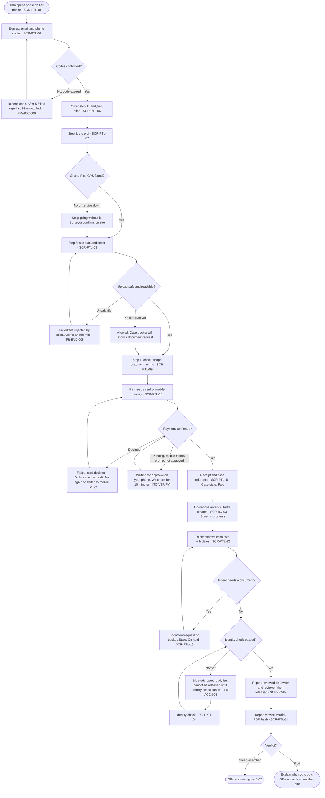
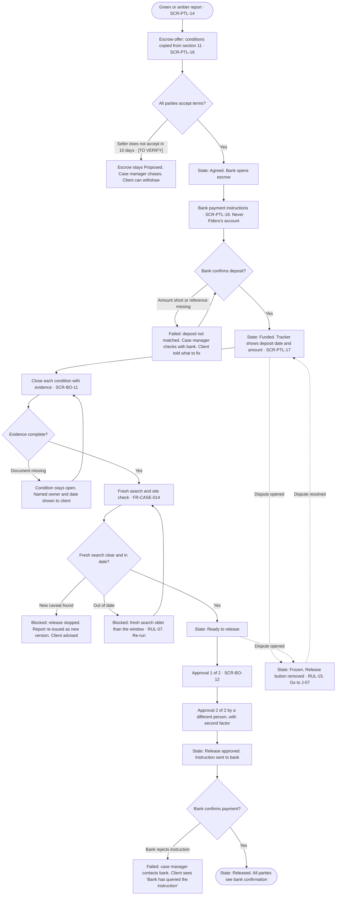
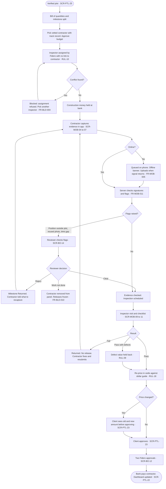
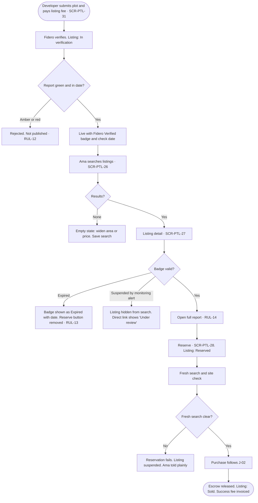
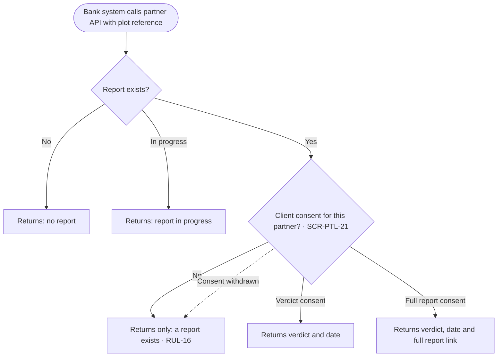
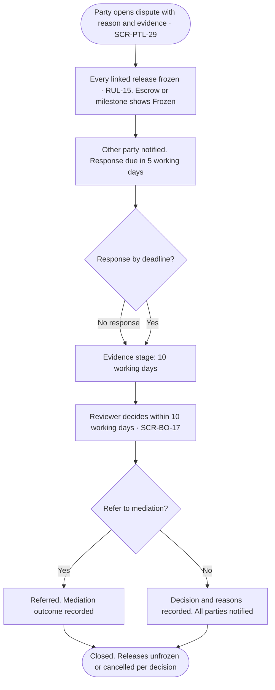
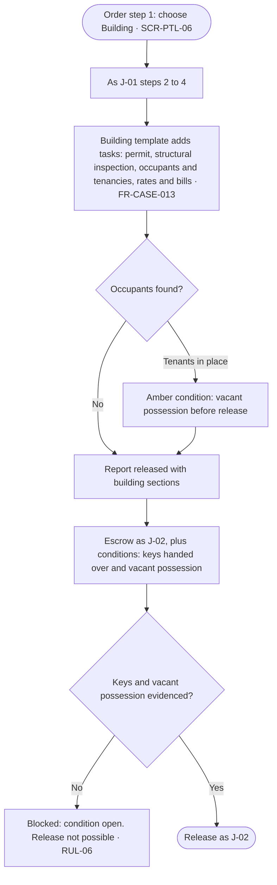

# 03 — UI/UX Design Specification

Information architecture, user flows, wireframes, interaction and content rules, design system and accessibility for the three Fidero front ends: the `portal` web app, the `backoffice` web app and the Android milestone app.

| Item | Value |
|---|---|
| Document | 03 of 6 in `docs/specs/` |
| Version | 0.1 |
| Date | 31 October 2026 |
| Status | Draft. For review. Not yet baselined |
| Owner | Product designer, for the founder as product owner |
| Source of truth | `01-requirements-and-product-specification.md` (personas, features, journeys, rules, FR and NFR IDs, state models) |
| Other sources | `README.md`, `docs/operations/verification-report-template.md`, `docs/operations/milestone-schedule.md`, `docs/product/architecture.md` |
| Companion | `03-prototype/index.html`, a clickable prototype with sample data |

Every figure in this document is a working assumption, not verified data. Unknown numbers are marked `[TO VERIFY]`. Names, places, prices, dates and references in wireframes and the prototype are samples.

## 0. How this document traces to 01

- Every screen has a stable ID: `SCR-PTL-nn` (portal), `SCR-BO-nn` (back office), `SCR-MOB-nn` (Android app). IDs are never reused.
- Every reusable component has an ID: `CMP-nn`.
- Every screen lists the 01 IDs it satisfies: functional requirements (`FR-`), features (`F-`), journeys (`J-`) and rules (`RUL-`). This document creates no new requirement IDs.
- Section 10 holds the full screen-to-requirement table. Document 05 can test each screen against it.
- Where 01 is unclear or inconsistent, this document makes a design assumption, marks it `DA-nn`, and lists the gap in section 11.2. It does not edit 01.

### Design assumptions used in this document

| ID | Assumption | Why |
|---|---|---|
| DA-01 | Clients confirm approvals (escrow terms, milestone approval, cedi re-pricing) with a one-time code. This is the client's step, not a release. | FR-ACC-003 asks for MFA for "any user who approves a release". RUL-11 says the client approves. See issue I-05. |
| DA-02 | Prices show in the client's chosen display currency, but the charge is made in USD for cards and GHS for mobile money. | FR-ORD-002 and C3 differ. See issue I-09. |
| DA-03 | Money uses ISO codes (`USD 450.00`, `GHS 5,400.00`), not symbols. | `$` is ambiguous for clients in the US and Canada. Screen readers read codes reliably. |
| DA-04 | The hash check computes the PDF hash in the browser. The PDF never leaves the user's device. | Privacy. FR-RPT-008 says "anyone" can check. |
| DA-05 | The back office is used on laptops by office staff, and on phones by runners, surveyors and lawyers for their own tasks. | FR-CASE-006. |
| DA-06 | The Android app is held to the same WCAG 2.2 AA bar as the web front ends. | NFR-A11Y-01 names only the portal and back office. See issue I-06. |

---

## 1. Design principles

The principles come from 01 section B2. Each one changes what a user sees.

| Principle (01 B2) | What it means in the UI | Where it shows |
|---|---|---|
| **Evidence before money** (B2.1) | No money action without the evidence shown beside it. A release button is never live while a gate is open. Every gate says what is missing in words. | Escrow tracker (SCR-PTL-17), release approval (SCR-BO-12), milestone approval (SCR-PTL-23), condition checklist (CMP-08) |
| **Fidero never holds the money** (B2.2) | Purchase, build and project money screens show only the partner bank's name and account. Fidero's own payment page is only for Fidero fees and says so. A fixed line on every money screen: "Your money is held by [bank], not by Fidero." | Bank instructions (SCR-PTL-18), payment (SCR-PTL-10), money display (CMP-17) |
| **Plain status, always** (B2.3) | Every case, escrow, milestone, listing and dispute has one status sentence at the top: what happened, when, what comes next and by when. Reading age 12. | Status timeline (CMP-06), all trackers |
| **Built for a slow phone** (B2.4) | Phone layout first. System fonts. Small pages. Static map first, live map on tap. Thumbnails before full images. Forms save as you go. The app works offline. | Performance budgets (section 7.2), offline banner (CMP-13) |
| **One engine** (B2.5) | Land, building, construction, off-plan and project funds share the same components: tracker, conditions, evidence, approvals. A new line is new content, not a new screen design. | Shared components in section 6.4 |
| **People stay in the loop** (B2.6) | Licensed people sign their sections with name and licence number shown. Two named Fidero approvers on every release, visible to the client. | Report viewer (SCR-PTL-14), approval card (CMP-10) |
| **Safety first** (B2.7) | A risk screen blocks assignment to a disputed plot until two people are named. Field staff can log an incident from any task in two taps. The app never shows the client's personal data to field staff. | Risk screen (SCR-BO-05), task detail (SCR-BO-04), app task (SCR-MOB-12) |

### Design rules that follow

1. One primary action per screen.
2. Status first, detail second. The answer to "what is happening?" is above the fold on a 360 px wide phone.
3. Never colour alone. Verdicts and states use icon, word and colour together.
4. Never a dead end. Every error, empty and blocked state says what to do next.
5. No hidden money. Every amount shows its currency code and who holds it.
6. Irreversible actions need a clear summary and a deliberate confirm (section 5.3). Reversible actions use undo.

---

## 2. Information architecture

### 2.1 Portal sitemap (Next.js, phone first)

```text
portal
├── Public
│   ├── Home ................................ SCR-PTL-01
│   ├── How it works / prices ............... SCR-PTL-01 (sections)
│   ├── Check a report (hash check) ......... SCR-PTL-15
│   ├── Listings search and map (R2) ........ SCR-PTL-26
│   │   └── Listing detail (R2) ............. SCR-PTL-27
│   ├── Sign up ............................. SCR-PTL-02
│   └── Sign in ............................. SCR-PTL-03
└── Signed in
    ├── Home: my things ..................... SCR-PTL-05
    ├── Identity check ...................... SCR-PTL-04
    ├── Orders
    │   ├── Order a report (4 steps) ........ SCR-PTL-06 to 09
    │   ├── Pay ............................. SCR-PTL-10
    │   ├── Payment result and receipt ...... SCR-PTL-11
    │   └── Case tracker .................... SCR-PTL-12
    │       ├── Document request ............ SCR-PTL-13
    │       ├── Messages .................... SCR-PTL-19
    │       ├── Report viewer ............... SCR-PTL-14
    │       └── Rate this case (R2) ......... SCR-PTL-33
    ├── Escrow
    │   ├── Escrow offer and terms .......... SCR-PTL-16
    │   ├── Escrow tracker .................. SCR-PTL-17
    │   └── Bank payment instructions ....... SCR-PTL-18
    ├── Build and projects (R2)
    │   ├── Start a build ................... SCR-PTL-25
    │   ├── Build dashboard ................. SCR-PTL-22
    │   ├── Milestone detail and approval ... SCR-PTL-23
    │   ├── Variation approval .............. SCR-PTL-24
    │   └── Project fund dashboard .......... SCR-PTL-30
    ├── Listings: reserve (R2) .............. SCR-PTL-28
    ├── Disputes (R2) ....................... SCR-PTL-29
    ├── Selling (R2)
    │   ├── List a property ................. SCR-PTL-31
    │   └── My listings ..................... SCR-PTL-32
    ├── Records confirmation (R3) ........... SCR-PTL-35
    └── Account
        ├── Profile, notifications, representative .. SCR-PTL-20
        ├── Sharing and consent ............. SCR-PTL-21
        └── My data ......................... SCR-PTL-34
```

### 2.2 Back office sitemap (web, laptop first, phone for field roles)

```text
backoffice
├── Sign in with second factor .............. SCR-BO-01
├── My work (queue) ......................... SCR-BO-02
├── Cases
│   ├── Case detail with tasks .............. SCR-BO-03
│   ├── Task detail (phone friendly) ........ SCR-BO-04
│   ├── Risk screen and assignment .......... SCR-BO-05
│   ├── Map and overlay results ............. SCR-BO-07
│   ├── Report builder ...................... SCR-BO-08
│   └── Report review and release ........... SCR-BO-09
├── Safety: incident log (restricted) ....... SCR-BO-06
├── Escrow
│   ├── Escrow list ......................... SCR-BO-10
│   ├── Escrow detail and conditions ........ SCR-BO-11
│   ├── Release approval .................... SCR-BO-12
│   └── Bank and fee reconciliation ......... SCR-BO-13
├── Builds (R2)
│   ├── Milestone review and fraud flags .... SCR-BO-14
│   └── Panel: contractors and inspectors ... SCR-BO-15
├── Listings moderation (R2) ................ SCR-BO-16
├── Disputes (R2) ........................... SCR-BO-17
├── Records programme (R3) .................. SCR-BO-26
├── Dashboard and exports ................... SCR-BO-23
├── Audit log ............................... SCR-BO-22
└── Admin
    ├── Templates and configuration ......... SCR-BO-18
    ├── Prices, tiers, currencies ........... SCR-BO-19
    ├── Users, roles, licences .............. SCR-BO-20
    ├── Partners and API keys ............... SCR-BO-21
    ├── Notification templates and log ...... SCR-BO-25
    └── Data requests and retention ......... SCR-BO-24
```

### 2.3 Android milestone app map (R2, offline first)

```text
milestone app
├── Sign in and register this phone ......... SCR-MOB-01
├── My jobs ................................. SCR-MOB-02
│   ├── Project and milestone overview ...... SCR-MOB-03
│   │   ├── Evidence checklist .............. SCR-MOB-04
│   │   │   ├── Camera ...................... SCR-MOB-05
│   │   │   └── Check this capture .......... SCR-MOB-06
│   │   └── Submit milestone ................ SCR-MOB-07
│   ├── Inspection checklist (inspector) .... SCR-MOB-09
│   │   ├── Add a defect .................... SCR-MOB-10
│   │   └── Result and submit ............... SCR-MOB-11
│   └── Case task (runner, surveyor) ........ SCR-MOB-12
├── Upload queue ............................ SCR-MOB-08
└── Account, storage, help .................. SCR-MOB-13
```

### 2.4 Navigation model

| Front end | Phone | Laptop | Notes |
|---|---|---|---|
| Portal, public | Top bar: logo, "Listings", "Check a report", "Sign in". Menu button for the rest. | Same items in a horizontal top bar. | Public pages are server rendered and indexable (FR-LST-010). |
| Portal, signed in | Bottom tab bar with up to 5 tabs: **Home**, **Orders**, **Escrow**, **Build** (R2, shown only if the user has a project), **Account**. | Left side bar with the same items. | Tabs appear only when the user has something in them. A first-time user sees Home, Orders, Account. |
| Back office | Field roles (lawyer, surveyor, runner) get a single "My tasks" list and a top bar. No side bar. | Left side bar grouped by work area. Items filtered by role (FR-ACC-007). Global search for case, escrow, listing and person references. | Staff session times out after 30 minutes idle with a warning at 25 (NFR-SEC-02). |
| Android app | Bottom bar: **Jobs**, **Queue** (with a count badge), **Account**. Linear task flows with a back arrow. | n/a | Upload state is visible on every screen through the offline banner (CMP-13). |

Wayfinding rules:

- Every signed-in page has a heading that names the object and its reference, such as "Plot 14, Kasoa Millennium City · FID-2027-0142".
- Breadcrumbs on laptop only. On phone, a back link names the parent: "← Case FID-2027-0142".
- Help is in the same place on every page: a "Get help" link in the page footer and in the account menu (WCAG 2.2 SC 3.2.6).

### 2.5 Screen inventory

Release follows 01. "Roles" uses 01 C2 role names.

#### Portal

| Screen | Name | Purpose | Roles | Rel. | Satisfies |
|---|---|---|---|---|---|
| SCR-PTL-01 | Home and prices | Explain Fidero, show tiers and sample report, start an order | Public | R1 | F-02, FR-ORD-002, FR-ORD-005 |
| SCR-PTL-02 | Sign up | Create account with email and phone, both confirmed by code; privacy notice | Public | R1 | F-01, FR-ACC-001, FR-DPR-001, J-01 |
| SCR-PTL-03 | Sign in | Password or one-time code; lockout message | All portal users | R1 | FR-ACC-002, FR-ACC-009 |
| SCR-PTL-04 | Identity check | Ghana Card or passport check through the provider, or manual upload | Client | R1 | FR-ACC-004, J-01, J-02 |
| SCR-PTL-05 | Home: my things | One card per case, escrow, build, listing, with its status sentence | Client, seller, developer | R1 | F-06, FR-CASE-007 |
| SCR-PTL-06 | Order step 1: what to check | Land or building; tier; price in display currency | Client | R1 | F-02, F-09, FR-ORD-001, FR-ORD-002, J-01, J-08 |
| SCR-PTL-07 | Order step 2: the plot | Locality, plot number, site plan reference, Ghana Post GPS | Client | R1 | FR-ORD-001, FR-GEO-008, J-01 |
| SCR-PTL-08 | Order step 3: documents and seller | Upload site plan and documents; seller name and contact | Client | R1 | FR-ORD-001, FR-EVD-001, FR-EVD-005, J-01 |
| SCR-PTL-09 | Order step 4: check and agree | Summary, scope statement, terms, lead source, referral code | Client | R1 | FR-ORD-003, FR-ORD-005, FR-ORD-006, RUL-04 |
| SCR-PTL-10 | Pay Fidero's fee | Card or mobile money for the fee only | Client | R1 | FR-PAY-001, FR-PAY-002, FR-PAY-005, RUL-01 |
| SCR-PTL-11 | Payment result | Receipt, case reference, what happens next; failure recovery | Client | R1 | FR-PAY-003, FR-ORD-004, J-01 |
| SCR-PTL-12 | Case tracker | Status sentence, plain-language timeline, requests, messages | Client, representative | R1 | F-06, FR-CASE-007, FR-CASE-008, FR-NTF-001, FR-ACC-008, J-01, J-08 |
| SCR-PTL-13 | Document request | Upload what Fidero asked for | Client | R1 | FR-CASE-008, FR-EVD-001 |
| SCR-PTL-14 | Report viewer | Verdict, reasons, conditions, section verdicts, signatures, PDF, hash, versions | Client | R1 | F-04, FR-RPT-005, FR-RPT-007, FR-RPT-008, FR-RPT-010, J-01 |
| SCR-PTL-15 | Check a report | Anyone checks a PDF against the stored hash | Public | R1 | FR-RPT-008 |
| SCR-PTL-16 | Escrow offer and terms | Offer escrow on green or amber; show conditions from section 11; accept terms | Client, seller | R1 | F-08, FR-ESC-001, FR-ESC-002, FR-RPT-009, J-02 |
| SCR-PTL-17 | Escrow tracker | Deposit, conditions, fresh search, approvals, bank confirmation | Client, seller | R1 | F-08, FR-ESC-004 to FR-ESC-009, RUL-06, RUL-07, J-02 |
| SCR-PTL-18 | Bank payment instructions | The partner bank's details for the purchase price | Client | R1 | FR-ESC-003, RUL-01 |
| SCR-PTL-19 | Messages | Case thread with Fidero | Client | R1 | FR-CASE-015 |
| SCR-PTL-20 | Profile and notifications | Channels, preferences, representative | All portal users | R1 | FR-ACC-008, FR-ACC-010, FR-NTF-001 |
| SCR-PTL-21 | Sharing and consent | Grant and withdraw sharing with partners; case study consent | Client | R1 (case study), R2 (partners) | FR-PTR-002, FR-RPT-011, RUL-16, J-06 |
| SCR-PTL-22 | Build dashboard | Budget against actual, milestones, photo timeline, inspector results, payments | Client, representative | R2 | F-16, FR-BLD-009, J-03 |
| SCR-PTL-23 | Milestone detail and approval | Evidence, inspector result, defects held back, cedi re-pricing, approve | Client | R2 | FR-BLD-005, FR-BLD-006, FR-BLD-007, RUL-09, RUL-11, RUL-18 |
| SCR-PTL-24 | Variation approval | Approve or reject a scope change before work | Client, contractor | R2 | FR-BLD-008, RUL-19 |
| SCR-PTL-25 | Start a build | Pick verified plot, see bill of quantities, pick contractor with track record | Client | R2 | FR-BLD-001, FR-BLD-002, FR-BLD-003, FR-RAT-003 |
| SCR-PTL-26 | Listings search and map | Search, filter, list and map views | Public | R2 | F-19, FR-LST-004, FR-LST-010, J-04 |
| SCR-PTL-27 | Listing detail | Badge, check date, expiry, full report link, track record, reserve | Public; reserve needs sign in | R2 | FR-LST-003, FR-LST-005, FR-RAT-003, RUL-12, RUL-13, RUL-14, J-04 |
| SCR-PTL-28 | Reserve a listing | Start fresh search and escrow | Client | R2 | FR-LST-005, FR-CASE-014, J-04 |
| SCR-PTL-29 | Dispute | Open a dispute; see frozen releases, deadlines, statements, decision | Client, seller, developer, contractor | R2 | F-21, FR-DSP-001 to FR-DSP-004, RUL-15, J-07 |
| SCR-PTL-30 | Project fund dashboard | Budget by stage, checked suppliers, invoices, payments | Client | R2 | F-18, FR-PRJ-001 to FR-PRJ-005, RUL-21, J-05 |
| SCR-PTL-31 | List a property | Submit asset and pay listing fee | Seller, developer | R2 | FR-LST-001, FR-ACC-011, FR-PAY-007 |
| SCR-PTL-32 | My listings | Status, badge expiry, re-verify, sold | Seller, developer | R2 | FR-LST-006, FR-LST-007 |
| SCR-PTL-33 | Rate this case | 1 to 5 rating and comment | Client | R2 | FR-RAT-002 |
| SCR-PTL-34 | My data | See what Fidero holds; ask for a copy or a correction | All portal users | R1 | FR-DPR-003 |
| SCR-PTL-35 | Records confirmation | Authority representative views and confirms records | Authority representative | R3 | FR-REC-004, F-25 |

#### Back office

| Screen | Name | Purpose | Roles | Rel. | Satisfies |
|---|---|---|---|---|---|
| SCR-BO-01 | Sign in | Password plus second factor; idle timeout | All staff and professionals | R1 | FR-ACC-003, FR-ACC-009, NFR-SEC-02 |
| SCR-BO-02 | My work | Queue of cases and tasks by due date; overdue first | Case manager, reviewer, professionals | R1 | FR-CASE-005, FR-NTF-003, J-01 |
| SCR-BO-03 | Case detail | Steps as tasks, owners, due dates, evidence, client status, costs, pause or cancel | Case manager, reviewer | R1 | F-03, FR-CASE-001 to FR-CASE-004, FR-CASE-007, FR-CASE-008, FR-CASE-011, FR-CASE-012, FR-CASE-013 |
| SCR-BO-04 | Task detail | Do one task on a phone: evidence, notes, done; log incident | Lawyer, surveyor, runner | R1 | FR-CASE-004, FR-CASE-006, FR-CASE-010, FR-EVD-001 |
| SCR-BO-05 | Risk screen and assignment | Risk questions; two-person rule on disputed plots | Case manager | R1 | FR-CASE-009, RUL-17 |
| SCR-BO-06 | Incident log | Restricted safety log | Reviewer, administrator | R1 | FR-CASE-010 |
| SCR-BO-07 | Map and overlays | Plot polygon, layer results, overlaps with verified plots, satellite image | Case manager, surveyor | R1 | F-05, FR-GEO-001 to FR-GEO-006 |
| SCR-BO-08 | Report builder | Sections 1 to 14, section verdicts, evidence, signatures, locked scope, conditions | Case manager, lawyer, surveyor | R1 | F-04, FR-RPT-001 to FR-RPT-005, FR-RPT-009, RUL-02, RUL-04, RUL-20 |
| SCR-BO-09 | Report review and release | Two-person review, return with comments, release, new version | Lawyer, reviewer | R1 | FR-RPT-006, FR-RPT-007, FR-RPT-010, RUL-03 |
| SCR-BO-10 | Escrow list | All escrows by state; blocked first | Case manager, reviewer | R1 | F-08, FR-ESC-001, FR-ESC-006 |
| SCR-BO-11 | Escrow detail | Parties, terms, deposit, conditions, fresh search, freeze | Case manager, reviewer | R1 | FR-ESC-001, FR-ESC-002, FR-ESC-004, FR-ESC-005, FR-ESC-006, RUL-06, RUL-07, RUL-15 |
| SCR-BO-12 | Release approval | Two-person approval with gates and second factor; send; bank confirmation | Reviewer with release rights | R1 | FR-ESC-006 to FR-ESC-009, FR-ESC-013, RUL-05, RUL-06, RUL-07 |
| SCR-BO-13 | Reconciliation | Fee settlements against orders; bank statement lines against escrows | Case manager | R1 (fees), R2 (bank file) | FR-PAY-004, FR-PAY-006, FR-ESC-011, F-23 |
| SCR-BO-14 | Milestone review | Submissions, server flags, evidence check, inspector result, approve | Case manager, reviewer | R2 | FR-BLD-005, FR-BLD-010, FR-MOB-011, FR-EVD-006, J-03 |
| SCR-BO-15 | Panel | Contractors and inspectors, documents, conflicts, track record | Case manager, administrator | R2 | FR-BLD-003, FR-BLD-004, FR-RAT-001, RUL-10 |
| SCR-BO-16 | Listings moderation | Publish, suspend, remove; monitoring alerts | Reviewer | R2 | FR-LST-002, FR-LST-006, FR-LST-008, FR-GEO-007, FR-RAT-004 |
| SCR-BO-17 | Dispute management | Deadlines, statements, decision, mediation | Reviewer | R2 | FR-DSP-002 to FR-DSP-005 |
| SCR-BO-18 | Templates and configuration | Versioned templates, condition sets, schedules, locked scope, configurable values | Administrator | R1 | F-11, FR-ADM-001, FR-ADM-004, FR-ADM-005, FR-CTY-001 |
| SCR-BO-19 | Prices and currencies | Tiers, prices, exchange-rate guides | Administrator | R1 | FR-ADM-002 |
| SCR-BO-20 | Users, roles, licences | Invite, assign roles, verify licences | Administrator | R1 | FR-ACC-005, FR-ACC-006, FR-ACC-007 |
| SCR-BO-21 | Partners and API | Banks, professionals, suppliers, API partners, keys, metering | Administrator | R1, R2 | FR-ADM-003, FR-PTR-004 |
| SCR-BO-22 | Audit log | Search the append-only log; chain check | Reviewer, administrator | R1 | F-12, FR-AUD-001 to FR-AUD-004 |
| SCR-BO-23 | Dashboard and exports | A9 metrics; CSV export | Case manager, reviewer, administrator | R1 | F-13, FR-ANL-001 to FR-ANL-003 |
| SCR-BO-24 | Data requests and retention | Access and correction requests; retention; bulk export with two approvals | Administrator | R1 | F-14, FR-DPR-003 to FR-DPR-005 |
| SCR-BO-25 | Notifications | Templates per language and channel; send log | Administrator | R1 | FR-NTF-002, FR-NTF-004, FR-NTF-005 |
| SCR-BO-26 | Records programme | Capture allocation records; revenue share | Case manager, administrator | R3 | F-25, FR-REC-001 to FR-REC-003 |

#### Android milestone app

| Screen | Name | Purpose | Roles | Rel. | Satisfies |
|---|---|---|---|---|---|
| SCR-MOB-01 | Sign in | Sign in; register the phone's signing key | Contractor, inspector, runner, surveyor | R2 | FR-MOB-001, FR-MOB-004 |
| SCR-MOB-02 | My jobs | Assigned projects, inspections and tasks | Same | R2 | FR-MOB-001 |
| SCR-MOB-03 | Milestone overview | Milestone, status, what is needed | Contractor | R2 | FR-BLD-005, J-03 |
| SCR-MOB-04 | Evidence checklist | Required items from the schedule; progress | Contractor | R2 | FR-MOB-006 |
| SCR-MOB-05 | Camera | In-app capture only; position check | All app roles | R2 | FR-MOB-002, FR-MOB-003, FR-MOB-004, RUL-08 |
| SCR-MOB-06 | Check this capture | Preview, metadata, retake | All app roles | R2 | FR-MOB-003, FR-MOB-004, FR-MOB-008 |
| SCR-MOB-07 | Submit milestone | Confirm and queue | Contractor | R2 | FR-MOB-005, FR-MOB-006, J-03 |
| SCR-MOB-08 | Upload queue | What is waiting, sending, sent | All app roles | R2 | FR-MOB-005, FR-MOB-008, FR-MOB-009 |
| SCR-MOB-09 | Inspection checklist | Milestone checklist items | Inspector | R2 | FR-MOB-007, RUL-09, RUL-10 |
| SCR-MOB-10 | Add a defect | Photos, description, value | Inspector | R2 | FR-MOB-007, FR-BLD-006 |
| SCR-MOB-11 | Inspection result | Pass, pass with defects, fail; submit | Inspector | R2 | FR-MOB-007, RUL-09 |
| SCR-MOB-12 | Case task | Runner or surveyor task with in-app capture | Runner, surveyor | R2 | FR-MOB-010, FR-CASE-010 |
| SCR-MOB-13 | Account and storage | Storage used, encrypted items, help | All app roles | R2 | FR-MOB-008, FR-MOB-009 |

---

## 3. User flows

Each flow follows a journey in 01 B6. Error and edge states are drawn as side branches. Rounded nodes are screens; diamonds are decisions; red-path nodes start with "Blocked" or "Failed". State names match 01 C8.

### 3.1 J-01 Order a land verification report (R1)



Edge states: a reviewer returns the report (state goes back to In progress; the client sees "Our reviewer asked for one more check. New expected date: 9 April."); a case is cancelled with a refund decision (FR-CASE-012).

### 3.2 J-02 Buy through escrow (R1)



### 3.3 J-03 Build with milestone payments (R2)



### 3.4 J-04 Buy a verified listing (R2)



### 3.5 J-05 Fund a project at home (R2)


### 3.6 J-06 Bank collateral check (R2)



The client-facing part of J-06 is the consent screen SCR-PTL-21. Consent is per partner and per level. Withdrawal works the same way as granting.

### 3.7 J-07 Raise and resolve a dispute (R2)



Deadlines are the assumptions in FR-DSP-003. Each step shows its due date in Ghana time and in the user's time zone.

### 3.8 J-08 Verify an existing building (R1)



---

## 4. Wireframes

Low fidelity. Phone wireframes are 40 characters wide, standing for a 360 px screen. Laptop wireframes are wider. `[ Button ]` is a button, `( )` a radio, `[x]` a checkbox, `___` an input, `<v>` a select, `(*)` an icon. All data is sample data.

Annotation keys: **Content**, **Actions**, **States**, **Rules**, **Satisfies**.

### W-01 Sign up · SCR-PTL-02

```text
+----------------------------------------+
| FIDERO                     Sign in     |
+----------------------------------------+
| Create your account                    |
| Step 1 of 2                            |
|                                        |
| Full name                              |
| [ Ama Serwaa Mensah____________ ]      |
| Email                                  |
| [ ama.mensah@example.com_______ ]      |
| Mobile number                          |
| [ +44 v ][ 7700 900123__________ ]     |
| Password (12 characters or more)       |
| [ ************_________ ] [Show]       |
|                                        |
| [x] I have read the privacy notice     |
|     (plain-language, 1 page) >         |
|                                        |
| [        Send my codes         ]       |
|                                        |
| We send one code by email and one by   |
| text message. Codes last 10 minutes.   |
+----------------------------------------+
| Step 2: [ _ _ _ _ _ _ ] email code     |
|         [ _ _ _ _ _ _ ] phone code     |
|         Resend codes (in 0:45)         |
+----------------------------------------+
```

- **Content.** One "full name" field, not first and last, because Ghanaian names do not always split that way. Country code picker defaults from the browser locale.
- **Actions.** Send codes; enter codes; resend after a 45-second wait (sample).
- **States.** Code wrong: "That code does not match. Check the latest message." Code expired: "That code has expired. We sent a new one." Email already used: offer sign in.
- **Rules.** Paste allowed in code and password fields; password managers work (WCAG 3.3.8). Privacy notice acceptance recorded with version.
- **Satisfies.** FR-ACC-001, FR-DPR-001, J-01.

### W-02 Identity check · SCR-PTL-04

```text
+----------------------------------------+
| <- Home                                |
| Confirm who you are                    |
|                                        |
| We must check your identity before we  |
| release a report or open an escrow.    |
| It takes about 3 minutes.              |
|                                        |
| Choose a document                      |
| ( ) Ghana Card                         |
| (*) Passport                           |
| ( ) I cannot do this online            |
|                                        |
| You will:                              |
|  1. Photograph the photo page          |
|  2. Take a short selfie video          |
|                                        |
| [      Start identity check      ]     |
|                                        |
| Who sees this: Fidero staff and our    |
| identity check provider. Why? >        |
+----------------------------------------+
| STATUS CARD (after submit)             |
| (i) Checking your passport. Most       |
|     checks finish within 1 hour.       |
+----------------------------------------+
```

- **Content.** Why, how long, what happens, who sees the data.
- **Actions.** Start the provider check; or choose manual check, which opens an upload form for staff review.
- **States.** Pending, passed, failed with reason and retry, manual review. If the provider is down: "Our identity check service is not working right now. You can carry on ordering. We will remind you."
- **Rules.** The check is not needed to order or pay. It is needed before report release and escrow (A10 in J-01).
- **Satisfies.** FR-ACC-004, J-01, J-02.

### W-03 Order step 1, what to check · SCR-PTL-06

```text
+----------------------------------------+
| <- Cancel        Order a check         |
| [1 What]-[2 Plot]-[3 Docs]-[4 Agree]   |
|  ======                                |
| What do you want checked?              |
| +------------------------------------+ |
| |(*) Land (a plot)                   | |
| +------------------------------------+ |
| |( ) A building on its land          | |
| |    Adds permit, structure, tenants | |
| +------------------------------------+ |
|                                        |
| How fast?                              |
| +------------------------------------+ |
| |(*) Standard                        | |
| |    USD 450.00   about 3-4 weeks    | |
| |( ) Rush                            | |
| |    USD 600.00   about 2 weeks      | |
| +------------------------------------+ |
| Show prices in  <USD v>                |
| Prices are samples. Final price shown  |
| before you pay.                        |
|                                        |
| [            Continue            ]     |
+----------------------------------------+
```

- **Content.** Product line and tier as large radio cards (44 px or more). Tiers come from admin configuration (FR-ORD-002). "Extra plot, same seller" appears only after the first plot is added.
- **Actions.** Continue. The draft saves after each step.
- **States.** Prices fail to load: show "Prices are not loading. Try again." with a retry button; never show a stale price as final.
- **Rules.** Display currency per DA-02. Local standard tier shown when the user's country is Ghana.
- **Satisfies.** FR-ORD-001, FR-ORD-002, F-09, J-01, J-08.

### W-04 Order step 2, the plot · SCR-PTL-07

```text
+----------------------------------------+
| <- Back          Order a check         |
| [1 What]-[2 Plot]-[3 Docs]-[4 Agree]   |
|           ======                       |
| Where is the plot?                     |
| Region                                 |
| [ Central                      v ]     |
| Town or area                           |
| [ Kasoa, Millennium City______ ]       |
| Plot number (if known)                 |
| [ 14_________ ]                        |
| Site plan reference (if known)         |
| [ CR/KS/2026/0391_____ ]               |
| Ghana Post GPS address (if known)      |
| [ CX-071-4420___ ]  Look up            |
| +------------------------------------+ |
| | Map preview (static image)         | |
| | Pin near Kasoa. Tap to adjust >    | |
| +------------------------------------+ |
| Don't know some of these? That's fine. |
| Our surveyor confirms on site.         |
| [            Continue            ]     |
+----------------------------------------+
```

- **Content.** Only locality is required. Ghana Post GPS format hint `AA-NNN-NNNN`.
- **Actions.** Look up GPS address; adjust pin on a live map loaded only on tap (keeps page weight down).
- **States.** Look up fails: "We could not find that address. Check it, or carry on without it." Never blocks.
- **Rules.** No redundant entry: fields filled earlier (for example from a listing) are pre-filled (WCAG 3.3.7).
- **Satisfies.** FR-ORD-001, FR-GEO-008, J-01.

### W-05 Order step 4, check and agree · SCR-PTL-09

```text
+----------------------------------------+
| <- Back          Order a check         |
| [1 What]-[2 Plot]-[3 Docs]-[4 Agree]   |
|                             =======    |
| Check your order                       |
| Land check, Standard ......... Change  |
| Plot 14, Kasoa Millennium City  Change |
| Site plan uploaded (1 file) .. Change  |
| Seller: Kofi Asante, +233 24.. Change  |
|                                        |
| What the report covers                 |
| +------------------------------------+ |
| | (lock) Scope and limitation        | |
| | statement, version 1.0             | |
| | "This report sets out the results  | |
| |  of the checks listed in section   | |
| |  3 ..."   Read it all >            | |
| +------------------------------------+ |
| [ ] I have read what the report covers |
|     and does not cover                 |
| [ ] I agree to the terms (v1.0) >      |
| How did you hear about us? <Select v>  |
| Referral code (optional) [_______]     |
|                                        |
| Total to pay        USD 450.00         |
| [      Continue to payment       ]     |
+----------------------------------------+
```

- **Content.** Summary with change links back to each step. Locked scope text shown in full on expand, with version number.
- **Actions.** Accept scope and terms (two separate checkboxes), choose lead source, enter referral code, continue.
- **States.** Referral code invalid: inline message, order still allowed. Unchecked boxes: error summary at top with links to each box.
- **Rules.** Acceptance recorded with time and version (FR-ORD-003). Scope text cannot be edited (RUL-04).
- **Satisfies.** FR-ORD-003, FR-ORD-005, FR-ORD-006, RUL-04.

### W-06 Pay Fidero's fee · SCR-PTL-10

```text
+----------------------------------------+
| <- Back             Pay                |
| You are paying Fidero's fee for        |
| a land check.                          |
|                                        |
| Fee                    USD 450.00      |
| (about GBP 355, guide only)            |
|                                        |
| How do you want to pay?                |
| (*) Card                               |
| ( ) Mobile money (GHS 6,975.00)        |
|                                        |
| +------------------------------------+ |
| | Payment provider's secure card     | |
| | form loads here                    | |
| +------------------------------------+ |
|                                        |
| [       Pay USD 450.00           ]     |
|                                        |
| (i) This page is only for Fidero's     |
| fee. We never take money for the land. |
| Land money goes to a licensed bank.    |
+----------------------------------------+
```

- **Content.** Amount, method, guide conversion, the "fee only" notice.
- **Actions.** Pay. Button repeats the amount.
- **States.** Processing (button disabled, "Paying... do not close this page"); declined (reason from provider in plain words, try again or switch method); mobile money pending ("Approve the payment on your phone. We will wait for up to 10 minutes."); timeout (order saved as draft, nothing charged twice).
- **Rules.** No card data stored (FR-PAY-002). Fee and escrow money never share a screen or flow (FR-PAY-005, RUL-01).
- **Satisfies.** FR-PAY-001, FR-PAY-002, FR-PAY-005, J-01.

### W-07 Case tracker · SCR-PTL-12

```text
+----------------------------------------+
| <- Home                                |
| Plot 14, Kasoa Millennium City         |
| Land check  FID-2027-0142              |
| +------------------------------------+ |
| | NOW: Searches lodged at the Lands  | |
| | Commission on 12 March. Results    | |
| | expected by 2 April.               | |
| +------------------------------------+ |
| ! We need one thing from you           |
|   Seller's ID copy [Upload] by 20 Mar  |
|                                        |
| Timeline                               |
| (v) Order paid ............. 3 Mar     |
| (v) Case accepted .......... 4 Mar     |
| (v) Searches lodged ........ 12 Mar    |
| (o) Site visit ...... planned 18 Mar   |
| ( ) Map checks ...... expected 20 Mar  |
| ( ) Consent meeting . expected 27 Mar  |
| ( ) Search results .. expected 2 Apr   |
| ( ) Legal review .... expected 7 Apr   |
| ( ) Report ready .... expected 10 Apr  |
|                                        |
| [ Message Fidero ]  Receipt >          |
+----------------------------------------+
```

- **Content.** One "Now" sentence (CMP-06 pattern), open requests first, then the timeline. Done steps show actual dates; future steps show expected dates.
- **Actions.** Upload requested document; message Fidero; view receipt; share read-only access with a representative.
- **States.** On hold: "Paused. We are waiting for the seller's ID copy. We will restart as soon as it arrives." Late: "Search results are late. We expected them by 2 April. We are chasing and will update you by 9 April." Cancelled with refund status.
- **Rules.** Messages come from templates (FR-CASE-007). No third-party personal data shown beyond what the client supplied.
- **Satisfies.** FR-CASE-007, FR-CASE-008, FR-CASE-015, FR-ACC-008, FR-NTF-001, F-06, J-01.

### W-08 Report viewer · SCR-PTL-14

```text
+----------------------------------------+
| <- Case FID-2027-0142                  |
| Your report                            |
| +------------------------------------+ |
| | [(!) AMBER]  Fix before you pay    | |
| | Issues found that can be resolved  | |
| | before purchase.                   | |
| +------------------------------------+ |
| Why                                    |
| - Two corner pillars missing           |
| - Family consent promised, not yet     |
|   recorded                             |
| Before you pay                         |
| [ ] Pillars re-set by surveyor         |
| [ ] Consent meeting recorded on video  |
|                                        |
| Section verdicts  (table, 4 to 10)     |
| 4 Plot identity ......... (!) Amber    |
| 5 Lands Commission ...... (v) Green    |
| 8 Seller authority ...... (!) Amber    |
| ...                                    |
| Signed by: Lawyer A. Darko, GBA-1234   |
|  Surveyor E. Tetteh, LS-0567           |
| [   Download PDF (1.2 MB)   ]          |
| Report v1 · 10 Apr 2027 · SHA-256:     |
| 9f2c 41ab ... e07d  [Copy] [Check >]   |
| [ Buy through escrow ]                 |
+----------------------------------------+
```

- **Content.** Verdict badge (CMP-07) with the template's meaning, 3 to 5 reasons, conditions, section table, signatures with licence numbers, PDF, version, hash.
- **Actions.** Download PDF; copy hash; check a file against the hash (in-browser, DA-04); offer escrow on green or amber.
- **States.** New version: banner "This report was corrected on 14 April. Reason: plot number typo. Version 2 replaces version 1." Older versions stay listed. Red: escrow button replaced by "Why we advise you not to buy" and "Check another plot".
- **Rules.** Released reports never change (FR-RPT-010). Hash shown in groups of 4 for reading aloud.
- **Satisfies.** FR-RPT-005, FR-RPT-007, FR-RPT-008, FR-RPT-010, RUL-02, J-01.

### W-09 Escrow tracker · SCR-PTL-17

```text
+----------------------------------------+
| <- Home                                |
| Escrow for Plot 14, Kasoa              |
| ESC-2027-0031 · Held by Partner Bank   |
| +------------------------------------+ |
| | NOW: All 4 conditions closed.      | |
| | Fresh search done 2 May. Release   | |
| | is waiting for a second Fidero     | |
| | approval.                          | |
| +------------------------------------+ |
| Money at the bank                      |
| USD 18,000.00  deposit confirmed 22 Apr|
| Your money is held by Partner Bank,    |
| not by Fidero.                         |
|                                        |
| Conditions (4 of 4 closed)             |
| [v] Pillars re-set ...... closed 25 Apr|
| [v] Consent recorded .... closed 28 Apr|
| [v] Indenture signed .... closed 30 Apr|
| [v] Seller's tax clearance closed 6 May|
| Fresh search (within window) [v] 2 May |
|                                        |
| Release approvals   [ 1 of 2 ]         |
| (v) K. Boateng, reviewer, 6 May 15:20  |
| ( ) Second approver                    |
| Then: bank pays seller, confirms.      |
+----------------------------------------+
```

- **Content.** Status sentence, bank and amount, conditions with closing dates, fresh search, approvals, next step. An open condition shows its owner and due date instead of a closing date: "Seller's tax clearance. Owner: seller's lawyer. Due 6 May."
- **Actions.** View evidence for a closed condition; open a dispute (R2); view bank instructions.
- **States.** Proposed (waiting for parties), Agreed (waiting for deposit), Funded (conditions closing; approvals show "Start when every condition is closed"), Ready to release, Release approved, Released, Frozen ("A dispute was opened on 4 May. No money can move until it is resolved."), Cancelled.
- **Rules.** No approval or release while any condition is open (RUL-06); fresh search must be in date (RUL-07); approver names shown (RUL-05).
- **Satisfies.** FR-ESC-004 to FR-ESC-009, RUL-05, RUL-06, RUL-07, RUL-15, J-02.

### W-10 Bank payment instructions · SCR-PTL-18

```text
+----------------------------------------+
| <- Escrow ESC-2027-0031                |
| Pay the purchase price to the bank     |
| +------------------------------------+ |
| | (shield) These are the bank's      | |
| | details, not Fidero's. Fidero      | |
| | never asks you to pay land money   | |
| | to Fidero.                         | |
| +------------------------------------+ |
| Bank ............ Partner Bank [SAMPLE]|
| Account name .... Escrow account       |
| Account number .. 0000 0000 0000 [Copy]|
| SWIFT ........... XXXXGHAC     [Copy]  |
| Reference ....... ESC-2027-0031 [Copy] |
| Amount .......... USD 18,000.00        |
|                                        |
| Always use the reference. Without it   |
| the bank cannot match your payment.    |
| If anyone sends you different details, |
| do not pay. Call us first.             |
+----------------------------------------+
```

- **Content.** Bank details from the escrow record only. Warning about changed details.
- **Actions.** Copy each field; download as PDF; "Report suspicious details".
- **States.** Escrow not yet Agreed: details hidden with "The bank will open the escrow once everyone has accepted the terms."
- **Rules.** Never Fidero's account (FR-ESC-003, RUL-01). Details change only through a two-person admin change, logged.
- **Satisfies.** FR-ESC-003, RUL-01, J-02.

### W-11 Back office: my work queue · SCR-BO-02

```text
+------------------------------------------------------------------------------------+
| FIDERO back office   My work | Cases | Escrow | Reports | Admin     Esi M. (v)     |
+------------------------------------------------------------------------------------+
| My work (32 open)  Filter: [All types v] [All owners v] [Overdue first v]  Search  |
| OVERDUE (3)                                                                        |
| (!) FID-2027-0129  Search results  Runner: Yaw O.   Due 28 Mar  2 days late [Chase]|
| (!) FID-2027-0133 Consent meeting  Lawyer: A. Darko Due 29 Mar  1 day late  [Chase]|
| DUE THIS WEEK (7)                                                                  |
|     FID-2027-0142  Site visit      Surveyor: E.T.   Due 18 Mar  (risk: clear)      |
|     FID-2027-0150  Intake           Me              Due 31 Mar  New, unassigned    |
| WAITING ON OTHERS (22) ................................................ show >     |
+------------------------------------------------------------------------------------+
```

- **Content.** Tasks grouped by overdue, due this week, waiting. Each row: case, step, owner, due date, lateness in words and icon.
- **Actions.** Filter, search, open case, chase owner (sends templated reminder, logged), bulk reassign.
- **States.** Empty: "Nothing due. New cases appear here when paid." Loading: skeleton rows. Error: retry with last good list shown and its time.
- **Rules.** Sort by due date with overdue first (FR-CASE-005). Role filter (FR-ACC-007).
- **Satisfies.** FR-CASE-005, FR-NTF-003, J-01.

### W-12 Back office: case detail with tasks · SCR-BO-03

```text
+------------------------------------------------------------------------------------+
| <- My work   FID-2027-0142  Plot 14, Kasoa   Land v1.3   In progress   Risk: clear |
+--------------------------------------------+---------------------------------------+
| Tasks                                      | Client sees now                       |
| Step            Owner      Due     Status  | "Searches lodged at the Lands         |
| Intake          Esi M.     4 Mar   Done    |  Commission on 12 March. Results      |
| Searches lodged Yaw O.     6 Mar   Done    |  expected by 2 April."  [Change msg v]|
| Site visit      E.Tetteh+1 18 Mar  Open    |---------------------------------------|
| Overlay checks  System     20 Mar  Ready   | Requests to client                    |
| Consent meeting A. Darko   27 Mar  Open    | Seller's ID copy  due 20 Mar  Open    |
| Search results  Yaw O.     2 Apr   Waiting | [ + Request a document ]              |
| Legal review    A. Darko   7 Apr   -       |---------------------------------------|
| Second review   (reviewer) 9 Apr   -       | Costs   Lawyer GHS 1,500  Runner 300  |
| Release         Esi M.     10 Apr  -       | [ Pause ] [ Cancel case ]             |
+--------------------------------------------+---------------------------------------+
| Task: Site visit   Required evidence: coordinates [ ], photos [ ], video [ ]       |
| [ Mark done ] (disabled: 3 evidence items missing)  Change due date (reason needed)|
+------------------------------------------------------------------------------------+
```

- **Content.** Template version, state, risk flag, tasks, the current client message, requests, costs.
- **Actions.** Assign, change due date with reason, request document, pick next client message from templates, pause, cancel with refund decision.
- **States.** Mark done disabled with a reason until evidence is attached (FR-CASE-004). On hold banner with reason.
- **Rules.** Building cases show four extra steps (FR-CASE-013).
- **Satisfies.** FR-CASE-001 to FR-CASE-004, FR-CASE-007, FR-CASE-008, FR-CASE-011, FR-CASE-012, FR-CASE-013.

### W-13 Risk screen and assignment · SCR-BO-05

```text
+--------------------------------------------------+
| Site visit: risk screen   FID-2027-0129          |
| 1. Any report of threats on this plot?  (Yes) No |
| 2. Occupied by someone claiming it?      Yes (No)|
| 3. Known dispute area (overlay)?        (Yes) No |
| Result: (!) DISPUTED. Two people needed.         |
| Visitors  [ E. Tetteh, surveyor      v ]         |
|           [ Yaw Owusu, runner         v ]        |
| [x] Lawyer told the family head of the visit     |
| [ Assign visit ]                                 |
+--------------------------------------------------+
```

- **Content.** Short risk questions, computed result in words and icon, named visitors.
- **Actions.** Answer, assign, cancel visit.
- **States.** Fewer than two people on a disputed plot: Assign disabled, message "Disputed plot: add a second person (RUL-17)."
- **Rules.** RUL-17; the incident link sits on every field task.
- **Satisfies.** FR-CASE-009, FR-CASE-010.

### W-14 Report builder · SCR-BO-08

```text
+------------------------------------------------------------------------------------+
| Report builder  FID-2027-0142  Template land v1.3   Draft   Autosaved 10:41 GMT    |
+----------------------+-------------------------------------------------------------+
| Sections             | 8. Seller authority and consent        Owner: A. Darko      |
| 1 Cover        auto  | Findings  [ Family head confirmed seller's allocation ...  ]|
| 2 Summary      -     | Evidence  [doc] Allocation note  [vid] Consent 27 Mar (v)   |
| 3 Scope        auto  | Section verdict  ( ) Green  (*) Amber  ( ) Red              |
| 4 Plot identity Amber|   Amber means: consent promised but not yet recorded.       |
| 5 Searches   Green |---------------------------------------------------------------|
| 6 Surveyor     Green | 11. Verdict and conditions                                  |
| 7 Overlays     Green |   Allowed overall: Green blocked (no red, 2 amber) -> Amber |
| 8 Seller       Amber |   Conditions (copied to escrow):                            |
| 9 Chain        Green |   1 Pillars re-set   owner: surveyor  evidence: photos      |
| 10 Occupation  Green |   [ + Add condition ]                                       |
| 11 Verdict   Amber |---------------------------------------------------------------|
| 12 Scope (lock) v1.0 | 12. Scope and limitation  (lock) Locked text v1.0. Cannot   |
| 13 Signatures  0 of 3|     be edited here. Changes go through admin (FR-ADM-004).  |
| 14 Appendices auto  | 13. Sign  [ Sign legal section ] needs licence GBA-1234 valid|
+----------------------+-------------------------------------------------------------+
| [ Preview PDF ]   [ Send for review ] (disabled: summary empty, 3 signatures due)  |
+------------------------------------------------------------------------------------+
```

- **Content.** Section list with verdict per section in icon and word, the active section, computed allowed verdict, conditions as structured items, locked scope block.
- **Actions.** Enter findings, attach evidence from the case store, choose section verdict, add conditions, sign own section, preview, send for review.
- **States.** Green chosen while any section 4 to 10 is red: option disabled with "Overall cannot be green: section 7 is red (RUL-02)." Licence expired: sign button disabled with "Your licence expired on 31 Jan. Upload the renewed licence." Conflict: someone else editing the section, shown with name, read-only.
- **Rules.** RUL-02, RUL-04, RUL-20.
- **Satisfies.** FR-RPT-001 to FR-RPT-005, FR-RPT-009, FR-GEO-003.

### W-15 Two-person release approval · SCR-BO-12

```text
+------------------------------------------------------------------------------------+
| Release approval  ESC-2027-0031  Plot 14, Kasoa              Ready to release      |
+------------------------------------------------------------------------------------+
| Pay USD 18,000.00 from escrow at Partner Bank to Kofi Asante (seller), acct ..4471 |
+------------------------------------------------------------------------------------+
| Gates (all must pass)                                                              |
| (v) All 4 conditions closed with evidence ......................... view evidence  |
| (v) Fresh search 2 May, inside 14-day window [TO VERIFY] ......... view            |
| (v) No open dispute                                                                |
| (v) Deposit confirmed by bank 22 Apr, USD 18,000.00                                |
| (v) Payee matches escrow terms v1.0                                                |
+------------------------------------------------------------------------------------+
| Approval 1 of 2                         | Approval 2 of 2                          |
| (v) Kofi Boateng, reviewer              | You: Abena Owusu, reviewer               |
|     6 May 2027 15:20 GMT, code verified | [x] I checked the evidence for each      |
|                                         |     condition myself                     |
|                                         | Code from your authenticator [______]    |
|                                         | [ Approve and send instruction ]         |
+------------------------------------------------------------------------------------+
| After approval: instruction signed by both approvers and sent to the bank.         |
| Status changes to Release approved, then Released when the bank confirms.          |
+------------------------------------------------------------------------------------+
```

- **Content.** One sentence saying who gets how much from where. Gates. Two approval slots with names and times.
- **Actions.** Approve with second factor; return with comment; view each piece of evidence.
- **States.** Any gate failing: approve area replaced by "Release blocked: 1 condition open (seller's tax clearance)." Same person as approver 1: "You gave approval 1. A different person must give approval 2 (RUL-05)." Frozen by dispute: whole screen read-only with the dispute link. Bank rejects: banner with bank's reason.
- **Rules.** RUL-05, RUL-06, RUL-07, RUL-15. Refund and cancellation use the same screen with "Refund" wording (FR-ESC-013).
- **Satisfies.** FR-ESC-006 to FR-ESC-009, FR-ESC-013.

### W-16 Admin: templates and configuration · SCR-BO-18

```text
+------------------------------------------------------------------------------------+
| Admin > Configuration          Country: Ghana v                                    |
| Templates      Version  Status     | Values (Ghana)                 Current        |
| Land case      1.3      Live      | Fresh-search window      14 days [TO VERIFY]   |
| Building case  1.1      Live      | Listing badge validity   90 days [TO VERIFY]   |
| Land report    1.3      Live      | Plot buffer distance     50 m [TO VERIFY]      |
| Milestones std 1.0      Live       | Dispute response        5 working days        |
| Land case     1.4      Draft >    | [ Edit values ] (change logged, takes effect   |
|                                    |  for new cases only)                          |
| Locked scope statement v1.0 (lock)                                                 |
| Change needs: 2 administrators + lawyer approval file + insurer approval file      |
| [ Propose new version ]   Pending: none                                            |
+------------------------------------------------------------------------------------+
```

- **Content.** Versioned templates and values per country.
- **Actions.** Draft, compare, publish a version; edit values; propose scope change.
- **States.** Publishing a template shows a diff and "Running cases keep version 1.3." Scope proposal waits for a second admin.
- **Rules.** RUL-04, FR-ADM-004. Values marked `[TO VERIFY]` show a warning chip until confirmed by the owner in 01 B9.
- **Satisfies.** FR-ADM-001, FR-ADM-004, FR-ADM-005, FR-CTY-001.

### W-17 Android: contractor milestone submission with offline queue · SCR-MOB-07

```text
+--------------------------------+
| (!) Offline. 7 items saved on  |
|     this phone. They upload    |
|     when you have signal.      |
+--------------------------------+
| <- Foundation   House, Kasoa   |
| Milestone 1 of 6               |
| Evidence (6 of 6 done)         |
| [v] Cleared site, setting out  |
| [v] Trenches with tape (2)     |
| [v] Reinforcement, 2 angles    |
| [v] Video: trench line         |
| [v] Cured foundation           |
| [v] Delivery notes (3)         |
|                                |
| All taken with this app.       |
| Position checked: on plot.     |
|                                |
| [ Submit milestone          ]  |
|                                |
| Submitted offline: it will be  |
| sent automatically. Keep the   |
| app installed.                 |
+--------------------------------+
| Jobs     Queue (7)    Account  |
+--------------------------------+
```

- **Content.** Offline banner with item count, checklist from the milestone schedule, capture summary.
- **Actions.** Open an item to capture or retake; submit (queues when offline).
- **States.** Item missing: Submit disabled with "2 items still needed." Capture off plot: item marked "(!) Taken 340 m from the plot" and the contractor must explain or retake. Sending: progress per item. Sent: "Received by Fidero 14:22 GMT." Upload failed: retried automatically with backoff; never lost.
- **Rules.** Camera only, no gallery (RUL-08). Queue survives restart (FR-MOB-005). Originals kept until server confirms (FR-MOB-008).
- **Satisfies.** FR-MOB-002 to FR-MOB-006, FR-MOB-008, FR-MOB-009, J-03.

### W-18 Android: inspector checklist · SCR-MOB-09 and SCR-MOB-11

```text
+--------------------------------+
| <- Inspection: Blocks          |
| House, Kasoa. You have no link |
| to this contractor.            |
| 3 of 8 checked                 |
| Walls match drawing   Yes  No  |
|   (*)                [ Photo ] |
| Walls plumb, level    Yes  No  |
|   (*)                [ Photo ] |
| Block quality         Yes (No) |
|   Note: crumbling, east wall   |
|   [ Add as defect ]            |
| Mortar joints filled  ...      |
| ...                            |
| Result                         |
| ( ) Pass                       |
| (*) Pass with defects          |
|     1 defect, GHS 2,400 held   |
| ( ) Fail                       |
| [ Submit result ]              |
+--------------------------------+
```

- **Content.** Checklist from the milestone schedule, one item per row, yes/no as large toggles.
- **Actions.** Answer, photo, add defect with value (SCR-MOB-10), choose result, submit.
- **States.** Unanswered items block submit. Fail needs a reason. Offline: same queue as W-17.
- **Rules.** RUL-09 (defect value held), RUL-10 (conflict message at top).
- **Satisfies.** FR-MOB-007, FR-BLD-006, J-03.

### W-19 Build dashboard · SCR-PTL-22

```text
+----------------------------------------+
| House on Plot 14, Kasoa   BLD-2027-0007|
| NOW: Blocks passed inspection 14 Aug   |
| with 1 defect. Waiting for your        |
| approval by 21 Aug.  [ Review ]        |
| Budget                                 |
| Planned  USD 42,000 ######----  spent  |
| Released USD 12,600 (30%)              |
| Held at bank USD 29,400                |
| Milestones                             |
| (v) Mobilisation  paid 2 Jun           |
| (v) Foundation    paid 9 Jul           |
| (!) Blocks        pass w/ defects      |
| ( ) Lintel ... ( ) Roof ... ( ) Finish |
| Photo timeline                         |
| [img][img][img][img]  14 Aug >         |
| [img][img][img]       2 Jul  >         |
| Inspector: P. Quaye, 14 Aug, report >  |
+----------------------------------------+
```

- **Content.** Status sentence with the client's next action, budget against actual, milestone list, photo timeline grouped by milestone, inspector results.
- **Actions.** Review milestone, order an extra inspection (FR-ORD-007), approve a variation, open a dispute.
- **States.** No photos yet: "The contractor has not sent photos yet. Foundation photos are due by 30 June." Release frozen: banner with dispute link.
- **Rules.** Thumbnails are 320 px previews; full image on tap (FR-EVD-004).
- **Satisfies.** FR-BLD-009, FR-ORD-007, J-03.

### W-20 Milestone approval with cedi re-pricing · SCR-PTL-23

```text
+----------------------------------------+
| <- Build   Milestone 2: Blocks         |
| (!) PASS WITH DEFECTS  14 Aug          |
| 1 defect: crumbling blocks, east wall  |
| Price check (in cedis)                 |
| Agreed       GHS 98,000.00             |
| Re-priced    GHS 101,500.00 (+3.6%)    |
| Why: cement price guide rose. Source > |
| Defect held  GHS 2,400.00              |
| To pay now   GHS 99,100.00             |
| = USD 6,394 at guide rate (guide only) |
| [x] I have seen the new price          |
| Code sent to your phone [______]       |
| [ Approve this milestone ]             |
| [ Question it ]  [ Open a dispute ]    |
| After you approve, two Fidero staff    |
| approve and the bank pays.             |
+----------------------------------------+
```

- **Content.** Inspector result, re-pricing with old and new amounts, reason, defect hold-back, amount to pay now.
- **Actions.** Approve (with one-time code, DA-01), question, dispute.
- **States.** Approval window: "If you do nothing by 21 Aug, ..." text depends on the open question in issue I-14. Fail result: no approve button; "No payment. The contractor must fix and resubmit."
- **Rules.** RUL-18 change shown before approval; RUL-11 client approval does not release on its own.
- **Satisfies.** FR-BLD-005 to FR-BLD-007, RUL-09, RUL-11, RUL-18.

### W-21 Listings search and map · SCR-PTL-26

```text
+----------------------------------------+
| Verified listings                      |
| [ Tema, East Legon, Kasoa... ] Search  |
| Filters (3)  Sort: newest check v      |
| [ List ]  [ Map ]                      |
| +------------------------------------+ |
| | [plot img] Plot, 100 x 70 ft       | |
| | Community 25, Tema                 | |
| | USD 24,000                         | |
| | (v) Fidero Verified, checked 3 Jun | |
| +------------------------------------+ |
| | [plot img] 3-bed, off-plan unit    | |
| | Oyarifa Gardens [SAMPLE ESTATE]    | |
| | USD 61,500                         | |
| | (v) Fidero Verified, checked 20 May| |
| +------------------------------------+ |
| Showing 2 of 2. Prices set by sellers. |
+----------------------------------------+
```

- **Content.** Card per listing with price, size, locality, badge with check date. Map view shows numbered pins plus the same list below; no information only on the map.
- **Actions.** Search, filter (region, locality, price, size, type, verification date), toggle list or map, open detail.
- **States.** Empty with suggestions; map fails to load: list stays usable.
- **Rules.** Only Live listings appear (FR-LST-002). Map pan and zoom have button alternatives (WCAG 2.5.7).
- **Satisfies.** FR-LST-004, FR-LST-010, J-04.

### W-22 Listing detail · SCR-PTL-27

```text
+----------------------------------------+
| <- Listings                            |
| [ photo placeholder ]                  |
| Plot, 100 x 70 ft, Community 25, Tema  |
| USD 24,000                             |
| +------------------------------------+ |
| | (v) FIDERO VERIFIED                | |
| | Checks done 3 June 2027            | |
| | Badge valid until 1 Sept 2027      | |
| | [ Read the full report ]           | |
| +------------------------------------+ |
| Seller: Sample Estates Ltd             |
| Track record: 12 sales, 0 disputes >   |
| Before you pay, Fidero runs a fresh    |
| search and site check. Your money is   |
| held by a licensed bank.               |
| [ Reserve this plot ]  [ Ask Fidero ]  |
+----------------------------------------+
```

- **Content.** Badge (CMP-23) with check date and expiry, full report link, seller track record, what happens on reserve.
- **Actions.** Read report (always available, RUL-14), reserve (sign in needed), enquire through Fidero.
- **States.** Expired: badge shows "(x) Badge expired 1 Sept 2027. Checks are out of date." and reserve is removed. Suspended: "Under review. This listing cannot be reserved now." Reserved by someone else: "Reserved. Check back after 30 Sept."
- **Rules.** RUL-12, RUL-13, RUL-14.
- **Satisfies.** FR-LST-003, FR-LST-005, FR-LST-006, FR-RAT-003, J-04.

### W-23 Dispute · SCR-PTL-29

```text
+----------------------------------------+
| <- Escrow ESC-2027-0031                |
| Dispute DSP-2027-0004                  |
| NOW: Waiting for the seller's response |
| by 11 May (5 working days).            |
| (lock) Release frozen. No money can    |
| move until this is decided.            |
| Steps                                  |
| (v) Opened by you ........ 4 May       |
| (o) Seller response ...... by 11 May   |
| ( ) Evidence ............. by 25 May   |
| ( ) Decision ............. by 8 Jun    |
| Your statement   Read >                |
| Evidence (3 files)  [ + Add ]          |
| [ Withdraw dispute ]                   |
+----------------------------------------+
```

- **Content.** Status sentence, frozen notice, step deadlines, statements, evidence, decision with reasons when made.
- **Actions.** Open (reason picker plus free text plus evidence), add evidence before the deadline, withdraw.
- **States.** Referred to mediation; decided (outcome, reasons, decider name, what happens to the money).
- **Rules.** RUL-15; FR-DSP-003 deadlines in working days.
- **Satisfies.** FR-DSP-001 to FR-DSP-005, J-07.

### W-24 Partner sharing and consent · SCR-PTL-21

```text
+----------------------------------------+
| <- Account   Sharing                   |
| Who can see your reports               |
| Sample Bank Ghana [SAMPLE]             |
| asked about Plot 14, Kasoa on 2 Sept   |
| What may they see?                     |
| ( ) Nothing beyond "a report exists"   |
| (*) Verdict and date only              |
| ( ) Full report                        |
| [ Save my choice ]                     |
| You can change this at any time. We    |
| keep a record of each choice.          |
| Case studies                           |
| [ ] Fidero may use an anonymised       |
|     version of my report               |
+----------------------------------------+
```

- **Content.** Partner name, what they asked, three plain levels.
- **Actions.** Choose, save, withdraw (same control).
- **States.** Saved with time; withdrawn takes effect for the next API call.
- **Rules.** RUL-16; default is the most private level.
- **Satisfies.** FR-PTR-002, FR-RPT-011, J-06.

---

## 5. Interaction and content design

### 5.1 Status messages

Every case, escrow, milestone, listing and dispute shows one status sentence at the top (FR-CASE-007, B2.3). Status messages are written from templates held in translation files (NFR-LOC-01, FR-NTF-002).

**Pattern.** `[What happened] [where] on [date]. [What happens next] by [date].`

| Situation | Template output (sample) |
|---|---|
| Step done, next known | "Searches lodged at the Lands Commission on 12 March. Results expected by 2 April." |
| Waiting on the client | "We need the seller's ID copy from you. Please upload it by 20 March so we stay on time." |
| Waiting on a third party | "The surveyor visits the plot on 18 March. You do not need to do anything." |
| Late | "Search results are late. We expected them by 2 April. We are chasing the Lands Commission and will update you by 9 April." |
| Paused | "Your case is paused. We are waiting for the family head to fix a date for the consent meeting." |
| Blocked money | "The release is waiting for one condition: the seller's tax clearance. The seller's lawyer expects it by 6 May." |
| Frozen | "A dispute was opened on 4 May. No money can move until it is decided. Decision due by 8 June." |
| Done | "Partner Bank paid the seller on 7 May at 11:05 GMT. Your purchase is complete." |

Rules:

- One sentence for what happened, one for what next. Never more than 30 words in total.
- Always a date. Use "expected" for estimates and "by" for deadlines.
- Name the institution, not the person, for third parties (data minimisation, NFR-PRIV-02).
- Never blame the client. Never guess at reasons Fidero does not know.
- SMS and WhatsApp versions carry no report contents, no amounts above the threshold and no third-party personal data (FR-NTF-004). They say "There is an update on your case FID-2027-0142. Open the Fidero app or website to see it."

### 5.2 Empty, loading, error and offline states

| State | Pattern | Sample copy |
|---|---|---|
| Empty, first use | Plain explanation and one action (CMP-16) | "You have no checks yet. Order one to find out if a plot is safe to buy." [Order a check] |
| Empty, filtered | Say why and offer to clear filters | "No listings match. Try a wider price range." [Clear filters] |
| Loading, under 1 s | Nothing shown | |
| Loading, 1 s or more | Skeleton in the shape of the content (CMP-21). Keep any data already on screen. | |
| Loading, 10 s or more | Add a sentence | "This is taking longer than usual. Your connection may be slow." |
| Error, recoverable | Inline message near the cause, with a fix | "That file is too large (14 MB). The limit is 10 MB [TO VERIFY]. Try a photo instead of a scan." |
| Error, page | Keep the shell and last good data with its time | "We could not load the latest status. Showing what we had at 09:14 GMT." [Try again] |
| Error, server | Reference for support, no technical detail | "Something went wrong on our side. Reference T-7F3A. Try again in a minute." |
| Offline, web | Banner (CMP-13). Forms keep input. Submit queues only where safe; payments never queue. | "You are offline. You can keep reading. We will send your upload when you reconnect." |
| Offline, app | Banner with queue count, always visible | "Offline. 7 items saved on this phone." |
| Blocked | Say what blocks it, who must act, and by when | "Release blocked: 1 condition open." |

### 5.3 Confirmation of irreversible actions

Irreversible actions: pay a fee, accept escrow terms, sign a report section, release a report, approve a release or refund, submit a milestone, submit an inspection result, open a dispute, publish a template, approve a bulk export.

Pattern:

1. A summary panel that says, in one sentence, what will happen and to whom. Example: "Pay USD 18,000.00 from escrow at Partner Bank to Kofi Asante."
2. One or more statements the user must tick, written as facts they confirm: "I checked the evidence for each condition myself."
3. Second factor where money or signatures are involved (FR-ACC-003, FR-ESC-007, DA-01).
4. A button that names the action and amount: "Approve and send instruction", never "OK" or "Yes".
5. A receipt state that shows what happened, the time, and what comes next.

No "Are you sure?" dialogs for routine actions. Reversible actions (dismiss, archive, change a filter) act at once and offer "Undo" in a toast for 8 seconds.

### 5.4 The two-person approval pattern

Used for: escrow releases and refunds (RUL-05, FR-ESC-007, FR-ESC-013), report release (RUL-03), locked scope changes (FR-ADM-004), bulk personal data export (FR-DPR-005), and bank detail changes (design rule).

- The approval card (CMP-10) has two slots, "Approval 1 of 2" and "Approval 2 of 2".
- Each filled slot shows name, role, date and time in Ghana time, and "code verified".
- The gates list sits above the slots. If any gate fails, no slot is active and the reason is shown.
- The person in slot 1 sees slot 2 as "Waiting for a different person". The button is not rendered for them, so it cannot be clicked by mistake.
- People who closed a condition or authored the work can approve only where 01 allows it. A reviewer cannot be second approver of their own work (01 C2).
- Clients see the same two slots, read only, on their tracker. This shows "people stay in the loop" (B2.6).
- Approvals expire if a gate changes after slot 1 is filled, such as a new dispute or a fresh search going out of date. The card says "Approval 1 was reset because the fresh search expired on 16 May."

### 5.5 Communicating verdicts

Verdicts are never colour alone (WCAG 1.4.1). Each uses a distinct **shape**, a **word** and a **colour**, plus a one-line meaning from the report template.

| Verdict | Icon shape | Word | Meaning line (from template) |
|---|---|---|---|
| Green | Circle with a tick | GREEN | "No material issue found within scope. You may proceed, subject to the conditions listed." |
| Amber | Triangle with "!" | AMBER | "Issues found that can be fixed before purchase. Do not pay the seller until they are fixed." |
| Red | Octagon with a cross | RED | "A serious issue. Fidero advises you not to buy." |

- The verdict word is always written, including in tables and on small screens.
- Icon shapes differ, so the verdict reads in greyscale and for colour-blind users.
- Screen readers hear "Verdict: amber. Issues found that can be fixed before purchase."
- Never use red, amber or green for anything else in the UI: not for brand, not for buttons, not for charts. Errors use the red family but always with the word "Error" or a specific message and an error icon.
- An amber report with an escrow says plainly: "Paying into escrow is safe. The bank holds the money. The seller is paid only when every condition is closed."

### 5.6 Money display

- Always show the currency code before the amount: `USD 18,000.00`, `GHS 101,500.00` (DA-03). Two decimals for money. Thousands separated with commas.
- Say who holds it: "held by Partner Bank", "paid to the contractor by Partner Bank". Never "your Fidero balance".
- Guide conversions are marked "(guide only)" in smaller text and are never used in a button label.
- Cedi re-pricing (RUL-18, FR-BLD-007) shows the agreed amount, the new amount, the change as amount and percentage, the reason, the source of the guide and its date, then the amount to pay now. The client ticks "I have seen the new price" before approving.
- Amounts are not animated and do not count up.
- SMS and WhatsApp never include amounts above the threshold (FR-NTF-004).

### 5.7 Voice and tone

Fidero sounds like a calm, careful professional who is on the client's side.

| Do | Don't |
|---|---|
| "We found two missing pillars." | "Unfortunately, it appears that some discrepancies may have been identified." |
| "Do not pay the seller yet." | "We would recommend that you consider delaying payment." |
| "The bank holds your money." | "Your funds are safely secured in our escrow." (Fidero holds nothing) |
| "Fresh search" with a one-line explanation on first use | Legal shorthand without explanation |
| "Seller", "family head", "Lands Commission" | Internal names: "Task 5", "Overlay layer v3" |

Reading age 12 (NFR-USE-02): sentences under 20 words, everyday words, active voice. Check every template with a readability tool before release and test with real users. Legal text (scope statement, terms) is exempt from rewriting, but each is preceded by a plain summary marked "Summary, not the legal text".

---

## 6. Design system

### 6.1 Brand direction

Name: **Fidero**. Values: trust and evidence.

The verdict colours are red, amber and green. So are the colours of the Ghana flag and of kente cloth. The brand therefore avoids them entirely, which also avoids the obvious cliché. The palette draws on two materials tied to the work:

- **Indigo**, from the dyed cloth found across West Africa. Deep, calm and serious. Used for the brand and primary actions.
- **Laterite**, the red-brown earth of Ghana's plots and roads. Used sparingly for the brand mark and illustrations only, never on controls or status, so it is never confused with a red verdict.
- **Sand** neutrals. Warm off-white backgrounds instead of cold grey, easier on low-quality screens in bright light.

The wordmark is "Fidero" set in the system sans at semi-bold. A simple mark: a square plot outline with a tick through one corner, standing for "checked land". No shields with locks, no handshakes, no padlocks on houses.

### 6.2 Design tokens

Tokens are named by role, not by colour, so themes and countries can change values without code changes. Web: CSS custom properties. Android: Compose theme values. Contrast ratios below were calculated with the WCAG 2.x formula.

#### Colour, light theme

| Token | Hex | Use | Contrast |
|---|---|---|---|
| `--color-bg` | `#FAF7F2` | Page background (sand) | |
| `--color-surface` | `#FFFFFF` | Cards, inputs | |
| `--color-surface-2` | `#F2EDE4` | Sunken areas, table stripes | |
| `--color-text` | `#1C1B19` | Body text | 16.1:1 on bg; 17.2:1 on surface |
| `--color-text-muted` | `#5A544D` | Secondary text | 7.0:1 on bg; 6.4:1 on surface-2 |
| `--color-border` | `#DDD5C8` | Dividers only (decorative) | n/a |
| `--color-border-strong` | `#7C7368` | Input and control borders | 4.7:1 on surface (UI 3:1 met) |
| `--color-primary` | `#2B3F8C` | Primary buttons, links (indigo) | 9.0:1 on bg |
| `--color-primary-hover` | `#22337A` | Hover and pressed | white text 11.5:1 |
| `--color-on-primary` | `#FFFFFF` | Text on primary | 9.6:1 |
| `--color-primary-subtle` | `#E8ECF8` | Selected rows, chips | primary text 8.1:1 |
| `--color-accent` | `#A0461E` | Brand mark, illustration (laterite) | 6.2:1 on surface |
| `--color-focus` | `#1A56DB` | Focus ring, 3 px | 5.8:1 on bg |
| `--color-info` / `--color-info-bg` | `#1D5FA8` / `#E6F0FA` | Information notes | 5.6:1 |
| `--verdict-green-fg` / `-bg` | `#0A6B4F` / `#E2F3EC` | Green verdict text and fill | 5.7:1 |
| `--verdict-green-solid` | `#0B7A5C` | Large badge fill, white text | 5.3:1 |
| `--verdict-amber-fg` / `-bg` | `#7A4300` / `#FDF0D5` | Amber verdict text and fill | 7.1:1 |
| `--verdict-amber-solid` | `#F0B429` | Large badge fill, dark text | 9.2:1 with `#1C1B19` |
| `--verdict-red-fg` / `-bg` | `#A3191B` / `#FCE8E6` | Red verdict and error text | 6.6:1 |
| `--verdict-red-solid` | `#B42318` | Large badge fill, white text | 6.6:1 |

The amber solid fill has only 1.9:1 against white. It is therefore always drawn with a 2 px `--verdict-amber-fg` border and the triangle icon, which carry the 3:1 non-text contrast (WCAG 1.4.11).

#### Colour, dark theme

| Token | Hex | Contrast |
|---|---|---|
| `--color-bg` | `#121417` | |
| `--color-surface` | `#1B1E23` | |
| `--color-surface-2` | `#252A31` | |
| `--color-text` | `#ECEAE6` | 15.4:1 on bg |
| `--color-text-muted` | `#B5AFA7` | 8.5:1 on bg; 6.6:1 on surface-2 |
| `--color-border` | `#353B45` | decorative |
| `--color-border-strong` | `#808896` | 4.7:1 on surface |
| `--color-primary` | `#A9B8F5` | 9.5:1 on bg; text on it `#0F1733` 9.1:1 |
| `--color-primary-subtle` | `#1F2747` | primary text 7.6:1 |
| `--color-accent` | `#E08A62` | 6.4:1 on surface |
| `--color-focus` | `#7FA8FF` | 7.9:1 on bg |
| `--color-info` / `-bg` | `#8EC1F5` / `#13263A` | 8.1:1 |
| `--verdict-green-fg` / `-bg` / `-solid` | `#6FD9B0` / `#0F2E25` / `#3CBF8E` | 8.5:1; dark text on solid 8.3:1 |
| `--verdict-amber-fg` / `-bg` / `-solid` | `#F7C66B` / `#33260C` / `#F0B429` | 9.3:1; dark text on solid 10.3:1 |
| `--verdict-red-fg` / `-bg` / `-solid` | `#FF9F96` / `#3A1514` / `#F2685C` | 8.2:1; dark text on solid 6.3:1 |

Dark theme follows `prefers-color-scheme` and can be set by the user. In dark theme, solid verdict badges use dark text.

#### Colour-blind check

The three solid verdict fills were simulated for full deuteranopia, protanopia and tritanopia (Machado 2009 model). Colour difference (CIE ΔE 1976) between each pair stayed above 24 in every case: green to red was 41.8 (deuteranopia), 24.8 (protanopia) and 107.5 (tritanopia). Amber is far lighter than both (lightness about 75 against about 45). Protanopia is the weakest case, which is why shape and word carry the meaning and colour only supports it. Re-test with real users who have colour vision deficiency `[TO VERIFY]` during the usability study.

#### Typography

System fonts only. No web font download, which saves 40 to 100 KB per page on 3G (NFR-PERF-02). Android uses Roboto, which already covers the Akan letters ɛ and ɔ and the Hausa hooked letters for later languages.

| Token | Size / line height | Weight | Use |
|---|---|---|---|
| `--font-sans` | `system-ui, -apple-system, "Segoe UI", Roboto, "Noto Sans", Arial, sans-serif` | | All text |
| `--font-mono` | `ui-monospace, "SF Mono", Menlo, Consolas, "Roboto Mono", monospace` | | References, hashes |
| `--text-xs` | 13 / 18 px | 400 | Metadata only, never body |
| `--text-sm` | 14 / 20 px | 400, 600 | Labels, table cells |
| `--text-md` | 16 / 24 px | 400 | Body (minimum for body text) |
| `--text-lg` | 18 / 26 px | 600 | Status sentence |
| `--text-xl` | 20 / 28 px | 600 | Card titles |
| `--text-2xl` | 24 / 32 px | 700 | Page titles on phone |
| `--text-3xl` | 30 / 38 px | 700 | Page titles on laptop |
| `--text-4xl` | 36 / 44 px | 700 | Report verdict word |

Sizes are set in `rem` so user zoom and browser text size work. Text reflows at 320 px wide and 200% zoom (WCAG 1.4.4, 1.4.10).

#### Spacing, radii, elevation, breakpoints, motion

| Group | Tokens |
|---|---|
| Spacing (4 px base) | `--space-1` 4, `--space-2` 8, `--space-3` 12, `--space-4` 16, `--space-5` 24, `--space-6` 32, `--space-7` 48, `--space-8` 64 px. Page side gutter 16 px on phone, 24 on tablet, 32 on laptop. |
| Radii | `--radius-sm` 4 (inputs, chips), `--radius-md` 8 (buttons, cards), `--radius-lg` 12 (sheets, dialogs), `--radius-pill` 999 (badges) |
| Elevation | `--elev-0` none; `--elev-1` `0 1px 2px rgba(28,27,25,.08)` cards; `--elev-2` `0 4px 12px rgba(28,27,25,.10)` sticky bars; `--elev-3` `0 12px 32px rgba(28,27,25,.18)` dialogs. Dark theme uses lighter surfaces and borders instead of shadows. |
| Breakpoints | `sm` 360, `md` 600, `lg` 900, `xl` 1200 px. Design for 360 first; support 320. |
| Touch targets | 44 × 44 px minimum on web, 48 × 48 dp on Android. Above WCAG 2.5.8's 24 px minimum. |
| Motion | `--dur-fast` 100 ms, `--dur-base` 200 ms, `--dur-slow` 300 ms; easing `cubic-bezier(.2,0,0,1)`. All motion off under `prefers-reduced-motion`. No motion is needed to understand anything. |

### 6.3 Iconography

- One outline set, 24 px grid, 2 px stroke, rounded joins. Shipped as an inline SVG sprite of no more than 40 icons and 8 KB compressed. Android uses the same shapes as vector drawables.
- Icons never stand alone for meaning. Every icon has a visible label or an accessible name.
- Reserved shapes: circle-tick (green, done), triangle-exclamation (amber, warning), octagon-cross (red, stop), padlock (locked text, frozen money), bank building (money at the bank), camera with dot (captured in app), cloud with arrow (queued upload), clock (expected date).

### 6.4 Component library

Each component lists its states, usage rules, accessibility notes and Android Compose equivalent. All use the tokens above.

| ID | Component | States and variants | Usage rules | Accessibility | Compose equivalent |
|---|---|---|---|---|---|
| CMP-01 | Button | Primary, secondary, quiet, danger. Default, hover, focus, pressed, disabled, loading | One primary per screen. Label is a verb plus object ("Pay USD 450.00"). Disabled buttons show the reason next to them. | Native `<button>`. Focus ring 3 px `--color-focus` with 2 px offset. Loading keeps the label for screen readers ("Paying"). | `Button`, `OutlinedButton`, `TextButton` with `FideroTheme` colours |
| CMP-02 | Text input | Default, focus, filled, error, disabled, read only. With hint, prefix (country code) | Label above, always visible. Hint below label. Error below field. | `<label for>`; `aria-describedby` for hint and error; `autocomplete` set; errors announced via error summary. | `OutlinedTextField` with `supportingText`, `isError` |
| CMP-03 | Radio card and select | Default, selected, focus, disabled | Use radio cards for 2 to 5 options with prices or explanations. Select for long lists. | Native radio group with `<fieldset>` and `<legend>`. | `Row` with `RadioButton` and `Modifier.selectable` |
| CMP-04 | File upload | Empty, uploading with progress, scanned OK, rejected, retry | Show size limit and allowed types. Show a thumbnail and file name. Resumable on poor connections. | Native file input with visible label. Progress in `role="progressbar"` with value text. | Not used for evidence (RUL-08); `ActivityResultContracts` for portal-like uploads only |
| CMP-05 | Stepper | Step done, current, to do; with error | 3 to 5 steps. Labels short ("Plot"). Back never loses data. | `<ol>` with `aria-current="step"`; "Step 2 of 4" in text. | Custom `Row` of steps with `semantics { stateDescription }` |
| CMP-06 | Status timeline | Done (date), current (expected date), to do, late, paused, blocked | Status sentence on top, then the timeline. Done steps show actual dates. | `<ol>`; each item says its state in words ("Done", "Expected"). | `LazyColumn` items with icon and text |
| CMP-07 | Verdict badge | Green, amber, red. Sizes: small (tables), medium (cards), large (report cover) | Always icon plus word. Large size adds the meaning line. | Text is real text. Icon `aria-hidden`. | `FideroVerdictBadge(verdict, size)` |
| CMP-08 | Condition checklist | Open, closed with evidence, overdue, not applicable (with reason) | Each item shows owner, due date, closing evidence link and closed date. | `<ul>` with state words; not interactive checkboxes for clients. | `Column` of `ListItem` with leading icon |
| CMP-09 | Evidence thumbnail | Photo, video, document. Captured in app, uploaded, flagged, pending upload | Shows capture time, server time, position check, "Captured in app" or "Uploaded", hash (short). Tap opens full view with metadata. | Alt text built from metadata ("Photo, foundation trench, 14 Aug 10:02 GMT, on plot"). | `AsyncImage` with overlay `Text`; `contentDescription` from metadata |
| CMP-10 | Approval card | 0 of 2, 1 of 2, 2 of 2, blocked, reset, read only (client view) | See section 5.4. | Each slot is a list item with name and time; button only for eligible user. | `Card` with two `ListItem` slots |
| CMP-11 | Data table | Default, sortable, selectable rows, loading, empty | Back office only. Phone: becomes stacked cards. Sticky header. | `<table>` with `<th scope>`; sort state in `aria-sort`. | `LazyColumn` (no tables in app) |
| CMP-12 | Map panel | Static image, interactive, layer legend, error | Static map image first; interactive map on tap. Legend uses pattern and label, not colour alone. | Text summary always next to the map ("Plot is 120 m from the road reserve"). Zoom and pan buttons, no drag needed (WCAG 2.5.7). | Static image in app; no interactive map in R2 |
| CMP-13 | Offline banner | Offline, back online (auto-hides after 4 s), sending (n of m), failed item | Top of screen, does not cover content. Shows queue count in the app. | `role="status"`, polite. Not focus-stealing. | `Surface` banner driven by `ConnectivityManager` and the WorkManager queue |
| CMP-14 | Toast | Success, info, with undo | Only for results of the user's own action. Not for errors that need action. Lasts 8 s; pauses on hover or focus. | `role="status"`. Undo is a real button reachable by keyboard. | `SnackbarHost` |
| CMP-15 | Modal dialog | Confirm, form, blocking error | Only for irreversible confirmation (section 5.3). Never for marketing. | Focus moves in and is trapped; Escape closes when safe; returns focus. Not obscured by sticky bars (WCAG 2.4.11). | `AlertDialog` |
| CMP-16 | Empty state | First use, filtered, done | Short sentence, one action. No large images (page weight). | Heading plus text plus button. | `Column` with `Text` and `Button` |
| CMP-17 | Money | Amount, guide, held-by line, change (old to new) | Section 5.6. | Code read as words via `aria-label` ("18,000 US dollars"). | `FideroMoney(amount, currency, holder)` |
| CMP-18 | Date and time | Date, date and time, expected, deadline | "12 March 2027"; times "14:05 GMT" plus local time for users abroad. | `<time datetime>`. | `Text` with `java.time` formatter |
| CMP-19 | Hash display | Full, short, copied, match, no match | Monospace, groups of 4, copy button, check button. | Copy result announced. | `SelectionContainer` with mono `Text` |
| CMP-20 | Inline alert | Info, warning, error, success, locked | Inside content near its cause. | `role="alert"` only for new errors after submit. | `Surface` with icon and `Text` |
| CMP-21 | Skeleton | Text lines, card, table row | Only after 1 s. Matches final layout to avoid shift. | `aria-busy="true"` on the region. | Placeholder `Box` with shimmer off under reduced motion |
| CMP-22 | Tabs and segmented control | List or map; sections of a case | 2 to 5 options. | ARIA tabs pattern with arrow keys. | `TabRow` |
| CMP-23 | Fidero Verified badge | Valid, expiring in 14 days, expired, suspended | Always with check date; expiry on detail page; links to the report. Never shown on a listing that is not Live. | Text label, not an image. | `FideroVerifiedBadge(state, checkedOn, validUntil)` |
| CMP-24 | One-time code input | Empty, typing, error, expired, resend timer | One field, not 6 boxes; numeric keyboard; paste allowed. | `autocomplete="one-time-code"`; timer not announced every second. | `OutlinedTextField` with `KeyboardType.NumberPassword` |

---

## 7. Accessibility and performance

### 7.1 WCAG 2.2 AA checklist mapped to components

NFR-A11Y-01 requires WCAG 2.2 AA on the portal and back office. This document applies the same bar to the Android app (DA-06). Each item is tested in document 05.

| SC | Requirement | How Fidero meets it | Components and screens |
|---|---|---|---|
| 1.1.1 Non-text content | Text alternatives | Evidence alt text built from metadata; decorative icons hidden | CMP-09, CMP-07, CMP-12 |
| 1.3.1 Info and relationships | Structure in code | Real headings, lists, tables, fieldsets | CMP-03, CMP-05, CMP-06, CMP-11 |
| 1.3.5 Identify input purpose | `autocomplete` | Name, email, tel, one-time-code | CMP-02, CMP-24, SCR-PTL-02 |
| 1.4.1 Use of colour | Not colour alone | Shape plus word plus colour for verdicts, states, map layers | CMP-07, CMP-08, CMP-12, CMP-23 |
| 1.4.3 Contrast (minimum) | 4.5:1 text | All text tokens 5.3:1 or more (section 6.2) | All |
| 1.4.4 Resize text | 200% | `rem` sizes, no fixed heights on text | All |
| 1.4.10 Reflow | 320 px, no 2-D scroll | Phone-first layouts; tables become cards | CMP-11, back office |
| 1.4.11 Non-text contrast | 3:1 UI | Input borders 4.7:1; focus ring 5.8:1; amber badge border | CMP-02, CMP-07, CMP-01 |
| 1.4.12 Text spacing | Overrides do not break | No clipped text containers | All |
| 1.4.13 Content on hover or focus | Dismissible, persistent | Tooltips replaced by visible hints | CMP-02 |
| 2.1.1 Keyboard | All functions | Map has buttons; uploads, dialogs, tabs keyboard operable | CMP-12, CMP-15, CMP-22 |
| 2.2.1 Timing adjustable | Warn and extend | Staff idle timeout warns at 25 minutes with "Stay signed in"; code resend timers are not deadlines | SCR-BO-01, CMP-24 |
| 2.4.3 Focus order | Logical | Order follows reading order; dialogs trap and return focus | CMP-15 |
| 2.4.7 Focus visible | Visible | 3 px ring, 2 px offset, both themes | All |
| 2.4.11 Focus not obscured (minimum) | Not hidden by sticky UI | `scroll-padding` equal to sticky bar heights | Bottom tab bar, CMP-13 |
| 2.5.7 Dragging movements | Single pointer alternative | Map zoom and pan buttons; no drag-to-reorder | CMP-12 |
| 2.5.8 Target size (minimum) | 24 px | 44 px web, 48 dp Android | CMP-01, CMP-03 |
| 3.1.1 Language of page | `lang` | `lang="en-GH"`; per-language when localised | All |
| 3.2.6 Consistent help | Same place | "Get help" in footer and account menu on every page | All |
| 3.3.1 Error identification | Text errors | Inline messages plus summary | CMP-02 |
| 3.3.3 Error suggestion | How to fix | Every error says what to do | Section 5.2 |
| 3.3.4 Error prevention (legal, financial) | Review and confirm | Order review step; confirmation pattern | SCR-PTL-09, section 5.3 |
| 3.3.7 Redundant entry | No retyping | Plot details carried from listing to order; seller saved for "extra plot" | SCR-PTL-07, SCR-PTL-28 |
| 3.3.8 Accessible authentication (minimum) | No cognitive test | Paste allowed; password managers; one-time code by email or SMS; no CAPTCHA puzzles | SCR-PTL-02, SCR-PTL-03, SCR-BO-01 |
| 4.1.2 Name, role, value | Correct semantics | Native elements first; ARIA only where needed | All |
| 4.1.3 Status messages | Announced | Status sentence, toasts, offline banner use `role="status"` | CMP-06, CMP-13, CMP-14 |

Android: content descriptions, `semantics` merging for list items, TalkBack order checked, font scale up to 200% without truncation, 48 dp targets, no information in haptics alone.

Testing: automated checks in the build pipeline, manual keyboard and screen reader passes (NVDA with Chrome, VoiceOver with Safari on iPhone, TalkBack on a 2 GB Android phone) before each release.

### 7.2 Performance budgets

NFR-PERF-01 (useful content in 3 s at the 75th percentile on 1.6 Mbps and 300 ms latency) and NFR-PERF-02 (under 500 KB initial transfer) set the ceiling. The design budget sits below it to leave room for growth.

| Item (compressed, per route, first load) | Budget | Hard limit |
|---|---|---|
| HTML | 30 KB | |
| CSS | 25 KB | |
| JavaScript | 150 KB | 200 KB |
| Fonts | 0 KB (system fonts) | |
| Icons | 8 KB (inline sprite) | |
| Above-the-fold images | 80 KB | 120 KB |
| **Total initial transfer** | **about 300 KB** | **500 KB (NFR-PERF-02)** |
| Largest contentful paint, 3G profile | 2.5 s | 3 s (NFR-PERF-01) |
| Layout shift | 0.05 | 0.1 |
| Listing pages | Server rendered, under 3 s on 3G (FR-LST-010) | |
| Android app | Start under 3 s, install under 30 MB (NFR-PERF-05) | |

Design choices that keep to budget:

- The live map loads only when the user taps the static map image.
- The card payment form is the provider's; load it only on the payment step.
- No carousels, no autoplay video, no decorative images.
- The case tracker works with JavaScript turned off for reading (server rendered).

### 7.3 Image and video handling

| Asset | Size served | Format | Notes |
|---|---|---|---|
| Thumbnail | 320 px long edge, about 20 to 30 KB | WebP, JPEG fallback | Lists, timelines (FR-EVD-004) |
| Preview | 1,024 px, about 120 to 150 KB | WebP, JPEG fallback | Opened on tap |
| Original | As captured | Original | Only on explicit "Download original", with size shown first |
| Video preview | 480p, capped length `[TO VERIFY]` | H.264 MP4 | Poster image first; never autoplay |
| App capture | Compressed on device (FR-MOB-008) | JPEG, MP4 | Original kept on device until server confirms |

All images have width and height set to stop layout shift, `loading="lazy"` below the fold, and are served through signed links that expire within 15 minutes (FR-EVD-003). The UI refreshes an expired link without a page reload.

---

## 8. Localisation readiness

NFR-LOC-01 requires every user-facing string in translation files. English (Ghana) is the only language in R1.

| Topic | Rule |
|---|---|
| Strings | Every string, including status templates, errors, emails and SMS, lives in translation files with stable keys (`case.status.searches_lodged`). No text in images. |
| Message format | ICU MessageFormat for plurals and variables. Never build sentences by joining fragments, because word order differs between languages. |
| Expansion | Layouts allow 40% longer text. Buttons wrap rather than truncate. |
| Fonts | System fonts cover Akan (ɛ, ɔ), Ewe and Ga letters and Hausa hooked letters. Test each before adding a language. |
| Direction | CSS logical properties (`margin-inline-start`) so a right-to-left language is possible later, though none is planned. |
| Candidate languages | Twi, Ga, Ewe, Hausa for Ghana; Nigeria pilot languages per FR-CTY-001. Demand `[TO VERIFY]` from R0 and R1 data. Legal texts stay in English until translated texts are approved by the lawyer. |
| Dates | `12 March 2027` (day, month name, year). Short form `12 Mar 2027`. Never `03/12/27`, which reads differently in the US. |
| Times | 24-hour clock with zone: `14:05 GMT`. Ghana uses GMT all year with no daylight saving. For users abroad, add their local time: `14:05 GMT (15:05 in London)`. Deadlines are always stated in Ghana time first (C3). |
| Working days | Deadlines in working days (FR-DSP-003) exclude weekends and Ghana public holidays. The holiday calendar must be configurable per country `[TO VERIFY]` (issue I-10). |
| Currency | ISO code, then amount: `GHS 5,400.00`, `USD 450.00`. Comma for thousands, point for decimals. Screen readers get the full currency name. Naira (`NGN`) added in R3. |
| Numbers and sizes | Plot sizes in feet as sold locally ("100 x 70 ft") with square metres in brackets. Distances in metres. |
| Phone numbers | Stored in E.164. Shown with country code: `+233 24 123 4567`. Default country from locale, editable. |
| Names | One full-name field plus an optional "what should we call you" field. No assumption of first and last name order. |
| Addresses | Ghana Post GPS (`AA-NNN-NNNN`) plus free-text locality. No postcode field for Ghana. |
| Country configuration | Templates, scope statement, currency, partners and licence bodies come from country configuration (FR-CTY-001); the UI never hard-codes "Lands Commission" outside Ghana templates. |

---

## 9. Prototype and usability testing

### 9.1 What the prototype covers

File: `docs/specs/03-prototype/index.html`. One self-contained HTML file. No build step, no network calls, no external images. Open it in any current browser, on a phone or a laptop. A banner on every screen says it is a prototype with sample data and sample prices.

| Flow | Screens in the prototype | Spec screens |
|---|---|---|
| A. Order a report (J-01) | What to check → the plot → documents → check and agree → pay → payment confirmed → case tracker → released report with verdict and hash check | SCR-PTL-06 to 12, SCR-PTL-14 |
| B. Escrow (J-02) | Escrow tracker with conditions closing, fresh search and approvals 1 of 2; bank instructions panel | SCR-PTL-17, SCR-PTL-18 |
| C. Back office release | Two-person release approval with gates, second-factor field, and a switch to see the screen as approver 1 | SCR-BO-12 |
| D. Listings (J-04) | Search with list and map views → listing detail with Fidero Verified badge, check date, expiry and report link; one expired example | SCR-PTL-26, SCR-PTL-27 |
| E. Build dashboard (J-03) | Budget against actual, milestone list, photo timeline placeholders, re-pricing note | SCR-PTL-22, SCR-PTL-23 (summary) |
| F. Android contractor app | Phone frame with evidence checklist, offline banner and upload queue; a switch to go online and watch the queue send | SCR-MOB-04, SCR-MOB-07, SCR-MOB-08 |

How to use it:

- The top bar has a **flow switcher** (A to F) and a **theme switch** (system, light, dark).
- Within flow A, buttons move forward and back as in the real product. The step indicator is clickable for completed steps.
- The hash check in flow A really computes SHA-256 in the browser for any file you choose, and compares it with the sample hash. "Download report (sample file)" saves a small text file that matches; "Use the sample report" shows the match state in one click. Any other file shows the no-match state.
- The release approval in flow C is blocked until you tick the statement and type any 6 digits. The "View as Kofi Boateng" switch shows the "different person" rule.
- In flow F, "Go online" sends queued items one by one; "Go offline" stops the queue.

What it does not cover: sign-up and identity check, the back-office queue and report builder, disputes and admin screens. These are in the wireframes.

### 9.2 Usability test plan

**Goal.** Show that NFR-USE-01 is met: a first-time client orders a report on a phone in under 10 minutes without help. Also check that clients understand status, verdicts and where purchase money goes.

| Item | Plan |
|---|---|
| Participants | 5 diaspora adults who have bought or plan to buy land in Ghana, recruited through diaspora associations and R0 clients. Mix of UK, US, Canada and Germany or the Netherlands; at least 2 aged over 50; at least 1 using a low-end Android phone. Incentive `[TO VERIFY]`. |
| Method | Remote, moderated, 45 minutes, on the participant's own phone, sharing the screen. Think-aloud. Moderator does not help during timed tasks. |
| Build | R1 staging portal with a test payment provider, or this prototype for an early round. |
| Throttling | One session run with the phone on a slow connection to check the 3G experience. |
| Consent | Recorded consent for screen and audio recording under Act 843 (FR-DPR-002 practice). Recordings deleted after analysis `[TO VERIFY]` retention. |

Tasks:

| Task | Scenario | Success |
|---|---|---|
| T1 Order a report (timed) | "Your cousin found a plot in Kasoa. Order a check on it and pay with the test card." | Order paid with correct plot details, unaided, in under 10 minutes |
| T2 Read status | "Your case has moved on. What is happening and when will you hear next?" | States the step and the next date correctly |
| T3 Understand the verdict | "Your report is ready. Should you pay the seller now? Why?" | For amber: says not yet, names at least one condition |
| T4 Check the report file | "Check that the PDF you downloaded is the real one." | Finds and completes the hash check |
| T5 Where does the money go | "You are ready to pay for the plot. Who do you pay?" | Names the partner bank, not Fidero (critical, RUL-01) |
| T6 Listing trust (R2 round) | "Is this listing checked, and when?" | Reads badge, check date and opens the report |

Measures:

- Completion rate and time for T1. **NFR-USE-01 pass: all 5 participants complete T1 unaided in under 10 minutes.** (Interpretation, see issue I-13.)
- Errors and recoveries per task.
- T5 must be 5 of 5. Any failure is a release blocker, because paying the wrong party is the highest-harm error.
- Single Ease Question (1 to 7) after each task; target median 6 or above (assumption).
- Comprehension: participants explain the status sentence and verdict in their own words.
- Findings are logged with severity and the screen ID, fixed, and retested in the next round.

---

## 10. Traceability

Screen to requirement to journey. Rules (`RUL-`) follow the FR IDs where a screen enforces them. "Wireframe" names the section 4 drawing, if any. Document 05 should test each FR on the screens listed here.

| Screen | FR IDs; rules | Journey | Wireframe |
|---|---|---|---|
| SCR-PTL-01 | FR-ORD-002, FR-ORD-005 | J-01 | - |
| SCR-PTL-02 | FR-ACC-001, FR-DPR-001 | J-01 | W-01 |
| SCR-PTL-03 | FR-ACC-002, FR-ACC-009 | J-01 | - |
| SCR-PTL-04 | FR-ACC-004 | J-01, J-02 | W-02 |
| SCR-PTL-05 | FR-CASE-007 | J-01, J-02, J-03 | - |
| SCR-PTL-06 | FR-ORD-001, FR-ORD-002 | J-01, J-08 | W-03 |
| SCR-PTL-07 | FR-ORD-001, FR-GEO-008 | J-01, J-08 | W-04 |
| SCR-PTL-08 | FR-ORD-001, FR-EVD-001, FR-EVD-005 | J-01, J-08 | - |
| SCR-PTL-09 | FR-ORD-003, FR-ORD-005, FR-ORD-006; RUL-04 | J-01, J-08 | W-05 |
| SCR-PTL-10 | FR-PAY-001, FR-PAY-002, FR-PAY-005; RUL-01 | J-01, J-08 | W-06 |
| SCR-PTL-11 | FR-PAY-003, FR-ORD-004 | J-01, J-08 | - |
| SCR-PTL-12 | FR-CASE-007, FR-CASE-008, FR-NTF-001, FR-ACC-008 | J-01, J-08 | W-07 |
| SCR-PTL-13 | FR-CASE-008, FR-EVD-001 | J-01, J-08 | - |
| SCR-PTL-14 | FR-RPT-005, FR-RPT-007, FR-RPT-008, FR-RPT-010 | J-01, J-08 | W-08 |
| SCR-PTL-15 | FR-RPT-008 | J-01 | - |
| SCR-PTL-16 | FR-ESC-001, FR-ESC-002, FR-RPT-009 | J-02, J-08 | - |
| SCR-PTL-17 | FR-ESC-004 to FR-ESC-009; RUL-06, RUL-07 | J-02, J-04, J-08 | W-09 |
| SCR-PTL-18 | FR-ESC-003; RUL-01 | J-02, J-04 | W-10 |
| SCR-PTL-19 | FR-CASE-015 | J-01 | - |
| SCR-PTL-20 | FR-ACC-008, FR-ACC-010, FR-NTF-001 | J-01 | - |
| SCR-PTL-21 | FR-PTR-002, FR-RPT-011; RUL-16 | J-06 | W-24 |
| SCR-PTL-22 | FR-BLD-009 | J-03 | W-19 |
| SCR-PTL-23 | FR-BLD-005, FR-BLD-006, FR-BLD-007; RUL-09, RUL-11, RUL-18 | J-03 | W-20 |
| SCR-PTL-24 | FR-BLD-008; RUL-19 | J-03 | - |
| SCR-PTL-25 | FR-BLD-001, FR-BLD-002, FR-BLD-003, FR-RAT-003 | J-03 | - |
| SCR-PTL-26 | FR-LST-004, FR-LST-010 | J-04 | W-21 |
| SCR-PTL-27 | FR-LST-003, FR-LST-005, FR-RAT-003; RUL-12, RUL-13, RUL-14 | J-04 | W-22 |
| SCR-PTL-28 | FR-LST-005, FR-CASE-014 | J-04 | - |
| SCR-PTL-29 | FR-DSP-001 to FR-DSP-004; RUL-15 | J-07 | W-23 |
| SCR-PTL-30 | FR-PRJ-001 to FR-PRJ-005; RUL-21 | J-05 | - |
| SCR-PTL-31 | FR-LST-001, FR-ACC-011, FR-PAY-007 | J-04 | - |
| SCR-PTL-32 | FR-LST-006, FR-LST-007 | J-04 | - |
| SCR-PTL-33 | FR-RAT-002 | J-01, J-03 | - |
| SCR-PTL-34 | FR-DPR-003 | None (data rights) | - |
| SCR-PTL-35 | FR-REC-004 | None (records, R3) | - |
| SCR-BO-01 | FR-ACC-003, FR-ACC-009, FR-SEC-02 | All | - |
| SCR-BO-02 | FR-CASE-005, FR-NTF-003 | J-01, J-08 | W-11 |
| SCR-BO-03 | FR-CASE-001 to FR-CASE-004, FR-CASE-007, FR-CASE-008, FR-CASE-011, FR-CASE-012, FR-CASE-013 | J-01, J-08 | W-12 |
| SCR-BO-04 | FR-CASE-004, FR-CASE-006, FR-CASE-010, FR-EVD-001 | J-01, J-08 | - |
| SCR-BO-05 | FR-CASE-009; RUL-17 | J-01, J-08 | W-13 |
| SCR-BO-06 | FR-CASE-010 | J-01 | - |
| SCR-BO-07 | FR-GEO-001 to FR-GEO-006 | J-01, J-04 | - |
| SCR-BO-08 | FR-RPT-001 to FR-RPT-005, FR-RPT-009; RUL-02, RUL-04, RUL-20 | J-01, J-08 | W-14 |
| SCR-BO-09 | FR-RPT-006, FR-RPT-007, FR-RPT-010; RUL-03 | J-01, J-08 | - |
| SCR-BO-10 | FR-ESC-001, FR-ESC-006 | J-02 | - |
| SCR-BO-11 | FR-ESC-001, FR-ESC-002, FR-ESC-004, FR-ESC-005, FR-ESC-006; RUL-06, RUL-07, RUL-15 | J-02, J-04, J-08 | - |
| SCR-BO-12 | FR-ESC-006 to FR-ESC-009, FR-ESC-013; RUL-05, RUL-06, RUL-07 | J-02, J-03, J-05 | W-15 |
| SCR-BO-13 | FR-PAY-004, FR-PAY-006, FR-ESC-011 | J-01, J-02 | - |
| SCR-BO-14 | FR-BLD-005, FR-BLD-010, FR-MOB-011, FR-EVD-006 | J-03 | - |
| SCR-BO-15 | FR-BLD-003, FR-BLD-004, FR-RAT-001; RUL-10 | J-03 | - |
| SCR-BO-16 | FR-LST-002, FR-LST-006, FR-LST-008, FR-GEO-007, FR-RAT-004 | J-04 | - |
| SCR-BO-17 | FR-DSP-002 to FR-DSP-005 | J-07 | - |
| SCR-BO-18 | FR-ADM-001, FR-ADM-004, FR-ADM-005, FR-CTY-001 | All | W-16 |
| SCR-BO-19 | FR-ADM-002 | J-01 | - |
| SCR-BO-20 | FR-ACC-005, FR-ACC-006, FR-ACC-007 | All | - |
| SCR-BO-21 | FR-ADM-003, FR-PTR-004 | J-06 | - |
| SCR-BO-22 | FR-AUD-001 to FR-AUD-004 | All | - |
| SCR-BO-23 | FR-ANL-001 to FR-ANL-003 | None (operations) | - |
| SCR-BO-24 | FR-DPR-003 to FR-DPR-005 | None (data rights) | - |
| SCR-BO-25 | FR-NTF-002, FR-NTF-004, FR-NTF-005 | All | - |
| SCR-BO-26 | FR-REC-001 to FR-REC-003 | None (records, R3) | - |
| SCR-MOB-01 | FR-MOB-001, FR-MOB-004 | J-03 | - |
| SCR-MOB-02 | FR-MOB-001 | J-03 | - |
| SCR-MOB-03 | FR-BLD-005 | J-03 | - |
| SCR-MOB-04 | FR-MOB-006 | J-03 | - |
| SCR-MOB-05 | FR-MOB-002, FR-MOB-003, FR-MOB-004; RUL-08 | J-03 | - |
| SCR-MOB-06 | FR-MOB-003, FR-MOB-004, FR-MOB-008 | J-03 | - |
| SCR-MOB-07 | FR-MOB-005, FR-MOB-006 | J-03 | W-17 |
| SCR-MOB-08 | FR-MOB-005, FR-MOB-008, FR-MOB-009 | J-03 | - |
| SCR-MOB-09 | FR-MOB-007; RUL-09, RUL-10 | J-03 | W-18 |
| SCR-MOB-10 | FR-MOB-007, FR-BLD-006 | J-03 | - |
| SCR-MOB-11 | FR-MOB-007; RUL-09 | J-03 | W-18 |
| SCR-MOB-12 | FR-MOB-010, FR-CASE-010 | J-01, J-02 | - |
| SCR-MOB-13 | FR-MOB-008, FR-MOB-009 | J-03 | - |

---

## 11. Open questions and issues

### 11.1 Open design questions

| ID | Question | Owner | Needed by |
|---|---|---|---|
| DQ-01 | Is a brand typeface worth its page weight for headings only, or do system fonts stay for good? | Founder, designer | Before R1 visual design sign-off |
| DQ-02 | Which local languages first, if any, and for which screens (status messages only, or all)? Needs R0 and R1 data. | Founder | R2 planning |
| DQ-03 | Should clients receive WhatsApp messages with a deep link to the case, or a neutral "open the app" message only? Links in messages can be copied by fraudsters. | Product lead, security | R1 |
| DQ-04 | How do we show the seller's side of an escrow in R1, before sellers have full accounts? A one-time link to accept terms, or a lawyer-mediated paper step? | Product lead, lawyer | R1 |
| DQ-05 | Does the client representative in Ghana (FR-ACC-008) see the report verdict, or only progress? | Founder, lawyer | R1 |
| DQ-06 | How long is the mobile money wait before we show "not confirmed"? Depends on the provider. `[TO VERIFY]` | Product lead | R1 |
| DQ-07 | Should the portal offer a lightweight installable web app (offline reading of the tracker and report), or is the server-rendered page enough? | Product lead | R1 |
| DQ-08 | Do inspectors need a laptop view of their results, or is the app enough? | Operations | R2 |
| DQ-09 | What is the file size limit for client uploads on slow connections? Sample 10 MB `[TO VERIFY]`. | Engineering | R1 |
| DQ-10 | Should the public hash check (SCR-PTL-15) show the report's verdict, or only "match" and the release date? This design shows only match, reference, version and release date. | Founder, lawyer | R1 |
| DQ-11 | How is a listing's badge shown on social media shares, where it can be screenshotted after expiry? A live verification link with the expiry date is proposed. | Product lead | R2 |
| DQ-12 | Do we recruit colour-blind participants specifically for the verdict test? Recommended. | Designer | R1 usability round |

### 11.2 Issues found in document 01

Document 01 has not been edited. These need a decision by its owner.

| ID | Where in 01 | Issue | Design assumption used here |
|---|---|---|---|
| I-01 | RUL-02, FR-RPT-003 | 01 says green is blocked if any section from **4 to 10** is red. The report template says **4 to 9**. The architecture note says "any section". | Sections 4 to 10, as 01 states. Template and architecture should be aligned. |
| I-02 | RUL-11 against J-02 and the Escrow state model (C8) | RUL-11 says "A client approves; Fidero staff approve; the bank pays". J-02 and the Escrow states have no client approval step for a purchase release. | Client approval shown for milestones (J-03). For purchase escrows, the tracker shows conditions but asks for no client approval. Needs a decision. |
| I-03 | Milestone state model (C8) against FR-BLD-005, FR-BLD-006, FR-BLD-012 | States miss "Inspection scheduled" (in FR-BLD-005), the move from Returned back to Submitted, defect hold-back and defect closed, and retention held and released. | UI shows these as sub-states. The model should list them so document 05 can test them. |
| I-04 | Escrow state model (C8) | No move to Frozen from Release approved (dispute raised after approval but before the bank pays). No Frozen to Cancelled when a dispute ends in cancellation. No states for partial releases (FR-ESC-010). No "manual mode" when no bank agreement exists (AS-02). | UI allows freeze until the bank confirms payment, and shows partial releases as a list under Funded. |
| I-05 | FR-ACC-003 against RUL-11 | MFA is required for "any user who approves a release". Clients approve milestones but do not release. It is unclear whether client approvals need MFA. | DA-01: one-time code for client approvals. |
| I-06 | NFR-A11Y-01 | WCAG 2.2 AA applies only to the portal and back office. The Android app has no accessibility requirement. | DA-06: same bar for the app. |
| I-07 | C2 user roles | Roles are missing for: quantity surveyor (FR-BLD-002), client representative (FR-ACC-008), traditional authority representative (FR-REC-004), project-run person and supplier (FR-PRJ-001). Sellers must accept escrow terms in R1 (FR-ESC-002), but seller features are mostly R2. | Screens assume these roles exist with minimal rights. |
| I-08 | FR-NTF-004 | "Money amounts above a threshold" has no threshold and no `[TO VERIFY]` marker. FR-ADM-005 does not list it as a configurable value. | Treated as a configurable value. |
| I-09 | FR-ORD-002 against C3 | FR-ORD-002 shows "the price in the client's currency". C3 says GBP, EUR and CAD are guides only. It is unclear which currency is charged. | DA-02: charge in USD (card) or GHS (mobile money); show others as guides. |
| I-10 | FR-DSP-003, FR-ADM-005 | Deadlines in working days need a public holiday calendar per country. No requirement covers it. | Holiday calendar treated as country configuration. |
| I-11 | FR-CASE-006, RUL-08, FR-EVD-006 | In R1, field staff upload verification evidence through a phone browser, which allows gallery uploads. RUL-08 covers only milestones, and app-capture marking (FR-EVD-006) is R2. R1 site photos therefore have weaker proof of time and place. | UI marks R1 uploads as "Uploaded" with metadata shown. The gap should be accepted in writing or covered by a rule. |
| I-12 | Listing state model (C8), RUL-13 | No transition for a Reserved listing whose badge expires or that gets a monitoring alert during the fresh search. | Reserved listing stays reserved; the fresh search decides. Needs confirmation. |
| I-13 | NFR-USE-01 | The pass mark is unclear: all 5 participants, most of them, or the median time. | Section 9.2 uses the strict reading: all 5 unaided in under 10 minutes. |
| I-14 | Milestone state model "approval window lapses" against RUL-18 | If the approval window lapses after a cedi re-pricing, an automatic approval would skip the client seeing the change. | No automatic approval when the price changed. Needs a rule. |
| I-15 | Dispute state model (C8), FR-DSP-004 | No "Withdrawn" state. The model does not say what happens to frozen releases for each outcome. | UI offers withdraw and shows the money outcome in the decision. |
| I-16 | FR-RPT-008 | "Anyone" can check a PDF against the hash, but 01 does not say what the check may reveal about the report. | DA-04 and DQ-10: in-browser hash, reveal only match, reference, version and release date. |
