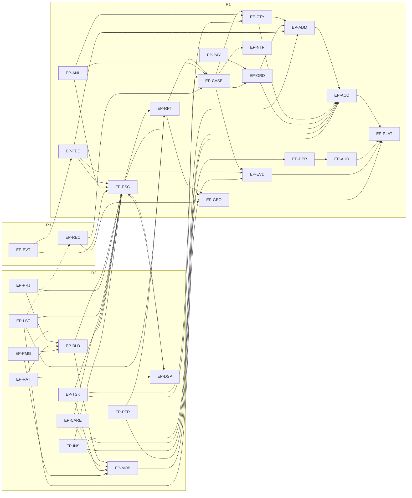

# 04 — Project Plan and Backlog

How Fidero gets from the manual service to the platform: the delivery approach, roadmap, milestones, release plans, epics, the full product backlog, priorities, roles, risks, budget and governance.

Every figure in this document is a working assumption, not verified data. That includes story points, velocity, dates and costs. Unknown numbers are marked `[TO VERIFY]`.

## 1. Document control

| Item | Value |
|---|---|
| Document | 04 of 6 in `docs/specs/` |
| Version | 0.2 |
| Date | 1 November 2026 |
| Status | Draft. For review by the founder as product owner |
| Owner | Product and engineering lead (once hired). Until then, the founder |
| Approver | Founder, acting as product owner |
| Source of truth | [01 Requirements and Product Specification](01-requirements-and-product-specification.md), version 0.3, and the decision record [`docs/decisions/2026-11-01-diaspora-platform.md`](../decisions/2026-11-01-diaspora-platform.md) |
| Related | [02 Architecture](02-architecture-and-technical-design.md), [03 UI/UX](03-ui-ux-design.md), [05 Testing and Acceptance](05-testing-and-acceptance.md), [06 Deployment and Operations](06-deployment-and-operations.md), [`docs/proposal.md`](../proposal.md), [`docs/validation-plan.md`](../validation-plan.md), [`docs/partners.md`](../partners.md), [`docs/product/architecture.md`](../product/architecture.md) |

### Change log

| Version | Date | Change | By |
|---|---|---|---|
| 0.2 | 1 November 2026 | Updated for 01 version 0.3 and the diaspora platform decision. Six new epics (EP-FEE, EP-CARE, EP-PMG, EP-TSK, EP-INS, EP-EVT) with 37 new stories; six stories changed (US-ACC-007, US-ACC-008, US-ACC-011, US-ESC-006, US-ESC-010, US-MOB-010) and the EP-CTY stories rewritten for R1 basic and R2 full. Country 2 manual phase from month 6, its software from month 12, country 3 manual phase in R2, events in R3. Enablers EN-47 to EN-63, milestones M-24 to M-36, gates G-C2 and G-C3, risks DR-25 to DR-34. R1 capacity recomputed (408 points against 384) with a new recommendation. Budget, RACI, traceability and the issues list refreshed | Delivery lead |
| 0.1 | 31 October 2026 | First draft against 01 version 0.1 | Delivery lead |

### How this document traces to 01

| 01 item | Becomes in 04 | Rule |
|---|---|---|
| SRS module (ACC, ORD, … CTY) | Epic `EP-<MODULE>` | One epic per module |
| `FR-<MODULE>-nnn` | User story `US-<MODULE>-nnn` | Story number equals FR number. Exactly one story per FR. A large FR is split into lettered sub-stories (`US-ESC-008a`, `US-ESC-008b`) |
| Priority and release of an FR | Priority and release of its story | Copied, never changed here. A change goes through change control (section 12.3) |
| `NFR-…` | Enabler items `EN-nn` in `EP-PLAT`, and the definition of done | Each NFR is covered by at least one enabler or a done rule |
| `RUL-…` | Acceptance criteria on the stories that enforce the rule | Plus the business-rule test suite, EN-32 |
| `Q-…`, `AS-…` | Spikes (EN items), milestones and delivery risks | Section 10 |
| Gates in 01 B4 and C-13 | Gates G0 to G3, country gates G-C2 and G-C3, and milestones `M-nn` | Section 3 |

Documents 05 and 06 reference the IDs in this document: `EP-…`, `US-…`, `EN-…` and `M-…`. These IDs are stable. They are never reused. An item that is no longer needed is marked superseded, not deleted.

## 2. Delivery approach

### 2.1 Discover, build, validate

Each release runs three steps. Software is built only for a phase that has passed its gate. The same rule applies to each country: a country gets configuration on the platform only after its own manual phase and 90-day validation (C-13).

| Step | What happens | R1 example |
|---|---|---|
| Discover | Learn from real work before building. Map the service, test designs with users, run spikes on partners and data | R0 spreadsheets show time per step and where cases stall. The R0 institution payment register (EN-51) shows which schools and hospitals take direct payment. Five diaspora clients try the clickable prototype in document 03. Spikes on the bank, payment, identity and institution formats |
| Build | Two-week Scrum sprints against the backlog in section 7 | Sprints S0 to S13 in section 5.1 |
| Validate | Put the increment in front of real users, measure, then decide | Staff run live cases in the back office alongside the spreadsheet (internal alpha). R0 clients move to the portal (client beta). Gate G1 at month 9. Country 2 runs its manual phase from month 6 and its own day-90 review at month 9 (G-C2) |

### 2.2 Scrum

- Two-week sprints. Sprint numbers run on from R1 to R2 (S0 to S31).
- The founder is product owner. The product and engineering lead also acts as Scrum lead. There is no separate Scrum master at this team size.
- Ceremonies, reports and change control are in section 12.
- The R1 team is one product and engineering lead, two developers (one backend-leaning, one frontend-leaning) and a part-time designer `[TO VERIFY]` (C-07). This plan recommends one contract developer from S3 to S13 (section 5.1). R2 adds an Android developer and a QA engineer `[TO VERIFY]`.
- The country 2 manual phase is run by a country 2 lead, an operations role, not an engineering one (EN-47, `[TO VERIFY]`). Engineering stays one team working on one codebase, because country is configuration (FR-CTY-001).

### 2.3 Definition of ready

A story can enter a sprint only when all of these hold:

1. It has an ID that traces to an FR in 01 (or is an `EN-` item that traces to an NFR, question or assumption).
2. It has 2 to 4 acceptance criteria in Given, When, Then form, and the product owner agrees them.
3. It is estimated, and the estimate is 8 points or less. Larger items are split first. US-BLD-013 is a 13-point placeholder and must be split before it is ready. US-CTY-002 was split into US-CTY-002a and US-CTY-002b in this version.
4. Its dependencies are done or planned in an earlier sprint.
5. Screens it needs are designed in document 03 and tested with users where they are client-facing.
6. Any open question (Q-) that blocks it is answered, or a safe default is agreed and recorded. For the new lines this means Q-16 (institutions) before EP-FEE, Q-19 (carer vetting) before EP-CARE, Q-17 and C-11 (insurer licence) before EP-INS, Q-18 (licences) before EP-PMG and EP-TSK, and Q-20 (pricing) before any line opens.
7. Test cases for it are outlined in document 05.

### 2.4 Definition of done

A story is done only when all of these hold:

1. Code is reviewed and approved by a developer who did not write it.
2. Automated tests pass in CI. Line coverage on the core API stays at 80% or more. Each business rule the story touches has a named test (NFR-MNT-01, EN-32).
3. Security checks in CI pass: static analysis, dependency and secret scanning, with no new high or critical findings. The OWASP ASVS level 2 items it touches are met (NFR-SEC-05).
4. Every state change it adds writes an audit entry (FR-AUD-001).
5. Client and back-office screens pass automated accessibility checks and a keyboard check against WCAG 2.2 AA (NFR-A11Y-01). Client pages stay inside the page-weight budget (NFR-PERF-02).
6. User-facing text is in translation files (NFR-LOC-01). Client status text reads at age 12 or below (NFR-USE-02).
7. Nothing about Ghana is hard-coded. Every template, price, legal text, partner and calendar the story uses comes from country configuration (FR-CTY-001, NFR-MNT-02).
8. Documentation is updated: API reference, data catalogue (NFR-PRIV-02), and any runbook change for document 06.
9. It is deployed to staging by the pipeline, with database migrations that can be rolled back.
10. Its acceptance criteria are shown working on staging, and the product owner accepts it.

### 2.5 Estimation and velocity

- Story points on the Fibonacci scale: 1, 2, 3, 5, 8, 13. All estimates in this document are assumptions made before the team exists. The team re-estimates in refinement.
- Reference stories: US-ACC-009 (account lockout) is 2. US-ACC-001 (sign-up with two one-time codes) is 5. US-ADM-001 (versioned templates) is 8.
- Planning velocity, `[TO VERIFY]` after Sprint 2:

| Period | Team | Planning velocity per sprint |
|---|---|---|
| S0 | Lead plus two developers, starting | 15 |
| S1 | As above | 18 |
| S2 | As above | 21 |
| S3 to S13 | R1 team plus one contract developer (recommended, section 5.1) | 33 |
| S3 to S15 without the contract developer | R1 team at steady pace | 25 |
| S13 onward | Plus the Android developer (ramping in S13 to S15) | 25 web plus about 10 Android from S16 |

- Planning velocity already leaves about 10% for defects and support of live features.
- From Sprint 3 the plan uses the average of the last three sprints. If it differs from the table by more than 20%, the lead re-plans and reports the effect on milestones.

## 3. Roadmap and milestones

### 3.1 Roadmap

The chart uses month numbers. The axis shows months 0 to 36. Ghana runs on the top rows. Each further country repeats the manual phase and a 90-day validation before it gets configuration on the platform.

```mermaid
gantt
    title Fidero roadmap, months 0 to 36 (axis numbers are month numbers)
    dateFormat X
    axisFormat %S
    todayMarker off
    section R0 Manual service
    Land reports by hand, fees to institutions by hand   :r0, 0, 3
    section R1 Escrow, portal, fees
    Sprint 0 and foundations                       :r1a, 3, 4
    Accounts, orders, payments, case workflow      :r1b, 4, 7
    Reports, escrow, fees to institutions          :r1c, 7, 9
    R1 completion, overlay checks, data rights     :r1d, 9, 10
    section Country 2
    Lead and field team set-up                     :c2a, 5, 6
    Manual service and 90-day validation           :c2b, 6, 9
    Configuration, data location, go-live          :c2c, 10, 12
    On the platform                                :c2d, 12, 36
    section Country 3
    Manual service and 90-day validation           :c3a, 15, 18
    Configuration and go-live                      :c3b, 18, 19
    On the platform                                :c3c, 19, 36
    section R2 Construction and family
    Android set-up, legal, bank and partner spikes :r2a, 9, 10
    Field app and construction core                :r2b, 10, 13
    Care, errands, property, off-plan, funds, listings, API :r2c, 13, 16
    Insurer lines, track records, hardening        :r2d, 16, 18
    section R3 Scale
    Events pilot, relocation and investing discovery :r3a, 18, 21
    Records programme pilot                        :r3b, 21, 24
    Relocation, shipping, investing decided        :r3c, 24, 30
    Family listings, materials, improvements       :r3d, 27, 36
    section Gates
    G0 day-90 review                               :milestone, g0, 3, 0d
    G1 R1 targets                                  :milestone, g1, 9, 0d
    G-C2 country 2 day-90 review                   :milestone, gc2, 9, 0d
    G2 R2 targets                                  :milestone, g2, 18, 0d
    G-C3 country 3 day-90 review                   :milestone, gc3, 18, 0d
    G3 R3 review                                   :milestone, g3, 36, 0d
```

R1 completion (months 9 to 10) appears because the R1 Must scope does not fit by month 9 even with the recommended contract developer. See section 5.1. Country 2 software starts at month 10 and goes live at month 12 only if G-C2 passes (AS-13). Country 3 follows the same pattern one release later.

### 3.2 Gates

Gates come from 01 B4 and C-13. A gate is a business decision, separate from a software release go/no-go (section 12.4).

| Gate | When | Opens | Passes when (from 01 B4 and C-13) |
|---|---|---|---|
| G0 | Month 3 | R1 | Day-90 review in `docs/validation-plan.md` section 6 passes, and an escrow partner is in talks |
| G1 | Month 9 | R2 | 300 reports and 50 escrows `[TO VERIFY]`; security review passed; insurer approves the platform report process. R2 also needs a signed bank agreement, and the Act 1047 position before listings |
| G-C2 | Month 9 | Country 2 configuration work (R2-B) | Country 2 manual service passes its own day-90 review (EN-44), using the Ghana R0 criteria adapted by the country 2 lead `[TO VERIFY]`. Entry criteria from the decision record are confirmed: legal route to escrow, licensed professionals contracted, a partner bank in talks, safe field conditions |
| G2 | Month 18 | R3 | 40 active builds, one bank contract and 40% of clients with a recurring line `[TO VERIFY]`. Country 2 live on the platform (BO-08) |
| G-C3 | Month 18 | Country 3 configuration work (R3-A) | Country 3 manual service passes its own day-90 review (EN-60) |
| G3 | Month 36 | Next phase | `[TO VERIFY]` in 01 |

A country gate can fail without touching Ghana. If G-C2 fails, country 2 software waits and the R2-B capacity planned for it (21 points) goes to the family lines.

### 3.3 Milestones

Months follow the recommended plan in section 5.1 (contract developer S3 to S13). Under the baseline team, M-10 to M-12 and M-26 slip by about one month each.

| ID | Month | Milestone | Exit criteria | Owner |
|---|---|---|---|---|
| M-01 | Month 0 | R0 starts | Lawyer, surveyor and runner contracted (two of each where possible). Report template and scope wording final. R0 tooling EN-01 to EN-08 live; institution payment register EN-51 ready for existing clients | Founder |
| M-02 | Month 1 | First paid report delivered | Report released from the template, two-person reviewed, hash logged (EN-02) | Founder |
| M-03 | Month 2 | Engineering lead offer made | Offer conditional on G0 `[TO VERIFY]`. No engineering spend committed before G0 | Founder |
| M-04 | Month 3 | Gate G0 | Day-90 criteria met. Founder records the decision | Founder |
| M-05 | Month 3 | Sprint 0 done | Monorepo, CI, hosting decision (EN-16) recorded | Engineering lead |
| M-06 | Month 5 | Walking skeleton in staging | Sign-up, sign-in, audit log and country configuration run on infrastructure built from code | Engineering lead |
| M-07 | Month 6 | Escrow partner signed | Agreement with a bank or licensed agent (AS-02). Release instruction format and channel agreed (EN-17); held-balance structure agreed (EN-53) | Founder |
| M-08 | Month 7 | Internal alpha | Staff run new cases in the back office alongside the spreadsheet. Access limited to staff. Backup restore drill passed (EN-15) | Engineering lead, with operations |
| M-09 | Month 8 | Client beta | Penetration test 1 passed (EN-28), accessibility audit (EN-25) and usability test (EN-24) done. New clients order and track in the portal | Product owner |
| M-10 | Month 8 | Escrow tracker live | First escrow tracked on the platform with client approval, two-person release and payee name check (US-ESC-006, US-ESC-007, US-ESC-015) | Product owner |
| M-11 | Month 9 | Gate G1 review | Business targets reviewed. Insurer approval recorded (EN-31) | Founder |
| M-12 | Month 10 | R1 complete | All R1 Must stories accepted per document 05. Penetration retest passed (EN-29). Overlay checks automatic. Metrics by country live | Engineering lead |
| M-13 | Month 11 | Field app beta | Signed app on 2 GB test devices. First contractors and inspectors vetted on the panel. Check-in and check-out working (US-MOB-012) | Engineering lead |
| M-14 | Month 12 | Listings and licence positions known | Act 1047 view in writing (EN-39). Insurer view on inspections and project funds (EN-40). Lawyer's view on property management and errand licences (EN-56) | Founder |
| M-15 | Month 13 | Construction pilot | First milestone paid: app evidence, inspector pass, client approval, two-person release, bank confirmation | Product owner |
| M-16 | Month 16 | Listings and partner API pilot | Developer listings live if EN-39 allows. One bank calls the partner API in a pilot | Product owner |
| M-17 | Month 16 | Off-plan and project funds pilot | First off-plan stage and first supplier payment released, if EN-40 allows | Product owner |
| M-18 | Month 18 | Gate G2 | 40 active builds, one bank contract, 40% of clients with a recurring line `[TO VERIFY]`, country 2 live. R2 penetration test passed (EN-38) | Founder |
| M-19 | Month 21 | Nigeria day-90 review | Superseded in version 0.2 by M-27. The country 2 review moves to month 9 | – |
| M-20 | Month 24 | Records pilot | One traditional authority's records captured and used in live cases | Product owner |
| M-21 | Month 27 | Nigeria on the platform | Superseded in version 0.2 by M-28. Country 2 goes live at month 12 | – |
| M-22 | Month 32 | R3 Coulds decided | Events, family and stool listings and materials ordering live, or dropped on evidence | Product owner |
| M-23 | Month 36 | Gate G3 | Criteria `[TO VERIFY]` in 01 | Founder |
| M-24 | Month 5 | Country 2 field team ready | Country 2 lead appointed (EN-47). Lawyer, surveyor and runner contracted (EN-49). Report template and scope statement adapted and approved (EN-48). Country confirmed by the founder (Q-15) | Founder |
| M-25 | Month 6 | Country 2 manual service starts | First paid country 2 case accepted. Partner bank or agent talks opened (EN-50) | Country 2 lead |
| M-26 | Month 9 | Fees to institutions live in the portal | First invoice paid direct to a verified institution with the receipt returned to the client (US-FEE-003, US-FEE-004). Prices set (EN-57) | Product owner |
| M-27 | Month 9 | Gate G-C2 | Country 2 day-90 review passes (EN-44). Founder records the decision | Founder |
| M-28 | Month 12 | Country 2 on the platform | Country 2 cases run with country 2 configuration and data stored where its law requires (US-CTY-002a, US-CTY-004, EN-59) | Engineering lead |
| M-29 | Month 15 | Family lines pilot | First care visit confirmed by the family and paid (US-CARE-004). First errand completed against the uploaded document (US-TSK-004). Field app usability test with carers passed (EN-61) | Product owner |
| M-30 | Month 15 | Country 3 manual service starts | Country chosen (Q-15), field team contracted, first case accepted (EN-60) | Founder |
| M-31 | Month 16 | Property management pilot | First rent tracked to the owner's own account (US-PMG-003). First repair paid after inspection (US-PMG-005). Licence position known (EN-56) | Product owner |
| M-32 | Month 17 | Insurer partner line live | First policy sold as the insurer's product with the premium paid to the insurer (US-INS-002), only if EN-55 allows | Founder |
| M-33 | Month 18 | Gate G-C3 | Country 3 day-90 review passes (EN-60) | Founder |
| M-34 | Month 19 | Country 3 on the platform | Country 3 configuration published by copying and editing (US-CTY-004, EN-62) | Engineering lead |
| M-35 | Month 21 | Events pilot | First vendor paid against delivery evidence (US-EVT-002), if the Could is taken | Product owner |
| M-36 | Month 30 | Later lines decided | Relocation and shipping, vehicles and investing specified in 01 or dropped (EN-63) | Founder |

## 4. R0 manual service

R0 runs months 0 to 3 with no platform. The plan, targets and day-90 criteria are in [`docs/validation-plan.md`](../validation-plan.md). In short:

- A contracted lawyer, licensed surveyor and field runner deliver reports from the standard template.
- For existing clients, fees to schools, hospitals and agencies are paid by hand through the partner bank or the founder's bank, with the receipt returned (01 releases table). Every such payment goes in the register EN-51 so R1 learns which institutions take direct payment (Q-16).
- Target: 50 paid reports in 90 days, 20 from diaspora clients (assumptions).
- Go to R1 if, among other things, at least 30 paid reports, median turnaround under 25 working days, cost per report under 50% of price, and professional indemnity cover in place (validation plan section 6).

R0 also feeds R1 discovery. Every step date, cost and stall in the spreadsheets becomes evidence for the case template, target durations and status messages. Country 2 repeats this phase from month 6 with its own team (section 5.4).

### R0 tooling

R0 tooling is bought or built without developers. It is in the backlog as enabler items so its dates are tracked. It uses no engineering capacity.

| Item | Tool | Replaced in R1 by |
|---|---|---|
| EN-01 | Leads, orders and case tracker spreadsheet | EP-ORD, EP-CASE |
| EN-02 | Report template document with locked scope text, and a hash log of released PDFs | EP-RPT |
| EN-03 | Landing page with order and contact form | Client portal (EP-ORD) |
| EN-04 | Payment link for fees, card and mobile money | EP-PAY |
| EN-05 | Metrics and partner tracker for the fortnightly review | EP-ANL |
| EN-06 | Evidence folder convention with hash log | EP-EVD |
| EN-07 | Consent recording kit | US-DPR-002 |
| EN-08 | Data Protection Commission registration `[TO VERIFY]` | Stays a legal task |
| EN-51 | Institution payment register for fees paid by hand | EP-FEE |

R0 cases that are still open when the portal opens finish in the spreadsheet. Closed cases, leads, reports and institution payments move to the platform in EN-30.

## 5. Release plans

### 5.1 R1: Escrow, portal and fees to institutions (months 3 to 9)

**Goal.** Clients order, pay for and track reports online. Staff run every case through a tracked workflow. Reports are built from the template, reviewed by two people and hashed. Escrows are tracked with client approval and two-person release. Clients pay school fees and hospital bills direct to verified institutions and get the receipt back. Country is configuration from the first release. Overlay checks run from plot coordinates.

**Objectives served.** BO-01, BO-02, BO-03, BO-07, BO-08, BO-09, BO-10. Business requirements BR-01 to BR-07, BR-14, BR-15, BR-16, BR-17.

**Scope.** 110 stories in 15 epics (EP-ACC, EP-ORD, EP-PAY, EP-CASE, EP-RPT, EP-GEO, EP-ESC, EP-EVD, EP-NTF, EP-ADM, EP-AUD, EP-ANL, EP-DPR, EP-FEE, EP-CTY), plus enablers EN-09 to EN-32, EN-44, EN-47 to EN-50, EN-52, EN-53 and EN-57.

| R1 scope | Stories | Points |
|---|---|---|
| Must stories | 87 | 315 |
| Should stories | 20 | 64 |
| Could stories | 3 | 9 |
| Must enablers (EN-31, EN-44, EN-47, EN-48, EN-49 and EN-57 are not pointed) | 29 | 85 |
| Should enablers (EN-21, EN-30; EN-50 is not pointed) | 3 | 5 |
| **Total** | **142** | **478** |

Version 0.1 had 97 stories and 421 points. The growth is EP-FEE (25 points), US-ESC-014 and US-ESC-015 (7), EP-CTY in R1 (14), US-ACC-012 (5), US-ESC-006 re-estimated for client approval (2), and spikes EN-52 and EN-53 (4).

#### Sprint plan for the recommended team

The plan covers Must items only, plus US-ANL-001, which US-CTY-003 (Must) needs. They are ordered by dependency and by the WSJF ranking in section 8. Country configuration comes in S4 because every later table carries a country. Escrow comes before fees to institutions because fees reuse the escrow release path (US-ESC-003, US-ESC-007, US-ESC-015). Automatic overlay checks come last because staff can run them by hand meanwhile, as they do in R0. The plan assumes one contract developer from S3 to S13 (Option A+ below).

| Sprint | Month | Goal | Items | Points |
|---|---|---|---|---|
| S0 | 3 | Foundations: repo, CI, hosting decision, identity provider spike | EN-09, EN-10, EN-16, EN-19 | 15 |
| S1 | 3-4 | Infrastructure as code, security baseline, provider sandboxes | EN-11, EN-14, EN-18, EN-22 | 17 |
| S2 | 4 | Environments, design system, bank and institution spikes, business-rule test suite | EN-17, EN-12, EN-23, EN-52, EN-53, EN-32 | 20 |
| S3 | 4-5 | Walking skeleton: sign-up, sign-in, MFA, roles, audit log, versioned configuration (contract developer joins) | US-ACC-001, US-ACC-002, US-DPR-001, US-ACC-003, US-ACC-006, US-AUD-001, US-AUD-002, US-ADM-001 | 33 |
| S4 | 5 | Prices, partners, country as configuration, access control, evidence store | US-ADM-002, US-ADM-003, US-CTY-001a, US-ACC-007, US-CTY-001b, US-EVD-001, US-EVD-002 | 33 |
| S5 | 5 | Observability, backups, safe evidence links, ordering, card payment | EN-13, EN-15, US-EVD-003, US-EVD-005, US-ORD-001, US-ORD-002, US-RPT-004, US-ORD-003, US-PAY-001a, US-PAY-002 | 33 |
| S6 | 6 | Fee separation, case creation, mobile money, case tasks | US-PAY-005, US-CASE-001, US-ORD-004, US-PAY-001b, US-CASE-002, US-CASE-003, US-CASE-004, US-NTF-001a | 32 |
| S7 | 6 | Receipts, notifications, case queue, field tasks on phone, client tracker, safety (internal alpha, M-08) | US-ACC-009, US-PAY-003, US-NTF-002, US-NTF-004, US-CASE-005, US-CASE-006, US-CASE-007, US-NTF-003, US-CASE-008, US-CASE-009, US-CASE-010 | 33 |
| S8 | 7 | Client readiness: manual identity check, licences, previews, SMS and WhatsApp, threat model, usability, accessibility, pen test 1, fresh search, consent (client beta, M-09) | US-ACC-004b, US-ACC-005, US-EVD-004, US-NTF-001b, EN-27, EN-24, EN-25, EN-28, US-CASE-014, US-DPR-002 | 33 |
| S9 | 7-8 | Report builder, two-person review, hashed PDF | US-RPT-001, US-RPT-002, US-RPT-003, US-RPT-005, US-RPT-006, US-RPT-007, US-RPT-009, US-RPT-010 | 32 |
| S10 | 8 | Escrow tracker with client approval, two-person release and payee name check (M-10) | US-ADM-005, US-ESC-001, US-ESC-002, US-ESC-003, US-ESC-004, US-ESC-005, US-ESC-006, US-ESC-007, US-ESC-015, US-ESC-008a, US-ESC-008b, US-ESC-009 | 33 |
| S11 | 8-9 | Cancellation, held balance, fees to institutions (M-26), overlay layer sourcing | US-ESC-013, US-ESC-014, US-FEE-001, US-FEE-002, US-FEE-003, US-FEE-004, US-FEE-007, EN-20 | 32 |
| S12 | 9 | Overlay checks, load test, pen retest, identity provider | US-GEO-001, US-GEO-004, US-GEO-002, US-GEO-003, EN-26, EN-29, US-ACC-004a | 33 |
| S13 | 9-10 | R1 completion: scope wording control, data rights, retention and legal hold, dashboard and metrics by country (M-12) | US-ADM-004, US-DPR-003, US-DPR-005, US-DPR-004a, US-DPR-004b, US-ANL-003, US-ANL-001, US-CTY-003 | 29 |

S13 falls in months 9 to 10. The web team finishes R1 there while the Android developer sets up R2 (section 5.2). The S13 items are the ones with the least effect before month 10: scope-wording change control, data subject export, retention and legal hold, the dashboard and metrics by country (no second country has data before month 12).

#### Capacity against scope

| Measure | Baseline team | Option A as in version 0.1: contract developer S3 to S12 | Option A+ (recommended): contract developer S3 to S13 |
|---|---|---|---|
| Planning capacity S0 to S12 | 304 points (15 + 18 + 21 + 10 × 25) | 384 points (15 + 18 + 21 + 10 × 33) | 384 points; 417 to the end of S13 |
| R1 Must stories and Must enablers, plus US-ANL-001 | 408 points (315 + 85 + 8) | 408 points | 408 points |
| Gap | 104 points short. Must scope ends in S17, about month 11 | 24 points short. Must scope ends in S14, month 10 | 9 points spare at the end of S13. Must scope ends in S13, months 9 to 10 |
| Should items that fit before construction work starts in S16 | None | About 25 points in S14 and S15 | About 40 points in S14 and S15: US-CASE-013, US-ACC-012, US-ORD-005, US-CASE-011, US-CASE-012, US-PAY-004, US-FEE-005, US-FEE-006, US-ANL-002, US-NTF-005, EN-30, US-ACC-008, US-ACC-010, US-CASE-015, US-RPT-008 |

What the new scope means, plainly: version 0.1 already showed the baseline team 50 points short of the R1 Musts. Version 0.3 of 01 adds 46 points of R1 Must stories and enablers, and FR-CTY-003 pulls an 8-point Should (US-ANL-001) into the Must plan: 54 points more. The baseline team now finishes the R1 Musts around month 11, two months after gate G1 and one month after the Android developer starts. That is not workable: it eats the R2 start, and it collides with the country 2 configuration work that is due at month 12. The founder has three choices. All three are assumptions until the team's real velocity is known after S2.

1. **More people. Option A+ (recommended).** Add one contract developer for S3 to S13, one sprint longer than version 0.1 proposed. All R1 Musts land by the end of S13 (months 9 to 10). Gate G1 at month 9 is judged on business numbers (reports, escrows, fees paid), which the S13 tail does not affect. Cost about $17,600 `[TO VERIFY]` (section 11). This protects the R2 start, the family lines and the month-12 country 2 date.
2. **Later R1. Option B.** Keep the baseline team and accept R1 completion at month 11 (S17). Not recommended: the Android developer would start while the web team is still on R1, and country 2 configuration (R2-B) would slip past month 12, which breaks BO-08.
3. **Move items to R2. Option C.** Downgrade named R1 Musts through change control (section 12.3) with the product owner's written agreement. Candidates with the least effect before month 10: FR-CTY-003 (metrics by country, 3 points, no second-country data until month 12), FR-ACC-004 provider integration (US-ACC-004a, 5), FR-ADM-004 (3) and FR-DPR-003, FR-DPR-004, FR-DPR-005 (13). That is 24 points. Dropping FR-CTY-003 also lets US-ANL-001 return to the Should list, so 32 points leave the Must plan: 376 against 384 with Option A, which fits S12 with almost no slack. Moving EP-FEE or FR-CTY-001 is not recommended: fees to institutions are the first visible proof of the redefinition, R0 clients already pay them by hand, and country configuration is a data-model decision that costs far more to retrofit than to build in.

The decision is needed at the end of S2, when velocity is first measured. If velocity after S2 is more than 20% below the table, the founder takes Option A+ and the Option C list together.

#### Cut line

If R1 runs late, items drop in this order. Nothing below the line is cut without change control.

1. Coulds: US-GEO-008, US-RPT-011, US-ORD-006.
2. Shoulds, lowest value first: US-AUD-004, US-AUD-003, US-NTF-005, US-ACC-010, US-CASE-015, US-RPT-008, US-GEO-005, US-PAY-006, US-ANL-002, US-GEO-006 with EN-21, US-PAY-004, US-CASE-012, US-CASE-011, US-FEE-006, US-ACC-008, US-ORD-005, EN-30, US-FEE-005, US-ACC-012, US-CASE-013.
3. **Cut line.** Musts below this line are cut only with change control, in the Option C order above.

US-CASE-013 (building verification) drops last among Shoulds because it opens the second property line (F-09). US-ACC-012 (home dashboard) and US-FEE-005 (recurring fees) drop just before it because they carry BO-09, the monthly contact target. US-ANL-001 is a Should but sits in the Must plan because US-CTY-003 needs it (issue I-19). In the baseline plan, all R1 Shoulds and Coulds move to R2 phases R2-A to R2-D.

### 5.2 R2: Construction and family (months 9 to 18)

**Goal.** Release construction money only against app evidence and an inspector's pass. Put country 2 on the platform by month 12. Open care visits, paperwork and errands, property management, off-plan escrow, project funds, verified listings for developers, the partner API, track records and disputes. Open insurer partner lines only if the licence position allows.

**Objectives served.** BO-04, BO-05, BO-06, BO-08, BO-09, BO-10. Business requirements BR-08 to BR-12, BR-14, BR-18 to BR-21.

**Start conditions.** Gate G1 passed and a bank agreement signed. Country 2 configuration work starts only after G-C2 (EN-44). Listings work starts only after the Act 1047 position (EN-39). Off-plan and project funds go live only with the insurer's extension (EN-40). Care visits need the vetting standard (EN-54). Property management and errands need the licence view (EN-56). Insurer lines need an insurer agreement and the licence view (EN-55).

**Scope.** 88 stories in 18 epics (EP-ACC, EP-ORD, EP-PAY, EP-GEO, EP-ESC, EP-EVD, EP-MOB, EP-BLD, EP-PRJ, EP-LST, EP-RAT, EP-DSP, EP-PTR, EP-CARE, EP-PMG, EP-TSK, EP-INS, EP-CTY), plus enablers EN-33 to EN-43, EN-45, EN-54 to EN-56 and EN-58 to EN-61. Totals: 395 story points (Must 231, Should 137, Could 27) and 43 enabler points.

**Team.** R1 team plus an Android developer and a QA engineer `[TO VERIFY]`. The QA engineer adds no planned points. They own test automation, device testing and document 05 test runs, which lowers defect load on developers. The country 2 lead and field team are operations, outside this count.

**Sequence.** The new lines are ordered by what they reuse. Care visits and errands come first in R2-C because they reuse the field app check-in (US-MOB-012), the case workflow and the held balance (US-ESC-014), and because BO-09 (40% of clients with a recurring line) is a G2 target. Property management follows because it reuses inspections (US-MOB-007) and the contractor panel (US-BLD-003) for repairs. Insurer lines come last, in R2-D, because they depend on Q-17 and C-11 (EN-55) and add no engine.

| Phase | Sprints | Month | Goal | Items | Points |
|---|---|---|---|---|---|
| R2-A | S13-S15 | 9-10 | Android set-up; bank, legal, carer, insurer and country 2 data location spikes; R0 data migration. The web team finishes R1 Musts in S13 and does the first R1 Shoulds in S14 and S15 | EN-33, EN-34, EN-35, EN-45, EN-39, EN-40, EN-41, EN-54, EN-55, EN-56, US-CASE-013, US-ACC-012, US-ORD-005, US-CASE-011, US-CASE-012, US-PAY-004, US-FEE-005, US-FEE-006, US-ANL-002, US-NTF-005, EN-30, US-ACC-008, US-ACC-010, US-CASE-015, US-RPT-008 | 56 |
| R2-B | S16-S21 | 10-13 | Construction core: field app with check-in, inspections, milestone releases, disputes. Country 2 on the platform by month 12: data location, copy configuration, publish (M-28). Organisation accounts for institutions | US-MOB-001, US-MOB-002, US-MOB-003, US-MOB-004, US-MOB-005a, US-MOB-005b, US-MOB-006, US-MOB-007, US-MOB-008, US-MOB-009, US-MOB-011a, US-MOB-011b, US-MOB-012, US-MOB-010, US-EVD-006, US-ESC-010, US-BLD-001, US-BLD-002, US-BLD-003, US-BLD-004, US-BLD-005a, US-BLD-005b, US-BLD-006, US-BLD-007, US-BLD-008, US-BLD-009, US-BLD-010, US-BLD-012, US-DSP-001, US-DSP-002, US-DSP-003, US-DSP-004, US-ORD-007, US-CTY-002a, US-CTY-002b, US-CTY-004, EN-59, US-ACC-011, EN-61, US-PAY-006, US-GEO-005 | 183 |
| R2-C | S22-S27 | 13-16 | Family lines first: care visits and errands (reuse the field app and case workflow), then property management (reuses inspections and the contractor panel), off-plan, project funds, statement import, listings, partner API; remaining R1 Shoulds | US-CARE-002, US-CARE-003, US-CARE-004, US-CARE-005, US-CARE-006, US-CARE-001, US-TSK-002, US-TSK-003, US-TSK-004, US-TSK-001, US-TSK-005, US-PMG-002, US-PMG-003, US-PMG-005, US-PMG-001, US-PMG-004, US-PMG-006, EN-58, US-BLD-011a, US-BLD-011b, US-PRJ-005, US-PRJ-001, US-PRJ-002, US-PRJ-003, US-PRJ-004, US-ESC-011, US-DSP-005, US-LST-002, US-LST-003, US-LST-006, US-LST-008, US-LST-001, US-LST-004a, US-LST-004b, US-LST-005, US-LST-007, US-LST-010, US-PAY-007, US-PTR-002, US-PTR-001, US-PTR-004, EN-36, EN-43, EN-21, US-GEO-006, US-AUD-003, US-AUD-004 | 198 |
| R2-D | S28-S31 | 16-18 | Insurer partner lines (only if EN-55 allows), track records, hardening: scale test, pen test, accessibility; country 3 manual service runs; Coulds if capacity allows | US-INS-002, US-INS-003, US-INS-001, US-INS-004, US-RAT-001, US-RAT-002, US-RAT-003, US-RAT-004, EN-37, EN-38, EN-42, EN-60, US-GEO-007, US-ESC-012, US-PTR-003, US-ORD-006, US-RPT-011, US-GEO-008 | 71 |

R2 also carries the 29 points of R1 completion in S13 and the R1 Shoulds in R2-A to R2-C.

| R2 capacity check | Points |
|---|---|
| Capacity S13 to S31: web 19 × 25 plus 8 from the contract developer in S13, Android 8 in S13 to S15 then 16 × 10 | 651 |
| Demand: R1 completion 29, R2 phases 508 | 537 |
| Unplanned capacity | 114 (about 18%) |

Version 0.1 left 31% unplanned. The family lines and country 2 take most of that. R2 still has the most outside dependencies: the bank's file or API, the Act 1047 position, the insurer's extension, the carer vetting standard, the insurer partner and licence, contractor uptake and field defects on low-end phones. If 18% proves too little, the first lever is to keep the contract developer through R2-B (about 8 points a sprint, `[TO VERIFY]`); the second is the cut line below. If dependencies do not bite, the team pulls R2 Coulds and R3 discovery forward.

**Cut line for R2.** Coulds first (US-INS-001, US-INS-004, US-ESC-012, US-GEO-007, US-PTR-003, the R1 Coulds), then Shoulds from the lines that are blocked or late: EP-INS if EN-55 fails (the whole line stays off by configuration, including its Must), EP-LST Shoulds if Act 1047 is unclear, off-plan and project funds (US-BLD-011a/b, EP-PRJ) if the insurer will not extend cover, EP-PMG if Q-18 shows a licence is needed, then EP-RAT and EP-PTR Shoulds, then the Should parts of the family lines (US-CARE-001, US-TSK-001, US-TSK-005, US-PMG-001, US-PMG-004, US-PMG-006). Never cut: the construction Must path (EP-MOB, EP-BLD Musts, US-ESC-010, EP-DSP Musts) because gate G2 depends on it; country 2 on the platform (US-CTY-002a, US-CTY-002b, US-CTY-004, EN-59) because BO-08 and G2 depend on it; and the EP-CARE and EP-TSK Musts because the G2 recurring-line target depends on them.

### 5.3 R3: Scale (months 18 to 36)

**Goal.** Put country 3 on the platform, run the events line, digitise traditional authority records, open family and stool listings and materials ordering, and decide the relocation, shipping and investing lines on evidence.

**Start conditions.** Gate G2 passed. For country 3, its manual service has passed its own 90-day validation (G-C3, EN-60) before any configuration work. Events open only with vendors verified the same way as institutions.

**Scope.** 9 stories in 4 epics (EP-EVT, EP-REC, EP-LST, EP-BLD) and enablers EN-46, EN-62 and EN-63: 66 points. 01 specifies R3 lightly. Most R3 work will come from R2 data and a later version of 01. Relocation and shipping, vehicles and investing have no requirements yet and get discovery only (EN-63).

**Team and budget.** R3 falls after the 18-month pre-seed. Team and funding are `[TO VERIFY]` and depend on a later round.

| Phase | Month | Goal | Items | Points |
|---|---|---|---|---|
| R3-A | 18-21 | Country 3 configuration and go-live (if gate G-C3 passed), events pilot, discovery for relocation, shipping and investing partners | EN-62, EN-46, US-EVT-001, US-EVT-002, US-EVT-003, EN-63 | 19 |
| R3-B | 21-24 | Records programme pilot | US-REC-001, US-REC-002, US-REC-003, US-REC-004 | 26 |
| R3-C | 24-30 | Relocation, shipping and investing lines specified in 01 or dropped, from EN-63; improvements from R2 data | - | 0 |
| R3-D | 27-36 | Family and stool listings, materials ordering | US-LST-009, US-BLD-013 | 21 |

**Cut line for R3.** US-EVT-001 to US-EVT-003, US-LST-009 and US-BLD-013 (Coulds) first, then EP-REC Shoulds. EN-62 (country 3 configuration) is cut only if the country 3 pilot is stopped.

### 5.4 Country 2 manual phase (months 5 to 9)

The second country repeats Ghana's R0 with its own team, inside R1's timeline. It uses no engineering capacity. Its items are enablers so their dates are tracked.

| Month | What happens | Items | Owner |
|---|---|---|---|
| 5 | Country confirmed (Q-15, Nigeria assumed). Country 2 lead appointed. Scope statement and report template adapted with a local lawyer and reviewed by the insurer. Lawyer, surveyor and runner contracted | EN-47, EN-48, EN-49, M-24 | Founder |
| 6 to 9 | Manual service: reports from the adapted template, two-person review, hash log, tracker spreadsheet. Fees to institutions by hand where clients ask. Partner bank or escrow agent talks and insurer shortlist | EN-44, EN-50, EN-51 pattern, M-25 | Country 2 lead |
| 9 | Day-90 review against the Ghana R0 criteria adapted for the country `[TO VERIFY]`. Gate G-C2 | EN-44, M-27 | Founder |
| 10 to 12 | If G-C2 passes: data location spike and stack (EN-45), copy and edit Ghana's configuration (US-CTY-004), publish (EN-59). Go-live M-28 | R2-B | Engineering lead, country 2 lead |

Country 3 repeats this in months 15 to 19 (EN-60, EN-62, M-30, M-33, M-34).

## 6. Epic catalogue

Size: S up to 15 points, M 16 to 30, L 31 to 55, XL over 55.

| Epic | Name | Goal | Features | FR range | Release | Priority | Stories | Points | Size |
|---|---|---|---|---|---|---|---|---|---|
| EP-ACC | Accounts and identity | Safe sign-up, sign-in, MFA, identity checks, role-based access and the client's home dashboard | F-01, F-35 | FR-ACC-001 to 012 | R1, R2 | Must | 13 | 50 | L |
| EP-ORD | Orders and leads | Clients order a report or an extra inspection online | F-02 | FR-ORD-001 to 007 | R1, R2 | Must | 7 | 19 | M |
| EP-PAY | Payments for Fidero fees | Take Fidero's own fees by card and mobile money; never take client money | F-02 | FR-PAY-001 to 007 | R1, R2 | Must | 8 | 25 | M |
| EP-CASE | Verification case workflow | Run every case through owned, dated tasks with required evidence | F-03, F-06, F-09 | FR-CASE-001 to 015 | R1 | Must | 15 | 56 | XL |
| EP-RPT | Report builder | Build, sign, review, hash and version reports from the template | F-04, F-09 | FR-RPT-001 to 011 | R1 | Must | 11 | 39 | L |
| EP-GEO | Geospatial checks and monitoring | Automatic overlay checks, images and later change detection | F-05, F-24 | FR-GEO-001 to 008 | R1, R2 | Must | 8 | 40 | L |
| EP-ESC | Escrow tracking | Mirror the bank's escrow and held balances; control every release instruction and payee | F-08, F-17, F-23, F-29 | FR-ESC-001 to 015 | R1, R2 | Must | 16 | 60 | XL |
| EP-EVD | Evidence store | Tamper-evident, never-overwritten evidence served safely | F-07 | FR-EVD-001 to 006 | R1, R2 | Must | 6 | 21 | M |
| EP-MOB | Field app (milestone app) | Offline, signed, in-app capture, check-in and check-out for all field roles | F-15, F-30 | FR-MOB-001 to 012 | R2 | Must | 14 | 70 | XL |
| EP-BLD | Construction, off-plan and buildings | Milestone releases, inspections, dashboard, off-plan, materials | F-16, F-17, F-27 | FR-BLD-001 to 013 | R2, R3 | Must | 15 | 78 | XL |
| EP-PRJ | Project funds | Pay checked suppliers against invoices for funded projects | F-18 | FR-PRJ-001 to 005 | R2 | Should | 5 | 22 | M |
| EP-LST | Verified listings | List only verified assets and sell them through escrow | F-19, F-26 | FR-LST-001 to 010 | R2, R3 | Should, with Must rules | 11 | 47 | L |
| EP-RAT | Track records and ratings | Public track records for sellers, contractors and professionals | F-20 | FR-RAT-001 to 004 | R2 | Should | 4 | 16 | M |
| EP-DSP | Disputes | Freeze releases and resolve disputes on fixed timelines | F-21 | FR-DSP-001 to 005 | R2 | Must | 5 | 16 | M |
| EP-PTR | Partner API | Consent-based plot status for banks and developers | F-22 | FR-PTR-001 to 004 | R2 | Should | 4 | 23 | M |
| EP-NTF | Notifications and messaging | Status, task and approval messages by email, SMS and WhatsApp | F-06, F-10 | FR-NTF-001 to 005 | R1 | Must | 6 | 17 | M |
| EP-ADM | Administration | Templates, prices, partners and rules as configuration | F-11 | FR-ADM-001 to 005 | R1 | Must | 5 | 19 | M |
| EP-AUD | Audit | Append-only, searchable, hash-chained audit log | F-12 | FR-AUD-001 to 004 | R1 | Must | 4 | 13 | S |
| EP-ANL | Analytics and reporting | Operating dashboard and exports from platform data | F-13 | FR-ANL-001 to 003 | R1 | Should | 3 | 12 | S |
| EP-DPR | Data protection and retention | Notice, consent, data rights, retention and export control under Act 843 | F-14 | FR-DPR-001 to 005 | R1 | Must | 6 | 18 | M |
| EP-FEE | Payments to institutions | Verify the institution, check the invoice, pay the institution direct, return the receipt | F-29 | FR-FEE-001 to 007 | R1 | Must | 7 | 25 | M |
| EP-CARE | Care visits | Vetted carers, check-in and check-out, family confirmation, pay only for confirmed visits | F-30 | FR-CARE-001 to 006 | R2 | Should feature, Must rules | 6 | 26 | M |
| EP-PMG | Property management | Tenants, rent to the owner's own account, repairs paid against quotes and inspection | F-31 | FR-PMG-001 to 006 | R2 | Should feature, Must rules | 6 | 28 | M |
| EP-TSK | Paperwork and errands | Catalogue per country, vetted agents, fees to the agency, completion by the document | F-32 | FR-TSK-001 to 005 | R2 | Should feature, Must rules | 5 | 18 | M |
| EP-INS | Insurer partner lines | Health and funeral cover sold as the insurer's product; premiums never to Fidero | F-33 | FR-INS-001 to 004 | R2 | Could feature, Must rule | 4 | 14 | S |
| EP-EVT | Events and ceremonies | Verified vendors paid against invoices and delivery evidence | F-34 | FR-EVT-001 to 003 | R3 | Could | 3 | 13 | S |
| EP-REC | Records programme | Digitise authority records and use them in searches | F-25 | FR-REC-001 to 004 | R3 | Should | 4 | 26 | M |
| EP-CTY | Multi-country | Country as configuration from R1; data kept where each law requires and new countries by copying, in R2 | F-28 | FR-CTY-001 to 004 | R1 basic, R2 full | Must | 6 | 32 | L |
| EP-PLAT | Platform and enablers | Infrastructure, CI/CD, observability, security, performance, accessibility, spikes, R0 tooling, country field teams | NFRs | None (NFR-…, Q-…, AS-…) | R0 to R3 | Must | 63 items | 139 | XL |

## 7. Product backlog

### 7.1 How to read the backlog

- Stories are grouped by epic and ordered by release, then priority, then number.
- Each story's number equals the FR it implements. Priority and release are copied from 01.
- Points are assumptions (section 2.5).
- "Depends on" lists stories or enablers that must be done first.
- Personas are from 01 B3 (P-01 to P-17). Where a story's user is a role from 01 C2 with no persona, the role is named.
- Acceptance criteria follow each epic's table. Document 05 turns each criterion into test cases (`TC-<MODULE>-nnn-nn`).

### 7.2 Totals

| Release | Must | Should | Could | Story points | Enabler points | Total points |
|---|---|---|---|---|---|---|
| R0 | – | – | – | – | Not pointed (EN-01 to EN-08, EN-51) | – |
| R1 | 87 stories, 315 points | 20 stories, 64 points | 3 stories, 9 points | 388 | 90 | 478 |
| R2 | 52 stories, 231 points | 31 stories, 137 points | 5 stories, 27 points | 395 | 43 | 438 |
| R3 | – | 4 stories, 26 points | 5 stories, 34 points | 60 | 6 | 66 |
| **All** | **139 stories, 546 points** | **55 stories, 227 points** | **13 stories, 70 points** | **843** | **139** | **982** |

207 user stories cover all 195 FRs in 01 version 0.3: 183 FRs have one story each, and 12 large FRs are split into lettered sub-stories (US-ACC-004a/b, US-PAY-001a/b, US-ESC-008a/b, US-MOB-005a/b, US-MOB-011a/b, US-BLD-005a/b, US-BLD-011a/b, US-LST-004a/b, US-DPR-004a/b, US-NTF-001a/b, US-CTY-001a/b, US-CTY-002a/b). There are 63 enabler items. Version 0.1 had 170 stories for 159 FRs and 46 enablers.

### EP-ACC: Accounts and identity

13 stories, 50 points.

| Story | As a … I want … so that … | Priority | Release | Points | Depends on |
|---|---|---|---|---|---|
| US-ACC-001 | As a diaspora buyer (P-01), I want to sign up with my email address and mobile number, each confirmed by a one-time code, so that Fidero can reach me and knows the contact details are mine. | Must | R1 | 5 | EN-09, EN-22 |
| US-ACC-002 | As a client (P-01, P-02), I want to sign in with email or phone and a password, or with a one-time code, so that I can get in quickly from any device. | Must | R1 | 3 | US-ACC-001 |
| US-ACC-003 | As a reviewer (P-04), I want multi-factor authentication on my account, so that a stolen password cannot approve a report or a release. | Must | R1 | 5 | US-ACC-002 |
| US-ACC-004a | As a case manager (P-03), I want each client's identity checked through the identity check provider, so that no report is released and no escrow opened for an unverified person. | Must | R1 | 5 | US-ACC-004b, EN-19 |
| US-ACC-004b | As a case manager (P-03), I want to record a manual document check when the provider cannot decide or is unavailable, so that clients with a Ghana Card or foreign passport are never stuck. | Must | R1 | 3 | US-ACC-001, US-EVD-001 |
| US-ACC-005 | As an administrator (P-14), I want to store each professional's licence number, licence body and expiry date, so that only licensed people sign report sections (RUL-20). | Must | R1 | 3 | US-ACC-006 |
| US-ACC-006 | As an administrator (P-14), I want to invite staff, professionals, contractors and inspectors and assign their roles, so that each person gets the access their job needs and nothing more. | Must | R1 | 3 | US-ACC-001 |
| US-ACC-007 | As a reviewer (P-04), I want each user to see only the cases, projects and listings assigned to them, owned by them or within their operational scope, with staff seeing only their own country and team, so that client and seller data stays private (Act 843). | Must | R1 | 8 | US-ACC-006, EN-32 |
| US-ACC-009 | As a client (P-01, P-02), I want my account locked after 5 failed sign-in attempts for 15 minutes, and to be told, so that someone guessing my password is stopped. | Must | R1 | 2 | US-ACC-002, US-NTF-001a |
| US-ACC-008 | As a diaspora buyer (P-01), I want to name a representative in the home country with read-only access to one case or project, so that a relative can follow progress without being able to act for me. | Should | R1 | 3 | US-ACC-007 |
| US-ACC-010 | As a client (P-01, P-02), I want to choose my notification preferences and preferred channel, so that I hear about my case where I actually read messages. | Should | R1 | 2 | US-NTF-001a, US-NTF-001b |
| US-ACC-012 | As a family supporter (P-15), I want to add family members, properties and institutions to my account and see everything running at home in one dashboard, so that I manage my mother's care, the school fees and the house from one place (F-35). | Should | R1 | 5 | US-ACC-007, US-FEE-001 |
| US-ACC-011 | As a developer, seller, institution or insurer (P-10, roles in 01 C2), I want an organisation account with several users, so that my sales team, bursar's office or claims team can work on our account together. | Should | R2 | 3 | US-ACC-007, US-FEE-001 |

Acceptance criteria:

- **US-ACC-001** (implements FR-ACC-001)
  1. Given a visitor on the sign-up page, when they submit a valid email and mobile number, then a one-time code is sent to each and the account stays unverified until both codes are entered.
  2. Given an expired or wrong code, when it is entered, then it is rejected and the user can request a new code.
  3. Given an email or number already on an account, when someone signs up with it, then sign-up is refused without revealing whose account it is.
- **US-ACC-002** (implements FR-ACC-002)
  1. Given a verified account, when the user enters the right identifier and password, then they are signed in and the sign-in is written to the audit log.
  2. Given a verified account, when the user asks for a one-time code, then the code goes only to a verified email or number on that account.
  3. Given a wrong password, when sign-in fails, then the failure counts towards the lockout in US-ACC-009.
- **US-ACC-003** (implements FR-ACC-003)
  1. Given a user with a staff, professional, administrator or release-approver role, when they sign in without completing the second factor, then access is refused.
  2. Given a client who becomes a release approver, when they try to approve for the first time, then they must enrol a second factor first.
  3. Given an administrator, when they try to switch off multi-factor authentication for a staff account, then the system refuses.
- **US-ACC-004a** (implements FR-ACC-004)
  1. Given a client with no passed identity check, when a report is about to be released or an escrow opened, then the action is blocked and the client is asked to complete the check.
  2. Given the provider returns a pass, when the result arrives, then the status becomes verified and the provider reference is stored, with no document images kept beyond what the data catalogue allows.
  3. Given the provider returns fail or inconclusive, when the result arrives, then the client goes to the manual check queue in US-ACC-004b.
- **US-ACC-004b** (implements FR-ACC-004)
  1. Given a client with no provider check, or one routed to the manual queue, when a case manager records document type, number and outcome, then the status is set to verified (manual) with the checker's name and the audit log records it.
  2. Given a manual check, when the document copy is uploaded, then it is held in the evidence store with restricted access.
- **US-ACC-005** (implements FR-ACC-005)
  1. Given a lawyer whose licence is verified and in date, when they open their section, then signing is allowed.
  2. Given a licence that is expired or not yet verified, when the professional tries to sign by screen or API, then signing is blocked with the reason shown.
  3. Given an administrator verifies a licence, when they save, then the verifier and date are stored.
- **US-ACC-006** (implements FR-ACC-006)
  1. Given an administrator, when they send an invitation with a role, then a single-use link is sent that expires after a configured time.
  2. Given an accepted invitation, when the account is created, then the role assignment is written to the audit log with the administrator's name.
- **US-ACC-007** (implements FR-ACC-007)
  1. Given a lawyer assigned to case A only, when they request case B by screen or API, then access is refused and the attempt is logged.
  2. Given a client, when they list cases, then only their own cases appear.
  3. Given a case manager scoped to Ghana, when they list or query work, then nothing from another country appears (US-CTY-001b).
  4. Given the role matrix in 01 section C2, when the automated tests run, then every role has allow and deny tests for each object type.
- **US-ACC-009** (implements FR-ACC-009)
  1. Given 5 failed attempts, when a sixth attempt is made within 15 minutes, then it is refused even with the right password.
  2. Given a lockout, when it starts, then the user is notified on their verified channel.
  3. Given 15 minutes have passed, when the right password is entered, then sign-in succeeds.
- **US-ACC-008** (implements FR-ACC-008)
  1. Given a client invites a representative to a case, when the representative signs in, then they see status and documents for that case only.
  2. Given a representative, when they try to approve, pay or change anything, then the action is refused.
  3. Given a client revokes the representative, when the representative next makes a request, then access is refused.
- **US-ACC-010** (implements FR-ACC-010)
  1. Given a user sets WhatsApp as preferred, when a status message is due, then it is sent by WhatsApp and logged.
  2. Given a user turns SMS off, when a status message is due, then no SMS is sent.
- **US-ACC-012** (implements FR-ACC-012)
  1. Given my account, when I add a family member with name, relationship, address and whether they may confirm visits, then they appear on my dashboard with the lines linked to them.
  2. Given cases, payments and escrows, and from R2 visits, repairs and errands, when I open the home dashboard, then each shows its latest plain-language status and next expected date.
  3. Given a family member I remove, when I confirm, then their record is kept under retention rules and no new line can be linked to them.
- **US-ACC-011** (implements FR-ACC-011)
  1. Given an organisation administrator, when they invite a colleague, then the colleague sees the organisation's listings, estates, invoices or policies and nothing else.
  2. Given an institution's organisation account, when a user confirms an invoice, then the confirmation records both the organisation and the person.
  3. Given a user is removed from the organisation, when they next make a request, then access to its data is refused.

### EP-ORD: Orders and leads

7 stories, 19 points.

| Story | As a … I want … so that … | Priority | Release | Points | Depends on |
|---|---|---|---|---|---|
| US-ORD-001 | As a diaspora buyer (P-01), I want to order a verification by entering the plot details and seller contact and uploading the site plan, so that Fidero has what it needs to start without phone calls. | Must | R1 | 5 | US-ACC-001, US-EVD-001 |
| US-ORD-002 | As a diaspora buyer (P-01), I want to choose a tier and see the price in my currency before paying, so that I know exactly what I will be charged. | Must | R1 | 3 | US-ADM-002 |
| US-ORD-003 | As a diaspora buyer (P-01), I want to read the scope statement and terms before I pay, so that I know what the report does and does not cover. | Must | R1 | 2 | US-RPT-004 |
| US-ORD-004 | As a case manager (P-03), I want a case created only after payment is confirmed or an offline payment is recorded with proof, so that we never start work that has not been paid for. | Must | R1 | 3 | US-PAY-001a, US-CASE-001 |
| US-ORD-005 | As a case manager (P-03), I want the lead source of every order recorded, so that the founder can see which channels bring paying clients. | Should | R1 | 1 | US-ORD-001 |
| US-ORD-006 | As a diaspora buyer (P-01), I want to enter a referral code, so that the person who referred me gets their reward. | Could | R1 | 3 | US-ORD-002 |
| US-ORD-007 | As a diaspora buyer (P-01), I want to order an extra inspection on my build at the configured price, so that I can check a worry without waiting for the next milestone. | Should | R2 | 2 | US-BLD-001, US-PAY-001a |

Acceptance criteria:

- **US-ORD-001** (implements FR-ORD-001)
  1. Given a signed-in client, when they submit locality, plot number, site plan reference, seller name and contact, and a site plan file, then an order is saved with Ghana Post GPS optional.
  2. Given a missing required field, when the client submits, then the field is named and the order is not saved.
  3. Given the connection drops mid-form, when the client returns, then the entered details are kept as a draft.
  4. Given a client orders for a building, when they choose building, then the building case template is used (US-CASE-013).
- **US-ORD-002** (implements FR-ORD-002)
  1. Given tiers set by an administrator, when the client reaches pricing, then diaspora standard, local standard, rush and extra plot same seller are offered as configured.
  2. Given a client in the UK, when prices are shown, then the charge currency (USD or GHS) is shown, with GBP as a guide only.
  3. Given a chosen tier, when the client pays, then the amount charged equals the amount shown.
- **US-ORD-003** (implements FR-ORD-003)
  1. Given the payment step, when the client has not ticked acceptance, then payment cannot start.
  2. Given the client accepts, when the order is saved, then the acceptance time and the version of the scope statement and terms are stored.
- **US-ORD-004** (implements FR-ORD-004)
  1. Given the provider confirms payment, when the confirmation arrives, then a case is created in the Paid state.
  2. Given a failed or abandoned payment, when the order is checked, then no case exists.
  3. Given a bank transfer, when a case manager records it, then proof of payment must be attached before the case is created.
- **US-ORD-005** (implements FR-ORD-005)
  1. Given the order form, when a client submits, then a lead source from the configured list (association, webinar, referral, remittance partner, other) is required.
- **US-ORD-006** (implements FR-ORD-006)
  1. Given a valid code, when the client pays, then the referral is linked to the referrer and the reward owed is recorded.
  2. Given an invalid or expired code, when it is entered, then the client is told and the price is unchanged.
- **US-ORD-007** (implements FR-ORD-007)
  1. Given an active construction project, when the client orders an extra inspection and pays, then an inspection task is created for a conflict-free inspector.
  2. Given the price set by an administrator, when the client orders, then that price is charged.

### EP-PAY: Payments for Fidero fees

8 stories, 25 points.

| Story | As a … I want … so that … | Priority | Release | Points | Depends on |
|---|---|---|---|---|---|
| US-PAY-001a | As a diaspora buyer (P-01), I want to pay Fidero's fee by international card, so that I can pay from abroad in minutes. | Must | R1 | 5 | EN-18, US-ORD-002 |
| US-PAY-001b | As a local buyer (P-02), I want to pay Fidero's fee by Ghana mobile money, so that I can pay the way I pay for everything else. | Must | R1 | 5 | EN-18, US-ORD-002 |
| US-PAY-002 | As a reviewer (P-04), I want the system never to store full card numbers, so that a breach cannot leak card data. | Must | R1 | 1 | US-PAY-001a |
| US-PAY-003 | As a client (P-01, P-02), I want a receipt for every fee payment by email and in the portal, so that I have proof of what I paid. | Must | R1 | 2 | US-PAY-001a, US-NTF-001a |
| US-PAY-005 | As a reviewer (P-04), I want fee payments kept apart from escrowed money, with no way to accept purchase money, so that Fidero never holds client money (RUL-01, C-01). | Must | R1 | 2 | US-PAY-001a |
| US-PAY-004 | As a case manager (P-03), I want to record refunds with a reason and an approver, so that refunds are controlled and visible. | Should | R1 | 2 | US-PAY-003 |
| US-PAY-006 | As a case manager (P-03), I want provider settlements reconciled against orders every day, so that I catch missing or duplicate payments early. | Should | R1 | 5 | US-PAY-001a, US-PAY-001b |
| US-PAY-007 | As a developer (P-10), I want to receive invoices for listing fees and success fees, so that my accounts team can pay Fidero correctly. | Should | R2 | 3 | US-LST-001, US-LST-007 |

Acceptance criteria:

- **US-PAY-001a** (implements FR-PAY-001)
  1. Given a client on the provider's hosted card page, when the provider confirms the payment, then the order is marked paid.
  2. Given the provider sends the same callback twice, when both arrive, then only one payment is recorded.
  3. Given a declined card, when the client returns, then they see a plain reason and can retry.
- **US-PAY-001b** (implements FR-PAY-001)
  1. Given a client chooses mobile money, when they approve the prompt on their phone and the provider confirms, then the order is marked paid.
  2. Given no confirmation within the provider's timeout, when the client returns, then the order shows unpaid with a retry option.
- **US-PAY-002** (implements FR-PAY-002)
  1. Given any card payment, when it is made, then card details are entered only in the provider's hosted fields.
  2. Given the database and logs, when the automated card-number scan runs, then it finds no full card number.
- **US-PAY-003** (implements FR-PAY-003)
  1. Given a confirmed payment, when it is recorded, then a numbered receipt is emailed and shown in the portal.
  2. Given a refund, when it is recorded, then a credit note appears with the original receipt.
- **US-PAY-005** (implements FR-PAY-005)
  1. Given any payment endpoint, when a payment is created, then it must link to a Fidero fee order or invoice.
  2. Given a request to take purchase, construction or project money, when it reaches the API, then it is rejected because no such payment type exists.
  3. Given the business-rule test suite, when it runs, then a test confirms no route accepts escrow money.
- **US-PAY-004** (implements FR-PAY-004)
  1. Given a refund, when a case manager enters it, then a reason and an approver who is a different person are required.
  2. Given an approved refund, when the provider confirms, then the order shows refunded.
- **US-PAY-006** (implements FR-PAY-006)
  1. Given the provider's daily settlement, when the job runs, then each line is matched to an order.
  2. Given an unmatched line or an order without settlement, when the job ends, then it appears in a mismatch list for a case manager.
- **US-PAY-007** (implements FR-PAY-007)
  1. Given a listing is submitted, when the fee is due, then an invoice is issued to the seller organisation.
  2. Given a listed sale's escrow releases, when release is confirmed, then a success-fee invoice is issued.

### EP-CASE: Verification case workflow

15 stories, 56 points.

| Story | As a … I want … so that … | Priority | Release | Points | Depends on |
|---|---|---|---|---|---|
| US-CASE-001 | As a case manager (P-03), I want each case created from the case template for its product line and country, so that every case follows the same agreed steps. | Must | R1 | 5 | US-ADM-001 |
| US-CASE-002 | As a case manager (P-03), I want the template's steps created as tasks with owner role, required evidence and target duration, so that nothing is forgotten and every step has a due date. | Must | R1 | 8 | US-CASE-001 |
| US-CASE-003 | As a case manager (P-03), I want to assign each task to a named person and change its due date with a reason, so that ownership is clear and slips are explained. | Must | R1 | 3 | US-CASE-002 |
| US-CASE-004 | As a reviewer (P-04), I want a task blocked from completion until its required evidence is attached, so that we never find missing evidence at review. | Must | R1 | 3 | US-CASE-002, US-EVD-001 |
| US-CASE-005 | As a case manager (P-03), I want a queue of cases and tasks sorted by due date with overdue items highlighted, so that I see what is late and who owns it at a glance. | Must | R1 | 5 | US-CASE-003 |
| US-CASE-006 | As a runner (P-07), I want to see and complete my tasks on my phone's browser, so that I can work from the field without a laptop. | Must | R1 | 5 | US-CASE-004, EN-23 |
| US-CASE-007 | As a diaspora buyer (P-01), I want a plain-language status message at each step with the date and the next expected date, so that I always know what happened and what comes next. | Must | R1 | 3 | US-CASE-002, US-NTF-002 |
| US-CASE-008 | As a case manager (P-03), I want to request documents from the client and show the request in their tracker, so that I stop chasing clients on WhatsApp. | Must | R1 | 3 | US-CASE-007 |
| US-CASE-009 | As a surveyor (P-06), I want a risk screen before any site visit, and at least two people on a disputed plot, so that no one is sent into danger (RUL-17). | Must | R1 | 3 | US-CASE-003 |
| US-CASE-010 | As a runner (P-07), I want to log a safety incident from the case, so that threats are recorded and acted on. | Must | R1 | 3 | US-CASE-002, US-ACC-007 |
| US-CASE-014 | As a case manager (P-03), I want a fresh-search case type that repeats the search and a site check on a verified asset, so that no purchase money is released on stale checks (RUL-07). | Must | R1 | 3 | US-CASE-002 |
| US-CASE-011 | As a case manager (P-03), I want to record the cost of each case by item, so that the founder can see cost per report (BO-02). | Should | R1 | 3 | US-CASE-002 |
| US-CASE-012 | As a case manager (P-03), I want to pause, cancel or refund a case with a reason, so that exceptions are handled the same way every time. | Should | R1 | 3 | US-CASE-002, US-PAY-004 |
| US-CASE-013 | As a diaspora buyer (P-01), I want a building case with permit, structural, occupancy and rates checks, so that I can buy an existing house safely (J-08). | Should | R1 | 3 | US-CASE-002, US-ADM-001 |
| US-CASE-015 | As a diaspora buyer (P-01), I want to message Fidero inside my case, so that the conversation stays with the case, not in my WhatsApp. | Should | R1 | 3 | US-CASE-001, US-NTF-001a |

Acceptance criteria:

- **US-CASE-001** (implements FR-CASE-001)
  1. Given a paid land order in Ghana, when the case is created, then it uses the current Ghana land template and records its version.
  2. Given a template is changed, when existing cases are opened, then they keep the version they started with.
- **US-CASE-002** (implements FR-CASE-002)
  1. Given a new land case, when it is accepted, then tasks for intake, searches lodged, site visit, overlay checks, consent meeting, search results, legal review, second review and release are created.
  2. Given each task, when it is created, then its due date is set from the template's target duration.
  3. Given a step that depends on another, when the earlier step is open, then the later step shows as waiting.
- **US-CASE-003** (implements FR-CASE-003)
  1. Given an open task, when a case manager assigns a person with the right role, then that person is notified.
  2. Given a due date change, when no reason is entered, then the change is refused.
  3. Given a change, when it is saved, then the old and new dates and the reason are in the audit log.
- **US-CASE-004** (implements FR-CASE-004)
  1. Given a task needing search receipts, when the runner marks it done with no receipt attached, then the system refuses and names what is missing.
  2. Given all required evidence is attached, when the owner marks the task done, then it closes.
- **US-CASE-005** (implements FR-CASE-005)
  1. Given open tasks, when I open the queue, then they are sorted by due date and overdue ones are highlighted.
  2. Given filters, when I filter by owner, step or status, then the queue updates.
  3. Given 30 open cases, when the queue loads, then it meets the response times in NFR-PERF-03.
- **US-CASE-006** (implements FR-CASE-006)
  1. Given a runner on Android Chrome on a 2 GB device, when they open their task list, then only their assigned tasks show and the page meets NFR-PERF-02.
  2. Given a task, when the runner takes a photo of a receipt in the browser and attaches it, then it is stored as evidence and the task can close.
- **US-CASE-007** (implements FR-CASE-007)
  1. Given a step completes, when the status is recorded, then the client sees a message from the step template, such as "Searches lodged at the Lands Commission on 12 March. Results expected by 2 April."
  2. Given the status templates, when they are reviewed, then each reads at a reading age of 12 or below (NFR-USE-02).
- **US-CASE-008** (implements FR-CASE-008)
  1. Given a case, when I request a document, then the request appears in the client's tracker and the client is notified.
  2. Given the client uploads the document, when it is received, then the request closes and I am notified.
- **US-CASE-009** (implements FR-CASE-009)
  1. Given a site visit task, when no risk screen is recorded, then the visit cannot be scheduled.
  2. Given a plot flagged as disputed, when fewer than two people are assigned, then assignment is blocked.
  3. Given a completed risk screen, when it is saved, then it is linked to the task.
- **US-CASE-010** (implements FR-CASE-010)
  1. Given a case, when field staff log an incident, then it goes to a restricted incident log and the case manager is alerted.
  2. Given a user without incident-log rights, when they open the case, then they cannot see incident details.
- **US-CASE-014** (implements FR-CASE-014)
  1. Given a verified asset, when a fresh search is ordered, then a case is created with only the search and site check steps.
  2. Given the fresh search completes, when it is recorded, then its date is available to the escrow release check (US-ESC-006).
- **US-CASE-011** (implements FR-CASE-011)
  1. Given a case, when I add a cost for lawyer, surveyor, runner, fees or travel, then it is saved with amount, currency and date.
  2. Given a closed case, when costs are totalled, then the total feeds the cost-per-report metric.
- **US-CASE-012** (implements FR-CASE-012)
  1. Given an open case, when I pause it, then a reason is required and the client sees an on-hold status.
  2. Given a cancellation, when it is saved, then a refund decision is required and follows US-PAY-004.
- **US-CASE-013** (implements FR-CASE-013)
  1. Given a building order, when the case is created, then it has the land steps plus building permit check, structural inspection, occupancy and tenancy check, and property rates and utility bills check.
  2. Given the building template, when the report is built, then the extra checks appear as report sections.
- **US-CASE-015** (implements FR-CASE-015)
  1. Given a case, when the client sends a message, then the case manager sees it in the case and is notified.
  2. Given a reply, when it is sent, then the client is notified without the message text in SMS or WhatsApp (US-NTF-004).

### EP-RPT: Report builder

11 stories, 39 points.

| Story | As a … I want … so that … | Priority | Release | Points | Depends on |
|---|---|---|---|---|---|
| US-RPT-001 | As a case manager (P-03), I want each report built from the versioned template with sections 1 to 14 in order, so that every report follows the standard (BR-02). | Must | R1 | 8 | US-CASE-001, US-ADM-001 |
| US-RPT-002 | As a lawyer (P-05), I want to enter findings, attach evidence and choose a red, amber or green verdict for my section, so that my section is complete and backed by evidence. | Must | R1 | 5 | US-RPT-001, US-EVD-001 |
| US-RPT-003 | As a reviewer (P-04), I want the system to block a green overall verdict if any section from 4 to 10 is red, so that no report misleads a client (RUL-02). | Must | R1 | 2 | US-RPT-002 |
| US-RPT-004 | As a reviewer (P-04), I want the scope and limitation statement inserted from a locked, versioned block, so that no one can change our liability wording (RUL-04). | Must | R1 | 2 | US-ADM-001 |
| US-RPT-005 | As a lawyer (P-05), I want to sign the legal section with my name, licence number and time, so that my professional sign-off is recorded. | Must | R1 | 3 | US-RPT-002, US-ACC-005 |
| US-RPT-006 | As a reviewer (P-04), I want release to need approval by the signing lawyer and a second, different Fidero reviewer, so that two people check every report (RUL-03). | Must | R1 | 3 | US-RPT-005 |
| US-RPT-007 | As a diaspora buyer (P-01), I want a PDF of my released report with its SHA-256 hash stored, so that I have a document that can be proven unaltered. | Must | R1 | 5 | US-RPT-006, US-EVD-001 |
| US-RPT-009 | As a lawyer (P-05), I want to record release conditions in section 11 as structured items, so that they can be copied straight into an escrow. | Must | R1 | 3 | US-RPT-002 |
| US-RPT-010 | As a diaspora buyer (P-01), I want a released report never changed, with corrections issued as new versions, so that I can rely on what I was given. | Must | R1 | 3 | US-RPT-007 |
| US-RPT-008 | As a bank credit officer (P-12), I want to check that a report PDF matches its stored hash, so that I can trust a report a client shows me. | Should | R1 | 2 | US-RPT-007 |
| US-RPT-011 | As an administrator (P-14), I want an anonymised version of a report only when the client's written consent is on file, so that we can publish case studies lawfully. | Could | R1 | 3 | US-RPT-007, US-DPR-002 |

Acceptance criteria:

- **US-RPT-001** (implements FR-RPT-001)
  1. Given a case reaches drafting, when the report is created, then it has sections 1 to 14 from the current template version.
  2. Given a template is updated, when an existing draft is opened, then it keeps its version.
- **US-RPT-002** (implements FR-RPT-002)
  1. Given I own section 5, when I enter findings and pick a verdict, then they are saved with my name and time.
  2. Given I am not the section owner, when I try to edit it, then I am refused.
- **US-RPT-003** (implements FR-RPT-003)
  1. Given section 6 is red, when anyone sets the overall verdict to green by screen or API, then it is refused.
  2. Given no red sections from 4 to 10, when the overall verdict is set, then all three colours are allowed.
- **US-RPT-004** (implements FR-RPT-004)
  1. Given a new report, when section 12 is created, then it holds the current locked statement and its version.
  2. Given any user, when they try to edit section 12, then the edit is refused.
- **US-RPT-005** (implements FR-RPT-005)
  1. Given a verified, in-date licence, when the lawyer signs, then name, licence number and time are recorded in section 13.
  2. Given the surveyor's section, when the surveyor signs, then the same details are recorded for them.
  3. Given an expired licence, when signing is attempted, then it is blocked.
- **US-RPT-006** (implements FR-RPT-006)
  1. Given the lawyer has approved, when the same person tries to give the second approval, then it is refused.
  2. Given both approvals, when the second is recorded, then the case moves to Released.
  3. Given only one approval, when release is attempted, then it is blocked.
- **US-RPT-007** (implements FR-RPT-007)
  1. Given a released report, when the PDF is generated, then its SHA-256 hash is computed and stored with it.
  2. Given a slow connection, when the client downloads the PDF, then the download can resume.
- **US-RPT-009** (implements FR-RPT-009)
  1. Given an amber or green verdict, when conditions are entered, then each has text, the party responsible and the evidence that closes it.
  2. Given a released report, when an escrow is created, then its conditions can be copied (US-ESC-001).
- **US-RPT-010** (implements FR-RPT-010)
  1. Given a released report, when anyone tries to edit it, then the edit is refused.
  2. Given a correction, when it is issued, then a new version with a reason is created, its own hash stored, and the client notified.
- **US-RPT-008** (implements FR-RPT-008)
  1. Given a report reference and a PDF, when the hash check is run, then it says match or no match.
  2. Given a check, when it runs, then no report content is shown.
- **US-RPT-011** (implements FR-RPT-011)
  1. Given no recorded consent, when an anonymised version is requested, then it is refused.
  2. Given consent, when the version is produced, then names, plot numbers, coordinates and contacts are removed.

### EP-GEO: Geospatial checks and monitoring

8 stories, 40 points.

| Story | As a … I want … so that … | Priority | Release | Points | Depends on |
|---|---|---|---|---|---|
| US-GEO-001 | As a surveyor (P-06), I want the plot boundary stored as a polygon from my coordinates or a digitised site plan, so that overlay checks run on the real shape of the plot. | Must | R1 | 5 | EN-11 |
| US-GEO-002 | As a case manager (P-03), I want the plot checked against every overlay layer when its polygon is saved, so that section 7 is done in seconds, not days. | Must | R1 | 8 | US-GEO-001, US-GEO-004, EN-20 |
| US-GEO-003 | As a case manager (P-03), I want each plot flagged as inside, near or clear of each layer with a proposed section 7 verdict, so that the lawyer starts from a clear picture. | Must | R1 | 3 | US-GEO-002 |
| US-GEO-004 | As an administrator (P-14), I want to upload and version overlay layers, so that checks use the latest maps and old results stay traceable. | Must | R1 | 5 | US-GEO-001 |
| US-GEO-005 | As a case manager (P-03), I want each new plot checked against all previously verified plots, so that double sales and overlaps show up early. | Should | R1 | 3 | US-GEO-002 |
| US-GEO-006 | As a diaspora buyer (P-01), I want a satellite image of my plot with the boundary drawn in my report, so that I can see the plot I am buying. | Should | R1 | 5 | US-GEO-001, EN-21 |
| US-GEO-008 | As a diaspora buyer (P-01), I want to enter a Ghana Post GPS address and get coordinates, where the service allows, so that I can describe the plot without a surveyor's file. | Could | R1 | 3 | US-GEO-001, IF-06 |
| US-GEO-007 | As a case manager (P-03), I want new satellite imagery of listed and active plots compared on a schedule, so that I am alerted when new structures or clearing appear. | Could | R2 | 8 | US-GEO-006, US-LST-002 |

Acceptance criteria:

- **US-GEO-001** (implements FR-GEO-001)
  1. Given surveyor coordinates in the agreed format, when they are uploaded, then a valid polygon is saved.
  2. Given self-intersecting or unclosed coordinates, when they are uploaded, then the error is shown and nothing is saved.
- **US-GEO-002** (implements FR-GEO-002)
  1. Given a saved polygon, when the check runs, then a result per layer is stored with the layer version.
  2. Given a saved polygon, when the check runs, then it completes within 30 seconds (NFR-PERF-04).
  3. Given a layer is updated, when a plot is re-checked, then the new result is stored next to the old one.
- **US-GEO-003** (implements FR-GEO-003)
  1. Given a plot within the configured buffer of a road reserve, when the check runs, then it is flagged near with the distance.
  2. Given any layer flags inside, when the verdict is proposed, then section 7 is proposed red.
- **US-GEO-004** (implements FR-GEO-004)
  1. Given a valid layer file, when I upload it, then a new version is created and the old one kept.
  2. Given an invalid file, when I upload it, then it is rejected with the reason.
- **US-GEO-005** (implements FR-GEO-005)
  1. Given a new polygon overlapping a verified plot, when it is saved, then an overlap flag names the other case to authorised staff only.
- **US-GEO-006** (implements FR-GEO-006)
  1. Given a saved polygon, when the report is built, then a satellite image with the boundary and image date is attached.
  2. Given no image is available, when the report is built, then the gap is stated in section 4.
- **US-GEO-008** (implements FR-GEO-008)
  1. Given a valid address and the service available, when it is entered, then coordinates are shown for confirmation.
  2. Given the service is unavailable, when an address is entered, then it is saved as text and no coordinates are guessed.
- **US-GEO-007** (implements FR-GEO-007)
  1. Given a listed plot, when new imagery shows a change above the threshold, then an alert is raised for a case manager.
  2. Given an unresolved alert on a listed plot, when it is raised, then the listing is suspended (US-LST-006).

### EP-ESC: Escrow tracking

16 stories, 60 points.

| Story | As a … I want … so that … | Priority | Release | Points | Depends on |
|---|---|---|---|---|---|
| US-ESC-001 | As a case manager (P-03), I want to create an escrow record with parties, asset, price, currency, bank reference and conditions copied from the report, so that the escrow starts from the verified facts. | Must | R1 | 3 | US-RPT-009 |
| US-ESC-002 | As a diaspora buyer (P-01), I want each party's acceptance of the escrow terms recorded with time and terms version, so that everyone is bound to the same terms. | Must | R1 | 2 | US-ESC-001, US-ACC-004b |
| US-ESC-003 | As a diaspora buyer (P-01), I want to see only the bank's payment instructions, never Fidero's account, so that I pay the bank and not Fidero (RUL-01). | Must | R1 | 2 | US-ESC-002 |
| US-ESC-004 | As a case manager (P-03), I want to record the bank's deposit confirmation, so that the client sees the money is safe at the bank. | Must | R1 | 3 | US-ESC-002, US-EVD-001 |
| US-ESC-005 | As a case manager (P-03), I want to close each condition by attaching the evidence that satisfies it, so that release depends on proof. | Must | R1 | 3 | US-ESC-004 |
| US-ESC-006 | As a reviewer (P-04), I want release blocked while any condition is open, the client has not approved, the fresh search is missing or out of date, or (from R2) a dispute is open, so that money never moves on incomplete proof or without the client's approval (RUL-06, RUL-07, RUL-11, RUL-15). | Must | R1 | 5 | US-ESC-005, US-CASE-014, US-ADM-005, US-ACC-003 |
| US-ESC-007 | As a reviewer (P-04), I want each release instruction approved by two different staff with release rights using multi-factor authentication, so that no single person can move money (RUL-05). | Must | R1 | 3 | US-ESC-006, US-ACC-003 |
| US-ESC-008a | As a reviewer (P-04), I want the release instruction generated in the format agreed with the bank and signed by both approvers, so that the bank can act on it without questions. | Must | R1 | 3 | US-ESC-007, EN-17 |
| US-ESC-008b | As a case manager (P-03), I want the instruction sent by the channel agreed with the bank and the sending recorded, so that we can prove when the bank was instructed. | Must | R1 | 3 | US-ESC-008a |
| US-ESC-009 | As a diaspora buyer (P-01), I want the bank's release confirmation recorded and shown to all parties, so that I know the seller was paid. | Must | R1 | 2 | US-ESC-008b |
| US-ESC-013 | As a reviewer (P-04), I want cancellation and refund instructions to need the same two-person approval, so that refunds are as controlled as releases. | Must | R1 | 3 | US-ESC-007, US-ESC-008b |
| US-ESC-014 | As a family supporter (P-15), I want a held balance at the partner bank from which several small payments are made over time, with a running statement, so that I can top up once and pay several bills without a new deposit each time. | Must | R1 | 5 | US-ESC-004, US-ESC-007, EN-53 |
| US-ESC-015 | As a reviewer (P-04), I want any release blocked when the payee's bank account name does not match the verified institution, supplier, vendor or professional, so that money never goes to an account in someone else's name (RUL-22). | Must | R1 | 2 | US-ESC-007, US-ADM-003 |
| US-ESC-010 | As a contractor, carer, agent or supplier (P-08, P-17, roles in 01 C2), I want partial releases against milestones, stages, visits or tasks for construction, off-plan, project fund, care, errand, property repair and event escrows, so that every line pays for work as it is proven, not at the end. | Must | R2 | 8 | US-ESC-007, US-ESC-014, US-BLD-005a |
| US-ESC-011 | As a case manager (P-03), I want to import the bank's daily statement file and match lines to escrows, so that deposits are confirmed without typing. | Should | R2 | 5 | US-ESC-004, EN-35 |
| US-ESC-012 | As a case manager (P-03), I want deposit and release status from the bank's API where available, so that the tracker updates on its own. | Could | R2 | 8 | US-ESC-011, EN-35 |

Acceptance criteria:

- **US-ESC-001** (implements FR-ESC-001)
  1. Given a green or amber report, when I create an escrow, then the section 11 conditions are copied as open conditions.
  2. Given a red report, when I try to create an escrow, then it is refused.
- **US-ESC-002** (implements FR-ESC-002)
  1. Given the buyer and seller accept, when the last acceptance is recorded, then the escrow moves from Proposed to Agreed.
  2. Given the terms change, when parties are asked again, then the earlier acceptances stay on the old version.
- **US-ESC-003** (implements FR-ESC-003)
  1. Given an agreed escrow, when the client opens payment instructions, then only the bank's details from partner configuration are shown.
  2. Given any screen or message, when it is checked, then no Fidero account details appear for escrow money.
- **US-ESC-004** (implements FR-ESC-004)
  1. Given a manual entry, when no bank confirmation is attached, then it is refused.
  2. Given a confirmation is recorded, when it is saved, then the escrow moves to Funded and all parties are notified.
  3. Given R2 sources (US-ESC-011, US-ESC-012), when they are added, then they write the same deposit record.
- **US-ESC-005** (implements FR-ESC-005)
  1. Given an open condition, when evidence is attached and saved, then the condition closes with who and when.
  2. Given no evidence, when I try to close it, then the system refuses.
- **US-ESC-006** (implements FR-ESC-006)
  1. Given one open condition, when a release instruction is requested, then it is blocked and the open condition named.
  2. Given the client has not approved the release, when a release instruction is requested, then it is blocked, the client is reminded over the configured period, and silence is never treated as approval (RUL-11).
  3. Given the fresh search is older than the configured window, when release is requested, then it is blocked.
  4. Given a reviewer's hold on the escrow, or from R2 an open dispute (US-DSP-002), when release is requested, then it is blocked.
- **US-ESC-007** (implements FR-ESC-007)
  1. Given one approval, when the same person tries to approve again, then it is refused.
  2. Given two approvals by different people with release rights and second factor, when the second is recorded, then the escrow moves to Release approved and both names are stored.
- **US-ESC-008a** (implements FR-ESC-008)
  1. Given an approved release, when the instruction is generated, then it uses the bank's agreed template and carries both approvers' signatures.
  2. Given the generated instruction, when it is stored, then its hash is kept in the evidence store.
- **US-ESC-008b** (implements FR-ESC-008)
  1. Given a signed instruction, when it is sent, then the channel, time and recipient are recorded.
  2. Given sending fails, when the error returns, then the case manager is alerted and the escrow stays in Release approved.
- **US-ESC-009** (implements FR-ESC-009)
  1. Given the bank confirms payment, when the confirmation is attached, then the escrow moves to Released and all parties are notified.
  2. Given no confirmation is attached, when someone tries to mark it released, then it is refused.
- **US-ESC-013** (implements FR-ESC-013)
  1. Given an Agreed or Funded escrow, when cancellation is requested, then two different approvers with second factor are needed.
  2. Given the bank confirms the refund, when it is recorded, then the escrow moves to Cancelled.
- **US-ESC-014** (implements FR-ESC-014)
  1. Given a deposit confirmed by the bank into a held balance, when I view it, then the balance, each release and the remaining amount are shown with bank references.
  2. Given a release larger than the held balance, when it is requested, then it is blocked.
  3. Given any release from a held balance, when it is prepared, then it needs the same two-person approval as any release (RUL-05) and goes only to a verified payee (US-ESC-015).
- **US-ESC-015** (implements FR-ESC-015)
  1. Given a release instruction, when the payee account name does not match the verified record, then the instruction cannot be approved and the mismatch is named.
  2. Given a payee record changed after verification, when a release is prepared, then it is treated as unverified until a second administrator confirms the change (FR-ADM-003).
  3. Given the business-rule test suite, when it runs, then a test attempts a release to a client's representative and confirms it is refused.
- **US-ESC-010** (implements FR-ESC-010)
  1. Given a construction escrow, when a milestone is release approved, then a partial instruction for that milestone amount is generated.
  2. Given a care, errand or repair escrow, when a visit, task or inspection is confirmed, then a partial instruction for that item is generated through the same two-person path.
  3. Given partial releases, when they are totalled, then they can never exceed the funded amount.
- **US-ESC-011** (implements FR-ESC-011)
  1. Given a statement file in the agreed format, when it is imported, then matched lines confirm deposits or releases.
  2. Given unmatched lines, when the import ends, then they are listed for a case manager.
  3. Given the same file imported twice, when it runs, then no line is applied twice.
- **US-ESC-012** (implements FR-ESC-012)
  1. Given the bank API reports a deposit, when the status is polled or pushed, then the escrow moves to Funded.
  2. Given the API is down, when status is needed, then manual entry with confirmation still works.

### EP-EVD: Evidence store

6 stories, 21 points.

| Story | As a … I want … so that … | Priority | Release | Points | Depends on |
|---|---|---|---|---|---|
| US-EVD-001 | As a reviewer (P-04), I want every file stored with its SHA-256 hash, uploader, device, capture and server time, position and owner record, so that any piece of evidence can be traced and proven. | Must | R1 | 5 | EN-11 |
| US-EVD-002 | As a reviewer (P-04), I want evidence never overwritten or silently deleted, so that the record cannot be quietly changed. | Must | R1 | 3 | US-EVD-001 |
| US-EVD-003 | As a client (P-01, P-02), I want evidence served only through signed links that expire within 15 minutes, so that links I forward cannot be used later. | Must | R1 | 2 | US-EVD-001 |
| US-EVD-004 | As a diaspora buyer (P-01), I want resized image previews and compressed video previews, so that I can see evidence on a slow phone (C-08). | Must | R1 | 5 | US-EVD-001 |
| US-EVD-005 | As a reviewer (P-04), I want uploads scanned for malware and unsafe files rejected, so that no one is infected by a file on the platform. | Must | R1 | 3 | US-EVD-001 |
| US-EVD-006 | As a reviewer (P-04), I want each item marked as app-captured with a verified device signature or as uploaded, so that I know which evidence can release money (RUL-08). | Must | R2 | 3 | US-MOB-011a |

Acceptance criteria:

- **US-EVD-001** (implements FR-EVD-001)
  1. Given an upload, when it is stored, then the hash, uploader, server time and owning case, project or listing are recorded.
  2. Given a file with capture time or position, when it is stored, then those are recorded too.
- **US-EVD-002** (implements FR-EVD-002)
  1. Given a stored file, when a new file with the same name is uploaded, then both versions are kept.
  2. Given a retention deletion, when it runs, then it is logged with the rule applied.
- **US-EVD-003** (implements FR-EVD-003)
  1. Given an authorised user, when they open evidence, then a signed link valid for 15 minutes or less is issued.
  2. Given an expired link, when it is used, then access is refused.
- **US-EVD-004** (implements FR-EVD-004)
  1. Given an image upload, when it is stored, then a resized preview is created and shown by default.
  2. Given a video upload, when it is stored, then a compressed preview is created and the original is available on request.
- **US-EVD-005** (implements FR-EVD-005)
  1. Given a file that fails the scan, when it is uploaded, then it is rejected and the uploader told.
  2. Given a file waiting for scan, when someone tries to open it, then access is held until the scan passes.
- **US-EVD-006** (implements FR-EVD-006)
  1. Given an item with a valid device signature, when it is stored, then it is marked app-captured.
  2. Given a milestone, when an uploaded item is offered as release evidence, then it is refused.

### EP-MOB: Field app (milestone app)

14 stories, 70 points.

| Story | As a … I want … so that … | Priority | Release | Points | Depends on |
|---|---|---|---|---|---|
| US-MOB-001 | As a contractor (P-08), I want to sign in to the app and see only my assigned projects, cases and tasks, so that I go straight to my work. | Must | R2 | 5 | EN-33, US-ACC-007 |
| US-MOB-002 | As a contractor (P-08), I want evidence captured only with the app's own camera, so that no one can submit old or borrowed photos (RUL-08). | Must | R2 | 5 | US-MOB-001 |
| US-MOB-003 | As a contractor (P-08), I want position and accuracy recorded at capture with a warning when I am far from the plot, so that I know when the evidence will be flagged. | Must | R2 | 3 | US-MOB-002, US-GEO-001 |
| US-MOB-004 | As a reviewer (P-04), I want each file hashed at capture and the hash, position and device time signed with a key in the device keystore, so that tampering after capture is detectable. | Must | R2 | 8 | US-MOB-002, EN-34 |
| US-MOB-005a | As a contractor (P-08), I want to capture, fill checklists and queue submissions with no signal, with the queue surviving restarts, so that I can work on sites with no network. | Must | R2 | 8 | US-MOB-004 |
| US-MOB-005b | As a contractor (P-08), I want queued submissions uploaded automatically when a connection returns, so that I do not have to remember to send them. | Must | R2 | 5 | US-MOB-005a |
| US-MOB-006 | As a contractor (P-08), I want the required evidence list for the milestone with submission blocked until each item is attached, so that my submission is complete first time. | Must | R2 | 3 | US-MOB-002, US-ADM-001 |
| US-MOB-007 | As an inspector (P-09), I want the checklist for the milestone and the choice of pass, pass with defects or fail, so that my result is recorded fully on site. | Must | R2 | 8 | US-MOB-006, US-BLD-004 |
| US-MOB-008 | As a contractor (P-08), I want photos compressed and video capped, with originals kept until the server confirms, so that uploads work on my data plan. | Must | R2 | 3 | US-MOB-005b |
| US-MOB-009 | As a reviewer (P-04), I want evidence encrypted on the device and removed after the server confirms receipt, so that a lost phone does not leak evidence. | Must | R2 | 3 | US-MOB-005b |
| US-MOB-011a | As a reviewer (P-04), I want the server to verify each signature and record server time, so that only genuine app evidence is accepted. | Must | R2 | 5 | US-MOB-004 |
| US-MOB-011b | As a reviewer (P-04), I want evidence flagged for distance, time gap, early capture, reused hash and odd metadata, so that fraud reaches me before the inspector visits. | Must | R2 | 8 | US-MOB-011a |
| US-MOB-012 | As a carer or errand agent (P-17), I want to check in and check out at the registered address with my GPS position, so that there is proof I was there, for a care visit or an inspection (RUL-23). | Must | R2 | 3 | US-MOB-003, US-MOB-005a |
| US-MOB-010 | As a runner, surveyor, carer or errand agent (P-06, P-07, P-17), I want to capture evidence for case tasks, care visits and errands the same way, so that site, visit and errand evidence is as strong as milestone evidence. | Should | R2 | 3 | US-MOB-005b, US-MOB-012, US-CASE-006 |

Acceptance criteria:

- **US-MOB-001** (implements FR-MOB-001)
  1. Given a contractor on two projects, when they sign in, then only those two appear.
  2. Given a staff member removes an assignment, when the app next syncs, then that project disappears.
- **US-MOB-002** (implements FR-MOB-002)
  1. Given the evidence step, when the user tries to attach from the gallery or files, then the option is not offered.
  2. Given the in-app camera, when a photo or video is taken, then it is saved to the app's encrypted store.
- **US-MOB-003** (implements FR-MOB-003)
  1. Given a capture, when it is taken, then GPS position and accuracy are recorded.
  2. Given the position is beyond the configured distance from the boundary, when the photo is taken, then a warning is shown.
- **US-MOB-004** (implements FR-MOB-004)
  1. Given a capture, when the file is saved, then its hash is computed and signed with a non-exportable keystore key.
  2. Given a file changed after capture, when the server verifies it, then the signature check fails.
- **US-MOB-005a** (implements FR-MOB-005)
  1. Given airplane mode, when the contractor captures and submits a milestone, then it is queued.
  2. Given a queued submission, when the app is closed or the phone restarts, then the queue is still there.
- **US-MOB-005b** (implements FR-MOB-005)
  1. Given a queue and a returning connection, when the app syncs, then items upload in order and resume after drops.
  2. Given an upload fails, when the connection returns, then it retries without duplicating the item on the server.
- **US-MOB-006** (implements FR-MOB-006)
  1. Given the foundation milestone, when I open it, then the evidence list from the milestone schedule is shown.
  2. Given a missing item, when I press submit, then it is blocked and the item named.
- **US-MOB-007** (implements FR-MOB-007)
  1. Given an assigned inspection, when I open it, then the milestone checklist is shown.
  2. Given pass with defects, when I submit, then each defect needs a photo and a value.
  3. Given fail, when I submit, then a reason is required.
- **US-MOB-008** (implements FR-MOB-008)
  1. Given a photo, when it is queued, then a compressed copy is uploaded first.
  2. Given a video longer than the configured cap, when recording, then it stops at the cap.
  3. Given the server has not confirmed receipt, when storage is cleaned, then the original is kept.
- **US-MOB-009** (implements FR-MOB-009)
  1. Given stored evidence, when the app's files are read outside the app, then they are unreadable.
  2. Given server confirmation, when it arrives, then the local copy is deleted.
- **US-MOB-011a** (implements FR-MOB-011)
  1. Given an upload with a valid signature, when it arrives, then server time is recorded and it is accepted.
  2. Given an invalid signature, when it arrives, then it is rejected as release evidence and flagged.
- **US-MOB-011b** (implements FR-MOB-011)
  1. Given a position outside the plot buffer, when evidence is verified, then a distance flag is raised.
  2. Given a hash already seen on another project, when evidence is verified, then a reuse flag is raised.
  3. Given a capture time before the previous milestone passed, when verified, then an early-capture flag is raised.
  4. Given any flag, when it is raised, then the submission goes to a reviewer before the inspection is scheduled.
- **US-MOB-012** (implements FR-MOB-012)
  1. Given an assigned visit or inspection, when I check in, then position, accuracy and device time are recorded and signed as app evidence.
  2. Given a check-in more than the configured distance from the registered address, when it is recorded, then it is flagged for the reviewer and shown to me.
  3. Given no connection, when I check in and out, then both are queued and uploaded later with their original times.
- **US-MOB-010** (implements FR-MOB-010)
  1. Given an assigned site visit task, when I capture in the app, then items attach to the task as app-captured.
  2. Given an assigned care visit or errand, when I capture in the app, then items attach to that visit or errand as app-captured.
  3. Given offline capture, when the connection returns, then the task, visit or errand updates.

### EP-BLD: Construction, off-plan and buildings

15 stories, 78 points.

| Story | As a … I want … so that … | Priority | Release | Points | Depends on |
|---|---|---|---|---|---|
| US-BLD-001 | As a diaspora buyer (P-01), I want to start a construction project on my verified plot, so that I build only on land I know is clean. | Must | R2 | 3 | US-RPT-007, US-ESC-010 |
| US-BLD-002 | As a quantity surveyor (role not yet in 01 C2), I want a quantity surveyor to upload a bill of quantities and set the milestone split, so that payments match the real cost of each stage. | Must | R2 | 5 | US-BLD-001, US-ADM-001 |
| US-BLD-003 | As an administrator (P-14), I want a panel of vetted contractors and inspectors with documents, status and track record, so that clients choose only from people we checked. | Must | R2 | 5 | US-ADM-003 |
| US-BLD-004 | As a case manager (P-03), I want an inspector assigned only when they have no recorded link to the contractor, so that inspections stay independent (RUL-10). | Must | R2 | 3 | US-BLD-003 |
| US-BLD-005a | As a case manager (P-03), I want each milestone routed through submitted, evidence checked, inspection scheduled, inspected, client approved, release approved, released, so that every payment follows the same path. | Must | R2 | 8 | US-MOB-011b, US-MOB-007 |
| US-BLD-005b | As a diaspora buyer (P-01), I want to approve each inspected milestone before release, so that I stay in control of my money (RUL-11). | Must | R2 | 3 | US-BLD-005a, US-ACC-003 |
| US-BLD-006 | As a diaspora buyer (P-01), I want the defect value held back on a pass with defects and released when the defect is closed, so that I do not pay for unfinished work (RUL-09). | Must | R2 | 3 | US-BLD-005a |
| US-BLD-007 | As a diaspora buyer (P-01), I want each milestone re-priced in cedis against the dollar guide before release with any change shown to me, so that cedi swings do not surprise me (RUL-18). | Must | R2 | 5 | US-BLD-005a, US-ADM-002 |
| US-BLD-008 | As a contractor (P-08), I want scope variations agreed in writing in the app before work starts, so that we avoid disputes about extra work (RUL-19). | Must | R2 | 3 | US-BLD-005a |
| US-BLD-009 | As a diaspora buyer (P-01), I want a build dashboard with budget against actual, milestones, photo timeline, inspector results and payments, so that I can watch my build from London. | Must | R2 | 8 | US-BLD-005a, US-EVD-004 |
| US-BLD-010 | As a reviewer (P-04), I want a contractor removed from the panel and their releases frozen when they claim work not done, so that bad actors are stopped. | Must | R2 | 3 | US-BLD-003 |
| US-BLD-012 | As a diaspora buyer (P-01), I want retention held for the defects period and released when the inspector confirms all defects closed, so that the contractor fixes defects before final payment. | Must | R2 | 3 | US-BLD-006 |
| US-BLD-011a | As a developer (P-10), I want my title, permits and company verified as an off-plan case, so that buyers trust my estate. | Should | R2 | 5 | US-CASE-001, US-ADM-001 |
| US-BLD-011b | As a diaspora buyer (P-01), I want my off-plan stage payments held at the bank and released against app evidence and an inspector, so that I pay only for stages that exist. | Should | R2 | 8 | US-BLD-011a, US-ESC-010, US-BLD-005a |
| US-BLD-013 | As a diaspora buyer (P-01), I want Fidero to order bulk materials, pay suppliers from held funds through the bank, and show deliveries, so that materials are bought at a fair price and actually arrive. | Could | R3 | 13 | US-BLD-009, US-PRJ-003 |

Acceptance criteria:

- **US-BLD-001** (implements FR-BLD-001)
  1. Given a plot with a released green or amber report, when I start a project, then it is created and linked to the report.
  2. Given an unverified plot, when I try, then I am told to order verification first.
- **US-BLD-002** (implements FR-BLD-002)
  1. Given a project, when the quantity surveyor uploads the bill of quantities, then the standard schedule from mobilisation to handover and retention is proposed.
  2. Given a split, when shares do not total 100%, then it cannot be saved.
  3. Given the client approves the budget, when approval is recorded, then the split is locked.
- **US-BLD-003** (implements FR-BLD-003)
  1. Given a contractor with all documents verified, when I approve, then they become active on the panel.
  2. Given a suspended contractor, when a client chooses, then they are not offered.
- **US-BLD-004** (implements FR-BLD-004)
  1. Given an inspector with a recorded link to the contractor, when assignment is attempted, then it is blocked.
  2. Given a contractor, when they try to choose or pay the inspector, then no such function exists.
- **US-BLD-005a** (implements FR-BLD-005)
  1. Given a submitted milestone with no flags, when evidence is checked, then an inspection is scheduled.
  2. Given a fail, when it is recorded, then the milestone returns to the contractor.
  3. Given any step is skipped by API, when attempted, then it is refused.
- **US-BLD-005b** (implements FR-BLD-005)
  1. Given a passed milestone, when I approve with my second factor, then it moves to Client approved.
  2. Given the approval window lapses, when the configured rule applies, then the status changes as configured `[TO VERIFY]` and I am notified.
- **US-BLD-006** (implements FR-BLD-006)
  1. Given a pass with defects, when the release is calculated, then the total defect value is held back.
  2. Given a defect closed with evidence and inspector confirmation, when recorded, then the held value can be released.
- **US-BLD-007** (implements FR-BLD-007)
  1. Given a milestone, when release is prepared, then its cedi amount is recalculated from the current guide rate.
  2. Given a change, when it is shown, then I must approve it before release.
- **US-BLD-008** (implements FR-BLD-008)
  1. Given a variation, when both client and contractor accept in the app, then it is recorded with cost and time effect.
  2. Given an unaccepted variation, when its work is submitted, then it cannot be paid.
- **US-BLD-009** (implements FR-BLD-009)
  1. Given a project, when I open the dashboard, then I see budget against actual, each milestone's status and payments.
  2. Given a slow connection, when the photo timeline loads, then previews load first.
- **US-BLD-010** (implements FR-BLD-010)
  1. Given a confirmed finding, when I remove the contractor, then they leave the panel and all their pending releases are frozen.
  2. Given removal, when it is saved, then the reason is recorded and feeds their track record.
- **US-BLD-012** (implements FR-BLD-012)
  1. Given handover, when the defects period runs, then the retention is held.
  2. Given the inspector confirms no open defects at the end, when recorded, then retention can be release approved.
- **US-BLD-011a** (implements FR-BLD-011)
  1. Given a developer, when an off-plan case is opened, then it uses the off-plan template with title, permits and company checks.
  2. Given a failed check, when the case closes, then off-plan escrows for that estate cannot open.
- **US-BLD-011b** (implements FR-BLD-011)
  1. Given an off-plan escrow, when a stage passes inspection, then a partial release follows the milestone path.
  2. Given no app evidence, when release is requested, then it is blocked.
- **US-BLD-013** (implements FR-BLD-013)
  1. Given an order, when it is approved, then the bank is instructed to pay the supplier from the held funds.
  2. Given a delivery with app evidence, when recorded, then it shows on the dashboard.

### EP-PRJ: Project funds

5 stories, 22 points.

| Story | As a … I want … so that … | Priority | Release | Points | Depends on |
|---|---|---|---|---|---|
| US-PRJ-005 | As a project fund owner (P-13), I want every project agreement to say Fidero gives no investment advice and guarantees no returns, so that I understand what Fidero does. | Must | R2 | 1 | US-PRJ-001 |
| US-PRJ-001 | As a project fund owner (P-13), I want to set up a project with a budget, stages, the person running it and named suppliers, so that my money for my brother's farm has a plan. | Should | R2 | 5 | US-ADM-001, US-ACC-004a |
| US-PRJ-002 | As a case manager (P-03), I want identity and background checks on the person running the project and each supplier before money reaches the bank, so that money only goes to real, checked people. | Should | R2 | 5 | US-PRJ-001, US-ACC-004a |
| US-PRJ-003 | As a project fund owner (P-13), I want money released only to checked suppliers against an invoice once the stage is confirmed, so that no cash goes to the person running it (RUL-21). | Should | R2 | 8 | US-PRJ-002, US-ESC-010 |
| US-PRJ-004 | As a reviewer (P-04), I want enhanced anti-money-laundering checks on projects above a configured amount, so that we meet the bank's and the law's standards. | Should | R2 | 3 | US-PRJ-002 |

Acceptance criteria:

- **US-PRJ-005** (implements FR-PRJ-005)
  1. Given a project agreement, when it is shown, then the no-advice statement is included from a locked text block and acceptance recorded.
- **US-PRJ-001** (implements FR-PRJ-001)
  1. Given the form, when I save, then budget stages must total the budget.
  2. Given a supplier without contact or bank details, when I save, then it is flagged incomplete.
- **US-PRJ-002** (implements FR-PRJ-002)
  1. Given unchecked suppliers, when the client tries to fund, then funding is blocked.
  2. Given all checks pass, when recorded, then the project can be funded.
- **US-PRJ-003** (implements FR-PRJ-003)
  1. Given an invoice from a checked supplier with stage receipts and photos, when approved, then a partial release to that supplier is generated.
  2. Given a request to pay the person running the project, when made, then it is refused.
  3. Given a visit is configured for a stage, when no visit is recorded, then release is blocked.
- **US-PRJ-004** (implements FR-PRJ-004)
  1. Given a project budget above the threshold, when funding is requested, then the enhanced check must be completed and approved first.

### EP-LST: Verified listings

11 stories, 47 points.

| Story | As a … I want … so that … | Priority | Release | Points | Depends on |
|---|---|---|---|---|---|
| US-LST-002 | As a reviewer (P-04), I want a listing published only when its report is green and within the validity period, so that the badge cannot be bought (RUL-12). | Must | R2 | 3 | US-RPT-007, US-ADM-005 |
| US-LST-003 | As a diaspora buyer (P-01), I want the badge, check date and a link to the full report on every listing, so that I judge the plot on evidence (RUL-14). | Must | R2 | 3 | US-LST-002 |
| US-LST-006 | As a diaspora buyer (P-01), I want the badge expired after the validity period and the listing suspended on an unresolved alert, so that I never rely on stale checks (RUL-13). | Must | R2 | 3 | US-LST-002, US-GEO-007 |
| US-LST-008 | As a reviewer (P-04), I want to remove a listing and its seller for misconduct with a reason, so that bad sellers leave the marketplace. | Must | R2 | 2 | US-LST-002 |
| US-LST-001 | As a developer (P-10), I want to submit a plot, building, estate or off-plan unit for listing and pay the fee, so that I can reach diaspora buyers. | Should | R2 | 5 | US-ACC-011, US-PAY-007, EN-39 |
| US-LST-004a | As a diaspora buyer (P-01), I want to search and filter listings by region, locality, price, size, type and verification date, so that I find suitable plots quickly. | Should | R2 | 5 | US-LST-003 |
| US-LST-004b | As a diaspora buyer (P-01), I want to see listings on a map, so that I understand where plots are. | Should | R2 | 5 | US-LST-004a, US-GEO-001 |
| US-LST-005 | As a diaspora buyer (P-01), I want to enquire about or reserve a listing, which starts a fresh search and an escrow, so that I buy through the safe path (J-04). | Should | R2 | 5 | US-LST-003, US-CASE-014, US-ESC-001 |
| US-LST-007 | As a developer (P-10), I want the listing marked sold when its escrow releases and the success fee invoiced, so that the sale closes cleanly. | Should | R2 | 3 | US-LST-005, US-PAY-007 |
| US-LST-010 | As a developer (P-10), I want listing pages indexable by search engines and loading in under 3 seconds on 3G, so that buyers find my plots. | Should | R2 | 5 | US-LST-003 |
| US-LST-009 | As a family head or stool secretary (P-11), I want to list our family's plots through the records module, so that we sell legitimately and visibly. | Could | R3 | 8 | US-REC-004, US-LST-002 |

Acceptance criteria:

- **US-LST-002** (implements FR-LST-002)
  1. Given an amber or red report, when publication is attempted, then it is refused.
  2. Given a green report older than the validity period, when publication is attempted, then it is refused.
- **US-LST-003** (implements FR-LST-003)
  1. Given a live listing, when I open it, then the badge, check date and full report link are shown.
  2. Given I follow the link, when the report opens, then it is the released version behind the badge.
- **US-LST-006** (implements FR-LST-006)
  1. Given a badge past validity, when the daily job runs, then the listing moves to Expired.
  2. Given an unresolved monitoring alert, when raised, then the listing moves to Suspended.
- **US-LST-008** (implements FR-LST-008)
  1. Given misconduct, when I remove a seller, then all their listings are removed and the reason recorded.
- **US-LST-001** (implements FR-LST-001)
  1. Given a submission, when the fee is paid, then the listing moves to In verification and a case opens.
  2. Given the Act 1047 position is not yet cleared (C-04), when a seller opens listings, then submission is switched off.
- **US-LST-004a** (implements FR-LST-004)
  1. Given filters, when I apply them, then only matching live listings show.
  2. Given expired or suspended listings, when I search, then they do not show.
- **US-LST-004b** (implements FR-LST-004)
  1. Given search results, when I switch to map view, then each listing shows at its location.
  2. Given a slow connection, when the map loads, then the list view stays usable.
- **US-LST-005** (implements FR-LST-005)
  1. Given a live listing, when I reserve it, then it moves to Reserved, a fresh search case opens and an escrow is proposed.
  2. Given the reservation lapses, when the window ends, then the listing returns to Live.
- **US-LST-007** (implements FR-LST-007)
  1. Given the escrow releases, when confirmation is recorded, then the listing moves to Sold and a success-fee invoice is issued.
- **US-LST-010** (implements FR-LST-010)
  1. Given a live listing, when a crawler fetches it, then the page is server-rendered with title and description.
  2. Given a simulated 3G connection, when the page loads, then useful content shows in under 3 seconds.
- **US-LST-009** (implements FR-LST-009)
  1. Given a family with confirmed records, when they submit a plot, then the listing follows the same verification and badge rules.

### EP-RAT: Track records and ratings

4 stories, 16 points.

| Story | As a … I want … so that … | Priority | Release | Points | Depends on |
|---|---|---|---|---|---|
| US-RAT-001 | As a diaspora buyer (P-01), I want a track record for each seller, developer, contractor, surveyor and inspector, so that I choose people with a proven history. | Should | R2 | 8 | US-BLD-005a, US-DSP-004 |
| US-RAT-002 | As a diaspora buyer (P-01), I want to rate a completed case, deal or milestone from 1 to 5 with a comment, so that others learn from my experience. | Should | R2 | 3 | US-RAT-001 |
| US-RAT-003 | As a diaspora buyer (P-01), I want track records shown on listings and when I choose a contractor, so that I compare like with like. | Should | R2 | 3 | US-RAT-001 |
| US-RAT-004 | As a reviewer (P-04), I want to hide an abusive comment with a reason without changing the rating, so that the record stays fair. | Should | R2 | 2 | US-RAT-002 |

Acceptance criteria:

- **US-RAT-001** (implements FR-RAT-001)
  1. Given completed deals, milestones, disputes and timeliness, when the nightly job runs, then each subject's track record is updated.
  2. Given a subject with too little history, when shown, then it says so instead of a score.
- **US-RAT-002** (implements FR-RAT-002)
  1. Given a completed deal, when I rate it, then the score and optional comment are saved once per deal.
- **US-RAT-003** (implements FR-RAT-003)
  1. Given a listing or contractor choice, when shown, then the track record summary appears.
- **US-RAT-004** (implements FR-RAT-004)
  1. Given an abusive comment, when I hide it, then the comment is hidden, the score kept and the reason logged.

### EP-DSP: Disputes

5 stories, 16 points.

| Story | As a … I want … so that … | Priority | Release | Points | Depends on |
|---|---|---|---|---|---|
| US-DSP-001 | As a diaspora buyer (P-01), I want to open a dispute on an escrow, milestone or listing with a reason and evidence, so that I can stop a payment I believe is wrong. | Must | R2 | 5 | US-ESC-005, US-EVD-001 |
| US-DSP-002 | As a diaspora buyer (P-01), I want every release linked to an open dispute frozen, so that no money moves while a dispute is open (RUL-15). | Must | R2 | 3 | US-DSP-001, US-ESC-006 |
| US-DSP-003 | As a reviewer (P-04), I want deadlines set for response, evidence and decision, so that disputes do not drag on. | Must | R2 | 3 | US-DSP-001, US-ADM-005 |
| US-DSP-004 | As a reviewer (P-04), I want to record the decision, reasons and decider and notify all parties, so that the outcome is clear and on record. | Must | R2 | 3 | US-DSP-003 |
| US-DSP-005 | As a reviewer (P-04), I want to refer a dispute to external mediation and record the outcome, so that complex disputes get a fair hearing. | Should | R2 | 2 | US-DSP-004 |

Acceptance criteria:

- **US-DSP-001** (implements FR-DSP-001)
  1. Given I am a party, when I open a dispute with a reason, then it is created and the other parties notified.
  2. Given I am not a party, when I try, then it is refused.
- **US-DSP-002** (implements FR-DSP-002)
  1. Given an open dispute, when it is created, then linked escrows move to Frozen and release is blocked.
  2. Given the dispute closes, when the decision is recorded, then the escrow returns to Funded.
- **US-DSP-003** (implements FR-DSP-003)
  1. Given a dispute, when it opens, then deadlines are set from configuration (defaults: 5, 10 and 10 working days, assumptions).
  2. Given a deadline passes, when the job runs, then the dispute moves on and parties are notified.
- **US-DSP-004** (implements FR-DSP-004)
  1. Given a decision, when I record it, then reasons are required and all parties are notified.
- **US-DSP-005** (implements FR-DSP-005)
  1. Given a dispute, when referred, then it moves to Referred and the outcome must be recorded to close it.

### EP-PTR: Partner API

4 stories, 23 points.

| Story | As a … I want … so that … | Priority | Release | Points | Depends on |
|---|---|---|---|---|---|
| US-PTR-002 | As a bank credit officer (P-12), I want verdict and date only with the client's consent for my bank, and the full report only with specific consent, so that client data is shared lawfully (RUL-16). | Must | R2 | 5 | US-PTR-001, US-DPR-002 |
| US-PTR-001 | As a bank credit officer (P-12), I want to submit a plot reference or coordinates and get no report, in progress, or the verdict and date, so that I check collateral in minutes (J-06). | Should | R2 | 8 | EN-36, US-GEO-001 |
| US-PTR-004 | As an administrator (P-14), I want API calls metered per partner and rate limits applied, so that we bill correctly and stay stable. | Should | R2 | 5 | US-PTR-001 |
| US-PTR-003 | As a bank credit officer (P-12), I want to order a new verification for a consenting client, so that collateral checks start from our system. | Could | R2 | 5 | US-PTR-002, US-ORD-004 |

Acceptance criteria:

- **US-PTR-002** (implements FR-PTR-002)
  1. Given no consent for my bank, when I query, then I learn only whether a report exists.
  2. Given consent for verdict sharing, when I query, then I get verdict and date only.
  3. Given specific consent, when I request the full report, then it is returned and the access logged.
- **US-PTR-001** (implements FR-PTR-001)
  1. Given an authenticated partner, when it submits a reference, then one of the three statuses is returned.
  2. Given coordinates, when they match a verified polygon, then that plot's status is returned.
- **US-PTR-004** (implements FR-PTR-004)
  1. Given calls, when the month ends, then each partner's count is available for invoicing.
  2. Given calls above the limit, when they arrive, then they are refused with a retry time.
- **US-PTR-003** (implements FR-PTR-003)
  1. Given client consent, when the partner orders, then an order is created and billed to the partner.

### EP-NTF: Notifications and messaging

6 stories, 17 points.

| Story | As a … I want … so that … | Priority | Release | Points | Depends on |
|---|---|---|---|---|---|
| US-NTF-001a | As a client (P-01, P-02), I want status changes, tasks, requests and approvals sent by email, so that I have a written record. | Must | R1 | 3 | EN-22 |
| US-NTF-001b | As a client (P-01, P-02), I want the same notifications by SMS and WhatsApp, so that I see them on my phone wherever I am. | Must | R1 | 5 | US-NTF-001a, EN-22 |
| US-NTF-002 | As an administrator (P-14), I want notifications sent from editable templates per language and channel, so that we fix wording without a developer. | Must | R1 | 3 | US-NTF-001a |
| US-NTF-003 | As a case manager (P-03), I want reminders 2 working days before a due date and an alert when a task is overdue, so that fewer tasks are late. | Must | R1 | 2 | US-NTF-001a, US-CASE-003 |
| US-NTF-004 | As a reviewer (P-04), I want no report contents, large amounts or third-party personal data in SMS or WhatsApp, so that messages on a shared phone reveal nothing sensitive. | Must | R1 | 2 | US-NTF-002 |
| US-NTF-005 | As an administrator (P-14), I want every notification logged with channel and delivery status, so that we can prove a client was told. | Should | R1 | 2 | US-NTF-001a |

Acceptance criteria:

- **US-NTF-001a** (implements FR-NTF-001)
  1. Given a status change, when it occurs, then an email is sent according to my preferences.
  2. Given a task assignment, when it occurs, then the assignee is emailed.
- **US-NTF-001b** (implements FR-NTF-001)
  1. Given WhatsApp preference, when a notification is due, then an approved WhatsApp template is used.
  2. Given a WhatsApp failure, when the error returns, then the notification is retried on another allowed channel and logged.
- **US-NTF-002** (implements FR-NTF-002)
  1. Given a template, when I edit and save it, then a new version is used for the next message.
  2. Given a template with a missing variable, when I save, then it is refused.
- **US-NTF-003** (implements FR-NTF-003)
  1. Given a task due in 2 working days, when the daily job runs, then the owner is reminded.
  2. Given an overdue task, when the job runs, then the case manager is alerted.
- **US-NTF-004** (implements FR-NTF-004)
  1. Given an SMS or WhatsApp template, when it includes a blocked field, then it cannot be saved.
  2. Given an amount above the threshold, when a message is built, then the amount is left out.
- **US-NTF-005** (implements FR-NTF-005)
  1. Given a sent notification, when the provider reports status, then sent, delivered or failed is stored.

### EP-ADM: Administration

5 stories, 19 points.

| Story | As a … I want … so that … | Priority | Release | Points | Depends on |
|---|---|---|---|---|---|
| US-ADM-001 | As an administrator (P-14), I want to manage case templates, report templates, condition sets and milestone schedules as versioned configuration, so that a new product line is configuration, not code (NFR-MNT-02). | Must | R1 | 8 | EN-09 |
| US-ADM-002 | As an administrator (P-14), I want to manage prices, tiers, currencies and exchange-rate guides, so that prices change without a release. | Must | R1 | 3 | US-ADM-001 |
| US-ADM-003 | As an administrator (P-14), I want to manage banks, professionals, contractors, inspectors, suppliers and API partners, so that partner details live in one place. | Must | R1 | 3 | US-ACC-006 |
| US-ADM-004 | As an administrator (P-14), I want the scope statement changeable only by two administrators with the lawyer's and insurer's approval recorded, so that our liability wording stays controlled (C-06). | Must | R1 | 3 | US-ADM-001 |
| US-ADM-005 | As an administrator (P-14), I want to set the fresh-search window, badge validity, buffer distances and dispute deadlines, so that rules change with legal advice, not code. | Must | R1 | 2 | US-ADM-001 |

Acceptance criteria:

- **US-ADM-001** (implements FR-ADM-001)
  1. Given a template, when I publish a change, then a new version is created and the old one kept.
  2. Given a draft version, when it is not published, then new cases do not use it.
- **US-ADM-002** (implements FR-ADM-002)
  1. Given a price change, when it is saved, then new orders use it and existing orders keep their price.
  2. Given an exchange-rate guide, when it is updated, then the date is shown with guide prices.
- **US-ADM-003** (implements FR-ADM-003)
  1. Given a partner, when I add or deactivate it, then the change is logged and deactivated partners cannot be assigned.
- **US-ADM-004** (implements FR-ADM-004)
  1. Given a new wording, when one administrator proposes it, then a second, different administrator must approve.
  2. Given no recorded lawyer and insurer approval, when approval is attempted, then it is refused.
- **US-ADM-005** (implements FR-ADM-005)
  1. Given a configurable value, when I change it, then the change is logged with old and new value.
  2. Given an unset value marked `[TO VERIFY]` in 01, when a dependent feature goes live, then go-live is blocked until it is set.

### EP-AUD: Audit

4 stories, 13 points.

| Story | As a … I want … so that … | Priority | Release | Points | Depends on |
|---|---|---|---|---|---|
| US-AUD-001 | As a reviewer (P-04), I want every create, change, approval, release, export and sign-in written to an append-only audit log, so that we can show who did what, when and from where. | Must | R1 | 5 | EN-11 |
| US-AUD-002 | As an administrator (P-14), I want no application user able to edit or delete audit entries, so that the log is trustworthy. | Must | R1 | 2 | US-AUD-001 |
| US-AUD-003 | As a reviewer (P-04), I want to search the audit log by case, user, date and action, so that I can investigate quickly. | Should | R1 | 3 | US-AUD-001 |
| US-AUD-004 | As a reviewer (P-04), I want audit entries chained by hash, so that any tampering is detectable. | Should | R1 | 3 | US-AUD-001 |

Acceptance criteria:

- **US-AUD-001** (implements FR-AUD-001)
  1. Given any write action, when it completes, then an audit entry with actor, action, object, time and origin is stored.
  2. Given an export, when it is run, then it is logged.
- **US-AUD-002** (implements FR-AUD-002)
  1. Given any role, including administrator, when an edit or delete of an audit entry is attempted, then no function exists and the database role refuses it.
- **US-AUD-003** (implements FR-AUD-003)
  1. Given filters, when I search, then matching entries are returned and the search itself is logged.
- **US-AUD-004** (implements FR-AUD-004)
  1. Given the chain, when the verification job runs, then a changed or removed entry is reported.

### EP-ANL: Analytics and reporting

3 stories, 12 points.

| Story | As a … I want … so that … | Priority | Release | Points | Depends on |
|---|---|---|---|---|---|
| US-ANL-003 | As a reviewer (P-04), I want dashboards to show no personal data beyond what my role allows, so that metrics do not leak client data. | Must | R1 | 2 | US-ANL-001, US-ACC-007 |
| US-ANL-001 | As an administrator (P-14), I want an operating dashboard with the A9 metrics, filterable by date, country, product line and tier, so that the founder runs the business without hand-built spreadsheets (BR-16). | Should | R1 | 8 | US-ORD-005, US-CASE-011, US-ESC-009 |
| US-ANL-002 | As an administrator (P-14), I want to export metric tables as CSV with the export logged, so that investors and partners get clean numbers. | Should | R1 | 2 | US-ANL-001, US-AUD-001 |

Acceptance criteria:

- **US-ANL-003** (implements FR-ANL-003)
  1. Given a role without personal-data rights, when it opens the dashboard, then only aggregates show.
- **US-ANL-001** (implements FR-ANL-001)
  1. Given data for a month, when I open the dashboard, then paid reports, turnaround (median and 90th percentile), verdict mix and escrow figures are shown.
  2. Given a filter, when I apply it, then all tiles update.
- **US-ANL-002** (implements FR-ANL-002)
  1. Given a metric table, when I export, then a CSV downloads and the export is logged.

### EP-DPR: Data protection and retention

6 stories, 18 points.

| Story | As a … I want … so that … | Priority | Release | Points | Depends on |
|---|---|---|---|---|---|
| US-DPR-001 | As a client (P-01, P-02), I want a plain-language privacy notice at sign-up with my acceptance recorded, so that I know how my data is used. | Must | R1 | 2 | US-ACC-001 |
| US-DPR-002 | As a lawyer (P-05), I want the consent of every person recorded on video stored and linked to the recording, so that recordings are lawful (Act 843). | Must | R1 | 3 | US-EVD-001 |
| US-DPR-003 | As an administrator (P-14), I want to export or correct a person's data on request with the request logged, so that we meet access and correction rights. | Must | R1 | 5 | US-AUD-001 |
| US-DPR-004a | As an administrator (P-14), I want retention rules per data class with deletion or anonymisation at the end of the period, so that we keep data no longer than needed. | Must | R1 | 3 | US-EVD-002 |
| US-DPR-004b | As a lawyer (P-05), I want to place and lift a legal hold, so that data needed for a claim is never deleted. | Must | R1 | 2 | US-DPR-004a |
| US-DPR-005 | As an administrator (P-14), I want bulk exports of personal data to need two-person approval, so that no one can walk off with the client list. | Must | R1 | 3 | US-AUD-001 |

Acceptance criteria:

- **US-DPR-001** (implements FR-DPR-001)
  1. Given sign-up, when I accept, then the notice version and time are stored.
  2. Given a new notice version, when I next sign in, then I am asked to accept it.
- **US-DPR-002** (implements FR-DPR-002)
  1. Given a consent video upload, when no consent record is linked, then it cannot be attached to the case.
  2. Given a consent record, when it is saved, then the person, purpose and text version are stored.
- **US-DPR-003** (implements FR-DPR-003)
  1. Given an access request, when I run the export, then all data held about the person is produced and the request logged.
  2. Given a correction, when it is made, then the old value stays in the audit log.
- **US-DPR-004a** (implements FR-DPR-004)
  1. Given a class past its retention period, when the scheduled job runs, then records are deleted or anonymised and the job logged.
  2. Given a retention period still `[TO VERIFY]` (Q-08), when the job runs, then nothing in that class is deleted.
- **US-DPR-004b** (implements FR-DPR-004)
  1. Given a legal hold on a case, when retention runs, then nothing linked to it is deleted.
  2. Given the hold is lifted, when retention next runs, then normal rules apply.
- **US-DPR-005** (implements FR-DPR-005)
  1. Given a bulk export, when one administrator requests it, then a different administrator must approve before the file is produced.

### EP-FEE: Payments to institutions

7 stories, 25 points.

| Story | As a … I want … so that … | Priority | Release | Points | Depends on |
|---|---|---|---|---|---|
| US-FEE-001 | As a family supporter (P-15), I want to register a school, hospital, clinic, pharmacy, agency or utility, and have Fidero verify its registration, its bank account in its own name and a named contact before any payment, so that my money can only ever reach the real institution (RUL-22). | Must | R1 | 5 | US-ADM-003, US-EVD-001 |
| US-FEE-002 | As a family supporter (P-15), I want to upload an invoice or fee note with its reference, or have the institution send it to Fidero's reference, and have it checked against the institution and my family member, so that I only pay bills that are real and are ours. | Must | R1 | 3 | US-FEE-001, US-EVD-001 |
| US-FEE-003 | As a family supporter (P-15), I want to approve a checked invoice and pay into the partner bank, with payment instructed to the institution's account only, so that the school or hospital is paid directly and no cash passes through a relative (RUL-22). | Must | R1 | 5 | US-FEE-002, US-ESC-003, US-ESC-007, US-ESC-015 |
| US-FEE-004 | As a family supporter (P-15), I want the institution's receipt, and where it agrees a confirmation of enrolment, treatment or service, returned to my dashboard, so that I know the fee reached the school and my nephew is enrolled. | Must | R1 | 3 | US-FEE-003, US-NTF-001a |
| US-FEE-007 | As a family supporter (P-15), I want a statement per family member showing invoices, payments, receipts and the balance held, so that I can see in one place what I paid for my mother and what is still held. | Must | R1 | 3 | US-FEE-004, US-ESC-014 |
| US-FEE-005 | As a family supporter (P-15), I want a recurring fee schedule per term or per month, with a reminder and my approval before each payment, so that school fees go out on time each term without me having to remember. | Should | R1 | 3 | US-FEE-003, US-NTF-003 |
| US-FEE-006 | As a runner (P-07), I want to pay an institution in person and upload its receipt when direct payment is not possible, with the cash drawn from the bank against a signed voucher and reconciled within 2 working days, so that a client can still pay a school that only takes cash (AS-10). | Should | R1 | 3 | US-FEE-003, US-CASE-006 |

Acceptance criteria:

- **US-FEE-001** (implements FR-FEE-001)
  1. Given I submit an institution with name, type, registration number and bank account, when it is saved, then its status is Unverified and no payment can be created for it.
  2. Given a case manager records the registration check, the account name match and a named contact with evidence attached, when a second staff member confirms, then the status becomes Verified and both names are stored.
  3. Given a verified institution's bank account details change, when the change is saved, then the status returns to Unverified until re-checked (FR-ADM-003).
- **US-FEE-002** (implements FR-FEE-002)
  1. Given a verified institution and a named family member, when an invoice with reference, amount and due date is uploaded, then it is saved against both and shows Awaiting check.
  2. Given a case manager confirms the invoice with the institution's named contact, when the check is recorded, then the invoice shows Checked with the checker's name.
  3. Given an invoice naming a payee account other than the verified one, when it is checked, then it is flagged and cannot be approved for payment.
- **US-FEE-003** (implements FR-FEE-003)
  1. Given a checked invoice, when I approve it, then I see only the partner bank's payment instructions with the invoice reference, never a Fidero account (RUL-01).
  2. Given the bank confirms my deposit, when the confirmation is recorded, then a payment instruction to the institution's verified account is prepared and needs two-person approval (RUL-05).
  3. Given a payee account that is not the institution's verified account, when an instruction is prepared, then it is blocked (US-ESC-015).
- **US-FEE-004** (implements FR-FEE-004)
  1. Given the bank confirms payment, when the institution's receipt is uploaded by its contact or by a case manager, then it is linked to the invoice and I am notified.
  2. Given no receipt within the configured target `[TO VERIFY]`, when the daily job runs, then the case manager is alerted to chase the institution.
  3. Given a confirmation of enrolment or treatment, when it is uploaded, then it shows with the receipt and never appears in SMS or WhatsApp text (US-NTF-004).
- **US-FEE-007** (implements FR-FEE-007)
  1. Given payments for a family member, when I open their statement, then each invoice, payment, receipt and the balance held at the bank appear in date order.
  2. Given a statement, when I download it, then a PDF is produced with its hash stored, as for reports (US-RPT-007).
- **US-FEE-005** (implements FR-FEE-005)
  1. Given a schedule, when a due date approaches, then I am reminded the configured number of days before and nothing is paid until I approve.
  2. Given I do not approve, when the due date passes, then no payment is made and I am reminded again; silence is never approval (RUL-11).
- **US-FEE-006** (implements FR-FEE-006)
  1. Given an institution flagged as cash-only, when a payment is approved, then a voucher for the exact amount is generated, approved by two staff and signed by the runner on collection.
  2. Given the runner uploads the institution's receipt, when it is matched to the voucher, then the payment shows Paid and the voucher Reconciled.
  3. Given 2 working days pass without a matching receipt, when the job runs, then a reviewer is alerted and the runner can take no new voucher.

### EP-CARE: Care visits

6 stories, 26 points.

| Story | As a … I want … so that … | Priority | Release | Points | Depends on |
|---|---|---|---|---|---|
| US-CARE-002 | As a case manager (P-03), I want a panel of vetted carers with identity, references, background check, training and track record, and assignment only from that panel, so that no unvetted person enters a client's parent's home. | Must | R2 | 5 | US-ADM-003, US-ACC-004b, EN-54 |
| US-CARE-003 | As a carer or errand agent (P-17), I want to check in at the registered address, complete the plan items, attach the agreed photos or readings and check out, all in the field app, so that my visit is proven without anyone taking my word for it. | Must | R2 | 5 | US-MOB-012, US-MOB-010, US-CARE-002 |
| US-CARE-004 | As a family member (role in 01 C2), I want to confirm each visit with a one-tap code, a call or the app, with the carer paid only for confirmed visits, so that the carer is paid for visits that happened (RUL-23). | Must | R2 | 5 | US-CARE-003, US-ESC-010, US-NTF-001b |
| US-CARE-005 | As a family supporter (P-15), I want an alert when a visit is missed, late or unconfirmed within 24 hours, so that I know the same day that my mother was not visited. | Must | R2 | 3 | US-CARE-003, US-NTF-001a |
| US-CARE-006 | As a carer or errand agent (P-17), I want to raise a concern about health, safety or welfare that reaches the client and a Fidero reviewer the same day, so that a problem I see is acted on, not lost. | Must | R2 | 3 | US-CARE-003, US-CASE-010 |
| US-CARE-001 | As a family supporter (P-15), I want to create a care plan for my mother: address, visit frequency, tasks (medicine, meals, readings, companionship, transport) and who in the family may confirm visits, so that the carer knows exactly what to do and who will confirm it. | Should | R2 | 5 | US-ACC-012, US-ADM-001 |

Acceptance criteria:

- **US-CARE-002** (implements FR-CARE-002)
  1. Given a carer with every vetting item recorded and evidence attached, when a reviewer approves, then they become active on the panel.
  2. Given a carer missing any item or with an expired check, when a visit is assigned to them, then assignment is blocked.
  3. Given a carer removed for cause, when removal is saved, then all their future visits are reassigned and the reason feeds their track record.
- **US-CARE-003** (implements FR-CARE-003)
  1. Given an assigned visit, when I check in, then today's plan items are listed and each must be marked done, not done with a reason, or not applicable.
  2. Given an item that requires a photo or reading, when I mark it done without one, then it is refused.
  3. Given I check out, when the visit is submitted, then check-in, items, evidence and check-out are stored as one app-captured visit record.
- **US-CARE-004** (implements FR-CARE-004)
  1. Given a submitted visit, when the named family member enters the one-tap code or confirms in the app, then the visit shows Confirmed with who and when.
  2. Given a confirmation by call, when a case manager records it, then a second staff member must confirm the entry before it counts for payment.
  3. Given confirmed visits in a pay period, when the carer's payment is prepared, then only confirmed visits are included and the instruction follows two-person approval.
  4. Given an unconfirmed visit, when payment is prepared, then it is excluded and shown as awaiting confirmation.
- **US-CARE-005** (implements FR-CARE-005)
  1. Given a scheduled visit with no check-in by the end of its window, when the job runs, then the client and the case manager are alerted.
  2. Given a visit submitted but unconfirmed after 24 hours, when the job runs, then the client is alerted and the family member reminded.
- **US-CARE-006** (implements FR-CARE-006)
  1. Given a visit, when I raise a concern with a category and a note, then the client and a reviewer are notified at once and the concern is held in the restricted log.
  2. Given a concern, when the reviewer records the action taken, then the client sees the outcome without the carer's private notes.
- **US-CARE-001** (implements FR-CARE-001)
  1. Given a family member with an address, when I save a plan with a frequency and at least one task, then visits are scheduled from the plan and a confirmer is named.
  2. Given a plan change, when I save it, then future visits follow the new version and past visits keep theirs.
  3. Given a plan, when the price is shown, then it is the configured price for the line (Q-20) and I accept the terms before the first visit.

### EP-PMG: Property management

6 stories, 28 points.

| Story | As a … I want … so that … | Priority | Release | Points | Depends on |
|---|---|---|---|---|---|
| US-PMG-002 | As a case manager (P-03), I want to record the tenant, the tenancy agreement, the rent and the owner's own account at the partner bank to which rent is paid, so that rent never passes through Fidero (RUL-24). | Must | R2 | 5 | US-ADM-003, US-ESC-003, US-ACC-004b |
| US-PMG-003 | As a property owner abroad (P-16), I want rent due and received tracked from the bank's statement or confirmation, with an alert when rent is late, so that I know the day rent is late, not when my uncle tells me. | Must | R2 | 5 | US-PMG-002, US-ESC-004 |
| US-PMG-005 | As a property owner abroad (P-16), I want the repair money held at the bank and released to the contractor only after an inspection with photos, so that I pay for repairs that were done (RUL-22). | Must | R2 | 5 | US-ESC-010, US-MOB-010, US-ESC-015 |
| US-PMG-001 | As a property owner abroad (P-16), I want to register my house and have Fidero inspect it and record its condition with photos before management starts, so that there is an agreed starting point for every later repair. | Should | R2 | 5 | US-ACC-012, US-MOB-010, US-CASE-001 |
| US-PMG-004 | As a tenant (role in 01 C2), I want to report a repair, with Fidero collecting at least two quotes from vetted contractors and the owner approving one, so that repairs get done at a fair price. | Should | R2 | 5 | US-PMG-002, US-BLD-003 |
| US-PMG-006 | As a property owner abroad (P-16), I want periodic inspections scheduled, and a timeline of rent, repairs and inspections, so that I can see the state of my house over time. | Should | R2 | 3 | US-PMG-003, US-PMG-001 |

Acceptance criteria:

- **US-PMG-002** (implements FR-PMG-002)
  1. Given a managed property, when I record a tenant with an identity check, the agreement and the rent, then the agreement is stored as evidence and the tenant gets a tenant account.
  2. Given rent payment details, when they are shown to the tenant, then only the owner's own account at the partner bank is shown, never a Fidero account.
  3. Given an attempt to set a Fidero or staff account as the rent account, when it is saved, then it is refused.
- **US-PMG-003** (implements FR-PMG-003)
  1. Given a rent schedule, when the bank's statement or confirmation shows a matching credit to the owner's account, then the rent shows Received.
  2. Given no matching credit by the end of the configured grace period, when the job runs, then the owner, the tenant and the case manager are alerted.
  3. Given a manual confirmation, when it is entered, then a second staff member checks it (as in US-ESC-004).
- **US-PMG-005** (implements FR-PMG-005)
  1. Given an approved repair, when the owner's deposit is confirmed by the bank, then the money shows as held against that repair.
  2. Given the work is reported done, when an inspector or field staff member submits app photos and a pass, then a partial release to the contractor's verified account is prepared for two-person approval.
  3. Given no inspection or a fail, when release is requested, then it is blocked.
- **US-PMG-001** (implements FR-PMG-001)
  1. Given a property with its address and ownership documents, when I register it, then an inspection task is created for a field staff member.
  2. Given the inspection, when it is submitted in the app with photos per room and a condition rating, then the property moves to Managed and I see the report.
- **US-PMG-004** (implements FR-PMG-004)
  1. Given a tenant or inspector, when they report a repair with photos, then the owner and the case manager are notified and a repair record opens.
  2. Given fewer than two quotes from vetted contractors, when the owner tries to approve, then approval is blocked unless a reviewer records an exception with a reason.
  3. Given the owner approves a quote, when approval is recorded, then the repair amount is requested into escrow.
- **US-PMG-006** (implements FR-PMG-006)
  1. Given a managed property, when the configured interval passes, then an inspection task is created and its result is added to the timeline.
  2. Given the timeline, when I open it, then rent, repairs and inspections appear in date order with photo previews.

### EP-TSK: Paperwork and errands

5 stories, 18 points.

| Story | As a … I want … so that … | Priority | Release | Points | Depends on |
|---|---|---|---|---|---|
| US-TSK-002 | As a diaspora buyer (P-01), I want to upload the checklist documents and pay the official fees and Fidero's charge into the partner bank, so that my errand starts with everything in hand. | Must | R2 | 3 | US-EVD-001, US-PAY-001a, US-ESC-003 |
| US-TSK-003 | As a carer or errand agent (P-17), I want to be assigned an errand, have official fees paid to the agency's account only, and record each step with the receipt or acknowledgement uploaded, so that the client sees progress and the money trail (RUL-22, RUL-23). | Must | R2 | 5 | US-TSK-002, US-ADM-003, US-ESC-010, US-ESC-015, US-MOB-010 |
| US-TSK-004 | As a case manager (P-03), I want completion confirmed only when the resulting document or official confirmation is uploaded and checked, so that an errand is done when the document exists, not when someone says so (RUL-23). | Must | R2 | 3 | US-TSK-003 |
| US-TSK-001 | As an administrator (P-14), I want a catalogue of errands per country, each with a document checklist, official fees, Fidero's charge and a target time, so that clients see exactly what an errand needs and costs before they order. | Should | R2 | 5 | US-CTY-001a, US-ADM-002 |
| US-TSK-005 | As a carer or errand agent (P-17), I want to record handover of the document to the client's representative or courier with a signature or photo, so that no one can say the document was lost. | Should | R2 | 2 | US-TSK-004, US-ACC-008 |

Acceptance criteria:

- **US-TSK-002** (implements FR-TSK-002)
  1. Given an errand order, when a checklist item is missing, then the order cannot be submitted and the item is named.
  2. Given the fees, when I pay, then Fidero's charge goes through the fee payment route and the official fees to the partner bank, shown separately (RUL-01).
- **US-TSK-003** (implements FR-TSK-003)
  1. Given an errand, when a case manager assigns an agent, then only agents on the vetted panel for that country can be chosen.
  2. Given an official fee, when payment is prepared, then the payee must be the agency's verified account (US-ESC-015) and the receipt is required before the step closes.
  3. Given a step, when I mark it done without the receipt or acknowledgement, then it is refused.
- **US-TSK-004** (implements FR-TSK-004)
  1. Given an errand with all steps done, when no result document is uploaded, then it cannot be marked Complete.
  2. Given the document is uploaded, when I check it against the checklist, then the errand shows Complete, the client is notified and the agent's fee becomes payable.
- **US-TSK-001** (implements FR-TSK-001)
  1. Given a country, when I publish an errand type with checklist, official fees, charge and target days, then clients in that country can order it and clients elsewhere cannot.
  2. Given a fee change, when it is published, then new orders use it and open errands keep theirs.
- **US-TSK-005** (implements FR-TSK-005)
  1. Given a complete errand, when I record handover with the receiver's name and a signature or photo, then the client is notified and the errand closes.
  2. Given courier handover, when the tracking reference is entered, then it shows in the client's tracker.

### EP-INS: Insurer partner lines

4 stories, 14 points.

| Story | As a … I want … so that … | Priority | Release | Points | Depends on |
|---|---|---|---|---|---|
| US-INS-002 | As an insurer partner (role in 01 C2), I want to receive each application from Fidero and have premiums paid to my account, never to Fidero, so that the policy is mine and the money trail is clean (RUL-25). | Must | R2 | 5 | US-ACC-011, US-ESC-003, US-ESC-015, EN-55 |
| US-INS-003 | As a family supporter (P-15), I want my policy document, renewal dates and the insurer's claim contact stored, with a reminder before renewal, so that cover does not lapse without my knowing. | Should | R2 | 3 | US-INS-002, US-NTF-003 |
| US-INS-001 | As a family supporter (P-15), I want to see health and funeral cover from licensed insurers, with the insurer's name, the policy terms and a clear statement that the policy is the insurer's, so that I can cover my mother without being misled about who insures her (RUL-25). | Could | R2 | 3 | US-ADM-003, EN-55 |
| US-INS-004 | As a family supporter (P-15), I want to start a claim and track the insurer's response, without Fidero deciding the claim, so that I have one place to follow a claim. | Could | R2 | 3 | US-INS-003 |

Acceptance criteria:

- **US-INS-002** (implements FR-INS-002)
  1. Given a client completes an application, when it is submitted, then it is passed to the insurer in the agreed format and the client sees it as Sent to insurer.
  2. Given a premium, when the client pays, then the payee is the insurer's verified account and no Fidero account is shown.
  3. Given the business-rule test suite, when it runs, then a test confirms no route accepts a premium into a Fidero account.
- **US-INS-003** (implements FR-INS-003)
  1. Given a policy returned by the insurer, when it is stored, then its renewal date and claim contact show on my dashboard.
  2. Given renewal within the configured number of days, when the job runs, then I am reminded.
- **US-INS-001** (implements FR-INS-001)
  1. Given an insurer partner configured for my country, when I open cover products, then each shows the insurer's name, its terms document and the statement that Fidero is not the insurer.
  2. Given no licensed insurer partner or no intermediary licence for the country (C-11), when I open cover, then the line is not shown.
- **US-INS-004** (implements FR-INS-004)
  1. Given a policy, when I start a claim with the required documents, then it is passed to the insurer and shows Sent.
  2. Given the insurer's response, when it is recorded, then I see the insurer's decision, and no Fidero user can enter a decision.

### EP-EVT: Events and ceremonies

3 stories, 13 points.

| Story | As a … I want … so that … | Priority | Release | Points | Depends on |
|---|---|---|---|---|---|
| US-EVT-001 | As a family supporter (P-15), I want to create an event with a budget, a date and a list of vendors, with each vendor's registration and bank account verified, so that the funeral is paid for through people we checked. | Could | R3 | 5 | US-ACC-012, US-ADM-003, US-FEE-001 |
| US-EVT-002 | As a case manager (P-03), I want vendor payments released against invoices and delivery evidence, with deposits allowed against a signed quote, so that vendors are paid for what they deliver (RUL-22). | Could | R3 | 5 | US-EVT-001, US-ESC-010, US-ESC-015 |
| US-EVT-003 | As a family supporter (P-15), I want budget against actual and a receipt for every payment, so that I can show the family where the money went. | Could | R3 | 3 | US-EVT-002 |

Acceptance criteria:

- **US-EVT-001** (implements FR-EVT-001)
  1. Given an event, when I add a vendor, then it is Unverified until its registration and account name are checked by two staff.
  2. Given the budget, when vendor quotes exceed it, then I am warned before I approve.
- **US-EVT-002** (implements FR-EVT-002)
  1. Given a signed quote, when the client approves a deposit, then a partial release up to the configured deposit share is prepared for two-person approval.
  2. Given delivery evidence (photos, a delivery note or a family confirmation), when it is checked, then the balance is released to the vendor's verified account.
- **US-EVT-003** (implements FR-EVT-003)
  1. Given payments, when I open the event, then budget, committed and paid are shown per vendor with each receipt.

### EP-REC: Records programme

4 stories, 26 points.

| Story | As a … I want … so that … | Priority | Release | Points | Depends on |
|---|---|---|---|---|---|
| US-REC-001 | As a family head or stool secretary (P-11), I want our allocation records captured as plots with boundaries, allottees, dates and documents, so that we have a clean register. | Should | R3 | 8 | US-GEO-001, US-EVD-001 |
| US-REC-002 | As a case manager (P-03), I want new cases checked against digitised records with the chain of ownership pre-filled on a match, so that searches are faster. | Should | R3 | 8 | US-REC-001, US-RPT-002 |
| US-REC-003 | As a family head or stool secretary (P-11), I want the revenue share owed to us computed from cases that used our records, so that we are paid fairly. | Should | R3 | 5 | US-REC-002 |
| US-REC-004 | As a family head or stool secretary (P-11), I want to view and confirm our records, so that the register is ours and correct. | Should | R3 | 5 | US-REC-001, US-ACC-006 |

Acceptance criteria:

- **US-REC-001** (implements FR-REC-001)
  1. Given a paper record, when it is captured, then a plot with boundary, allottee, date and scanned document is stored.
  2. Given an overlapping allocation, when captured, then it is flagged for review.
- **US-REC-002** (implements FR-REC-002)
  1. Given a case plot overlapping a record, when the check runs, then section 9 is pre-filled for the lawyer to confirm.
  2. Given no match, when the check runs, then nothing is pre-filled.
- **US-REC-003** (implements FR-REC-003)
  1. Given cases that used a record in a period, when the share is computed, then each authority's amount is listed.
- **US-REC-004** (implements FR-REC-004)
  1. Given an authorised representative, when they confirm a record, then it is marked confirmed with name and time.
  2. Given another authority's record, when they try to view it, then access is refused.

### EP-CTY: Multi-country

6 stories, 32 points.

| Story | As a … I want … so that … | Priority | Release | Points | Depends on |
|---|---|---|---|---|---|
| US-CTY-001a | As an administrator (P-14), I want country held as configuration: templates, scope statement, overlay layers, currency, partners, licence bodies, legal texts, holiday calendar, errand catalogue and data location, so that a second country is set up, not rebuilt (BR-14). | Must | R1 | 8 | US-ADM-001, US-ADM-002, US-ADM-003 |
| US-CTY-001b | As a reviewer (P-04), I want every case, payment, listing and user to belong to exactly one country, with staff seeing only their country's work, so that countries never mix data or rules. | Must | R1 | 3 | US-CTY-001a, US-ACC-007 |
| US-CTY-003 | As an administrator (P-14), I want all metrics reported by country, so that each market is judged on its own numbers. | Must | R1 | 3 | US-ANL-001, US-CTY-001b |
| US-CTY-002a | As a reviewer (P-04), I want each country's data stored in the location its law requires, with records, evidence and backups routed by country, so that we stay lawful in each market. | Must | R2 | 8 | US-CTY-001b, EN-45 |
| US-CTY-002b | As an administrator (P-14), I want a data location register per country, with cross-country reports that leave only aggregates, so that we can show a regulator where every person's data is. | Must | R2 | 5 | US-CTY-002a, US-ANL-001 |
| US-CTY-004 | As an administrator (P-14), I want to open a new country by copying another country's configuration and editing it, without code changes other than new integrations, so that country 3 opens as configuration, not as a project (NFR-MNT-02). | Must | R2 | 5 | US-CTY-001a, US-CTY-002a |

Acceptance criteria:

- **US-CTY-001a** (implements FR-CTY-001)
  1. Given Ghana configured as the first country, when a case is created, then its template, scope statement, currency and holiday calendar come from the country configuration, not from code.
  2. Given a second country configured in staging, when a case is created in it, then it uses that country's configuration and nothing from Ghana's.
  3. Given a country without a data location set, when publication is attempted, then it is refused.
- **US-CTY-001b** (implements FR-CTY-001)
  1. Given any case, payment, listing or user record, when it is created without a country, then it is refused.
  2. Given a case manager scoped to Ghana, when they query country 2 work by screen or API, then access is refused and logged.
- **US-CTY-003** (implements FR-CTY-003)
  1. Given two countries with data, when I filter the dashboard or an export by country, then every metric splits by country.
  2. Given one country only, when I open the dashboard, then the country filter still shows and defaults to it.
- **US-CTY-002a** (implements FR-CTY-002)
  1. Given a country 2 case, when data and evidence are stored, then they are written to the store set for country 2 and the backup copy stays within its allowed locations (NFR-AVL-03).
  2. Given a Ghana user, when they request a country 2 record by API, then the request never reaches the country 2 store.
- **US-CTY-002b** (implements FR-CTY-002)
  1. Given the register, when a store or backup location changes, then the register updates and the change is logged.
  2. Given a cross-country dashboard, when it runs, then only aggregates leave each country's store.
- **US-CTY-004** (implements FR-CTY-004)
  1. Given Ghana's configuration, when I copy it for a new country, then every item is copied as a draft that cannot be published until currency, data location, scope statement and legal texts are set.
  2. Given a published new country, when its first case is created, then no code change was needed beyond new integrations, or the gap is logged (EN-59).

### EP-PLAT: Platform and enablers

63 enabler items, 139 points. Items marked "not pointed" are operations, legal or bought services. They sit in the backlog so their dates are tracked, but they use no engineering capacity.

| Item | What | Release | Priority | Points | Depends on | Done when | Traces to |
|---|---|---|---|---|---|---|---|
| EN-01 | Leads, orders and case tracker spreadsheet: one row per lead and per case, with step dates | R0 | Must | not pointed | - | Every lead and case from day 1 is in the sheet with source, price offered, outcome and step dates | validation-plan s4, s5 |
| EN-02 | Report template as a locked document, scope statement as protected text, and a SHA-256 hash of each released PDF logged in the tracker | R0 | Must | not pointed | - | First report released from the template with its hash logged | BR-02, RUL-04 |
| EN-03 | Landing page with service description, prices under test, order and contact form (no-code or bought) | R0 | Must | not pointed | - | Page live; form submissions land in EN-01 | BR-01 |
| EN-04 | Payment link for Fidero fees by card and mobile money from a provider's standard product | R0 | Must | not pointed | EN-03 | A test payment is received and receipted | BR-01, RUL-01 |
| EN-05 | Metrics and partner tracker sheet for the fortnightly review | R0 | Must | not pointed | EN-01 | Day-90 numbers in validation-plan s6 can be read from the sheet | BR-16 |
| EN-06 | Evidence folder convention: one restricted folder per case, file naming, hash log, access list | R0 | Should | not pointed | - | Every R0 case has a folder that follows the convention | BR-06, C-02 |
| EN-07 | Consent recording kit: consent form, video script, witness sheet | R0 | Must | not pointed | - | Lawyer approves the kit before the first consent meeting | C-02, RUL-17 |
| EN-08 | Data Protection Commission registration `[TO VERIFY]` whether required at Fidero's size | R0 | Must | not pointed | - | Registration filed, or lawyer's written view that it is not yet needed | BR-15, C-02 |
| EN-09 | Monorepo set-up: Django 5 and DRF API, `portal` and `backoffice` Next.js apps, linting, formatting, decision log | R1 | Must | 5 | - | A hello-world of each app builds and runs locally from one command | NFR-MNT-01 |
| EN-10 | CI on GitHub Actions: tests, 80% line-coverage gate on the core API, static analysis, dependency and secret scanning | R1 | Must | 5 | EN-09 | A pull request with a failing test, low coverage or a leaked test secret is blocked | NFR-MNT-01, NFR-SEC-04, NFR-SEC-05 |
| EN-11 | Infrastructure as code in Terraform: network, PostgreSQL with PostGIS, Redis, versioned object storage with a second copy, container hosting as set in document 02 | R1 | Must | 8 | EN-16 | Staging is created from code with no manual console steps | NFR-AVL-03, NFR-SEC-01, C-09 |
| EN-12 | Environments dev, staging and production, with continuous delivery to staging and approved promotion to production | R1 | Must | 5 | EN-10, EN-11 | A merged change reaches staging automatically and production only after approval | Document 06 |
| EN-13 | Observability: trace ID on every request, structured logs, metrics and alerts for errors, latency, job failures and upload queue length | R1 | Must | 5 | EN-12 | A forced error in staging raises an alert with its trace ID | NFR-OBS-01 |
| EN-14 | Security baseline: secrets manager, TLS 1.2 or later, encryption at rest, adaptive password hashing, 30-minute staff idle timeout | R1 | Must | 3 | EN-11 | Configuration checks pass in staging | NFR-SEC-01, NFR-SEC-02, NFR-SEC-04 |
| EN-15 | Backup and restore: point-in-time recovery, restore drill against RPO 1 hour and RTO 4 hours, evidence copied to a second location | R1 | Must | 5 | EN-11 | A timed restore drill in staging meets both targets | NFR-AVL-02, NFR-AVL-03 |
| EN-16 | Spike: data hosting location under Act 843 and data catalogue with a purpose for each field | R1 | Must | 3 | - | Lawyer's written view on hosting (Q-07) and a first data catalogue | C-09, NFR-PRIV-01, NFR-PRIV-02 |
| EN-17 | Spike: bank release instruction format, signing, channel and deposit confirmation evidence | R1 | Must | 3 | - | Format and channel agreed in writing with the bank or agent (Q-01) | IF-01, AS-02, AS-03 |
| EN-18 | Spike and sandbox integration: payment provider for cards and Ghana mobile money | R1 | Must | 3 | - | Provider chosen (Q-02) and a sandbox payment works end to end | IF-02, AS-04 |
| EN-19 | Spike: identity check provider for the Ghana Card and foreign passports | R1 | Must | 2 | - | Provider chosen (Q-03) or manual fallback confirmed as the R1 path | IF-03, AS-05 |
| EN-20 | Overlay layer sourcing and digitisation pipeline | R1 | Must | 5 | - | At least one version of each layer type is loaded, or the gap is recorded and the check is marked partly manual | IF-04, AS-06 |
| EN-21 | Spike: satellite imagery provider for report images | R1 | Should | 2 | - | Provider, licence terms and cost per image known `[TO VERIFY]` | IF-05 |
| EN-22 | Messaging providers: email, SMS and WhatsApp Business, with WhatsApp templates submitted for approval | R1 | Must | 3 | - | A test message is delivered on each channel | IF-07 |
| EN-23 | Design system: phone-first components, translation files for all user text, page-weight budget in CI | R1 | Must | 5 | EN-09 | A page over 500 KB initial transfer fails CI | NFR-LOC-01, NFR-PERF-02, NFR-ACC-01 |
| EN-24 | Usability test with 5 diaspora users and a reading-age review of status templates | R1 | Must | 2 | US-ORD-004 | Each tester orders on a phone in under 10 minutes without help, or the fixes are logged | NFR-USE-01, NFR-USE-02 |
| EN-25 | Accessibility audit of portal and back office against WCAG 2.2 AA | R1 | Must | 3 | EN-23 | No open level A or AA failures on R1 screens | NFR-ACC-01 |
| EN-26 | Performance and load test: 3G profile, 10 times expected R1 load `[TO VERIFY]`, overlay timing | R1 | Must | 5 | EN-13 | NFR-PERF-01 to NFR-PERF-04 met in staging, or gaps logged as defects | NFR-PERF-01, NFR-PERF-02, NFR-PERF-03, NFR-PERF-04 |
| EN-27 | Threat model and OWASP ASVS level 2 checklist | R1 | Must | 3 | EN-09 | Checklist complete with each gap linked to a story or defect | NFR-SEC-05 |
| EN-28 | Independent penetration test before clients get portal access (accounts, orders, payments, case tracker), and fixes | R1 | Must | 3 | EN-27 | Report shows no open high or critical findings | NFR-SEC-03 |
| EN-29 | Penetration retest of the report release, escrow and overlay scope before R1 completion, and fixes | R1 | Must | 2 | EN-28 | No open high or critical findings on the full R1 scope | NFR-SEC-03 |
| EN-30 | Migrate R0 leads, cases and released reports into the platform | R1 | Should | 3 | US-CASE-001, US-RPT-007 | Spot check of 10 migrated cases matches the R0 sheet | BR-16 |
| EN-31 | Insurer review of the platform report process | R1 | Must | not pointed | US-RPT-006 | Insurer's written approval (R1 finish gate in 01 B4) | B4, C-06 |
| EN-32 | Business-rule test suite: one automated test per rule in 01 B7 that applies to the release | R1 | Must | 3 | EN-10 | Every R1 rule has a named test that runs in CI | NFR-MNT-01 |
| EN-33 | Android project set-up: Kotlin, CI build, signing keys in the secrets manager, test devices with 2 GB RAM | R2 | Must | 5 | EN-10 | A signed build installs on a 2 GB test device from CI | NFR-PERF-05, C-08 |
| EN-34 | Spike: device keystore keys and attestation on low-end Android | R2 | Must | 3 | EN-33 | Signing works on the oldest supported Android version `[TO VERIFY]` | FR-MOB-004 |
| EN-35 | Spike: bank statement file and API with the signed bank | R2 | Should | 3 | EN-17 | Sample file and API documentation received, or written confirmation that neither exists | AS-03, IF-01 |
| EN-36 | Partner API foundation: client-credential authentication, key rotation, versioning, documentation | R2 | Should | 5 | EN-12 | A test partner calls the sandbox with its own credentials | IF-08 |
| EN-37 | Scale test to 2,000 open cases, 500 active projects and 20,000 listings | R2 | Must | 5 | EN-26 | Response times in NFR-PERF-03 hold at that volume | NFR-SCL-01 |
| EN-38 | Penetration test before R2 go-live, including the Android app, the partner API, the family lines and country 2 | R2 | Must | 3 | EN-28 | No open high or critical findings | NFR-SEC-03 |
| EN-39 | Legal position on the Real Estate Agency Act 2020 (Act 1047) for listings | R2 | Must | not pointed | - | Lawyer's written view (Q-06); licence obtained if needed. Listings stay off until done | C-04 |
| EN-40 | Insurer extension of cover to building inspections and project funds | R2 | Must | not pointed | - | Written extension, or those lines stay closed | AS-09 |
| EN-41 | Survey of contractors' phones (Android versus iPhone) | R2 | Should | not pointed | - | Share known (Q-09) before app build passes sprint 15 | AS-08 |
| EN-42 | Accessibility re-audit and performance test of R2 web surfaces and the app | R2 | Must | 3 | EN-25, EN-26 | WCAG 2.2 AA on new screens; listing pages under 3 s on 3G; app start under 3 s | NFR-ACC-01, NFR-PERF-05, FR-LST-010 |
| EN-43 | Configuration-only check: open the off-plan and project-fund lines through configuration | R2 | Should | 3 | US-ADM-001 | No code change was needed beyond new integrations, or the gap is logged | NFR-MNT-02 |
| EN-44 | Country 2 (Nigeria assumed, Q-15) manual service and 90-day validation, repeating R0 with local professionals | R1 | Must | not pointed | EN-47, EN-48, EN-49 | Country 2 day-90 review passes (gate G-C2) before any configuration work | BR-14, C-13, AS-13 |
| EN-45 | Spike and Terraform for a second data location for country 2 | R2 | Must | 5 | EN-44, EN-16 | Lawyer's view on country 2 data location and a staging stack in that location | FR-CTY-002, Q-15 |
| EN-46 | Penetration test before R3 go-live, including country 3 and the events line | R3 | Must | 3 | EN-38 | No open high or critical findings | NFR-SEC-03 |
| EN-47 | Country 2 lead appointed (operations role, part-time or contract `[TO VERIFY]`), with a written plan and scope for the manual phase | R1 | Must | not pointed | - | Lead in place by month 5 and the country 2 manual-phase plan agreed by the founder | BO-08, C-13, Q-15 |
| EN-48 | Country 2 report template and scope statement adapted with a local lawyer and reviewed by the insurer | R1 | Must | not pointed | EN-47 | Template and wording approved in writing before the first country 2 case | BR-02, C-06 |
| EN-49 | Recruit and contract a country 2 lawyer, licensed surveyor and field runner | R1 | Must | not pointed | EN-47 | Contracts signed and licences verified before the first country 2 case | C-05, AS-13 |
| EN-50 | Country 2 partner bank or licensed escrow agent talks, and an insurer partner shortlist | R1 | Should | not pointed | EN-47 | At least one bank or agent in written talks by month 9; insurer shortlist for Q-17 | AS-02, AS-11 |
| EN-51 | R0 institution payment register: institution, invoice reference, bank payment proof, receipt returned, for fees paid by hand for existing clients | R0 | Should | not pointed | EN-01 | Every institution payment made in R0 is in the register with its receipt | BR-17, AS-10 |
| EN-52 | Spike: institution invoice references and receipt formats with three institutions (a school, a hospital, an agency) | R1 | Must | 2 | - | Reference and receipt formats known for three institutions (Q-16), or the runner path (FR-FEE-006) confirmed as the R1 default | IF-10, AS-10, Q-16 |
| EN-53 | Spike: held-balance structure with the bank for several small releases and a running statement | R1 | Must | 2 | EN-17 | Bank confirms in writing how a client's held balance and partial releases are reported | FR-ESC-014, IF-01 |
| EN-54 | Carer and errand agent vetting standard and care plan content (Q-19), with the lawyer's view on background checks | R2 | Must | not pointed | - | Standard approved by the founder and lawyer before the first carer is vetted | FR-CARE-002, Q-19, AS-12 |
| EN-55 | Insurer partner selection and intermediary licence position per country (Q-17, C-11) | R2 | Must | not pointed | - | Insurer agreement signed and the lawyer's written view on the licence. The INS line stays off until both exist | C-11, AS-11, Q-17 |
| EN-56 | Legal view on licences for property management and errand work (Q-18), including whether Act 1047 covers property management | R2 | Must | not pointed | - | Lawyer's written view before PMG and TSK go live | Q-18, C-04 |
| EN-57 | Pricing for each new line (Q-20), loaded as configuration | R1 | Must | not pointed | US-ADM-002 | Prices for fees to institutions set before US-FEE-003 goes live; R2 lines priced before their pilots | Q-20, FR-ADM-002 |
| EN-58 | Configuration-only check: open the care, errand and property management lines through configuration | R2 | Should | 3 | US-ADM-001, US-CTY-001a | No code change was needed beyond new integrations, or the gap is logged | NFR-MNT-02 |
| EN-59 | Country 2 configuration published by copying Ghana's and editing it; country 2 bank and identity integrations scoped | R2 | Must | 3 | US-CTY-004, EN-44, EN-45 | Country 2 cases run on the platform with country 2 data stored where required (M-28) | FR-CTY-001, FR-CTY-004, BO-08 |
| EN-60 | Country 3 manual service and 90-day validation, repeating the country 2 approach | R2 | Must | not pointed | EN-44 | Country 3 day-90 review passes (gate G-C3) before any configuration work | C-13, Q-15 |
| EN-61 | Field app usability test with carers and errand agents on 2 GB devices | R2 | Must | 2 | US-MOB-012, EN-24 | 4 of 5 testers complete a check-in, the plan items and a check-out without help | NFR-USE-01, FR-CARE-003 |
| EN-62 | Country 3 configuration published | R3 | Must | 3 | US-CTY-004, EN-60 | Country 3 cases run on the platform with country 3 data stored where required | FR-CTY-004, BO-08 |
| EN-63 | Discovery for relocation and shipping, vehicles and investing partners: demand `[TO VERIFY]` and licence position per line | R3 | Could | not pointed | - | Founder decision to specify each line in 01 or drop it | Decision record, 01 B8 |

## 8. Prioritisation

### 8.1 Rules

1. **Gates first.** No work for a release starts before its gate passes, whatever its score. R0 tooling and spikes that inform a gate are the only exception. The same applies to country gates: no country configuration before G-C2 or G-C3.
2. **MoSCoW from 01.** Within a release, Must comes before Should, and Should before Could. Priorities are copied from 01 and change only through change control.
3. **WSJF within MoSCoW.** Among items of the same priority, the higher weighted shortest job first (WSJF) score goes first, unless a dependency forces another order.
4. **Risk early.** Spikes that test an assumption (AS-02 to AS-06, AS-10, AS-11, AS-13) run in the first sprints of the release that needs them, so a bad answer costs least.
5. **Reuse before new.** A line that reuses the engine (a new template, condition set and schedule) goes before a line that needs a new integration or a licence.

### 8.2 WSJF by epic

Scores use the relative scale 1, 2, 3, 5, 8, 13, 20. They are the delivery lead's assumptions for the product owner to challenge. Cost of delay is business value plus time criticality plus risk reduction. Job size comes from the epic's points in section 6: S = 1, M up to 20 points = 2, M over 20 points = 3, L = 5, XL = 8. EP-CTY is scored once, in R1, where its first stories fall.

| Epic | Release | Business value | Time criticality | Risk reduction | Cost of delay | Job size | WSJF | Rank in release |
|---|---|---|---|---|---|---|---|---|
| EP-AUD | R1 | 5 | 13 | 13 | 31 | 1 | 31.0 | 1 |
| EP-ADM | R1 | 8 | 13 | 13 | 34 | 2 | 17.0 | 2 |
| EP-ORD | R1 | 13 | 13 | 5 | 31 | 2 | 15.5 | 3 |
| EP-DPR | R1 | 5 | 8 | 13 | 26 | 2 | 13.0 | 4 |
| EP-PAY | R1 | 13 | 13 | 8 | 34 | 3 | 11.3 | 5 |
| EP-EVD | R1 | 8 | 13 | 13 | 34 | 3 | 11.3 | 5 |
| EP-ANL | R1 | 5 | 3 | 3 | 11 | 1 | 11.0 | 7 (Should) |
| EP-FEE | R1 | 13 | 13 | 5 | 31 | 3 | 10.3 | 8 |
| EP-NTF | R1 | 8 | 8 | 3 | 19 | 2 | 9.5 | 9 |
| EP-RPT | R1 | 20 | 13 | 13 | 46 | 5 | 9.2 | 10 |
| EP-ACC | R1 | 8 | 13 | 13 | 34 | 5 | 6.8 | 11 |
| EP-CTY | R1, R2 | 8 | 8 | 13 | 29 | 5 | 5.8 | 12 |
| EP-PLAT | R1 | 3 | 20 | 20 | 43 | 8 | 5.4 | 13 (enabler) |
| EP-ESC | R1 | 20 | 8 | 13 | 41 | 8 | 5.1 | 14 |
| EP-CASE | R1 | 20 | 13 | 8 | 41 | 8 | 5.1 | 14 |
| EP-GEO | R1 | 8 | 5 | 8 | 21 | 5 | 4.2 | 16 |
| EP-DSP | R2 | 8 | 8 | 13 | 29 | 2 | 14.5 | 1 |
| EP-CARE | R2 | 13 | 8 | 5 | 26 | 3 | 8.7 | 2 |
| EP-TSK | R2 | 8 | 5 | 3 | 16 | 2 | 8.0 | 3 |
| EP-PTR | R2 | 13 | 5 | 5 | 23 | 3 | 7.7 | 4 |
| EP-INS | R2 | 3 | 1 | 2 | 6 | 1 | 6.0 | 5 |
| EP-PMG | R2 | 8 | 3 | 5 | 16 | 3 | 5.3 | 6 |
| EP-LST | R2 | 13 | 5 | 8 | 26 | 5 | 5.2 | 7 |
| EP-RAT | R2 | 5 | 2 | 3 | 10 | 2 | 5.0 | 8 |
| EP-PRJ | R2 | 8 | 3 | 3 | 14 | 3 | 4.7 | 9 |
| EP-BLD | R2 | 20 | 8 | 8 | 36 | 8 | 4.5 | 10 |
| EP-MOB | R2 | 13 | 8 | 13 | 34 | 8 | 4.3 | 11 |
| EP-EVT | R3 | 5 | 1 | 1 | 7 | 1 | 7.0 | 1 (Could) |
| EP-REC | R3 | 8 | 2 | 5 | 15 | 3 | 5.0 | 2 |

How the scores shape the plan:

- EP-PLAT, EP-ACC, EP-CASE and now EP-ESC score low on WSJF only because they are large. Almost everything depends on them, so dependency order puts them early. EP-ESC grew to XL with the held balance and payee check, which the family lines reuse.
- EP-FEE ranks eighth in R1 but is built after escrow because it reuses the escrow release path. It is the first line that shows the redefinition to clients.
- EP-CTY scores in the middle. It is built in S4 anyway, because every later table carries a country and retrofitting would cost more than the epic.
- In R2, EP-MOB and EP-BLD score lowest but carry gate G2 (40 active builds). They are planned first because they are Must and on the gate's critical path. EP-DSP is built with them because F-21 is "Must with F-16".
- EP-CARE and EP-TSK rank second and third in R2 and are planned first in R2-C: they reuse the field app and case workflow, and they carry the G2 recurring-line target.
- EP-INS scores above EP-PMG only because it is small. It is planned last in R2 because it waits on EN-55 (Q-17, C-11) and adds no engine.
- EP-PTR scores above EP-LST because one bank contract is a G2 target and listings wait on Act 1047.
- EP-EVT outranks EP-REC in R3 only because it is small. EP-REC is Should and EP-EVT Could, so MoSCoW puts records first; events run as a pilot alongside if capacity allows.

### 8.3 Epic dependencies

An arrow means "needs". Dotted arrows are dependencies that arrive in a later release.

The dotted arrow from EP-ESC to EP-DSP marks FR-ESC-006 (R1), which blocks release while a dispute is open, although disputes arrive in R2; 01 version 0.3 now says "from R2" for that clause. EP-ANL needs EP-CTY because every metric is reported by country (FR-CTY-003, Must) through the dashboard in FR-ANL-001 (Should); see issue I-19. EP-EVT needs EP-FEE because vendors are verified the way institutions are.

## 9. RACI

R = responsible (does the work). A = accountable (one per row, signs off). C = consulted. I = informed. QA applies from R2. In R1, developers carry the QA tasks. The country 2 lead is a proposed operations role (EN-47) that runs the second country's manual phase and later its field team; the same pattern repeats for country 3.

| Activity | Founder / PO | Engineering lead | Developers | Designer | QA | Operations staff | Country 2 lead | Lawyer | Insurer | Bank partner |
|---|---|---|---|---|---|---|---|---|---|---|
| Roadmap, gates and go/no-go to the next phase | A, R | C | I | I | I | C | C | C | C | C |
| Backlog order and priorities | A, R | C | I | C | I | C | C | – | – | – |
| Change to requirements in 01 | A | R | C | C | C | C | C | C | C | I |
| Sprint planning and estimates | C | A | R | R | R | I | – | – | – | – |
| Architecture and technical decisions (document 02) | I | A | R | – | C | – | – | – | – | – |
| UX design and usability tests (document 03) | A | C | C | R | I | C | C | – | – | – |
| Build, code review and unit tests | I | A | R | C | C | – | – | – | – | – |
| Test strategy and test cases (document 05) | C | A | R | – | R | C | – | – | – | – |
| User acceptance of stories | A | C | C | C | C | R | C | C | – | – |
| Security testing and penetration tests | I | A | R | – | C | – | – | – | I | I |
| Release go/no-go (section 12.4) | A | R | C | I | C | C | C | I | C | C |
| Deployment and operations (document 06) | I | A | R | – | C | I | I | – | – | – |
| Report template and scope statement wording (C-06) | A | I | I | – | – | C | C | R | C (approval required) | – |
| Release instruction format, channel, held balance and statement file | A | R | C | – | I | C | C | C | – | C |
| Data protection: registration, catalogue, hosting and data locations | A | R | C | – | – | I | C | R | C | – |
| R0 manual service and its data | A | I | – | – | – | R | – | R | I | – |
| Country 2 manual service: field team, partners, day-90 review (EN-44, EN-47 to EN-50) | A | I | – | – | – | C | R | C | C | C |
| Country 2 and 3 configuration and go-live (US-CTY-004, EN-59, EN-62) | A | R | R | – | C | I | C | C | – | C |
| Institution verification and payment operations (EP-FEE) | A | I | – | – | – | R | R (country 2) | C | – | C |
| Carer and agent vetting standard and care plan content (EN-54, Q-19) | A | I | – | – | – | R | C | C | C | – |
| Insurer partner selection and intermediary licence (EN-55, C-11) | A, R | I | – | – | – | C | C | R | C | – |
| Licence position for property management and errands (EN-56, Q-18) | A | I | – | – | – | C | C | R | – | – |
| Migration of R0 data (EN-30) | I | A | R | – | C | C | – | – | – | – |
| Production incident response | I | A | R | – | C | C | I | I | I | I |
| Act 1047 position and listings go-live | A | I | I | – | – | I | – | R | C | – |
| Insurer approval of the platform report process (EN-31) | A | C | – | – | – | C | – | C | R | – |

## 10. Delivery risk register

Likelihood and impact are H (high), M (medium) or L (low). They are assumptions, reviewed every two weeks.

| ID | Risk | Likelihood | Impact | Mitigation | Owner |
|---|---|---|---|---|---|
| DR-01 | No bank or licensed escrow agent signs by month 6 (AS-02) | M | H | Talk to two banks and one agent in parallel (`docs/partners.md`). Build EP-ESC behind a switch. Manual tracking continues. Escrows at the bank do not need the platform to happen. Fees to institutions (EP-FEE) also depend on this: without a bank, R0's by-hand path continues | Founder |
| DR-02 | The bank offers neither a status API nor a daily statement file (AS-03) | M | M | Manual entry with the bank's confirmation is the R1 design (US-ESC-004). EN-35 spike early in R2. US-ESC-011 and US-ESC-012 are Should and Could. Rent tracking (US-PMG-003) falls back to the same manual path | Engineering lead |
| DR-03 | No single payment provider handles international cards and Ghana mobile money (AS-04) | M | M | EN-18 in S1. Two providers if needed. R0 payment link stays as a fallback, with manual reconciliation | Engineering lead |
| DR-04 | Identity provider cannot check the Ghana Card or foreign passports (AS-05) | M | L | Manual check (US-ACC-004b) is built first. Provider integration (US-ACC-004a) comes late in R1 | Engineering lead |
| DR-05 | Overlay map layers are not available in digital form (AS-06) | H | M | EN-20 digitisation pipeline. EP-GEO is scheduled late in R1 so data has time to arrive. Gaps are stated in report section 7 | Engineering lead, with operations |
| DR-06 | Lands Commission search times stay long and manual (AS-07) | H | L | No platform change. The workflow already assumes manual searches. Status messages set honest dates | Operations |
| DR-07 | Many contractors use iPhones (AS-08) | L | H | EN-41 survey before S16. Fraud checks live on the server, so an iPhone app would reuse them. iPhone effort `[TO VERIFY]` | Founder |
| DR-08 | Insurer will not extend cover to building inspections and project funds (AS-09) | M | H | EN-40 at the start of R2. Off-plan and project funds are planned in R2-C, after the answer. If no, those lines stay closed. Check whether R1 building verification is also affected (issue I-11) | Founder |
| DR-09 | Team too small for R1 Must scope (C-07), now 408 points against 384 with a contract developer | H | H | Capacity check in section 5.1. Option A+ adds a contract developer for S3 to S13. Re-plan after S2. Cut line and the Option C list agreed in advance | Engineering lead |
| DR-10 | Hiring the engineering lead or developers takes longer than planned | M | H | Start the search in month 2 with offers conditional on G0. Keep a contract firm as fallback `[TO VERIFY]` | Founder |
| DR-11 | Key-person dependency on the engineering lead (infrastructure, security, architecture) | M | H | Everything in code (EN-11), decision log (EN-09), runbooks (document 06), pairing, break-glass access held by the founder | Engineering lead |
| DR-12 | Scope creep from R0 lessons, partner requests, sales promises and the wider positioning ("anything done at home") | H | M | Change control (section 12.3). New asks become proposed FRs in 01 first. The product owner trades scope rather than adding it. Lines without requirements (relocation, vehicles, investing) get discovery only (EN-63) | Founder |
| DR-13 | Act 1047 requires a licence for listings (C-04) | M | M | EN-39 by month 12. Listings are built in R2-C behind a switch. If blocked, R2-C capacity goes to the family lines, off-plan, project funds and the partner API | Founder, with the lawyer |
| DR-14 | Act 843 requires hosting in Ghana and the cloud region assumed is not accepted (C-09, Q-07) | M | H | EN-16 in S0, before infrastructure is built. Terraform kept portable. Cost of hosting in Ghana `[TO VERIFY]`. The same question is asked for country 2 in EN-45 | Founder, with the engineering lead |
| DR-15 | Penetration test finds high or critical issues late | M | H | Security checks in CI from S0, threat model in S8, test 1 before client beta, retest in S12, R2 test in R2-D covering the family lines and country 2 | Engineering lead |
| DR-16 | R0 fails or passes its gate late (AS-01) | M | H | No engineering spend committed before G0. R1 start moves with the gate. The country 2 manual phase also waits, because it needs G0's lessons | Founder |
| DR-17 | Open questions (Q-04 fresh-search window, Q-08 retention, Q-05 badge validity, Q-16 institutions, Q-19 carer vetting, Q-20 pricing) are not answered in time | H | M | Values are configuration (US-ADM-005, US-ADM-002). Go-live of the dependent feature is blocked until set. Each question has a due sprint in refinement | Founder |
| DR-18 | Budget overrun, or cedi and dollar swings on costs paid in dollars (C-07) | M | H | Budget view in section 11. Monthly burn review. Cut lines agreed in advance. The country 2 manual phase is costed before month 5 | Founder |
| DR-19 | Delays in WhatsApp template approval or SMS sender registration `[TO VERIFY]` | M | L | EN-22 in S1. Email works first. SMS and WhatsApp follow in S8 | Engineering lead |
| DR-20 | Offline sync, signing and check-in fail on low-end Android phones in the field (C-08) | M | H | EN-33 test devices with 2 GB RAM, EN-34 keystore spike, field tests with real contractors in R2-B and with carers in EN-61, QA engineer from R2 | Engineering lead |
| DR-21 | R0 data is incomplete or inconsistent when migrated | M | L | Open R0 cases finish in the spreadsheet. EN-30 spot checks closed cases and institution payments | Operations |
| DR-22 | Insurer is slow to approve the platform report process (G1) | M | M | Share the workflow design in S3 and a demo in S9. EN-31 tracked as a milestone item | Founder |
| DR-23 | Country 2 rules, partners or data location are unknown or unfavourable (Q-15, AS-13) | H | M | Country 2 repeats the manual phase first (EN-44) from month 6. EN-45 spike before any configuration. Country configuration waits for G-C2. Ghana is untouched if G-C2 fails | Founder, country 2 lead |
| DR-24 | The scope statement does not allow buyers or banks to rely on a report (issue I-06) | M | H | Lawyer and insurer review the wording before R2-C. Listings and the partner API stay off until the wording allows them | Founder, with the lawyer |
| DR-25 | Carer safety and vetting: a carer harms or is harmed in a client's home, or vetting misses a bad record (AS-12, Q-19) | M | H | Vetting standard EN-54 before the first carer. Identity, references, background check and training are blocking items (US-CARE-002). Check-in and check-out proof (US-MOB-012). Same-day concern route to a reviewer (US-CARE-006). Risk screen and two people where the family or area is flagged, reusing RUL-17. Insurance for carers `[TO VERIFY]` | Operations |
| DR-26 | Institution fraud: a fake invoice, an impersonated institution bank account, or a relative inside the institution | M | H | Institution verified by two staff with the account name checked (US-FEE-001). Payee name match block on every release (US-ESC-015). Invoice confirmed with the named contact (US-FEE-002). Receipt chased within a target (US-FEE-004). The cash path (US-FEE-006) is Should, voucher-based and reconciled within 2 working days | Operations, reviewer |
| DR-27 | Insurer licence (C-11): Fidero needs an intermediary licence it does not hold, or no insurer signs (AS-11) | H | M | EN-55 before any EP-INS build. EP-INS planned last, in R2-D. The line stays off by configuration until the licence and agreement exist. No premium ever reaches Fidero (US-INS-002) | Founder, with the lawyer |
| DR-28 | Country 2 partner dependencies: no bank or escrow agent, no insurer, licensed professionals hard to contract, a land registry process that differs from Ghana's | H | M | Manual phase first (EN-44) proves partners before any software. EN-50 talks from month 6. Entry criteria from the decision record checked at G-C2. The gate can fail without touching Ghana | Country 2 lead |
| DR-29 | Field capacity outside Accra: care visits, errands and institution checks in Kumasi, Tema and rural areas need runners, carers and agents Fidero does not have | H | M | Lines open area by area as configuration. Vetted panel per area with target times per area in the catalogue (US-TSK-001). R0 data on where clients' families live `[TO VERIFY]`. Partner agencies where the panel is thin | Operations |
| DR-30 | Team stretch across two countries: the founder, operations and one engineering team serve Ghana and country 2 at once from month 6 | H | H | Country 2 lead owns the manual phase (EN-47). Country as configuration keeps engineering to one codebase. No country 2 software before G-C2. Monthly steering reviews the stretch and can pause country 2 | Founder |
| DR-31 | Runner cash path (FR-FEE-006) conflicts with "Fidero never holds client money" (C-01), or the bank refuses vouchers | M | M | Lawyer's and bank's view before US-FEE-006 is built (issue I-18). The story is Should and sits low on the cut line. Direct payment is the default | Founder, with the lawyer |
| DR-32 | Property management or errand work needs a licence (Q-18, Act 1047) | M | M | EN-56 before EP-PMG and EP-TSK go live. Both behind a switch. Property management may run through a licensed agency partner if needed | Founder, with the lawyer |
| DR-33 | Must-on-Should dependencies in 01 version 0.3 (FR-FEE-007 on FR-ACC-012, FR-CTY-003 on FR-ANL-001, FR-PMG-005 on FR-PMG-004, FR-TSK-002 on FR-TSK-001, FR-INS-002 on FR-INS-001) | H | L | This plan pulls US-ANL-001 into the R1 Must plan and builds the minimum the Must needs for the others. Issue I-19 asks the product owner for a priority decision | Engineering lead |
| DR-34 | Recurring lines create daily operations load (invoice checks, receipt chasing, visit confirmations) that the Accra team cannot absorb while running land cases | M | M | Operations headcount in the budget `[TO VERIFY]`. Automation first: institution contacts confirm in the portal (US-ACC-011), family confirms by one tap (US-CARE-004), alerts not spreadsheets (US-CARE-005, US-PMG-003). Metrics in A9 watched fortnightly | Operations |

## 11. Budget view

The pre-seed is $400,000 for 18 months (C-07), shared with operations, marketing, insurance and legal. Engineering spend runs from month 3 to month 18, because R0 has no platform. The country 2 and country 3 manual phases are operations spend, not engineering, and are shown so the founder can see them.

The split below is a planning proposal for the founder to confirm. Every figure is an assumption. Market rates for the team in Accra or remote are `[TO VERIFY]`.

| Line | Months | Share of $400k (assumption) | Amount (assumption) | Notes |
|---|---|---|---|---|
| Product and engineering team: lead, two developers, part-time designer; Android developer and QA engineer from month 9 | 3 to 18 | 35% | $140,000 | Rates `[TO VERIFY]` |
| Option A+: contract developer, S3 to S13 | 4 to 10 | 4.4% | $17,600 | 11 sprints at about $1,600 `[TO VERIFY]`. Only if the founder chooses Option A+. Version 0.1 had $16,000 for S3 to S12 |
| Cloud hosting, tools and licences, including a second data location for country 2 from month 10 | 3 to 18 | 3% | $12,000 | Depends on the hosting decision (EN-16) and the country 2 location (EN-45) `[TO VERIFY]` |
| Third-party services: identity checks, SMS and WhatsApp, map data, satellite images, institution registry lookups, carer background checks | 3 to 18 | 3% | $12,000 | Paid per use and grows with volume `[TO VERIFY]` |
| Security and quality: two R1 penetration tests, one R2 penetration test, accessibility audits | 7 to 18 | 3% | $12,000 | Quotes `[TO VERIFY]` |
| **Engineering total** | | **48.4%** | **$193,600** | |
| Country 2 manual phase: country 2 lead, lawyer, surveyor and runner fees, travel, template adaptation | 5 to 9 | `[TO VERIFY]` | `[TO VERIFY]` | Operations spend, inside the line below. Planning assumption: about the cost of Ghana's R0 manual phase `[TO VERIFY]` |
| Country 3 manual phase | 15 to 18 | `[TO VERIFY]` | `[TO VERIFY]` | As above |
| Rest of the pre-seed: operations team, marketing, insurance, legal, reserve, including both manual phases | 0 to 18 | 51.6% | $206,400 | Outside this document |

What this means, under these assumptions:

- The team line allows about $9,300 a month on average for the whole product team over 15 months. Whether this buys the C-07 team is `[TO VERIFY]`. Months 9 to 18 cost more than months 3 to 9, because two roles join.
- The second country costs money from month 5, not month 18 as in version 0.1. It comes out of the operations share, which also carries the new recurring-line operations load (DR-34). The founder should cost the country 2 manual phase before M-24.
- If the team costs more, the choices are: a smaller share for another line, part-time roles, a later Android or QA start, or a smaller R2 (cut line in section 5.2).
- R3 (months 18 to 36) falls outside the pre-seed. Its team and budget depend on a later round `[TO VERIFY]`.
- The business plan doc and `docs/proposal.md` show the use of funds as `[TO VERIFY]`. If the founder accepts this split, both should be updated to match.

## 12. Governance

### 12.1 Ceremonies

| Ceremony | When | Who | Output |
|---|---|---|---|
| Sprint planning | Day 1 of each sprint, up to 2 hours | Team, product owner | Sprint goal and committed items |
| Daily stand-up | Daily, 15 minutes | Team | Blockers raised |
| Backlog refinement | Weekly, 1 hour | Product owner, engineering lead, designer, one developer; operations staff when their work is discussed; country 2 lead when country configuration is discussed | Next two sprints meet the definition of ready |
| Sprint review | Last day of each sprint, 1 hour | Team, product owner, operations staff; lawyer, bank or insurer when their work is shown | Increment shown on staging; stories accepted or returned |
| Retrospective | Last day of each sprint, 45 minutes | Team | One or two improvements for the next sprint |
| Metrics review | Every two weeks, matching the validation plan | Product owner, operations, engineering lead, country 2 lead from month 6 | Operating metrics (01 A9) by country and delivery metrics side by side |
| Monthly steering | Monthly | Founder, engineering lead, country 2 lead from month 5 | Milestones, risks, budget burn, team stretch, decisions |
| Gate review | G0 to G3, G-C2, G-C3 | Founder, with advisers and partners as needed | Go, pause or stop for the next phase or country |

### 12.2 Reporting

| Report | Frequency | Contents | Audience |
|---|---|---|---|
| Sprint report | Every sprint | Goal met or not, velocity, burn-up per release, escaped defects, new risks | Founder, team |
| Monthly status | Monthly | Milestones (on track, at risk, late), top risks from section 10, budget against section 11, decisions needed, one line per country | Founder, investors as agreed |
| Risk register | Every two weeks | Section 10, updated | Founder, engineering lead |
| Release report | Each go-live, including each country go-live and each new line | Scope shipped, test results from document 05, open defects, go/no-go record | Founder, partners as needed |

### 12.3 Change control for requirements

Document 01 is the source of truth. The backlog follows it, never the other way round.

1. Anyone raises a change request with the reason and the 01 IDs it touches.
2. The engineering lead and product owner assess the impact: stories, points, release, budget, tests in document 05, design in documents 02 and 03, operations in document 06.
3. The product owner decides. A change to the scope statement or report template needs the lawyer and insurer (C-06). A change to money or release rules needs the bank where the escrow agreement is affected. A change to personal data needs the lawyer (Act 843). A change that opens a new line or country needs the gate in section 3.2.
4. Document 01 is updated first, with a new version. New requirements get new IDs. Old IDs are never reused; withdrawn ones are marked withdrawn. The business plan doc is updated too where it is affected, as the repository rule requires.
5. The backlog is updated in the same change: the story with the matching number is added, changed or withdrawn, with new acceptance criteria. Document 05 test cases follow.
6. A change that touches the current sprint goes in only if the product owner and team agree. Otherwise it waits for the next refinement.
7. Downgrading a Must to Should needs the product owner's written agreement (01, priority table). The change log in section 1 records every accepted change.

### 12.4 Release go/no-go

A release go-live is R1, R2 or R3, and also any increment that opens the platform to a new group of users or a new country (internal alpha, client beta, fees to institutions, construction pilot, country 2 go-live, each family line, listings, partner API pilot, insurer line). The product owner decides after a meeting with the engineering lead, QA and operations, and with the country lead for a country go-live. The decision and its evidence are recorded.

Go needs all of these:

1. **Acceptance (document 05).** All Must stories in scope pass their acceptance tests. Every business rule in scope passes its test, including RUL-22 to RUL-25 for the new lines. No open critical or high defects. The product owner signs off, as 01 section C9 requires.
2. **Non-functional evidence.** Penetration test with no open high or critical findings (NFR-SEC-03). Accessibility audit (NFR-A11Y-01). Performance results (NFR-PERF-01 to 05). Restore drill within RPO and RTO (NFR-AVL-02).
3. **Operations (document 06).** Deployment runbook rehearsed on staging. Rollback tested. Monitoring and alerts live (NFR-OBS-01). Support and on-call rota agreed. Data location register updated (NFR-PRIV-01), including the new country's location.
4. **Partners and legal.** Where in scope: bank agrees the release instruction format, channel and held-balance reporting; insurer approves the report process; Act 1047 position cleared for listings; licence views for property management, errands and insurer lines on file (EN-55, EN-56); the country's own 90-day gate passed (C-13); configurable values marked `[TO VERIFY]` in 01 are set (US-ADM-005); prices for the line set (EN-57).

A no-go names what is missing, who fixes it and the new decision date.

## 13. Traceability summary

How business requirements in 01 flow to features, epics and stories. Each story implements the FR with the same number, and the FR's source in 01 decides the row. Document 05 extends this table to test cases.

| BR | Features | Epics | User stories |
|---|---|---|---|
| BR-01 | F-01, F-02, F-06, F-10 | EP-ACC, EP-ADM, EP-CASE, EP-NTF, EP-ORD, EP-PAY | US-ACC-001, US-ACC-002, US-ACC-008, US-ACC-010, US-ADM-002, US-CASE-007, US-CASE-015, US-NTF-001a, US-NTF-001b, US-NTF-002, US-ORD-001, US-ORD-002, US-ORD-004, US-PAY-001a, US-PAY-001b, US-PAY-003, US-PAY-004 |
| BR-02 | F-04 | EP-GEO, EP-RPT | US-GEO-006, US-RPT-001, US-RPT-002, US-RPT-010 |
| BR-03 | F-03, F-11 | EP-ACC, EP-ADM, EP-CASE, EP-NTF | US-ACC-006, US-ADM-001, US-ADM-003, US-CASE-001, US-CASE-002, US-CASE-003, US-CASE-005, US-CASE-006, US-CASE-008, US-CASE-012, US-NTF-003 |
| BR-04 | F-05 | EP-GEO | US-GEO-001, US-GEO-002, US-GEO-003, US-GEO-004, US-GEO-005, US-GEO-008 |
| BR-05 | F-08, F-23 | EP-ACC, EP-ESC, EP-RPT | US-ACC-004a, US-ACC-004b, US-ESC-001, US-ESC-002, US-ESC-004, US-ESC-005, US-ESC-008a, US-ESC-008b, US-ESC-009, US-ESC-011, US-ESC-012, US-RPT-009 |
| BR-06 | F-07 | EP-CASE, EP-EVD, EP-MOB, EP-RPT | US-CASE-004, US-EVD-001, US-EVD-002, US-MOB-004, US-MOB-010, US-RPT-007, US-RPT-008 |
| BR-07 | F-09 | EP-CASE | US-CASE-013 |
| BR-08 | F-15, F-16, F-27 | EP-BLD, EP-ESC, EP-MOB, EP-ORD | US-BLD-001, US-BLD-002, US-BLD-003, US-BLD-005a, US-BLD-005b, US-BLD-009, US-BLD-012, US-BLD-013, US-ESC-010, US-MOB-001, US-MOB-003, US-MOB-006, US-MOB-011a, US-MOB-011b, US-ORD-007 |
| BR-09 | F-17, F-18 | EP-BLD, EP-ESC, EP-PRJ | US-BLD-011a, US-BLD-011b, US-ESC-010, US-PRJ-001, US-PRJ-002, US-PRJ-004, US-PRJ-005 |
| BR-10 | F-19 | EP-ACC, EP-LST, EP-PAY | US-ACC-011, US-LST-001, US-LST-004a, US-LST-004b, US-LST-005, US-LST-007, US-LST-010, US-PAY-007 |
| BR-11 | F-22 | EP-PTR | US-PTR-001, US-PTR-003, US-PTR-004 |
| BR-12 | F-20, F-21 | EP-BLD, EP-DSP, EP-LST, EP-RAT | US-BLD-010, US-DSP-001, US-DSP-003, US-DSP-004, US-DSP-005, US-LST-008, US-RAT-001, US-RAT-002, US-RAT-003, US-RAT-004 |
| BR-13 | F-25, F-26 | EP-LST, EP-REC | US-LST-009, US-REC-001, US-REC-002, US-REC-003, US-REC-004 |
| BR-14 | F-28 | EP-CTY | US-CTY-001a, US-CTY-001b, US-CTY-002a, US-CTY-002b, US-CTY-003, US-CTY-004 |
| BR-15 | F-12, F-14 | EP-ACC, EP-ANL, EP-AUD, EP-EVD, EP-MOB, EP-NTF, EP-PAY, EP-RPT | US-ACC-003, US-ACC-007, US-ACC-009, US-ANL-003, US-AUD-001, US-AUD-002, US-AUD-003, US-AUD-004, US-EVD-003, US-EVD-005, US-MOB-009, US-NTF-004, US-NTF-005, US-PAY-002, US-RPT-011 |
| BR-16 | F-13 | EP-ANL, EP-CASE, EP-ORD, EP-PAY | US-ANL-001, US-ANL-002, US-CASE-011, US-ORD-005, US-ORD-006, US-PAY-006 |
| BR-17 | F-29, F-35 | EP-ACC, EP-ESC, EP-FEE | US-ACC-011, US-ACC-012, US-ESC-014, US-FEE-001, US-FEE-002, US-FEE-004, US-FEE-005, US-FEE-007 |
| BR-18 | F-30 | EP-CARE, EP-ESC, EP-MOB | US-CARE-001, US-CARE-002, US-CARE-005, US-CARE-006, US-ESC-010, US-MOB-010 |
| BR-19 | F-31 | EP-ESC, EP-PMG | US-ESC-010, US-PMG-001, US-PMG-003, US-PMG-004, US-PMG-006 |
| BR-20 | F-32 | EP-ESC, EP-MOB, EP-TSK | US-ESC-010, US-MOB-010, US-TSK-001, US-TSK-002, US-TSK-005 |
| BR-21 | F-33 | EP-INS | US-INS-001, US-INS-003 |
| BR-22 | F-34 | EP-EVT | US-EVT-001, US-EVT-003 |

Stories whose source in 01 is a business rule, constraint or assumption rather than a BR:

| Source | User stories |
|---|---|
| AS-10 | US-FEE-006 |
| C-02 | US-DPR-001, US-DPR-002, US-DPR-003, US-DPR-004a, US-DPR-004b, US-DPR-005 |
| C-08 | US-EVD-004, US-MOB-005a, US-MOB-005b, US-MOB-008 |
| RUL-01 | US-ESC-003, US-PAY-005 |
| RUL-02 | US-RPT-003 |
| RUL-03 | US-RPT-006 |
| RUL-04 | US-ADM-004, US-ORD-003, US-RPT-004 |
| RUL-05 | US-ESC-007, US-ESC-013 |
| RUL-06 | US-ESC-006 |
| RUL-07 | US-ADM-005, US-CASE-014, US-ESC-006 |
| RUL-08 | US-EVD-006, US-MOB-002 |
| RUL-09 | US-BLD-006, US-MOB-007 |
| RUL-10 | US-BLD-004 |
| RUL-12 | US-LST-002 |
| RUL-13 | US-ADM-005, US-GEO-007, US-LST-006 |
| RUL-14 | US-LST-003 |
| RUL-15 | US-DSP-002, US-ESC-006 |
| RUL-16 | US-PTR-002 |
| RUL-17 | US-CASE-009, US-CASE-010 |
| RUL-18 | US-BLD-007 |
| RUL-19 | US-BLD-008 |
| RUL-20 | US-ACC-005, US-RPT-005 |
| RUL-21 | US-PRJ-003 |
| RUL-22 | US-ESC-015, US-EVT-002, US-FEE-001, US-FEE-003, US-PMG-005, US-TSK-003 |
| RUL-23 | US-CARE-003, US-CARE-004, US-MOB-012, US-TSK-003, US-TSK-004 |
| RUL-24 | US-PMG-002 |
| RUL-25 | US-INS-001, US-INS-002, US-INS-004 |

## 14. Issues found in document 01

These were found while building the backlog against 01 version 0.3. Document 01 was not changed. Each open item needs a decision by the product owner and, where it applies, a new version of 01.

### 14.1 Closed by 01 version 0.3

| ID | Was | How version 0.3 fixed it |
|---|---|---|
| I-01 | No R1 way for a seller to get access to accept escrow terms | FR-ACC-006 now lets a case manager invite a seller for a named case. C2 has the Seller role |
| I-02 | No client approval step before a purchase release (RUL-11) | FR-ESC-006 blocks release until the client has approved. The escrow state model has Client approved. FR-ACC-003 requires MFA for any user who approves a release. US-ESC-006 updated |
| I-03 | FR-ESC-006 (R1) depended on disputes (R2) | FR-ESC-006 now says "(from R2) a dispute is open" |
| I-08 | Roles missing from C2 | C2 now lists quantity surveyor, client representative, project runner, supplier, authority representative, family member, institution contact, carer or errand agent, tenant and insurer partner |
| I-10 | NFR-PERF-03 had no expected load | It now states 2,000 client accounts, 150 open cases and 50 users at once |
| I-12 | R3 gate did not mention the second country's manual phase | B4 R3 row now needs "country 2 day-90 gate passed and its software live". C-13 makes the rule general |
| I-14 | Accessibility NFR shared the code ACC with accounts | The NFR is now NFR-A11Y-01 |

### 14.2 Open

| ID | Where in 01 | Issue | Effect on this plan | Proposed fix |
|---|---|---|---|---|
| I-04 | C-07, B4 | C-07 still says one or two developers. R1 Must scope and enablers are now 408 points against 304 for the baseline team and 384 with a contract developer to S12. The country 2 manual phase also starts inside R1, with no role for it in 01 | R1 Musts finish around month 11 unless Option A+ is taken (section 5.1) | Founder decides between options A+, B and C. Record the team size and the country 2 lead in C-07 |
| I-05 | FR-RPT-001, FR-CASE-013, RUL-02 | The report template covers land only. Building cases add four checks, but there are no building report sections, and RUL-02 refers to land sections 4 to 10 | US-CASE-013 can create the tasks but not a full building report | Add a building report template and state how RUL-02 applies to it |
| I-06 | RUL-14, FR-LST-003, FR-PTR-002, C-06 | The scope statement in `docs/operations/verification-report-template.md` says the report is for the named client only. Listings show the full report to other buyers, and the partner API shares verdicts with banks | Listings and the partner API may conflict with the locked wording | Add to the R2 start gate: lawyer and insurer approve wording for listed and shared reports |
| I-07 | A9, FR-ANL-001, C5.1 | Two A9 metrics have no source: client satisfaction ("survey after delivery") has no FR, and "lead source and conversion" needs leads that never order, but only orders record a source (FR-ORD-005) and there is no Lead entity | US-ANL-001 cannot show these two metrics | Add FRs for a post-delivery survey and for lead capture, and a Lead entity |
| I-09 | NFR-SEC-03 | "Before each release goes live" is unclear: roadmap releases only, or every increment that opens to new users, lines or countries | This plan tests before client beta, retests before R1 completion (EN-28, EN-29) and extends the R2 test to the family lines and country 2 (EN-38) | Define "release" for NFR-SEC-03 |
| I-11 | AS-09, FR-CASE-013, F-09 | AS-09 asks whether cover extends to "building inspections". If that includes structural inspections of existing buildings, R1 building verification also depends on it, not only R2. Property management inspections (FR-PMG-001, FR-PMG-005) raise the same question | US-CASE-013 may be blocked in R1; EP-PMG in R2 | Clarify AS-09 and add the insurer's answer to the start condition of each line |
| I-13 | B9 | Q-04 and Q-08 are "needed by R1", Q-01 to Q-03 and Q-07 by "R1 start", Q-16 by R0, Q-15 by month 6, Q-17 to Q-20 by R2. R1 Must stories cannot pass acceptance without the R1 values | Release go/no-go blocks until the values are set (US-ADM-005) | Give each question a due date tied to a sprint or a milestone |
| I-15 | B4 R1 row, AS-02, BO-03 | Gate G1 needs 50 escrows by month 9, but the bank may only sign by month 6. 01 does not say whether escrows run at the bank before the tracker goes live count, or how they are tracked | Gate G1 may be judged on unclear numbers | State that escrows count from the bank's records, tracked manually until US-ESC-004 is live |
| I-16 | FR-LST-010 | The FR includes a performance target (3 seconds on 3G), which belongs in the NFRs | Tested twice under two IDs | Move the target to an NFR and keep FR-LST-010 for indexing |
| I-17 | FR-CTY-002, FR-CTY-004, releases table, B4 | Country 2 software is "from month 12 if its gate passes", which is the middle of R2 (months 9 to 18), but FR-CTY-002 and FR-CTY-004 only say "R2". Nothing says they are needed by month 12 | This plan puts them in R2-B (months 10 to 13) with EN-59 | Say "R2, by month 12" on the two FRs, or add the date to BO-08 |
| I-18 | FR-FEE-006, C-01, RUL-01, RUL-22, AS-10 | The runner draws cash from the bank against a voucher and pays the institution in person. Cash in a Fidero runner's hands is close to Fidero holding client money, and RUL-22 says money goes only to an account in the payee's name | US-FEE-006 is Should and planned after the direct path. DR-31 | Lawyer and bank confirm the cash path is allowed, or withdraw FR-FEE-006 and change AS-10's fallback |
| I-19 | FR-FEE-007 and FR-ACC-012; FR-CTY-003 and FR-ANL-001; FR-PMG-005 and FR-PMG-004; FR-TSK-002 and FR-TSK-001; FR-INS-002 and FR-INS-001 | Must requirements depend on Should or Could requirements | US-ANL-001 is pulled into the R1 Must plan (8 points). The other Musts are built with the minimum they need. DR-33 | For each pair, make the dependency a Must or the dependent a Should |
| I-20 | FR-MOB-001, FR-MOB-010, FR-MOB-012, C1 | FR-MOB-001 lets contractors, inspectors, runners and surveyors sign in to the app. Carers and errand agents are not listed, yet FR-MOB-010 and FR-MOB-012 need them in the app and C1 names them as field app users | US-MOB-001 acceptance in document 05 should cover carers and agents | Add carers and errand agents to FR-MOB-001 |
| I-21 | FR-PMG-003, RUL-24, IF-01, AS-03 | Rent is paid to the owner's own account, not to an escrow. Tracking it "from the bank's statement" needs the owner's consent and the bank to share that account's statement, which IF-01 and AS-03 do not cover | US-PMG-003 falls back to manual confirmation with a second check | Add the owner's account statement, with consent, to IF-01 or an assumption, and say so in FR-PMG-003 |
| I-22 | C-04, Q-18, FR-PMG | C-04 covers listing and brokering under Act 1047. Property management may also fall under the Act, but C-04 and the R2 gate do not mention it | EN-56; EP-PMG behind a switch. DR-32 | Extend C-04 to property management once the lawyer answers Q-18 |
| I-23 | FR-INS-002, C-11, AS-11, B4 | FR-INS-002 is Must R2, but the whole line depends on a licence Fidero may not hold (C-11 `[TO VERIFY]`) and on an insurer signing (AS-11). A Must cannot depend on an unresolved constraint | EP-INS planned last in R2-D behind EN-55. DR-27 | Make the EP-INS Musts conditional on C-11 in B4, or set the line to Should |
| I-24 | A4, C4.1, C4.7, C4.9, C4.28 | New IDs are inserted out of numeric order: BR-17 to BR-22 before BR-15; FR-ACC-012 before FR-ACC-009; FR-ESC-014 and FR-ESC-015 before FR-ESC-011; FR-MOB-012 before FR-MOB-011; FR-CTY-004 before FR-CTY-002 | Readers may miss them. No effect on the backlog | Sort the tables by ID in the next version |
| I-25 | A9, FR-FEE-004 | A9 asks for the share of institution payments "with receipt returned within target", but no target is set anywhere | US-FEE-004 uses a configured target `[TO VERIFY]` | Add the target to FR-FEE-004 or to the configurable values in FR-ADM-005 |
| I-26 | B5 F-35, FR-ACC-012, C4.19 | F-35 (unified home dashboard, Should R1) maps to ACC and ANL, but only FR-ACC-012 implements it. FR-ANL has no client-facing requirement | US-ACC-012 carries the whole feature | Map F-35 to ACC only, or add a client dashboard FR under ANL |
| I-27 | FR-CARE-004, FR-ESC-010, FR-ESC-014, C5.1 | Carers are paid "only for confirmed visits", but 01 does not say where the money is held before payment or how often carers are paid. The Care plan and visit entity has no payment fields | US-CARE-004 assumes a configured pay period and a release from the held balance (FR-ESC-014) | State the carer payment cycle and the held-balance source in FR-CARE-004 |
| I-28 | B4 R2 row, BO-09 | The R2 finish gate adds "40% of clients with a recurring line", but the R2 start gate does not require the fees line (R1) to have run. If EP-FEE slips to S13 or later, the 40% target has little time | M-26 at month 9 is on the critical path for G2 | Add "fees to institutions live" to the R1 finish gate |

**Note on other documents.** `docs/proposal.md` (section 3) says escrow release keeps "one human approval". 01 (RUL-05) requires two Fidero staff. This plan follows 01. The proposal and the business plan doc should be aligned. Documents 02, 03, 05 and 06 were written against 01 version 0.1 and need the same update as this one: the new modules, roles, state (Client approved, held balance), country configuration from R1, and the new test cases for RUL-22 to RUL-25.
