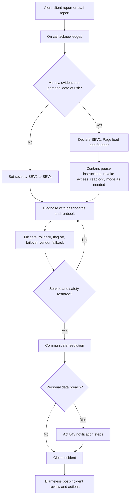

# 06 — Deployment and Operations

How Fidero builds, ships, runs, watches, recovers and secures the platform. This is the operations specification for site reliability, DevOps, support and data operations.

## 0. Document control

| Item | Value |
|---|---|
| Document | 06 of 6 in `docs/specs/` |
| Title | Deployment and Operations |
| Version | 0.1 |
| Date | 31 October 2026 |
| Status | Draft. For review. Not yet baselined |
| Owner | Product and engineering lead |
| Approver | Founder, acting as product owner |
| Source of truth | `docs/specs/01-requirements-and-product-specification.md` (document 01) |
| Other sources | `docs/product/architecture.md` sections 9 and 10; documents 02 to 05 of this set |
| Review cycle | Before each release gate (R1, R2, R3) and after every SEV1 or SEV2 incident |

Every figure in this document is a working assumption, not verified data. Unknown values are marked `[TO VERIFY]`. Tool and vendor names are candidates until the founder signs a contract or the lead records a decision in document 02.

### 0.1 Change history

| Version | Date | Author | Change |
|---|---|---|---|
| 0.1 | 31 October 2026 | Product and engineering lead (draft) | First draft |

### 0.2 Identifiers used in this document

| Prefix | Meaning | Defined in |
|---|---|---|
| `SLO-nn` | Service level objective | Section 7 |
| `AL-nn` | Alert | Section 8 |
| `RB-nn` | Runbook | Section 11 |
| SEV1 to SEV4 | Incident severity | Section 9 |
| `FR-`, `NFR-`, `RUL-`, `C-`, `AS-`, `IF-`, `Q-` | Requirements, rules, constraints, assumptions, interfaces, open questions | Document 01 |
| `US-<MODULE>-nnn`, `EN-nn` | User stories and enablers | Document 04 |
| `TC-…`, `UAT-nn` | Test cases and user acceptance scenarios | Document 05 |

This document creates no new functional requirement IDs. Where operations needs a capability that document 01 does not state, it is listed in section 17 as an issue for document 01, and the build work is expected as an enabler (`EN-nn`) in document 04.

### 0.3 Traceability to document 01

| Document 01 item | What it asks | Where this document meets it |
|---|---|---|
| C-01, RUL-01, RUL-05, RUL-06 | Fidero never holds money; two-person release; no release with open conditions | 4.6, 5.5, 8.3 (AL-08 to AL-11), 9.1, RB-08, RB-24 |
| C-04, AS-02 | Listings off until Act 1047 is resolved; escrow off until a bank signs | 2.6 feature flags |
| C-07 | Small team and tight budget | 6.1, 14 |
| C-08 | Slow connections, low-end Android | 4.3 stage 15 (performance smoke), SLO-04, SLO-07 |
| C-09, NFR-PRIV-01 | Data hosting location accepted by the Data Protection Commission | 2.1, 10.1, 13.4 |
| C-10 | Banned word in product, feature and brand names | All names in this document (alerts, runbooks, components) |
| FR-ESC-008, FR-ESC-009, IF-01 | Release instruction in the bank's format, by the agreed channel; bank confirmation | 5.7, SLO-08, AL-08, AL-09, RB-08, RB-09 |
| FR-EVD-001, FR-EVD-002, BR-06, NFR-AVL-03 | Evidence hashed, never overwritten, two copies | 10.2, SLO-11, AL-16, RB-05 |
| FR-AUD-001 to FR-AUD-004, NFR-AUD-01 | Append-only, hash-chained audit log, kept for full retention | 8.5, 12.7, AL-20 to AL-23 |
| FR-DPR-003, FR-DPR-004, FR-DPR-005 | Data subject requests, retention, two-person bulk export | 13, RB-16, RB-17, RB-25 |
| FR-PAY-006 | Daily payment reconciliation | AL-12, RB-10 |
| FR-ESC-011 | Bank statement import and matching | AL-10, RB-09 |
| FR-MOB-004, FR-MOB-005, FR-MOB-011 | Device-signed evidence, offline queue, server verification | 4.8, AL-17, RB-07, RB-19 |
| FR-GEO-002, FR-GEO-004, NFR-PERF-04 | Overlay checks within 30 seconds; versioned layers | SLO-05, AL-14, RB-11 |
| FR-NTF-005 | Notification delivery logged | SLO-06, AL-15 |
| NFR-PERF-01 to NFR-PERF-03 | Page speed and API latency | SLO-02 to SLO-04, 4.4 |
| NFR-AVL-01 | 99.5% monthly availability | SLO-01, 7.2 |
| NFR-AVL-02 | RPO 1 hour, RTO 4 hours | 10.4, 10.5, 10.7 |
| NFR-SEC-01 to NFR-SEC-05 | TLS, hashing, pen test, secrets manager, ASVS L2 | 4, 12 |
| NFR-OBS-01 | Trace IDs; alerts on errors, latency, upload queue, job failures | 8 |
| NFR-MNT-01 | 80% line coverage; every rule in B7 tested | 4.3 quality gates |
| NFR-A11Y-01 | WCAG 2.2 AA | 4.3 accessibility stage |
| A9 | Operating metrics | 8.6 business monitoring |
| C5.2 | Data classes and retention | 8.5, 10.3, 13.1 |
| IF-01 to IF-09 | External interfaces | 15 |
| C9 | Release acceptance | 5.2, 16 |

---

## 1. Scope and principles

### 1.1 In scope

- Environments, configuration and feature flags.
- Source control, versioning, database migrations and API versions.
- The CI/CD pipeline for the backend, the two web apps and the Android app.
- Release and change procedures.
- The operations model, on call and support.
- Service level objectives, monitoring, alerting and incident management.
- Backup, recovery and disaster recovery.
- Runbooks, security operations, data operations, capacity, cost and vendor operations.
- Operational readiness for R1, R2 and R3.

### 1.2 Out of scope

- R0 (months 0 to 3). R0 has no platform. It runs on spreadsheets, templates, a landing page and a payment link. The only R0 operations duties are: keep the spreadsheets backed up, protect the shared drive with multi-factor sign-in, and record where personal data sits. These carry into the data location register in 13.4.
- Application design. That is document 02.
- Test design. That is document 05. This document uses document 05 results as release gates.

### 1.3 Operating principles

1. **Money safety beats uptime.** If the platform is unsure whether a release instruction is right, it stops and asks a person. A delayed release is an inconvenience. A wrong release is a loss.
2. **Evidence is never lost and never changed.** Every evidence object has two copies and an immutable version history.
3. **No direct changes in production.** Every change goes through Git, review and the pipeline. The only exception is a recorded break-glass action (12.1).
4. **Two people for anything dangerous.** Production deploys, release instructions, bulk exports, key changes and restores need two people.
5. **Boring and managed.** Use managed AWS services so a three-person team does not run servers.
6. **Write it down once.** Every repeatable action has a runbook. Every alert links to one.
7. **Realistic on call.** Page people only for things that need a person now. Everything else waits for working hours.

---

## 2. Environments

### 2.1 Environment summary

| Environment | Purpose | Hosting | Data | Who has access | Deploys |
|---|---|---|---|---|---|
| Local | Developer work and unit tests | Developer laptop with Docker Compose (PostgreSQL 16 + PostGIS 3, Redis 7, MinIO or LocalStack for S3) | Synthetic only | The developer | Any time |
| dev | Shared integration of trunk; demo of work in progress | AWS account `fidero-dev`, primary region af-south-1 `[TO VERIFY]` | Synthetic only | Engineering; product owner read access | Automatically on every merge to `main` |
| staging | Release candidate testing, E2E, DAST, performance smoke, UAT, restore drills | AWS account `fidero-staging`, same region as production | Synthetic only; anonymised overlay layers and public map data allowed | Engineering; operations staff and testers for UAT; partner bank sandbox | Automatically for each release candidate |
| production | Live service | AWS account `fidero-prod`, af-south-1 as a working assumption pending Q-07 `[TO VERIFY]` | Real personal and financial data | Pipeline role only for changes; engineers read-only through SSO; break-glass for emergencies | Through the pipeline with two-person approval |
| DR (recovery) | Restore target if the primary region is lost | Second region `[TO VERIFY]`, in AWS account `fidero-prod` or a separate `fidero-dr` account `[TO VERIFY]` | Encrypted backup copies and replicated evidence only. No running application in R1 | Break-glass and pipeline only | Only during a DR test or a real recovery |

Supporting AWS accounts under one AWS Organization:

| Account | Holds |
|---|---|
| `fidero-management` | AWS Organization, consolidated billing, IAM Identity Center (SSO). No workloads |
| `fidero-security` | CloudTrail organisation trail, AWS Config aggregator, security findings, log archive bucket with Object Lock |
| `fidero-shared` | Amazon ECR image registry, Terraform state bucket and lock table, CI role trust |
| `fidero-dev`, `fidero-staging`, `fidero-prod` | Workloads, one per environment |
| `fidero-backup` | AWS Backup vault copies for production, with vault lock. Second region `[TO VERIFY]` |

Separate accounts stop a mistake in dev from touching production and give a clean boundary for access reviews.

### 2.2 Production topology

| Layer | Service | Notes |
|---|---|---|
| DNS | Route 53 | Health-checked records; low TTL (60 seconds) on the API and portal names for failover |
| Edge | CloudFront + AWS WAF + AWS Shield Standard | Serves both Next.js apps' static assets; caches public pages; TLS 1.2 or later (NFR-SEC-01) |
| Web apps | ECS Fargate services `portal` and `backoffice` (Next.js server rendering) | At least 2 tasks each across 2 Availability Zones |
| API | ECS Fargate service `api` (Django 5 + DRF, Python 3.12, Gunicorn) behind an Application Load Balancer | At least 2 tasks across 2 Availability Zones |
| Workers | ECS Fargate services `worker-default`, `worker-geo`, `worker-media`, `worker-integrations` (Celery), serving the queues `default`, `geo`, `media`, `integrations` and `notifications` listed in document 02 section 7.9 | Separate queues so a stuck media job cannot block release instructions |
| Scheduler | ECS Fargate service `beat` (Celery beat) | Exactly one task. Schedule held in the database so a restart does not double-run jobs |
| Database | Amazon RDS for PostgreSQL 16 with PostGIS 3, Multi-AZ | Encrypted with a customer-managed KMS key; automated backups and point-in-time recovery |
| Cache and broker | Amazon ElastiCache for Redis 7, Multi-AZ with automatic failover | Broker for Celery and short-lived cache. Holds no data of record |
| Evidence | S3 bucket `evidence` with versioning, Object Lock and cross-region replication | Access only through 15-minute signed links (FR-EVD-003) |
| Other storage | S3 buckets for reports (PDFs), exports (short-lived), overlay layers, static assets, logs | Each bucket has its own KMS key policy and lifecycle rules |
| Secrets | AWS Secrets Manager | Injected into ECS tasks at start. Never in code or images (NFR-SEC-04) |
| Keys | AWS KMS | Separate keys per data class (13.4) |
| Email | Amazon SES | Region choice `[TO VERIFY]` against the data location ruling |
| Network | VPC with public subnets (load balancer, NAT) and private subnets (tasks, RDS, Redis); VPC endpoints for S3, ECR, Secrets Manager, KMS, CloudWatch | No task has a public IP |

af-south-1 is an opt-in region. Before R1 build starts, the lead confirms every service above is available there `[TO VERIFY]`.

### 2.3 Parity

Staging matches production in shape, not size.

| Aspect | Same as production | Different from production |
|---|---|---|
| Terraform modules | Same modules and versions | Different variable files (sizes, counts) |
| Container images | The exact image digest that will go to production | None |
| Database engine | Same PostgreSQL and PostGIS versions, same extensions, same parameter group settings | Smaller instance class; single-AZ allowed in dev only |
| Services | Same ECS services, queues and schedules | One task per service in dev |
| Integrations | Same client code | Vendor sandboxes (payment, identity, SMS, WhatsApp test numbers, bank sandbox or file drop) |
| Security | Same WAF rules, TLS policy, IAM policies, KMS usage | WAF in count mode allowed in dev only |
| Feature flags | Same flag definitions | Values may differ; differences are listed in the release notes |

A difference not in this table is a defect in the infrastructure code.

### 2.4 Test data

No real personal data leaves production. This applies to dev, staging, local machines, CI logs, Sentry, screenshots and bug reports.

| Data type | How it is created in non-production |
|---|---|
| People and organisations | A seed command (`manage.py seed_synthetic`) builds people with generated names, emails on a reserved test domain, and phone numbers from a reserved test range `[TO VERIFY]` with the SMS vendor |
| Identity documents | Vendor sandbox test identities only. No real Ghana Card or passport images |
| Plots and polygons | Generated polygons placed over public map areas, plus a fixed set of "golden" plots that sit inside, near and clear of each overlay layer for overlay tests |
| Overlay layers | Real public layers where the licence allows `[TO VERIFY]`; otherwise simplified synthetic layers |
| Evidence files | A library of synthetic photos, videos and PDFs with known hashes, including an EICAR test file for malware scanning |
| Escrows and release instructions | Synthetic escrows linked to the bank sandbox or a staging file drop. Release instructions in staging carry a `TEST — DO NOT PAY` marker in every field the bank format allows `[TO VERIFY]` |
| Payments | Payment provider test mode keys and test cards or mobile money test numbers |
| Mobile devices | Staging device keys from test devices enrolled in the staging environment only |

Rules:

- Production snapshots are never restored into dev or staging. Restore drills (10.6) use an isolated, short-lived restore account or VPC inside production controls and are destroyed after the drill.
- A defect that needs production data to reproduce is investigated in production read-only by an engineer with a recorded reason, or reproduced with synthetic data.
- Sentry and logs scrub email, phone, names, national ID numbers, coordinates of plots, and tokens before sending (8.5).

### 2.5 Configuration management

| Type | Where it lives | How it changes |
|---|---|---|
| Infrastructure | Terraform in the `infra/` directory of the monorepo; remote state in S3 with a DynamoDB lock in `fidero-shared` | Pull request, plan output attached, review, apply by the pipeline |
| Application settings (non-secret) | Environment variables defined in Terraform per environment, loaded by Django settings and Next.js runtime config | Pull request |
| Secrets | AWS Secrets Manager, one secret per credential, named `/<env>/<service>/<name>` | Created by Terraform with a placeholder; value set by a named person through SSO; rotation per 12.4 |
| Business configuration | Database, through the back office (FR-ADM-001 to FR-ADM-005): templates, prices, condition sets, buffers, deadlines, fresh-search window | Back office with audit log. High-risk items need two people (5.5) |
| Feature flags | Database flag table, read through a small flag service in the API, cached for 30 seconds | Back office administrators, audited; safety flags need two people (2.6) |
| Mobile app config | Fetched from the API at start; minimum supported version served by the API (3.5) | Same as feature flags |

Configuration drift check: a nightly pipeline job runs `terraform plan` against each environment. Any difference raises AL-27.

### 2.6 Feature flags

Flags let code ship before a business dependency is met. A flag is a switch, not a branch of code that lives forever. Each flag has an owner, a reason and a removal date.

| Flag | Default in production | Turns on when | Who may switch it on | Linked items |
|---|---|---|---|---|
| `escrow.enabled` | Off | An escrow agreement with a licensed bank or escrow agent is signed and the release instruction format and channel are agreed and tested (AS-02, Q-01) | Founder plus one other administrator | C-01, FR-ESC-001 to FR-ESC-009 |
| `escrow.manual_confirmation` | On when `escrow.enabled` is on | Default R1 channel | Two administrators | FR-ESC-004, IF-01 |
| `escrow.bank_statement_import` | Off | The bank provides a daily statement file and the mapping passes UAT (AS-03) | Two administrators | FR-ESC-011 |
| `escrow.bank_api` | Off | The bank API passes contract and UAT tests | Two administrators | FR-ESC-012 |
| `escrow.partial_release` | Off | R2 construction and project escrows go live | Two administrators | FR-ESC-010 |
| `listings.enabled` | Off | The lawyer confirms the Act 1047 position and any licence is in place (C-04, Q-06) | Founder plus one other administrator | FR-LST-001 to FR-LST-010 |
| `listings.family_and_stool` | Off | R3 gate | Founder plus one other administrator | FR-LST-009 |
| `payments.mobile_money` | Off until the provider is live | Provider contract and test transactions pass (AS-04, Q-02) | Administrator | FR-PAY-001 |
| `identity.provider_check` | Off until the provider is live; manual check otherwise | Provider contract signed (AS-05, Q-03) | Administrator | FR-ACC-004 |
| `geo.satellite_monitoring` | Off | R2, provider contract signed | Administrator | FR-GEO-007 |
| `geo.ghana_post_gps` | Off | Service access confirmed (IF-06) | Administrator | FR-GEO-008 |
| `partner_api.enabled` | Off | R2, first partner contract and consent flow tested | Founder plus one other administrator | FR-PTR-001 to FR-PTR-004 |
| `mobile.capture` | Off | R2 milestone app goes live | Two administrators | FR-MOB-001 to FR-MOB-011 |
| `projects.funds` | Off | R2 and insurer confirms cover (AS-09) | Founder plus one other administrator | FR-PRJ-001 to FR-PRJ-005 |
| `building.construction` | Off | R2 gate and insurer confirms cover (AS-09) | Founder plus one other administrator | FR-BLD-001 to FR-BLD-012 |
| `country.ng` | Off | R3 Nigeria pilot gate, local data location ruling | Founder plus one other administrator | FR-CTY-001 to FR-CTY-003 |
| `maintenance.read_only` | Off | Planned maintenance or an incident needs writes stopped | Any on-call engineer (a kill switch) | 5.8, 9 |
| `escrow.instructions_paused` | Off | A suspected wrong instruction, a bank channel fault or a security incident | Any on-call engineer or reviewer (a kill switch) | RB-08, RB-24 |

Flag rules:

- **Safety flags** are those that enable money flows, listings, partner access or a new country. Switching one on needs two people, both named in the audit log. Switching one off (a kill switch) needs one person, because stopping is always safe.
- Flags are tested both on and off in CI. Document 05 holds the test cases.
- A flag that has been on in production for 90 days is removed from the code in the next release, unless it is a kill switch.
- The flag state is shown on the "Platform health" dashboard (8.4).

---

## 3. Branching, versioning and change compatibility

### 3.1 Trunk-based development

- One monorepo holds the backend (`api/`), the web apps (`web/portal`, `web/backoffice`), the Android app (`mobile/android`), infrastructure (`infra/`), and shared contracts (`contracts/`: OpenAPI specification, release instruction schema, event schemas).
- `main` is the trunk. It is always releasable.
- Developers use short-lived branches (less than 2 working days) and merge through pull requests.
- Every pull request needs one approving review from a person who is not the author, and green CI.
- Changes to the paths in 5.5 (high-risk paths) need two approving reviews, one of them the product and engineering lead. A `CODEOWNERS` file enforces this.
- Branch protection on `main`: no force pushes, no direct pushes, linear history, signed commits `[TO VERIFY]`.
- Unfinished features merge behind a feature flag that is off.
- Release candidates are tags on `main`, not long-lived release branches. A hotfix branch is cut from the production tag only when `main` holds unreleased changes that cannot ship (5.3).

### 3.2 Semantic versioning

| Artefact | Version format | Bumped when |
|---|---|---|
| Platform release (API, workers, web apps together) | `MAJOR.MINOR.PATCH`, for example `1.4.2` | MAJOR: a breaking change to a public API or the release instruction format. MINOR: a new feature or a backward-compatible change. PATCH: fixes only |
| Container images | Tagged with the Git commit SHA and the platform version; deployed by digest | Every build |
| Partner API | URL major version, `/partner/v1/` | Breaking change only |
| Client API (used by the web apps and the Android app) | URL major version, `/v1/` (document 02); additive changes within a major version | Breaking change only |
| Release instruction format | `RI-<bank>-vN`, held in `contracts/` | Any change to fields, order, encoding or signature (5.7) |
| Android app | `versionName` `MAJOR.MINOR.PATCH`; `versionCode` an increasing integer | Every Play upload |
| Report template, scope statement, case templates | Versioned in the database (FR-ADM-001, FR-ADM-004) | Business change, through the back office, not through a deploy |

The platform version is shown in the back office footer and in every API response header (`X-Fidero-Version`).

### 3.3 Database migrations

The database holds escrow state, audit chains and evidence records. Migrations are treated as high-risk changes.

Rules:

1. **Expand, then contract.** A change that removes or renames anything happens over at least two releases. Release N adds the new column or table and writes to both. Release N+1 reads the new one. Release N+2 removes the old one once nothing reads it.
2. **Backward compatible.** Every migration must work with the code version currently running in production, because the migration runs before the new code takes traffic and the old code keeps running during a blue/green switch.
3. **Reversible.** Every Django migration has a tested reverse. A migration that cannot be reversed (for example, dropping a column with data) is allowed only in a contract step, after a fresh snapshot, with the change advisory's agreement (5.5).
4. **No long locks.** Migrations set `lock_timeout` (5 seconds) and `statement_timeout` (assumption: 60 seconds). Indexes are created concurrently. Large backfills run as batched Celery jobs after the deploy, not inside the migration.
5. **Audit and evidence tables are append-only.** Migrations never update or delete rows in the audit log or evidence record tables. A migration linter in CI fails any migration that touches them with `UPDATE`, `DELETE` or `TRUNCATE`.
6. **Tested on a copy.** In staging, each migration runs against a synthetic database sized at the NFR-SCL-01 volume (2,000 open cases, 500 active projects, 20,000 listings) and its run time is recorded in the release record.
7. **Separate step.** Migrations run as a one-off ECS task in the pipeline before the new service version starts (4.6). The deploy stops if the migration fails.
8. **Snapshot first.** The pipeline takes a manual RDS snapshot before any migration that the linter marks as destructive or that touches escrow, release instruction, evidence or audit tables.

### 3.4 API versioning and deprecation

| Topic | Policy |
|---|---|
| Additive changes | New fields, endpoints and optional parameters may be added at any time. Clients must ignore unknown fields |
| Breaking changes | Only in a new major version (`/v2/`). The old version runs in parallel |
| Client API deprecation | The old major version stays at least until every supported Android version (3.5) has moved off it, and at least 90 days `[TO VERIFY]` |
| Partner API deprecation | At least 6 months' written notice `[TO VERIFY]` to each partner, or the period in the partner contract if longer |
| Deprecation signals | `Deprecation` and `Sunset` HTTP headers; a notice in the partner portal and by email; usage of the old version tracked on the integrations dashboard |
| Contracts | The OpenAPI specification in `contracts/` is the source of truth. CI fails if the code and the specification disagree, or if a change to a published version is breaking (4.3) |
| Release instruction format | Never changed without the bank's written agreement and a parallel test (5.7). Old and new formats are not both active for one bank at once |

### 3.5 Android app version support window (R2)

| Topic | Policy |
|---|---|
| Supported versions | The latest version and the one before it. Older versions are supported for 60 days after a new release `[TO VERIFY]` |
| Minimum version | The API serves a `min_supported_version` value. An older app shows a plain-language "Please update" screen and stops capture, but keeps and uploads any queued evidence first |
| Forced update | Used for security fixes, signature format changes and device key changes. Queued evidence is never deleted by a forced update |
| Queue compatibility | The server accepts uploads from any app version captured within the last 30 days `[TO VERIFY]`, so a contractor offline for days does not lose work |
| Android OS support | Android 8.0 or later `[TO VERIFY]` (C3) |
| Device key format | Versioned. A change to the signature format needs a new app version, a server that accepts both formats for the support window, and an entry in the change advisory |

---

## 4. CI/CD pipeline

### 4.1 Tooling

| Purpose | Tool (candidate unless stated) |
|---|---|
| Source control and CI/CD | GitHub and GitHub Actions (fixed decision) |
| Infrastructure as code | Terraform (fixed decision), with `tflint` and an IaC policy scanner (Checkov or similar) |
| Python quality | `ruff` (lint and format), `mypy` (types), `pytest` with coverage |
| TypeScript quality | ESLint, `tsc`, Vitest or Jest |
| Kotlin quality | `ktlint` or detekt, JUnit, Android instrumented tests on an emulator |
| Static application security testing (SAST) | Semgrep and Bandit for Python; CodeQL for Python, TypeScript and Kotlin `[TO VERIFY]` licence terms |
| Secret scanning | GitHub secret scanning plus `gitleaks` in CI |
| Dependency scanning | `pip-audit`, `npm audit`, Gradle dependency check; Dependabot for update pull requests |
| Container scanning | Trivy, plus Amazon ECR enhanced scanning |
| Contract tests | OpenAPI diff for breaking changes; schema tests against the specification (Schemathesis or similar); release instruction format tests against `contracts/` samples |
| End-to-end tests | Playwright against staging |
| Dynamic application security testing (DAST) | OWASP ZAP baseline scan against staging; authenticated full scan weekly |
| Accessibility | axe-core in Playwright; Lighthouse accessibility score |
| Performance smoke | k6 API smoke; Lighthouse CI with 3G throttling (1.6 Mbps, 300 ms) for NFR-PERF-01 and NFR-PERF-02 |
| Artefact signing and provenance | Sigstore `cosign` keyless signing from GitHub Actions; build provenance attestation (SLSA level 2 or higher target) |
| Deployment | ECS blue/green through AWS CodeDeploy, with CloudWatch alarm rollback |

### 4.2 Pipeline overview

```mermaid
flowchart LR
    PR["Pull request"] --> L["Lint, format, types"]
    L --> U["Unit tests and coverage"]
    U --> S["SAST and secret scan"]
    S --> D["Dependency scan"]
    D --> M["Merge to main"]
    M --> B["Build images and web bundles"]
    B --> C["Container scan"]
    C --> SG["Sign image and attach provenance"]
    SG --> I["Integration tests with PostgreSQL, PostGIS and Redis"]
    I --> K["Contract tests: OpenAPI and release instruction format"]
    K --> DEV["Deploy to dev"]
    DEV --> RC{"Release candidate tag?"}
    RC -- "No" --> END1["Stop: stays on dev"]
    RC -- "Yes" --> STG["Deploy to staging with migration step"]
    STG --> E2E["E2E tests"]
    E2E --> DAST["DAST scan"]
    DAST --> A11Y["Accessibility checks"]
    A11Y --> PERF["Performance smoke"]
    PERF --> GNG{"Go or no-go with document 05 acceptance"}
    GNG -- "No-go" --> FIX["Fix and new candidate"]
    GNG -- "Go" --> APP["Two-person approval"]
    APP --> SNAP["Pre-deploy snapshot if migration is risky"]
    SNAP --> MIG["Run migration task in production"]
    MIG --> BG["Blue/green deploy on ECS"]
    BG --> HC{"Health checks and alarms green?"}
    HC -- "No" --> RB["Automatic rollback to blue"]
    HC -- "Yes" --> VER["Post-deploy verification"]
    VER --> DONE["Release recorded and notes published"]
```

### 4.3 Stages and quality gates

| Stage | Runs on | What it does | Fails the build when |
|---|---|---|---|
| 1. Lint and types | Every push | `ruff`, `mypy`, ESLint, `tsc`, `ktlint`, Terraform `fmt` and `validate`, migration linter | Any error |
| 2. Unit tests | Every push | Backend, web and Android unit tests; business rule tests for RUL-01 to RUL-21 | Any failure; backend line coverage below 80% (NFR-MNT-01); any rule in B7 of document 01 without a tagged test |
| 3. SAST and secret scan | Every push | Semgrep, Bandit, CodeQL, gitleaks | Any new high or critical finding; any secret |
| 4. Dependency scan | Every push and nightly | `pip-audit`, `npm audit`, Gradle checks; licence check | A known exploitable high or critical vulnerability without a recorded exception (12.3) |
| 5. IaC scan | Pull requests touching `infra/` | `tflint`, Checkov, `terraform plan` posted to the pull request | Any high finding; a plan that deletes a stateful resource (RDS, evidence bucket, KMS key) without the `allow-destroy` label approved by the lead |
| 6. Build | Merge to `main` | Docker images for `api`, `worker`, `portal`, `backoffice`; one image per service, built once and promoted unchanged | Build error |
| 7. Container scan | After build | Trivy scan of each image | Critical or high fixable vulnerability in the OS or language packages |
| 8. Sign and attest | After scan | `cosign` signature and provenance attestation pushed to ECR next to the image; software bill of materials (SBOM) generated and stored | Signing fails |
| 9. Integration | After build | API tests against real PostgreSQL 16 + PostGIS 3 and Redis 7 containers; Celery tasks; S3 against LocalStack; malware scan with EICAR | Any failure |
| 10. Contract | After build | OpenAPI breaking-change diff; schema tests; release instruction samples generated and compared with the agreed bank samples byte for byte where the format allows; partner API consumer tests (R2) | Any breaking change without a major version; any change to release instruction output without a format version bump |
| 11. Deploy to dev | After stage 10 | Automatic | Deploy fails |
| 12. E2E on staging | Release candidate | Playwright journeys J-01, J-02, J-08 (R1) and J-03 to J-07 (R2) with synthetic data; feature flags on and off | Any failure in a Must journey |
| 13. DAST | Release candidate | ZAP baseline on portal, back office and API | New high or medium finding not triaged |
| 14. Accessibility | Release candidate | axe-core on key pages; WCAG 2.2 AA checks (NFR-A11Y-01) | Any serious or critical axe violation on a key page |
| 15. Performance smoke | Release candidate | k6 at 10 times the expected R1 load `[TO VERIFY]` for 5 minutes; Lighthouse CI on 3G profile | API p95 reads over 500 ms or writes over 1 second (NFR-PERF-03); page useful content over 3 seconds at p75 (NFR-PERF-01); initial transfer over 500 KB (NFR-PERF-02); overlay check over 30 seconds (NFR-PERF-04) |
| 16. Production deploy | After go decision | Two-person approval, migration task, blue/green deploy | See 4.6 |

Time budget: stages 1 to 5 under 10 minutes for a normal pull request, so developers keep merging small changes.

### 4.4 Artefact signing and provenance

- Images are built once, signed once, and promoted by digest through dev, staging and production. Production never builds code.
- ECR repositories use immutable tags.
- The production deploy role verifies the `cosign` signature and the provenance attestation before it registers a task definition. An unsigned image, or one built outside the `main` workflow, is refused.
- The SBOM for each release is kept for the life of the release plus 2 years `[TO VERIFY]`, so a new vulnerability can be traced to affected releases.
- GitHub Actions use pinned commit SHAs for third-party actions. CI authenticates to AWS with OpenID Connect and short-lived roles. There are no long-lived AWS keys in GitHub.
- Web bundles are uploaded to S3 with content hashes in file names; the HTML is served by the Next.js servers and never cached at the edge for authenticated pages.

### 4.5 Approvals

| Change | Approvals needed |
|---|---|
| Pull request, normal code | One reviewer who is not the author |
| Pull request touching high-risk paths (5.5) | Two reviewers, one of them the lead; change advisory record |
| Deploy to dev | None (automatic) |
| Deploy to staging | None (automatic for a release candidate tag) |
| Deploy to production | Two people: the person who starts the deploy and a second approver who is not the author of any change in the release. GitHub environment protection enforces this. In a three-person team, if all three authored changes, the founder approves as the second person after reading the release notes and the go/no-go record |
| Terraform apply to production | Same as a production deploy; the plan output is attached to the approval |
| Android production rollout | Two people (4.8) |
| Feature flag safety switch-on | Two administrators (2.6) |

### 4.6 Deployment strategy

The backend and web apps use **blue/green deployment on ECS through AWS CodeDeploy**.

1. The pipeline registers new task definitions for `api`, `portal` and `backoffice` with the new image digests.
2. The migration task runs (3.3). If it fails, the deploy stops and nothing switches.
3. CodeDeploy starts the green task set next to blue. Green must pass the load balancer health checks (`/healthz` for liveness; `/readyz` checks the database, Redis, S3 and KMS reachability).
4. A test listener on the load balancer sends the post-deploy smoke tests to green before any user traffic.
5. Traffic shifts in steps: 10% for 10 minutes, then 100% (`Linear` or `Canary` configuration `[TO VERIFY]` after first use).
6. During the shift and for 15 minutes after, CloudWatch alarms on the green target group watch: 5xx rate over 2%, p95 latency over twice the SLO, failed health checks, and a spike in release instruction errors. Any alarm triggers **automatic rollback** to blue.
7. Blue is kept for 60 minutes after the full shift so a manual rollback (RB-02) is a traffic switch, not a redeploy.

Celery workers and beat use a **rolling deployment**:

- Workers are drained with a warm shutdown (`SIGTERM`, wait for running tasks up to 5 minutes) before old tasks stop.
- `beat` is replaced with a stop-then-start so two schedulers never run together.
- Tasks are idempotent, so a task retried on the new version after a stop does no harm. The release instruction task uses an idempotency key per instruction, so it cannot send twice (5.7).
- The `worker-integrations` queue (which sends release instructions) is paused for the deploy window by switching the `escrow.instructions_paused` flag on for the duration of the worker roll, then off again. Approved instructions wait and are sent after the roll. The step is skipped when no instruction is pending.

### 4.7 Database migration step in production

| Step | Action |
|---|---|
| 1 | The pipeline checks the migration plan (`manage.py migrate --plan`) matches what ran in staging |
| 2 | If the linter marks a migration as risky, the pipeline takes a manual RDS snapshot named `pre-<version>` and waits for it to finish |
| 3 | A one-off ECS task with the new image runs `manage.py migrate` as the `fidero_migrate` database role (the only role with DDL rights, document 02), with the lock and statement timeouts in 3.3 |
| 4 | The task writes its result and run time to the release record and the audit log |
| 5 | If it fails, the pipeline stops. The on-call engineer follows RB-23 |

### 4.8 Android release pipeline (R2)

| Step | Action | Gate |
|---|---|---|
| 1 | Build the release bundle (`.aab`) in GitHub Actions on a tagged commit | Unit and instrumented tests pass; R8 shrinking on; install size under 30 MB (NFR-PERF-05) |
| 2 | Sign with the **upload key** | See key custody below |
| 3 | Upload to Google Play **internal testing** track | Fidero staff devices; smoke test of capture, offline queue, signature and upload against staging |
| 4 | Promote to **closed testing** | A pilot group of contractors and inspectors `[TO VERIFY]` size; at least 3 working days; crash-free sessions at least 99% `[TO VERIFY]`; no evidence upload regression on the dashboard |
| 5 | Promote to **production, staged rollout** | Two-person approval. 5% → 20% → 50% → 100%, at least 24 hours per step |
| 6 | Watch each step | Crash-free sessions, ANR rate, upload success (SLO-07), signature verification failures (AL-17). A breach halts the rollout (RB-19) |
| 7 | Raise `min_supported_version` | Only after 100% rollout and the support window in 3.5 |

The Google Play managed track for internal distribution is a fixed candidate decision `[TO VERIFY]`.

**Signing key custody.**

| Key | Where it is held | Who can use it | Backup |
|---|---|---|---|
| App signing key | Google Play App Signing (held by Google) | Google Play only | Managed by Google |
| Upload key | Encrypted keystore in AWS Secrets Manager in `fidero-shared`, read only by the Android release workflow role | The pipeline. No person uses it day to day | Two encrypted offline copies on hardware-encrypted USB drives in two separate locked places, one held by the founder and one by the lead `[TO VERIFY]` locations. Passphrase split between two people |
| Play Console access | Google accounts with hardware-key two-step sign-in | Lead (owner), one developer (release manager) | Founder holds a sealed break-glass account |

If the upload key is lost or exposed, the lead asks Google Play to reset the upload key (RB-06). Users are not affected because the app signing key does not change.

### 4.9 Infrastructure pipeline

- Terraform runs from GitHub Actions only, with one workspace per environment.
- Pull requests show the plan. The apply job uses the saved plan file, so what was reviewed is what is applied.
- Stateful resources (RDS, evidence bucket, KMS keys, backup vaults) carry `prevent_destroy`. Deleting one needs a separate, approved pull request that removes the protection first.
- State is encrypted, versioned and locked. State bucket access is limited to the CI role and break-glass.

---

## 5. Release procedures

### 5.1 Release calendar and cadence

| Item | Rule (assumption) |
|---|---|
| Production deploy cadence | Weekly, plus hotfixes. Smaller and more frequent is safer than large and rare |
| Deploy days | Tuesday to Thursday |
| Deploy window | 10:00 to 14:00 Ghana time (GMT). This is after the Accra office opens, before UK afternoon peak and before US East Coast morning |
| No deploys | Fridays, weekends, Ghana public holidays, the day before a public holiday, and 15 December to 5 January except hotfixes `[TO VERIFY]` |
| High-risk changes (5.5) | Tuesday or Wednesday only, so there are working days left to watch them |
| Release instruction format changes | On a date agreed in writing with the bank (5.7) |
| Android app | Every 2 to 4 weeks once R2 is live; staged rollout starts Monday to Wednesday so the 24-hour steps land on working days |
| Planned maintenance needing downtime | Saturday 22:00 to 02:00 GMT `[TO VERIFY]`, announced at least 5 working days ahead (5.8) |
| Release calendar | A shared calendar owned by the lead shows planned releases, freezes, bank dates and pen test windows |

### 5.2 Release checklist

The release manager is whoever starts the deploy. The release record is a GitHub release entry with the checklist attached.

**Pre-release (staging, the day before or earlier)**

- [ ] Release candidate tag created on `main`; release notes drafted (5.6).
- [ ] All pipeline stages 1 to 15 green for the candidate image digests.
- [ ] Document 05 test results attached: `TC-…` cases for changed requirements passed; `UAT-nn` scenarios signed off where the release touches a client or staff journey.
- [ ] No open critical or high defects (document 01, C9).
- [ ] Migrations run in staging; run time recorded; reverse migration tested.
- [ ] Feature flag changes listed with owners.
- [ ] High-risk change? If yes, change advisory record approved (5.5).
- [ ] Release instruction output unchanged, or bank agreement attached (5.7).
- [ ] Runbook or alert changes merged with the release.
- [ ] Client communication drafted if there is any downtime or visible change (5.8).

**Go/no-go (on the day, before approval)**

| Question | Who answers |
|---|---|
| Are document 05 acceptance results complete and passed for this release? | Release manager |
| Is anything else changing today (vendor maintenance, bank holiday, pen test)? | Release manager |
| Is production healthy now (no open SEV1 or SEV2, error budget not exhausted, 7.3)? | On-call engineer |
| Are there approved release instructions waiting to be sent? If yes, send or pause them first | Operations lead |
| Is the second approver available for the next 2 hours? | Second approver |

Any "no" means no-go. The decision is recorded in the release record.

**Deploy**

- [ ] Second person approves in GitHub.
- [ ] Pipeline runs the migration and blue/green deploy (4.6, 4.7).
- [ ] Release manager watches the "Deploy" dashboard during the traffic shift.

**Verify (within 30 minutes)**

- [ ] Automated post-deploy smoke tests passed.
- [ ] Manual checks: sign in to portal and back office; open a synthetic case in production marked as internal test `[TO VERIFY]` whether a production test tenant is allowed; check an evidence signed link opens; check the version header.
- [ ] Error rate and latency within SLO on the dashboard for 30 minutes.
- [ ] Celery queues draining; no new failed jobs.
- [ ] If `escrow.instructions_paused` was used, it is off again and pending instructions have been sent.

**Communicate**

- [ ] Release notes published to staff (5.6).
- [ ] Client-facing changes announced if any.
- [ ] Release record closed with the outcome.

### 5.3 Hotfix procedure

A hotfix is a fix that cannot wait for the next weekly release because it causes or risks a SEV1 or SEV2 (9.1). RB-03 has the steps.

- Fix on `main` first if `main` is releasable. If `main` has unreleased changes that cannot ship, cut `hotfix/<version>` from the production tag, fix there, and merge the fix back to `main` the same day.
- The full pipeline still runs. Stages 13 to 15 may be cut to the smoke subset if the incident commander agrees in writing. Stages 1 to 10 are never skipped.
- Two-person approval still applies. Out of hours, the second approver may approve by phone and confirm in GitHub when they reach a laptop `[TO VERIFY]` whether the GitHub mobile app is enough.
- A hotfix to a high-risk path still needs the change advisory, which may meet by phone in 15 minutes.
- Every hotfix is reviewed at the next post-incident review.

### 5.4 Rollback procedure

| Situation | Action | Runbook |
|---|---|---|
| Health or alarm failure during the traffic shift | Automatic rollback by CodeDeploy | None needed; on-call checks the result |
| Problem found within 60 minutes after the shift | Manual traffic switch back to blue | RB-02 |
| Problem found after blue is gone | Redeploy the previous signed image digest through the pipeline | RB-02 |
| A migration caused the problem | Run the reverse migration if safe; otherwise roll forward with a fix. Never restore the database just to undo a migration if data was written since, unless the incident commander and the lead agree | RB-23, RB-04 |
| Feature behaviour is the problem | Switch the feature flag off | 2.6 |
| Android app problem | Halt the staged rollout; release a fixed version with a higher `versionCode` (Play cannot roll back to a lower version code) | RB-19 |

Rule: code rolls back; data rolls forward. The audit log and evidence store are never rolled back.

### 5.5 Change advisory for high-risk changes

In a three-person team, a formal board is too heavy. The change advisory is a short, written review by two people, recorded in the pull request.

**What counts as high risk**

| Area | Examples | Paths (indicative) |
|---|---|---|
| Escrow release | Release conditions logic, approval rules, release instruction generation, signing, sending, bank confirmation, statement import matching | `api/escrow/`, `contracts/release-instruction/` |
| Evidence | Upload, hashing, storage class, Object Lock settings, replication, signed links, malware scanning, device signature verification | `api/evidence/`, `infra/modules/evidence/` |
| Audit | Audit write path, hash chain, retention, search access | `api/audit/` |
| Report hashing | PDF generation, hash computation, verification endpoint, locked scope statement | `api/reports/` |
| Permissions | Roles, object-level access, MFA, session rules, partner consent checks | `api/accounts/`, `api/permissions/` |
| Money-adjacent | Fee payments, refunds, reconciliation | `api/payments/` |
| Data protection | Retention jobs, anonymisation, exports, data subject requests, legal holds | `api/dpr/` |
| Infrastructure | KMS keys, IAM, network, backup and replication settings, WAF rules | `infra/` |
| Mobile | Device key handling, signature format, capture restrictions | `mobile/android/.../evidence/` |

**What the change advisory record holds**

1. What changes and why.
2. Which rules and requirements it touches (`RUL-`, `FR-`).
3. Test evidence from document 05 (`TC-…`).
4. Rollback plan, and whether data changes can be undone.
5. Effect on the bank, partners or clients.
6. Approval by the lead and one other person who did not write the change. For changes to release instruction generation or report hashing, the founder also approves.

### 5.6 Release notes

| Audience | Content | Channel |
|---|---|---|
| Engineering | Full list of merged pull requests, migrations, flags, image digests | GitHub release |
| Operations staff | What changes on their screens, new steps, known issues, in plain language | Back office "What's new" page and a short email |
| Clients | Only changes they can see, in plain English at reading age 12 (NFR-USE-02) | Portal banner or email, when relevant |
| Partner bank | Changes to the release instruction format, channel or confirmation handling | Formal letter or email to the named bank contact (5.7) |
| Partner API consumers (R2) | New fields, deprecations, sunset dates | Partner portal and email |

### 5.7 Partner bank coordination

The release instruction is the most sensitive output of the platform. Its format and channel are agreed with the bank in writing (FR-ESC-008, IF-01).

| Step | Action |
|---|---|
| 1 | Any change to the release instruction format, signature, channel, or confirmation handling is raised with the bank at least 30 days `[TO VERIFY]` before the planned date, or the notice period in the bank agreement |
| 2 | The new format gets a new version (`RI-<bank>-vN+1`) in `contracts/` with sample files |
| 3 | The bank tests the samples in its test environment, or reviews them in writing if it has no test environment `[TO VERIFY]` |
| 4 | Contract tests compare generated output to the bank-approved samples |
| 5 | Cutover date agreed in writing. On that date, pending instructions are sent before the switch, or held and regenerated in the new format with fresh two-person approval |
| 6 | The first live instruction in the new format is checked by phone with the bank before the bank acts on it |
| 7 | The bank's written confirmation of the change is stored in the escrow partner file |

The same steps apply when Fidero moves from manual entry (R1) to statement files or an API (R2).

In R1, the sending channel is manual `[TO VERIFY]` with the bank: for example, a signed PDF instruction sent by a named Fidero approver to a named bank mailbox, with a phone call-back to confirm. The platform generates the instruction, records both approvals, records who sent it and when, and records the bank's confirmation (FR-ESC-009).

### 5.8 Client communications for downtime

| Event | Notice | Channel | Template |
|---|---|---|---|
| Planned maintenance with downtime | 5 working days ahead, and a reminder 24 hours ahead | Portal banner, email to active clients and staff, status page | T-01 below |
| Unplanned outage over 15 minutes | Within 30 minutes of detection, updates every 60 minutes | Status page, portal banner if reachable, email to clients with active escrows or deadlines | Section 9.4 |
| Escrow releases delayed by an incident | Same day | Direct email or phone from the case manager to the affected client and seller | Section 9.4 |

A public status page `[TO VERIFY]` tool is hosted outside AWS so it stays up during an AWS outage.

**T-01 Planned maintenance notice**

> Subject: Fidero planned maintenance on [day, date]
>
> We will update the Fidero platform on [day, date] from [start] to [end] Ghana time (GMT). That is [start] to [end] in [client time zone].
>
> During this time you may not be able to sign in or upload documents. Your case, your documents and any money held by the bank are not affected. No payments will be released during the update.
>
> You do not need to do anything. If you have a deadline during this time, reply to this email and we will help.

---

## 6. Operations model

### 6.1 Roles

The team in R1 is assumed to be one product and engineering lead and two developers `[TO VERIFY]` (C-07), with Fidero operations staff (case managers, reviewers) and the founder.

| Role | Held by | Duties |
|---|---|---|
| Service owner | Product and engineering lead | Owns this document, SLOs, error budgets, vendor technical relationships, change advisory |
| Primary on-call engineer | Rotates weekly among the lead and the two developers | Responds to pages, runs runbooks, leads SEV3 and SEV4 incidents, first incident commander for SEV1 and SEV2 until the lead takes over |
| Secondary on-call | The lead, or the founder for non-technical decisions when the lead is primary | Backup if the primary does not acknowledge; second approver for emergency deploys |
| Incident commander (SEV1, SEV2) | The lead by default; the primary on call if the lead is unreachable | Runs the incident, decides, keeps the timeline (9.2) |
| Release manager | Whoever starts a deploy | Runs the release checklist (5.2) |
| Operations lead | Senior case manager `[TO VERIFY]` | Tier 1 owner; owns client communication during incidents; enters bank confirmations in R1 |
| Release approvers | Reviewers with release rights | The two-person release approval (RUL-05). They are not engineers, so engineering access does not grant release rights and release rights do not grant engineering access |
| Data protection lead | Founder until a dedicated person is named `[TO VERIFY]` | Breach notifications, data subject requests, legal holds, retention sign-off |
| Security lead | Product and engineering lead | Access reviews, vulnerability management, pen tests |
| Bank relationship owner | Founder | Bank notifications and format changes |

No one person holds every key. The lead cannot approve their own release instruction (they do not hold release rights) and cannot delete evidence (Object Lock).

### 6.2 On-call arrangement for a small team

| Item | Arrangement (assumption) |
|---|---|
| Rotation | Weekly, Monday 10:00 GMT handover, across three engineers. Each person is primary about one week in three |
| Paging hours | 24 hours for SEV1. SEV2 pages between 07:00 and 23:00 GMT; outside those hours SEV2 alerts wait until 07:00 unless they affect money or evidence, which always page |
| Response target when paged | Acknowledge within 15 minutes; working on it within 30 minutes |
| Non-paging alerts | Go to a chat channel and a ticket queue; reviewed at the 09:00 GMT daily check |
| Daily check | 15 minutes at 09:00 GMT by the primary: overnight alerts, queues, reconciliation results, backup results, pending release instructions |
| Handover | Written note: open incidents, risky changes, vendor issues, pending bank confirmations |
| Load limit | If a week has more than 2 out-of-hours pages, the next sprint includes work to remove the cause |
| Compensation | Time off in lieu after any out-of-hours page `[TO VERIFY]` company policy |
| Leave | Swaps arranged a week ahead. If only two engineers are available, the lead and one developer alternate; the founder is named as secondary for escalation |
| Tool | On-call paging tool `[TO VERIFY]` (candidates: an incident tool with phone call, SMS and app push). Phone calls must work on Ghana mobile networks and on roaming |

Alerts that page must be few, real and actionable. Each paging alert is reviewed quarterly: if it fired without needing action, it is changed or removed.

### 6.3 Support tiers

| Tier | Who | Handles | Hands on to |
|---|---|---|---|
| Tier 0 | Self-service | Portal help pages, status page, plain status messages, FAQ | Tier 1 through in-case messages, email or WhatsApp |
| Tier 1 | Fidero operations staff (case managers, operations lead) | Client questions, sign-in help (not resets that bypass MFA), document requests, case status, manual bank confirmation entry, reconciliation lists, first look at errors seen by clients | Tier 2 by ticket; by phone to the on-call engineer for anything affecting money, evidence, data protection or many users |
| Tier 2 | Engineering on-call | Platform faults, data fixes through approved scripts, integration faults, security events, runbook execution | Tier 3 by vendor support channel |
| Tier 3 | Vendors and partners | AWS support, payment provider, identity provider, SMS and WhatsApp providers, satellite provider, partner bank operations desk | Back to Tier 2 |

Tier 1 never edits data directly in the database. Data fixes are done by engineers with a reviewed script, logged in the audit trail with a ticket reference.

### 6.4 Working hours across time zones

Ghana uses GMT (UTC+0) all year with no daylight saving. Clients are mainly in the UK, US, Canada, Germany and the Netherlands (README).

| Location | Offset from Ghana | Overlap with Ghana 08:00–18:00 |
|---|---|---|
| UK | 0 in winter, +1 in summer | Full working day |
| Germany, Netherlands | +1 in winter, +2 in summer | Most of the working day |
| US and Canada East | −5 in winter, −4 in summer | Ghana 13:00–18:00 is their morning |
| US and Canada West | −8 in winter, −7 in summer | Ghana 16:00–18:00 is their morning |

| Service | Hours (assumption) |
|---|---|
| Tier 1 client support | Monday to Friday 08:00–20:00 GMT; Saturday 09:00–14:00 GMT `[TO VERIFY]` |
| Tier 1 response target | First reply within 1 working day; within 4 working hours for clients with an active escrow or a deadline |
| Release approvals and bank instruction sending | Bank working hours `[TO VERIFY]`, typically Monday to Friday 08:30–16:00 GMT. Instructions approved after the bank cut-off are sent next bank working day |
| Engineering business hours | Monday to Friday 09:00–18:00 GMT |
| Out of hours | Paging for SEV1, and SEV2 per 6.2 |

The portal shows clients the next support reply time in their own time zone.

### 6.5 Escalation paths

| Trigger | First contact | If no answer in | Next |
|---|---|---|---|
| Client reports a fault | Tier 1 | 4 working hours | On-call engineer |
| Paging alert | Primary on call | 15 minutes | Secondary on call |
| Secondary does not answer | | 15 minutes | Founder by phone |
| Suspected wrong release instruction | On-call engineer and operations lead at once | Immediately | Lead, founder, bank (RB-24) |
| Suspected data breach | On-call engineer and data protection lead at once | Immediately | Founder, lawyer (RB-18) |
| Vendor outage | On-call engineer | Per vendor | Vendor support; account manager if the outage exceeds the vendor SLA |
| Safety incident at a site | Not an engineering escalation | | Operations lead under the field safety process. The platform only records it (FR-CASE-010) |

### 6.6 Contact list template

The live contact list is kept in the on-call tool and in a printed copy in the office safe, not in Git, because it holds personal phone numbers. Review it monthly and after any staff change.

| Role | Name | Mobile (Ghana) | Mobile (other) | Email | Backup person | Last checked |
|---|---|---|---|---|---|---|
| Founder | | | | | | |
| Product and engineering lead | | | | | | |
| Developer 1 | | | | | | |
| Developer 2 | | | | | | |
| Operations lead | | | | | | |
| Reviewer with release rights 1 | | | | | | |
| Reviewer with release rights 2 | | | | | | |
| Data protection lead | | | | | | |
| Lawyer (data protection and contracts) | | | | | | |
| Insurer claims contact | | | | | | |
| Bank escrow operations desk | | | | | | |
| Bank relationship manager | | | | | | |
| Bank fraud and payment recall line | | | | | | |
| AWS support (case portal, plan level) | | | | | | |
| Payment provider support | | | | | | |
| Identity check provider support | | | | | | |
| SMS provider support | | | | | | |
| WhatsApp Business provider support | | | | | | |
| Satellite imagery provider support | | | | | | |
| Data Protection Commission (breach contact) | | | | | | |

---

## 7. Service level objectives

### 7.1 SLO catalogue

SLOs are internal targets. They are not contractual promises to clients. Each SLO is measured over a rolling 30 days unless stated. All targets are assumptions to be reviewed after 3 months of R1 data.

| ID | Service | Indicator (SLI) | Target | Measured by | Maps to | Release |
|---|---|---|---|---|---|---|
| SLO-01 | Portal and API availability | Share of minutes in the calendar month where synthetic checks of portal sign-in page, back office sign-in page and API `/readyz` succeed from 2 external locations, excluding announced maintenance | 99.5% per calendar month | External synthetic checks (CloudWatch Synthetics plus a third-party probe outside AWS `[TO VERIFY]`) | NFR-AVL-01 | R1 |
| SLO-02 | API read latency | Share of successful `GET` API requests served under 500 ms | 95% | Load balancer and OpenTelemetry metrics | NFR-PERF-03 | R1 |
| SLO-03 | API write latency | Share of successful `POST`, `PUT`, `PATCH`, `DELETE` requests served under 1 second, excluding file upload bodies | 95% | Load balancer and OpenTelemetry metrics | NFR-PERF-03 | R1 |
| SLO-04 | Portal page speed | Share of portal page loads showing useful content within 3 seconds, from real-user monitoring on mobile; and synthetic 3G profile result | 75% (real users); synthetic test passes daily | Real-user monitoring `[TO VERIFY]` tool; Lighthouse CI scheduled run | NFR-PERF-01, NFR-PERF-02 | R1 |
| SLO-05 | Overlay check time | Share of overlay check jobs finishing within 30 seconds of the plot polygon being saved | 99% | Job start and end timestamps | NFR-PERF-04, FR-GEO-002 | R1 |
| SLO-06 | Notification delivery | Share of notifications handed to the provider within 5 minutes of the event, and with a delivered status (where the channel reports one) within 1 hour | 99% handed over; 95% delivered `[TO VERIFY]` per channel | Notification log (FR-NTF-005) | FR-NTF-001, FR-NTF-005 | R1 |
| SLO-07 | Evidence upload success | Share of evidence uploads that are stored, hashed and scanned without a server error. R2: share of app-queued items received by the server within 1 hour of the device reporting a connection | 99.5% (web); 99% (app) | Upload API metrics; app telemetry | FR-EVD-001, FR-MOB-005, NFR-OBS-01 | R1 web; R2 app |
| SLO-08 | Release instruction delivery | Share of two-person-approved release instructions sent to the bank channel within 1 bank working hour of the second approval, inside bank hours | 100%. Any miss is reviewed | Escrow event timestamps | FR-ESC-008, RUL-05 | R1 |
| SLO-09 | Release instruction correctness | Number of release instructions sent with a wrong payee, amount, currency or escrow reference | 0. Any breach is a SEV1 | Bank confirmation match; reconciliation | C-01, RUL-05, RUL-06 | R1 |
| SLO-10 | Bank confirmation tracking | Share of sent release instructions with a bank confirmation recorded within 2 bank working days `[TO VERIFY]` with the bank, or escalated before that time | 100% recorded or escalated | Escrow event timestamps | FR-ESC-009 | R1 |
| SLO-11 | Evidence durability and second copy | Share of new evidence objects with a confirmed replica in the second location within 1 hour | 99.9%; 100% within 24 hours | S3 replication metrics and the daily inventory check | NFR-AVL-03, BR-06 | R1 |
| SLO-12 | Backup success | Share of scheduled backup jobs (RDS automated backups, cross-region copies, AWS Backup plans, Terraform state, configuration exports) that complete | 100%. Any failure is fixed within 1 working day | AWS Backup job status; custom checks | NFR-AVL-02 | R1 |
| SLO-13 | Recovery point | Age of the newest restorable point for the production database, checked every 15 minutes | Under 15 minutes in-region; under 1 hour cross-region | RDS latest restorable time; cross-region backup replication status | NFR-AVL-02 | R1 |
| SLO-14 | Background job health | Share of Celery jobs that succeed without manual action (retries allowed) | 99.5% | Celery result events | NFR-OBS-01 | R1 |
| SLO-15 | Milestone app stability | Crash-free user sessions on supported versions | 99% `[TO VERIFY]` | Play Console vitals and Sentry | NFR-PERF-05 | R2 |
| SLO-16 | Partner API availability and latency | Share of partner API requests that succeed (non-5xx) and return within 1 second | 99.5% success; 95% under 1 second | API gateway metrics per partner | FR-PTR-001, IF-08 | R2 |

### 7.2 Error budgets

| SLO | Budget per 30-day month | What it means in practice |
|---|---|---|
| SLO-01 (99.5%) | 0.5% of 43,200 minutes = 216 minutes, about 3.6 hours | One long outage or several short ones. A single region-level event can use all of it |
| SLO-02, SLO-03 (95%) | 5% of requests may be slower than target | A slow endpoint used often can burn this quickly |
| SLO-05 (99%) | 1% of overlay checks may take over 30 seconds | Large or complex polygons |
| SLO-07 (99.5% web) | 0.5% of uploads may fail with a server error | The client retries; the upload page must say so plainly |
| SLO-09, SLO-10 | No budget | These are safety objectives, not reliability objectives |

### 7.3 Error budget policy

| Budget state | Action |
|---|---|
| More than 50% left | Normal releases |
| 25% to 50% left | Lead reviews the causes in the weekly meeting; reliability fixes get priority in the next sprint |
| Less than 25% left | Only fixes, security patches and high-priority business changes approved by the founder are deployed |
| Exhausted | Feature releases stop until the SLO is back on track for 7 days. Reliability work takes the team's capacity. The founder may override in writing for a business-critical change |
| SLO-09 breached (any wrong instruction) | All changes to escrow code stop until the post-incident review actions are done |

### 7.4 SLO review

- Monthly: the lead publishes an SLO report to the founder: each SLO, budget used, incidents, actions.
- Quarterly: targets are reviewed against client feedback and cost. A target is raised only if the team can hold it without heroics.

---

## 8. Monitoring and alerting

### 8.1 Telemetry stack

| Signal | Tool | Notes |
|---|---|---|
| Traces | OpenTelemetry SDK in Django, Celery and Next.js; exported through the AWS Distro for OpenTelemetry collector as a sidecar | Every request and job carries a trace ID (NFR-OBS-01). The trace ID is returned to users in error pages so support can find it |
| Metrics | CloudWatch metrics (AWS services and custom application metrics via embedded metric format) | Custom metrics namespace `Fidero/<env>` |
| Logs | CloudWatch Logs, structured JSON | 8.5 |
| Dashboards | Grafana (managed or Grafana Cloud `[TO VERIFY]` data location) reading CloudWatch | 8.4 |
| Errors | Sentry for backend, web apps and Android | Personal data scrubbing on; data location of the Sentry project `[TO VERIFY]` (13.4) |
| Synthetic checks | CloudWatch Synthetics canaries plus one external probe | SLO-01 |
| Paging | On-call paging tool `[TO VERIFY]` | 6.2 |
| Security findings | AWS threat detection service, AWS Security Hub, AWS Config, CloudTrail | 12 |

### 8.2 What is measured

**Golden signals per service (`api`, `portal`, `backoffice`, workers)**

| Signal | Measure |
|---|---|
| Latency | p50, p95, p99 per endpoint group; job duration per Celery task type |
| Traffic | Requests per minute; jobs per minute per queue |
| Errors | 5xx rate; 4xx rate (watch for spikes); unhandled exceptions; job failures |
| Saturation | CPU and memory per task; RDS CPU, free memory, connections, storage, IOPS, replica lag; Redis memory and evictions |

**Platform and business-critical measures**

| Area | Measure |
|---|---|
| Celery | Queue depth and oldest message age per queue; failed jobs; retries; dead-letter count |
| Uploads | Upload queue length (NFR-OBS-01); malware scan backlog; preview generation backlog; app upload queue age from telemetry (R2) |
| Overlay | Job duration; failures; current layer versions in use |
| Notifications | Sent, failed, delivered per channel; provider error codes |
| Payments | Provider webhook failures; daily reconciliation mismatches (FR-PAY-006) |
| Escrow | Approved instructions not yet sent; sent instructions without bank confirmation; bank statement import result and unmatched lines (FR-ESC-011); manual entries without an attached bank confirmation |
| Evidence | Replication lag and failures; objects without a hash record; hash mismatch on read |
| Audit | Hash chain verification result (FR-AUD-004); write failures |
| Security events | Failed MFA attempts; account lockouts (FR-ACC-009); exports and bulk exports (FR-ANL-002, FR-DPR-005); role grants; changes to locked text; break-glass use; sign-ins from new countries for staff |
| Certificates and domains | Certificate expiry (ACM, and any bank or vendor client certificates); domain registration expiry |
| Backups | Job success; latest restorable time; cross-region copy status |
| Cost | Daily spend against budget (14.2) |
| Mobile (R2) | Crash-free sessions; ANR rate; signature verification failures; fraud flags (FR-MOB-011) |

### 8.3 Alert catalogue

Severity in this table is the **alert** priority:

- **P1 (page now)**: pages the primary on call at any hour.
- **P2 (page in hours)**: pages between 07:00 and 23:00 GMT; otherwise queued for 07:00.
- **P3 (ticket)**: chat channel and ticket; handled at the daily check.

The incident severity (SEV1 to SEV4) is set by the person who responds, using 9.1. An alert may become an incident of any severity.

| ID | Alert | Condition (threshold, assumption) | Priority | Route | Runbook |
|---|---|---|---|---|---|
| AL-01 | Platform unavailable | SLO-01 synthetic checks fail from 2 locations for 3 consecutive minutes | P1 | On call → secondary → founder | RB-02, RB-13, RB-20 |
| AL-02 | High error rate | API 5xx rate over 2% for 5 minutes, at more than 20 requests per minute | P1 | On call | RB-02, RB-12 |
| AL-03 | Fast error budget burn | SLO-01 burn rate over 14 times for 1 hour (2% of the monthly budget per hour) | P1 | On call | RB-02, RB-13 |
| AL-04 | Slow error budget burn | SLO-01 or SLO-02 burn rate over 3 times over 6 hours | P3 | Engineering channel | RB-13 |
| AL-05 | API latency high | API p95 over 1 second (reads) or 2 seconds (writes) for 10 minutes | P2 | On call | RB-13 |
| AL-06 | Database under pressure | RDS CPU over 80% for 15 minutes, or free storage under 20%, or connections over 80% of maximum | P2 | On call | RB-13 |
| AL-07 | Database failover | RDS Multi-AZ failover event, or ElastiCache failover event | P2 | On call | RB-13 |
| AL-08 | Release instruction not sent | An approved release instruction not sent within 1 bank working hour of the second approval (SLO-08) | P1 in bank hours; P2 otherwise | On call and operations lead | RB-08 |
| AL-09 | Release instruction awaiting bank confirmation | A sent release instruction with no bank confirmation after 1 bank working day; escalates to P2 after 2 bank working days | P3, then P2 | Operations lead, then on call | RB-08 |
| AL-10 | Bank statement import problem (R2) | Daily statement file missing by 10:00 GMT on a bank working day, fails to parse, or has any unmatched line | P2 for missing or failed file; P3 for unmatched lines | Operations lead and on call | RB-09 |
| AL-11 | Release instruction mismatch | Any bank confirmation or statement line whose amount, currency, payee or reference does not match the instruction | P1 | On call, operations lead, lead, founder | RB-24 |
| AL-12 | Payment reconciliation mismatch | Daily fee reconciliation (FR-PAY-006) has any unmatched order or settlement, or a total difference above GHS 0 | P3 | Operations lead | RB-10 |
| AL-13 | Celery queue backlog | Oldest message on any queue older than 10 minutes (5 minutes for `integrations`), or dead-letter count above 0 | P2 (P1 for `integrations` in bank hours) | On call | RB-12 |
| AL-14 | Overlay check slow or failing | SLO-05 under 99% over 1 hour, or 3 consecutive overlay job failures | P2 | On call | RB-11, RB-12 |
| AL-15 | Notification delivery failing | Provider error rate over 10% for 15 minutes on any channel, or no messages sent for 30 minutes while events are queued | P2 | On call | RB-22 |
| AL-16 | Evidence replication behind | Replication backlog older than 1 hour, any replication failure, or the daily inventory check finds an object without a replica | P2 | On call | RB-05 |
| AL-17 | Device signature failures (R2) | Signature verification failure rate over 2% of uploads in 1 hour, or failures from one device over 5 in 1 hour | P2 | On call and reviewer | RB-07 |
| AL-18 | Upload pipeline stuck | Upload queue length over 100 items or oldest unscanned upload older than 15 minutes; malware detected in any upload (P3 notice) | P2 | On call | RB-12 |
| AL-19 | Evidence integrity | Any hash mismatch on read, any evidence record without an object, or any attempt to delete an evidence object version refused by Object Lock | P1 | On call, lead | RB-05, RB-18 |
| AL-20 | Audit chain broken | Nightly hash chain verification fails, or any audit write fails | P1 | On call, lead | RB-18 |
| AL-21 | Unusual exports | More than 5 exports by one user in 1 hour, any bulk personal data export, or any export outside 07:00–20:00 GMT | P2 | Lead and data protection lead | RB-18 |
| AL-22 | Failed MFA and lockouts | More than 10 failed MFA attempts on staff accounts in 15 minutes, or more than 3 staff lockouts in 1 hour, or 50 client lockouts in 1 hour | P2 | On call and lead | RB-18 |
| AL-23 | Privileged change | Role grant to release rights or administrator; change to the locked scope statement; feature flag safety switch-on; break-glass sign-in; root account sign-in | P2 (P1 for break-glass or root) | Lead and founder | RB-15, RB-21 |
| AL-24 | Certificate or domain expiry | Any certificate expiring within 30 days (P3) or 7 days (P2); domain registration within 60 days | P3, then P2 | On call | RB-14 |
| AL-25 | Backup failure | Any backup job failed, cross-region copy failed, or latest restorable time older than 15 minutes (SLO-13) | P2 | On call | RB-04 |
| AL-26 | Security finding | High or critical finding from AWS threat detection, Security Hub, ECR scan of a running image, or WAF blocking more than 1,000 requests per minute | P2 (P1 for active compromise indicators) | On call and lead | RB-21 |
| AL-27 | Infrastructure drift | Nightly `terraform plan` shows changes in production | P3 | Engineering channel | RB-21 if unexplained |
| AL-28 | Retention job failure | Retention or anonymisation job failed, or skipped items not explained by a legal hold | P3 | Data protection lead and on call | RB-25 |
| AL-29 | Budget threshold | Monthly forecast over 80% (P3) or 100% (P2) of budget; daily spend over 3 times the 7-day average | P3, then P2 | Lead and founder | RB-13 |
| AL-30 | Vendor degraded | Payment, identity, SMS, WhatsApp or satellite provider error rate over 20% for 15 minutes, or their status page reports an incident | P2 | On call | RB-22 |
| AL-31 | Android rollout health (R2) | Crash-free sessions below 99%, or upload success below SLO-07 on the new version during staged rollout | P2 | On call and release manager | RB-19 |
| AL-32 | Scheduler missing | Celery beat heartbeat missing for 5 minutes, or a daily job (reconciliation, retention, audit check, inventory check) did not start | P2 | On call | RB-12 |

Alert hygiene rules:

- Every alert has a runbook link in its description.
- Every P1 or P2 alert has a named owner.
- Alerts are defined in Terraform next to the resource they watch.
- Alerts are tested in staging by forcing the condition at least once before R1 goes live, and after any change.

### 8.4 Dashboards

| Dashboard | Audience | Shows |
|---|---|---|
| Platform health | On call, lead | Golden signals per service, SLO status and budgets, open alerts, current flag states, current version |
| Deploy | Release manager | Blue/green target groups, error rate and latency by version, migration status |
| Escrow operations | Operations lead, reviewers, on call | Approved not sent, sent not confirmed, confirmations by age, bank import results, mismatches. No client personal data beyond escrow reference |
| Evidence and uploads | On call | Upload rates, failures, scan backlog, replication lag, integrity checks |
| Workers | On call | Queue depth and age per queue, job success, retries, dead letters, beat heartbeat |
| Integrations | On call | Per vendor: request rates, errors, latency, status page state; partner API usage by version (R2) |
| Security | Lead, data protection lead | MFA failures, lockouts, exports, privileged changes, break-glass use, WAF blocks, security findings |
| Data protection | Data protection lead | Retention job results, open data subject requests and their age, legal holds |
| Backups and DR | Lead | Backup job status, latest restorable time, cross-region copy status, last restore drill result |
| Cost | Lead, founder | Daily spend by service and environment, forecast, budget |
| Mobile (R2) | Lead, release manager | Rollout stage, crash-free sessions, ANRs, version adoption, signature failures, fraud flags |
| Business operations | Founder, operations | The A9 metrics (8.6) |

### 8.5 Log management and retention

**Rules for what is logged**

- Logs are structured JSON with timestamp (UTC), service, version, environment, trace ID, user ID (internal ID only), request path template, status and duration.
- Logs must not contain passwords, one-time codes, tokens, card data, full national ID numbers, document contents, plot coordinates, evidence signed URLs, or free text from clients. A log filter in Django and Next.js removes known fields; a CI test checks the filter.
- Application logs are operational logs. They are not the audit log. The audit log (FR-AUD-001) is business data in the database and follows NFR-AUD-01.

**Retention**

| Log type | Store | Retention (assumption) | Reason |
|---|---|---|---|
| Application and access logs, production | CloudWatch Logs | 30 days hot, then exported to the log archive bucket | Troubleshooting |
| Application logs, archive | S3 log archive in `fidero-security`, encrypted, Object Lock governance mode | 12 months `[TO VERIFY]`, then deleted | Incident investigation. Kept short because logs may still hold personal data such as IP addresses |
| Load balancer, CloudFront and WAF logs | S3 log archive | 12 months `[TO VERIFY]` | Security investigation |
| CloudTrail (all accounts) | S3 log archive with Object Lock compliance mode | 7 years `[TO VERIFY]` to match the escrow and payment class in C5.2 | Who changed what in AWS, including key use for release instructions |
| VPC flow logs | S3 log archive | 90 days | Security investigation |
| Sentry events | Sentry | 90 days `[TO VERIFY]` plan default | Debugging |
| Dev and staging logs | CloudWatch Logs | 14 days | Synthetic data only |
| Application audit log | RDS, append-only, hash-chained | At least as long as the longest data class it covers (C5.2, NFR-AUD-01) | Business record; see 13 |
| Security event extract | S3 log archive | Same as CloudTrail | Exports, MFA events, privileged changes for investigation |

Access to log archives is read-only for engineers through SSO and is itself logged by CloudTrail.

### 8.6 Business monitoring

The operating dashboard (FR-ANL-001) is a product feature. Operations also watches a small set of signals that show a business process going wrong, even when the platform is technically healthy.

| A9 metric or signal | Watched for | Alert or review |
|---|---|---|
| Paid reports per month, by tier and country | Sudden drop day on day (possible payment or order fault) | Daily check; AL-12 if paired with payment errors |
| Turnaround, median and 90th percentile | Rising 90th percentile | Weekly operations review |
| Time per workflow step | Steps over target; overdue tasks not alerted (FR-NTF-003 fault) | Weekly operations review |
| Cost per report | Missing cost entries | Monthly |
| Verdict mix | Unusual shift (possible template or rule fault) | Monthly; the lead checks RUL-02 tests if green rises sharply |
| Conversion report to escrow and to build | Drop after a release | Release review |
| Lead source and conversion | Missing lead source (FR-ORD-005) | Monthly |
| Escrows opened, value held, value released | Value released not matching bank confirmations | AL-11 and monthly reconciliation with the bank |
| Milestones submitted, passed first time, failed, flagged for fraud | Spike in fraud flags (possible attack or app fault) | AL-17; weekly reviewer meeting |
| Listings live, views, enquiries, sales | Listings live while `listings.enabled` should be off; badges past expiry still live | Daily automated check (P2 if found) |
| Disputes opened, resolved in time | Releases not frozen while a dispute is open (RUL-15) | Daily automated check (P1 if found) |
| Client satisfaction | Drop after a release | Monthly |
| Safety incidents | New entries in the restricted incident log | Operations lead; not routed to engineering |

Two **invariant checks** run every hour in production and page (P1) on any failure, because they check money safety rules in live data, which tests alone cannot do:

1. No escrow is in "Release approved" or "Released" with an open condition, an open dispute, or a missing or out-of-date fresh search (RUL-06, RUL-07, RUL-15).
2. No release instruction has fewer than two distinct approvers with release rights at the time of approval, and no approver approved their own request (RUL-05).

Both invariant checks raise AL-11 if they fail.

---

## 9. Incident management

### 9.1 Severities

| Severity | Definition | Examples | Response | Updates | Review |
|---|---|---|---|---|---|
| SEV1 | Money, evidence or personal data is at risk or harmed, or production is down | A wrong release instruction sent (wrong payee, amount, currency or escrow); a release sent while a condition or dispute was open; evidence store compromised, evidence deleted or altered; audit chain broken by tampering; confirmed or likely personal data breach; production down for all users over 15 minutes; region loss | Page now. Incident commander named within 15 minutes. Founder told within 30 minutes | Internal every 30 minutes; clients and bank as in 9.4 | Written review within 5 working days |
| SEV2 | A key function is broken or degraded for many users, or a safety control is weakened, with no harm yet | Release instructions cannot be sent; bank confirmations cannot be recorded; uploads failing for many users; overlay checks failing; payment provider down; MFA failing for staff; replication to the second copy stopped; backups failing for more than 24 hours | Page in hours (P2 rules). Incident commander named within 30 minutes | Internal every 60 minutes; status page if users see it | Written review within 10 working days |
| SEV3 | A function is degraded for some users, with a workaround | One notification channel down with others working; slow back office search; one vendor degraded; a statement import with unmatched lines; a single Celery queue backed up but draining | Next working hours | At start and end | Short note in the incident log; review if it repeats |
| SEV4 | Minor fault, no client effect | A dashboard broken; a non-critical scheduled job retried; a cosmetic error | Normal backlog | None | None |

When unsure, choose the higher severity. It can be lowered later.

### 9.2 Incident roles

In a three-person team, one person may hold two roles. For SEV1, the incident commander should not also be the main hands-on fixer if a second engineer is available.

| Role | Who | Does |
|---|---|---|
| Incident commander | Lead by default; primary on call until the lead joins | Declares severity, decides, assigns work, approves risky actions, keeps the timeline, closes the incident |
| Operations responder | On-call engineer, other engineers | Investigates and fixes through runbooks |
| Communications lead | Operations lead (clients), founder (bank, insurer, regulator, investors) | Sends messages from the templates in 9.4 |
| Scribe | Anyone not fixing; may be the incident commander | Timeline in the incident channel: time, action, who, result |
| Data protection lead | Founder until a dedicated person is named | Joins any incident with possible personal data exposure; owns Act 843 steps (9.6) |

### 9.3 Incident process

Steps:

1. **Detect.** From an alert, a client, staff or a vendor.
2. **Acknowledge and open.** The on-call engineer opens an incident record (ticket plus a dedicated chat channel named `inc-<date>-<short-name>`) and sets the severity.
3. **Contain first for money and data.** For any SEV1 touching escrow, switch on `escrow.instructions_paused` before investigating. For a suspected breach, preserve evidence (do not delete logs or instances), then revoke access.
4. **Diagnose and mitigate.** Use the runbook. Prefer the fastest safe mitigation (rollback, flag off) over a root-cause fix.
5. **Communicate.** On the cadence in 9.1 using 9.4.
6. **Resolve.** Confirm with dashboards and, for escrow, with the bank.
7. **Close.** Severity confirmed, timeline complete, follow-ups ticketed.
8. **Review.** Blameless review (9.5).

All incident records are kept as operational records. Incident records that involve personal data or money are kept for the escrow and payment retention period in C5.2 `[TO VERIFY]`.

The operational incident log is separate from the restricted field safety incident log (FR-CASE-010).

### 9.4 Communication templates

**Internal SEV1 or SEV2 opening message**

> INCIDENT [SEV level] — [short name]
> Started: [time GMT]. Detected by: [alert ID or person].
> What we know: [one or two sentences].
> Effect: [who is affected; money, evidence, data at risk yes or no].
> Incident commander: [name]. Next update: [time GMT].

**Status page and portal banner, outage**

> We are having a problem with the Fidero platform. You may not be able to sign in or upload documents. We are working on it. Your documents are safe and no payments are released while we fix this. Next update by [time GMT] ([time in UK], [time in US East]).

**Client email, delayed release**

> Dear [name],
>
> The release of payment for [escrow reference] is delayed because of a technical problem on our side. The money is still held safely by [bank name]. Nothing has been paid out.
>
> We expect to send the release instruction by [date and time]. [Case manager name] will confirm when the bank has paid.
>
> We are sorry for the delay.

**Bank notification, suspected wrong or duplicate release instruction**

> URGENT — please hold payment
>
> Fidero release instruction [instruction ID], escrow [bank reference], sent [date and time GMT], may be wrong. Please do not act on it. If it has already been processed, please start your payment recall procedure.
>
> Fidero contact: [name, phone]. We will call your escrow operations desk now to confirm by voice.

**Bank notification, Fidero security incident**

> Fidero is dealing with a security incident that started on [date]. As a precaution we have paused all release instructions from [time GMT]. Please do not act on any Fidero instruction dated after [time GMT] until we call you to confirm it by voice. We will confirm when instructions resume.

**Client notification, personal data breach** (wording to be reviewed by the lawyer `[TO VERIFY]`)

> Dear [name],
>
> On [date] we found that [plain description of what happened]. This may have affected the following information about you: [list].
>
> What we have done: [actions]. What you can do: [steps, for example watch for messages claiming to be from Fidero asking for money or codes; Fidero will never ask you to pay purchase money to a Fidero account].
>
> We have told the Data Protection Commission. If you have questions, contact [data protection lead, email, phone].

### 9.5 Post-incident review (blameless)

- Required for every SEV1 and SEV2, and for any SEV3 that repeats within 30 days.
- Led by someone who was not the main fixer where possible.
- The review asks how the system and process allowed the problem, not who caused it. People are not named as causes.
- Contents: summary; timeline; effect (users, money, evidence, data, SLO budget used); what went well; what went badly; contributing factors; actions with owners and dates.
- Actions that reduce the chance of a repeat take priority over new features in the next sprint.
- Reviews are shared with all staff. Reviews involving the bank are shared with the bank in summary. Reviews of breaches are shared with the insurer if the policy requires `[TO VERIFY]`.

### 9.6 Act 843 personal data breach notification

The Data Protection Act 2012 (Act 843) requires a responsible party to notify the Data Protection Commission and the affected data subjects when personal data has been accessed or acquired by an unauthorised person. The exact deadline, form and content are `[TO VERIFY]` with the lawyer. Until confirmed, Fidero works to these internal targets (assumptions):

| Step | Time from discovery | Owner | Action |
|---|---|---|---|
| 1 | 0 to 1 hour | On call | Declare SEV1. Contain. Preserve logs, snapshots and affected objects. Call the data protection lead |
| 2 | Within 4 hours | Data protection lead, lead | Initial assessment: what data, whose data, how many people, how it happened, whether it is still happening, whether data was encrypted and keys safe |
| 3 | Within 24 hours | Data protection lead, lawyer | Decide whether the event is a notifiable breach. Record the decision and reasons even if the answer is no |
| 4 | Within 72 hours `[TO VERIFY]` legal deadline | Data protection lead | Notify the Data Protection Commission in the required form `[TO VERIFY]`: nature of the breach, categories and approximate number of people and records, likely effects, measures taken, contact person |
| 5 | As soon as reasonably possible after step 3, and no later than the Commission notice unless the lawyer advises otherwise | Data protection lead, operations lead | Notify affected people by email and, where the risk is high, by phone. Use the template in 9.4. Never put details of the breach in SMS or WhatsApp beyond "please check your email" (FR-NTF-004) |
| 6 | Within 72 hours | Founder | Notify the insurer if the policy requires `[TO VERIFY]`; notify the partner bank if escrow data or staff credentials were involved |
| 7 | Ongoing | Data protection lead | Record the breach in the breach register: facts, effects, actions, notifications sent, dates |
| 8 | Within 10 working days | Lead | Post-incident review; actions tracked to closure |

Special cases:

- **Safety data** (threat and incident logs about disputed plots): a breach could put people in physical danger. The operations lead and founder decide within 4 hours whether to warn the people named and field staff directly, before formal notices.
- **Consent videos**: treat as high risk because they identify family heads, sellers and witnesses.
- **Nigeria (R3)**: Nigerian law applies to Nigerian data `[TO VERIFY]`. The R3 readiness checklist (16.3) adds the Nigerian notification steps.

### 9.7 Bank notification steps

| Event | Notify the bank | How | Within |
|---|---|---|---|
| Suspected wrong, duplicate or unauthorised release instruction | Yes | Phone to the escrow operations desk, then written notice (9.4) | Immediately |
| Fidero security incident that may affect instruction integrity (staff credential compromise, key compromise, AWS account compromise) | Yes | Phone, then written notice; agree a voice call-back for every instruction until cleared | Within 1 hour of declaring SEV1 |
| Platform outage delaying instructions beyond the agreed time | Yes, if any instruction is due | Email to the operations desk | Same bank working day |
| Change to the instruction format or channel | Yes | Per 5.7 | 30 days `[TO VERIFY]` ahead |
| Personal data breach involving escrow parties | Yes, as agreed in the bank agreement `[TO VERIFY]` | Founder to relationship manager | Within 72 hours `[TO VERIFY]` |

---

## 10. Backup and recovery

### 10.1 Principles

- The database and the evidence store are the two crown jewels. Losing either is a business-ending event.
- Every backup is encrypted with a KMS key that the backup vault account controls.
- At least one backup copy is in a different AWS account and a different region from production, so one compromised account or one region outage cannot remove every copy.
- The second region must meet the same data location test as the primary (C-09, NFR-PRIV-01, Q-07). If the Data Protection Commission accepts only hosting in Ghana and no AWS region is available there `[TO VERIFY]`, the hosting decision in document 02 must be revisited before R1 go-live.
- A backup that has not been restored in a test is not trusted.

### 10.2 What is backed up

| Asset | Method | Frequency | Retention (assumption) | Copy location | Encryption |
|---|---|---|---|---|---|
| RDS PostgreSQL (all business data, audit log, escrow state) | RDS automated backups with point-in-time recovery (transaction logs every 5 minutes) | Continuous; daily snapshot | 35 days (RDS maximum) | Primary region, Multi-AZ | KMS customer-managed key |
| RDS cross-region | RDS cross-region automated backup replication | Continuous | 7 days `[TO VERIFY]` | Second region | KMS key in the second region |
| RDS long-term snapshots | AWS Backup plan, copied to `fidero-backup` vault with vault lock | Daily, kept 35 days; monthly, kept 12 months; yearly, kept 7 years `[TO VERIFY]` against C5.2 | As stated | `fidero-backup` account, second region | Backup vault KMS key |
| Pre-change snapshots | Manual snapshot by the pipeline before risky migrations (3.3) | Per release | 30 days | Primary region | KMS |
| Evidence objects (S3 `evidence`) | Versioning + Object Lock in compliance mode (document 02, ADR-04) + cross-region replication with replication time control | On every write | Retain-until date from the data class (C5.2); set to the minimum agreed period and extended, never shortened, until Q-08 is answered `[TO VERIFY]` | Second region bucket, owned by `fidero-backup`, also with Object Lock | KMS keys in each region |
| Report PDFs and hashes | Same as evidence (stored in the evidence bucket under `reports/`) | On every write | As evidence | As evidence | KMS |
| Overlay layers | S3 versioning; source files kept | On upload | Life of the platform; old versions kept because results cite the layer version (FR-GEO-002) | Cross-region replication | KMS |
| Exports bucket | Not backed up. Exports expire after 7 days | — | 7 days | — | KMS |
| Redis | Not backed up. Holds no data of record. Celery tasks are re-created from database state if lost | — | — | — | In transit and at rest |
| Terraform state | S3 versioning; cross-region replication | On every apply | 90 days of versions | Second region | KMS |
| Infrastructure and application code, configuration | Git on GitHub; a weekly mirror to an S3 bucket in `fidero-backup` | Weekly | 12 months | `fidero-backup` | KMS |
| Secrets | Secrets Manager with replicas in the second region | On change | Current and previous versions | Second region | KMS |
| Business configuration (templates, condition sets, prices, flags) | In the database, so covered by RDS backups; also a nightly JSON export to S3 for quick comparison | Nightly | 90 days | Second region | KMS |
| KMS keys | Not exportable. Multi-region keys for evidence and backups `[TO VERIFY]` design choice in document 02; deletion protected by a 30-day waiting period and an alert | — | — | — | — |
| Android upload key | Secrets Manager plus two offline encrypted copies (4.8) | On creation | Life of the app | Two physical locations | Hardware encryption |
| Release instruction signing keys | KMS asymmetric keys; not exportable. Recovery is by creating a new key and registering it with the bank (RB-06) | — | — | — | — |
| Contact lists and runbooks | Runbooks in Git; contact list in the on-call tool and a printed copy | Monthly print | Current | Office safe | Physical |

### 10.3 Immutability and deletion

- **Object Lock mode.** Evidence uses compliance mode from R1 (document 02, ADR-04), so no one, including the AWS root user, can delete a locked version early. Because a compliance-mode date can be extended but never shortened, each object's retain-until date is set to the minimum agreed period for its data class and extended later when Q-08 is answered. Any change to lock periods or mode is a high-risk change (5.5).
- **Legal holds.** Object Lock legal holds are placed on the objects of any case under legal hold (RB-17), in both regions.
- **Deletion at end of retention.** After the retention period ends and no legal hold applies, the retention job (13.1) deletes the object versions and records the deletion in the audit log (FR-EVD-002). Replication of delete markers is off, so the second copy is deleted by the same job, separately and logged.
- **Backups and erasure requests.** Personal data erased in production remains in backups until those backups expire. The privacy notice says so `[TO VERIFY]` wording with the lawyer. After any restore, the erasure log is replayed so erased data does not come back (RB-04).
- **Vault lock.** The AWS Backup vault in `fidero-backup` uses vault lock so backups cannot be deleted before their retention ends, even by an administrator.

### 10.4 Recovery objectives

| Data or service | RPO target | RTO target | How it is met |
|---|---|---|---|
| Database, single-AZ failure | 0 (synchronous standby) | Under 5 minutes | RDS Multi-AZ automatic failover |
| Database, corruption or bad change | Up to 5 minutes | Under 2 hours | Point-in-time restore to a new instance (RB-04) |
| Database, region loss | Under 1 hour (NFR-AVL-02) | Under 4 hours (NFR-AVL-02) | Cross-region automated backup replication; Terraform rebuild in the second region (10.5) |
| Evidence, accidental deletion or overwrite | 0 (versions kept) | Under 1 hour per case | Restore previous version (RB-05) |
| Evidence, region loss | Under 15 minutes for 99.9% of objects (replication time control) | Under 4 hours | Point the application at the replica bucket |
| Application services | Not applicable (stateless) | Under 30 minutes in-region; part of the 4-hour region plan | Redeploy signed images |
| Release instructions in flight | 0. Every instruction is in the database before it is sent | Under 4 hours, and no instruction is re-sent without a check with the bank | RB-08 |

### 10.5 Disaster recovery scenarios

Each scenario starts with: declare an incident (9), pause release instructions (`escrow.instructions_paused`), tell the bank if any instruction is due.

**DR-A. Primary region loss (af-south-1 unavailable for a long period)**

1. Incident commander confirms the region event from the AWS Health Dashboard and external checks. Decide to fail over if the expected outage is over 1 hour or unknown. Record the decision time; the 4-hour RTO clock starts at detection.
2. Switch DNS for portal and API to a static maintenance page on CloudFront with an origin in the second region (prepared in advance).
3. Run the DR Terraform workspace for the second region: VPC, ECS cluster and services, ElastiCache, load balancer, WAF, secrets (replicas already there).
4. Restore RDS from the cross-region automated backup to the latest restorable time. Record that time: it is the actual data loss point.
5. Point the application to the evidence replica bucket (configuration value per environment).
6. Deploy the current production image digests (ECR replication to the second region is configured in advance).
7. Run post-deploy smoke tests and the invariant checks (8.6).
8. List every escrow event, release approval and upload after the restored point; ask the bank for all instruction receipts after that time; reconcile before resuming instructions (RB-08).
9. Switch DNS to the second region. Lift the maintenance page.
10. Tell clients and staff that any work after [restored time] may need to be redone. Operations re-enters bank confirmations received after that time.
11. Plan fail-back after the primary region recovers, as a scheduled change, not during the incident.

**DR-B. Database corruption or a bad data change**

1. Find the last good time from the audit log, application logs and the change that caused it.
2. Put the platform in `maintenance.read_only` if the corruption is spreading.
3. Restore to a new RDS instance at the last good time (RB-04). Do not overwrite the live instance.
4. Compare the restored and live data for the affected tables. Choose either: copy the good rows back to live (preferred, keeps later good data), or switch the application to the restored instance and re-enter later changes.
5. Never restore or edit audit log rows. If the audit chain is affected, record a signed incident note in the chain explaining the gap.
6. Run the invariant checks and reconciliation before lifting read-only mode.

**DR-C. Accidental deletion**

| What was deleted | Recovery |
|---|---|
| Evidence object or version | Object Lock prevents deletion of locked versions. If a delete marker was added, remove it or copy the previous version back (RB-05) |
| Database rows | Point-in-time restore to a side instance and copy back (RB-04) |
| An S3 bucket or RDS instance through Terraform | Blocked by `prevent_destroy` and deletion protection. If it still happened, restore from the backup vault and the replica bucket |
| A secret | Secrets Manager recovery window (7 to 30 days); restore from the replica |
| A KMS key scheduled for deletion | Cancel the deletion within the 30-day waiting period. AL-26 fires on any key deletion request |

**DR-D. Ransomware or credential compromise (AWS, GitHub, staff accounts)**

1. Contain: disable the compromised identities through SSO; revoke sessions; rotate access keys; block the CI role if the pipeline may be affected (RB-21).
2. Pause release instructions and tell the bank (9.7).
3. Preserve: snapshot affected resources; copy CloudTrail and logs (they are already in the separate security account with Object Lock).
4. Assess: what the attacker could reach. Evidence and backups in Object Lock and the vault-locked backup account cannot be deleted or encrypted by an attacker in the production account.
5. Rebuild from known-good sources: Terraform from Git (verify recent commits), signed images by digest, database from a backup before the compromise if data was altered.
6. Rotate every secret and key in scope (RB-06). Register new release instruction signing keys with the bank.
7. Treat as a possible personal data breach (9.6).

**DR-E. Vendor outage**

| Vendor | Effect | Recovery and fallback |
|---|---|---|
| Payment provider (IF-02) | Clients cannot pay fees; no case starts | Show a plain message; offer bank transfer with manual recording by a case manager with proof (FR-ORD-004); reconcile after (RB-10). No effect on escrow money |
| SMS provider (IF-07) | One-time codes and SMS alerts fail | Switch to the secondary SMS provider if contracted `[TO VERIFY]`; send one-time codes by email; staff use authenticator apps, not SMS, for MFA |
| WhatsApp Business (IF-07) | WhatsApp messages fail | Fall back to SMS or email per user preference |
| Email (SES) | Receipts and notices fail | Messages queue and retry; SES in a second region as fallback `[TO VERIFY]` data location |
| Identity check provider (IF-03) | Identity checks pause | Manual document check by staff (AS-05) |
| Bank channel (IF-01) | Instructions cannot be sent or confirmations cannot be received | Hold instructions; agree an alternate channel in the bank agreement (for example, signed PDF by email plus voice call-back) `[TO VERIFY]`; never improvise a new channel during an incident without the bank's written agreement |
| Satellite or map data (IF-04, IF-05) | New images or layers unavailable | Overlay checks still run on current layer versions; satellite image attached later; report waits if the image is required |

### 10.6 Restore tests

| Test | Frequency | Pass criteria |
|---|---|---|
| Full database restore to a point in time in an isolated restore VPC, with application smoke tests against it | Quarterly | Restore completes and the application works within 2 hours; data matches row counts and the audit chain verifies |
| Cross-region database restore | Twice a year, as part of the DR test | Within the 4-hour RTO; restored point within 1 hour of the test start |
| Evidence object version restore | Monthly, on a random sample of 10 objects | Hashes match the evidence records |
| Evidence replica check | Daily, automated (S3 inventory comparison) | Every object older than 24 hours has a replica with the same checksum |
| Backup vault copy restore | Quarterly | Snapshot from `fidero-backup` restores in the second region |
| Terraform state recovery | Yearly | Previous state version restores and `terraform plan` shows no unexpected changes |
| Secrets replica | Twice a year | Application starts in the second region with replica secrets |
| Android upload key recovery | Yearly | An offline copy opens with the split passphrase; a test build signs |

Restore test data never leaves the production account boundary and the restore VPC is destroyed after the test. Results go on the "Backups and DR" dashboard and in the quarterly report to the founder.

### 10.7 DR test plan

| Exercise | Frequency | Scope | Who |
|---|---|---|---|
| Tabletop | Quarterly, rotating scenario (DR-A to DR-E, wrong release instruction, data breach) | Walk through the runbook; check contacts; find gaps | All engineers, operations lead, founder |
| Region failover test | Twice a year; first one before R1 go-live | Build the full stack in the second region from Terraform, restore the database and evidence, run E2E smoke tests. Production stays in place; DNS is not switched | Engineers |
| Vendor failover | Twice a year | Switch SMS and email fallbacks in staging; run a manual payment recording drill | Engineers, operations |
| Bank channel drill | Yearly, with the bank's agreement | Send a test instruction over the fallback channel and practise the recall call | Operations lead, founder, bank |

Each exercise produces a short report: time taken against RTO, data point against RPO, problems found, actions. An RTO miss in a test is treated as a SEV3 with a post-incident review.

---

## 11. Runbooks

Runbooks are kept in Git under `ops/runbooks/RB-nn.md` with the full commands. This section is the specification: trigger, who, steps and the finish line. Every runbook that changes production records a ticket reference in the audit log or the incident record.

### 11.1 Runbook index

| ID | Runbook | Typical trigger |
|---|---|---|
| RB-01 | Production deploy | Weekly release |
| RB-02 | Roll back a deployment | Failed release, AL-01 to AL-03 |
| RB-03 | Hotfix | SEV1 or SEV2 needing a code change |
| RB-04 | Restore the database to a point in time | Corruption, bad change, DR |
| RB-05 | Restore an evidence object version | AL-16, AL-19, deletion request by mistake |
| RB-06 | Rotate secrets and keys | Schedule (12.4), staff leaving, suspected exposure |
| RB-07 | Revoke a compromised device key (R2) | AL-17, lost or stolen phone |
| RB-08 | Handle a stuck release instruction | AL-08, AL-09 |
| RB-09 | Reconcile a bank statement mismatch (R2) | AL-10 |
| RB-10 | Reconcile a payment provider mismatch | AL-12 |
| RB-11 | Update an overlay layer | New layer version, AL-14 |
| RB-12 | Failed or backed-up Celery queue | AL-13, AL-18, AL-32 |
| RB-13 | Scale up | AL-05, AL-06, load growth |
| RB-14 | Certificate and domain renewal | AL-24 |
| RB-15 | Onboard and offboard staff access | Staff joining, leaving or changing role |
| RB-16 | Data subject access or correction request | Request from a person |
| RB-17 | Place and lift a legal hold | Instruction from the lawyer or founder |
| RB-18 | Personal data breach response | AL-19 to AL-22, report from anyone |
| RB-19 | Halt an Android app rollout (R2) | AL-31 |
| RB-20 | Region failover | DR-A |
| RB-21 | Credential compromise or suspicious infrastructure change | AL-23, AL-26, AL-27 |
| RB-22 | Vendor outage fallback | AL-15, AL-30 |
| RB-23 | Failed database migration | Pipeline migration step fails |
| RB-24 | Wrong release instruction sent | AL-11, report from bank or staff |
| RB-25 | Retention job failure | AL-28 |

### RB-01 Production deploy

- **Who:** release manager and a second approver.
- **Steps:**
  1. Complete the pre-release and go/no-go parts of the checklist (5.2).
  2. If approved release instructions are pending, ask the operations lead to send them or agree they wait.
  3. Start the `deploy-production` workflow with the release candidate tag. The second person approves in GitHub.
  4. Watch the migration task result. If it fails, go to RB-23.
  5. Watch the "Deploy" dashboard through the traffic shift. CodeDeploy rolls back on alarms.
  6. Run the verify steps in 5.2. Confirm `escrow.instructions_paused` is off.
  7. Publish release notes. Close the release record.
- **Done when:** new version serves 100% of traffic for 30 minutes within SLO, and the record is closed.

### RB-02 Roll back a deployment

- **Who:** on-call engineer; second approver for a redeploy.
- **Steps:**
  1. Declare an incident if users are affected.
  2. Within 60 minutes of the shift: in CodeDeploy, stop the deployment and reroute traffic to the blue task set.
  3. After blue is gone: run `deploy-production` with the previous release tag. Images are reused by digest. Approval is still two people.
  4. For workers, redeploy the previous worker image (rolling).
  5. Do not reverse migrations as part of a rollback. Old code works with the expanded schema (3.3). If it does not, go to RB-23.
  6. If the fault is in a flagged feature, switch the flag off instead of rolling back.
- **Done when:** error rate and latency are back within SLO and the faulty version is marked "do not deploy".

### RB-03 Hotfix

- **Who:** on-call engineer, incident commander, second approver.
- **Steps:**
  1. Confirm the incident is SEV1 or SEV2 and a code change is the fastest safe fix (a rollback or flag change is often faster).
  2. Branch from `main`, or from the production tag if `main` cannot ship (5.3).
  3. Write the fix with a test that fails without it.
  4. Pull request; one reviewer (two for high-risk paths, with a phone change advisory).
  5. Run the pipeline. Agree in writing any cut to stages 13 to 15.
  6. Deploy with RB-01. Merge the fix back to `main` the same day.
- **Done when:** the incident is mitigated, the fix is on `main`, and the hotfix is listed for the post-incident review.

### RB-04 Restore the database to a point in time

- **Who:** two engineers (one runs, one checks); incident commander approves.
- **Steps:**
  1. Find the target time (last good state). Record it.
  2. If writes may make it worse, switch on `maintenance.read_only` and `escrow.instructions_paused`.
  3. Restore to a **new** RDS instance (`fidero-prod-restore-<date>`) at the target time, in the same subnet group and with the same parameter group and KMS key. Never restore over the live instance.
  4. Run the audit chain verification and row count checks on the restored instance.
  5. Choose the recovery path (DR-B step 4). For a copy-back, use a reviewed script; every row change goes through the application's audit path or is logged as a data fix.
  6. If switching instances: update the database endpoint secret, redeploy services, run smoke tests and invariant checks.
  7. Replay the erasure log so erased personal data does not return (10.3).
  8. Reconcile escrow events after the target time with the bank before lifting `escrow.instructions_paused`.
  9. Keep the old instance stopped for 7 days, then delete with a final snapshot.
- **Done when:** the platform runs on correct data, invariant checks pass, and the bank reconciliation is clean.

### RB-05 Restore an evidence object version

- **Who:** on-call engineer; reviewer confirms the case.
- **Steps:**
  1. Identify the evidence record ID and the expected SHA-256 hash from the database.
  2. List object versions in the primary bucket. Find the version whose checksum matches the record.
  3. If the current version is a delete marker, remove the delete marker (needs a role with that single permission and two-person approval). If the current version is different content, copy the matching version to be the current version. The wrong version stays in history.
  4. If no matching version exists in the primary bucket, copy it from the replica bucket.
  5. Verify the hash of the served object matches the record.
  6. Record the action in the audit log with the reason and ticket.
  7. If the content was changed by someone other than the platform, treat as a SEV1 evidence integrity incident (AL-19, RB-18).
- **Done when:** the served object's hash matches the evidence record and both copies exist.

### RB-06 Rotate secrets and keys

- **Who:** the lead or a named engineer; second person checks.
- **Steps:**
  1. For automatically rotated secrets (RDS credentials), trigger rotation in Secrets Manager and watch the services reconnect.
  2. For vendor API keys: create a new key in the vendor console; store it as a new secret version; deploy or restart the services that read it; confirm traffic works; revoke the old key at the vendor.
  3. For KMS customer-managed keys: automatic yearly rotation is on. For a suspected compromise, create a new key, re-encrypt affected data or data keys, and disable the old key after checking nothing uses it.
  4. For release instruction signing keys: create a new KMS asymmetric key; register the new public key with the bank under 5.7; switch after the bank confirms; disable the old key. During the gap, instructions wait.
  5. For the Android upload key: request an upload key reset from Google Play, store the new key per 4.8, destroy the old copies.
  6. Record the rotation in the secrets register (date, who, next due).
- **Done when:** the new secret is in use, the old one is revoked, and the register is updated.

### RB-07 Revoke a compromised device key (R2)

- **Who:** on-call engineer and a reviewer.
- **Steps:**
  1. Identify the device record (user, device ID, key ID) from the alert or the user's report.
  2. In the back office, mark the device key as revoked with a time and reason. The server rejects any new submission signed by it.
  3. Find submissions signed by that key after the suspected compromise time. Mark them "under review" and route them to a reviewer before any linked release (FR-MOB-011).
  4. Freeze releases linked to those submissions until the reviewer decides.
  5. Ask the user to re-enrol: sign in on the new or wiped device, which creates a new key in the keystore.
  6. If several devices are affected, consider a forced app update or a server-side block of an app version.
- **Done when:** the key is revoked, affected submissions are reviewed, and the user has a new enrolled device.

### RB-08 Handle a stuck release instruction

- **Who:** on-call engineer and operations lead. Release approvers if re-approval is needed.
- **Steps:**
  1. Find the instruction and its state: approved not sent, sent not confirmed, or failed.
  2. **Approved, not sent:** check the `integrations` queue (RB-12) and the bank channel. Do not create a new instruction. Fix the cause and let the same instruction (same idempotency key) send.
  3. **Sent, not confirmed:** phone the bank operations desk with the instruction ID and escrow reference. Ask whether it was received and its status. Record the answer.
  4. Never re-send without the bank confirming it did not receive or will not act on the first one. If a re-send is needed, it carries the same instruction ID and a "resend" marker if the format allows `[TO VERIFY]`.
  5. If the instruction is out of date (fresh search expired, a dispute opened, the cedi re-pricing changed), cancel it with a reason and start a new approval. Two people approve again.
  6. Tell the client and seller if the release is late (9.4).
- **Done when:** the bank confirms payment or cancellation, and the escrow state matches the bank.

### RB-09 Reconcile a bank statement mismatch (R2)

- **Who:** operations lead; on-call engineer for file or parsing faults.
- **Steps:**
  1. Missing file: check the delivery channel; call the bank; do not mark deposits from other sources.
  2. Parsing failure: keep the file (stored as evidence); fix the parser through a normal or hotfix release; re-import. Imports are idempotent by file hash and line reference.
  3. Unmatched line: check the reference against escrows; look for typos in the client's payment reference; ask the bank for payer details.
  4. Match manually only with a bank confirmation attached and a second person's approval. Record the reason.
  5. A line that suggests money moved without a Fidero instruction is escalated to the founder and the bank the same day.
- **Done when:** every line is matched or has a recorded explanation agreed with the bank.

### RB-10 Reconcile a payment provider mismatch

- **Who:** operations lead; engineer for webhook faults.
- **Steps:**
  1. Open the daily reconciliation list (FR-PAY-006).
  2. Order paid, no settlement: check the provider dashboard; wait for the settlement cycle `[TO VERIFY]`; then raise with the provider.
  3. Settlement, no order: check for a missed webhook; replay the webhook from the provider dashboard. The handler is idempotent.
  4. Amount difference: check fees and currency conversion; record the difference.
  5. Refunds: confirm each refund has a reason and approver (FR-PAY-004).
  6. Any payment that looks like purchase money sent to Fidero by mistake is refunded at once and the client is told how to pay the bank (RUL-01).
- **Done when:** all items are matched or explained.

### RB-11 Update an overlay layer

- **Who:** administrator with layer rights; engineer on call for failures.
- **Steps:**
  1. Get the new layer file and record its source, date and licence.
  2. Validate in staging: geometry validity, coordinate system, polygon count, and the golden plot tests (2.4).
  3. Upload through the back office as a new version (FR-GEO-004). Old versions stay.
  4. Decide with the operations lead whether open cases are re-checked against the new version. Re-checks run as a batched job on the `geo` queue at low priority.
  5. Watch overlay check duration (SLO-05). A large layer may need a spatial index rebuild (`VACUUM ANALYZE`) or simplification.
  6. Released reports are never changed (FR-RPT-010). A new result that changes a released verdict goes to a reviewer to decide on a corrected version.
- **Done when:** the new version is active, checks run within 30 seconds, and affected open cases are flagged.

### RB-12 Failed or backed-up Celery queue

- **Who:** on-call engineer.
- **Steps:**
  1. On the "Workers" dashboard, find the queue, the oldest message age and the failing task type.
  2. If workers are down or crash-looping: check ECS events and logs; roll back the worker image if the fault started at a deploy.
  3. If a dependency is down (vendor, database), follow RB-22 or RB-13; tasks retry with back-off.
  4. If one poison message blocks a queue, move it to the dead-letter queue and open a ticket.
  5. If the queue is just large, scale the worker service (RB-13).
  6. Replay dead-letter messages only after the cause is fixed, and never for the `integrations` queue without checking RB-08 first.
  7. If beat is missing (AL-32), restart the `beat` service and check that missed daily jobs run once.
- **Done when:** queue age is under the alert threshold and dead letters are cleared or ticketed.

### RB-13 Scale up

- **Who:** on-call engineer; Terraform change for permanent changes.
- **Steps:**
  1. Find the bottleneck: tasks (CPU or memory), database, Redis or a vendor rate limit.
  2. ECS services: raise desired count within auto-scaling limits; if limits are reached, raise the maximum through an emergency Terraform change.
  3. RDS: if CPU or memory is the limit, scale the instance class (Multi-AZ applies the change with a short failover; schedule it if possible). If connections are the limit, check for leaks and use connection pooling settings.
  4. Storage: RDS storage auto-scaling is on; check the maximum.
  5. Redis: scale the node type.
  6. Record the change and update the capacity plan (14.1).
- **Done when:** saturation is under thresholds and the change is in Terraform.

### RB-14 Certificate and domain renewal

- **Who:** on-call engineer.
- **Steps:**
  1. ACM certificates renew automatically if DNS validation records exist. If AL-24 fires for an ACM certificate, check the validation record in Route 53.
  2. For certificates not in ACM (bank channel client certificates, mobile certificate pins `[TO VERIFY]`), request a new certificate, test in staging, and deploy before expiry. For the bank, follow 5.7 if the bank must load it.
  3. For mobile pins, ship the new pin in an app version at least one release before the old certificate expires.
  4. Domain registrations: auto-renew on; check the payment card on the registrar account.
- **Done when:** every certificate has more than 30 days left.

### RB-15 Onboard and offboard staff access

- **Who:** the lead (AWS, GitHub, tools); an administrator (application roles); the founder approves release rights and administrator rights.
- **Onboard steps:**
  1. Confirm the signed data agreement and completed data protection training (architecture section 9).
  2. Create the SSO user with hardware-key or authenticator MFA. Assign the least-privilege permission set for their role (12.1).
  3. Add to GitHub team with the right repository access.
  4. Invite to the application with the role needed (FR-ACC-006). Release rights and administrator rights need the founder's written approval.
  5. Add to the on-call tool and contact list if relevant.
  6. Record the access in the access register.
- **Offboard steps (same day as leaving, or within 1 hour for a dismissal):**
  1. Disable the SSO user; this ends AWS console and CLI access.
  2. Remove from GitHub, Sentry, Grafana, the on-call tool, Play Console, vendor consoles.
  3. Disable the application account and revoke sessions; remove release rights.
  4. Revoke any device keys (RB-07) for field users.
  5. Rotate any shared secret the person could have seen (RB-06). If they held release rights, tell the bank to remove them from any call-back list.
  6. Record in the access register.
- **Done when:** the access register matches reality.

### RB-16 Data subject access or correction request

- **Who:** data protection lead; an administrator runs the export.
- **Steps:**
  1. Log the request with date received. Target reply time `[TO VERIFY]` with the lawyer; working target 21 days (assumption).
  2. Verify the person's identity through their account MFA or a document check. Do not send data to an unverified address.
  3. Run the data subject export (FR-DPR-003). It covers account, orders, cases where they are the client, escrows where they are a party, consents and notifications. It excludes other people's personal data and restricted safety logs, unless the lawyer advises otherwise.
  4. Review the export with a second person before sending.
  5. Send through the portal (signed link, 15 minutes, re-issuable) or by an encrypted file with the password sent separately.
  6. For a correction: correct the data through the application so the audit log records it. Released reports are not changed; a correction creates a new version if the lawyer agrees (FR-RPT-010).
  7. For an erasure request: check retention rules and legal holds; erase or anonymise what may go; explain in writing what must be kept and why.
- **Done when:** the person has the reply, and the request record is closed with dates.

### RB-17 Place and lift a legal hold

- **Who:** data protection lead on instruction from the lawyer or founder; an engineer applies object holds.
- **Steps:**
  1. Record the hold: reason, scope (cases, escrows, people, date range), who asked, review date.
  2. Set the hold flag on the records in the application. Retention jobs skip held records (FR-DPR-004).
  3. Apply S3 Object Lock legal holds to the evidence and report objects of the held cases, in both buckets, through the tool script.
  4. Check that the retention job's next dry run lists the held items as skipped.
  5. Lifting: written instruction from the lawyer; remove application flags and Object Lock legal holds; record. Normal retention then applies.
- **Done when:** the hold register, the application flags and the object holds all match.

### RB-18 Personal data breach response

- **Who:** incident commander, data protection lead, lead, founder.
- **Steps:**
  1. Declare SEV1. Open the incident (9.3).
  2. Contain: revoke the access path (accounts, keys, signed links, a public bucket policy, an API bug behind a flag). Switch on `escrow.instructions_paused` if staff or system credentials are involved.
  3. Preserve: do not delete logs; snapshot affected resources; copy relevant log ranges to the incident folder in the security account.
  4. Assess scope with the queries in the runbook file: which records, which people, which data classes, what time window.
  5. Follow the Act 843 steps in 9.6 and the bank steps in 9.7.
  6. Fix the cause through RB-03 or RB-21.
  7. Hold the post-incident review.
- **Done when:** contained, notifications made or a recorded decision not to notify, actions tracked.

### RB-19 Halt an Android app rollout (R2)

- **Who:** release manager or on-call engineer (one person can halt).
- **Steps:**
  1. In the Play Console (or through the Play Developer API from the pipeline), halt the staged rollout. Users already on the new version keep it.
  2. If the fault endangers evidence (lost queue items, bad signatures), raise `min_supported_version` only if a fixed version is available; otherwise set a server flag that tells the faulty version to stop capture and only upload its queue.
  3. On the server, accept uploads from the faulty version and mark them for review if signatures may be wrong.
  4. Build a fix with a higher `versionCode`. Release through internal and closed tracks, then a new staged rollout.
  5. Tell field users through operations what to do (for example, "do not uninstall the app; your photos will upload").
- **Done when:** the fixed version is rolling out and no queued evidence was lost.

### RB-20 Region failover

- **Who:** incident commander and two engineers.
- **Steps:** follow DR-A in 10.5. Key checks: the restored point is recorded; no release instruction is sent until bank reconciliation is done; DNS is switched only after smoke tests and invariant checks pass.
- **Done when:** the platform serves from the second region within the 4-hour RTO and clients are told of any data to redo.

### RB-21 Credential compromise or suspicious infrastructure change

- **Who:** incident commander, lead.
- **Steps:**
  1. Identify the identity (SSO user, IAM role, CI role, GitHub account, vendor account) and the actions taken from CloudTrail and GitHub audit logs.
  2. Disable it. Revoke active sessions. For the CI role, remove the trust for the repository until cleared.
  3. If production infrastructure changed (AL-27), compare with Git; revert through Terraform from a known-good commit.
  4. Check for persistence: new IAM users, roles, keys, Lambda functions, security group rules, ECR images, GitHub deploy keys, webhooks.
  5. Rotate secrets in scope (RB-06).
  6. Decide with the data protection lead whether it is a personal data breach (RB-18).
  7. Pause release instructions and tell the bank if staff or system credentials could reach the release path.
- **Done when:** the attacker's access is gone, infrastructure matches Git, and secrets are rotated.

### RB-22 Vendor outage fallback

- **Who:** on-call engineer; operations lead for client messages.
- **Steps:**
  1. Confirm on the vendor's status page and with a test call.
  2. Apply the fallback in 10.5 DR-E and 15.
  3. Post a status page note if clients are affected.
  4. Raise a support case with the vendor and record the case number.
  5. After recovery, replay queued messages or reconcile payments.
- **Done when:** the vendor is back or the fallback is stable, and queued work is replayed.

### RB-23 Failed database migration

- **Who:** release manager and the developer who wrote the migration.
- **Steps:**
  1. The pipeline has stopped; blue (old code) still serves traffic. Confirm the platform is healthy.
  2. Read the migration task log. Check whether PostgreSQL rolled back the transaction (Django migrations on PostgreSQL run in a transaction unless marked non-atomic).
  3. If rolled back cleanly: fix the migration, run it in staging again, start a new release.
  4. If partly applied (non-atomic or concurrent index): finish or reverse the remaining steps by hand with a reviewed script, so the schema matches a known migration state.
  5. If data was damaged, go to RB-04 using the pre-migration snapshot or point in time.
- **Done when:** the schema matches a known migration state and production is healthy.

### RB-24 Wrong release instruction sent

- **Who:** incident commander, operations lead, founder. This is always SEV1.
- **Steps:**
  1. Switch on `escrow.instructions_paused` at once.
  2. Phone the bank's escrow operations desk and the payment recall line. Ask them to stop or recall the payment. Follow with the written notice (9.4).
  3. Record the exact instruction sent, approvers, time, channel, and the bank reference.
  4. Find the cause: data error, template error, code change, wrong escrow selected, approver error, or tampering. Check the audit log and the hash chain.
  5. Check every other instruction sent since the last known-good change for the same fault.
  6. Tell the affected parties (client, seller, contractor) plainly what happened and what the bank is doing.
  7. Tell the insurer `[TO VERIFY]` per the policy.
  8. Resume instructions only after the cause is fixed, the invariant checks pass, and the founder agrees. For 2 weeks after, each instruction gets a voice call-back with the bank `[TO VERIFY]`.
- **Done when:** the bank has recalled or settled the payment, the cause is fixed, and the review is complete.

### RB-25 Retention job failure

- **Who:** on-call engineer; data protection lead.
- **Steps:**
  1. Read the job report: items processed, deleted, anonymised, skipped and failed.
  2. Skipped items must be explained by a legal hold or an open dispute or escrow. Unexplained skips are a defect.
  3. Failed items: fix the cause; re-run. The job is idempotent and works in batches.
  4. Never delete evidence by hand to "catch up". Deletions go through the job so they are logged (FR-EVD-002).
  5. If the job deleted something it should not have, treat as a SEV1 evidence incident and restore (RB-05, RB-04).
- **Done when:** the next run completes with all skips explained.

---

## 12. Security operations

### 12.1 Access management

| Control | Rule |
|---|---|
| Identity | AWS IAM Identity Center (SSO) for all human AWS access, with MFA (hardware security keys for the lead and anyone with production write rights `[TO VERIFY]` budget). No IAM users for people |
| Least privilege | Permission sets: `ReadOnly` (all engineers, production), `Developer` (dev and staging write), `Operator` (production runbook actions such as ECS restart and scaling, no data access), `DataRestore` (restore roles, two-person use), `Admin` (lead only, time-limited) |
| Just-in-time | Production write sets are granted for a few hours on request with a ticket, not held permanently `[TO VERIFY]` tooling |
| Data access | No engineer reads production personal data by default. Read access to the database goes through a logged bastion-less session (ECS Exec or Session Manager) with a ticket reference |
| Application staff | Roles per document 01 C2; MFA for all staff (FR-ACC-003); 30-minute idle timeout (NFR-SEC-02) |
| Separation of duties | Engineers do not hold release rights. Release approvers do not hold AWS access. Administrators cannot edit the audit log (FR-AUD-002) |
| Break-glass | Two break-glass identities in `fidero-management` with hardware MFA. Credentials sealed, split between the founder and the lead, stored in the office safe and a second location `[TO VERIFY]`. Use raises AL-23 (P1). Every use is reviewed within 2 working days |
| Root accounts | Root MFA on every account; root credentials unused; use raises AL-23 |
| Quarterly access review | The lead and founder review every AWS, GitHub, vendor console and application staff account and role. Removals are done the same day. The review is recorded |
| Vendor and partner access | Bank and partner API keys scoped per partner and environment; rotated per 12.4 |

### 12.2 Patching cadence

| Component | Cadence (assumption) | How |
|---|---|---|
| Container base images (Python, Node.js) | Rebuilt weekly, or within the vulnerability SLA | Scheduled pipeline run; normal release |
| Python and JavaScript dependencies | Weekly Dependabot pull requests; security updates per SLA | Normal review |
| Django, Next.js, DRF, Celery | Patch versions within 14 days; minor and major versions planned each quarter | Normal release; major versions as high-risk changes if they touch auth |
| PostgreSQL and PostGIS | RDS minor versions in the maintenance window (Sunday 01:00–03:00 GMT `[TO VERIFY]`) after staging; major versions planned yearly | Terraform change |
| Redis | ElastiCache maintenance window | Terraform change |
| Android app dependencies | Each app release | Normal release |
| Fargate platform | Managed by AWS; pin to `LATEST` platform version | Automatic on redeploy |

### 12.3 Vulnerability management

| Severity (CVSS or scanner rating) | Internet-facing or in the release path | Other |
|---|---|---|
| Critical | Fix or mitigate within 72 hours | 7 days |
| High | 7 days | 30 days |
| Medium | 30 days | 90 days |
| Low | 90 days or next planned update | Next planned update |

All targets are assumptions. Sources: CI scanners, ECR scans of running images, AWS Security Hub, DAST, pen tests, a security contact address (`security@` domain `[TO VERIFY]`) and a published vulnerability disclosure policy. Exceptions need the lead's written approval with a compensating control and an expiry date. The vulnerability register is reviewed weekly.

### 12.4 Secrets rotation schedule

| Secret | Rotation (assumption) | Method |
|---|---|---|
| RDS master and application credentials | 90 days, automatic | Secrets Manager rotation |
| Django `SECRET_KEY` and signing keys for sessions and links | Yearly, or on suspected exposure | RB-06, with key fallback lists so sessions do not all end |
| Vendor API keys (payment, identity, SMS, WhatsApp, satellite, Sentry) | Yearly, on staff exit with access, or on suspected exposure | RB-06 |
| Payment provider webhook secret | Yearly | RB-06 |
| Partner API credentials issued by Fidero (R2) | Yearly, partner-led, with overlap | Partner portal |
| KMS customer-managed keys | Automatic yearly rotation | KMS |
| Release instruction signing keys | Yearly, or on any approver or system change agreed with the bank | RB-06 and 5.7 |
| Android upload key | Only on compromise | RB-06 |
| Break-glass credentials | After every use and yearly | Lead and founder |

The secrets register lists every secret, owner, last rotation and next due date. AL-24 also covers rotation due dates `[TO VERIFY]` implementation.

### 12.5 Key management

| Key | Purpose | Type |
|---|---|---|
| `kms/rds` | Database encryption | Symmetric, customer-managed |
| `kms/evidence` | Evidence and report objects | Symmetric, multi-region `[TO VERIFY]` |
| `kms/backup` | Backup vault | Symmetric, in `fidero-backup` |
| `kms/logs` | Log archive | Symmetric, in `fidero-security` |
| `kms/secrets` | Secrets Manager | Symmetric |
| `kms/release-signing` | Signing release instructions (FR-ESC-008), if the bank accepts digital signatures `[TO VERIFY]` | Asymmetric, sign-only. Only the `integrations` worker role can call `Sign`, and only for an instruction with two recorded approvals |
| `kms/report-signing` | Optional signature over report hashes `[TO VERIFY]` design choice in document 02 | Asymmetric |

Key policies deny use outside the named roles. Key deletion has a 30-day wait and raises AL-26. Key use is in CloudTrail.

### 12.6 WAF and DDoS

- AWS WAF on CloudFront and the load balancer with AWS managed rule groups (core rules, known bad inputs, SQL injection, IP reputation) and rate-based rules: sign-in, one-time code requests and password reset limited per IP and per account `[TO VERIFY]` thresholds.
- Geo rules are not used to block countries, because clients are spread across many countries.
- Bot control on sign-up and one-time code endpoints to stop SMS cost abuse `[TO VERIFY]` cost.
- AWS Shield Standard is included. Shield Advanced is not planned in R1 because of cost; review in R2 if attacks occur.
- WAF changes are tested in count mode in staging first.

### 12.7 Audit log monitoring

| Check | Frequency |
|---|---|
| Hash chain verification over the whole audit log (FR-AUD-004) | Nightly; AL-20 on failure |
| Exports, bulk exports, data subject exports | Real time (AL-21) |
| Failed MFA and lockouts | Real time (AL-22) |
| Release approvals: approver pairs, approvals outside bank hours, approvals from new devices or countries | Daily review by the operations lead; invariant check hourly (8.6) |
| Role grants and locked text changes | Real time (AL-23) |
| Weekly sample review of 20 random staff actions | Weekly by the lead or a reviewer |

The audit log hash chain head is anchored every hour to an Object Lock bucket (`audit.anchor_head`, document 02), so tampering with the database copy is detectable against an independent record.

### 12.8 Penetration testing (NFR-SEC-03)

| When | Scope |
|---|---|
| Before R1 go-live | Portal, back office, API, AWS configuration review, release instruction path |
| Before R2 go-live | Adds Android app (including device key and offline storage), partner API, bank file or API integration |
| Before R3 go-live | Adds records module and multi-country separation |
| Yearly between releases | Full scope |
| After any major change to escrow release, authentication or evidence handling | Targeted test |

The tester is independent and accredited `[TO VERIFY]` standard. No release goes live with an open high or critical finding (NFR-SEC-03). Medium findings follow 12.3. Results are shared with the bank if the bank agreement requires `[TO VERIFY]`.

### 12.9 Security monitoring

AWS threat detection service, Security Hub (with the AWS Foundational Security Best Practices standard), AWS Config rules and IAM Access Analyzer are on in every account and aggregated to `fidero-security`. High and critical findings raise AL-26.

---

## 13. Data operations

### 13.1 Retention jobs

| Data class (C5.2) | Retention (from document 01; all `[TO VERIFY]` unless stated) | Job action at end | Run |
|---|---|---|---|
| Case and report | Lawyer and insurer to set; at least the limitation period | Delete evidence objects and personal data; keep an anonymised case record for metrics | Nightly batch, dry run report weekly |
| Consent recordings | Same as case | Delete | With case |
| Escrow and payment | As tax and banking law requires | Anonymise parties; keep amounts, dates, references and approver IDs | Nightly |
| Account | Life of account plus a period | Delete or anonymise profile | Nightly |
| Safety | To be set; restricted | Delete | Nightly |
| Audit | At least as long as the longest class it covers (NFR-AUD-01) | Nothing to anonymise in the entry itself: audit rows hold IDs and keyed hashes, not personal values (document 02). Erasure of the person's data elsewhere (crypto-shredding of their data key) leaves the chain valid | Not applicable |
| Marketing leads | 24 months from last contact (assumption in C5.2) | Delete | Nightly |
| Operational logs | 8.5 | Lifecycle rules | Automatic |
| Exports | 7 days | Lifecycle rule | Automatic |

Rules: the job runs in batches, is idempotent, skips legal holds and records linked to open escrows or disputes, writes one audit entry per deletion batch with record IDs, and reports counts to the data protection dashboard. The first live run in production is a dry run reviewed by the data protection lead.

### 13.2 Anonymisation

- Anonymised data keeps what metrics need (dates, tier, region, verdict, costs) and removes names, contact details, ID numbers, exact plot polygons (replaced by district centroid), images and free text.
- The anonymisation function is tested against a list of personal data fields from the data catalogue (NFR-PRIV-02). A new personal data field without an anonymisation rule fails CI.
- Anonymised case studies (FR-RPT-011) need the client's written consent and a reviewer's check before use.

### 13.3 Legal holds

RB-17 is the procedure. The hold register records: hold ID, reason, scope, requested by, placed by, date, review date, lifted date. The data protection lead reviews open holds every quarter.

### 13.4 Data location register (NFR-PRIV-01)

The register lists every place personal data is stored or processed. It is kept as a table in the repository (`ops/data-location-register.md`) and reviewed before each release and when a vendor changes. Every location is `[TO VERIFY]` against the Q-07 ruling.

| Service | Data | Location (working assumption) | Personal data? | Status |
|---|---|---|---|---|
| RDS PostgreSQL | All business data | af-south-1 | Yes | Pending Q-07 |
| S3 evidence and reports | Evidence, consent videos, reports | af-south-1; replica in the second region | Yes | Pending Q-07; second region pending |
| AWS Backup vault | Database snapshots | Second region | Yes | Pending Q-07 |
| CloudWatch Logs and log archive | Operational logs (scrubbed), IP addresses | af-south-1 | Limited | Pending Q-07 |
| ElastiCache Redis | Short-lived task data, sessions | af-south-1 | Limited, transient | Pending Q-07 |
| Amazon SES | Email addresses, message content | Region `[TO VERIFY]` | Yes | Pending |
| Sentry | Error events (scrubbed), user IDs | Vendor region `[TO VERIFY]` (EU or US) | Limited | Pending; data processing agreement needed |
| Grafana | Metrics only | Vendor region `[TO VERIFY]` | No (by design) | Check no personal labels |
| On-call paging tool | Staff names and phones | Vendor region `[TO VERIFY]` | Staff only | Pending |
| Payment provider | Payer details, card tokens | Vendor `[TO VERIFY]` | Yes | Pending contract |
| Identity check provider | ID images, selfies, results | Vendor `[TO VERIFY]` | Yes, sensitive | Pending contract |
| SMS and WhatsApp providers | Phone numbers, message text | Vendor `[TO VERIFY]` | Yes | Pending contract |
| Satellite imagery provider | Plot coordinates | Vendor `[TO VERIFY]` | Indirect | Pending contract |
| GitHub | Code only. No personal data allowed | US | No | Enforced by secret and data scanning |
| Google Play | App users' Play accounts (Google's own processing) | Google | Yes (Google is controller for Play data `[TO VERIFY]`) | Note in privacy notice |
| Android devices | Queued evidence, encrypted | User devices | Yes | Cleared after upload (FR-MOB-009) |
| Office (R0 carry-over) | Spreadsheets and shared drive | Vendor `[TO VERIFY]` | Yes | Migrate to the platform at R1 and delete |

### 13.5 Data subject request handling

| Item | Rule |
|---|---|
| Channels | Portal form, email to the data protection contact, written letter |
| Handling time | `[TO VERIFY]` by the lawyer under Act 843; working target 21 days from a verified request (assumption) |
| Procedure | RB-16 |
| Tracking | Data protection dashboard shows open requests and age; P3 alert at 14 days |
| Record | Request, identity check, what was sent, by whom, when; kept with the account class retention |

### 13.6 Data fixes

Data fixes in production use a reviewed management command with a dry-run mode, a ticket reference, and an audit entry per changed record. Raw SQL updates in production are not allowed outside a declared incident, and then only with two people watching.

---

## 14. Capacity and cost management

### 14.1 Capacity and scaling triggers

Load is small in R1. The aim is to stay simple and react early.

| Resource | Starting size (assumption) | Scale trigger | Action |
|---|---|---|---|
| `api` service | 2 tasks, 0.5 vCPU, 1 GB each | CPU over 60% for 5 minutes, or p95 latency over SLO | Auto-scale to 6 tasks |
| `portal`, `backoffice` | 2 tasks each, 0.5 vCPU, 1 GB | CPU over 60% | Auto-scale to 4 tasks |
| Workers | 1 task per queue, 0.5 to 1 vCPU | Queue age over half the alert threshold | Auto-scale on queue depth to 4 tasks per queue |
| `worker-media` | 1 task, 1 vCPU, 2 GB | Upload queue over 50 | Auto-scale to 4 tasks |
| RDS | `db.t4g.medium` Multi-AZ, 100 GB gp3 with auto-scaling `[TO VERIFY]` | CPU credit balance falling, CPU over 70% sustained, memory pressure | Move to `db.m7g.large` class `[TO VERIFY]` availability in region |
| ElastiCache | `cache.t4g.small`, 2 nodes | Memory over 70% | Next size |
| Evidence storage | Grows with cases; size per case `[TO VERIFY]` from R0 data | Monthly growth over plan | Lifecycle to infrequent-access class for objects older than 90 days `[TO VERIFY]` cost against retrieval |

Capacity review: monthly in R1, using growth in cases, uploads and storage. Before R2, a load test at the NFR-SCL-01 volumes in staging.

### 14.2 Cost monitoring

- AWS Budgets per account with alerts at 50%, 80% and 100% of the monthly budget and a forecast alert (AL-29).
- AWS Cost Anomaly Detection on all accounts.
- Cost allocation tags: `env`, `service`, `owner`.
- Monthly cost review by the lead and founder against the C-07 budget.
- Dev and staging scale down out of hours (ECS desired count 0 from 20:00 to 07:00 GMT and at weekends; RDS stopped where allowed) `[TO VERIFY]` savings.
- Commitments (Savings Plans, reserved instances) considered after 6 months of stable usage.

### 14.3 Cost estimate (R1, monthly)

Every figure is a rough planning assumption, not a quote. af-south-1 prices are usually higher than other regions. Confirm with the AWS Pricing Calculator and vendor quotes `[TO VERIFY]`.

| Item | Assumed size | Monthly cost (USD, assumption) |
|---|---|---|
| ECS Fargate, production (api, web, workers, beat) | About 9 to 12 small tasks | 200 to 400 `[TO VERIFY]` |
| RDS PostgreSQL Multi-AZ | `db.t4g.medium`, 100 GB, backups | 200 to 350 `[TO VERIFY]` |
| ElastiCache Redis | 2 small nodes | 50 to 90 `[TO VERIFY]` |
| NAT gateways and data transfer | 2 AZs | 80 to 150 `[TO VERIFY]` |
| Load balancer | 1 | 25 to 40 `[TO VERIFY]` |
| S3 (evidence, replicas, logs) and replication | Under 1 TB in year one `[TO VERIFY]` | 30 to 100 `[TO VERIFY]` |
| CloudFront, WAF, Route 53 | Low traffic | 40 to 80 `[TO VERIFY]` |
| CloudWatch logs, metrics, synthetics | Moderate | 60 to 150 `[TO VERIFY]` |
| KMS, Secrets Manager, Security Hub, threat detection, Config | Small | 40 to 100 `[TO VERIFY]` |
| AWS Backup and cross-region copies | Daily and monthly | 30 to 80 `[TO VERIFY]` |
| Staging and dev (scaled down out of hours) | Smaller sizes | 200 to 400 `[TO VERIFY]` |
| AWS support plan | Business tier `[TO VERIFY]` | 100 or a share of spend `[TO VERIFY]` |
| Sentry, Grafana, on-call tool, status page, external probe | Small team plans | 50 to 200 `[TO VERIFY]` |
| GitHub (team plan, Actions minutes) | 3 to 5 users | 20 to 80 `[TO VERIFY]` |
| SMS, WhatsApp, email | Per message | `[TO VERIFY]` with volumes |
| Identity checks, payment fees, satellite images | Per use | `[TO VERIFY]`; usually passed into pricing |
| Pen test | Per release | `[TO VERIFY]` quote |
| **Total infrastructure and tools, excluding per-use fees** | | **About 1,150 to 2,300 `[TO VERIFY]`** |

---

## 15. Vendor and partner operations

| IF | Vendor or partner (candidate) | Status page | Support contact | SLA | Fallback | Monitoring |
|---|---|---|---|---|---|---|
| IF-01 | Escrow bank or licensed escrow agent `[TO VERIFY]` (Q-01) | None expected; operations desk phone | Named desk and relationship manager (6.6) | Instruction processing and confirmation times `[TO VERIFY]` in the agreement | Manual entry with the bank's confirmation (AS-03); alternate channel agreed in advance; instructions held, never improvised | AL-08 to AL-11 |
| IF-02 | Paystack `[TO VERIFY]` (Q-02) | Vendor status page | Vendor support and account manager | `[TO VERIFY]` | Bank transfer with manual recording and proof (FR-ORD-004) | AL-12, AL-30 |
| IF-03 | Smile ID `[TO VERIFY]` (Q-03) | Vendor status page | Vendor support | `[TO VERIFY]` | Manual document check by staff (AS-05); flag `identity.provider_check` off | AL-30 |
| IF-04 | Map layer sources (government agencies, other) `[TO VERIFY]` | None | Named agency contacts `[TO VERIFY]` | None | Keep current layer version; staff digitise from paper maps (AS-06) | AL-14 |
| IF-05 | Satellite imagery provider `[TO VERIFY]` | Vendor status page | Vendor support | `[TO VERIFY]` | Attach image later; R2 monitoring pauses; listings badge rules unchanged | AL-30 |
| IF-06 | Ghana Post GPS `[TO VERIFY]` | None known | `[TO VERIFY]` | None | Manual coordinates from the surveyor; flag `geo.ghana_post_gps` off | AL-30 |
| IF-07 | Amazon SES; Hubtel or Twilio SMS; WhatsApp Business Platform `[TO VERIFY]` | AWS Health; vendor status pages | AWS support; vendor support | Vendor standard `[TO VERIFY]` | Channel fallback per user preference: WhatsApp → SMS → email; second SMS provider `[TO VERIFY]` | AL-15, AL-30 |
| IF-08 | Partner API consumers (banks, developers) (R2) | Fidero publishes its own status page | Named technical contact per partner | Fidero to partner: SLO-16 as a target; contractual SLA `[TO VERIFY]` | Partners told through the status page; rate limits protect the platform | SLO-16 |
| IF-09 | Lands Commission | None | Runners in person | None | Manual in all releases (AS-07). No platform dependency | Not monitored |
| — | AWS | AWS Health Dashboard | AWS support plan | AWS service terms | DR plan (10.5) | AWS Health events to the engineering channel |
| — | GitHub | GitHub status page | GitHub support | GitHub terms | Deploys wait; emergency deploy of an existing signed image through a documented break-glass AWS path `[TO VERIFY]` | Manual |
| — | Google Play (R2) | Play status | Play Console support | Google terms | Direct APK to field staff devices through managed distribution only for internal staff `[TO VERIFY]` | Manual |

Vendor rules:

- Every vendor that processes personal data has a signed data processing agreement and an entry in the data location register before go-live.
- Each vendor has a named Fidero owner who reviews its performance quarterly: outages, support quality, cost.
- Vendor sandbox credentials are kept separate from production and never used in production.

---

## 16. Operational readiness

A release cannot go live until its operational readiness checklist is complete and signed by the lead and the founder. The checklist sits beside the document 05 acceptance results. Document 05 holds the operational acceptance test cases (`TC-…`) that prove these items, such as backup restore, alert firing, failover and runbook drills. Document 01 C9 still applies: all Must requirements pass, no critical or high defects open, product owner sign-off.

### 16.1 R1 readiness (escrow and portal)

- [ ] Hosting location decision recorded for Q-07; data location register complete (13.4).
- [ ] AWS accounts, SSO, break-glass and Terraform for all environments in place; production built only through the pipeline.
- [ ] CI/CD stages 1 to 16 running; signing and provenance verified at deploy.
- [ ] Blue/green deploy and automatic rollback tested in staging by forcing a failure.
- [ ] Feature flags in place; `escrow.enabled` off until the bank agreement and format are signed; `listings.enabled` off.
- [ ] SLO-01 to SLO-14 measured on dashboards for at least 2 weeks in staging or production soft launch.
- [ ] All R1 alerts (AL-01 to AL-32 except the R2 alerts AL-10, AL-17 and AL-31) tested by forcing each condition once; runbook links work.
- [ ] On-call tool live; rotation set; contact list complete and checked; paging tested on Ghana and roaming numbers.
- [ ] Runbooks RB-01 to RB-06, RB-08, RB-10 to RB-18, RB-20 to RB-25 written and each walked through once.
- [ ] Quarterly-style full database restore done and timed; evidence version restore done.
- [ ] Region failover test (10.7) done once, with RTO and RPO measured.
- [ ] Release instruction format, channel and call-back agreed with the bank in writing; test instructions exchanged; recall procedure and contacts known.
- [ ] Invariant checks (8.6) running hourly.
- [ ] Retention job dry run reviewed; legal hold procedure tested.
- [ ] Breach response tabletop done with the lawyer; Act 843 timings confirmed or recorded as `[TO VERIFY]`.
- [ ] Independent pen test passed with no open high or critical findings (NFR-SEC-03).
- [ ] Data processing agreements signed with all vendors handling personal data.
- [ ] Status page live; client communication templates approved.
- [ ] Tier 1 staff trained on the back office, escalation paths and the "never edit data directly" rule.
- [ ] Cost budgets and alerts set.
- [ ] R0 spreadsheets migrated or archived; old shared copies deleted per the data location register.

### 16.2 R2 readiness (construction, mobile, partner API, bank integration)

- [ ] Everything in 16.1 still true; R1 SLO report shows targets met for the last 3 months, or gaps have accepted plans.
- [ ] Android release pipeline live; upload key custody done (4.8); internal and closed tracks used for at least one full cycle.
- [ ] RB-07 and RB-19 written and drilled; device key revocation tested end to end.
- [ ] SLO-15 and SLO-16 measured; AL-10, AL-17, AL-31 tested.
- [ ] Bank statement import or API tested with real bank sample files; RB-09 drilled with the operations lead.
- [ ] Partner API versioning, rate limits, keys and deprecation policy published; partner contacts listed.
- [ ] Capacity load test at NFR-SCL-01 volumes passed in staging.
- [ ] Pen test covering the Android app, partner API and bank integration passed.
- [ ] `listings.enabled` stays off unless the Act 1047 position is confirmed (C-04).
- [ ] Insurer confirmation recorded before `building.construction` and `projects.funds` flags go on (AS-09).
- [ ] On-call load reviewed; team size confirmed for R2 `[TO VERIFY]`.

### 16.3 R3 readiness (records, family and stool listings, Nigeria pilot)

- [ ] Nigeria data location ruling obtained; separate storage and keys for Nigerian data if required (FR-CTY-002).
- [ ] Nigerian breach notification steps added to 9.6 `[TO VERIFY]`.
- [ ] Nigeria vendors (payment, identity, SMS) added to section 15 and the data location register.
- [ ] Country configuration deployed behind `country.ng`; country-level dashboards and SLO reporting.
- [ ] Support hours and contact list cover the Nigeria pilot team; tier 1 staff trained.
- [ ] Records module access reviewed; traditional authority users onboarded through RB-15 with MFA.
- [ ] DR test repeated with the R3 data volumes; RTO and RPO still met.
- [ ] Pen test covering records and multi-country separation passed.
- [ ] Nigerian manual verification phase and 90-day validation completed before any software is localised (Fidero core design rule).

### 16.4 Operational acceptance criteria

A release meets operational acceptance when:

1. Every readiness item for that release is ticked or has a written exception signed by the founder.
2. Document 05 operational acceptance tests for backups, restore, deploy and rollback, alerting, failover and security controls have passed.
3. A restore of the database and of an evidence object has been done within the last 90 days and met its target.
4. Every paging alert has a tested route and runbook.
5. Two named people can run every runbook marked for that release.

---

## 17. Issues found in document 01

Document 01 is not edited here. These items need a decision by the product owner and, where shown, the lawyer, insurer or bank.

| No. | Location in 01 | Issue | Suggested resolution |
|---|---|---|---|
| 1 | NFR-AVL-01 | "Excluding announced maintenance" has no limit. Unlimited maintenance would make the target meaningless. | Cap planned maintenance, for example 4 hours a month announced 5 working days ahead (assumption). |
| 2 | NFR-AVL-02 | RPO and RTO apply to the whole platform. There is no separate objective for evidence or for release instructions in flight, and no statement of whether region loss is in scope. | Add per-asset targets (10.4) and state that region loss is covered. |
| 3 | NFR-AVL-03 and NFR-PRIV-01, C-09 | "Two copies in separate locations" does not say separate Availability Zones, regions or countries. A second region may fail the Act 843 location test (Q-07). If only Ghana hosting is accepted, no AWS region may qualify. | Define "separate location" and make Q-07 cover the backup region and every vendor. |
| 4 | C7 | No NFR for release instruction delivery time, bank confirmation tracking or correctness monitoring, although a wrong or late release is the worst operational event. | Add NFRs matching SLO-08 to SLO-10 and the invariant checks in 8.6. |
| 5 | NFR-OBS-01 | No thresholds or alert targets, and no requirement for log retention or for keeping personal data out of logs. C5.2 has no class for operational logs, backups or incident records. | Add a log and backup data class with retention, and a no-personal-data-in-logs rule. |
| 6 | C4.20 (DPR) | No requirement for personal data breach detection, recording and notification, though A5 lists the Data Protection Commission for breach notices and architecture section 9 asks for a breach plan. | Add a breach register and notification requirement with the Act 843 deadline `[TO VERIFY]`. |
| 7 | FR-DPR-003 | No handling time for data subject requests (architecture section 9 says `[TO VERIFY]`). No erasure request handling, and no statement on backups holding erased data. | Add the handling time once the lawyer confirms, and an erasure-and-backups rule. |
| 8 | FR-DPR-004 | Legal holds are mentioned but no requirement says who places or lifts them, or how they reach evidence objects. | Add an FR for legal hold management (RB-17). |
| 9 | FR-MOB-004, FR-MOB-011 | Device keys are created but there is no requirement to revoke a lost or compromised device key, or to re-review evidence signed by it. | Add a device key revocation requirement (RB-07). |
| 10 | C4.9 (MOB) | No requirement for a minimum supported app version, forced update, or keeping queued evidence through an update. | Add an app version support requirement (3.5). |
| 11 | FR-ESC-008 | "Signed by the approvers" does not say how: a wet signature on a PDF, a digital signature per approver, or a system signature recording both approvals. Each choice changes key custody and bank onboarding. The R1 "agreed channel" is also undefined. | Decide with the bank (Q-01); record in document 02. |
| 12 | FR-AUD-004 and NFR-AUD-01 vs FR-DPR-004 | Hash chaining is only "Should", although tamper evidence is central to BR-06 and BR-15, and document 02 builds it as core design. Document 01 does not say that audit entries must avoid personal values, which is what lets audit retention and erasure coexist. | Make FR-AUD-004 a Must; add a rule that audit entries hold IDs and keyed hashes, not personal values (as document 02 designs). |
| 13 | FR-EVD-002, C5.2, Q-08 | The evidence store must never delete silently, but retention periods are unknown. Document 02 uses Object Lock compliance mode, whose dates cannot be shortened, so an early guess that is too long could stop Fidero meeting erasure duties. | Answer Q-08 before R1 go-live; until then set lock dates to the minimum agreed period and extend them (10.3). |
| 14 | FR-ADM-005 | Configurable values that affect release safety (fresh-search window, plot buffers, dispute deadlines) can be changed by one administrator. Release rules need two people, but changing the rule itself does not. | Require two-person approval for safety-relevant configuration, as for the locked scope statement (FR-ADM-004). |
| 15 | NFR-PERF-03 | "10 times the expected R1 load" has no stated expected load, so the test cannot be set. | State the expected R1 load (requests per minute, concurrent users) as an assumption. |
| 16 | NFR-SEC-03 | "Before each release goes live" could mean each roadmap release (R1 to R3) or each weekly deploy. | Clarify as each roadmap release plus major changes to escrow, authentication or evidence (12.8). |
| 17 | C-07 vs the fixed team assumption | C-07 says "one or two developers"; operations planning assumes two. With one developer, a three-person on-call rotation and two-person deploy approvals become hard. | Confirm the team size; if one developer, name the founder as a regular second approver and reduce paging hours. |
| 18 | A9 "Safety incidents / Incident log" and FR-CASE-010 | "Incident log" means the field safety log, which can be confused with the operational incident log in this document. | Rename to "safety incident log" in 01. |
| 19 | C3, C-08 | The milestone app supports Android 8.0+ `[TO VERIFY]`, but Play Store target API rules and security patches limit old Android versions over time. No policy for dropping OS versions. | Add a rule to review the minimum Android version yearly. |
| 20 | C4.16 (NTF) and FR-ACC-001, FR-ACC-002 | One-time codes by SMS are the main sign-in path for clients. No fallback is required when the SMS provider fails, and SMS abuse cost is not addressed. | Add a fallback channel requirement (email or WhatsApp) and a rate limit requirement. |
| 21 | B9 open questions | No open question covers the second backup region, the bank's recall procedure or the bank's notice period for format changes. | Add them to B9 with owners. |
